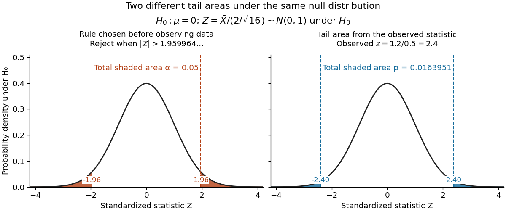

# Normal mean confidence interval and hypothesis test duality

↑ **Parent:** [Normal mean confidence interval with known variance](normal-mean-confidence-interval-with-known-variance.md)

For the same [normal distribution](normal-distribution.md) model, a [two-sided test](two-sided-hypothesis-test.md) compares the [null hypothesis](null-hypothesis.md) $H_0:\mu=\mu_0$ with the [alternative hypothesis](alternative-hypothesis.md) $H_1:\mu\ne\mu_0$. Under the [null hypothesis](null-hypothesis.md), the standardized [test statistic](test-statistic.md) has [standard normal distribution](standard-normal-distribution.md). Write $\Phi$ for the [standard normal distribution function](standard-normal-distribution-function.md). With $\bar x=1.2$, $\sigma=2$, $n=16$ and $\mu_0=0$, the observed [test statistic](test-statistic.md) is $z=1.2/0.5=2.4$. Its [p-value](p-value.md) is

$$
p=\mathbb P_{\mu_0}(|Z|\geq2.4)
=2[1-\Phi(2.4)]
=0.01639507185\ldots.
$$

Thus the [p-value](p-value.md) is a tail [probability](probability.md) computed under the [null hypothesis](null-hypothesis.md), including departures in both directions. It is not $\mathbb P(H_0\mid x)$, the [posterior probability](posterior-probability.md) of the [null hypothesis](null-hypothesis.md), nor the [probability](probability.md) that the observations arose "by chance". The [normal distribution](normal-distribution.md) [test statistic](test-statistic.md) and its calibration appear in [NIST's teaching reference for testing a process mean](https://www.itl.nist.gov/div898/handbook/prc/section2/prc22.htm); the tail interpretation is stated in [Penn State's hypothesis-testing notes](https://online.stat.psu.edu/stat200/Lesson05).

Choose the [significance level](significance-level.md) $\alpha=0.05$ before observing the sample. The [rejection region](rejection-region.md) is $|Z|>z_{0.975}$, whose [probability](probability.md) under $H_0$ is exactly 0.05. Here $2.4>1.9599639845\ldots$, so reject $H_0$. This agrees with zero lying outside $[0.22,2.18]$. More generally, a proposed $\mu_0$ belongs to the unrounded 95% [confidence interval](confidence-interval.md) precisely when its [two-sided test](two-sided-hypothesis-test.md) does not reject under this strict cutoff. The equality boundary has [probability](probability.md) zero in this continuous [statistical model](statistical-model-split.md).

**[Figure 9](#image-the-chosen-5-percent-rejection-tails-and-the-observed-two-sided-p-value). The chosen 5% rejection tails and the observed two-sided p-value**.

The [significance level](significance-level.md) and [statistical power](statistical-power.md) describe different repeated-experiment [probabilities](probability.md). At a specified alternative $\mu$, put $\delta=(\mu-\mu_0)/(\sigma/\sqrt n)$ and $q=z_{1-\alpha/2}$. Then

$$
\begin{aligned}
\mathbb P_{\mu_0}(\text{reject }H_0)&=\alpha,\\
\beta(\mu)=\mathbb P_\mu(\text{do not reject }H_0)&=\Phi(q-\delta)-\Phi(-q-\delta),\\
\mathbb P_\mu(\text{reject }H_0)&=1-\beta(\mu).
\end{aligned}
$$

The first is the [Type I error](type-i-and-type-ii-errors.md) [probability](probability.md); the second is the [Type II error](type-i-and-type-ii-errors.md) [probability](probability.md) at that alternative. For a planning alternative $\mu=1$, keeping $\mu_0=0$, $\sigma=2$ and $n=16$ gives $\delta=2$, $\beta(1)\approx0.483995$ and [statistical power](statistical-power.md) $0.516005$. At $n=64$, $\delta=4$ and [statistical power](statistical-power.md) rises to $0.979327$. These are model calculations for specified alternatives, not [posterior probabilities](posterior-probability.md) inferred from a nonsignificant result. They explain why failure to reject cannot establish equality and why choosing [sample size](sample-size.md) before an experiment is useful.

Historically, Ronald Fisher's 1925 book discusses the normal cutoff $1.96$ and tail [probability](probability.md) 0.05 as a convenient convention on page 47, rather than a mathematically compulsory threshold: [Fisher, Statistical Methods for Research Workers, first edition](https://books.google.com/books/about/Statistical_Methods_for_Research_Workers.html?id=I0NBAAAAIAAJ).

## ↑ Ancestors (7)

1. [Normal mean confidence interval with known variance](normal-mean-confidence-interval-with-known-variance.md)
2. [Confidence interval](confidence-interval.md)
3. [Statistical inference](statistical-inference-split.md)
4. [Probability and statistics](probability-and-statistics-split.md)
5. [Area of mathematics](area-of-mathematics.md)
6. [Mathematics](mathematics-split.md)
7. [Codex Wiki](split.md)
