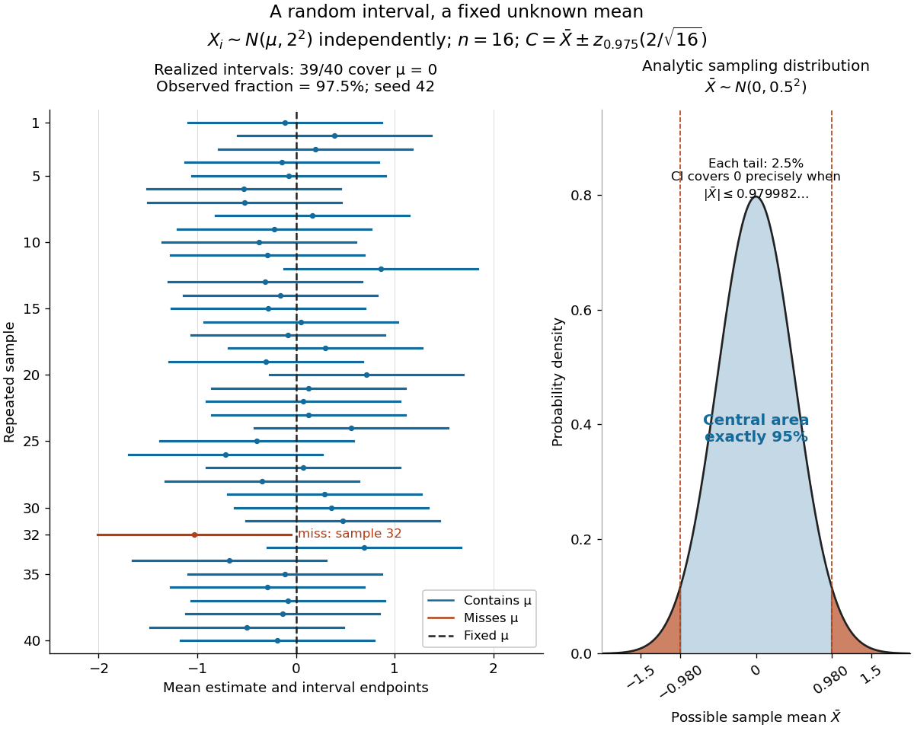

# Normal mean confidence interval with known variance

↑ **Parent:** [Confidence interval](confidence-interval.md)

Suppose $X_1,\ldots,X_n$ are [independent and identically distributed](independent-and-identically-distributed-random-variables.md) with [normal distribution](normal-distribution.md) $N(\mu,\sigma^2)$, where the [mean](expected-value-split.md) $\mu$ is unknown and the [standard deviation](standard-deviation.md) $\sigma>0$ is known. The [sample mean](sample-mean.md) $\bar X=n^{-1}\sum_iX_i$ has [normal distribution](normal-distribution.md) $N(\mu,\sigma^2/n)$ and [standard error](standard-error.md) $\sigma/\sqrt n$. With $z_q$ the [standard normal quantile](standard-normal-quantile.md) at $q$, the displayed [confidence interval](confidence-interval.md) has exact [coverage probability](coverage-probability.md) $1-\alpha$ for every $\mu$ and every positive integer $n$. No [central limit theorem](central-limit-theorem.md) approximation is needed.

Take $\sigma=2$, $n=16$ and nominal confidence 95%. The [standard error](standard-error.md) is $2/\sqrt{16}=0.5$, and $z_{0.975}=1.9599639845\ldots$. Therefore

$$
C(X)=[\bar X-0.9799819923\ldots,\ \bar X+0.9799819923\ldots].
$$

Rounded for reporting, this is $\bar x\pm0.98$. If $\bar x=1.2$, the realized [confidence interval](confidence-interval.md) is approximately $[0.22,2.18]$. Exact 95% calibration refers to the unrounded [standard normal quantile](standard-normal-quantile.md); using $1.96$ literally gives [coverage probability](coverage-probability.md) $0.9500042097\ldots$, almost but not exactly 0.95.

The [confidence interval](confidence-interval.md)'s width scales as $n^{-1/2}$: increasing [sample size](sample-size.md) from 16 to 64 halves its half-width to $0.4899909961\ldots$. If $\sigma$ is unknown, merely substituting the square root of a [sample variance](sample-variance.md) loses the displayed exact calibration; for the same [normal distribution](normal-distribution.md) model, use a [Student t confidence interval](student-t-confidence-interval.md).

The figure holds the true [mean](expected-value-split.md) at $\mu=0$ and independently generates 40 samples of 16 observations from the same [normal distribution](normal-distribution.md). NumPy's PCG64 generator with seed 42 gives 39 covering [confidence intervals](confidence-interval.md) and one miss, at sample 32: observed coverage is $39/40=97.5\%$. Every bar uses the unrounded [standard normal quantile](standard-normal-quantile.md). This finite collection illustrates the moving endpoints; it does not establish the analytic [coverage probability](coverage-probability.md) or require exactly two misses.

**[Figure 8](#image-forty-normal-mean-confidence-intervals-and-their-exact-95-percent-coverage-event). Forty normal-mean confidence intervals and their exact 95% coverage event**.

The beauty of the construction is that a familiar [standard normal distribution](standard-normal-distribution.md) calibrates every possible unknown [mean](expected-value-split.md) at once. For a short proof, the [pivotal quantity](pivotal-quantity.md)

$$
Z=\frac{\bar X-\mu}{\sigma/\sqrt n}\sim N(0,1)
$$

has a [probability distribution](probability-distribution-split.md) independent of $\mu$. The event $|Z|\leq z_{1-\alpha/2}$ has [probability](probability.md) $1-\alpha$; rearranging it gives $\mu\in C(X)$. The right panel shows the equivalent event $|\bar X|\leq0.9799819923\ldots$ when $\mu=0$.

**Table of contents**

- [Normal mean confidence interval and hypothesis test duality](normal-mean-confidence-interval-and-hypothesis-test-duality.md)

## ↑ Ancestors (6)

1. [Confidence interval](confidence-interval.md)
2. [Statistical inference](statistical-inference-split.md)
3. [Probability and statistics](probability-and-statistics-split.md)
4. [Area of mathematics](area-of-mathematics.md)
5. [Mathematics](mathematics-split.md)
6. [Codex Wiki](split.md)

## ← Incoming links (2)

- [Coverage probability](coverage-probability.md)
- [Statistical inference](statistical-inference-split.md)
