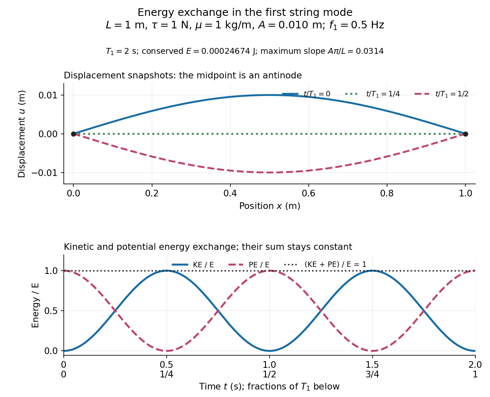

# Normal-mode energy exchange

↑ **Parent:** [Normal mode](normal-mode.md)

For the undamped first [normal mode](normal-mode.md) of a fixed string, start at maximum [displacement](displacement.md) with $u(x,t)=A\sin(\pi x/L)\cos(\omega_1t)$. In the small-slope [wave equation on a string](wave-equation-on-a-string.md), its [kinetic energy](kinetic-energy.md) and excess [potential energy](potential-energy.md) are

$$
\mathrm{KE}(t)=\frac{\mu}{2}\int_0^L u_t^2\,dx,\qquad \mathrm{PE}(t)=\frac{\tau}{2}\int_0^L u_x^2\,dx.
$$

The [potential energy](potential-energy.md) comes from the extra length under [tension](tension.md): $\sqrt{1+u_x^2}-1\simeq u_x^2/2$. It depends on slope, so a [node of a standing wave](node-physics.md) need not have zero local [potential energy](potential-energy.md) density. These are physical [energies](energy.md), with the mass and [tension](tension.md) factors restored to the normalized [wave energy](wave-energy.md). [Richard Fitzpatrick, Oscillations and Waves, Energy Conservation, equations 6.24-6.29](https://farside.ph.utexas.edu/teaching/315/Waveshtml/node43.html)

Integrating $\sin^2(\pi x/L)$ and $\cos^2(\pi x/L)$ over the string gives $L/2$ in both cases. Using $\mu\omega_1^2=\tau\pi^2/L^2$ yields

$$
E=\frac{\tau A^2\pi^2}{4L},\qquad \mathrm{KE}(t)=E\sin^2(\omega_1t),\qquad \mathrm{PE}(t)=E\cos^2(\omega_1t),\qquad \mathrm{KE}+\mathrm{PE}=E.
$$

For the model $\mu=1\,\mathrm{kg\,m^{-1}}$, $\tau=1\,\mathrm N$, $L=1\,\mathrm m$, and $A=0.010\,\mathrm m$, the [angular frequency](angular-frequency.md) is $\omega_1=\pi\,\mathrm{rad\,s^{-1}}$, the [frequency](frequency.md) is $0.5\,\mathrm{Hz}$, and $E\simeq2.4674\times10^{-4}\,\mathrm J$. The maximum slope $A\pi/L\simeq0.0314$ is small. At $t=0$ all the [energy](energy.md) is [potential energy](potential-energy.md); at $t=T_1/4=0.5\,\mathrm s$ the string is straight and all the [energy](energy.md) is [kinetic energy](kinetic-energy.md). At $t=T_1/2=1\,\mathrm s$ the [displacement](displacement.md) is reversed and all the [energy](energy.md) is again [potential energy](potential-energy.md). The energy curves repeat twice during one [displacement](displacement.md) cycle, while [conservation of energy](conservation-of-energy.md) keeps their sum constant.

**[Figure 7](#image-first-mode-displacement-in-metres-and-kinetic-and-potential-energies-divided-by-the-conserved-total-energy). First-mode displacement in metres and kinetic and potential energies divided by the conserved total energy**.

## ↑ Ancestors (7)

1. [Normal mode](normal-mode.md)
2. [Wave equation](wave-equation-split.md)
3. [Partial differential equation](partial-differential-equation-split.md)
4. [Analysis](analysis-split.md)
5. [Area of mathematics](area-of-mathematics.md)
6. [Mathematics](mathematics-split.md)
7. [Codex Wiki](split.md)

## ← Incoming links (1)

- [Normal mode](normal-mode.md)
