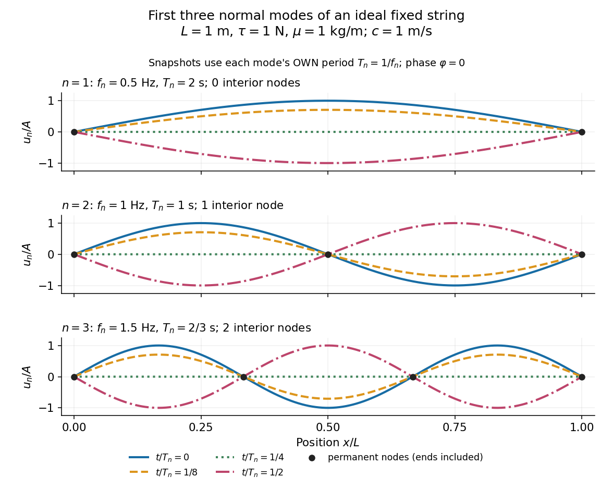

# Normal mode

↑ **Parent:** [Wave equation](wave-equation-split.md)  
ⓦ [Wiki](https://en.wikipedia.org/wiki/Normal_mode)

A normal mode, also called an [eigenmode](normal-mode.md), is a pattern of free [oscillation](oscillation.md) in a linear system whose relative displacements stay fixed while a single temporal factor changes their size and sign. For an undamped stable vibrational mode,

$$
u(x,t)=\phi(x)q(t),\qquad q(t)=A\cos(\omega t+\varphi).
$$

Here $\phi$ is the [mode shape](mode-shape.md), $A$ sets the [amplitude](wave-amplitude.md), $\omega$ is the [eigenfrequency](eigenfrequency.md) expressed as an [angular frequency](angular-frequency.md), and $\varphi$ is the [oscillation phase](phase-waves.md). Every snapshot is a [scalar multiple](scalar-multiple.md) of the same [mode shape](mode-shape.md); neighbouring regions may move in opposite directions. [Normal modes of a double pendulum](normal-modes-of-a-double-pendulum.md) show that [normal modes](normal-mode.md) also describe coupled discrete systems, beyond strings. Their shapes are [eigenvectors](eigenvector.md), rather than spatial [eigenfunctions](eigenfunction.md). [Feynman, Leighton and Sands, The Feynman Lectures on Physics, Volume I, Chapter 49](https://www.feynmanlectures.caltech.edu/I_49.html)

For the ideal [wave equation on a string](wave-equation-on-a-string.md), take a uniform string of length $L$ with constant [tension](tension.md) $\tau$ and [linear mass density](linear-mass-density.md) $\mu$. Assume small transverse slope, negligible bending stiffness, no [damping](damping.md), and fixed endpoints. Its [wave speed](wave-speed.md) is $c=\sqrt{\tau/\mu}$, and the nonzero [normal modes](normal-mode.md) are

$$
u_n(x,t)=A\sin\left(\frac{n\pi x}{L}\right)\cos(\omega_nt+\varphi),\qquad \omega_n=\frac{n\pi c}{L},\qquad f_n=\frac{\omega_n}{2\pi}=\frac{nc}{2L},\qquad n=1,2,3,\ldots.
$$

The [angular frequency](angular-frequency.md) $\omega_n$ is in radians per second; the [frequency](frequency.md) $f_n$ is in hertz. The [wavelength](wavelength.md) is $2L/n$. The [mode shape](mode-shape.md) has $n$ loops separated by [nodes of a standing wave](node-physics.md), including both fixed endpoints. [OpenStax, University Physics Volume 1, Section 16.6](https://openstax.org/books/university-physics-volume-1/pages/16-6-standing-waves-and-resonance)

As a worked example, choose $L=1\,\mathrm m$, $\tau=1\,\mathrm N$, and $\mu=1\,\mathrm{kg\,m^{-1}}$. Then $c=1\,\mathrm{m\,s^{-1}}$ and $f_1=0.5\,\mathrm{Hz}$, $f_2=1\,\mathrm{Hz}$, $f_3=1.5\,\mathrm{Hz}$. Their [oscillation periods](period-of-an-oscillation.md) are $T_1=2\,\mathrm s$, $T_2=1\,\mathrm s$, and $T_3=2/3\,\mathrm s$. These are deliberately simple model parameters, rather than measurements of a musical instrument. The plot divides [displacement](displacement.md) by $A$ so that the three [mode shapes](mode-shape.md) can be compared, and uses each mode's own [oscillation period](period-of-an-oscillation.md) for its snapshots.

**[Figure 6](#image-first-three-ideal-fixed-string-normal-modes-at-fractions-of-their-own-periods-black-dots-mark-permanent-nodes). First three ideal fixed-string normal modes at fractions of their own periods; black dots mark permanent nodes**.

For $\varphi=0$, at $t=T_n/4$ every point has zero [displacement](displacement.md), but most points have nonzero [velocity](velocity.md). Only zeros of the [mode shape](mode-shape.md) are permanent [nodes of a standing wave](node-physics.md). At $t=T_n/2$ the original [mode shape](mode-shape.md) has reversed sign, and at $t=T_n$ it returns. The synchronized conversion between [kinetic energy](kinetic-energy.md) and [potential energy](potential-energy.md) is shown in [normal-mode energy exchange](normal-mode-energy-exchange.md).

The short derivation uses [separation of variables](separation-of-variables.md): substituting $u=\phi q$ into the [wave equation](wave-equation-split.md) gives $\phi''+k^2\phi=0$ and $q''+c^2k^2q=0$. The fixed-end [boundary conditions](boundary-condition.md) remove the cosine spatial term and require $\sin(kL)=0$, hence $k=n\pi/L$ and $\omega_n=ck$. Different geometries and [boundary conditions](boundary-condition.md) give different [eigenfunctions](eigenfunction.md); a sine [mode shape](mode-shape.md) is a property of this uniform fixed string, not a universal form of an [eigenmode](normal-mode.md).

The usefulness is that a complicated vibration becomes a collection of [harmonic oscillators](simple-harmonic-motion.md). For sufficiently regular fixed-end initial data, the [Fourier sine series](fourier-sine-series.md) gives

$$
u(x,t)=\sum_{n=1}^{\infty}\sin\left(\frac{n\pi x}{L}\right)\left[a_n\cos(\omega_nt)+b_n\sin(\omega_nt)\right].
$$

The initial [displacement](displacement.md) and [velocity](velocity.md) determine $a_n$ and $b_n$. This is the [superposition principle](superposition-principle.md) in a [Fourier sine basis](fourier-sine-basis.md), and [modal energy distribution](modal-energy-distribution.md) measures how strongly each [normal mode](normal-mode.md) is excited. The striking simplification is that each component keeps its identity while their sum can continually change shape. [Feynman, Leighton and Sands, The Feynman Lectures on Physics, Volume I, Section 50-2](https://www.feynmanlectures.caltech.edu/I_50.html)

These independent [normal modes](normal-mode.md) belong to the linear model. At larger slopes, changing [tension](tension.md) introduces nonlinear effects and can couple the modes. A [linearly damped string](linearly-damped-string.md) still admits a [Fourier sine basis](fourier-sine-basis.md), but its temporal factors decay and need not oscillate; its [energy dissipation identity for a linearly damped string](energy-dissipation-identity-for-a-linearly-damped-string.md) replaces [conservation of energy](conservation-of-energy.md). More general [damping](damping.md) need not leave undamped [mode shapes](mode-shape.md) independent.

**Table of contents**

- [Mode shape](mode-shape.md)
- [Countability of elastic eigenfrequencies](countability-of-elastic-eigenfrequencies.md)
- [Eigenfrequency](eigenfrequency.md)
- [Modal energy distribution](modal-energy-distribution.md)
- [Normal-mode energy exchange](normal-mode-energy-exchange.md)
- [Node (physics)](node-physics.md)
- [Antinode](antinode.md)

## ↑ Ancestors (6)

1. [Wave equation](wave-equation-split.md)
2. [Partial differential equation](partial-differential-equation-split.md)
3. [Analysis](analysis-split.md)
4. [Area of mathematics](area-of-mathematics.md)
5. [Mathematics](mathematics-split.md)
6. [Codex Wiki](split.md)

## ← Incoming links (176)

- [Antinode](antinode.md)
- [Boundary pseudomomentum of a sloping Eady layer](boundary-pseudomomentum-of-a-sloping-eady-layer.md)
- [Clamped--clamped bending mode](clamped-clamped-bending-mode.md)
- [Constrained variational characterization of bending modes](constrained-variational-characterization-of-bending-modes.md)
- [Cubic axisymmetric inertial mode of a rigid sphere](cubic-axisymmetric-inertial-mode-of-a-rigid-sphere.md)
- [D'Alembert's formula](d-alembert-s-formula.md)
- [Damping](damping.md)
- [Damping measurement from free decay](damping-measurement-from-free-decay.md)
- [Degenerate normal modes from permutation symmetry](degenerate-normal-modes-from-permutation-symmetry.md)
- [Density-wave dispersion relation in a non-self-gravitating disk](density-wave-dispersion-relation-in-a-non-self-gravitating-disk.md)
- [Diagonalizable matrix](diagonalizable-matrix.md)
- [Dispersion relation for two density interfaces in uniform shear](dispersion-relation-for-two-density-interfaces-in-uniform-shear.md)
- [Displacement equation for a parallel magnetic shear flow](displacement-equation-for-a-parallel-magnetic-shear-flow.md)
- [Dulong-Petit law](dulong-petit-law.md)
- [Eigenfrequency](eigenfrequency.md)
- [Einstein solid](einstein-solid.md)
- [Fastest growth in infinite-Prandtl convection](fastest-growth-in-infinite-prandtl-convection.md)
- [Free two-mass spring](free-two-mass-spring.md)
- [Frozen-temperature solutal interface dispersion](frozen-temperature-solutal-interface-dispersion.md)
- [Global hydrodynamic instability](global-hydrodynamic-instability.md)
- [Gradient Richardson number](gradient-richardson-number.md)
- [Heat capacity ratio](heat-capacity-ratio.md)
- [Hermite vertical mode of an isothermal disk](hermite-vertical-mode-of-an-isothermal-disk.md)
- [High-wavenumber instability of a non-monotone Prandtl layer](high-wavenumber-instability-of-a-non-monotone-prandtl-layer.md)
- [Ideal gas](ideal-gas.md)
- [Ideal magnetorotational dispersion relation](ideal-magnetorotational-dispersion-relation.md)
- [Inertial modes in a rigid rotating sphere](inertial-modes-in-a-rigid-rotating-sphere.md)
- [Infrared](infrared.md)
- [Inviscid instability of a piecewise-linear mixing layer](inviscid-instability-of-a-piecewise-linear-mixing-layer.md)
- [Inviscid instability of a triangular jet](inviscid-instability-of-a-triangular-jet.md)
- [Lagrangian fluid displacement](lagrangian-fluid-displacement.md)
- [Laser](laser.md)
- [Laser threshold](laser-threshold.md)
- [Lift-up effect](lift-up-effect.md)
- [Linear complex Ginzburg-Landau equation](linear-complex-ginzburg-landau-equation.md)
- [Linear instability](linear-instability.md)
- [Magnetic stabilization of an equal-density vortex sheet](magnetic-stabilization-of-an-equal-density-vortex-sheet.md)
- [Magnetohydrodynamic energy principle](magnetohydrodynamic-energy-principle.md)
- [Miles–Howard theorem](miles-howard-theorem.md)
- [Modal energy of a localized velocity impulse on a string](modal-energy-of-a-localized-velocity-impulse-on-a-string.md)
- [Mode shape](mode-shape.md)
- [Node (physics)](node-physics.md)
- [Normal mode](normal-mode.md)
- [Normal-mode energy exchange](normal-mode-energy-exchange.md)
- [Orr mechanism](orr-mechanism.md)
- [Orr-Sommerfeld equation](orr-sommerfeld-equation.md)
- [Oscillation](oscillation.md)
- [Overdamped relaxation of a clamped--free filament](overdamped-relaxation-of-a-clamped-free-filament.md)
- [Overstability](overstability.md)
- [Solution](past-exam-of-the-mathematics-course-of-the-university-of-cambridge/2001/iii/paper-42/2/solution.md)
- [Solution](past-exam-of-the-mathematics-course-of-the-university-of-cambridge/2001/iii/paper-44/3/solution.md)
- [Solution](past-exam-of-the-mathematics-course-of-the-university-of-cambridge/2001/iii/paper-50/2/solution.md)
- [Solution](past-exam-of-the-mathematics-course-of-the-university-of-cambridge/2002/iii/paper-49/3/solution.md)
- [Solution](past-exam-of-the-mathematics-course-of-the-university-of-cambridge/2002/iii/paper-58/4/solution.md)
- [Solution](past-exam-of-the-mathematics-course-of-the-university-of-cambridge/2003/ib/paper-3/12d/b/solution.md)
- [Solution](past-exam-of-the-mathematics-course-of-the-university-of-cambridge/2003/iii/paper-74/2/solution.md)
- [Solution](past-exam-of-the-mathematics-course-of-the-university-of-cambridge/2004/iii/paper-64/3/solution.md)
- [Solution](past-exam-of-the-mathematics-course-of-the-university-of-cambridge/2004/iii/paper-64/4/solution.md)
- [Solution](past-exam-of-the-mathematics-course-of-the-university-of-cambridge/2004/iii/paper-73/3/solution.md)
- [Solution](past-exam-of-the-mathematics-course-of-the-university-of-cambridge/2004/iii/paper-76/5/a/i/solution.md)
- [Solution](past-exam-of-the-mathematics-course-of-the-university-of-cambridge/2004/iii/paper-76/5/a/iii/solution.md)
- [Solution](past-exam-of-the-mathematics-course-of-the-university-of-cambridge/2005/iii/paper-71/4/solution.md)
- [Solution](past-exam-of-the-mathematics-course-of-the-university-of-cambridge/2005/iii/paper-73/2/v/solution.md)
- [Solution](past-exam-of-the-mathematics-course-of-the-university-of-cambridge/2005/iii/paper-79/1/b/i/solution.md)
- [Solution](past-exam-of-the-mathematics-course-of-the-university-of-cambridge/2005/iii/paper-79/1/b/ii/solution.md)
- [Solution](past-exam-of-the-mathematics-course-of-the-university-of-cambridge/2005/iii/paper-79/4/b/solution.md)
- [Solution](past-exam-of-the-mathematics-course-of-the-university-of-cambridge/2005/iii/paper-79/5/a/ii/solution.md)
- [Solution](past-exam-of-the-mathematics-course-of-the-university-of-cambridge/2006/ii/paper-2/9c/solution.md)
- [Solution](past-exam-of-the-mathematics-course-of-the-university-of-cambridge/2006/iii/paper-82/3/b/i/solution.md)
- [Solution](past-exam-of-the-mathematics-course-of-the-university-of-cambridge/2006/iii/paper-83/1/solution.md)
- [Solution](past-exam-of-the-mathematics-course-of-the-university-of-cambridge/2007/iii/paper-68/3/i/solution.md)
- [Solution](past-exam-of-the-mathematics-course-of-the-university-of-cambridge/2007/iii/paper-75/1/a/solution.md)
- [Solution](past-exam-of-the-mathematics-course-of-the-university-of-cambridge/2007/iii/paper-77/2/solution.md)
- [Solution](past-exam-of-the-mathematics-course-of-the-university-of-cambridge/2007/iii/paper-77/3/solution.md)
- [Solution](past-exam-of-the-mathematics-course-of-the-university-of-cambridge/2007/iii/paper-79/4/a/solution.md)
- [Solution](past-exam-of-the-mathematics-course-of-the-university-of-cambridge/2007/iii/paper-79/4/b/solution.md)
- [Solution](past-exam-of-the-mathematics-course-of-the-university-of-cambridge/2008/ii/paper-2/9a/solution.md)
- [Solution](past-exam-of-the-mathematics-course-of-the-university-of-cambridge/2008/iii/paper-69/4/solution.md)
- [Solution](past-exam-of-the-mathematics-course-of-the-university-of-cambridge/2008/iii/paper-81/3/solution.md)
- [Solution](past-exam-of-the-mathematics-course-of-the-university-of-cambridge/2008/iii/paper-82/4/a/solution.md)
- [Solution](past-exam-of-the-mathematics-course-of-the-university-of-cambridge/2008/iii/paper-82/4/b/solution.md)
- [Solution](past-exam-of-the-mathematics-course-of-the-university-of-cambridge/2009/ib/paper-2/15b/solution.md)
- [Solution](past-exam-of-the-mathematics-course-of-the-university-of-cambridge/2009/ii/paper-2/9e/solution.md)
- [Solution](past-exam-of-the-mathematics-course-of-the-university-of-cambridge/2009/iii/paper-64/4/c/solution.md)
- [Solution](past-exam-of-the-mathematics-course-of-the-university-of-cambridge/2009/iii/paper-73/2/iv/solution.md)
- [Solution](past-exam-of-the-mathematics-course-of-the-university-of-cambridge/2009/iii/paper-81/4/b/solution.md)
- [Solution](past-exam-of-the-mathematics-course-of-the-university-of-cambridge/2010/ii/paper-2/9d/solution.md)
- [Solution](past-exam-of-the-mathematics-course-of-the-university-of-cambridge/2010/iii/paper-68/3/a/solution.md)
- [Solution](past-exam-of-the-mathematics-course-of-the-university-of-cambridge/2010/iii/paper-68/4/b/solution.md)
- [Solution](past-exam-of-the-mathematics-course-of-the-university-of-cambridge/2011/ii/paper-3/13b/iii/solution.md)
- [Solution](past-exam-of-the-mathematics-course-of-the-university-of-cambridge/2012/iii/paper-74/2/b/solution.md)
- [Solution](past-exam-of-the-mathematics-course-of-the-university-of-cambridge/2012/iii/paper-76/4/b/solution.md)
- [Solution](past-exam-of-the-mathematics-course-of-the-university-of-cambridge/2012/iii/paper-77/1/solution.md)
- [Solution](past-exam-of-the-mathematics-course-of-the-university-of-cambridge/2013/ib/paper-2/7a/solution.md)
- [Solution](past-exam-of-the-mathematics-course-of-the-university-of-cambridge/2013/iii/paper-47/2/solution.md)
- [Solution](past-exam-of-the-mathematics-course-of-the-university-of-cambridge/2013/iii/paper-65/2/b/ii/solution.md)
- [Solution](past-exam-of-the-mathematics-course-of-the-university-of-cambridge/2013/iii/paper-67/4/a/solution.md)
- [Solution](past-exam-of-the-mathematics-course-of-the-university-of-cambridge/2013/iii/paper-68/3/solution.md)
- [Solution](past-exam-of-the-mathematics-course-of-the-university-of-cambridge/2014/iii/paper-57/3/a/solution.md)
- [Solution](past-exam-of-the-mathematics-course-of-the-university-of-cambridge/2014/iii/paper-74/4/solution.md)
- [Solution](past-exam-of-the-mathematics-course-of-the-university-of-cambridge/2015/ii/paper-4/7d/b/solution.md)
- [Solution](past-exam-of-the-mathematics-course-of-the-university-of-cambridge/2015/iii/paper-57/4/a/solution.md)
- [Solution](past-exam-of-the-mathematics-course-of-the-university-of-cambridge/2015/iii/paper-60/2/solution.md)
- [Solution](past-exam-of-the-mathematics-course-of-the-university-of-cambridge/2015/iii/paper-64/3/b/solution.md)
- [Solution](past-exam-of-the-mathematics-course-of-the-university-of-cambridge/2015/iii/paper-75/2/solution.md)
- [Solution](past-exam-of-the-mathematics-course-of-the-university-of-cambridge/2015/iii/paper-79/3/ii/solution.md)
- [Solution](past-exam-of-the-mathematics-course-of-the-university-of-cambridge/2015/iii/paper-79/4/ii/solution.md)
- [Solution](past-exam-of-the-mathematics-course-of-the-university-of-cambridge/2015/iii/paper-79/4/iv/solution.md)
- [Solution](past-exam-of-the-mathematics-course-of-the-university-of-cambridge/2016/ib/paper-3/18c/b/solution.md)
- [Solution](past-exam-of-the-mathematics-course-of-the-university-of-cambridge/2016/iii/paper-331/1/b/solution.md)
- [Solution](past-exam-of-the-mathematics-course-of-the-university-of-cambridge/2016/iii/paper-331/2/a/solution.md)
- [Solution](past-exam-of-the-mathematics-course-of-the-university-of-cambridge/2016/iii/paper-331/2/c/solution.md)
- [Solution](past-exam-of-the-mathematics-course-of-the-university-of-cambridge/2016/iii/paper-331/3/a/i/solution.md)
- [Solution](past-exam-of-the-mathematics-course-of-the-university-of-cambridge/2016/iii/paper-331/3/b/ii/solution.md)
- [Solution](past-exam-of-the-mathematics-course-of-the-university-of-cambridge/2016/iii/paper-333/3/iii/solution.md)
- [Solution](past-exam-of-the-mathematics-course-of-the-university-of-cambridge/2017/iii/paper-314/3/solution.md)
- [Solution](past-exam-of-the-mathematics-course-of-the-university-of-cambridge/2017/iii/paper-314/4/a/solution.md)
- [Solution](past-exam-of-the-mathematics-course-of-the-university-of-cambridge/2017/iii/paper-314/4/b/solution.md)
- [Solution](past-exam-of-the-mathematics-course-of-the-university-of-cambridge/2017/iii/paper-321/3/a/ii/solution.md)
- [Solution](past-exam-of-the-mathematics-course-of-the-university-of-cambridge/2017/iii/paper-331/1/a/i/solution.md)
- [Solution](past-exam-of-the-mathematics-course-of-the-university-of-cambridge/2017/iii/paper-331/1/a/iii/solution.md)
- [Solution](past-exam-of-the-mathematics-course-of-the-university-of-cambridge/2017/iii/paper-331/2/a/solution.md)
- [Solution](past-exam-of-the-mathematics-course-of-the-university-of-cambridge/2017/iii/paper-331/2/b/ii/solution.md)
- [Solution](past-exam-of-the-mathematics-course-of-the-university-of-cambridge/2017/iii/paper-331/3/b/iv/solution.md)
- [Solution](past-exam-of-the-mathematics-course-of-the-university-of-cambridge/2017/iii/paper-337/4/solution.md)
- [Solution](past-exam-of-the-mathematics-course-of-the-university-of-cambridge/2017/iii/paper-341/3/i/solution.md)
- [Solution](past-exam-of-the-mathematics-course-of-the-university-of-cambridge/2017/iii/paper-341/3/ii/solution.md)
- [Solution](past-exam-of-the-mathematics-course-of-the-university-of-cambridge/2017/iii/paper-342/1/c/solution.md)
- [Solution](past-exam-of-the-mathematics-course-of-the-university-of-cambridge/2018/ib/paper-4/18d/solution.md)
- [Solution](past-exam-of-the-mathematics-course-of-the-university-of-cambridge/2018/ii/paper-2/35a/solution.md)
- [Solution](past-exam-of-the-mathematics-course-of-the-university-of-cambridge/2018/ii/paper-3/8b/solution.md)
- [Solution](past-exam-of-the-mathematics-course-of-the-university-of-cambridge/2018/iii/paper-331/1/a/iii/solution.md)
- [Solution](past-exam-of-the-mathematics-course-of-the-university-of-cambridge/2018/iii/paper-331/1/b/ii/solution.md)
- [Solution](past-exam-of-the-mathematics-course-of-the-university-of-cambridge/2018/iii/paper-331/2/a/solution.md)
- [Solution](past-exam-of-the-mathematics-course-of-the-university-of-cambridge/2018/iii/paper-331/3/a/solution.md)
- [Solution](past-exam-of-the-mathematics-course-of-the-university-of-cambridge/2018/iii/paper-331/4/b/i/solution.md)
- [Solution](past-exam-of-the-mathematics-course-of-the-university-of-cambridge/2018/iii/paper-345/1/c/solution.md)
- [Solution](past-exam-of-the-mathematics-course-of-the-university-of-cambridge/2018/iii/paper-345/4/d/solution.md)
- [Solution](past-exam-of-the-mathematics-course-of-the-university-of-cambridge/2019/iii/paper-321/3/c/solution.md)
- [Solution](past-exam-of-the-mathematics-course-of-the-university-of-cambridge/2019/iii/paper-331/1/a/solution.md)
- [Solution](past-exam-of-the-mathematics-course-of-the-university-of-cambridge/2019/iii/paper-331/1/b/i/solution.md)
- [Solution](past-exam-of-the-mathematics-course-of-the-university-of-cambridge/2019/iii/paper-331/1/b/ii/solution.md)
- [Solution](past-exam-of-the-mathematics-course-of-the-university-of-cambridge/2019/iii/paper-331/2/b/ii/solution.md)
- [Solution](past-exam-of-the-mathematics-course-of-the-university-of-cambridge/2019/iii/paper-331/4/b/solution.md)
- [Solution](past-exam-of-the-mathematics-course-of-the-university-of-cambridge/2019/iii/paper-332/3/b/solution.md)
- [Solution](past-exam-of-the-mathematics-course-of-the-university-of-cambridge/2019/iii/paper-333/2/solution.md)
- [Solution](past-exam-of-the-mathematics-course-of-the-university-of-cambridge/2019/iii/paper-333/4/solution.md)
- [Solution](past-exam-of-the-mathematics-course-of-the-university-of-cambridge/2020/ib/paper-2/13a/ii/solution.md)
- [Solution](past-exam-of-the-mathematics-course-of-the-university-of-cambridge/2020/ib/paper-2/16c/c/solution.md)
- [Solution](past-exam-of-the-mathematics-course-of-the-university-of-cambridge/2020/ii/paper-1/8b/solution.md)
- [Solution](past-exam-of-the-mathematics-course-of-the-university-of-cambridge/2020/ii/paper-4/38b/i/solution.md)
- [Solution](past-exam-of-the-mathematics-course-of-the-university-of-cambridge/2021/ii/paper-1/8d/b/solution.md)
- [Solution](past-exam-of-the-mathematics-course-of-the-university-of-cambridge/2021/iii/paper-331/1/d/solution.md)
- [Solution](past-exam-of-the-mathematics-course-of-the-university-of-cambridge/2022/ib/paper-1/13b/b/solution.md)
- [Solution](past-exam-of-the-mathematics-course-of-the-university-of-cambridge/2023/ii/paper-2/14d/c/solution.md)
- [Solution](past-exam-of-the-mathematics-course-of-the-university-of-cambridge/2023/ii/paper-4/38c/d/solution.md)
- [Solution](past-exam-of-the-mathematics-course-of-the-university-of-cambridge/2024/iii/paper-331/1/i/solution.md)
- [Solution](past-exam-of-the-mathematics-course-of-the-university-of-cambridge/2024/iii/paper-331/2/i/solution.md)
- [Solution](past-exam-of-the-mathematics-course-of-the-university-of-cambridge/2024/iii/paper-333/3/c/solution.md)
- [Pressure matching at a piecewise-linear shear interface](pressure-matching-at-a-piecewise-linear-shear-interface.md)
- [Quadratic fluctuation Hamiltonian](quadratic-fluctuation-hamiltonian.md)
- [Rayleigh quotient](rayleigh-quotient.md)
- [Rigid-boundary buoyancy condition for quasi-geostrophic waves](rigid-boundary-buoyancy-condition-for-quasi-geostrophic-waves.md)
- [Small oscillation](small-oscillation.md)
- [Square-basin topographic Rossby mode](square-basin-topographic-rossby-mode.md)
- [Squire equation](squire-equation.md)
- [Stimulated emission](stimulated-emission.md)
- [Stratified internal-wave guide](stratified-internal-wave-guide.md)
- [Thermocapillary thin-film equation](thermocapillary-thin-film-equation.md)
- [Unbounded piecewise-linear shear layer](unbounded-piecewise-linear-shear-layer.md)
- [Unstable band of a three-layer stratified shear flow](unstable-band-of-a-three-layer-stratified-shear-flow.md)
- [Variable-sound-speed WKB duct amplitude](variable-sound-speed-wkb-duct-amplitude.md)
- [Vorticity-jump matching for an inviscid shear flow](vorticity-jump-matching-for-an-inviscid-shear-flow.md)
- [Wave equation on a string](wave-equation-on-a-string.md)
- [Wavenumber selection in rotating convection](wavenumber-selection-in-rotating-convection.md)
- [Zero-flux thermocapillary film profiles](zero-flux-thermocapillary-film-profiles.md)
