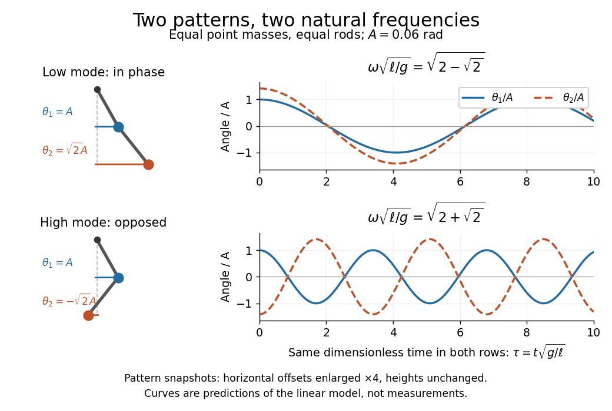

# Normal modes of a double pendulum

↑ **Parent:** [Generalized eigenvalue problem for small oscillations](generalized-eigenvalue-problem-for-small-oscillations.md)

For equal [lengths](length.md) and [mass](mass.md) ratio $\mu=m/M$, the squared [angular frequencies](angular-frequency.md) are $\omega_0^2(1+\mu\pm\sqrt{\mu(1+\mu)})$, where $M$ is the upper [mass](mass.md), $m$ the lower [mass](mass.md), and $\omega_0^2=g/\ell$. The equal-[mass](mass.md) case $\mu=1$ admits particularly simple [mode shapes](mode-shape.md).

Use the ideal model of the [double pendulum](double-pendulum.md), with both [angles](angle.md) measured from the downward vertical. Around $\theta_1=\theta_2=0$, the [Taylor expansions](taylor-expansion.md) $\sin\theta_i=\theta_i+O(\theta_i^3)$ and $\cos\theta_i=1-\theta_i^2/2+O(\theta_i^4)$ give the quadratic [Lagrangian](lagrangian.md)

$$
L_2=\frac12\dot{\boldsymbol\theta}^{\mathsf T}\mathsf M\dot{\boldsymbol\theta}-\frac12\boldsymbol\theta^{\mathsf T}\mathsf K\boldsymbol\theta,\qquad
\boldsymbol\theta=\begin{pmatrix}\theta_1\\\theta_2\end{pmatrix},\qquad
\mathsf M=m\ell^2\begin{pmatrix}2&1\\1&1\end{pmatrix},\quad
\mathsf K=mg\ell\begin{pmatrix}2&0\\0&1\end{pmatrix}.
$$

Here both [angles](angle.md) and their [angular velocities](angular-velocity.md) are counted as small. Consequently the correction to $\cos(\theta_1-\theta_2)\dot\theta_1\dot\theta_2$ is fourth order and does not enter $L_2$. The [Euler-Lagrange equations](euler-lagrange-equation.md) give $\mathsf M\ddot{\boldsymbol\theta}+\mathsf K\boldsymbol\theta=0$. The [mass matrix](mass-matrix.md) is not diagonal: an angular motion of the upper rod carries the lower [mass](mass.md) too.[Classical Dynamics, chapter 2, §2.6.1, printed pp. 41–42, equations (2.130)–(2.132): equal-mass, equal-length linearized double pendulum](classical-dynamics-by-david-tong.md)

For a [normal mode](normal-mode.md), put $\boldsymbol\theta(t)=\mathbf a\cos(\omega t+\varphi)$ with fixed [amplitude](wave-amplitude.md) [vector](vector.md) $\mathbf a$. The resulting [generalized eigenvalue problem for small oscillations](generalized-eigenvalue-problem-for-small-oscillations.md) is $\mathsf K\mathbf a=\omega^2\mathsf M\mathbf a$. With $\lambda=\omega^2\ell/g$, its [characteristic equation](characteristic-equation-of-a-constant-coefficient-differential-equation.md) is

$$
0=\det\begin{pmatrix}2-2\lambda&-\lambda\\-\lambda&1-\lambda\end{pmatrix}=\lambda^2-4\lambda+2.
$$

Solving this quadratic and using the second row, $a_2/a_1=\lambda/(1-\lambda)$, gives

$$
\begin{aligned}
\omega_-^2&=\frac g\ell(2-\sqrt2),&\mathbf a_-&=\begin{pmatrix}1\\\sqrt2\end{pmatrix},\\
\omega_+^2&=\frac g\ell(2+\sqrt2),&\mathbf a_+&=\begin{pmatrix}1\\-\sqrt2\end{pmatrix}.
\end{aligned}
$$

The lower-[frequency](frequency.md) [normal mode](normal-mode.md) has the rods in phase, with the lower [angle](angle.md) $\sqrt2$ times the upper one. The higher-[frequency](frequency.md) [normal mode](normal-mode.md) has opposite signs, corresponding to an [oscillation phase](phase-waves.md) difference of $\pi$. These are ratios of absolute [angles](angle.md). The horizontal [displacements](displacement.md) are instead $x_1\simeq\ell\theta_1$ and $x_2\simeq\ell(\theta_1+\theta_2)$; their ratios are $1+\sqrt2$ and $1-\sqrt2$ respectively. Thus the lower [mass](mass.md) moves horizontally opposite to the upper [mass](mass.md) in the faster [normal mode](normal-mode.md).

**[Figure 3](#image-two-linear-normal-modes-rod-patterns-and-angle-histories-on-the-same-dimensionless-time-scale). Two linear normal modes: rod patterns and angle histories on the same dimensionless time scale**. Original predictions for the ideal equal-[mass](mass.md) [double pendulum](double-pendulum.md), with upper-[angle](angle.md) [amplitude](wave-amplitude.md) $A=0.06$ radians and $\tau=t\sqrt{g/\ell}$. The snapshots use the rod geometry at $\boldsymbol\theta=A\mathbf a_\pm$, with horizontal offsets enlarged fourfold and heights unchanged; the curves show the [angles](angle.md) predicted by [linearization](linearization.md), not experimental records. Both histories use the same horizontal scale, making the faster opposed [normal mode](normal-mode.md) visible.

Both squared [angular frequencies](angular-frequency.md) are positive. Their ratio satisfies $\omega_+/\omega_-=1+\sqrt2$, independently of $m$, $g$ and $\ell$. For a constructed model with $\ell=1\,\mathrm m$ and $g=9.81\,\mathrm{m\,s^{-2}}$, the [angular frequencies](angular-frequency.md) are approximately $2.3972$ and $5.7874\,\mathrm{s^{-1}}$, and the [oscillation periods](period-of-an-oscillation.md) $2\pi/\omega_\pm$ are $2.6211$ and $1.0857\,\mathrm s$. Doubling both [masses](mass.md) leaves these unchanged; multiplying both rod [lengths](length.md) by four doubles both [oscillation periods](period-of-an-oscillation.md).

The [eigenvectors](eigenvector.md) are not orthogonal in the ordinary [dot product](dot-product.md): $\mathbf a_-^{\mathsf T}\mathbf a_+=-1$. They satisfy [mass-matrix orthogonality of normal modes](mass-matrix-orthogonality-of-normal-modes.md), since

$$
\mathbf a_-^{\mathsf T}\mathsf M\mathbf a_+=0,\qquad
\mathbf a_-^{\mathsf T}\mathsf M\mathbf a_-=m\ell^2(4+2\sqrt2),\qquad
\mathbf a_+^{\mathsf T}\mathsf M\mathbf a_+=m\ell^2(4-2\sqrt2).
$$

Writing $\boldsymbol\theta=\mathbf a_-q_-+\mathbf a_+q_+$ therefore removes the cross terms from both quadratic [energies](energy-split.md). The two [normal coordinates](normal-coordinates.md) satisfy $\ddot q_\pm+\omega_\pm^2q_\pm=0$. This is why the [normal modes](normal-mode.md) are useful: one coupled system becomes two independently evolving [harmonic oscillators](simple-harmonic-motion.md), and any small release can be decomposed into them. At larger [angles](angle.md), the discarded terms in the [double pendulum equations of motion](double-pendulum-equations-of-motion.md) matter and this exact linear [superposition](superposition-principle.md) no longer applies.

**Table of contents**

- [Three-to-one mass double-pendulum modes](three-to-one-mass-double-pendulum-modes.md)
- [Release of a double pendulum into both normal modes](release-of-a-double-pendulum-into-both-normal-modes.md)

## ↑ Ancestors (7)

1. [Generalized eigenvalue problem for small oscillations](generalized-eigenvalue-problem-for-small-oscillations.md)
2. [Small oscillation](small-oscillation.md)
3. [Lagrangian mechanics](lagrangian-mechanics-split.md)
4. [Classical mechanics](classical-mechanics-split.md)
5. [Branches of physics](branches-of-physics.md)
6. [Physics](physics-split.md)
7. [Codex Wiki](split.md)

## ← Incoming links (3)

- [Double pendulum](double-pendulum.md)
- [Double pendulum demonstration](double-pendulum-demonstration.md)
- [Normal mode](normal-mode.md)
