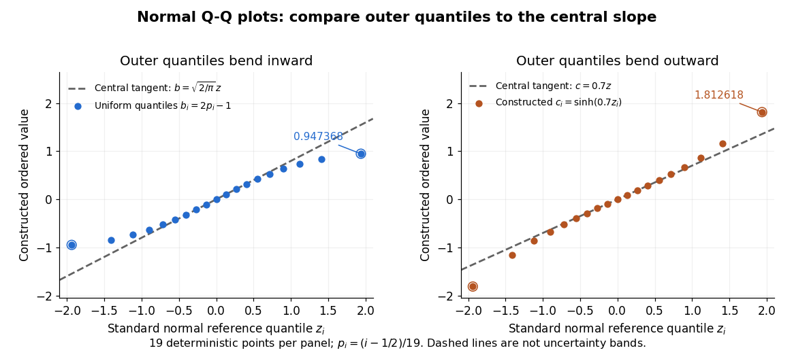

# Normal Q-Q plot

↑ **Parent:** [Q-Q plot](q-q-plot.md)

A [normal Q-Q plot](normal-q-q-plot.md) compares [order statistics](order-statistic.md) with [standard normal quantiles](standard-normal-quantile.md) $z_i=\Phi^{-1}(p_i)$. For a [normal distribution](normal-distribution.md) $N(\mu,\sigma^2)$ with $\sigma>0$, the population [quantile function](quantile-function.md) is $\mu+\sigma\Phi^{-1}(p)$, so the diagnostic sample relation is

$$
x_{(i)}\approx\mu+\sigma z_i.
$$

The appropriate reference is a line with an intercept and positive slope, not necessarily the identity line. A line can be fitted through two central [sample quantiles](sample-quantile.md); R's `qqline` uses the [quantile](quantile-function.md) levels $p=0.25$ and $p=0.75$ by default. Neither that line nor its fitting rule is part of the definition of a [normal Q-Q plot](normal-q-q-plot.md). [R stats documentation, qqnorm and qqline](https://stat.ethz.ch/R-manual/R-devel/library/stats/html/qqnorm.html)

To isolate curvature, retain the same 19 [plotting positions](plotting-position.md) and construct two more ordered sequences:

$$
b_i=2p_i-1,\qquad c_i=\sinh(0.7z_i).
$$

The $b_i$ are [continuous uniform distribution](continuous-uniform-distribution.md) [quantiles](quantile-function.md) on $[-1,1]$, while the $c_i$ apply the [hyperbolic sine](hyperbolic-sine.md) to the reference [quantiles](quantile-function.md). Both examples are symmetric about zero. At ranks $1,10,19$, $b_i$ is approximately $-0.947368,0,0.947368$ and $c_i$ is approximately $-1.812618,0,1.812618$. Again, these are constructed values rather than random draws or real data.

**[Figure 6](#image-normal-q-q-curvature-distinguishes-compressed-and-stretched-outer-quantiles). Normal Q-Q curvature distinguishes compressed and stretched outer quantiles**. Left: the constructed [uniform distribution](continuous-uniform-distribution.md) [quantiles](quantile-function.md) $b_i=2p_i-1$ bend inward relative to the central tangent $b=\sqrt{2/\pi}\,z$. Right: the constructed values $c_i=\sinh(0.7z_i)$ bend outward relative to the central tangent $c=0.7z$. Both panels use 19 [standard normal quantiles](standard-normal-quantile.md) at $p_i=(i-1/2)/19$. Dashed lines are analytic central tangents, not fitted lines or uncertainty bands; only the chosen finite range is illustrated.

Read these shapes relative to their central slope. The [uniform distribution](continuous-uniform-distribution.md) example has $b(z)=2\Phi(z)-1$, with [derivative](derivative.md) $b'(0)=\sqrt{2/\pi}\approx0.797885$; at the upper endpoint the tangent predicts $1.546246$, while $b_{19}=0.947368$. Its lower end lies above the tangent and its upper end below it: the outer [quantiles](quantile-function.md) are compressed. The [hyperbolic sine](hyperbolic-sine.md) example has $c'(0)=0.7$; its tangent predicts $1.356552$ at the upper endpoint, while $c_{19}=1.812618$. Its lower end lies below the tangent and its upper end above it: the outer [quantiles](quantile-function.md) are stretched. Unequal departures at the two ends can suggest [skewness](skewness.md). The direction of these descriptions assumes that reference [quantiles](quantile-function.md) are horizontal and observed values vertical. The graphs illustrate finite-range shape differences; a sample pattern cannot establish an asymptotic [tail probability](tail-probability.md) law or membership in a [heavy-tailed distribution](heavy-tailed-distribution.md) class.

A nearly straight [normal Q-Q plot](normal-q-q-plot.md) is a diagnostic, not a proof of a [normal distribution](normal-distribution.md) or a formal [hypothesis test](statistical-hypothesis-test-split.md). Random [statistical samples](statistical-sample.md) fluctuate, particularly at extreme [order statistics](order-statistic.md), and apparent curvature depends on [sample size](sample-size.md), [plotting positions](plotting-position.md) and the reference line. A calibrated [hypothesis test](statistical-hypothesis-test-split.md) or uncertainty band requires its own assumptions and must account for parameters estimated from the same observations. Sorting also discards the original observation order: rearranging a time series leaves its [Q-Q plot](q-q-plot.md) unchanged, so the plot cannot establish [independence](independent-random-variables.md).

For a [normal linear model](normal-linear-model-split.md), R's diagnostic [normal Q-Q plot](normal-q-q-plot.md) uses [standardized regression residuals](standardized-regression-residual.md), also called [internally studentized residuals](standardized-regression-residual.md). [Maindonald and Maechler, R plot.lm documentation, Details](https://stat.ethz.ch/R-manual/R-devel/library/stats/html/plot.lm.html) Even with independent errors, the [regression residuals](regression-residual.md) have [covariance matrix](covariance-matrix.md) $\sigma^2(I-H)$, where $H$ is the [hat matrix](hat-matrix.md); fitting parameters generally creates dependencies. Dividing by a shared estimated [standard deviation](standard-deviation.md) creates further dependence, and the [distribution of an internally studentized Gaussian residual](distribution-of-an-internally-studentized-gaussian-residual.md) is not exactly the [standard normal distribution](standard-normal-distribution.md). The [normal Q-Q plot](normal-q-q-plot.md) therefore helps assess error shape alongside other diagnostics rather than certifying independent [normal random variables](gaussian-random-variable.md).

## ↑ Ancestors (5)

1. [Q-Q plot](q-q-plot.md)
2. [Probability and statistics](probability-and-statistics-split.md)
3. [Area of mathematics](area-of-mathematics.md)
4. [Mathematics](mathematics-split.md)
5. [Codex Wiki](split.md)

## ← Incoming links (4)

- [Normal Q-Q plot](normal-q-q-plot.md)
- [Solution](past-exam-of-the-mathematics-course-of-the-university-of-cambridge/2001/iii/paper-28/2/i/solution.md)
- [Solution](past-exam-of-the-mathematics-course-of-the-university-of-cambridge/2004/iii/paper-37/4/solution.md)
- [Solution](past-exam-of-the-mathematics-course-of-the-university-of-cambridge/2008/ii/paper-3/5j/solution.md)
