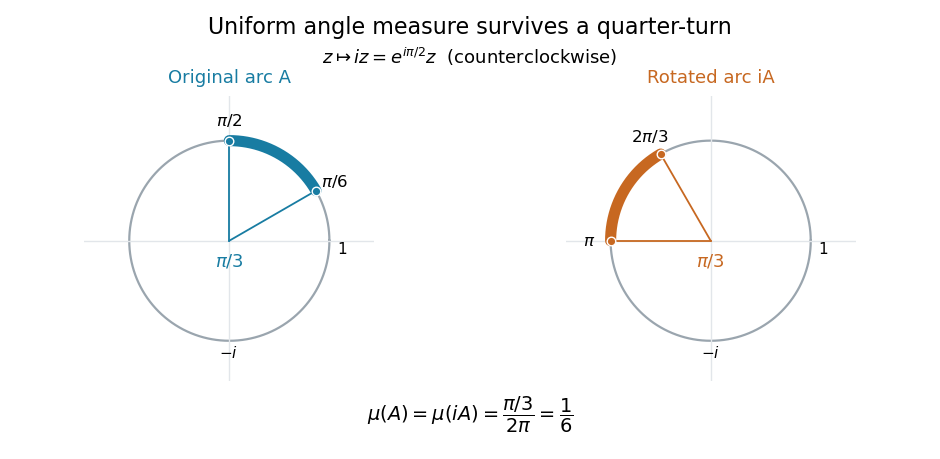

# Normalized angle integration on the circle

↑ **Parent:** [Compact group](compact-group.md)

On the [circle group](circle-group.md) $\mathbb T$, normalized [Haar measure](haar-measure.md) is the [pushforward measure](pushforward-measure.md) of uniform angle on $[0,2\pi)$. For a [continuous function](continuous-function.md) $f:\mathbb T\to\mathbb C$, define

$$
\int_{\mathbb T}f(z)\,d\mu(z)=\frac1{2\pi}\int_0^{2\pi}f(e^{i\theta})\,d\theta.
$$

The factor $1/(2\pi)$ makes the [integral](integral.md) of the constant function $1$ equal to $1$. For $g=e^{i\phi}$, a change of angle gives

$$
\int_{\mathbb T}f(gz)\,d\mu(z)
=\frac1{2\pi}\int_\phi^{2\pi+\phi}f(e^{iu})\,du
=\frac1{2\pi}\int_0^{2\pi}f(e^{iu})\,du.
$$

The last equality uses the $2\pi$-[periodic function](periodic-function.md) $u\mapsto f(e^{iu})$. Since the [circle group](circle-group.md) is an [abelian group](abelian-group.md), this also verifies right invariance. An arc of angular length $L$ has normalized [Haar measure](haar-measure.md) $L/(2\pi)$. In particular, the arc $A=\{e^{i\theta}:\pi/6\leq\theta\leq\pi/2\}$ and its quarter-turn $iA$ both have [measure](measure.md) $(\pi/2-\pi/6)/(2\pi)=1/6$.

**[Figure 1](#image-a-quarter-turn-changes-the-position-of-an-arc-but-preserves-its-normalized-haar-measure). A quarter-turn changes the position of an arc but preserves its normalized Haar measure**. Multiplication by $i=e^{i\pi/2}$ carries the blue arc onto the orange arc. Both span $\pi/3$ and have [Haar measure](haar-measure.md) $1/6$. The diagram is generated by [circle-group-rotation-invariance.py](circle-group-rotation-invariance.py).

The [continuous unitary characters](continuous-unitary-character.md) $\chi_n(e^{i\theta})=e^{in\theta}$, indexed by [integers](integer.md), give a fully computed family of [integrals](integral.md):

$$
\int_{\mathbb T}z^n\,d\mu(z)
=\frac1{2\pi}\int_0^{2\pi}e^{in\theta}\,d\theta
=\begin{cases}
1,&n=0,\\
\displaystyle\frac{e^{2\pi in}-1}{2\pi in}=0,&n\ne0.
\end{cases}
$$

Here $n$ must be an [integer](integer.md), so $z^n$ is well defined and $e^{2\pi in}=1$. Every nonconstant mode cancels exactly over a full turn. For example, the [integral](integral.md) of $f(e^{i\theta})=3+2\cos\theta-\sin(2\theta)$ is $3$, and the [integral](integral.md) of $\cos^2\theta=(1+\cos(2\theta))/2$ is $1/2$. More generally,

$$
\int_{\mathbb T}\chi_n(z)\overline{\chi_m(z)}\,d\mu(z)
=\begin{cases}1,&n=m,\\0,&n\ne m.\end{cases}
$$

This is the [orthogonality of complex exponentials](orthogonality-of-complex-exponentials.md) underlying the [Fourier basis](fourier-basis.md) and [Fourier series](fourier-series-split.md): invariant averaging separates distinct frequencies and retains the constant component.

## ↑ Ancestors (7)

1. [Compact group](compact-group.md)
2. [Topological group](topological-group-split.md)
3. [Algebraic topology](algebraic-topology-split.md)
4. [Geometry and topology](geometry-and-topology-split.md)
5. [Area of mathematics](area-of-mathematics.md)
6. [Mathematics](mathematics-split.md)
7. [Codex Wiki](split.md)

## ← Incoming links (1)

- [Haar measure](haar-measure.md)
