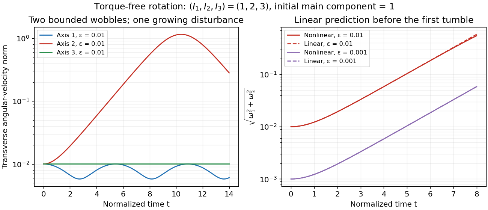

# Normalized intermediate-axis model

↑ **Parent:** [Intermediate axis theorem](intermediate-axis-theorem.md)

Choose an inertia unit $I_*$ and an [angular speed](angular-speed.md) unit $\Omega_*>0$, so physical [principal moments of inertia](principal-moment-of-inertia.md) are $I_*(1,2,3)$, physical [angular velocity](angular-velocity.md) is $\Omega_*\boldsymbol\omega$, and normalized [time](time-in-physics.md) is $t=\Omega_*t_{\mathrm{physical}}$. The [Euler equations for a torque-free rigid body](euler-equations-for-a-torque-free-rigid-body.md) become

$$
\dot\omega_1=-\omega_2\omega_3,\qquad
\dot\omega_2=\omega_3\omega_1,\qquad
\dot\omega_3=-\frac13\omega_1\omega_2.
$$

This is a physically admissible ideal planar [mass](mass.md) distribution: $I_3=I_1+I_2$ is the [perpendicular axis theorem](perpendicular-axis-theorem.md). A book of finite thickness need not have these exact ratios.

For an original comparison, start with [angular velocity](angular-velocity.md) $(1,\varepsilon,0)$, $(\varepsilon,1,0)$ or $(\varepsilon,0,1)$, respectively. With $\varepsilon=0.01$, the transverse [Euclidean norm](euclidean-norm.md) stays small about axes one and three, but becomes order one about axis two. For the intermediate-axis start, its [linearization](linearization.md) gives

$$
\omega_1\simeq\varepsilon\cosh(t/\sqrt3),\qquad
\omega_3\simeq-\frac{\varepsilon}{\sqrt3}\sinh(t/\sqrt3),\qquad
\omega_2\simeq1.
$$

The [hyperbolic functions](hyperbolic-function.md) contain a growing [exponential function](exponential-function.md) with rate $\lambda_2=1/\sqrt3$. Reducing $\varepsilon$ tenfold delays reaching the same small transverse amplitude by approximately $\sqrt3\log 10\simeq3.99$ normalized [time](time-in-physics.md) units, once the growing term dominates. That delays the instability. Once the transverse [angular velocity](angular-velocity.md) is comparable to the main component, the [linearization](linearization.md) ceases to describe the motion.

**[Figure 1](#image-small-perturbations-about-the-three-principal-axes). Small perturbations about the three principal axes**. Original [Runge-Kutta method](runge-kutta-method-split.md) calculations for the [normalized intermediate-axis model](normalized-intermediate-axis-model.md), with initial [angular velocity](angular-velocity.md) $(1,0.01,0)$, $(0.01,1,0)$ and $(0.01,0,1)$. Left: transverse [Euclidean norm](euclidean-norm.md) relative to each initial [principal axis](principal-axis.md). Right: full [Euler equations for a torque-free rigid body](euler-equations-for-a-torque-free-rigid-body.md) compared with the displayed [linearization](linearization.md), also using $(0.001,1,0)$. Dashed curves are linear predictions. These are model curves, not measured throws.

## ↑ Ancestors (8)

1. [Intermediate axis theorem](intermediate-axis-theorem.md)
2. [Euler equations for a torque-free rigid body](euler-equations-for-a-torque-free-rigid-body.md)
3. [Euler's equations (rigid body dynamics)](euler-s-equations-rigid-body-dynamics.md)
4. [Rigid body dynamics](rigid-body-dynamics-split.md)
5. [Classical mechanics](classical-mechanics-split.md)
6. [Branches of physics](branches-of-physics.md)
7. [Physics](physics-split.md)
8. [Codex Wiki](split.md)

## ← Incoming links (3)

- [Linear stability of principal-axis rotation](linear-stability-of-principal-axis-rotation.md)
- [Normalized intermediate-axis model](normalized-intermediate-axis-model.md)
- [Torque-free tumbling](torque-free-tumbling.md)
