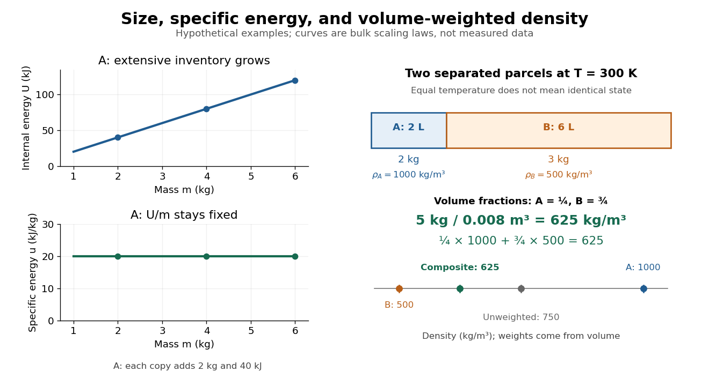

# Normalizing extensive quantities

↑ **Parent:** [Intensive quantity](intensive-quantity.md)

Dividing two [extensive quantities](extensive-quantity.md) with the same replication factor produces an [intensive quantity](intensive-quantity.md):

$$
\frac{\lambda X}{\lambda Y}=\frac XY,\qquad Y>0.
$$

Division by [volume](volume-thermodynamics.md) gives a density, such as [mass density](density.md) $\rho=m/V$ or [energy density](energy-density.md) $U/V$. Division by [mass](mass.md) gives a specific quantity, such as [specific internal energy](specific-internal-energy.md) $u=U/m$ or [specific volume](specific-volume.md) $v=V/m$. Division by [amount of substance](amount-of-substance.md) gives a molar quantity, such as [molar volume](molar-volume.md) $V_m=V/n$. Their units are respectively $\mathrm{kg\,m^{-3}}$, $\mathrm{J\,m^{-3}}$, $\mathrm{J\,kg^{-1}}$, $\mathrm{m^3\,kg^{-1}}$ and $\mathrm{m^3\,mol^{-1}}$. The denominator must be stated: “per particle”, “per [mole](mole-unit.md)” and “per unit [mass](mass.md)” are different normalizations.

For a hypothetical uniform parcel with [mass](mass.md) $2\,\mathrm{kg}$, [volume](volume-thermodynamics.md) $0.002\,\mathrm{m^3}$ and [internal energy](internal-energy-split.md) $40\,\mathrm{kJ}$ relative to a specified reference, $u=20\,\mathrm{kJ\,kg^{-1}}$ and $\rho=1000\,\mathrm{kg\,m^{-3}}$. Three independent copies have $6\,\mathrm{kg}$, $0.006\,\mathrm{m^3}$ and $120\,\mathrm{kJ}$; both ratios remain unchanged. This permits comparison of materials without confusing the amount tested with the state tested.

If $X$ and $Y$ are additive but the parcels have different $r_i=X_i/Y_i$, their composite ratio is a [weighted arithmetic mean](weighted-arithmetic-mean.md):

$$
r_{\rm total}=\frac{\sum_i X_i}{\sum_i Y_i}
=\sum_i\frac{Y_i}{\sum_jY_j}r_i.
$$

The denominator supplies the weights: [specific internal energy](specific-internal-energy.md) uses [mass](mass.md) weights, while [mass density](density.md) uses [volume](volume-thermodynamics.md) weights. This identity is accounting for the specified subsystems; predicting a new state after mixing also needs the relevant [equation of state](equation-of-state.md).

**[Figure 22](#image-size-changes-extensive-inventory-composite-density-weights-each-parcel-by-its-volume). Size changes extensive inventory; composite density weights each parcel by its volume**.

**Table of contents**

- [Density of a composite system](density-of-a-composite-system.md)
- [Pycnometer density measurement](pycnometer-density-measurement.md)

## ↑ Ancestors (7)

1. [Intensive quantity](intensive-quantity.md)
2. [Intensive and extensive thermodynamic quantities](intensive-and-extensive-thermodynamic-quantities.md)
3. [Thermodynamics](thermodynamics-split.md)
4. [Statistical physics](statistical-physics-split.md)
5. [Branches of physics](branches-of-physics.md)
6. [Physics](physics-split.md)
7. [Codex Wiki](split.md)

## ← Incoming links (1)

- [Intensive quantity](intensive-quantity.md)
