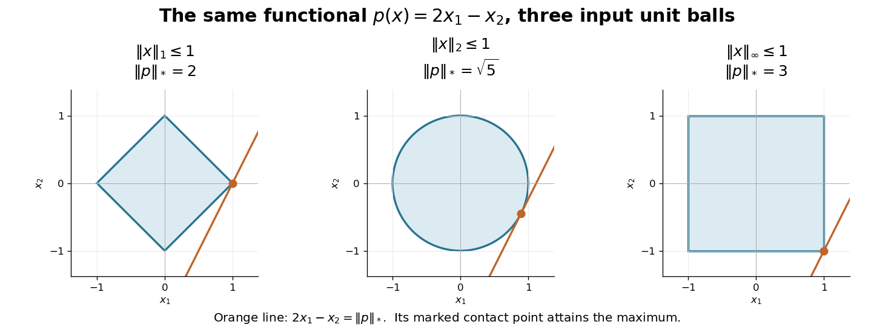

# Normed vector space

↑ **Parent:** [Functional analysis](functional-analysis.md)  
ⓦ [Wiki](https://en.wikipedia.org/wiki/Normed_vector_space)

A normed vector space is a [vector space](vector-space.md) equipped with a [norm](#norm), whose induced [metric](topological-analysis.md#metric) is $d(x,y)=\lVert x-y\rVert$. The [norm](#norm) must be positive on nonzero [vectors](vector-space.md#vector), scale by the absolute value of a [scalar](vector-space.md#scalar), and satisfy the [triangle inequality](topological-analysis.md#triangle-inequality). These conditions make distance compatible with addition and scaling.

On $C([0,1])$, both the [supremum norm](#supremum-norm) $\|f\|_\infty=\max_{0\leq x\leq1}|f(x)|$ and the [L2 norm](real-analysis.md#l2-norm) $\|f\|_2=(\int_0^1|f(x)|^2\,dx)^{1/2}$ are genuine [norms](#norm). A nonzero [continuous function](calculus.md#continuous-function) stays nonzero on an interval of positive length, so its squared [integral](integral.md) cannot vanish. For $f(x)=x$, they give $1$ and $1/\sqrt3$, respectively. Always $\|f\|_2\leq\|f\|_\infty$, but the shrinking peaks below show that no uniform reverse bound exists. Unlike the [finite-dimensional equivalence of norms](#finite-dimensional-equivalence-of-norms), infinite-dimensional [vector spaces](vector-space.md) can support inequivalent [norm topologies](#norm-topology).

**Table of contents**

- [Interior and closure of norm balls](#interior-and-closure-of-norm-balls)
- [Uniformly convex space](#uniformly-convex-space)
- [Strictly convex normed space](#strictly-convex-normed-space)
  - [Uniqueness of best approximation in a strictly convex space](#uniqueness-of-best-approximation-in-a-strictly-convex-space)
- [Best approximation in a normed space](#best-approximation-in-a-normed-space)
  - [Lower-frequency Lp approximation to a single harmonic](#lower-frequency-lp-approximation-to-a-single-harmonic)
  - [Sign criterion for best L1 approximation](#sign-criterion-for-best-l1-approximation)
- [Volume ratio](#volume-ratio)
  - [Orthogonal splitting with bounded volume ratio](#orthogonal-splitting-with-bounded-volume-ratio)
- [Point-evaluation kernel is not closed in the integral norm](#point-evaluation-kernel-is-not-closed-in-the-integral-norm)
- [Sphere in a normed vector space](#sphere-in-a-normed-vector-space)
- [Completion of a normed space](#completion-of-a-normed-space)
- [Lambda-injective normed space](#lambda-injective-normed-space)
  - [Retraction characterization of lambda-injectivity](#retraction-characterization-of-lambda-injectivity)
- [Norm topology](#norm-topology)
  - [Norm convergence](#norm-convergence)
- [Finite-dimensional subspace is closed](#finite-dimensional-subspace-is-closed)
- [Isometric isomorphism of normed spaces](#isometric-isomorphism-of-normed-spaces)
- [Norm](#norm)
  - [Quasi-norm](#quasi-norm)
  - [Dual norm](#dual-norm)
    - [Dual norm as a worst-case linear error bound](#dual-norm-as-a-worst-case-linear-error-bound)
    - [Dual norm supremum need not be attained](#dual-norm-supremum-need-not-be-attained)
  - [Block mixed norm](#block-mixed-norm)
    - [Duality of block mixed norms](#duality-of-block-mixed-norms)
  - [Definiteness of a norm](#definiteness-of-a-norm)
  - [Absolute homogeneity of a norm](#absolute-homogeneity-of-a-norm)
  - [Norm determined by a convex radial unit ball](#norm-determined-by-a-convex-radial-unit-ball)
  - [Discrete L2 norm](#discrete-l2-norm)
- [L1 norm](#l1-norm)
  - [Weighted one-norm on l2](#weighted-one-norm-on-l2)
    - [Subdifferential of a weighted one-norm on l2](#subdifferential-of-a-weighted-one-norm-on-l2)
  - [Taxicab geometry](#taxicab-geometry)
- [Trace norm](#trace-norm)
  - [Unitary variational formula for the trace norm](#unitary-variational-formula-for-the-trace-norm)
  - [Trace-norm variational principle for Hermitian operators](#trace-norm-variational-principle-for-hermitian-operators)
    - [Diagonal absolute-sum bound for the trace norm](#diagonal-absolute-sum-bound-for-the-trace-norm)
  - [Induced trace norm](#induced-trace-norm)
    - [Diamond norm](#diamond-norm)
- [Euclidean norm](#euclidean-norm)
  - [Hessian of the Euclidean norm](#hessian-of-the-euclidean-norm)
  - [Squared Euclidean norm](#squared-euclidean-norm)
  - [Euclidean norm duality](#euclidean-norm-duality)
  - [Euclidean ball](#euclidean-ball)
    - [Euclidean unit ball](#euclidean-unit-ball)
    - [Unit ball](#unit-ball)
      - [Closed unit ball](#closed-unit-ball)
      - [Open unit ball](#open-unit-ball)
- [Supremum norm](#supremum-norm)
  - [Unboundedness of derivative evaluation in the supremum norm](#unboundedness-of-derivative-evaluation-in-the-supremum-norm)
  - [Derivative supremum norm](#derivative-supremum-norm)
- [Surjective isometry of normed vector spaces](#surjective-isometry-of-normed-vector-spaces)
  - [Mazur-Ulam theorem](#mazur-ulam-theorem)
    - [Metric extraction of a midpoint by shrinking diameters](#metric-extraction-of-a-midpoint-by-shrinking-diameters)
  - [Nonsurjective isometry need not preserve midpoints](#nonsurjective-isometry-need-not-preserve-midpoints)
- [Equivalent norms](#equivalent-norms)
  - [Topology determines norm equivalence](#topology-determines-norm-equivalence)
  - [Signed interval projection norm](#signed-interval-projection-norm)
  - [Bounded distortion of a Banach space](#bounded-distortion-of-a-banach-space)
  - [Banach norm rigidity from continuous point evaluations](#banach-norm-rigidity-from-continuous-point-evaluations)
  - [Finite-dimensional equivalence of norms](#finite-dimensional-equivalence-of-norms)
- [Banach space](banach-space.md)
  - [Finite codimension in a Banach space](banach-space.md#finite-codimension-in-a-banach-space)
  - [Banach-Saks property](banach-space.md#banach-saks-property)
  - [Cotype of a Banach space](banach-space.md#cotype-of-a-banach-space)
    - [Cotype 2](banach-space.md#cotype-2)
      - [Cotype 2 extrapolation on finite-dimensional linfinity](banach-space.md#cotype-2-extrapolation-on-finite-dimensional-linfinity)
  - [Complemented subspace](banach-space.md#complemented-subspace)
    - [Pełczyński decomposition method](banach-space.md#pelczynski-decomposition-method)
  - [Hereditarily indecomposable Banach space](banach-space.md#hereditarily-indecomposable-banach-space)
    - [Gowers dichotomy theorem](banach-space.md#gowers-dichotomy-theorem)
  - [Quotient Banach space](banach-space.md#quotient-banach-space)
    - [Approximate weakly null lifting through a quotient](banach-space.md#approximate-weakly-null-lifting-through-a-quotient)
    - [Quotient norm](banach-space.md#quotient-norm)
  - [Convex block](banach-space.md#convex-block)
    - [Convex-block cancellation of a weak-star limit](banach-space.md#convex-block-cancellation-of-a-weak-star-limit)
  - [Duality mapping](banach-space.md#duality-mapping)
  - [Bounded scalar functions on an index set](banach-space.md#bounded-scalar-functions-on-an-index-set)
    - [Coordinate functional representation of an operator into bounded indexed functions](banach-space.md#coordinate-functional-representation-of-an-operator-into-bounded-indexed-functions)
  - [Separable Banach space](banach-space.md#separable-banach-space)
  - [l-p sequence space](banach-space.md#l-p-sequence-space)
    - [Absolutely summable sequence space](banach-space.md#absolutely-summable-sequence-space)
    - [l2 sequence space](banach-space.md#l2-sequence-space)
      - [Uniform convexity of l2](banach-space.md#uniform-convexity-of-l2)
    - [Finitely supported sequence](banach-space.md#finitely-supported-sequence)
      - [Incompleteness of finitely supported sequences](banach-space.md#incompleteness-of-finitely-supported-sequences)
      - [Density of finitely supported sequences in l-p](banach-space.md#density-of-finitely-supported-sequences-in-l-p)
  - [l-infinity sequence space](banach-space.md#l-infinity-sequence-space)
    - [Generalized limit](banach-space.md#generalized-limit)
    - [Banach limit](banach-space.md#banach-limit)
      - [Cesàro construction of a Banach limit](banach-space.md#cesaro-construction-of-a-banach-limit)
      - [Ultrafilter construction of a Banach limit](banach-space.md#ultrafilter-construction-of-a-banach-limit)
    - [Left shift on bounded sequences](banach-space.md#left-shift-on-bounded-sequences)
  - [Riesz's lemma](banach-space.md#riesz-s-lemma)
    - [Compact unit ball characterizes finite-dimensional normed spaces](banach-space.md#compact-unit-ball-characterizes-finite-dimensional-normed-spaces)
  - [Uniformly convex Banach space](banach-space.md#uniformly-convex-banach-space)
    - [Nearest point in a uniformly convex Banach space](banach-space.md#nearest-point-in-a-uniformly-convex-banach-space)
    - [Clarkson's inequalities](banach-space.md#clarkson-s-inequalities)
      - [Dual-exponent Clarkson inequality](banach-space.md#dual-exponent-clarkson-inequality)
  - [Uniform boundedness principle](banach-space.md#uniform-boundedness-principle)
    - [Weak boundedness implies norm boundedness](banach-space.md#weak-boundedness-implies-norm-boundedness)
    - [Uniform bound from pointwise absolute summability of dual evaluations](banach-space.md#uniform-bound-from-pointwise-absolute-summability-of-dual-evaluations)

## Interior and closure of norm balls

↑ **Parent:** [Normed vector space](normed-vector-space.md)

In a nonzero [normed vector space](normed-vector-space.md), a unit vector $x$ is approached from outside the unit ball by $(1+\varepsilon)x$, so no boundary point is [interior](topology.md#interior-topology). It is approached from inside by $(1-\varepsilon)x$, so every boundary point is in the [closure](topology.md#closure-topology) of the open ball. The zero space satisfies the same identities trivially. These statements need the radial structure of a normed space; a two-point discrete [metric space](topological-analysis.md#metric-space) with interpoint distance one disproves both analogous claims for general metric balls.

## Uniformly convex space

↑ **Parent:** [Normed vector space](normed-vector-space.md)  
ⓦ [Wiki](https://en.wikipedia.org/wiki/Uniformly_convex_space)

A [normed vector space](normed-vector-space.md) is uniformly convex if, for each $\varepsilon>0$, there is $\delta>0$ such that unit-ball vectors $x,y$ with $\lVert x-y\rVert\geq\varepsilon$ satisfy $\lVert(x+y)/2\rVert\leq1-\delta$. Completeness is not part of this definition; a complete example is a [uniformly convex Banach space](banach-space.md#uniformly-convex-banach-space).

## Strictly convex normed space

↑ **Parent:** [Normed vector space](normed-vector-space.md)

A [normed vector space](normed-vector-space.md) is strictly convex when distinct unit vectors have their midpoint strictly inside the unit ball. The [Lp space](measure-theory.md#lp-space) is strictly convex for $1<p<\infty$: strict convexity of $|z|^p$ gives a strict integrated midpoint inequality for distinct unit functions. The endpoint spaces $L^1$ and $L^\infty$ need not have this property.

### Uniqueness of best approximation in a strictly convex space

↑ **Parent:** [Strictly convex normed space](#strictly-convex-normed-space)

If two distinct elements $u,v$ of a [linear subspace](vector-space.md#vector-subspace) both minimize distance to $f$, normalize their residuals by the common positive minimum $d$. [Strictly convex normed space](#strictly-convex-normed-space) geometry gives $\|f-(u+v)/2\|<d$, a contradiction. If $d=0$, both elements equal $f$. This proves uniqueness when a best approximant exists, without asserting existence for a nonclosed subspace.

## Best approximation in a normed space

↑ **Parent:** [Normed vector space](normed-vector-space.md)

Given $f$ in a [normed vector space](normed-vector-space.md) and a [vector subspace](vector-space.md#vector-subspace) $U$, an element $p_*\in U$ is a best approximation if $\|f-p_*\|=\inf_{p\in U}\|f-p\|$. Existence is automatic for a finite-dimensional [vector subspace](vector-space.md#vector-subspace): a minimizing sequence can be bounded by the [triangle inequality](topological-analysis.md#triangle-inequality), and a subsequence converges by [compactness](topology.md#compact-space) in finite dimension. An arbitrary infinite-dimensional [vector subspace](vector-space.md#vector-subspace) need not contain a minimizer. The norm matters: [best uniform approximation](uniform-approximation.md#best-uniform-approximation) uses the [supremum norm](#supremum-norm), while $L^1$ approximation minimizes integrated absolute error.

### Lower-frequency Lp approximation to a single harmonic

↑ **Parent:** [Best approximation in a normed space](#best-approximation-in-a-normed-space)

For $1<p<\infty$ and $n\ge1$, existence follows from finite-dimensional [compactness](topology.md#compact-space) and uniqueness from [strictly convex normed space](#strictly-convex-normed-space) geometry. Translation by $2\pi/n$ and negative translation by $\pi/n$ preserve the target and the error [norm](#norm). Uniqueness forces the minimizing [trigonometric polynomial](fourier-series.md#trigonometric-polynomial) to be invariant under the first operation and the negative of itself under the second. Invariance removes every nonzero frequency below $n$; negative invariance removes the remaining constant.

### Sign criterion for best L1 approximation

↑ **Parent:** [Best approximation in a normed space](#best-approximation-in-a-normed-space)

For real functions, let $r=f-p_*$ and put $\operatorname{sign}(0)=0$. If $\int v\,\operatorname{sign}(r)=0$ for every $v\in U$, then $p_*$ is a [best approximation in a normed space](#best-approximation-in-a-normed-space) using the $L^1$ norm. The proof is the pointwise inequality $|r-v|\geq|r|-v\operatorname{sign}(r)$, followed by integration. This is a sufficient criterion even if the residual vanishes on a positive-measure set; a general necessary criterion may choose any subgradient in $[-1,1]$ on that zero set.

## Volume ratio

↑ **Parent:** [Normed vector space](normed-vector-space.md)

The [volume ratio](#volume-ratio) of a $d$-dimensional [normed vector space](normed-vector-space.md) is $\operatorname{vr}(E)=(\operatorname{vol}(B_E)/\operatorname{vol}(\mathcal E))^{1/d}$, where $\mathcal E$ is its [John ellipsoid](euclidean-geometry.md#john-ellipsoid). It is unchanged by invertible linear changes of coordinates. In [John position](euclidean-geometry.md#john-position), polar integration gives $\operatorname{vr}(E)^d=\int_{S^{d-1}}\|u\|_E^{-d}\,d\sigma(u)$, with normalized spherical measure. Consequently $\sigma\{\|u\|_E\leq t\}\leq(\operatorname{vr}(E)t)^d$.

### Orthogonal splitting with bounded volume ratio

↑ **Parent:** [Volume ratio](#volume-ratio)

In a $2k$-dimensional [normed vector space](normed-vector-space.md) in [John position](euclidean-geometry.md#john-position), two orthogonal $k$-dimensional subspaces admit $\|x\|_E\leq |x|\leq32\operatorname{vr}(E)^2\|x\|_E$. To see this, take $\varepsilon$-nets in two orthogonal half-dimensional unit spheres, each of size at most $(1+2/\varepsilon)^k$, and rotate them uniformly together. The [volume ratio](#volume-ratio) bound makes the [probability](probability-theory.md#probability) that any net point has [norm](#norm) below $2\varepsilon$ at most $2[4\operatorname{vr}(E)^2(\varepsilon^2+2\varepsilon)]^k$. With $\varepsilon=(32\operatorname{vr}(E)^2)^{-1}$ this is less than $1$. Since $\|\cdot\|_E$ is $1$-[Lipschitz](real-analysis.md#lipschitz-continuity) for the [Euclidean metric](riemannian-metric.md#euclidean-metric), the successful nets give the stated inequality everywhere on both spheres. A dimension-independent constant therefore requires a bound on the [volume ratio](#volume-ratio); it does not hold for arbitrary [normed vector spaces](normed-vector-space.md).

## Point-evaluation kernel is not closed in the integral norm

↑ **Parent:** [Normed vector space](normed-vector-space.md)

On continuous functions on a compact interval, evaluation at an interior point is not continuous in the integral [norm](#norm). Narrow triangular peaks have fixed point value and integral tending to zero. Subtracting such a peak from the constant function one gives functions vanishing at the point and converging in the integral norm to one. Thus the evaluation kernel is not closed, although it is closed in the [uniform norm](#supremum-norm).

Here is a fully computed endpoint version, now using the [L2 norm](real-analysis.md#l2-norm) on the actual [continuous functions](calculus.md#continuous-function) $C([0,1])$. For each integer $n\geq1$, set $f_n(x)=\max(1-nx,0)$. Its [point evaluation](topological-vector-space.md#point-evaluation-functional) at zero is $E(f_n)=f_n(0)=1$, while

$$
\|f_n\|_2^2=\int_0^{1/n}(1-nx)^2\,dx=\frac1{3n},\qquad F(f_n)=\int_0^{1/n}(1-nx)\,dx=\frac1{2n}.
$$

Consequently $f_n\to0$ in the [L2 norm](real-analysis.md#l2-norm) but $E(f_n)\not\to0$: [point evaluation](topological-vector-space.md#point-evaluation-functional) is discontinuous on this [normed space](normed-vector-space.md). Quantitatively $|E(f_n)|/\|f_n\|_2=\sqrt{3n}$ is unbounded. At $n=100$, the [L2 norm](real-analysis.md#l2-norm) is approximately $0.057735$, the [integral](integral.md) is $0.005$, and the point value is still $1$. In the [supremum norm](#supremum-norm), $\|f_n\|_\infty=1$ and $|E(f)|\leq\|f\|_\infty$, so $E$ has [operator norm](continuous-dual-space.md#operator-norm) one instead.

Set $g_n=1-f_n$. Then $E(g_n)=0$ and $\|g_n-1\|_2=1/\sqrt{3n}\to0$, although $E(1)=1$. Thus the [kernel](kernel-of-a-linear-map.md) of $E$ fails to be a [closed set](topology.md#closed-set). On the full [L2 space](measure-theory.md#l2-space-is-a-hilbert-space), a further distinction is essential: its elements are [equivalence classes](set-theory.md#equivalence-class) under equality [almost everywhere](measure-theory.md#almost-everywhere), and changing a representative at zero does not change its class. Arbitrary [point evaluation](topological-vector-space.md#point-evaluation-functional) is therefore not even well-defined there. Restricting first to [continuous functions](calculus.md#continuous-function) makes the discontinuity statement precise.[MIT 18.102, lecture 13: Lp spaces and almost-everywhere identification](https://ocw.mit.edu/courses/18-102-introduction-to-functional-analysis-spring-2021/aad5fcf3b0f85788519a0324258dd296_MIT18_102s21_lec13.pdf)

**[Figure 1](#image-shrinking-continuous-peaks-integration-and-l2-size-vanish-while-point-evaluation-stays-one). Shrinking continuous peaks: integration and L2 size vanish while point evaluation stays one**.

## Sphere in a normed vector space

↑ **Parent:** [Normed vector space](normed-vector-space.md)

In a [normed vector space](normed-vector-space.md), this set consists of all points at a fixed positive [norm](#norm) distance $r$ from $x_0$. It also makes sense in an infinite-dimensional [Hilbert space](hilbert-space.md), unlike a specifically Euclidean [sphere](euclidean-geometry.md#sphere). In a real [Hilbert space](hilbert-space.md), the [sphere in a normed vector space](#sphere-in-a-normed-vector-space) $\|u\|^2=2E_0>0$ has tangent variations $v$ satisfying $(u,v)=0$; this follows by differentiating the fixed squared [norm](#norm). This is the geometric constraint used in [fixed-energy initial-condition optimality](control-theory.md#fixed-energy-initial-condition-optimality).

## Completion of a normed space

↑ **Parent:** [Normed vector space](normed-vector-space.md)

The completion of a [normed vector space](normed-vector-space.md) $X$ is a [Banach space](banach-space.md) containing an isometric dense copy of $X$. Construct it from [Cauchy sequences](sequence-and-series.md#cauchy-sequence) modulo [sequences](sequence-and-series.md#sequence) whose difference tends to zero; define the [norm](#norm) by $\|[(x_n)]\|=\lim_n\|x_n\|$. Equivalently, the canonical evaluation map into the [bidual space](dual-space.md#bidual-of-a-normed-space) is an isometry by the [Hahn-Banach theorem](functional-analysis.md#hahn-banach-theorem), and the closure of its image supplies a completion.

A [Banach space](banach-space.md) is precisely a [normed vector space](normed-vector-space.md) in which every [Cauchy sequence](sequence-and-series.md#cauchy-sequence) converges in [norm](#norm) to an element of the same space. [Completion of a normed space](#completion-of-a-normed-space) fills missing limits without changing distances between existing elements. For example, $C([0,1])$ with the [L2 norm](real-analysis.md#l2-norm) completes to [L2 space](measure-theory.md#l2-space-is-a-hilbert-space) on the interval with [Lebesgue measure](measure-theory.md#lebesgue-measure). The bounded [integral](integral.md) functional extends uniquely to that [completion of a normed space](#completion-of-a-normed-space): define $F(f)=\lim_kF(f_k)$ for any approximating [sequence](sequence-and-series.md#sequence) of [continuous functions](calculus.md#continuous-function). Its bound makes this independent of the approximation. The unbounded [point evaluation](topological-vector-space.md#point-evaluation-functional) has no continuous extension agreeing with its values on all [continuous functions](calculus.md#continuous-function).[Richard Melrose, Functional Analysis, chapter 1, sections 5–6: completion and continuous extension](https://ocw.mit.edu/courses/18-102-introduction-to-functional-analysis-spring-2021/3d4cc88026d44a01f936cd6a0aa995cb_MIT18_102s20_lec_FA.pdf)

## Lambda-injective normed space

↑ **Parent:** [Normed vector space](normed-vector-space.md)

For $\lambda\ge1$, a [normed vector space](normed-vector-space.md) $X$ is lambda-injective when every [bounded linear operator](topological-vector-space.md#continuous-linear-operator) from a subspace $Y$ of any normed space $Z$ into $X$ extends to $Z$ with the displayed norm bound. The space of [bounded scalar functions on an index set](banach-space.md#bounded-scalar-functions-on-an-index-set) is 1-injective: extend each coordinate functional by the [Hahn-Banach theorem](functional-analysis.md#hahn-banach-theorem) and reassemble it using the [coordinate functional representation of an operator into bounded indexed functions](banach-space.md#coordinate-functional-representation-of-an-operator-into-bounded-indexed-functions).

### Retraction characterization of lambda-injectivity

↑ **Parent:** [Lambda-injective normed space](#lambda-injective-normed-space)

A space is a [lambda-injective normed space](#lambda-injective-normed-space) exactly when every linear isometry $J:X\to Z$ has a bounded left inverse as displayed. Necessity extends the inverse on $J(X)$. For sufficiency, embed $X$ in [bounded scalar functions on an index set](banach-space.md#bounded-scalar-functions-on-an-index-set), extend the composed operator coordinatewise, and compose that extension with the assumed left inverse. The associated operator $JP$ is a projection onto $J(X)$.

## Norm topology

↑ **Parent:** [Normed vector space](normed-vector-space.md)

The norm topology is the [metric topology](topological-analysis.md#metric-topology) induced by $d(x,y)=\lVert x-y\rVert$.

### Norm convergence

↑ **Parent:** [Norm topology](#norm-topology)

A sequence converges in norm when $\lVert x_n-x\rVert\to0$.

## Finite-dimensional subspace is closed

↑ **Parent:** [Normed vector space](normed-vector-space.md)

Every [finite-dimensional vector space](vector-space.md#finite-dimensional-vector-space) subspace of a [normed vector space](normed-vector-space.md) is closed. Coordinates in a finite basis identify it homeomorphically with a finite-dimensional scalar space; it is therefore complete, and every complete subspace of a metric space is closed.

## Isometric isomorphism of normed spaces

↑ **Parent:** [Normed vector space](normed-vector-space.md)

An isometric isomorphism between normed spaces is a bijective linear map $T$ satisfying $\|Tx\|=\|x\|$ for every vector $x$.

## Norm

↑ **Parent:** [Normed vector space](normed-vector-space.md)  
ⓦ [Wiki](https://en.wikipedia.org/wiki/Norm_(mathematics))

A norm assigns a nonnegative length to each vector, is zero only at the zero vector, is absolutely homogeneous, and satisfies the [triangle inequality](topological-analysis.md#triangle-inequality).

### Quasi-norm

↑ **Parent:** [Norm](#norm)

A quasi-[norm](#norm) on a [vector space](vector-space.md) is nonnegative, vanishes only at zero, is absolutely homogeneous, and satisfies a [triangle inequality](topological-analysis.md#triangle-inequality) with one constant factor $C\geq1$. For $0<p<1$, $(\int|f|^p)^{1/p}$ on an [Lp space](measure-theory.md#lp-space) is a quasi-[norm](#norm): $\|f+g\|_p^p\leq\|f\|_p^p+\|g\|_p^p$ gives a quasi-[triangle inequality](topological-analysis.md#triangle-inequality). Measure-preserving composition preserves this quantity even though the [Minkowski inequality](real-analysis.md#minkowski-inequality) is unavailable below exponent one.

### Dual norm

↑ **Parent:** [Norm](#norm)  
ⓦ [Wiki](https://en.wikipedia.org/wiki/Dual_norm)

A [dual norm](#dual-norm) measures how strongly a [bounded linear functional](topological-vector-space.md#continuous-linear-functional) can respond to a unit-sized input. If $p$ is a [bounded linear functional](topological-vector-space.md#continuous-linear-functional) on a [normed vector space](normed-vector-space.md) $X$, write $\langle p,x\rangle=p(x)$ and define

$$
\|p\|_* =\sup_{\|x\|\le1}|p(x)|.
$$

It is the [operator norm](continuous-dual-space.md#operator-norm) of $p$ when its scalar output is measured by [absolute value](real-analysis.md#absolute-value). On $\mathbb R^n$, represent $p(x)=a^Tx$ using a coefficient [vector](vector-space.md#vector) $a$. The [unit ball](#unit-ball) is symmetric, so maximizing $|a^Tx|$ gives the same value as maximizing $a^Tx$: negate an input whenever its output is negative.[§A.1.6, printed p. 636: dual norm and scalar operator-norm interpretation](mathematics-bibliography.md#convex-optimization-by-stephen-boyd-and-lieven-vandenberghe)

For an original two-coordinate example, fix $a=(2,-1)^T$, so $p(x)=2x_1-x_2$. The input [norm](#norm) changes the allowable [unit ball](#unit-ball) and hence the [dual norm](#dual-norm):

$$
\begin{aligned}
\|x\|_1\le1&:\quad\|p\|_*=2,
&&x_*=(1,0)^T,\\
\|x\|_2\le1&:\quad\|p\|_*=\sqrt5,
&&x_*=(2,-1)^T/\sqrt5,\\
\|x\|_\infty\le1&:\quad\|p\|_*=3,
&&x_*=(1,-1)^T.
\end{aligned}
$$

Under the [L1 norm](#l1-norm), $|2x_1-x_2|\le2(|x_1|+|x_2|)\le2$, and $(1,0)^T$ attains the bound. Under the [Euclidean norm](#euclidean-norm), the [Cauchy-Schwarz inequality](probability-and-statistics.md#cauchy-schwarz-inequality) gives $|a^Tx|\le\|a\|_2\|x\|_2\le\sqrt5$, with equality at the displayed normalized [vector](vector-space.md#vector). Under the [maximum norm](#supremum-norm), each coordinate can reach unit [absolute value](real-analysis.md#absolute-value), so $|2x_1-x_2|\le2+1=3$; $(1,-1)^T$ attains it. Thus the [dual norms](#dual-norm) of these three [vector norms](#norm) are respectively the [maximum norm](#supremum-norm), the [Euclidean norm](#euclidean-norm), and the [L1 norm](#l1-norm). For $1\le p\le\infty$, [Lp norms](real-analysis.md#lp-norm) on a finite coordinate space pair with their [Holder conjugate exponents](functional-analysis.md#conjugate-exponents).[§A.1.6, printed p. 637: Euclidean self-duality and one-, infinity- and p-norm duality; the numerical vector and maximizing points here are independent examples](mathematics-bibliography.md#convex-optimization-by-stephen-boyd-and-lieven-vandenberghe)

**[Figure 2](#image-the-same-linear-functional-has-three-dual-norms-on-three-input-unit-balls). The same linear functional has three dual norms on three input unit balls**. Original geometry for $p(x)=2x_1-x_2$. The orange [supporting line](convex-set.md#supporting-line) $2x_1-x_2=\|p\|_*$ touches each [unit ball](#unit-ball) at the marked maximizing point. Blue regions use the [L1 norm](#l1-norm), [Euclidean norm](#euclidean-norm) and [maximum norm](#supremum-norm), respectively.

This geometry explains the usefulness of a [dual norm](#dual-norm): it translates a bound on inputs into the sharp bound on a linear output. The [support function](convex-set.md#support-function) of the [unit ball](#unit-ball) gives its value in the coefficient direction $a$. Changing the input budget changes the set of possible inputs; the three different answers do not conflict. In finite dimensions a closed [unit ball](#unit-ball) is [compact](topology.md#compact-space), so a [continuous linear functional](topological-vector-space.md#continuous-linear-functional) achieves its maximum [absolute value](real-analysis.md#absolute-value). In an infinite-dimensional [normed vector space](normed-vector-space.md), the [supremum](real-analysis.md#supremum) remains the definition and need not be achieved.

#### Dual norm as a worst-case linear error bound

↑ **Parent:** [Dual norm](#dual-norm)

Suppose a perturbation $\delta x$ satisfies $\|\delta x\|\le\varepsilon$, with $\varepsilon\ge0$. [Absolute homogeneity of a norm](#absolute-homogeneity-of-a-norm) and the [dual norm](#dual-norm) definition give

$$
|p(x+\delta x)-p(x)|=|p(\delta x)|
\le\|p\|_*\|\delta x\|\le\varepsilon\|p\|_*.
$$

For nonzero $\delta x$, divide it by its [norm](#norm) to obtain an input in the [unit ball](#unit-ball); for zero perturbation the inequality is immediate. This is an exact [error bound](numerical-analysis.md#error-bound) for a [linear functional](dual-space.md#linear-functional), for every perturbation in the stated input set.

For $p(x)=2x_1-x_2$ and a budget $\varepsilon=0.1$, the sharp output-error bounds are **$0.2$** for $\|\delta x\|_1\le0.1$, **$\sqrt5/10\simeq0.224$** for $\|\delta x\|_2\le0.1$, and **$0.3$** for $\|\delta x\|_\infty\le0.1$. Scale the maximizing [vectors](vector-space.md#vector) from the preceding example by $0.1$ to attain the positive endpoints; their negatives attain the negative endpoints. The [L1 norm](#l1-norm) budget constrains a total absolute error; the [maximum norm](#supremum-norm) budget permits each coordinate to have that error separately. These budgets define nested sets and carry different information.

**[Figure 3](#image-dual-norms-give-exact-worst-case-errors-for-the-same-linear-functional). Dual norms give exact worst-case errors for the same linear functional**. Original bounds for $p(x)=2x_1-x_2$. Lines show the sharp error magnitude as the stated input [norm](#norm) budget increases. The right panel gives the full possible error intervals at $\varepsilon=0.1$; these are the full feasible intervals for the stated deterministic bounds.

The coordinates must use the stated scale and units. Rescaling one coordinate changes both its coefficient in $a$ and the meaning of its input budget. For a nonlinear [differentiable function](analysis.md#differentiable-function) with scalar values, its [Fréchet derivative](multivariable-calculus.md#frechet-derivative) at the base point is a [linear functional](dual-space.md#linear-functional) governing the first-order response. An exact finite-perturbation [error bound](numerical-analysis.md#error-bound) additionally needs control of the [Taylor remainder](calculus.md#taylor-remainder) or of the [Fréchet derivative](multivariable-calculus.md#frechet-derivative) along the path.

#### Dual norm supremum need not be attained

↑ **Parent:** [Dual norm](#dual-norm)

On the real [space of sequences converging to zero](functional-analysis.md#space-of-sequences-converging-to-zero) $c_0$, use the [supremum norm](#supremum-norm) and define the [linear functional](dual-space.md#linear-functional)

$$
p(x)=\sum_{n=1}^{\infty}2^{-n}x_n.
$$

The [geometric series](sequence-and-series.md#geometric-series) gives $|p(x)|\le\|x\|_\infty$, so $p$ is a [bounded linear functional](topological-vector-space.md#continuous-linear-functional) and $\|p\|_*\le1$. The [sequence](sequence-and-series.md#sequence) with its first $N$ entries equal to one and all later entries zero belongs to $c_0$, has unit [supremum norm](#supremum-norm), and gives $p(x)=1-2^{-N}$. Hence $\|p\|_*=1$. But if $\|x\|_\infty\le1$ and $x_n\to0$, not all coordinates can equal one or all equal minus one. Since every weight $2^{-n}$ is positive, $-1<p(x)<1$. The [supremum](real-analysis.md#supremum) is approached but never attained on the [unit ball](#unit-ball).

### Block mixed norm

↑ **Parent:** [Norm](#norm)

The block mixed [norm](#norm) sums the $\ell^q$ [norm](#norm) of each block, for $q\ge1$. Its [dual norm](#dual-norm) is $\|p\|_{q',\infty}=\max_i\|p_i\|_{q'}$, where $q'=q/(q-1)$ for $q>1$ and $q'=\infty$ for $q=1$. Apply [Holder inequality](functional-analysis.md#holder-inequality) blockwise and choose a norming block to attain equality. [Absolute values](real-analysis.md#absolute-value) are essential for signed components.

#### Duality of block mixed norms

↑ **Parent:** [Block mixed norm](#block-mixed-norm)

For a [linear map](vector-space.md#linear-map) $A$ between finite-dimensional real [inner product spaces](inner-product.md#inner-product-space),

$$
\lambda\|Au\|_{q,1}=\sup_{\max_i\|p_i\|_{q'}\le\lambda}\langle A^*p,u\rangle.
$$

Thus the penalty is the [support function](convex-set.md#support-function) of the [compact](topology.md#compact-space) [convex set](convex-set.md) $A^*\{p:\max_i\|p_i\|_{q'}\le\lambda\}$. The [Moreau decomposition](convex-optimization.md#moreau-decomposition) makes its [proximal operator](convex-optimization.md#proximal-operator) the identity minus the [Euclidean projection onto a convex set](convex-set.md#euclidean-projection-onto-a-convex-set).

### Definiteness of a norm

↑ **Parent:** [Norm](#norm)

Definiteness says that a [norm](#norm) vanishes only at the zero [vector](vector-space.md#vector). The [box norm](additive-combinatorics.md#box-norm) on a nonempty finite [Cartesian product](set-theory.md#cartesian-product) is definite because its defining sum of squares includes equal-column terms, each of which is the square of an average of squares. Omitting repeated coordinates would destroy this proof and can produce a different quantity.

### Absolute homogeneity of a norm

↑ **Parent:** [Norm](#norm)

Absolute homogeneity is the [norm](#norm) axiom $\|av\|=|a|\|v\|$ for every [scalar](vector-space.md#scalar) $a$ and [vector](vector-space.md#vector) $v$. It distinguishes a [norm](#norm) from a merely homogeneous expression of a different degree; for example the fourth root in the [box norm](additive-combinatorics.md#box-norm) converts a degree-four expression into a degree-one [norm](#norm).

### Norm determined by a convex radial unit ball

↑ **Parent:** [Norm](#norm)

Suppose $B$ contains zero, is [convex](real-analysis.md#convex-function), and meets every line $\mathbb Rv$, $v\ne0$, in the finite symmetric open segment $\{tv:|t|<\lambda(v)\}$ with $\lambda(v)>0$. Then its [Minkowski functional](topological-vector-space.md#minkowski-functional) is a [norm](#norm), with $p_B(v)=1/\lambda(v)$ and $B=\{x:p_B(x)<1\}$. Absolute homogeneity follows by rescaling the segment. If $s>p_B(x)$ and $t>p_B(y)$, convexity puts $(x+y)/(s+t)$ in $B$, giving $p_B(x+y)<s+t$; passing to the infima proves the triangle inequality. Conversely the open unit ball uniquely determines any norm by the displayed formula. No prior topology on the vector space is needed for these radial hypotheses.

### Discrete L2 norm

↑ **Parent:** [Norm](#norm)

On a uniform $d$-dimensional spatial grid, the discrete L2 norm weights the squared [Euclidean norm](#euclidean-norm) by the cell volume. It approximates the continuous [L2 norm](real-analysis.md#l2-norm) and is induced by the [discrete L2 inner product](inner-product.md#discrete-l2-inner-product). A contraction bound in this norm with a mesh-independent constant proves [stability of a numerical method](numerical-analysis.md#stability-of-a-numerical-method) for the spatially discretized evolution.

## L1 norm

↑ **Parent:** [Normed vector space](normed-vector-space.md)

For $x\in\mathbb R^d$, the L1 norm is

$$
\lVert x\rVert_1=\sum_{j=1}^d|x_j|.
$$

### Weighted one-norm on l2

↑ **Parent:** [L1 norm](#l1-norm)

For $0<c\leq w_k<\infty$, interpret the nonnegative sum as an extended-valued functional on the [l2 sequence space](banach-space.md#l2-sequence-space). Finiteness implies $u\in\ell^1$, but unbounded weights can make it infinite even there. It is proper and convex. Every finite partial sum is norm-continuous, so their supremum is [sequentially lower semicontinuous](calculus.md#sequential-lower-semicontinuity) and also weakly lower semicontinuous. This is useful as a sparsity penalty in [variational regularization](inverse-problem.md#variational-regularization).

#### Subdifferential of a weighted one-norm on l2

↑ **Parent:** [Weighted one-norm on l2](#weighted-one-norm-on-l2)

The coordinate conditions define a [subgradient](real-analysis.md#subgradient) precisely when $p\in\ell^2$ and $J_w(u)<\infty$. They follow by varying one coordinate; summing their scalar supporting inequalities proves sufficiency. Since $w_k\geq c>0$, a [subgradient](real-analysis.md#subgradient) can exist only at finitely supported $u$. At such a base point $v$, $D_{J_w}^p(u,v)=\sum_k(w_k|u_k|-p_ku_k)$, allowing the value infinity. Merely having finite penalty does not guarantee a nonempty [subdifferential](convex-optimization.md#subdifferential) in the ambient [l2 sequence space](banach-space.md#l2-sequence-space).

### Taxicab geometry

↑ **Parent:** [L1 norm](#l1-norm)  
ⓦ [Wiki](https://en.wikipedia.org/wiki/Taxicab_geometry)

Taxicab geometry equips Euclidean coordinate space with the distance induced by the [L1 norm](#l1-norm), so the distance between two points is the sum of their coordinatewise absolute differences.

## Trace norm

↑ **Parent:** [Normed vector space](normed-vector-space.md)  
ⓦ [Wiki](https://en.wikipedia.org/wiki/Trace_norm)

The trace norm of a finite-dimensional operator $A$ is the sum of its [singular values](linear-algebra.md#singular-value):

$$
\lVert A\rVert_1=\operatorname{Tr}\sqrt{A^*A}.
$$

For a [Hermitian operator](hilbert-space.md#hermitian-operator) $A=A_+-A_-$, it equals $\operatorname{Tr}A_++\operatorname{Tr}A_-$.

### Unitary variational formula for the trace norm

↑ **Parent:** [Trace norm](#trace-norm)

For a finite square matrix $X$, maximize over [unitary operators](vector-space.md#unitary-operator). Write its [singular value decomposition](linear-algebra.md#singular-value-decomposition) as $X=PDQ^\dagger$. Then $|\operatorname{Tr}(XU)|=|\operatorname{Tr}(DQ^\dagger UP)|\leq\sum_jD_{jj}$, since every diagonal entry of a unitary has modulus at most one. Choosing $U=QP^\dagger$ attains equality, proving the formula for the [trace norm](#trace-norm).

### Trace-norm variational principle for Hermitian operators

↑ **Parent:** [Trace norm](#trace-norm)

A [Hermitian operator](hilbert-space.md#hermitian-operator) satisfies $\|X\|_1=\max_{-I\leq T\leq I}\operatorname{Tr}(XT)$. Each diagonal entry of $T$ in an eigenbasis of $X$ lies between minus one and one, giving the upper bound $\sum_i|\lambda_i|$. The sign operator of $X$ attains it. The substitution $T=2E-I$ converts this formula to optimization over binary [POVM](quantum-measurement.md#positive-operator-valued-measure) effects and proves the [Holevo–Helstrom theorem](quantum-information-theory.md#holevo-helstrom-theorem).

#### Diagonal absolute-sum bound for the trace norm

↑ **Parent:** [Trace-norm variational principle for Hermitian operators](#trace-norm-variational-principle-for-hermitian-operators)

For any [orthonormal basis](inner-product.md#orthonormal-basis) and [Hermitian operator](hilbert-space.md#hermitian-operator), $\sum_i|\langle\psi_i|X|\psi_i\rangle|\leq\|X\|_1$. In the [trace-norm variational principle for Hermitian operators](#trace-norm-variational-principle-for-hermitian-operators), choose the diagonal $T$ whose entries are the signs of these diagonal entries. This bounds the total distinguishability visible in one fixed measurement basis.

### Induced trace norm

↑ **Parent:** [Trace norm](#trace-norm)

The induced trace norm of a [linear map](vector-space.md#linear-map) $T$ between matrix spaces is

$$
\lVert T\rVert_1=\sup_{X\ne0}\frac{\lVert T(X)\rVert_1}{\lVert X\rVert_1}.
$$

It measures the largest trace-norm amplification available without an auxiliary tensor factor.

#### Diamond norm

↑ **Parent:** [Induced trace norm](#induced-trace-norm)  
ⓦ [Wiki](https://en.wikipedia.org/wiki/Diamond_norm)

The diamond norm is the stabilized [induced trace norm](#induced-trace-norm)

$$
\lVert T\rVert_\diamond
=\sup_{n\geq1}\lVert T\otimes\operatorname{id}_n\rVert_1.
$$

For a map on $d$-dimensional inputs, an auxiliary space of dimension $d$ suffices. The tensor factor lets the norm detect how $T$ acts on one half of an entangled input.

## Euclidean norm

↑ **Parent:** [Normed vector space](normed-vector-space.md)

The Euclidean norm of $x=(x_1,\ldots,x_n)\in\mathbb R^n$ is

$$
\lVert x\rVert_2=\sqrt{x_1^2+\cdots+x_n^2}.
$$

### Hessian of the Euclidean norm

↑ **Parent:** [Euclidean norm](#euclidean-norm)

For a nonzero [vector](vector-space.md#vector) $x\in\mathbb R^n$, put $r=|x|$ and $\hat x=x/r$. The [gradient](multivariable-calculus.md#gradient) of the [Euclidean norm](#euclidean-norm) is $\nabla r=\hat x$. Differentiate its components to obtain the [Hessian matrix](multivariable-calculus.md#hessian-matrix)

$$
\partial_i\partial_jr=\frac{\delta_{ij}}r-\frac{x_ix_j}{r^3},\qquad D^2r=\frac1r(I-\hat x\hat x^T).
$$

The factor $I-\hat x\hat x^T$ is the [orthogonal projection matrix](inner-product.md#orthogonal-projection-matrix) onto the [orthogonal complement](hilbert-space.md#orthogonal-complement) of the radial direction. Thus the [Hessian matrix](multivariable-calculus.md#hessian-matrix) has [eigenvalue](linear-operator-theory.md#eigenvalue) zero radially and $1/r$ on each tangential direction, explaining the [convexity](real-analysis.md#convex-function) of the [Euclidean norm](#euclidean-norm). Taking the [trace](linear-algebra.md#matrix-trace) gives $\Delta r=(n-1)/r$ away from the origin. The [Euclidean norm](#euclidean-norm) is not [differentiable](analysis.md#differentiable-function) at the origin: its restriction to any line is a nonzero multiple of the absolute value.

### Squared Euclidean norm

↑ **Parent:** [Euclidean norm](#euclidean-norm)

For a real vector $v$, the square of its [Euclidean norm](#euclidean-norm) is $\|v\|_2^2=v\cdot v=\sum_jv_j^2$. Unlike the norm itself it is a quadratic function, so expanding sums directly exposes diagonal and cross terms. This is useful for the [mean-square displacement of an isotropic planar random walk](random-walk.md#mean-square-displacement-of-an-isotropic-planar-random-walk).

### Euclidean norm duality

↑ **Parent:** [Euclidean norm](#euclidean-norm)

The Euclidean norm is self-dual:

$$
\sup_{\lVert v\rVert_2\leq1}|x^Tv|=\lVert x\rVert_2.
$$

The upper bound is [Cauchy-Schwarz inequality](probability-and-statistics.md#cauchy-schwarz-inequality), and equality holds at $v=x/\lVert x\rVert_2$ when $x\ne0$.

### Euclidean ball

↑ **Parent:** [Euclidean norm](#euclidean-norm)

This is a [ball](topological-analysis.md#ball-mathematics) for the Euclidean metric.

The closed Euclidean ball of radius $R$ about $a\in\mathbb R^n$ is $\{x:\lVert x-a\rVert_2\leq R\}$; replacing $\leq$ by $<$ gives the open ball.

#### Euclidean unit ball

↑ **Parent:** [Euclidean ball](#euclidean-ball)

The [Euclidean unit ball](#euclidean-unit-ball) is the closed [unit ball](#unit-ball) of the [Euclidean norm](#euclidean-norm), centered at zero. Its radial function is identically $1$, making it a natural reference body for [John ellipsoids](euclidean-geometry.md#john-ellipsoid) and [volume ratios](#volume-ratio).

#### Unit ball

↑ **Parent:** [Euclidean ball](#euclidean-ball)

The unit ball of a [normed vector space](normed-vector-space.md) is $\{x:\lVert x\rVert\leq1\}$ under the closed-ball convention.

##### Closed unit ball

↑ **Parent:** [Unit ball](#unit-ball)

The closed unit ball of a [normed vector space](normed-vector-space.md) is the set of vectors of [norm](#norm) at most one. In a [continuous dual space](continuous-dual-space.md) it is compact in the [weak-star topology](weak-topology.md#weak-star-topology) by the [Banach-Alaoglu theorem](functional-analysis.md#banach-alaoglu-theorem).

##### Open unit ball

↑ **Parent:** [Unit ball](#unit-ball)

The open unit ball of a [normed vector space](normed-vector-space.md) $X$ is $B_X=\{x\in X:\lVert x\rVert<1\}$.

## Supremum norm

↑ **Parent:** [Normed vector space](normed-vector-space.md)

The supremum norm of a bounded real- or complex-valued [function](function.md) on a set $X$ is

$$
\lVert f\rVert_\infty=\sup_{x\in X}|f(x)|.
$$

For a [continuous function](calculus.md#continuous-function) on a [compact space](topology.md#compact-space), the [extreme value theorem](real-analysis.md#extreme-value-theorem) makes this supremum a maximum.

### Unboundedness of derivative evaluation in the supremum norm

↑ **Parent:** [Supremum norm](#supremum-norm)

On a nondegenerate interval, point evaluation of the [derivative](calculus.md#derivative) is unbounded for the [supremum norm](#supremum-norm) on smooth functions. The functions $f_N(x)=\sin(N(x-x_0))$ have [supremum norm](#supremum-norm) at most one but $f_N'(x_0)=N$. Adding the [supremum norm](#supremum-norm) of the [derivative](calculus.md#derivative) makes this evaluation a [bounded linear functional](topological-vector-space.md#continuous-linear-functional).

### Derivative supremum norm

↑ **Parent:** [Supremum norm](#supremum-norm)

For a function with bounded derivatives through order $k$, the derivative [supremum norm](#supremum-norm) is $|u|_{k;U}=\sum_{j=0}^k\sup_U|D^j u|$, with any equivalent finite-dimensional norm for each derivative tensor. This is a classical $C^k$ norm; it is different from the [Lp norm](real-analysis.md#lp-norm) with exponent $k$.

## Surjective isometry of normed vector spaces

↑ **Parent:** [Normed vector space](normed-vector-space.md)

A surjective isometry $u:V\to W$ between normed vector spaces preserves every distance:

$$
\|u(v)-u(w)\|=\|v-w\|.
$$

### Mazur-Ulam theorem

↑ **Parent:** [Surjective isometry of normed vector spaces](#surjective-isometry-of-normed-vector-spaces)  
ⓦ [Wiki](https://en.wikipedia.org/wiki/Mazur–Ulam_theorem)

Every surjective isometry between real normed vector spaces is affine. In particular, if $u(0)=0$, then $u$ is real-linear.

#### Metric extraction of a midpoint by shrinking diameters

↑ **Parent:** [Mazur-Ulam theorem](#mazur-ulam-theorem)

For $v,w$ in a real normed space, start with the points at distance $\|v-w\|/2$ from both endpoints and repeatedly retain those within half the previous [diameter](topological-analysis.md#diameter) of every retained point. Reflection about $(v+w)/2$ preserves every stage, the midpoint belongs to every stage, and the diameters decrease by a factor at least two. Their intersection is therefore exactly the midpoint.

### Nonsurjective isometry need not preserve midpoints

↑ **Parent:** [Surjective isometry of normed vector spaces](#surjective-isometry-of-normed-vector-spaces)

Surjectivity in the [Mazur-Ulam theorem](#mazur-ulam-theorem) is essential. The map

$$
u:\mathbb R\longrightarrow(\mathbb R^2,\|\cdot\|_\infty),
\qquad
u(x)=(x,|x|),
$$

preserves all distances and fixes zero, but it is not linear and does not preserve every midpoint.

## Equivalent norms

↑ **Parent:** [Normed vector space](normed-vector-space.md)  
ⓦ [Wiki](https://en.wikipedia.org/wiki/Equivalent_norms)

Two norms on one vector space are equivalent when constants $c,C>0$ satisfy

$$
c\|x\|\le\|x\|'\le C\|x\|
$$

for every vector. Equivalent norms define the same convergent sequences, open sets, and continuous linear functionals.

### Topology determines norm equivalence

↑ **Parent:** [Equivalent norms](#equivalent-norms)

Two [norms](#norm) $p,q$ on a [vector space](vector-space.md) give the same [topology](topology.md) if and only if $c p(x)\le q(x)\le C p(x)$ for some positive constants. Indeed, continuity of the identity at zero gives $p(x)<\delta\Rightarrow q(x)<1$. For $x\ne0$, apply this to $\delta x/(2p(x))$ to obtain $q(x)<2p(x)/\delta$. Reverse the roles of the [norms](#norm) for the lower bound. Conversely the two inequalities compare every translated [open ball](topology.md#open-ball). This proof uses [absolute homogeneity of a norm](#absolute-homogeneity-of-a-norm), not finite dimension.

### Signed interval projection norm

↑ **Parent:** [Equivalent norms](#equivalent-norms)

Relative to a [Schauder basis](functional-analysis.md#schauder-basis), take the supremum over successive finite intervals whose minima belong to a specified hereditary family $\mathcal F$, and signs $\varepsilon_i\in\{-1,1\}$. If this supremum is bounded above by a multiple of the original norm and the family contains all singletons, it gives an equivalent norm. Composing two admitted signed interval projections costs at most a factor of two in this norm: split their nonempty intersections according to which interval supplies the later left endpoint. In each of the two resulting families the minima form a subset of one original list, so heredity preserves admissibility. This estimate lets [bounded distortion of a Banach space](#bounded-distortion-of-a-banach-space) give a uniform bound independent of the complexity of $\mathcal F$.

### Bounded distortion of a Banach space

↑ **Parent:** [Equivalent norms](#equivalent-norms)

Bounded distortion means there is one finite bound on the ratio between the largest and smallest relative sizes of any equivalent norm after restriction to a further infinite-dimensional block subspace. The comparison is invariant under scalar multiplication of the new norm. A literal two-sided bound without an allowed rescaling would fail even for a scalar multiple of the original norm.

### Banach norm rigidity from continuous point evaluations

↑ **Parent:** [Equivalent norms](#equivalent-norms)

On $C(X)$ for compact Hausdorff $X$, any complete norm making every [point evaluation functional](topological-vector-space.md#point-evaluation-functional) continuous is equivalent to the [uniform norm](#supremum-norm). If $f_n$ converges in the new norm to $f$ and uniformly to $g$, evaluation gives $f(x)=g(x)$ for every $x$, so the identity map between the two [Banach spaces](banach-space.md) has closed graph. The [closed graph theorem](functional-analysis.md#closed-graph-theorem) and [open mapping theorem](functional-analysis.md#open-mapping-theorem-functional-analysis) make the identity and its inverse bounded. Completeness of the proposed norm is essential to this argument.

### Finite-dimensional equivalence of norms

↑ **Parent:** [Equivalent norms](#equivalent-norms)

Any two norms on a finite-dimensional real or complex vector space are equivalent. Relative to a fixed basis, continuity and positivity of a norm on the compact Euclidean unit sphere give uniform positive lower and finite upper bounds.

## Banach space

↑ **Parent:** [Normed vector space](normed-vector-space.md)

[This section is present in another page, follow this link to view it.](banach-space.md)

## ↑ Ancestors (5)

1. [Functional analysis](functional-analysis.md)
2. [Analysis](analysis.md)
3. [Area of mathematics](mathematics.md#area-of-mathematics)
4. [Mathematics](mathematics.md)
5. [Codex Wiki](README.md)

## ← Incoming links (89)

- [2-summing norm of a finite-dimensional identity](topological-vector-space.md#2-summing-norm-of-a-finite-dimensional-identity)
- [Automatic real bilinearity from a multiplicative norm](algebra.md#automatic-real-bilinearity-from-a-multiplicative-norm)
- [Banach-Mazur distance](functional-analysis.md#banach-mazur-distance)
- [Banach space](banach-space.md)
- [Best approximation in a normed space](#best-approximation-in-a-normed-space)
- [Bi-Lipschitz distortion](metric-embedding.md#bi-lipschitz-distortion)
- [Bidual of a normed space](dual-space.md#bidual-of-a-normed-space)
- [Bounded bilinear form](bilinear-form.md#bounded-bilinear-form)
- [Boundedness criterion for a bilinear form](bilinear-form.md#boundedness-criterion-for-a-bilinear-form)
- [Choice-free Hahn-Banach extension in a separable space](functional-analysis.md#choice-free-hahn-banach-extension-in-a-separable-space)
- [Closed convex cone](convex-set.md#closed-convex-cone)
- [Closed linear span](vector-space.md#closed-linear-span)
- [Closed unit ball](#closed-unit-ball)
- [Coercive bilinear form](bilinear-form.md#coercive-bilinear-form)
- [Completeness forced by uniformly bounded lifting](functional-analysis.md#completeness-forced-by-uniformly-bounded-lifting)
- [Completion of a normed space](#completion-of-a-normed-space)
- [Continuous dual space](continuous-dual-space.md)
- [Continuous linear operator](topological-vector-space.md#continuous-linear-operator)
- [Differentiability](analysis.md#differentiability)
- [Discontinuous functional detected by vanishing sequence tails](dual-space.md#discontinuous-functional-detected-by-vanishing-sequence-tails)
- [Dual norm](#dual-norm)
- [Extension of approximation operators from a dense subspace](uniform-approximation.md#extension-of-approximation-operators-from-a-dense-subspace)
- [Finite-dimensional subspace is closed](#finite-dimensional-subspace-is-closed)
- [Functional analysis](functional-analysis.md)
- [Geometric correction for approximate surjectivity](functional-analysis.md#geometric-correction-for-approximate-surjectivity)
- [Hadamard differentiability](multivariable-calculus.md#hadamard-differentiability)
- [Interior and closure of norm balls](#interior-and-closure-of-norm-balls)
- [Isometric evaluation embedding into continuous functions on a compact dual ball](functional-analysis.md#isometric-evaluation-embedding-into-continuous-functions-on-a-compact-dual-ball)
- [Iterated contraction gives a summable orbit](sequence-and-series.md#iterated-contraction-gives-a-summable-orbit)
- [John ellipsoid](euclidean-geometry.md#john-ellipsoid)
- [Kahane-Khintchine inequality](fourier-analysis.md#kahane-khintchine-inequality)
- [Lambda-injective normed space](#lambda-injective-normed-space)
- [Linear functional](dual-space.md#linear-functional)
- [Linear functional with closed kernel](topological-vector-space.md#linear-functional-with-closed-kernel)
- [Locally convex space](topological-vector-space.md#locally-convex-space)
- [Nonexpansive mapping](convex-optimization.md#nonexpansive-mapping)
- [Normed representation of a Banach algebra](module-theory.md#normed-representation-of-a-banach-algebra)
- [Norming functional](continuous-dual-space.md#norming-functional)
- [Open unit ball](#open-unit-ball)
- [Orthogonal splitting with bounded volume ratio](#orthogonal-splitting-with-bounded-volume-ratio)
- [Orthonormal basis](inner-product.md#orthonormal-basis)
- [Solution](past-exam-of-the-mathematics-course-of-the-university-of-cambridge/2001/iii/paper-6.md#5/solution)
- [Solution](past-exam-of-the-mathematics-course-of-the-university-of-cambridge/2002/ib/paper-4.md#1e/b/solution)
- [Solution](past-exam-of-the-mathematics-course-of-the-university-of-cambridge/2002/iii/paper-6.md#1/solution)
- [Solution](past-exam-of-the-mathematics-course-of-the-university-of-cambridge/2002/iii/paper-6.md#2/solution)
- [Solution](past-exam-of-the-mathematics-course-of-the-university-of-cambridge/2002/iii/paper-6.md#4/ii/solution)
- [Solution](past-exam-of-the-mathematics-course-of-the-university-of-cambridge/2002/iii/paper-7.md#5/solution)
- [Solution](past-exam-of-the-mathematics-course-of-the-university-of-cambridge/2004/iii/paper-6.md#2/i/solution)
- [Solution](past-exam-of-the-mathematics-course-of-the-university-of-cambridge/2004/iii/paper-71.md#2/1/solution)
- [Solution](past-exam-of-the-mathematics-course-of-the-university-of-cambridge/2006/ib/paper-4.md#3f/solution)
- [Solution](past-exam-of-the-mathematics-course-of-the-university-of-cambridge/2007/ib/paper-3.md#13h/solution)
- [Solution](past-exam-of-the-mathematics-course-of-the-university-of-cambridge/2007/iii/paper-8.md#1/solution)
- [Solution](past-exam-of-the-mathematics-course-of-the-university-of-cambridge/2007/iii/paper-9.md#4/solution)
- [Solution](past-exam-of-the-mathematics-course-of-the-university-of-cambridge/2008/ii/paper-1.md#22f/solution)
- [Solution](past-exam-of-the-mathematics-course-of-the-university-of-cambridge/2010/iii/paper-31.md#4/solution)
- [Solution](past-exam-of-the-mathematics-course-of-the-university-of-cambridge/2010/iii/paper-6.md#1/solution)
- [Solution](past-exam-of-the-mathematics-course-of-the-university-of-cambridge/2010/iii/paper-6.md#2/iv/solution)
- [Solution](past-exam-of-the-mathematics-course-of-the-university-of-cambridge/2015/iii/paper-6.md#2/solution)
- [Solution](past-exam-of-the-mathematics-course-of-the-university-of-cambridge/2015/iii/paper-7.md#4/solution)
- [Solution](past-exam-of-the-mathematics-course-of-the-university-of-cambridge/2016/iii/paper-106.md#1/solution)
- [Solution](past-exam-of-the-mathematics-course-of-the-university-of-cambridge/2016/iii/paper-106.md#2/solution)
- [5](past-exam-of-the-mathematics-course-of-the-university-of-cambridge/2016/iii/paper-106.md#5)
- [Solution](past-exam-of-the-mathematics-course-of-the-university-of-cambridge/2017/iii/paper-106.md#1/solution)
- [Solution](past-exam-of-the-mathematics-course-of-the-university-of-cambridge/2017/iii/paper-106.md#2/a/solution)
- [Solution](past-exam-of-the-mathematics-course-of-the-university-of-cambridge/2017/iii/paper-106.md#3/solution)
- [Solution](past-exam-of-the-mathematics-course-of-the-university-of-cambridge/2018/ii/paper-4.md#22f/a/solution)
- [Solution](past-exam-of-the-mathematics-course-of-the-university-of-cambridge/2018/iii/paper-106.md#1/solution)
- [Solution](past-exam-of-the-mathematics-course-of-the-university-of-cambridge/2018/iii/paper-106.md#4/solution)
- [Solution](past-exam-of-the-mathematics-course-of-the-university-of-cambridge/2019/ii/paper-3.md#22h/b/solution)
- [Solution](past-exam-of-the-mathematics-course-of-the-university-of-cambridge/2020/ii/paper-1.md#22i/a/solution)
- [Solution](past-exam-of-the-mathematics-course-of-the-university-of-cambridge/2020/ii/paper-4.md#22i/a/solution)
- [Solution](past-exam-of-the-mathematics-course-of-the-university-of-cambridge/2022/iii/paper-106.md#2/a/solution)
- [Rademacher sum](probability-distribution.md#rademacher-sum)
- [Radon-Riesz property](weak-topology.md#radon-riesz-property)
- [Reverse triangle inequality](topological-analysis.md#reverse-triangle-inequality)
- [Separation from an absorbing convex set](functional-analysis.md#separation-from-an-absorbing-convex-set)
- [Sequential Banach-Alaoglu theorem for a separable predual](functional-analysis.md#sequential-banach-alaoglu-theorem-for-a-separable-predual)
- [Sphere in a normed vector space](#sphere-in-a-normed-vector-space)
- [Strictly convex normed space](#strictly-convex-normed-space)
- [Topological vector space](topological-vector-space.md)
- [Uniformly convex space](#uniformly-convex-space)
- [Unit ball](#unit-ball)
- [Unit vector](vector-space.md#unit-vector)
- [Vector normalization](vector-space.md#vector-normalization)
- [Volume ratio](#volume-ratio)
- [Weak-ball metrizability requires a norm-separable dual](weak-topology.md#weak-ball-metrizability-requires-a-norm-separable-dual)
- [Weakly bounded set](weak-topology.md#weakly-bounded-set)
- [Weakly compact set is norm bounded](weak-topology.md#weakly-compact-set-is-norm-bounded)
- [Weakly convergent sequence is bounded](weak-topology.md#weakly-convergent-sequence-is-bounded)
