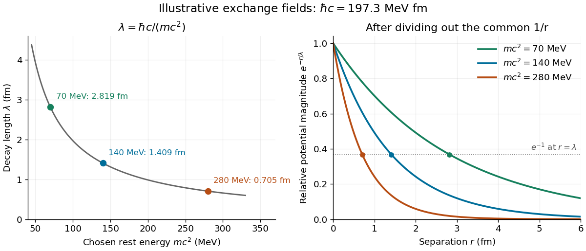

# Nuclear force

↑ **Parent:** [Nuclear physics](physics.md#nuclear-physics)  
ⓦ [Wiki](https://en.wikipedia.org/wiki/Nuclear_force)

The residual [strong interaction](standard-model.md#strong-interaction) between [nucleons](physics.md#nucleon). Its long-distance part involves [pion](standard-model.md#pion) exchange and depends on [spin](angular-momentum-operator.md#spin) and [isospin](standard-model.md#isospin). It is distinct from directly exchanging gluons between color-singlet nucleons.

Why do [protons](physics.md#proton) and [neutrons](neutron.md) bind into an [atomic nucleus](atomic-nucleus.md), even though [protons](physics.md#proton) repel electrically? An attractive [nuclear force](nuclear-force.md) can lower the total [energy](energy.md) below that of separated [nucleons](physics.md#nucleon), producing [nuclear binding energy](atomic-nucleus.md#nuclear-binding-energy). The [deuteron](atomic-nucleus.md#deuteron), containing one [proton](physics.md#proton) and one [neutron](neutron.md), is the simplest such [bound state](quantum-system.md#bound-state).

In [Quantum chromodynamics](standard-model.md#quantum-chromodynamics), [nucleons](physics.md#nucleon) are composite [colour singlets](standard-model.md#colour-singlet) built from [quarks](standard-model.md#quark) and [gluons](standard-model.md#gluon). Their residual [nuclear force](nuclear-force.md) has a longest-range strong contribution from [one-pion exchange](#one-pion-exchange), with additional interactions at shorter distances.[Modern Theory of Nuclear Forces, inspected preprint sections I and I.B](physics-bibliography.md#modern-theory-of-nuclear-forces-by-evgeny-epelbaum-and-others)

**Table of contents**

- [Nuclear matter saturation](#nuclear-matter-saturation)
- [Neutron-proton radiative capture](#neutron-proton-radiative-capture)
- [Diproton](#diproton)
- [Dineutron](#dineutron)
- [Charge independence of nuclear forces](#charge-independence-of-nuclear-forces)
- [Yukawa meson theory of nuclear forces](#yukawa-meson-theory-of-nuclear-forces)
  - [Static Yukawa Green function](#static-yukawa-green-function)
  - [Mass and range of a nuclear exchange field](#mass-and-range-of-a-nuclear-exchange-field)
- [One-pion exchange](#one-pion-exchange)
  - [Nuclear tensor force](#nuclear-tensor-force)
    - [Deuteron quadrupole evidence for a tensor force](#deuteron-quadrupole-evidence-for-a-tensor-force)

## Nuclear matter saturation

↑ **Parent:** [Nuclear force](nuclear-force.md)

The approximately bounded [binding energy per nucleon](atomic-nucleus.md#binding-energy-per-nucleon) and approximately constant interior density of well-bound medium and heavy nuclei. The short effective range and many-body character of the [nuclear force](nuclear-force.md) prevent each nucleon from binding independently to every other nucleon with an unsuppressed long-range attraction.

## Neutron-proton radiative capture

↑ **Parent:** [Nuclear force](nuclear-force.md)

Formation of a [deuteron](atomic-nucleus.md#deuteron) from a [neutron](neutron.md) and a [proton](physics.md#proton) with [photon](quantum-mechanics.md#photon) emission. For an initial pair at rest, two-body [energy](energy.md) and [momentum](momentum.md) conservation gives $E_\gamma=B-B^2/[2(m_p+m_n)]$ in [natural units](mathematical-physics.md#natural-units), where $B=m_p+m_n-m_d$. The missing [binding energy](energy.md#binding-energy) becomes [nuclear recoil](atomic-nucleus.md#nuclear-recoil).

## Diproton

↑ **Parent:** [Nuclear force](nuclear-force.md)

A two-[proton](physics.md#proton) system. Its low-energy spin-singlet strong channel does not give a vacuum [bound state](quantum-system.md#bound-state), and electrostatic repulsion further opposes binding. This is distinct from [proton](physics.md#proton) pairing correlations within an [atomic nucleus](atomic-nucleus.md).

## Dineutron

↑ **Parent:** [Nuclear force](nuclear-force.md)

A two-[neutron](neutron.md) system. At low [orbital angular momentum](quantum-mechanics.md#orbital-angular-momentum) its identical-fermion exchange symmetry forces the spin-singlet, isospin-one channel; there is no bound [dineutron](#dineutron) in vacuum at physical parameters. This does not forbid correlated [neutron](neutron.md) pairs inside larger nuclei.

## Charge independence of nuclear forces

↑ **Parent:** [Nuclear force](nuclear-force.md)

The approximate invariance of the strong [nuclear force](nuclear-force.md) under [isospin](standard-model.md#isospin) rotations. It compares channels with the same [spin](angular-momentum-operator.md#spin), orbital and total-isospin quantum numbers; it does not identify the spin-triplet isospin-zero [deuteron](atomic-nucleus.md#deuteron) channel with the spin-singlet isospin-one neutron-neutron channel. Electromagnetic effects and [quark](standard-model.md#quark) [mass](classical-mechanics.md#mass) differences break the approximation.

## Yukawa meson theory of nuclear forces

↑ **Parent:** [Nuclear force](nuclear-force.md)

In 1935, [Hideki Yukawa](physicist.md#hideki-yukawa) proposed a new massive exchange quantum to explain [nucleon](physics.md#nucleon) binding. His paper began with the inadequacy of an [electron](physics.md#electron)–[neutrino](standard-model.md#neutrino) exchange description of the binding strength. It then required a [potential energy](energy.md#potential-energy) falling faster with distance than a [Coulomb potential](electrostatics.md#coulomb-potential-energy), introduced an exponentially decaying field, and related its inverse range to the exchange particle's [rest mass](special-relativity.md#invariant-mass). This was a theoretical proposal, not a detection with an apparatus of his own.[On the Interaction of Elementary Particles. I, opening motivation, equations (1)–(3) and (12); text inspected in a retypeset mirror](physics-bibliography.md#on-the-interaction-of-elementary-particles-i-by-hideki-yukawa)

The crucial idea is that a finite [rest mass](special-relativity.md#invariant-mass) supplies a length scale even in empty space. In a scalar model, the static limit of a [Klein-Gordon equation](wave-equation.md#klein-gordon-equation) produces the [modified Helmholtz equation](partial-differential-equation.md#modified-helmholtz-equation). Its decaying [Green's function](green-s-function.md) gives the [Yukawa potential](electromagnetism.md#yukawa-potential). The derivation below isolates this range mechanism; [one-pion exchange](#one-pion-exchange) also carries [spin](angular-momentum-operator.md#spin) and [isospin](standard-model.md#isospin) structure.

The [nuclear emulsion track experiment](photography.md#nuclear-emulsion-track-experiment) used developed [photographic emulsions](photography.md#photographic-emulsion) exposed to [cosmic rays](galaxy.md#cosmic-ray) and inspected microscopically. Stopping [pions](standard-model.md#pion) gave daughter [muon](standard-model.md#muon) tracks with closely grouped ranges. Comparing penetrating [muons](standard-model.md#muon) with [pion](standard-model.md#pion)-induced nuclear breakup distinguished their interactions; this was not a direct static [force](force.md) measurement. The [muon](standard-model.md#muon) is a [lepton](standard-model.md#lepton), not Yukawa's strongly interacting [meson](physics.md#meson).[The Cosmic Radiation, printed pp. 144–145 and 151–152, especially Fig. 5; inspected in the Columbia-hosted Nobel volume](physics-bibliography.md#the-cosmic-radiation-by-cecil-frank-powell)

### Static Yukawa Green function

↑ **Parent:** [Yukawa meson theory of nuclear forces](#yukawa-meson-theory-of-nuclear-forces)

Let $\kappa>0$ be an inverse length. In three spatial dimensions, seek the [Green's function](green-s-function.md) that decays at infinity and satisfies

$$
(-\nabla^2+\kappa^2)G_\kappa(\mathbf r)=\delta^{(3)}(\mathbf r),\qquad r=|\mathbf r|,
$$

where $\nabla^2$ is the [Laplacian](multivariable-calculus.md#laplacian) and $\delta^{(3)}$ the three-dimensional [Dirac delta function](distribution-theory.md#dirac-delta-function). The [point source](fluid-mechanics.md#point-source) and the [differential operator](analysis.md#differential-operator) have [spherical symmetry](geometry-and-topology.md#spherical-symmetry). For $r>0$, the [radial Laplacian](partial-differential-equation.md#radial-laplacian) gives

$$
G_\kappa''+\frac2rG_\kappa'-\kappa^2G_\kappa=0.
$$

Writing $u(r)=rG_\kappa(r)$ reduces this to $u''-\kappa^2u=0$. Decay at infinity removes the growing [exponential function](calculus.md#exponential-function), leaving $G_\kappa(r)=C e^{-\kappa r}/r$.

The [Dirac delta function](distribution-theory.md#dirac-delta-function) fixes the coefficient. Integrating over a ball $B_\epsilon$ and using the [divergence theorem](multivariable-calculus.md#divergence-theorem) gives

$$
-4\pi\epsilon^2G_\kappa'(\epsilon)+\kappa^2\int_{B_\epsilon}G_\kappa\,d^3r=1.
$$

The first term tends to $4\pi C$, while the second is $O(\epsilon^2)$. Hence $C=1/(4\pi)$ and

$$
G_\kappa(r)=\frac{e^{-\kappa r}}{4\pi r}.
$$

This solves the source equation in the sense of [distributions](distribution-theory.md#distribution-mathematical-analysis), including at the origin. Merely verifying the equation for $r>0$ would leave the normalization undetermined. The limit $\kappa\to0$ at fixed $r>0$ is $1/(4\pi r)$, the [Green function of the Laplacian](partial-differential-equation.md#green-function-of-the-laplacian) for the convention $-\nabla^2$.

For an attractive scalar toy interaction, absorb constants into $A>0$ and set

$$
V(r)=-A\frac{e^{-\kappa r}}r,\qquad F_r=-\frac{dV}{dr}=-A\frac{e^{-\kappa r}}{r^2}(1+\kappa r).
$$

Here $A$ has units of [energy](energy.md) times length, and negative $F_r$ points inward. At equal $A$, comparison with the unscreened model $V_0=-A/r$ gives

$$
\frac{|V|}{|V_0|}=e^{-x},\qquad \frac{|F_r|}{|F_{0r}|}=(1+x)e^{-x},\qquad x=\kappa r.
$$

Thus the [potential energy](energy.md#potential-energy) and [force](force.md) have the same exponential scale but different suppression factors. At $x=1$, these ratios are approximately $0.368$ and $0.736$; at $x=3$, they are $0.0498$ and $0.199$. Finite range means rapid decay, not an abrupt cutoff.

**[Figure 1](#image-the-yukawa-green-function-and-its-decay-relative-to-the-coulomb-kernel). The Yukawa Green function and its decay relative to the Coulomb kernel**. Original scalar-model calculation. Left: $4\pi G_\kappa/\kappa=e^{-x}/x$ compared with the unscreened $1/x$, for $x=\kappa r>0$. Right: relative [potential energy](energy.md#potential-energy) and radial [force](force.md) magnitudes. The source singularity is excluded from the plotted interval; this is not a measured [nucleon](physics.md#nucleon) [potential energy](energy.md#potential-energy) or a model of its core.

### Mass and range of a nuclear exchange field

↑ **Parent:** [Yukawa meson theory of nuclear forces](#yukawa-meson-theory-of-nuclear-forces)

A free scalar [Klein-Gordon equation](wave-equation.md#klein-gordon-equation) with [rest mass](special-relativity.md#invariant-mass) $m$ is

$$
\left(\frac1{c^2}\frac{\partial^2}{\partial t^2}-\nabla^2+\frac{m^2c^2}{\hbar^2}\right)\phi=0.
$$

Here $c$ is the [speed of light](special-relativity.md#speed-of-light) and $\hbar$ the reduced [Planck constant](quantum-mechanics.md#planck-constant). In the static limit, comparison with the [static Yukawa Green function](#static-yukawa-green-function) identifies

$$
\kappa=\frac{mc}{\hbar},\qquad \lambda=\kappa^{-1}=\frac{\hbar}{mc}=\frac{\hbar c}{mc^2}.
$$

This $\lambda$ is the reduced [Compton wavelength](mathematical-physics.md#compton-wavelength), rather than $h/(mc)$; the two differ by $2\pi$. It is an exponential decay length of this exchange field, not the geometric size of a [nucleon](physics.md#nucleon) or an exact radius of a [bound state](quantum-system.md#bound-state). This article uses $\lambda$ for a length; the 1935 paper used that letter for its inverse.

For a deliberately rounded worked example, stipulate $\hbar c=197.3\,\mathrm{MeV\,fm}$ and $mc^2=140\,\mathrm{MeV}$. Then

$$
\lambda=\frac{197.3}{140}\,\mathrm{fm}=1.4092857\ldots\,\mathrm{fm}\approx1.41\,\mathrm{fm},\qquad \kappa\approx0.70958\,\mathrm{fm}^{-1}.
$$

A [femtometre](physics.md#femtometre) is $10^{-15}\,\mathrm m$. The chosen [rest energy](special-relativity.md#rest-energy) is a convenient [pion](standard-model.md#pion)-scale input; neither it nor the resulting [Yukawa potential](electromagnetism.md#yukawa-potential) is asserted to be an exact measured nuclear interaction. Holding $\hbar c$ fixed, chosen [rest energies](special-relativity.md#rest-energy) $70$, $140$ and $280\,\mathrm{MeV}$ give lengths $2.819$, $1.409$ and $0.7046\,\mathrm{fm}$. Doubling the exchange [rest mass](special-relativity.md#invariant-mass) halves the decay length.

**[Figure 2](#image-heavier-exchange-fields-have-shorter-yukawa-decay-lengths). Heavier exchange fields have shorter Yukawa decay lengths**. Original comparisons using stipulated $\hbar c=197.3\,\mathrm{MeV\,fm}$ and illustrative [rest energies](special-relativity.md#rest-energy) $70$, $140$ and $280\,\mathrm{MeV}$. Left: inverse relation between [rest energy](special-relativity.md#rest-energy) and $\lambda$. Right: the relative scalar [potential energy](energy.md#potential-energy) magnitude $e^{-r/\lambda}$ after dividing out the common $1/r$ factor. No interaction strength or experimental [nuclear force](nuclear-force.md) curve is fitted.

Range alone does not guarantee binding: the [potential energy](energy.md#potential-energy) must overcome the [kinetic energy](energy.md#kinetic-energy) cost of localizing a [wavefunction](wave-function.md). The existing [exponential variational bound for the Yukawa potential](quantum-mechanics.md#exponential-variational-bound-for-the-yukawa-potential) makes this precise. For the same toy $V$, with [reduced mass](classical-mechanics.md#reduced-mass) $M$, choosing a normalized exponential [wavefunction](wave-function.md) proportional to $e^{-\alpha r}$ with $\alpha=\kappa/2$ yields

$$
\langle H\rangle=\frac{\hbar^2\kappa^2}{8M}-\frac{A\kappa}{8}.
$$

For additional stipulated inputs $Mc^2=470\,\mathrm{MeV}$ and $A=100\,\mathrm{MeV\,fm}$, this gives $\langle H\rangle\approx-3.66\,\mathrm{MeV}$. A negative value proves a [bound state](quantum-system.md#bound-state) in this scalar model by the [quantum variational principle](quantum-mechanics.md#quantum-variational-principle); it is an upper bound on its [ground-state energy](quantum-mechanics.md#ground-state-energy), not a prediction for the [deuteron](atomic-nucleus.md#deuteron). A nonnegative trial value would not prove the absence of binding.

## One-pion exchange

↑ **Parent:** [Nuclear force](nuclear-force.md)

Although the [pion](standard-model.md#pion) has [spin](angular-momentum-operator.md#spin) zero, [one-pion exchange](#one-pion-exchange) depends on [nucleon](physics.md#nucleon) [spin](angular-momentum-operator.md#spin) and [isospin](standard-model.md#isospin) and includes a [nuclear tensor force](#nuclear-tensor-force). Shorter-range and multiple-[nucleon](physics.md#nucleon) interactions also matter. The scalar [Yukawa potential](electromagnetism.md#yukawa-potential) isolates a range mechanism rather than specifying the complete [nuclear force](nuclear-force.md).[Modern Theory of Nuclear Forces, inspected preprint sections I.B and II.B, especially equation (2.11) and Fig. 12](physics-bibliography.md#modern-theory-of-nuclear-forces-by-evgeny-epelbaum-and-others)

### Nuclear tensor force

↑ **Parent:** [One-pion exchange](#one-pion-exchange)

The [linear operator](vector-space.md#linear-operator) $V_T(r)S_{12}$ couples [nucleon](physics.md#nucleon) [spin](angular-momentum-operator.md#spin) orientations to their separation direction $\hat{\mathbf r}$. Here $\boldsymbol\sigma_i$ are [Pauli matrices](algebra.md#pauli-matrices). A scalar radial [potential energy](energy.md#potential-energy) alone omits this directional dependence.

#### Deuteron quadrupole evidence for a tensor force

↑ **Parent:** [Nuclear tensor force](#nuclear-tensor-force)

An isotropic pure $L=0$ spatial state has zero [electric quadrupole moment](electrostatics.md#electric-quadrupole-moment). The nonzero [deuteron](atomic-nucleus.md#deuteron) quadrupole moment consequently requires anisotropic structure. With ground-state $J^P=1^+$, a [nuclear tensor force](#nuclear-tensor-force) can mix $\,{}^3S_1$ and $\,{}^3D_1$ waves while preserving total [angular momentum](momentum.md#angular-momentum) and [parity](quantum-mechanics.md#parity). A purely central spin-independent potential cannot produce this mixing. The inference of an orientation-dependent force was already explicit in 1939.[Abstract and opening discussion, Nature 144, 476–477](physics-bibliography.md#the-electric-quadrupole-moment-of-the-deuteron-and-the-field-theory-of-nuclear-forces-by-christian-moller-and-leon-rosenfeld)

## ↑ Ancestors (3)

1. [Nuclear physics](physics.md#nuclear-physics)
2. [Physics](physics.md)
3. [Codex Wiki](README.md)

## ← Incoming links (18)

- [Atomic nucleus](atomic-nucleus.md)
- [Charge independence of nuclear forces](#charge-independence-of-nuclear-forces)
- [Coulomb excitation](atomic-nucleus.md#coulomb-excitation)
- [Mass and range of a nuclear exchange field](#mass-and-range-of-a-nuclear-exchange-field)
- [Nobel Prize in Physics in 1949](nobel-prize-in-physics.md#nobel-prize-in-physics-in-1949)
- [Nuclear charge distribution](atomic-nucleus.md#nuclear-charge-distribution)
- [Nuclear force](nuclear-force.md)
- [Nuclear matter saturation](#nuclear-matter-saturation)
- [Nuclear physics](physics.md#nuclear-physics)
- [Nuclear shell model](atomic-nucleus.md#nuclear-shell-model)
- [One-pion exchange](#one-pion-exchange)
- [Solution](past-exam-of-the-mathematics-course-of-the-university-of-cambridge/2016/iii/paper-308.md#3/solution)
- [Solution](past-exam-of-the-particle-and-nuclear-physics-course-of-the-university-of-cambridge/2012/paper-1.md#2/c/solution)
- [Solution](past-exam-of-the-particle-and-nuclear-physics-course-of-the-university-of-cambridge/2015/paper-1.md#2/c/solution)
- [Solution](past-exam-of-the-particle-and-nuclear-physics-course-of-the-university-of-cambridge/2021.md#section-b/6/a/solution)
- [Pion decay at rest in emulsion](photography.md#pion-decay-at-rest-in-emulsion)
- [Rutherford model](atomic-physics.md#rutherford-model)
- [Rutherford scattering](atomic-physics.md#rutherford-scattering)
