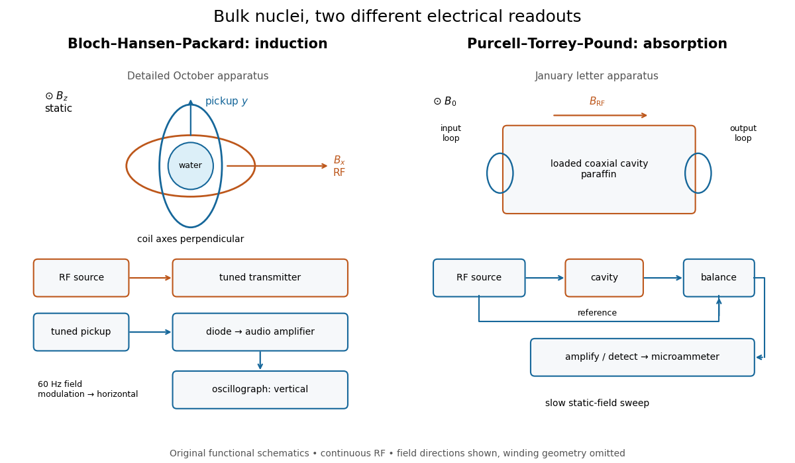
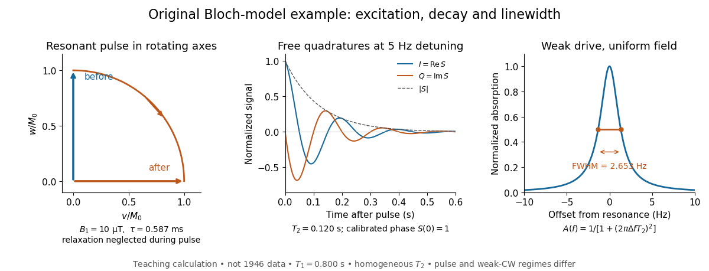

# Nuclear magnetic resonance

↑ **Parent:** [Chemistry](chemistry.md)  
ⓦ [Wiki](https://en.wikipedia.org/wiki/Nuclear_magnetic_resonance)

[Nuclear magnetic resonance](nuclear-magnetic-resonance.md) detects the response of [atomic nuclei](atomic-nucleus.md) with a [magnetic moment](electromagnetism.md#magnetic-dipole-moment) to a [radio frequency](wave.md#radio-frequency) [magnetic field](magnetic-field.md) in a steady [magnetic field](magnetic-field.md). Its striking possibility is to measure a nuclear property through an ordinary electrical [signal](electrical-engineering.md#signal) from a bulk sample: an enormous number of tiny [magnetic moments](electromagnetism.md#magnetic-dipole-moment) can produce a measurable change in a receiving circuit.

For a nucleus with [spin angular momentum](angular-momentum-operator.md#spin) $\mathbf J$, define its [gyromagnetic ratio](electromagnetism.md#gyromagnetic-ratio) by $\boldsymbol\mu=\gamma\mathbf J$. Throughout this article $\gamma$ is angular, measured in radians per second per tesla; $\gamma/(2\pi)$ is the corresponding value in cycles per second per tesla. With $\mathbf B_0=B_0\hat{\mathbf z}$, the [Hamiltonian](hamiltonian-mechanics.md#hamiltonian) is $H=-\gamma B_0J_z$. Adjacent [energy levels](quantum-mechanics.md#energy-level) differ by

$$
\Delta E=\hbar|\gamma|B_0,\qquad \omega_0=|\gamma|B_0,\qquad f_0=\frac{|\gamma|B_0}{2\pi}.
$$

Thus a measured resonance [frequency](wave.md#frequency) and a calibrated [magnetic field](magnetic-field.md) determine $|\gamma|$. Converting that into a [nuclear magnetic moment](electromagnetism.md#nuclear-magnetic-moment) also requires the [spin](angular-momentum-operator.md#spin) quantum number: the maximum projection has magnitude $|\gamma|\hbar I$. This simple experiment does not by itself determine the sign of $\gamma$.

The [Rabi molecular beam magnetic resonance experiment](quantum-system.md#rabi-molecular-beam-magnetic-resonance-experiment) detects transitions through changes in a selected [molecular beam](physics.md#molecular-beam). The bulk experiments below instead detect electrical consequences of nuclear [magnetization](electromagnetism.md#magnetization) in matter at ordinary density. A small [Boltzmann distribution](thermodynamics.md#boltzmann-distribution) population imbalance is multiplied by a very large number of nuclei. For noninteracting [spin one-half](angular-momentum-operator.md#spin-one-half) nuclei of number density $n$ and positive $\gamma$, their equilibrium [magnetization](electromagnetism.md#magnetization) is

$$
M_0=n\frac{\gamma\hbar}{2}\tanh\!\left(\frac{\gamma\hbar B_0}{2k_{\rm B}T}\right).
$$

This follows by weighting the two projections $\pm\gamma\hbar/2$ with their [Boltzmann distribution](thermodynamics.md#boltzmann-distribution) probabilities. It explains both the smallness of the bulk polarization at ordinary [temperature](temperature.md) and the value of many nuclei contributing to one receiving circuit.

[NMR spectroscopy](nuclear-magnetic-resonance.md) measures resonant responses of [atomic nuclei](atomic-nucleus.md) to applied [electromagnetic radiation](electromagnetic-radiation.md) in a [magnetic field](magnetic-field.md). In [residual-group monitoring of polyurethane formation](polymer.md#residual-group-monitoring-of-polyurethane-formation), distinguishable signal [integrals](integral.md) supply a relative residual-group readout; overlap or very weak signals can limit that inference.

**Table of contents**

- [NMR signal integration](#nmr-signal-integration)
- [NMR signal multiplicity](#nmr-signal-multiplicity)
- [Silicon-29 nuclear magnetic resonance](#silicon-29-nuclear-magnetic-resonance)
- [ABX3 spin system](#abx3-spin-system)
- [NMR scalar coupling](#nmr-scalar-coupling)
- [NMR cross-relaxation](#nmr-cross-relaxation)
- [DOSY](#dosy)
- [NMR line narrowing](#nmr-line-narrowing)
- [NMR motional correlation time](#nmr-motional-correlation-time)
- [DEPT-135](#dept-135)
- [HMBC](#hmbc)
- [HSQC](#hsqc)
- [COSY](#cosy)
- [Lithium NMR](#lithium-nmr)
- [NMR timescale](#nmr-timescale)
- [Magnetic resonance imaging](#magnetic-resonance-imaging)
  - [Magnetic resonance k-space](#magnetic-resonance-k-space)
- [Cryogenic NMR probe](#cryogenic-nmr-probe)
- [Dynamic nuclear polarization](#dynamic-nuclear-polarization)
- [Solid-state nuclear magnetic resonance](#solid-state-nuclear-magnetic-resonance)
  - [Magic angle spinning](#magic-angle-spinning)
- [Paramagnetic relaxation enhancement](#paramagnetic-relaxation-enhancement)
- [Residual dipolar coupling](#residual-dipolar-coupling)
- [Nuclear Overhauser effect](#nuclear-overhauser-effect)
  - [Nuclear spin diffusion](#nuclear-spin-diffusion)
  - [ROESY](#roesy)
  - [NOESY](#noesy)
- [Nuclear spin relaxation](#nuclear-spin-relaxation)
- [Transverse relaxation-optimized spectroscopy](#transverse-relaxation-optimized-spectroscopy)
  - [Methyl-TROSY](#methyl-trosy)
- [Chemical exchange in NMR](#chemical-exchange-in-nmr)
  - [Fast exchange limit in NMR](#fast-exchange-limit-in-nmr)
- [Boron-11 nuclear magnetic resonance](#boron-11-nuclear-magnetic-resonance)
- [Phosphorus-31 nuclear magnetic resonance](#phosphorus-31-nuclear-magnetic-resonance)
- [Proton nuclear magnetic resonance](#proton-nuclear-magnetic-resonance)
- [Fluorine-19 NMR](#fluorine-19-nmr)
- [Carbon-13 NMR](#carbon-13-nmr)
  - [Attached proton test](#attached-proton-test)
- [Proton decoupling](#proton-decoupling)
  - [Proton-decoupled NMR](#proton-decoupled-nmr)
- [NMR signal integral](#nmr-signal-integral)
- [Scalar spin-spin coupling](#scalar-spin-spin-coupling)
  - [Acetal-alkyne long-range coupling](#acetal-alkyne-long-range-coupling)
  - [Vinylic scalar coupling](#vinylic-scalar-coupling)
    - [Cis vinylic coupling](#cis-vinylic-coupling)
    - [Trans vinylic coupling](#trans-vinylic-coupling)
  - [NMR multiplet](#nmr-multiplet)
    - [NMR sextet](#nmr-sextet)
    - [Quartet of quartets](#quartet-of-quartets)
    - [Doublet of quartets](#doublet-of-quartets)
    - [Doublet of doublets of triplets](#doublet-of-doublets-of-triplets)
    - [NMR septet](#nmr-septet)
    - [NMR quartet](#nmr-quartet)
    - [NMR triplet](#nmr-triplet)
    - [NMR doublet](#nmr-doublet)
    - [NMR singlet](#nmr-singlet)
  - [Long-range scalar coupling](#long-range-scalar-coupling)
    - [Allylic scalar coupling](#allylic-scalar-coupling)
  - [First-order NMR multiplet](#first-order-nmr-multiplet)
    - [Doublet of triplets](#doublet-of-triplets)
    - [Doublet of doublets](#doublet-of-doublets)
    - [Apparent NMR quartet](#apparent-nmr-quartet)
  - [NMR coupling constant](#nmr-coupling-constant)
    - [Geminal coupling](#geminal-coupling)
    - [Vicinal coupling](#vicinal-coupling)
- [Karplus equation](#karplus-equation)
- [NMR relaxation dispersion](#nmr-relaxation-dispersion)
- [Chemical shift](#chemical-shift)
  - [Chemical equivalence in NMR](#chemical-equivalence-in-nmr)
  - [NMR multiplet centre](#nmr-multiplet-centre)
  - [Chemical shift anisotropy](#chemical-shift-anisotropy)
- [Bloch nuclear induction experiment](#bloch-nuclear-induction-experiment)
- [Purcell nuclear resonance absorption experiment](#purcell-nuclear-resonance-absorption-experiment)
- [Bloch equations](#bloch-equations)
  - [Longitudinal nuclear spin relaxation](#longitudinal-nuclear-spin-relaxation)
  - [Transverse nuclear magnetization decay](#transverse-nuclear-magnetization-decay)
- [Free induction decay](#free-induction-decay)
- [Continuous-wave nuclear magnetic resonance](#continuous-wave-nuclear-magnetic-resonance)
  - [Nuclear magnetic resonance saturation](#nuclear-magnetic-resonance-saturation)
  - [Nuclear resonance linewidth](#nuclear-resonance-linewidth)
- [Spin echo](#spin-echo)
  - [Static inhomogeneity refocusing](#static-inhomogeneity-refocusing)
  - [Hahn spin echo experiment](#hahn-spin-echo-experiment)
  - [Diffusion attenuation of a spin echo](#diffusion-attenuation-of-a-spin-echo)

## NMR signal integration

↑ **Parent:** [Nuclear magnetic resonance](nuclear-magnetic-resonance.md)

Use of integrated peak areas to estimate relative numbers of resonant nuclei.

## NMR signal multiplicity

↑ **Parent:** [Nuclear magnetic resonance](nuclear-magnetic-resonance.md)

The number and relative intensities of lines into which an [NMR](nuclear-magnetic-resonance.md) signal is split by scalar spin coupling.

## Silicon-29 nuclear magnetic resonance

↑ **Parent:** [Nuclear magnetic resonance](nuclear-magnetic-resonance.md)

[nuclear magnetic resonance](nuclear-magnetic-resonance.md) of the spin-one-half isotope $^{29}\mathrm{Si}$. Equivalent [silicon](chemical-substance.md#silicon) sites give the same isotropic [chemical shift](#chemical-shift), while condensation and [silanol](chemical-substance.md#silanol) substitution can distinguish environments. Line heights alone are not quantitative populations.

## ABX3 spin system

↑ **Parent:** [Nuclear magnetic resonance](nuclear-magnetic-resonance.md)

A [spin](angular-momentum-operator.md#spin) system with two distinguishable, mutually coupled [spins](angular-momentum-operator.md#spin) A and B, each coupled to three equivalent X [spins](angular-momentum-operator.md#spin). An ethoxy methylene with nonequivalent hydrogens can display this pattern; small A/B chemical-shift separation relative to their coupling produces second-order distortion.

## NMR scalar coupling

↑ **Parent:** [Nuclear magnetic resonance](nuclear-magnetic-resonance.md)

Indirect coupling of nuclear spins mediated by bonding [electrons](physics.md#electron).

## NMR cross-relaxation

↑ **Parent:** [Nuclear magnetic resonance](nuclear-magnetic-resonance.md)

Coupled relaxation of nuclear-spin populations through their mutual interactions.

## DOSY

↑ **Parent:** [Nuclear magnetic resonance](nuclear-magnetic-resonance.md)

Diffusion-ordered spectroscopy, separating [NMR](nuclear-magnetic-resonance.md) signals by molecular translational [diffusion](thermodynamics.md#diffusion).

## NMR line narrowing

↑ **Parent:** [Nuclear magnetic resonance](nuclear-magnetic-resonance.md)

[reduction](chemical-reaction.md#reduction-chemistry) of a resonance linewidth when motion averages otherwise distinct local magnetic environments. The onset probes a motional timescale but does not by itself establish long-range transport.

## NMR motional correlation time

↑ **Parent:** [Nuclear magnetic resonance](nuclear-magnetic-resonance.md)

The decay timescale of the local magnetic-field fluctuations that relax a nuclear [spin](angular-momentum-operator.md#spin). Its relation to a tracer jump waiting time depends on geometry and the microscopic stochastic model.

## DEPT-135

↑ **Parent:** [Nuclear magnetic resonance](nuclear-magnetic-resonance.md)

A polarization-transfer carbon NMR experiment giving opposite phases to CH-two versus CH/CH-three signals in its usual convention; nonprotonated carbons are absent. Combined with other spectra it distinguishes methylene, methyl/methine and quaternary sites.

## HMBC

↑ **Parent:** [Nuclear magnetic resonance](nuclear-magnetic-resonance.md)

Heteronuclear multiple-bond correlation: an experiment commonly detecting proton-carbon scalar coupling across two or three bonds. Occasional longer-range peaks, missing peaks and intensity variations require cautious interpretation.

## HSQC

↑ **Parent:** [Nuclear magnetic resonance](nuclear-magnetic-resonance.md)

Heteronuclear single-quantum coherence: a two-dimensional experiment commonly correlating a proton with its directly bonded carbon through one-bond scalar coupling.

## COSY

↑ **Parent:** [Nuclear magnetic resonance](nuclear-magnetic-resonance.md)

Correlation spectroscopy: a two-dimensional proton NMR experiment whose cross peaks identify scalar-coupled proton pairs. Overlap can prevent a unique letter-by-letter assignment.

## Lithium NMR

↑ **Parent:** [Nuclear magnetic resonance](nuclear-magnetic-resonance.md)

[Nuclear magnetic resonance](nuclear-magnetic-resonance.md) using lithium isotopes. Lithium-6 has spin 1 and a small quadrupole moment, often giving narrower aggregate resonances than lithium-7.

## NMR timescale

↑ **Parent:** [Nuclear magnetic resonance](nuclear-magnetic-resonance.md)

The timescale relevant to resolving exchange between resonance frequencies. Fast and slow are relative to the frequency separation and measurement, not absolute labels for molecular motion.

## Magnetic resonance imaging

↑ **Parent:** [Nuclear magnetic resonance](nuclear-magnetic-resonance.md)

Imaging based on spatial encoding of [nuclear magnetic resonance](nuclear-magnetic-resonance.md) signals. Acquisition and reconstruction choices determine which physical contrasts can be measured.

### Magnetic resonance k-space

↑ **Parent:** [Magnetic resonance imaging](#magnetic-resonance-imaging)

The spatial Fourier-frequency coordinates sampled by a magnetic-resonance acquisition. With gyromagnetic ratio in radians per time per field, the displayed expression is in cycles per length. Signal phase, gradient history and sequence refocusing determine the trajectory; the samples require reconstruction to form a spatial image.

## Cryogenic NMR probe

↑ **Parent:** [Nuclear magnetic resonance](nuclear-magnetic-resonance.md)

A detection probe with cooled electronic components to reduce noise and improve sensitivity. The sample need not itself be cooled to the electronics [temperature](temperature.md).

## Dynamic nuclear polarization

↑ **Parent:** [Nuclear magnetic resonance](nuclear-magnetic-resonance.md)

Transfer of polarization from electron spins to nuclei to enhance [NMR](nuclear-magnetic-resonance.md) sensitivity. Added radicals and low-temperature conditions can alter spectral resolution and the states sampled.

## Solid-state nuclear magnetic resonance

↑ **Parent:** [Nuclear magnetic resonance](nuclear-magnetic-resonance.md)

[NMR measurements](nuclear-magnetic-resonance.md) on immobilized or slowly moving samples, using approaches such as decoupling, sample alignment or [magic angle spinning](#magic-angle-spinning) to manage anisotropic interactions.

### Magic angle spinning

↑ **Parent:** [Solid-state nuclear magnetic resonance](#solid-state-nuclear-magnetic-resonance)

Sample rotation about an axis at approximately $54.74^\circ$ to the field, averaging appropriate second-rank anisotropic interactions when spinning and pulse conditions are suitable.

## Paramagnetic relaxation enhancement

↑ **Parent:** [Nuclear magnetic resonance](nuclear-magnetic-resonance.md)

Additional nuclear relaxation associated with a paramagnetic centre. With appropriate controls, its distance dependence constrains molecular arrangement and transient contacts.

## Residual dipolar coupling

↑ **Parent:** [Nuclear magnetic resonance](nuclear-magnetic-resonance.md)

A coupling remaining when orientational averaging of a dipolar interaction is incomplete. It can constrain bond-vector orientation in a suitable alignment frame.

## Nuclear Overhauser effect

↑ **Parent:** [Nuclear magnetic resonance](nuclear-magnetic-resonance.md)

A change in one nuclear signal caused by perturbing another through cross-relaxation. Appropriate measurements constrain distances or molecular motions, with interpretation dependent on dynamics.

### Nuclear spin diffusion

↑ **Parent:** [Nuclear Overhauser effect](#nuclear-overhauser-effect)

Transfer of magnetization through a network of coupled spins, which can create indirect NOE correlations.

### ROESY

↑ **Parent:** [Nuclear Overhauser effect](#nuclear-overhauser-effect)

Rotating-frame Overhauser effect spectroscopy, using [NMR cross-relaxation](#nmr-cross-relaxation) during a spin-lock period.

### NOESY

↑ **Parent:** [Nuclear Overhauser effect](#nuclear-overhauser-effect)

Two-dimensional [nuclear Overhauser effect](#nuclear-overhauser-effect) spectroscopy, detecting [NMR cross-relaxation](#nmr-cross-relaxation) between nuclear spins.

## Nuclear spin relaxation

↑ **Parent:** [Nuclear magnetic resonance](nuclear-magnetic-resonance.md)

Evolution of nuclear-spin populations and coherences toward equilibrium. Different relaxation measurements report different aspects of molecular motion.

## Transverse relaxation-optimized spectroscopy

↑ **Parent:** [Nuclear magnetic resonance](nuclear-magnetic-resonance.md)

[NMR](nuclear-magnetic-resonance.md) methods selecting slowly relaxing coherence components through interference between relaxation mechanisms. Appropriate labelling and field conditions extend measurements to larger assemblies.

### Methyl-TROSY

↑ **Parent:** [Transverse relaxation-optimized spectroscopy](#transverse-relaxation-optimized-spectroscopy)

Methyl-based [NMR](nuclear-magnetic-resonance.md) strategies exploiting favourable relaxation properties of selected methyl coherences, often with selective isotopic labelling in a largely deuterated [protein](protein.md).

## Chemical exchange in NMR

↑ **Parent:** [Nuclear magnetic resonance](nuclear-magnetic-resonance.md)

[Chemical exchange in NMR](#chemical-exchange-in-nmr) interconverts environments during the observation. Fast exchange relative to their frequency difference produces averaged shifts; slow exchange resolves separate sites. A single peak alone does not prove a single static geometry.

### Fast exchange limit in NMR

↑ **Parent:** [Chemical exchange in NMR](#chemical-exchange-in-nmr)

Exchange much faster than the resonance frequency difference gives one population-weighted resonance. The averaging does not prove a single static geometry.

## Boron-11 nuclear magnetic resonance

↑ **Parent:** [Nuclear magnetic resonance](nuclear-magnetic-resonance.md)

[Boron-11 nuclear magnetic resonance](#boron-11-nuclear-magnetic-resonance) probes boron environments. Rapid exchange can average inequivalent sites into one resonance; slow exchange reveals distinct sites. Quadrupolar relaxation and line broadening can complicate integration.

## Phosphorus-31 nuclear magnetic resonance

↑ **Parent:** [Nuclear magnetic resonance](nuclear-magnetic-resonance.md)

[Phosphorus-31 nuclear magnetic resonance](#phosphorus-31-nuclear-magnetic-resonance) observes spin-one-half phosphorus-31. An $A_2X$ system can show a two-phosphorus doublet and a one-phosphorus triplet; three inequivalent mutually coupled phosphorus sites can each give a doublet of doublets in the first-order limit.

## Proton nuclear magnetic resonance

↑ **Parent:** [Nuclear magnetic resonance](nuclear-magnetic-resonance.md)

[Proton nuclear magnetic resonance](#proton-nuclear-magnetic-resonance) measures resonances of hydrogen-1 nuclei. Structural signal counts require an explicit [symmetry](physics.md#symmetry-physics) and exchange-timescale model; exchangeable N–H or O–H signals can be broadened or lost.

## Fluorine-19 NMR

↑ **Parent:** [Nuclear magnetic resonance](nuclear-magnetic-resonance.md)

[NMR](nuclear-magnetic-resonance.md) observation of spin-$\tfrac12$ fluorine-19 nuclei. Coupling to nearby [protons](physics.md#proton) can split a resonance unless [proton decoupling](#proton-decoupling) is applied.

## Carbon-13 NMR

↑ **Parent:** [Nuclear magnetic resonance](nuclear-magnetic-resonance.md)

[NMR](nuclear-magnetic-resonance.md) observation of spin-$\tfrac12$ [carbon-13](chemical-substance.md#carbon-13) nuclei. Routine spectra often use [proton decoupling](#proton-decoupling), but this does not automatically decouple other spin-active nuclei.

### Attached proton test

↑ **Parent:** [Carbon-13 NMR](#carbon-13-nmr)

An NMR multiplicity-editing experiment in which carbon signals are separated by the parity of their attached proton count: CH and CH3 have one relative phase, while CH2 and nonprotonated carbons have the other. The absolute up/down convention depends on processing and is not a universal assignment.

## Proton decoupling

↑ **Parent:** [Nuclear magnetic resonance](nuclear-magnetic-resonance.md)

Irradiation that removes resolved [scalar spin-spin coupling](#scalar-spin-spin-coupling) to [protons](physics.md#proton) from another nucleus’s spectrum. Other couplings, such as carbon–fluorine coupling in a proton-decoupled [carbon-13 NMR](#carbon-13-nmr) spectrum, can remain.

### Proton-decoupled NMR

↑ **Parent:** [Proton decoupling](#proton-decoupling)

## NMR signal integral

↑ **Parent:** [Nuclear magnetic resonance](nuclear-magnetic-resonance.md)

The area of a resonance or multiplet, proportional to the contributing nuclear population under suitable excitation, relaxation and acquisition conditions. Relative proton integrals can count chemically distinct [protons](physics.md#proton).

## Scalar spin-spin coupling

↑ **Parent:** [Nuclear magnetic resonance](nuclear-magnetic-resonance.md)

Through-bond interaction between nuclear [spins](angular-momentum-operator.md#spin) that splits [NMR](nuclear-magnetic-resonance.md) resonances. In the weak-coupling limit, $n$ equivalent spin-$\tfrac12$ neighbours produce $n+1$ lines with [binomial coefficient](binomial-coefficient.md) intensities. Equivalent nuclei do not split each other.

### Acetal-alkyne long-range coupling

↑ **Parent:** [Scalar spin-spin coupling](#scalar-spin-spin-coupling)

[Proton](physics.md#proton) coupling across H-C-C≡C-H can resolve a small four-bond splitting. In a propargyl [acetal](chemical-substance.md#acetal) this connects the [acetal](chemical-substance.md#acetal) methine and terminal [alkyne](chemical-substance.md#alkyne) [proton](physics.md#proton).

### Vinylic scalar coupling

↑ **Parent:** [Scalar spin-spin coupling](#scalar-spin-spin-coupling)

Through-bond spin coupling involving vinylic nuclei. The geometry of a vicinal pathway across an alkene distinguishes cis and trans coupling.

#### Cis vinylic coupling

↑ **Parent:** [Vinylic scalar coupling](#vinylic-scalar-coupling)

[vicinal coupling](#vicinal-coupling) between [protons](physics.md#proton) on the same side of an alkene. A measured first-order splitting is an approximation if the spin system is appreciably strongly coupled.

#### Trans vinylic coupling

↑ **Parent:** [Vinylic scalar coupling](#vinylic-scalar-coupling)

[vicinal coupling](#vicinal-coupling) between [protons](physics.md#proton) on opposite sides of an alkene. In many ordinary terminal alkenes its magnitude exceeds the corresponding cis coupling.

### NMR multiplet

↑ **Parent:** [Scalar spin-spin coupling](#scalar-spin-spin-coupling)

A set of [resonance](dynamical-systems.md#resonance) lines arising from resolved spin coupling. Weak-coupling patterns can be assigned through coupling paths and line intensities; line count alone can be ambiguous.

#### NMR sextet

↑ **Parent:** [NMR multiplet](#nmr-multiplet)

An approximately six-line scalar-coupling pattern. Similar coupling to five spin-one-half partners can mimic a sextet even when those partners are not all chemically equivalent.

#### Quartet of quartets

↑ **Parent:** [NMR multiplet](#nmr-multiplet)

A first-order [NMR multiplet](#nmr-multiplet) produced by coupling to two distinct sets of three equivalent spin-one-half nuclei. Sixteen lines are possible; equal couplings can collapse the pattern to a septet.

#### Doublet of quartets

↑ **Parent:** [NMR multiplet](#nmr-multiplet)

A first-order [NMR multiplet](#nmr-multiplet) split into a doublet by one spin-one-half nucleus and into quartets by three equivalent spin-one-half nuclei. Ideally it has eight lines; overlap and second-order behavior can change its appearance.

#### Doublet of doublets of triplets

↑ **Parent:** [NMR multiplet](#nmr-multiplet)

A first-order [NMR multiplet](#nmr-multiplet) split successively by two distinct spin-one-half couplings and by two equivalent spin-one-half nuclei. Ideally it has twelve resolved lines before coincidences or further unresolved couplings.

#### NMR septet

↑ **Parent:** [NMR multiplet](#nmr-multiplet)

A seven-line [First-order NMR multiplet](#first-order-nmr-multiplet). Coupling to six equivalent spin-one-half neighbours gives the intensity ratio $1:6:15:20:15:6:1$.

#### NMR quartet

↑ **Parent:** [NMR multiplet](#nmr-multiplet)

A four-line first-order pattern, often from three equivalent spin-one-half neighbours, with intensities 1:3:3:1. Equal couplings to different groups can mimic it.

#### NMR triplet

↑ **Parent:** [NMR multiplet](#nmr-multiplet)

A three-line first-order pattern, often from two equivalent spin-one-half neighbours, with intensities 1:2:1.

#### NMR doublet

↑ **Parent:** [NMR multiplet](#nmr-multiplet)

A pair of lines with the first-order splitting expected for one spin-one-half neighbour. Additional unresolved or coincident interactions can complicate the pattern.

#### NMR singlet

↑ **Parent:** [NMR multiplet](#nmr-multiplet)

A [resonance](dynamical-systems.md#resonance) with no resolved scalar splitting under the acquisition conditions. This does not prove that every coupling is exactly zero.

### Long-range scalar coupling

↑ **Parent:** [Scalar spin-spin coupling](#scalar-spin-spin-coupling)

Through-bond coupling over a longer path, often four or more bonds. Small resolved allylic couplings can split alkene and oxygen-bound methylene signals and should not be discarded merely because vicinal couplings are larger.

#### Allylic scalar coupling

↑ **Parent:** [Long-range scalar coupling](#long-range-scalar-coupling)

Coupling across an allylic four-bond path, such as between an oxygen-bound CH2 group and terminal vinyl hydrogens in an allyl ester.

### First-order NMR multiplet

↑ **Parent:** [Scalar spin-spin coupling](#scalar-spin-spin-coupling)

The line pattern obtained when chemically distinguishable spin groups can be treated in the weak-coupling approximation. For an observed spin, each coupled neighbour contributes a frequency displacement of plus or minus half the relevant coupling; coincident lines add intensities.

#### Doublet of triplets

↑ **Parent:** [First-order NMR multiplet](#first-order-nmr-multiplet)

A first-order pattern combining a doublet splitting with a triplet splitting, commonly from one neighbour and a pair of equivalent neighbours.

#### Doublet of doublets

↑ **Parent:** [First-order NMR multiplet](#first-order-nmr-multiplet)

Splitting by two distinguishable spin-one-half neighbours with different resolved coupling magnitudes. The four line positions are displaced from the centre by every choice of plus or minus half of each coupling.

#### Apparent NMR quartet

↑ **Parent:** [First-order NMR multiplet](#first-order-nmr-multiplet)

Four equally spaced lines can arise from three equivalent neighbours or from coincident couplings to different groups. Combining a doublet with a triplet of the same spacing gives intensities 1:3:3:1; line count alone does not identify a unique topology.

### NMR coupling constant

↑ **Parent:** [Scalar spin-spin coupling](#scalar-spin-spin-coupling)

The frequency spacing $J$ of a first-order multiplet, expressed in [hertz](wave.md#hertz). For a spectrum at $\nu_0$ MHz, $J/\mathrm{Hz}=(\Delta\delta/\mathrm{ppm})(\nu_0/\mathrm{MHz})$. A bond-count superscript, such as ${}^3J$, specifies the coupling path.

#### Geminal coupling

↑ **Parent:** [NMR coupling constant](#nmr-coupling-constant)

#### Vicinal coupling

↑ **Parent:** [NMR coupling constant](#nmr-coupling-constant)

## Karplus equation

↑ **Parent:** [Nuclear magnetic resonance](nuclear-magnetic-resonance.md)  
ⓦ [Wiki](https://en.wikipedia.org/wiki/Karplus_equation)

A [Karplus equation](#karplus-equation) relates a vicinal scalar coupling to molecular torsion, often represented as $J=A\cos^2\phi+B\cos\phi+C$. Parameters depend on the chemical environment. A mobile molecule gives a population average of couplings, which is generally not the coupling evaluated at its mean angle.

## NMR relaxation dispersion

↑ **Parent:** [Nuclear magnetic resonance](nuclear-magnetic-resonance.md)

[NMR relaxation dispersion](#nmr-relaxation-dispersion) measures how an observed nuclear-spin relaxation rate changes with pulse timing or effective field conditions. Models can constrain exchange between molecular environments, including weakly populated conformations; rate and population estimates depend on the exchange model and information content.

## Chemical shift

↑ **Parent:** [Nuclear magnetic resonance](nuclear-magnetic-resonance.md)

A [chemical shift](#chemical-shift) measures an [NMR](nuclear-magnetic-resonance.md) resonance position relative to a reference. Electronic environments alter local magnetic shielding, so shifts can report a changed molecular environment without uniquely specifying a structure.

### Chemical equivalence in NMR

↑ **Parent:** [Chemical shift](#chemical-shift)

Nuclei with the same [resonance](dynamical-systems.md#resonance) frequency in the specified environment. Equivalent [chemical shifts](#chemical-shift) do not automatically imply magnetic equivalence when couplings to other nuclei differ.

### NMR multiplet centre

↑ **Parent:** [Chemical shift](#chemical-shift)

The chemical-shift position around which a first-order multiplet is split. A labelled outer line is not generally the resonance centre.

### Chemical shift anisotropy

↑ **Parent:** [Chemical shift](#chemical-shift)

Dependence of nuclear shielding and resonance frequency on molecular orientation relative to the magnetic field. Its modulation contributes to nuclear-spin relaxation.

## Bloch nuclear induction experiment

↑ **Parent:** [Nuclear magnetic resonance](nuclear-magnetic-resonance.md)

In their 1946 letter, [Felix Bloch](physicist.md#felix-bloch), [William Webster Hansen](physicist.md#william-webster-hansen), and [Martin Packard](physicist.md#martin-packard) reported [water](chemical-substance.md#water) at room [temperature](temperature.md). A steady [magnetic field](magnetic-field.md) along $z$ and an oscillating field along $x$ produced a [signal](electrical-engineering.md#signal) in a pickup coil along $y$, displayed on an [oscilloscope](wave-equation.md#oscilloscope). Some samples included paramagnetic additives to accelerate [thermal equilibrium](thermal-equilibrium.md). Resonance fields at two [frequencies](wave.md#frequency) gave the same field-to-frequency ratio, consistent with the [proton](physics.md#proton) value.[p. 127, Nuclear Induction, entire letter; geometry, water, additives, readout and two-frequency check](physics-bibliography.md#nuclear-induction-by-felix-bloch-and-others)

The detailed paper describes glass [water](chemical-substance.md#water) bulbs inside tuned receiving coils. Transmitter coils, shields and a conducting paddle controlled leakage. Field modulation at 60 Hz drove the horizontal [oscilloscope](wave-equation.md#oscilloscope) sweep. A [diode](electrical-circuit.md#diode) and audio amplification supplied the vertical trace. Vibration changed coupling: their largest difficulty. Coil tuning capacitors formed tank circuits. The actual receiver omitted the conceptual diagram's radiofrequency [amplifier](electrical-circuit.md#amplifier).[pp. 475–480, Figs. 1–4, APPARATUS and opening RESULTS; actual diode receiver versus conceptual amplifier](physics-bibliography.md#the-nuclear-induction-experiment-by-felix-bloch-and-others)

The orthogonal coil axes suppress direct transmitter pickup, but do not eliminate it. A field-dependent [signal](electrical-engineering.md#signal) at the nuclear resonance must be distinguished from leakage and [noise](electrical-engineering.md#noise-signal-processing); merely detecting a radiofrequency voltage is insufficient. This is why the field sweep and the independently checked field-to-frequency ratio matter.

## Purcell nuclear resonance absorption experiment

↑ **Parent:** [Nuclear magnetic resonance](nuclear-magnetic-resonance.md)

[Edward Mills Purcell](physicist.md#edward-mills-purcell), [Henry Cutler Torrey](physicist.md#henry-cutler-torrey), and [Robert Vivian Pound](physicist.md#robert-vivian-pound) placed [paraffin wax](chemical-substance.md#paraffin-wax) in a capacitively loaded coaxial cavity near 30 MHz between magnet poles. Coupling loops supplied and extracted power; oscillating and steady fields were perpendicular. Output balanced against a generator reference fed amplification, detection and a microammeter. A slow field sweep revealed absorption above fluctuations at room [temperature](temperature.md). Weak drive avoided population equalization. Calibration was rough; field inhomogeneity could contribute to linewidth.[pp. 37–38, apparatus and results; weak drive, balanced cavity output, microammeter, field sweep, calibration and linewidth limitations](physics-bibliography.md#resonance-absorption-by-nuclear-magnetic-moments-in-a-solid-by-edward-mills-purcell-and-others)

**[Figure 1](#image-two-electrical-routes-to-bulk-nuclear-magnetic-resonance). Two electrical routes to bulk nuclear magnetic resonance**. Original functional diagrams of the distinct instruments described above. Arrows show connections and field directions, not scale or winding geometry.

These are driven experiments with continuous radiofrequency excitation and changing static field, not demonstrations of modern pulsed [Fourier transform](fourier-transform.md) [nuclear magnetic resonance](nuclear-magnetic-resonance.md). Bloch's theoretical paper explicitly distinguishes proposed free precession after a pulse from the forced precession actually studied.[pp. 460–461, introduction: proposed pulse/free-precession experiment versus performed forced-precession experiment](physics-bibliography.md#nuclear-induction-by-felix-bloch)

An experimental failure need not mean absent [nuclear magnetic moments](electromagnetism.md#nuclear-magnetic-moment). In the model below, excessive drive reduces the population imbalance through [nuclear magnetic resonance saturation](#nuclear-magnetic-resonance-saturation); waiting too briefly can leave insufficient polarization. Separately, ordinary electrical losses can cause heating without identifying a nuclear resonance. The absorption experiment measured a balanced electrical [signal](electrical-engineering.md#signal), rather than using heating as its readout. Useful diagnostic checks include moving off resonance, changing the frequency, checking field uniformity and reducing drive. These are general checks; the historical operations actually documented are specified above.

## Bloch equations

↑ **Parent:** [Nuclear magnetic resonance](nuclear-magnetic-resonance.md)  
ⓦ [Wiki](https://en.wikipedia.org/wiki/Bloch_equations)

The [Bloch equations](#bloch-equations) describe an ensemble [magnetization](electromagnetism.md#magnetization) $\mathbf M$ with [Larmor precession](angular-momentum-operator.md#larmor-precession) plus phenomenological recovery and decay:

$$
\frac{d\mathbf M}{dt}=\gamma\mathbf M\times\mathbf B
-\frac{M_x\hat{\mathbf x}+M_y\hat{\mathbf y}}{T_2}
-\frac{M_z-M_0}{T_1}\hat{\mathbf z}.
$$

Here $T_1,T_2>0$ are model parameters, not a microscopic explanation of relaxation. The precession term follows from the torque on a [magnetic moment](electromagnetism.md#magnetic-dipole-moment); the two dissipative terms prescribe [exponential decay](analysis.md#exponential-decay). Bloch explicitly introduced this macroscopic relaxation description as a simplifying approximation.[§4, pp. 467–468, equations (32), (37) and (38): longitudinal recovery and assumed exponential transverse decay](physics-bibliography.md#nuclear-induction-by-felix-bloch)

For positive $\gamma$ and no transverse drive, $M_x+iM_y$ rotates as $e^{-i\gamma B_0t}$: its signed rotation is negative about $z$, although the resonance [angular frequency](lagrangian-mechanics.md#angular-frequency) $\omega_0=\gamma B_0$ is positive. This distinction prevents a hidden sign change when choosing a [rotating frame](mathematical-physics.md#rotating-reference-frame).

### Longitudinal nuclear spin relaxation

↑ **Parent:** [Bloch equations](#bloch-equations)

With no transverse drive, the [Bloch equations](#bloch-equations) give

$$
M_z(t)=M_0+[M_z(0)-M_0]e^{-t/T_1}.
$$

[Longitudinal nuclear spin relaxation](#longitudinal-nuclear-spin-relaxation) restores the population imbalance and thus the [magnetization](electromagnetism.md#magnetization) parallel to the static [magnetic field](magnetic-field.md). It corresponds to [population relaxation](density-matrix.md#population-relaxation) for the two-level model. Starting from $M_z(0)=0$, waiting $T_1$ recovers $1-e^{-1}$ of $M_0$, whereas waiting $5T_1$ recovers about $99.3\%$. This is why repeated measurements require a recovery-time decision.

### Transverse nuclear magnetization decay

↑ **Parent:** [Bloch equations](#bloch-equations)

[Transverse relaxation](density-matrix.md#transverse-relaxation) describes loss of ensemble transverse [magnetization](electromagnetism.md#magnetization). It must not automatically be identified with pure [dephasing](quantum-information-theory.md#dephasing-channel). In a simple completely positive two-level relaxation model,

$$
\frac1{T_2}=\frac1{2T_1}+\frac1{T_\phi},
$$

where $T_\phi$ describes additional pure [dephasing](quantum-information-theory.md#dephasing-channel). Thus population recovery itself contributes to transverse decay. A spread of static [magnetic fields](magnetic-field.md) can further cancel ensemble phases without the same microscopic relaxation; an observed free signal may have an effective $T_2^*$ rather than homogeneous $T_2$. The simple exponential examples below assume a uniform field and a single homogeneous $T_2$.

## Free induction decay

↑ **Parent:** [Nuclear magnetic resonance](nuclear-magnetic-resonance.md)  
ⓦ [Wiki](https://en.wikipedia.org/wiki/Free_induction_decay)

[Free induction decay](#free-induction-decay) is a receiving [signal](electrical-engineering.md#signal) from freely precessing transverse [magnetization](electromagnetism.md#magnetization) after excitation ends. [Faraday's law of induction](maxwell-equations.md#faraday-s-law-of-induction) gives coil voltage proportional to the time derivative of linked [magnetic flux](magnetic-field.md#magnetic-flux), with sign set by the winding. At $\omega_0T_2\gg1$ its envelope follows the transverse [magnetization](electromagnetism.md#magnetization); a fixed receiver phase can absorb the derivative's near-quadrature shift. We define the calibrated complex [signal](electrical-engineering.md#signal) below to represent [magnetization](electromagnetism.md#magnetization), not raw coil voltage.

For an original teaching model, take positive $\gamma$, a circular drive $B_1(\cos\omega t\,\hat{\mathbf x}-\sin\omega t\,\hat{\mathbf y})$, and axes rotating at $-\omega$ about $z$. Define $u+iv=e^{i\omega t}(M_x+iM_y)$, $w=M_z$, $\Delta=\omega_0-\omega$ and $\omega_1=\gamma B_1$. The [Bloch equations](#bloch-equations) become

$$
\dot u=-u/T_2+\Delta v,\qquad
\dot v=-\Delta u-v/T_2+\omega_1w,\qquad
\dot w=-\omega_1v-(w-M_0)/T_1.
$$

A linearly oscillating field of peak amplitude $2B_1$ has a co-rotating component of amplitude $B_1$; neglecting its counter-rotating component requires $\omega_1\ll\omega_0$ near resonance.

At resonance, a short pulse starting from $(0,0,M_0)$ gives $(u,v,w)=(0,M_0\sin\theta,M_0\cos\theta)$ with $\theta=\gamma B_1\tau$, neglecting relaxation during duration $\tau$. A receiver phase rotation can make a $\pi/2$ pulse's initial transverse [signal](electrical-engineering.md#signal) real. After the pulse, direct integration gives

$$
S(t)=S_0e^{-t/T_2}e^{-i\Delta t},\qquad
I(t)=\operatorname{Re}S(t),\qquad Q(t)=\operatorname{Im}S(t).
$$

These are the two components extracted by [quadrature demodulation](electrical-engineering.md#quadrature-demodulation). Differentiating verifies $\dot S=-(T_2^{-1}+i\Delta)S$; taking its magnitude separates decay from detuning.

Choose rounded illustrative $\gamma/(2\pi)=42.58\,\mathrm{MHz/T}$, $B_0=0.200\,\mathrm T$, $B_1=10\,\mathrm{\mu T}$, $T_1=0.800\,\mathrm s$ and $T_2=0.120\,\mathrm s$. Then $f_0=8.516\,\mathrm{MHz}$ and the $\pi/2$ duration is $\tau=1/(4(\gamma/(2\pi))B_1)=0.587\,\mathrm{ms}$, short relative to both relaxation times. For receiver detuning $\Delta/(2\pi)=5\,\mathrm{Hz}$ and $S_0=1$, $S(0.050\,\mathrm s)=-0.65924i$ and $S(0.100\,\mathrm s)=-0.43460$. These are calculated examples, not 1946 measurements.

**[Figure 2](#image-a-pulse-rotating-frame-quadratures-and-the-corresponding-resonance-width). A pulse, rotating-frame quadratures and the corresponding resonance width**. Original calculated [Bloch equations](#bloch-equations) example with the parameters above. The resonant pulse rotates [magnetization](electromagnetism.md#magnetization) towards $+v$; a receiver phase makes $S(0)=1$. The later free [signal](electrical-engineering.md#signal) has 5 Hz detuning. The final panel shows the normalized weak-drive homogeneous absorption profile, centered on resonance. None of these curves is a historical trace.

## Continuous-wave nuclear magnetic resonance

↑ **Parent:** [Nuclear magnetic resonance](nuclear-magnetic-resonance.md)

For constant drive, set the three [rotating frame](mathematical-physics.md#rotating-reference-frame) derivatives to zero. Substitution first gives $u=\Delta T_2v$, then $w=M_0-\omega_1T_1v$, hence

$$
v=\frac{\omega_1T_2M_0}{1+\Delta^2T_2^2+s},\qquad
s=\omega_1^2T_1T_2.
$$

The absorption is proportional to $\omega_1v$. With $s\ll1$, its frequency dependence is a [Cauchy distribution](probability-distribution.md#cauchy-distribution) profile, often called a Lorentzian. With appreciable $s$, the response broadens and $w=M_0/(1+s)$ on resonance: [nuclear magnetic resonance saturation](#nuclear-magnetic-resonance-saturation) limits the response. The short-pulse amplitude in the previous example is not a weak continuous drive; these are different operating regimes of the same equations.

### Nuclear magnetic resonance saturation

↑ **Parent:** [Continuous-wave nuclear magnetic resonance](#continuous-wave-nuclear-magnetic-resonance)

Drive reduces the longitudinal population imbalance when excitation competes with recovery. The dimensionless $s$ in the steady [Bloch equations](#bloch-equations) measures that competition.

### Nuclear resonance linewidth

↑ **Parent:** [Continuous-wave nuclear magnetic resonance](#continuous-wave-nuclear-magnetic-resonance)

For weak drive in this homogeneous model, half maximum occurs at $|\Delta|=1/T_2$. The absorption [full width at half maximum](analysis.md#full-width-at-half-maximum) is therefore

$$
\Delta\omega_{\rm FWHM}=\frac2{T_2},\qquad
\Delta f_{\rm FWHM}=\frac1{\pi T_2},\qquad
\Delta B_{\rm FWHM}=\frac2{|\gamma|T_2}.
$$

The example gives $2.653\,\mathrm{Hz}$ or $0.06230\,\mathrm{\mu T}$. At finite drive the model width is multiplied by $\sqrt{1+s}$. Field inhomogeneity and unresolved components can also broaden an actual line, so its width alone does not determine pure [dephasing](quantum-information-theory.md#dephasing-channel).

The same width appears by an original [Fourier transform](fourier-transform.md) calculation. For $a=1/T_2$ and a free homogeneous [signal](electrical-engineering.md#signal) demodulated exactly at resonance,

$$
\int_0^\infty e^{-at}e^{i\Omega t}\,dt=\frac1{a-i\Omega},\qquad
\operatorname{Re}\frac1{a-i\Omega}=\frac{a}{a^2+\Omega^2}.
$$

This connects exponential memory to a Lorentzian absorptive line. It is a mathematical connection, not evidence that the 1946 teams performed pulsed [Fourier transform](fourier-transform.md) spectroscopy. Instrumental [signal bandwidth](electrical-engineering.md#signal-bandwidth) is a separate choice: narrowing a receiver band can reject [thermal electrical noise](electrical-engineering.md#thermal-electrical-noise), but too narrow a band distorts a changing [signal](electrical-engineering.md#signal). A sample linewidth and a receiver bandwidth are not interchangeable.

## Spin echo

↑ **Parent:** [Nuclear magnetic resonance](nuclear-magnetic-resonance.md)  
ⓦ [Wiki](https://en.wikipedia.org/wiki/Spin_echo)

A [spin echo](#spin-echo) is a reappearance of transverse [magnetization](electromagnetism.md#magnetization) after a pulse sequence reverses an earlier spread of [phases](wave.md#phase-waves). An ensemble can have almost no net transverse [magnetization](electromagnetism.md#magnetization) while its components retain enough individual phase memory to reassemble. In the ideal [Hahn echo](#spin-echo) below, a short 90° pulse prepares transverse [magnetization](electromagnetism.md#magnetization), a 180° pulse follows after time $\tau$, and the [signal](electrical-engineering.md#signal) refocuses at $t=2\tau$. The receiver observes freely precessing [magnetization](electromagnetism.md#magnetization), as in [free induction decay](#free-induction-decay); no third driving pulse is needed at the echo time.

The useful distinction is between cancellation in an ensemble average and loss of recoverable phase memory. A static spread of [Larmor precession](angular-momentum-operator.md#larmor-precession) [frequencies](wave.md#frequency) can make [free induction decay](#free-induction-decay) much faster than [transverse nuclear magnetization decay](#transverse-nuclear-magnetization-decay). A [spin echo](#spin-echo) can remove that static spread from the echo amplitude, allowing a more selective measurement of [transverse relaxation](density-matrix.md#transverse-relaxation). It does not in general reverse [noise](electrical-engineering.md#noise-signal-processing), [population relaxation](density-matrix.md#population-relaxation), or every interaction between [spins](angular-momentum-operator.md#spin).

### Static inhomogeneity refocusing

↑ **Parent:** [Spin echo](#spin-echo)

Use the [rotating frame](mathematical-physics.md#rotating-reference-frame) and positive [gyromagnetic ratio](electromagnetism.md#gyromagnetic-ratio) convention of [free induction decay](#free-induction-decay). Let $\Delta=\omega_0-\omega$ be each component's fixed detuning, and normalize its [magnetization](electromagnetism.md#magnetization) by the equilibrium value. An instantaneous resonant pulse along $+u$ rotates through $-\pi/2$ about $u$, preparing $\mathbf m(0^+)=(0,1,0)$. A second pulse along $+v$ rotates through $-\pi$ about $v$. These ideal pulses require a drive much stronger than the relevant detunings and negligible relaxation during either pulse. The corresponding [rotation matrices](linear-algebra.md#rotation-matrix), acting on column [vectors](vector-space.md#vector), are

$$
R_u(-\pi/2)=\begin{pmatrix}1&0&0\\0&0&1\\0&-1&0\end{pmatrix},\qquad
P=R_v(-\pi)=\begin{pmatrix}-1&0&0\\0&1&0\\0&0&-1\end{pmatrix},\qquad
F_\Delta(t)=\begin{pmatrix}\cos\Delta t&\sin\Delta t&0\\-\sin\Delta t&\cos\Delta t&0\\0&0&1\end{pmatrix}.
$$

Here $F_\Delta(t)$ is free [Larmor precession](angular-momentum-operator.md#larmor-precession) in the [rotating frame](mathematical-physics.md#rotating-reference-frame), before including [transverse relaxation](density-matrix.md#transverse-relaxation). Define a calibrated complex [signal](electrical-engineering.md#signal) $s=-i(m_u+im_v)$ so the prepared component has $s(0^+)=1$. The pulse $P$ sends $m_u+im_v$ to its negative [complex conjugate](complex-analysis.md#complex-conjugate), hence sends $s$ to $s^*$. Direct multiplication gives

$$
s_\Delta(t)=\begin{cases}
e^{-t/T_2}e^{-i\Delta t},&0\leq t<\tau,\\
e^{-t/T_2}e^{-i\Delta(t-2\tau)},&t>\tau.
\end{cases}
$$

The [phase](wave.md#phase-waves) accumulated before the pulse is reflected; the [angular velocity](rigid-body-dynamics.md#angular-velocity) during subsequent free evolution keeps its sign. At $2\tau$ every fixed detuning has zero residual [phase](wave.md#phase-waves). Equivalently, $PF_\Delta(t)P=F_\Delta(-t)$, so $F_\Delta(\tau)PF_\Delta(\tau)=P$. This is not the identity on arbitrary three-dimensional [magnetization](electromagnetism.md#magnetization): it returns the prepared $+v$ component because $P(0,1,0)=(0,1,0)$. The two transverse pulse axes specified here also fix the receiver sign of the echo.

**[Figure 3](#image-how-a-180°-pulse-refocuses-a-static-spread-of-larmor-precession-frequencies). How a 180° pulse refocuses a static spread of Larmor precession frequencies**. Original [Bloch vector](density-matrix.md#bloch-vector) projections and accumulated [phases](wave.md#phase-waves) for five illustrative detunings, with no relaxation. A $-\pi/2$ rotation about $u$ prepares $+v$; a $-\pi$ rotation about $v$ reflects transverse phases at $t=\tau$. Colors identify the same components throughout. Their subsequent free [angular velocities](rigid-body-dynamics.md#angular-velocity) are unchanged.

For an original ensemble example, let the static detunings have a [Gaussian distribution](probability-distribution.md#normal-distribution) with mean zero and [standard deviation](variance.md#standard-deviation) $\sigma$, independent of a common homogeneous $T_2$. Averaging $s_\Delta$ uses the [characteristic function](characteristic-function.md) of that [Gaussian distribution](probability-distribution.md#normal-distribution):

$$
p(\Delta)=\frac{e^{-\Delta^2/(2\sigma^2)}}{\sqrt{2\pi}\sigma},\qquad
S(t)=e^{-t/T_2}\begin{cases}
e^{-\sigma^2t^2/2},&0\leq t<\tau,\\
e^{-\sigma^2(t-2\tau)^2/2},&t>\tau.
\end{cases}
$$

Choose $\sigma/(2\pi)=25\,\mathrm{Hz}$, $\tau=40\,\mathrm{ms}$ and $T_2=160\,\mathrm{ms}$. Immediately before the refocusing pulse the normalized [signal](electrical-engineering.md#signal) is only $2.08\times10^{-9}$, yet $S(80\,\mathrm{ms})=e^{-1/2}=0.60653$. A one-pulse [free induction decay](#free-induction-decay) at 80 ms would instead be about $3.11\times10^{-35}$. These chosen numbers describe a calculation, not a measured trace. Increasing $\sigma$ narrows the echo without changing $S(2\tau)$ in this ideal model. Because this [Gaussian distribution](probability-distribution.md#normal-distribution) produces a Gaussian factor rather than an [exponential decay](analysis.md#exponential-decay), its inhomogeneous decay is not characterized by a unique exponential $T_2^*$.

**[Figure 4](#image-synthetic-gaussian-distribution-ensemble-a-vanished-free-induction-decay-and-a-recovered-spin-echo). Synthetic Gaussian distribution ensemble: a vanished free induction decay and a recovered spin echo**. Left: the stated instantaneous $90_u^\circ$ and $180_v^\circ$ sequence, ensemble magnitude, one-pulse comparison and homogeneous $T_2$ envelope. Direct sums over weighted detunings agree with the analytic curve. Right: samples at exact refocusing times for a series of separate sequences, with and without the [diffusion](thermodynamics.md#diffusion) model below. No panel reproduces an experimental trace.

The exact phase-refocusing time is $2\tau$. A slowly falling [transverse relaxation](density-matrix.md#transverse-relaxation) envelope moves the maximum of this particular echo shape slightly earlier: differentiating $\log S$ after the pulse gives $t_{\rm max}=2\tau-1/(\sigma^2T_2)$, or $79.747\,\mathrm{ms}$ here. Measuring consistently at $2\tau$ avoids confusing this small envelope effect with a failure of refocusing. A series of such measurements gives $\log S(2\tau)=-2\tau/T_2$ only when the assumed homogeneous [exponential decay](analysis.md#exponential-decay), pulse quality and negligible additional attenuation are appropriate.

### Hahn spin echo experiment

↑ **Parent:** [Spin echo](#spin-echo)

[Erwin Louis Hahn](physicist.md#erwin-louis-hahn)'s 1950 apparatus enclosed [liquid](thermodynamics.md#liquid) samples in the coil of a tuned [LC circuit](electrical-circuit.md#lc-circuit), coupled to a gated [radio transmitter](electrical-engineering.md#radio-transmitter) and [radio receiver](electrical-engineering.md#radio-receiver). One transmitter quadrupled a crystal [oscillator](wave.md#oscillator)'s 7.5 MHz to 30 MHz. A separate [proton](physics.md#proton) resonance regulator stabilized the static [magnetic field](magnetic-field.md).[§IV, Figs. 12–13: transmitter, coil, receiver and regulator](physics-bibliography.md#spin-echoes-by-erwin-louis-hahn)

Waiting for [thermal equilibrium](thermal-equilibrium.md) prepared [nuclear polarization](physics.md#nuclear-polarization). [Oscilloscope](wave-equation.md#oscilloscope) photographs compared [glycerol](chemical-substance.md#glycerol) [proton](physics.md#proton) echoes at different field homogeneity: echo width changed; echo time followed twice the pulse separation. Receiver saturation obscured early [free induction decay](#free-induction-decay); transmitter leakage required care. The delayed [signal](electrical-engineering.md#signal) tested refocusing; [diffusion](thermodynamics.md#diffusion) could still attenuate it.[§II(B), Fig. 2, §IV: preparation, timing, homogeneity comparison and readout limits](physics-bibliography.md#spin-echoes-by-erwin-louis-hahn)

Hahn analyzed equal pulses as well as noting improved recovery with a second pulse twice as long; the ideal sequence above isolates that latter case.[§III(B), Fig. 1; footnote discussing a doubled second pulse and drive inhomogeneity](physics-bibliography.md#spin-echoes-by-erwin-louis-hahn)

### Diffusion attenuation of a spin echo

↑ **Parent:** [Spin echo](#spin-echo)

A [spin echo](#spin-echo) refocuses a nucleus's fixed detuning. A nucleus that moves through a [magnetic field gradient](magnetic-field.md#magnetic-field-gradient) can have different detunings during the two intervals. To see the distinction without assuming that all [noise](electrical-engineering.md#noise-signal-processing) is reversible, let $\Delta(t)$ vary during free evolution. With the same pulse convention, its residual [phase](wave.md#phase-waves) at $2\tau$ is

$$
\Phi=\int_0^\tau\Delta(t)\,dt-\int_\tau^{2\tau}\Delta(t)\,dt
=\int_0^{2\tau}y(t)\Delta(t)\,dt,\qquad
y(t)=\begin{cases}+1,&t<\tau,\\-1,&t>\tau.\end{cases}
$$

Static detuning cancels because $\int y(t)\,dt=0$. A detuning $\Delta_a$ during the first interval and $\Delta_b$ during the second leaves $\Phi=\tau(\Delta_a-\Delta_b)$, which need not vanish. The final component [signal](electrical-engineering.md#signal) is $e^{i\Phi}$ before relaxation; changing the overall receiver convention changes its conjugation but not its magnitude.

For an original quantitative model, take a constant [magnetic field gradient](magnetic-field.md#magnetic-field-gradient) $G=dB_z/dx$ and unrestricted one-dimensional [Brownian motion](brownian-motion.md) $x(t)=x_0+\sqrt{2D}W_t$, where $D$ is the [diffusion coefficient](brownian-motion.md#diffusion-coefficient) and $W_t$ is standard [Brownian motion](brownian-motion.md). Then $\Delta(t)=\Delta_0+\gamma Gx(t)$. The constant terms cancel, and the [Gaussian distribution](probability-distribution.md#normal-distribution) of the remaining [phase](wave.md#phase-waves) follows from the [Brownian covariance kernel](random-variable.md#brownian-covariance-kernel) $\mathbb E[W_sW_t]=\min(s,t)$. Writing $Q(r)=\int_r^{2\tau}y(t)\,dt$ gives

$$
Q(r)=\begin{cases}-r,&0\leq r\leq\tau,\\r-2\tau,&\tau\leq r\leq2\tau,\end{cases}\qquad
\operatorname{Var}\Phi=2D\gamma^2G^2\int_0^{2\tau}Q(r)^2\,dr
=\frac43D\gamma^2G^2\tau^3.
$$

The [characteristic function](characteristic-function.md) of a zero-mean [Gaussian distribution](probability-distribution.md#normal-distribution) now supplies the extra factor $\mathbb E[e^{i\Phi}]=e^{-\operatorname{Var}\Phi/2}$, so

$$
S(2\tau)=\exp\!\left[-\frac{2\tau}{T_2}-\frac23D\gamma^2G^2\tau^3\right].
$$

Here $\gamma$ is in radians per second per tesla, $G$ in tesla per metre, and $D$ in square metres per second: the extra exponent is [dimensionless](physics.md#dimensionless-quantity). The figure chooses $\gamma/(2\pi)=42.58\,\mathrm{MHz/T}$, $G=0.010\,\mathrm{T/m}$ and $D=2.0\times10^{-9}\,\mathrm{m^2/s}$. With the earlier $\tau$ and $T_2$, diffusion reduces the echo from $0.60653$ to about $0.32930$. These are illustrative model parameters, not values extracted from Hahn's experiment.

This result assumes instantaneous perfect pulses, a constant [magnetic field gradient](magnetic-field.md#magnetic-field-gradient), unrestricted [diffusion](thermodynamics.md#diffusion) with constant [diffusion coefficient](brownian-motion.md#diffusion-coefficient), and independent homogeneous [transverse relaxation](density-matrix.md#transverse-relaxation). Restricted motion, changing gradients, finite pulses and interactions between [spins](angular-momentum-operator.md#spin) can require different attenuation laws. Even a fixed [Hamiltonian](hamiltonian-mechanics.md#hamiltonian) is refocused only for the terms whose sign the pulse reverses: a simultaneous 180° rotation of two [spins](angular-momentum-operator.md#spin) leaves their $J_{z,1}J_{z,2}$ product unchanged, because both factors change sign. A recovered echo therefore demonstrates a particular recoverable phase history, rather than reversal of every microscopic process.

## ↑ Ancestors (2)

1. [Chemistry](chemistry.md)
2. [Codex Wiki](README.md)

## ← Incoming links (23)

- [Empirical evidence for nuclear shells](atomic-nucleus.md#empirical-evidence-for-nuclear-shells)
- [Erwin Louis Hahn](physicist.md#erwin-louis-hahn)
- [Helium-3 superfluid discovery experiment](statistical-physics.md#helium-3-superfluid-discovery-experiment)
- [Helium-3 superfluidity](statistical-physics.md#helium-3-superfluidity)
- [Isotope labelling](biology.md#isotope-labelling)
- [Lithium NMR](#lithium-nmr)
- [Magnetic resonance imaging](#magnetic-resonance-imaging)
- [Nobel Prize in Physics in 1952](nobel-prize-in-physics.md#nobel-prize-in-physics-in-1952)
- [Nuclear magnetic moment](electromagnetism.md#nuclear-magnetic-moment)
- [Nuclear magnetic resonance](nuclear-magnetic-resonance.md)
- [Nuclear magnetic resonance fingerprint of superfluid helium-3](statistical-physics.md#nuclear-magnetic-resonance-fingerprint-of-superfluid-helium-3)
- [Solution](past-exam-of-the-advanced-quantum-physics-course-of-the-university-of-cambridge/2017.md#1/a/solution)
- [Solution](past-exam-of-the-biochemistry-and-molecular-biology-course-of-the-university-of-cambridge/2025/paper-1.md#section-c/8/solution)
- [Solution](past-exam-of-the-biochemistry-and-molecular-biology-course-of-the-university-of-cambridge/2025/paper-1.md#section-e/15/solution)
- [Solution](past-exam-of-the-biochemistry-course-of-the-university-of-cambridge/2024/paper-1.md#section-ii/6/solution)
- [Solution](past-exam-of-the-chemistry-b-course-of-the-university-of-cambridge/2025/paper-2.md#b9/a/solution)
- [Solution](past-exam-of-the-superconductivity-and-quantum-coherence-course-of-the-university-of-cambridge/2012/paper-1.md#3/solution)
- [Solution](past-exam-of-the-superconductivity-and-quantum-coherence-course-of-the-university-of-cambridge/2015/paper-1.md#1/b/solution)
- [Solution](past-exam-of-the-systems-biology-course-of-the-university-of-cambridge/2024/paper-1.md#section-i/1-2/solution)
- [Purcell nuclear resonance absorption experiment](#purcell-nuclear-resonance-absorption-experiment)
- [Rabi molecular beam magnetic resonance experiment](quantum-system.md#rabi-molecular-beam-magnetic-resonance-experiment)
- [Silicon-29 nuclear magnetic resonance](#silicon-29-nuclear-magnetic-resonance)
- [Solid-state nuclear magnetic resonance](#solid-state-nuclear-magnetic-resonance)
