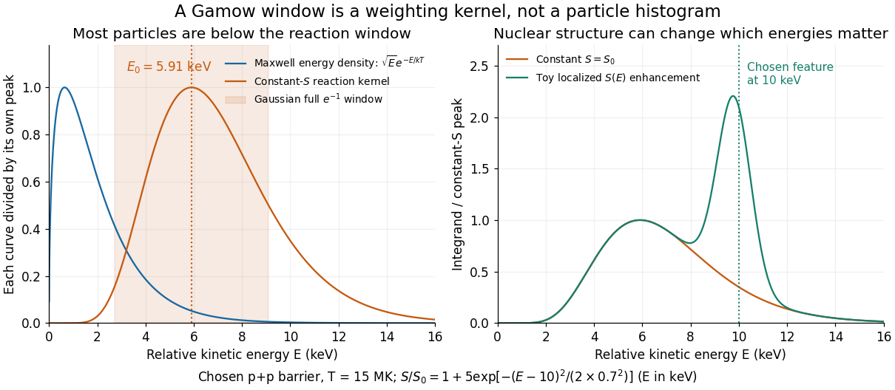

# Nuclear S-factor variation across a Gamow window

↑ **Parent:** [Gamow peak](gamow-peak.md)

The [Gaussian approximation to a nonresonant thermonuclear rate](gaussian-approximation-to-a-nonresonant-thermonuclear-rate.md) already gives the saddle and curvature. In its notation $E_G=4E_B$, so the same result reads

$$
E_0=\left[\frac{E_G(k_BT)^2}{4}\right]^{1/3},\qquad \sigma_G^2=\frac{2E_0k_BT}{3},\qquad \Delta_{1/e}=2\sqrt2\,\sigma_G=\sqrt{\frac{16E_0k_BT}{3}}.
$$

The full width $\Delta_{1/e}$ joins the two points at $e^{-1}$ of the peak of the approximating [Gaussian function](gaussian-function.md); it is neither its [standard deviation](standard-deviation.md) $\sigma_G$ nor its full width at half maximum $2\sqrt{2\log2}\,\sigma_G$. These are local [Gaussian approximation](normal-approximation.md) widths, not exact equal-height endpoints of the asymmetric kernel.

Why keep the [astrophysical S factor](astrophysical-s-factor.md) inside the integral? If $S(E)$ is positive and smooth, stationarity of $\log S(E)-\Phi(E)$ gives a leading peak displacement $\delta E\simeq\sigma_G^2(d\log S/dE)_{E_0}$. The slow-variation test is therefore $|d\log S/dE|\sigma_G\ll1$, together with small curvature corrections. More generally any energy-dependent prefactor shifts the saddle; a [temperature](temperature-split.md)-dependent prefactor also changes the [local temperature exponent of a thermonuclear reaction](local-temperature-exponent-of-a-thermonuclear-reaction.md). A sharp nuclear feature can invalidate this expansion altogether.

Choose $T=15\,\mathrm{MK}$ and $E_G=493\,\mathrm{keV}$ for an illustrative [proton](proton.md) pair. Then $k_BT=1.293\,\mathrm{keV}$, $E_0=5.905\,\mathrm{keV}$ and $\Delta_{1/e}=6.380\,\mathrm{keV}$. The relative [Maxwell-Boltzmann velocity distribution](maxwell-boltzmann-velocity-distribution.md) has energy-density maximum $k_BT/2=0.646\,\mathrm{keV}$, far below the reaction kernel's maximum. Now choose the deliberately artificial enhancement

$$
\frac{S(E)}{S_0}=1+5\exp\left[-\frac{(E-10\,\mathrm{keV})^2}{2(0.7\,\mathrm{keV})^2}\right].
$$

Numerical integration raises the rate by about $54.2\%$ at the same [temperature](temperature-split.md), even though the enhancement is away from $E_0$. This is a sensitivity experiment, not a claimed [proton](proton.md)–[proton](proton.md) nuclear level or a physical nuclear line-shape model. It illustrates why extrapolating $S(E_0)$ without checking nearby structure can fail.

**[Figure 4](#image-particle-energies-the-gamow-kernel-and-a-chosen-s-factor-enhancement). Particle energies, the Gamow kernel, and a chosen S-factor enhancement**. Original analytic curves at 15 MK. Left: separately peak-normalized relative Maxwell energy density and constant-S reaction kernel; shading denotes the approximate full Gaussian e-minus-one width. Right: both integrands use the constant-S peak as their common denominator, so the extra area represents a rate increase. The localized S-factor feature is an artificial sensitivity test.

## ↑ Ancestors (8)

1. [Gamow peak](gamow-peak.md)
2. [Thermonuclear reaction rate](thermonuclear-reaction-rate.md)
3. [Stellar nuclear fusion](stellar-nuclear-fusion.md)
4. [Stellar astrophysics](stellar-astrophysics-split.md)
5. [Astrophysics](astrophysics-split.md)
6. [Branches of physics](branches-of-physics.md)
7. [Physics](physics-split.md)
8. [Codex Wiki](split.md)
