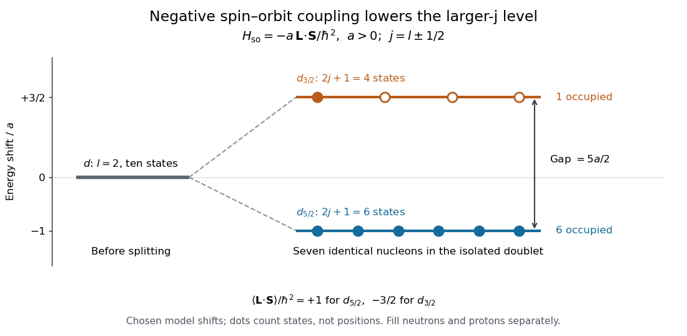

# Nuclear spin-orbit splitting

↑ **Parent:** [Nuclear shell model](nuclear-shell-model.md)

The splitting of one-[nucleon](nucleon.md) [energy levels](energy-level.md) by their [spin-orbit interaction](spin-orbit-interaction.md). With $\mathbf J=\mathbf L+\mathbf S$, the identity $2\mathbf L\cdot\mathbf S=\mathbf J^2-\mathbf L^2-\mathbf S^2$ gives, in a state of definite $l,s=1/2,j$,

$$
\langle\mathbf L\cdot\mathbf S\rangle
=\frac{\hbar^2}{2}\left[j(j+1)-l(l+1)-\frac34\right]
=\begin{cases}
\hbar^2l/2,&j=l+1/2,\\
-\hbar^2(l+1)/2,&j=l-1/2.
\end{cases}
$$

The second branch requires $l\ge1$. For the illustrative [Hamiltonian operator](hamiltonian-quantum-mechanics.md) $H_{\mathrm{so}}=-a\mathbf L\cdot\mathbf S/\hbar^2$ with $a>0$, the shifts are $-al/2$ and $+a(l+1)/2$. Thus the strong negative coefficient lowers the aligned $j=l+1/2$ branch. Its capacity is $2l+2$; the raised partner holds $2l$. Together they still hold $4l+2=2(2l+1)$ identical [nucleons](nucleon.md): the interaction rearranges states rather than creating them.

**[Figure 4](#image-a-negative-spin-orbit-term-lowers-the-larger-j-nuclear-level). A negative spin-orbit term lowers the larger-j nuclear level**. Original isolated $d$-doublet example with $l=2$, $a>0$, and seven identical nucleons. Six occupy $d_{5/2}$ and one occupies $d_{3/2}$. The circles count magnetic substates; they do not represent spatial particle positions. Energies are chosen model shifts in units of $a$.

In this example the $d_{5/2}$ and $d_{3/2}$ shifts are $-a$ and $3a/2$, respectively, so the gap is $5a/2$. The capacity-weighted mean shift vanishes:

$$
6(-a)+4(3a/2)=0.
$$

This is a useful check on both the sign and state counting. A seventh identical particle cannot occupy another substate of the already full lower level. In a real [atomic nucleus](atomic-nucleus-split.md), other radial and [orbital angular momentum](orbital-angular-momentum.md) levels can interleave with this doublet, and a radial coupling need not give the same effective $a$ for every orbital.

## ↑ Ancestors (5)

1. [Nuclear shell model](nuclear-shell-model.md)
2. [Atomic nucleus](atomic-nucleus-split.md)
3. [Nuclear physics](nuclear-physics.md)
4. [Physics](physics-split.md)
5. [Codex Wiki](split.md)

## ← Incoming links (3)

- [Nuclear shell closure](nuclear-shell-closure.md)
- [Nuclear shell model](nuclear-shell-model.md)
- [Solution](past-exam-of-the-particle-and-nuclear-physics-course-of-the-university-of-cambridge/2016/paper-1/2/b/solution.md)
