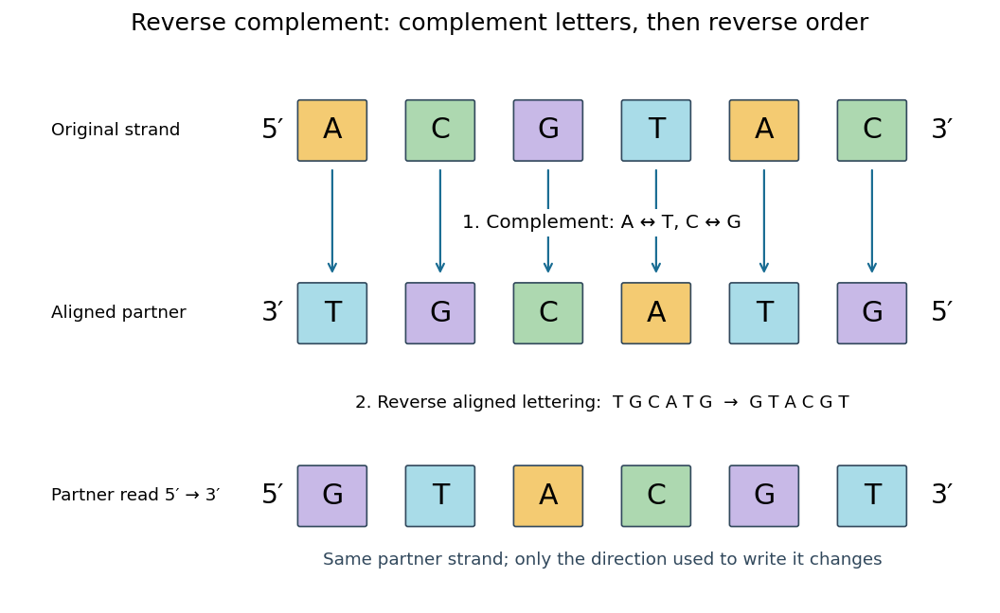

# Nucleic acid sequence

↑ **Parent:** [Nucleic acid](nucleic-acid.md)  
ⓦ [Wiki](https://en.wikipedia.org/wiki/Nucleic_acid_sequence)

A [nucleic acid sequence](nucleic-acid-sequence.md) records the ordered [nucleobases](nucleotide-base.md) of a [nucleic acid](nucleic-acid.md) strand, conventionally read from $5'$ to $3'$. The standard [DNA](deoxyribonucleic-acid.md) alphabet is [adenine](adenine.md) A, [cytosine](cytosine.md) C, [guanine](guanine.md) G, and [thymine](thymine.md) T; the standard [RNA](ribonucleic-acid.md) alphabet uses [uracil](uracil.md) U in place of [thymine](thymine.md) T. Each letter denotes the [nucleobase](nucleotide-base.md) attached to one [nucleotide](nucleotide.md), so the six-letter [DNA](deoxyribonucleic-acid.md) [nucleic acid sequence](nucleic-acid-sequence.md) $5'\text{-}\mathrm{ACGTAC}\text{-}3'$ describes six linked [nucleotides](nucleotide.md). See [NHGRI: representing DNA by a sequence of letters](https://www.genome.gov/genetics-glossary/Base-Pair).

Order carries information that composition loses. Both ACGTAC and AACCGT contain two [adenine](adenine.md), two [cytosine](cytosine.md), one [guanine](guanine.md), and one [thymine](thymine.md) [nucleobase](nucleotide-base.md), but their [nucleic acid sequences](nucleic-acid-sequence.md) differ at positions 2, 3, 4, 5, and 6. At position 2, for example, the first has [cytosine](cytosine.md) and the second [adenine](adenine.md). Reporting only the four counts cannot reconstruct either ordered record.

To obtain the partner of $5'\text{-}\mathrm{ACGTAC}\text{-}3'$, apply the [DNA](deoxyribonucleic-acid.md) [base pairing](base-pairing.md) rules position by position: A selects T, C selects G, G selects C, T selects A, A selects T, and C selects G. Alignment gives $3'\text{-}\mathrm{TGCATG}\text{-}5'$. Its opposite end labels matter because the two are [antiparallel nucleic acid strands](antiparallel-nucleic-acid-strands.md). Reading the partner from its own $5'$ end reverses the aligned lettering and yields the [reverse complement](reverse-complement.md), $5'\text{-}\mathrm{GTACGT}\text{-}3'$.

**[Figure 40](#image-complement-then-reverse-dna-acgtac-has-aligned-partner-tgcatg-and-reverse-complement-gtacgt). Complement, then reverse: DNA ACGTAC has aligned partner TGCATG and reverse complement GTACGT**.

Reversal alone gives CATGCA; complementation alone gives aligned TGCATG. Neither operation alone gives the partner written in the usual $5'$-to-$3'$ convention. Applying the [reverse complement](reverse-complement.md) operation twice returns ACGTAC: GTACGT complements to CATGCA, which reverses to ACGTAC. This convention makes a single reported strand sufficient to specify an ideally complementary [DNA](deoxyribonucleic-acid.md) duplex, provided its direction is known.

**Table of contents**

- [Reverse complement](reverse-complement.md)

## ↑ Ancestors (4)

1. [Nucleic acid](nucleic-acid.md)
2. [Polymer](polymer.md)
3. [Chemistry](chemistry-split.md)
4. [Codex Wiki](split.md)

## ← Incoming links (4)

- [Base pairing](base-pairing.md)
- [Nucleic acid](nucleic-acid.md)
- [Nucleic acid double helix](nucleic-acid-double-helix.md)
- [Nucleic acid sequence](nucleic-acid-sequence.md)
