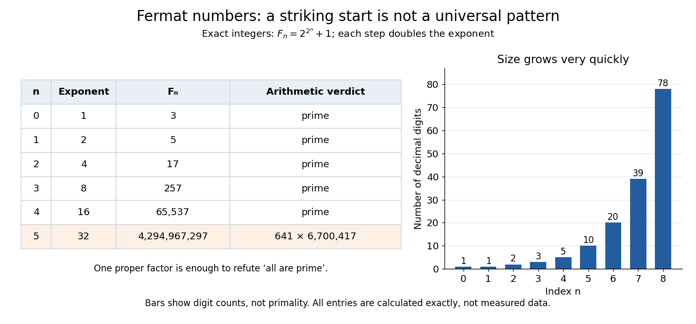
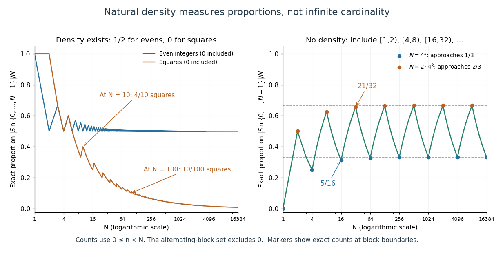
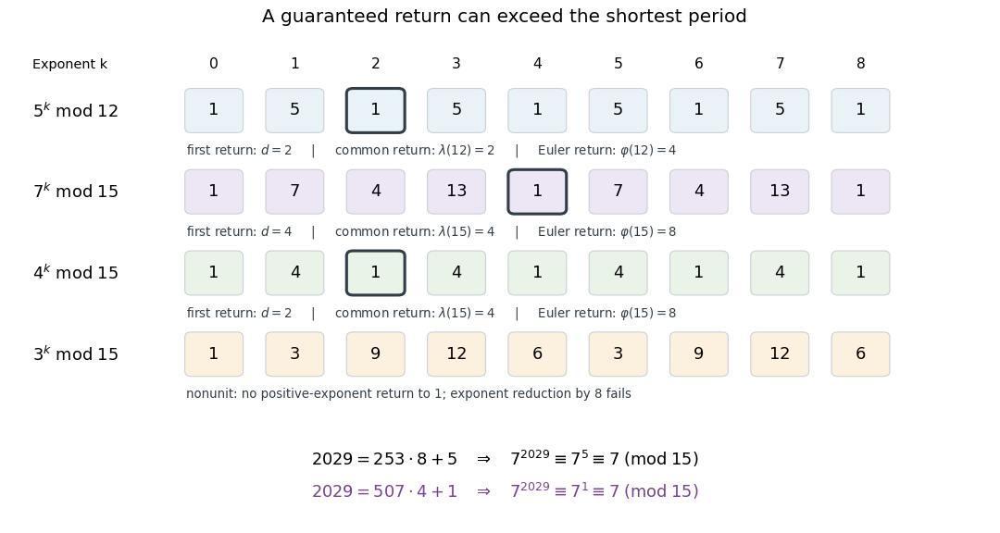
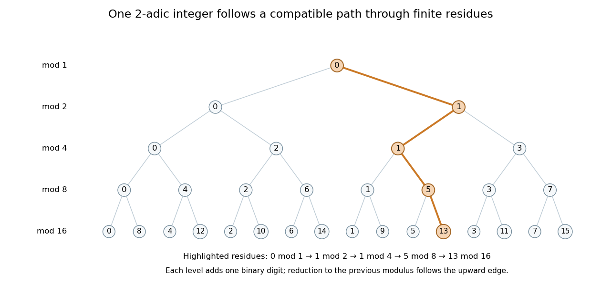
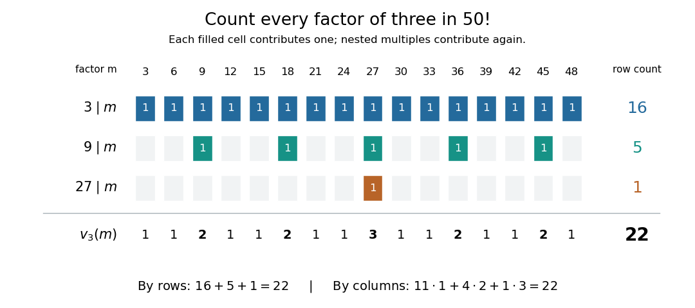
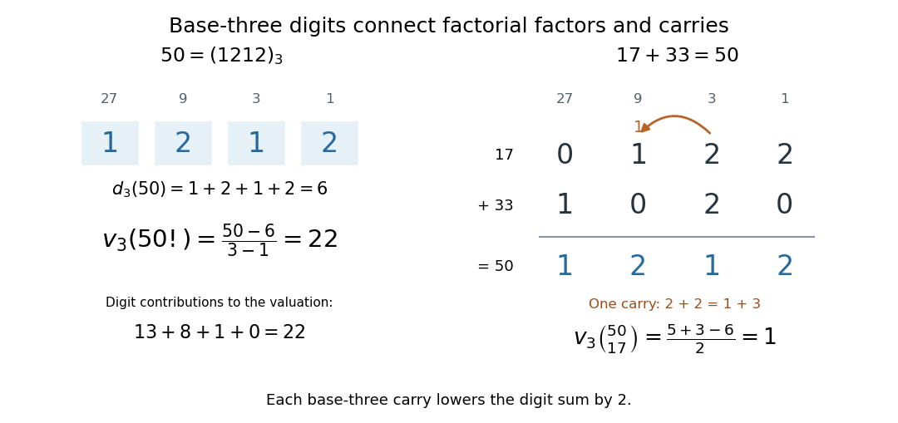
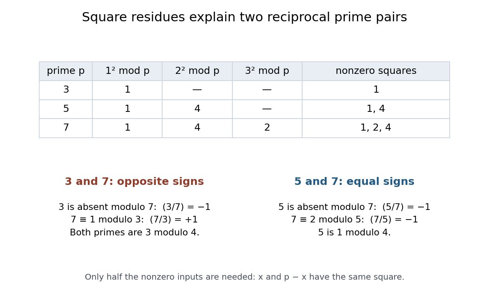
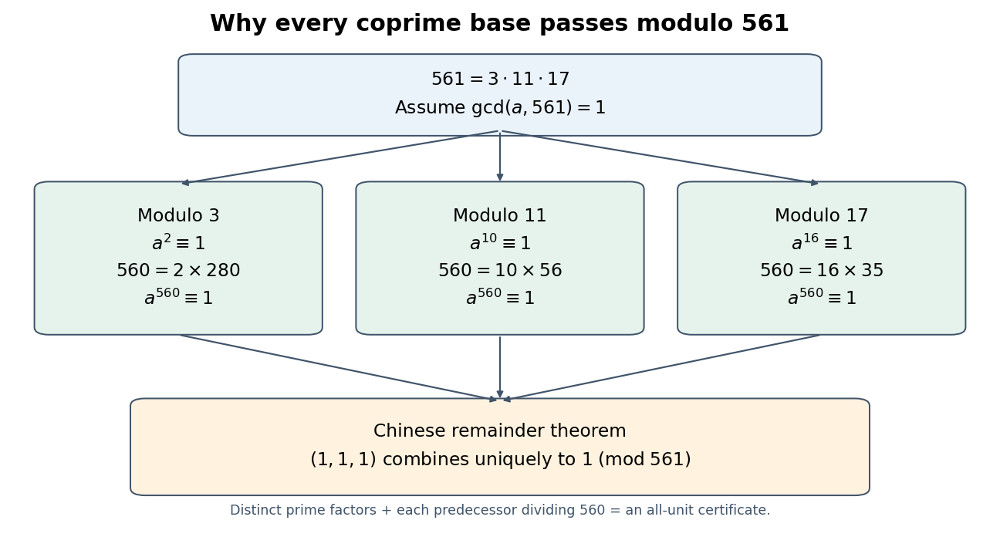
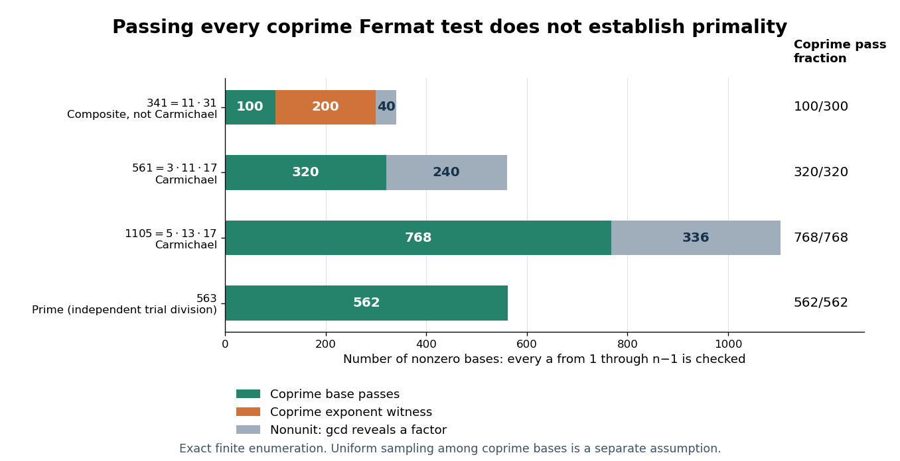
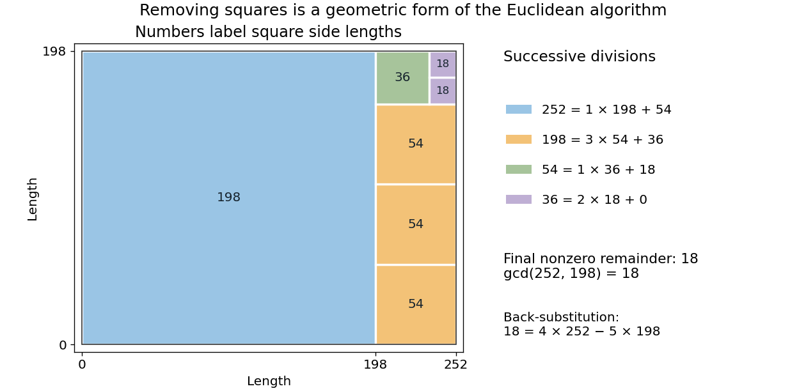

# Number theory

↑ **Parent:** [Area of mathematics](mathematics.md#area-of-mathematics)  
ⓦ [Wiki](https://en.wikipedia.org/wiki/Number_theory)

Number theory studies [integers](integer.md), their [divisibility](divisibility.md), and the patterns created by [prime numbers](prime-number.md). Its questions often have short statements but rigid answers: which [integers](integer.md) divide a given one, when does an [equation](algebra.md#equation) have integer solutions, and when can arithmetic with [congruence classes](modular-arithmetic.md#congruence-class) be reversed? The [Euclidean algorithm](#euclidean-algorithm) and [modular multiplicative inverses](#modular-multiplicative-inverse) connect these questions through explicit calculations.

For example, $252=2^2\cdot3^2\cdot7$ and $198=2\cdot3^2\cdot11$. Their shared [prime factors](prime-number.md#prime-factor) give [greatest common divisor](divisibility.md#greatest-common-divisor) $18$. The [Euclidean algorithm](#euclidean-algorithm) reaches that answer without finding either complete [prime factorization](prime-number.md#fundamental-theorem-of-arithmetic). It also produces $18=4\cdot252-5\cdot198$, an instance of [Bézout's identity](algebra.md#bezout-s-identity). This relation certifies every common [divisor](divisibility.md#divisor) at once and solves an associated [linear Diophantine equation](#linear-diophantine-equation).

[Modular arithmetic](modular-arithmetic.md) retains only remainders, but the lost information can be surprisingly controlled. Multiplication by $5$ modulo $17$ is a [permutation](combinatorics.md#permutation) of all residue classes, because $5$ has [modular inverse](#modular-multiplicative-inverse) $7$. Multiplication by $5$ modulo $15$ collapses fifteen residue classes to three. Thus an apparently small change in the modulus changes whether a calculation can be reversed. The [Chinese remainder theorem](mathematics.md#chinese-remainder-theorem) explains another kind of compression: remainders modulo [coprime integers](divisibility.md#coprime-integers) can be combined into one remainder modulo their product.

Simple restrictions help reveal the structure without telling the whole story. Every [prime number](prime-number.md) greater than three is congruent to $1$ or $5$ modulo $6$: the other four residue classes force [divisibility](divisibility.md) by $2$ or $3$. The converse fails because $25$ and $35$ lie in those classes but are [composite numbers](#composite-number). Necessary conditions are useful filters, not substitutes for [primality testing](theoretical-computer-science.md#primality-testing).

The subject's appeal lies partly in this tension: [prime factorization](prime-number.md#fundamental-theorem-of-arithmetic) gives a clean description of every positive [integer](integer.md), while identifying factors and predicting their distribution lead to substantial further questions. [Analytic number theory](analytic-number-theory.md) uses tools from [analysis](analysis.md) to study global patterns, and [algebraic number theory](algebraic-number-theory.md) extends arithmetic into [number fields](algebraic-number-theory.md#number-field). Applications include [cryptography](computer-science.md#cryptography) and [error-correcting codes](coding-theory.md#error-correcting-code); MIT's discrete applied mathematics course develops modular structures for both purposes. [Ankur Moitra, MIT 18.200, Modular Arithmetic and Elementary Algebra, 2024, introduction](https://ocw.mit.edu/courses/18-200-principles-of-discrete-applied-mathematics-spring-2024/mit18_200_s24_lec15.pdf)

Euclid's _Elements_ already gives a greatest-common-measure construction in Book VII, Proposition 2, and the argument that a finite list cannot exhaust the [prime numbers](prime-number.md) in Book IX, Proposition 20. These are documented ancient treatments, rather than evidence that all of number theory began with one author. [Euclid, Elements VII.2, translated text hosted by David Joyce](https://mathcs.clarku.edu/~djoyce/java/elements/bookVII/propVII2.html) [Euclid, Elements IX.20, translated text hosted by David Joyce](https://mathcs.clarku.edu/~djoyce/java/elements/bookIX/propIX20.html)

**Table of contents**

- [Sum of two squares](#sum-of-two-squares)
- [Four exponentials conjecture](#four-exponentials-conjecture)
- [Pronic number](#pronic-number)
- [Cube-full number](#cube-full-number)
- [Jacobi's four-square theorem](#jacobi-s-four-square-theorem)
- [Kaprekar routine](#kaprekar-routine)
  - [Kaprekar constant](#kaprekar-constant)
- [Arithmetic derivative](#arithmetic-derivative)
- [Harshad number](#harshad-number)
- [Frobenius number](#frobenius-number)
  - [Two-generator Frobenius theorem](#two-generator-frobenius-theorem)
- [Practical number](#practical-number)
- [Product-sum number](#product-sum-number)
- [Integer factorization](#integer-factorization)
  - [General number field sieve](#general-number-field-sieve)
  - [Ordered factorization](#ordered-factorization)
  - [Pollard's rho algorithm](#pollard-s-rho-algorithm)
    - [Brent variant of Pollard rho](#brent-variant-of-pollard-rho)
  - [Factor base](#factor-base)
    - [Exponent vector](#exponent-vector)
      - [Prime-exponent difference](#prime-exponent-difference)
  - [Odd part of a positive integer](#odd-part-of-a-positive-integer)
  - [Congruence of squares](#congruence-of-squares)
    - [Nontrivial square root of unity modulo an integer](#nontrivial-square-root-of-unity-modulo-an-integer)
- [Erdős-Turán inequality](#erdos-turan-inequality)
- [Fermat number](#fermat-number)
  - [Fermat number product identity](#fermat-number-product-identity)
    - [Distinct Fermat numbers are coprime](#distinct-fermat-numbers-are-coprime)
  - [Prime divisor of a Fermat number](#prime-divisor-of-a-fermat-number)
    - [Stronger prime-divisor congruence for Fermat numbers](#stronger-prime-divisor-congruence-for-fermat-numbers)
- [Bernoulli number](bernoulli-number.md)
  - [von Staudt-Clausen theorem](bernoulli-number.md#von-staudt-clausen-theorem)
  - [Bernoulli polynomial](bernoulli-number.md#bernoulli-polynomial)
    - [Integer power sum](bernoulli-number.md#integer-power-sum)
      - [Bernoulli corrections for polynomial sums](bernoulli-number.md#bernoulli-corrections-for-polynomial-sums)
  - [Hyperbolic cotangent generating function for Bernoulli numbers](bernoulli-number.md#hyperbolic-cotangent-generating-function-for-bernoulli-numbers)
  - [Euler evaluation of even zeta values](bernoulli-number.md#euler-evaluation-of-even-zeta-values)
    - [Zeta series truncation error](bernoulli-number.md#zeta-series-truncation-error)
    - [Cotangent coefficient proof of the even zeta values](bernoulli-number.md#cotangent-coefficient-proof-of-the-even-zeta-values)
  - [Generalized Bernoulli number](bernoulli-number.md#generalized-bernoulli-number)
- [Normal number](#normal-number)
  - [Digit block frequency](#digit-block-frequency)
  - [Simply normal number](#simply-normal-number)
  - [Champernowne constant](#champernowne-constant)
  - [Normality and equidistribution under integer multiplication](#normality-and-equidistribution-under-integer-multiplication)
  - [Absolutely normal number](#absolutely-normal-number)
- [Natural density](#natural-density)
  - [Set without natural density](#set-without-natural-density)
  - [Upper asymptotic density](#upper-asymptotic-density)
  - [Full-density sequence](#full-density-sequence)
- [Lagrange's four-square theorem](#lagrange-s-four-square-theorem)
- [Analytic number theory](analytic-number-theory.md)
  - [Hardy-Littlewood circle method](analytic-number-theory.md#hardy-littlewood-circle-method)
    - [Vinogradov's three-primes theorem](analytic-number-theory.md#vinogradov-s-three-primes-theorem)
    - [Singular series](analytic-number-theory.md#singular-series)
    - [Minor arc](analytic-number-theory.md#minor-arc)
    - [Major arc](analytic-number-theory.md#major-arc)
  - [L-function](analytic-number-theory.md#l-function)
    - [Hasse–Weil zeta function](analytic-number-theory.md#hasse-weil-zeta-function)
    - [Hasse-Weil L-function](analytic-number-theory.md#hasse-weil-l-function)
    - [Hecke L-function](analytic-number-theory.md#hecke-l-function)
    - [p-adic L-function](analytic-number-theory.md#p-adic-l-function)
      - [Kubota-Leopoldt p-adic L-function](analytic-number-theory.md#kubota-leopoldt-p-adic-l-function)
        - [p-adic zeta pseudomeasure](analytic-number-theory.md#p-adic-zeta-pseudomeasure)
  - [Linnik's theorem](analytic-number-theory.md#linnik-s-theorem)
  - [Character sum](analytic-number-theory.md#character-sum)
    - [Pólya–Vinogradov inequality](analytic-number-theory.md#polya-vinogradov-inequality)
  - [Prime sum](analytic-number-theory.md#prime-sum)
  - [Bombieri–Vinogradov theorem](analytic-number-theory.md#bombieri-vinogradov-theorem)
    - [Weighted arithmetic-progression error bound](analytic-number-theory.md#weighted-arithmetic-progression-error-bound)
  - [Exponential sum](analytic-number-theory.md#exponential-sum)
    - [Weyl differencing](analytic-number-theory.md#weyl-differencing)
      - [Weyl inequality](analytic-number-theory.md#weyl-inequality)
      - [Cubic Weyl inequality](analytic-number-theory.md#cubic-weyl-inequality)
      - [Hua's lemma](analytic-number-theory.md#hua-s-lemma)
        - [Cubic eighth-moment proof by differencing](analytic-number-theory.md#cubic-eighth-moment-proof-by-differencing)
    - [Power Gauss sum over a prime field](analytic-number-theory.md#power-gauss-sum-over-a-prime-field)
      - [Three power summands over a large prime field](analytic-number-theory.md#three-power-summands-over-a-large-prime-field)
    - [Quadratic exponential sum](analytic-number-theory.md#quadratic-exponential-sum)
      - [Quadratic Weyl inequality](analytic-number-theory.md#quadratic-weyl-inequality)
    - [Vinogradov mean value](analytic-number-theory.md#vinogradov-mean-value)
      - [Vinogradov mean-value method for a bilinear exponential sum](analytic-number-theory.md#vinogradov-mean-value-method-for-a-bilinear-exponential-sum)
    - [Bilinear shift averaging for a logarithmic phase](analytic-number-theory.md#bilinear-shift-averaging-for-a-logarithmic-phase)
    - [Van der Corput sum-integral lemma](analytic-number-theory.md#van-der-corput-sum-integral-lemma)
    - [Cancellation in an exponential sum](analytic-number-theory.md#cancellation-in-an-exponential-sum)
  - [Probabilistic number theory](analytic-number-theory.md#probabilistic-number-theory)
    - [Erdős-Kac theorem](analytic-number-theory.md#erdos-kac-theorem)
      - [Centered moment comparison for additive arithmetic functions](analytic-number-theory.md#centered-moment-comparison-for-additive-arithmetic-functions)
    - [Cramér model](analytic-number-theory.md#cramer-model)
      - [Cramér model prime-gap upper bound](analytic-number-theory.md#cramer-model-prime-gap-upper-bound)
    - [Multiplication table problem](analytic-number-theory.md#multiplication-table-problem)
      - [Multiplication table bound from distinct prime factors](analytic-number-theory.md#multiplication-table-bound-from-distinct-prime-factors)
    - [Turán-Kubilius inequality](analytic-number-theory.md#turan-kubilius-inequality)
  - [Landau theorem for a Dirichlet series with nonnegative coefficients](analytic-number-theory.md#landau-theorem-for-a-dirichlet-series-with-nonnegative-coefficients)
  - [Nonvanishing of a nonprincipal Dirichlet L-function at one](analytic-number-theory.md#nonvanishing-of-a-nonprincipal-dirichlet-l-function-at-one)
  - [Chebyshev function in an arithmetic progression](analytic-number-theory.md#chebyshev-function-in-an-arithmetic-progression)
  - [Classical zero-free region for Dirichlet L-functions](analytic-number-theory.md#classical-zero-free-region-for-dirichlet-l-functions)
    - [Uniqueness of a possible exceptional real Dirichlet zero](analytic-number-theory.md#uniqueness-of-a-possible-exceptional-real-dirichlet-zero)
    - [Siegel zero](analytic-number-theory.md#siegel-zero)
      - [Landau theorem for two real Dirichlet characters](analytic-number-theory.md#landau-theorem-for-two-real-dirichlet-characters)
        - [Sparse conductors of exceptional real Dirichlet zeros](analytic-number-theory.md#sparse-conductors-of-exceptional-real-dirichlet-zeros)
      - [Prime number theorem in an arithmetic progression with an exceptional zero](analytic-number-theory.md#prime-number-theorem-in-an-arithmetic-progression-with-an-exceptional-zero)
        - [Exceptional-zero bound from a uniform upper bound in arithmetic progressions](analytic-number-theory.md#exceptional-zero-bound-from-a-uniform-upper-bound-in-arithmetic-progressions)
  - [Pretentious number theory](analytic-number-theory.md#pretentious-number-theory)
  - [Normal order of an arithmetic function](analytic-number-theory.md#normal-order-of-an-arithmetic-function)
    - [Turán normal-order theorem for distinct prime divisors](analytic-number-theory.md#turan-normal-order-theorem-for-distinct-prime-divisors)
  - [Dirichlet's theorem on arithmetic progressions](analytic-number-theory.md#dirichlet-s-theorem-on-arithmetic-progressions)
    - [Reciprocal primes in a fixed arithmetic progression](analytic-number-theory.md#reciprocal-primes-in-a-fixed-arithmetic-progression)
    - [Siegel–Walfisz theorem](analytic-number-theory.md#siegel-walfisz-theorem)
      - [Major-arc value of the prime exponential sum](analytic-number-theory.md#major-arc-value-of-the-prime-exponential-sum)
    - [Prime-character sum near one](analytic-number-theory.md#prime-character-sum-near-one)
  - [Harmonic number](analytic-number-theory.md#harmonic-number)
    - [Integral bounds for a finite harmonic sum](analytic-number-theory.md#integral-bounds-for-a-finite-harmonic-sum)
  - [Abel's summation formula](analytic-number-theory.md#abel-s-summation-formula)
    - [Reciprocal-sum convergence from a counting bound](analytic-number-theory.md#reciprocal-sum-convergence-from-a-counting-bound)
    - [Bounded-variation multipliers of a convergent series](analytic-number-theory.md#bounded-variation-multipliers-of-a-convergent-series)
    - [Exponentially damped reciprocal-prime sum](analytic-number-theory.md#exponentially-damped-reciprocal-prime-sum)
  - [Reciprocal fractional-part sum near a rational](analytic-number-theory.md#reciprocal-fractional-part-sum-near-a-rational)
  - [Bilinear quadratic exponential sum fourth-moment bound](analytic-number-theory.md#bilinear-quadratic-exponential-sum-fourth-moment-bound)
    - [Factorized fourth moment for a bilinear quadratic exponential sum](analytic-number-theory.md#factorized-fourth-moment-for-a-bilinear-quadratic-exponential-sum)
      - [Truncation of a divisor weight by its second moment](analytic-number-theory.md#truncation-of-a-divisor-weight-by-its-second-moment)
  - [Bilinear sum](analytic-number-theory.md#bilinear-sum)
    - [Vinogradov Type I–II method](analytic-number-theory.md#vinogradov-type-i-ii-method)
      - [Small Type I and Type II sums](analytic-number-theory.md#small-type-i-and-type-ii-sums)
    - [Fourier separation of interval cutoffs](analytic-number-theory.md#fourier-separation-of-interval-cutoffs)
    - [Bilinear cancellation for badly approximable phases](analytic-number-theory.md#bilinear-cancellation-for-badly-approximable-phases)
    - [Type II sum](analytic-number-theory.md#type-ii-sum)
      - [Rational-phase Type II estimate](analytic-number-theory.md#rational-phase-type-ii-estimate)
    - [Type I sum](analytic-number-theory.md#type-i-sum)
    - [Dyadic decomposition](analytic-number-theory.md#dyadic-decomposition)
  - [Sieve theory](analytic-number-theory.md#sieve-theory)
    - [Parity problem](analytic-number-theory.md#parity-problem)
    - [Integers with all prime factors congruent to one modulo four](analytic-number-theory.md#integers-with-all-prime-factors-congruent-to-one-modulo-four)
    - [Large sieve](analytic-number-theory.md#large-sieve)
      - [Large sieve upper bound for sifted intervals](analytic-number-theory.md#large-sieve-upper-bound-for-sifted-intervals)
      - [Character large sieve](analytic-number-theory.md#character-large-sieve)
      - [Variance form of the large sieve](analytic-number-theory.md#variance-form-of-the-large-sieve)
      - [Exponential-sum large sieve](analytic-number-theory.md#exponential-sum-large-sieve)
        - [Fejér-kernel proof of the analytic large sieve](analytic-number-theory.md#fejer-kernel-proof-of-the-analytic-large-sieve)
        - [Local-multiplicity large sieve](analytic-number-theory.md#local-multiplicity-large-sieve)
          - [Prime-denominator large sieve](analytic-number-theory.md#prime-denominator-large-sieve)
      - [Circular spacing](analytic-number-theory.md#circular-spacing)
    - [Buchstab function](analytic-number-theory.md#buchstab-function)
      - [Oscillation of the Buchstab function](analytic-number-theory.md#oscillation-of-the-buchstab-function)
      - [Buchstab theorem](analytic-number-theory.md#buchstab-theorem)
    - [Rough number](analytic-number-theory.md#rough-number)
    - [Sifting function](analytic-number-theory.md#sifting-function)
      - [Sieve distribution](analytic-number-theory.md#sieve-distribution)
      - [Buchstab identity](analytic-number-theory.md#buchstab-identity)
    - [Upper-bound sieve](analytic-number-theory.md#upper-bound-sieve)
      - [Brun–Titchmarsh theorem](analytic-number-theory.md#brun-titchmarsh-theorem)
      - [Selberg sieve](analytic-number-theory.md#selberg-sieve)
        - [Selberg upper-bound sieve](analytic-number-theory.md#selberg-upper-bound-sieve)
          - [Uniform interval bound from optimal Selberg weights](analytic-number-theory.md#uniform-interval-bound-from-optimal-selberg-weights)
          - [Half-dimensional interval sieve](analytic-number-theory.md#half-dimensional-interval-sieve)
          - [Selberg sieve weights](analytic-number-theory.md#selberg-sieve-weights)
            - [Selberg sieve denominator asymptotic](analytic-number-theory.md#selberg-sieve-denominator-asymptotic)
            - [Selberg sieve diagonalization](analytic-number-theory.md#selberg-sieve-diagonalization)
              - [Selberg least-common-multiple weights](analytic-number-theory.md#selberg-least-common-multiple-weights)
              - [Optimal Selberg weights have modulus at most one](analytic-number-theory.md#optimal-selberg-weights-have-modulus-at-most-one)
          - [Polynomial root density in a sieve](analytic-number-theory.md#polynomial-root-density-in-a-sieve)
            - [Elementary lower bound for the twin-prime sieve denominator](analytic-number-theory.md#elementary-lower-bound-for-the-twin-prime-sieve-denominator)
            - [Twin-prime upper bound from a quadratic sieve](analytic-number-theory.md#twin-prime-upper-bound-from-a-quadratic-sieve)
            - [Prime-tuple upper bound from the Selberg sieve](analytic-number-theory.md#prime-tuple-upper-bound-from-the-selberg-sieve)
          - [Almost-primes from an upper-bound sieve and Buchstab identity](analytic-number-theory.md#almost-primes-from-an-upper-bound-sieve-and-buchstab-identity)
          - [Fourier representation of a smooth Selberg weight](analytic-number-theory.md#fourier-representation-of-a-smooth-selberg-weight)
            - [Smooth divisor-square sieve asymptotic](analytic-number-theory.md#smooth-divisor-square-sieve-asymptotic)
              - [Euler product for a smoothed divisor-square correlation](analytic-number-theory.md#euler-product-for-a-smoothed-divisor-square-correlation)
              - [Derivative energy constant for a smooth sieve cutoff](analytic-number-theory.md#derivative-energy-constant-for-a-smooth-sieve-cutoff)
            - [Short-interval prime upper bound from a smooth divisor weight](analytic-number-theory.md#short-interval-prime-upper-bound-from-a-smooth-divisor-weight)
      - [Dimension-three upper-bound sieve](analytic-number-theory.md#dimension-three-upper-bound-sieve)
  - [Mertens' theorems](analytic-number-theory.md#mertens-theorems)
    - [Mertens first theorem](analytic-number-theory.md#mertens-first-theorem)
      - [Square-root logarithmic sum over primes](analytic-number-theory.md#square-root-logarithmic-sum-over-primes)
      - [Positive logarithmic moments of reciprocal primes](analytic-number-theory.md#positive-logarithmic-moments-of-reciprocal-primes)
      - [Factorial proof of Mertens first theorem](analytic-number-theory.md#factorial-proof-of-mertens-first-theorem)
      - [Logarithmically weighted reciprocal-prime tail](analytic-number-theory.md#logarithmically-weighted-reciprocal-prime-tail)
    - [Mertens second theorem](analytic-number-theory.md#mertens-second-theorem)
      - [Reciprocal-prime sum in residue class one modulo four](analytic-number-theory.md#reciprocal-prime-sum-in-residue-class-one-modulo-four)
    - [Mertens third theorem](analytic-number-theory.md#mertens-third-theorem)
      - [Totient lower bound from the Mertens product](analytic-number-theory.md#totient-lower-bound-from-the-mertens-product)
  - [Dirichlet series](analytic-number-theory.md#dirichlet-series)
    - [Holomorphy of a Dirichlet series from bounded partial sums](analytic-number-theory.md#holomorphy-of-a-dirichlet-series-from-bounded-partial-sums)
    - [Epstein zeta function](analytic-number-theory.md#epstein-zeta-function)
      - [Completed Epstein zeta function](analytic-number-theory.md#completed-epstein-zeta-function)
        - [Pole-subtracted theta integral for an Epstein zeta function](analytic-number-theory.md#pole-subtracted-theta-integral-for-an-epstein-zeta-function)
    - [Dirichlet polynomial](analytic-number-theory.md#dirichlet-polynomial)
      - [Mean value of Dirichlet polynomials](analytic-number-theory.md#mean-value-of-dirichlet-polynomials)
        - [Odd moment of a prime cosine sum](analytic-number-theory.md#odd-moment-of-a-prime-cosine-sum)
    - [Euler product](analytic-number-theory.md#euler-product)
      - [Euler product positivity for L-function nonvanishing](analytic-number-theory.md#euler-product-positivity-for-l-function-nonvanishing)
      - [Truncated Euler-product lower bound](analytic-number-theory.md#truncated-euler-product-lower-bound)
      - [Euler proof that the sum of reciprocals of primes diverges](analytic-number-theory.md#euler-proof-that-the-sum-of-reciprocals-of-primes-diverges)
        - [Prime reciprocal lower bound](analytic-number-theory.md#prime-reciprocal-lower-bound)
      - [Three-four-one inequality for Euler products](analytic-number-theory.md#three-four-one-inequality-for-euler-products)
    - [Perron's formula](analytic-number-theory.md#perron-s-formula)
      - [Logarithmically smoothed Perron formula](analytic-number-theory.md#logarithmically-smoothed-perron-formula)
        - [Unsmoothing a logarithmically weighted sum](analytic-number-theory.md#unsmoothing-a-logarithmically-weighted-sum)
      - [Truncated Perron formula](analytic-number-theory.md#truncated-perron-formula)
        - [Short-interval Perron bound for the second Chebyshev function](analytic-number-theory.md#short-interval-perron-bound-for-the-second-chebyshev-function)
        - [Truncated Perron kernel estimate](analytic-number-theory.md#truncated-perron-kernel-estimate)
  - [Riemann zeta function](analytic-number-theory.md#riemann-zeta-function)
    - [Real-axis singular limit of the Riemann zeta function at one](analytic-number-theory.md#real-axis-singular-limit-of-the-riemann-zeta-function-at-one)
    - [Reciprocal Dirichlet-series bound on boundary-zero multiplicity](analytic-number-theory.md#reciprocal-dirichlet-series-bound-on-boundary-zero-multiplicity)
    - [Reciprocal zeta bounds near the line one](analytic-number-theory.md#reciprocal-zeta-bounds-near-the-line-one)
    - [Three-four-one product proof of zeta boundary nonvanishing](analytic-number-theory.md#three-four-one-product-proof-of-zeta-boundary-nonvanishing)
    - [Lindelöf hypothesis](analytic-number-theory.md#lindelof-hypothesis)
    - [Truncated Möbius inverse identity for the Riemann zeta function](analytic-number-theory.md#truncated-mobius-inverse-identity-for-the-riemann-zeta-function)
    - [Richert bound for the Riemann zeta function](analytic-number-theory.md#richert-bound-for-the-riemann-zeta-function)
    - [Hardy-Littlewood approximation to the Riemann zeta function](analytic-number-theory.md#hardy-littlewood-approximation-to-the-riemann-zeta-function)
    - [Fractional-part continuation formula for the Riemann zeta function](analytic-number-theory.md#fractional-part-continuation-formula-for-the-riemann-zeta-function)
    - [Completed Riemann zeta function](analytic-number-theory.md#completed-riemann-zeta-function)
      - [Riemann xi function](analytic-number-theory.md#riemann-xi-function)
        - [Order-one growth of the Riemann xi function](analytic-number-theory.md#order-one-growth-of-the-riemann-xi-function)
        - [Real logarithmic derivative of Riemann xi](analytic-number-theory.md#real-logarithmic-derivative-of-riemann-xi)
          - [Absolute convergence of the real xi logarithmic derivative](analytic-number-theory.md#absolute-convergence-of-the-real-xi-logarithmic-derivative)
    - [Trivial zero of the Riemann zeta function](analytic-number-theory.md#trivial-zero-of-the-riemann-zeta-function)
    - [Fourth moment of the Riemann zeta function](analytic-number-theory.md#fourth-moment-of-the-riemann-zeta-function)
    - [Bernoulli formula for zeta values at nonpositive integers](analytic-number-theory.md#bernoulli-formula-for-zeta-values-at-nonpositive-integers)
    - [Meromorphic continuation of the Riemann zeta function to the right half-plane](analytic-number-theory.md#meromorphic-continuation-of-the-riemann-zeta-function-to-the-right-half-plane)
    - [Basel problem](analytic-number-theory.md#basel-problem)
    - [Functional equation of the Riemann zeta function](analytic-number-theory.md#functional-equation-of-the-riemann-zeta-function)
      - [Mellin representation of the completed Riemann zeta function](analytic-number-theory.md#mellin-representation-of-the-completed-riemann-zeta-function)
        - [Pole-subtracted theta integral for the completed zeta function](analytic-number-theory.md#pole-subtracted-theta-integral-for-the-completed-zeta-function)
      - [Vertical-strip factor in the Riemann zeta functional equation](analytic-number-theory.md#vertical-strip-factor-in-the-riemann-zeta-functional-equation)
    - [Euler-product nonvanishing of the Riemann zeta function](analytic-number-theory.md#euler-product-nonvanishing-of-the-riemann-zeta-function)
    - [Nontrivial zero of the Riemann zeta function](analytic-number-theory.md#nontrivial-zero-of-the-riemann-zeta-function)
      - [Critical strip](analytic-number-theory.md#critical-strip)
        - [Critical line](analytic-number-theory.md#critical-line)
      - [Riemann hypothesis](analytic-number-theory.md#riemann-hypothesis)
        - [Riemann hypothesis implies the Lindelöf hypothesis](analytic-number-theory.md#riemann-hypothesis-implies-the-lindelof-hypothesis)
        - [Subpower zeta bound to the right of the critical line](analytic-number-theory.md#subpower-zeta-bound-to-the-right-of-the-critical-line)
        - [Xi modulus criterion for the Riemann hypothesis](analytic-number-theory.md#xi-modulus-criterion-for-the-riemann-hypothesis)
        - [Riemann hypothesis equivalence for the second Chebyshev function](analytic-number-theory.md#riemann-hypothesis-equivalence-for-the-second-chebyshev-function)
      - [Zero-free region of the Riemann zeta function](analytic-number-theory.md#zero-free-region-of-the-riemann-zeta-function)
        - [Vinogradov-Korobov zero-free region](analytic-number-theory.md#vinogradov-korobov-zero-free-region)
        - [Landau zero-free-region theorem](analytic-number-theory.md#landau-zero-free-region-theorem)
        - [Weak logarithmic zero-free region for the Riemann zeta function](analytic-number-theory.md#weak-logarithmic-zero-free-region-for-the-riemann-zeta-function)
        - [Three-four-one zero-free-region argument](analytic-number-theory.md#three-four-one-zero-free-region-argument)
        - [Logarithmic derivative inside the zeta zero-free region](analytic-number-theory.md#logarithmic-derivative-inside-the-zeta-zero-free-region)
      - [Riemann–von Mangoldt formula](analytic-number-theory.md#riemann-von-mangoldt-formula)
        - [Infinitely many reciprocal-logarithmic gaps between zeta zeros](analytic-number-theory.md#infinitely-many-reciprocal-logarithmic-gaps-between-zeta-zeros)
        - [Asymptotic inversion of the zeta zero count](analytic-number-theory.md#asymptotic-inversion-of-the-zeta-zero-count)
        - [Local zero count for the Riemann zeta function](analytic-number-theory.md#local-zero-count-for-the-riemann-zeta-function)
          - [Jensen disk proof of the zeta zero-count bound](analytic-number-theory.md#jensen-disk-proof-of-the-zeta-zero-count-bound)
          - [Smoothed zeta zero-count bound](analytic-number-theory.md#smoothed-zeta-zero-count-bound)
    - [Logarithmic derivative](analytic-number-theory.md#logarithmic-derivative)
      - [Global partial-fraction expansion of the zeta logarithmic derivative](analytic-number-theory.md#global-partial-fraction-expansion-of-the-zeta-logarithmic-derivative)
      - [Local logarithmic-derivative lemma](analytic-number-theory.md#local-logarithmic-derivative-lemma)
      - [Local partial-fraction expansion of the Riemann zeta logarithmic derivative](analytic-number-theory.md#local-partial-fraction-expansion-of-the-riemann-zeta-logarithmic-derivative)
      - [Prime number theorem](analytic-number-theory.md#prime-number-theorem)
        - [Prime number theorem error from a fixed zero-free strip](analytic-number-theory.md#prime-number-theorem-error-from-a-fixed-zero-free-strip)
        - [Prime number theorem error from a logarithmic zero-free region](analytic-number-theory.md#prime-number-theorem-error-from-a-logarithmic-zero-free-region)
        - [Prime number theorem with classical zero-free-region error](analytic-number-theory.md#prime-number-theorem-with-classical-zero-free-region-error)
        - [Smoothed prime number theorem from a zero-free region](analytic-number-theory.md#smoothed-prime-number-theorem-from-a-zero-free-region)
      - [Twisted Von Mangoldt estimate implying the Riemann hypothesis](analytic-number-theory.md#twisted-von-mangoldt-estimate-implying-the-riemann-hypothesis)
    - [Dirichlet eta function](analytic-number-theory.md#dirichlet-eta-function)
      - [Analytic continuation of the Riemann zeta function to the right half-plane](analytic-number-theory.md#analytic-continuation-of-the-riemann-zeta-function-to-the-right-half-plane)
- [Arithmetic function](arithmetic-function.md)
  - [Liouville function](arithmetic-function.md#liouville-function)
  - [Summatory function](arithmetic-function.md#summatory-function)
  - [Radical of an integer](arithmetic-function.md#radical-of-an-integer)
    - [Prime support of an integer](arithmetic-function.md#prime-support-of-an-integer)
  - [Total number of prime factors](arithmetic-function.md#total-number-of-prime-factors)
    - [Excess prime-factor multiplicity](arithmetic-function.md#excess-prime-factor-multiplicity)
  - [Additive function (number theory)](arithmetic-function.md#additive-function-number-theory)
    - [Mean of an additive arithmetic function](arithmetic-function.md#mean-of-an-additive-arithmetic-function)
    - [Strongly additive arithmetic function](arithmetic-function.md#strongly-additive-arithmetic-function)
    - [Completely additive arithmetic function](arithmetic-function.md#completely-additive-arithmetic-function)
  - [Multiplicative function](arithmetic-function.md#multiplicative-function)
    - [Multiplicativity of an arithmetic function](arithmetic-function.md#multiplicativity-of-an-arithmetic-function)
    - [Completely multiplicative function](arithmetic-function.md#completely-multiplicative-function)
    - [Divisor sum](arithmetic-function.md#divisor-sum)
      - [Sum-of-divisors function](arithmetic-function.md#sum-of-divisors-function)
        - [Proper-divisor sum](arithmetic-function.md#proper-divisor-sum)
    - [Pretentious distance](arithmetic-function.md#pretentious-distance)
      - [Large Fourier coefficient criterion for pretentiousness](arithmetic-function.md#large-fourier-coefficient-criterion-for-pretentiousness)
      - [Pretentious distance between one and the Möbius function](arithmetic-function.md#pretentious-distance-between-one-and-the-mobius-function)
      - [Prime-restriction metric for pretentious distance](arithmetic-function.md#prime-restriction-metric-for-pretentious-distance)
      - [Triangle inequality for pretentious distance](arithmetic-function.md#triangle-inequality-for-pretentious-distance)
      - [Archimedean character](arithmetic-function.md#archimedean-character)
      - [Halász theorem](arithmetic-function.md#halasz-theorem)
      - [Strong aperiodicity of the Möbius function](arithmetic-function.md#strong-aperiodicity-of-the-mobius-function)
  - [Pointwise product of arithmetic functions](arithmetic-function.md#pointwise-product-of-arithmetic-functions)
  - [Dirichlet convolution](arithmetic-function.md#dirichlet-convolution)
    - [Multiplicativity of Dirichlet convolution](arithmetic-function.md#multiplicativity-of-dirichlet-convolution)
    - [Constant-one arithmetic function](arithmetic-function.md#constant-one-arithmetic-function)
    - [Identity arithmetic function](arithmetic-function.md#identity-arithmetic-function)
    - [Identity for Dirichlet convolution](arithmetic-function.md#identity-for-dirichlet-convolution)
    - [Dirichlet hyperbola method](arithmetic-function.md#dirichlet-hyperbola-method)
      - [Divisor summatory function](arithmetic-function.md#divisor-summatory-function)
      - [Asymmetric Dirichlet hyperbola split](arithmetic-function.md#asymmetric-dirichlet-hyperbola-split)
      - [Arithmetic work of the Dirichlet hyperbola method](arithmetic-function.md#arithmetic-work-of-the-dirichlet-hyperbola-method)
      - [Divisor summatory asymptotic](arithmetic-function.md#divisor-summatory-asymptotic)
      - [Harmonic divisor sum](arithmetic-function.md#harmonic-divisor-sum)
  - [Divisor function](arithmetic-function.md#divisor-function)
    - [Perfection quotient](arithmetic-function.md#perfection-quotient)
    - [Amicable number](arithmetic-function.md#amicable-number)
      - [Amicable pair](arithmetic-function.md#amicable-pair)
    - [Subpower bound for the divisor function](arithmetic-function.md#subpower-bound-for-the-divisor-function)
    - [Divisor-square summatory bound](arithmetic-function.md#divisor-square-summatory-bound)
  - [Von Mangoldt function](arithmetic-function.md#von-mangoldt-function)
    - [Selberg symmetry formula](arithmetic-function.md#selberg-symmetry-formula)
    - [Von Mangoldt divisor identity](arithmetic-function.md#von-mangoldt-divisor-identity)
    - [Chebyshev function](arithmetic-function.md#chebyshev-function)
      - [Second Chebyshev function](arithmetic-function.md#second-chebyshev-function)
        - [First integral of the Chebyshev function](arithmetic-function.md#first-integral-of-the-chebyshev-function)
          - [Smoothed explicit formula for the Chebyshev function](arithmetic-function.md#smoothed-explicit-formula-for-the-chebyshev-function)
        - [Integrated Chebyshev sum](arithmetic-function.md#integrated-chebyshev-sum)
        - [Chebyshev estimate](arithmetic-function.md#chebyshev-estimate)
          - [Chebyshev estimate from central binomial coefficients](arithmetic-function.md#chebyshev-estimate-from-central-binomial-coefficients)
        - [Riemann–von Mangoldt explicit formula](arithmetic-function.md#riemann-von-mangoldt-explicit-formula)
          - [Truncated explicit formula for the second Chebyshev function](arithmetic-function.md#truncated-explicit-formula-for-the-second-chebyshev-function)
    - [Vaughan's identity](arithmetic-function.md#vaughan-s-identity)
      - [Prime exponential-sum estimate from Vaughan identity](arithmetic-function.md#prime-exponential-sum-estimate-from-vaughan-identity)
      - [Logarithmic coefficient bound in Vaughan identity](arithmetic-function.md#logarithmic-coefficient-bound-in-vaughan-identity)
      - [Vaughan identity for the Möbius function](arithmetic-function.md#vaughan-identity-for-the-mobius-function)
        - [Type I–type II inverse principle for Möbius correlation](arithmetic-function.md#type-i-type-ii-inverse-principle-for-mobius-correlation)
      - [Vaughan identity proof](arithmetic-function.md#vaughan-identity-proof)
  - [Prime omega function](arithmetic-function.md#prime-omega-function)
    - [Three to the distinct-prime-factor count](arithmetic-function.md#three-to-the-distinct-prime-factor-count)
      - [Summatory bound for three to the prime omega](arithmetic-function.md#summatory-bound-for-three-to-the-prime-omega)
      - [Log-weighted convolution bound for three to the prime omega](arithmetic-function.md#log-weighted-convolution-bound-for-three-to-the-prime-omega)
  - [Möbius function](arithmetic-function.md#mobius-function)
    - [Möbius divisor-sum identity](arithmetic-function.md#mobius-divisor-sum-identity)
    - [Möbius harmonic logarithmic moments](arithmetic-function.md#mobius-harmonic-logarithmic-moments)
    - [Möbius inversion formula](arithmetic-function.md#mobius-inversion-formula)
    - [Mertens function](arithmetic-function.md#mertens-function)
      - [Prime number asymptotic from Mertens cancellation](arithmetic-function.md#prime-number-asymptotic-from-mertens-cancellation)
      - [Mertens bound from a log-integrable Chebyshev error](arithmetic-function.md#mertens-bound-from-a-log-integrable-chebyshev-error)
      - [Mertens function bound from the classical zeta zero-free region](arithmetic-function.md#mertens-function-bound-from-the-classical-zeta-zero-free-region)
- [Exponentiation by squaring](#exponentiation-by-squaring)
  - [Binary powering multiplication count](#binary-powering-multiplication-count)
  - [Modular exponentiation](#modular-exponentiation)
    - [Bit cost of modular exponentiation](#bit-cost-of-modular-exponentiation)
- [Divisibility](divisibility.md)
  - [Divisibility rule](divisibility.md#divisibility-rule)
  - [Semidivisible number](divisibility.md#semidivisible-number)
  - [Integer multiple](divisibility.md#integer-multiple)
  - [Divisor](divisibility.md#divisor)
    - [Divisor lattice](divisibility.md#divisor-lattice)
    - [Bi-unitary divisor](divisibility.md#bi-unitary-divisor)
    - [Unitary divisor](divisibility.md#unitary-divisor)
      - [Greatest common unitary divisor](divisibility.md#greatest-common-unitary-divisor)
    - [Factor pair](divisibility.md#factor-pair)
    - [Proper divisor](divisibility.md#proper-divisor)
    - [Squarefree divisor](divisibility.md#squarefree-divisor)
  - [Greatest common divisor](divisibility.md#greatest-common-divisor)
    - [Scaling identity for greatest common divisors](divisibility.md#scaling-identity-for-greatest-common-divisors)
    - [Coprime integers](divisibility.md#coprime-integers)
      - [Pairwise coprimality](divisibility.md#pairwise-coprimality)
      - [Joint coprimality](divisibility.md#joint-coprimality)
  - [Least common multiple](divisibility.md#least-common-multiple)
- [Integer](integer.md)
  - [Cube-free part](integer.md#cube-free-part)
  - [Hilbert number](integer.md#hilbert-number)
    - [Squarefree Hilbert number](integer.md#squarefree-hilbert-number)
  - [Cubefree integer](integer.md#cubefree-integer)
  - [Roman numeral](integer.md#roman-numeral)
  - [Repdigit](integer.md#repdigit)
    - [Repunit](integer.md#repunit)
  - [Euclidean division](integer.md#euclidean-division)
    - [Remainder](integer.md#remainder)
    - [Long division](integer.md#long-division)
  - [Integer interval](integer.md#integer-interval)
  - [Positional notation](integer.md#positional-notation)
    - [Digit sum](integer.md#digit-sum)
    - [Scientific notation](integer.md#scientific-notation)
    - [Golden ratio base](integer.md#golden-ratio-base)
      - [Phigital number](integer.md#phigital-number)
    - [Bouncy number](integer.md#bouncy-number)
    - [Factorial number system](integer.md#factorial-number-system)
      - [Factoradic indexing](integer.md#factoradic-indexing)
    - [Palindromic number](integer.md#palindromic-number)
      - [Binary palindrome](integer.md#binary-palindrome)
      - [Decimal palindrome](integer.md#decimal-palindrome)
      - [Lychrel number](integer.md#lychrel-number)
    - [Numerical digit](integer.md#numerical-digit)
      - [Decimal digit](integer.md#decimal-digit)
      - [Balanced number](integer.md#balanced-number)
      - [Step number](integer.md#step-number)
      - [Digital root](integer.md#digital-root)
      - [Pandigital number](integer.md#pandigital-number)
        - [Pandigital prime](integer.md#pandigital-prime)
    - [Radix](integer.md#radix)
    - [Place value](integer.md#place-value)
    - [Decimal expansion](integer.md#decimal-expansion)
    - [Hereditary base representation](integer.md#hereditary-base-representation)
      - [Goodstein sequence](integer.md#goodstein-sequence)
        - [Goodstein's theorem](integer.md#goodstein-s-theorem)
        - [Ordinal rank of a Goodstein term](integer.md#ordinal-rank-of-a-goodstein-term)
        - [Goodstein function](integer.md#goodstein-function)
    - [Base-p expansion](integer.md#base-p-expansion)
    - [Binary numeral system](integer.md#binary-numeral-system)
      - [Binary digit](integer.md#binary-digit)
        - [Most significant bit](integer.md#most-significant-bit)
        - [Least significant bit](integer.md#least-significant-bit)
    - [Decimal](integer.md#decimal)
      - [Decimal representation](integer.md#decimal-representation)
        - [Terminating decimal](integer.md#terminating-decimal)
  - [Positive integer](integer.md#positive-integer)
    - [Alexandrian integer](integer.md#alexandrian-integer)
    - [Sqube](integer.md#sqube)
    - [Reversible number](integer.md#reversible-number)
    - [Progressive number](integer.md#progressive-number)
    - [Power of two](integer.md#power-of-two)
    - [Mersenne number](integer.md#mersenne-number)
      - [Mersenne prime](integer.md#mersenne-prime)
    - [Perfect number](integer.md#perfect-number)
      - [Euclid-Euler theorem](integer.md#euclid-euler-theorem)
        - [Testing the prime condition in the Euclid construction](integer.md#testing-the-prime-condition-in-the-euclid-construction)
    - [Deficient number](integer.md#deficient-number)
    - [Abundant number](integer.md#abundant-number)
  - [Parity (mathematics)](integer.md#parity-mathematics)
    - [Opposite parity](integer.md#opposite-parity)
    - [Odd integer](integer.md#odd-integer)
    - [Even number](integer.md#even-number)
    - [Odd number](integer.md#odd-number)
  - [Square-free integer](integer.md#square-free-integer)
    - [Squarefree part](integer.md#squarefree-part)
    - [Squarefree counting function](integer.md#squarefree-counting-function)
  - [Powerful number](integer.md#powerful-number)
    - [Powerful-squarefree coprime decomposition](integer.md#powerful-squarefree-coprime-decomposition)
    - [Achilles number](integer.md#achilles-number)
      - [Strong Achilles number](integer.md#strong-achilles-number)
  - [Square number](integer.md#square-number)
    - [Square part of an integer](integer.md#square-part-of-an-integer)
    - [Perfect square test](integer.md#perfect-square-test)
- [Modular arithmetic](modular-arithmetic.md)
  - [Modular division](modular-arithmetic.md#modular-division)
  - [Modulo operation](modular-arithmetic.md#modulo-operation)
  - [Modular square root](modular-arithmetic.md#modular-square-root)
  - [Modular multiplication](modular-arithmetic.md#modular-multiplication)
  - [Addition modulo an integer](modular-arithmetic.md#addition-modulo-an-integer)
  - [Modulus in modular arithmetic](modular-arithmetic.md#modulus-in-modular-arithmetic)
  - [Least nonnegative residue](modular-arithmetic.md#least-nonnegative-residue)
  - [Integer congruence](modular-arithmetic.md#integer-congruence)
    - [Wolstenholme's theorem](modular-arithmetic.md#wolstenholme-s-theorem)
  - [Wilson's theorem](modular-arithmetic.md#wilson-s-theorem)
    - [Wilson factorial congruence modulo a triangular number](modular-arithmetic.md#wilson-factorial-congruence-modulo-a-triangular-number)
    - [Odd-residue squared product modulo a prime](modular-arithmetic.md#odd-residue-squared-product-modulo-a-prime)
    - [Complementary factorial congruence](modular-arithmetic.md#complementary-factorial-congruence)
  - [Congruence class](modular-arithmetic.md#congruence-class)
  - [Modular congruence](modular-arithmetic.md#modular-congruence)
    - [Prime-power contraction under pth powers](modular-arithmetic.md#prime-power-contraction-under-pth-powers)
    - [Reduced residue system](modular-arithmetic.md#reduced-residue-system)
    - [Linear congruence](modular-arithmetic.md#linear-congruence)
    - [Residue class](modular-arithmetic.md#residue-class)
    - [Unit modulo n](modular-arithmetic.md#unit-modulo-n)
- [Prime number](prime-number.md)
  - [Prime gap](prime-number.md#prime-gap)
  - [Prime constellation](prime-number.md#prime-constellation)
  - [Prime quadruplet](prime-number.md#prime-quadruplet)
  - [Sexy prime pair](prime-number.md#sexy-prime-pair)
  - [Cuban prime](prime-number.md#cuban-prime)
  - [Truncatable prime](prime-number.md#truncatable-prime)
  - [Circular prime](prime-number.md#circular-prime)
  - [Primality](prime-number.md#primality)
  - [Trial division](prime-number.md#trial-division)
  - [Sieve of Eratosthenes](prime-number.md#sieve-of-eratosthenes)
  - [Infinitely many primes congruent to one modulo six](prime-number.md#infinitely-many-primes-congruent-to-one-modulo-six)
  - [Infinitely many primes congruent to minus one modulo six](prime-number.md#infinitely-many-primes-congruent-to-minus-one-modulo-six)
  - [Bertrand's postulate](prime-number.md#bertrand-s-postulate)
  - [Twin prime](prime-number.md#twin-prime)
    - [Twin prime conjecture](prime-number.md#twin-prime-conjecture)
      - [Hardy–Littlewood twin-prime asymptotic conjecture](prime-number.md#hardy-littlewood-twin-prime-asymptotic-conjecture)
      - [Twin-prime constant](prime-number.md#twin-prime-constant)
    - [Brun's theorem](prime-number.md#brun-s-theorem)
    - [Twin-prime upper bound using Bombieri–Vinogradov](prime-number.md#twin-prime-upper-bound-using-bombieri-vinogradov)
  - [Euclid's theorem](prime-number.md#euclid-s-theorem)
  - [Odd prime](prime-number.md#odd-prime)
  - [Fermat prime](prime-number.md#fermat-prime)
    - [Pépin's test](prime-number.md#pepin-s-test)
    - [Quadratic nonresidues modulo a Fermat prime](prime-number.md#quadratic-nonresidues-modulo-a-fermat-prime)
  - [Fundamental theorem of arithmetic](prime-number.md#fundamental-theorem-of-arithmetic)
    - [Prime signature](prime-number.md#prime-signature)
    - [Factorization tree](prime-number.md#factorization-tree)
  - [Prime factor](prime-number.md#prime-factor)
    - [Smallest prime factor](prime-number.md#smallest-prime-factor)
  - [Prime power](prime-number.md#prime-power)
- [Composite number](#composite-number)
  - [Semiprime](#semiprime)
- [Euler's theorem](#euler-s-theorem)
  - [Multiplication by a unit permutes reduced residues](#multiplication-by-a-unit-permutes-reduced-residues)
  - [Exponent reduction for units](#exponent-reduction-for-units)
  - [Generalized repunit pseudoprime construction](#generalized-repunit-pseudoprime-construction)
- [Fermat pseudoprime](#fermat-pseudoprime)
  - [Strong pseudoprime](#strong-pseudoprime)
    - [Strong-pseudoprime bases for a product of two primes with common predecessor divisor ten](#strong-pseudoprime-bases-for-a-product-of-two-primes-with-common-predecessor-divisor-ten)
- [Euler pseudoprime](#euler-pseudoprime)
  - [Euler witness](#euler-witness)
    - [Euler witnesses occupy at least half the unit bases](#euler-witnesses-occupy-at-least-half-the-unit-bases)
    - [Existence of an Euler witness for every odd composite integer](#existence-of-an-euler-witness-for-every-odd-composite-integer)
    - [Solovay-Strassen primality test](#solovay-strassen-primality-test)
- [P-adic valuation](#p-adic-valuation)
  - [p-adic integer](#p-adic-integer)
    - [p-adic digit](#p-adic-digit)
      - [Digit agreement and p-adic distance](#digit-agreement-and-p-adic-distance)
    - [Modular inversion converges to a p-adic inverse](#modular-inversion-converges-to-a-p-adic-inverse)
    - [Ring structure of the p-adic integers](#ring-structure-of-the-p-adic-integers)
    - [Open subgroups of the p-adic integers](#open-subgroups-of-the-p-adic-integers)
    - [7-adic integer](#7-adic-integer)
    - [2-adic integer](#2-adic-integer)
    - [Topological generator of the additive group of p-adic integers](#topological-generator-of-the-additive-group-of-p-adic-integers)
  - [2-adic valuation](#2-adic-valuation)
  - [Legendre's formula](#legendre-s-formula)
  - [Base-p digit sum](#base-p-digit-sum)
    - [Subadditivity of the base-p digit sum](#subadditivity-of-the-base-p-digit-sum)
  - [Kummer's theorem](#kummer-s-theorem)
  - [Valuation of a near-central binomial coefficient](#valuation-of-a-near-central-binomial-coefficient)
- [Primorial](#primorial)
  - [Chebyshev theta function](#chebyshev-theta-function)
    - [Elementary lower bound for the Chebyshev theta function](#elementary-lower-bound-for-the-chebyshev-theta-function)
  - [Elementary primorial bound](#elementary-primorial-bound)
- [Decisive number](#decisive-number)
- [Prime-counting function](#prime-counting-function)
  - [Prime index](#prime-index)
  - [Prime counting](#prime-counting)
  - [Lehmer prime-counting algorithm](#lehmer-prime-counting-algorithm)
  - [Legendre prime-counting formula](#legendre-prime-counting-formula)
  - [Prime-counting upper bound from a primorial estimate](#prime-counting-upper-bound-from-a-primorial-estimate)
- [Primitive root modulo n](#primitive-root-modulo-n)
  - [Fibonacci primitive root](#fibonacci-primitive-root)
  - [Lifting a primitive root to odd prime powers](#lifting-a-primitive-root-to-odd-prime-powers)
  - [Primitive-root modulus classification](#primitive-root-modulus-classification)
- [Quadratic residue](quadratic-residue.md)
  - [Square root of minus one modulo a prime](quadratic-residue.md#square-root-of-minus-one-modulo-a-prime)
  - [Quadratic nonresidue](quadratic-residue.md#quadratic-nonresidue)
    - [Least quadratic nonresidue](quadratic-residue.md#least-quadratic-nonresidue)
      - [Large-sieve logarithmic exceptional-prime bound for least quadratic nonresidues](quadratic-residue.md#large-sieve-logarithmic-exceptional-prime-bound-for-least-quadratic-nonresidues)
      - [Bounded exceptional primes for least quadratic nonresidues](quadratic-residue.md#bounded-exceptional-primes-for-least-quadratic-nonresidues)
  - [Quadratic Gauss sum](quadratic-residue.md#quadratic-gauss-sum)
    - [Quadratic periods modulo eleven](quadratic-residue.md#quadratic-periods-modulo-eleven)
  - [Legendre symbol](quadratic-residue.md#legendre-symbol)
    - [Multiplicativity of the Legendre symbol](quadratic-residue.md#multiplicativity-of-the-legendre-symbol)
    - [Complete Legendre-symbol sum](quadratic-residue.md#complete-legendre-symbol-sum)
    - [Quadratic Legendre-symbol correlation](quadratic-residue.md#quadratic-legendre-symbol-correlation)
      - [Number of consecutive nonzero quadratic residues modulo an odd prime](quadratic-residue.md#number-of-consecutive-nonzero-quadratic-residues-modulo-an-odd-prime)
    - [Euler's criterion](quadratic-residue.md#euler-s-criterion)
      - [Primes congruent to five modulo eight from odd squares plus four](quadratic-residue.md#primes-congruent-to-five-modulo-eight-from-odd-squares-plus-four)
    - [Gauss's lemma (number theory)](quadratic-residue.md#gauss-s-lemma-number-theory)
    - [Euler criterion](quadratic-residue.md#euler-criterion)
      - [First supplementary law for quadratic reciprocity](quadratic-residue.md#first-supplementary-law-for-quadratic-reciprocity)
      - [Second supplementary law for quadratic reciprocity](quadratic-residue.md#second-supplementary-law-for-quadratic-reciprocity)
        - [Euclid proof for infinitely many primes congruent to seven modulo eight](quadratic-residue.md#euclid-proof-for-infinitely-many-primes-congruent-to-seven-modulo-eight)
        - [Elementary logarithmic lower bound for primes in the quadratic-residue classes of two](quadratic-residue.md#elementary-logarithmic-lower-bound-for-primes-in-the-quadratic-residue-classes-of-two)
      - [Prime-power binomial congruence for a matrix](quadratic-residue.md#prime-power-binomial-congruence-for-a-matrix)
    - [Weighted complete Legendre-symbol sum](quadratic-residue.md#weighted-complete-legendre-symbol-sum)
    - [Lower-half quadratic-residue sum for primes congruent to seven modulo eight](quadratic-residue.md#lower-half-quadratic-residue-sum-for-primes-congruent-to-seven-modulo-eight)
    - [Discriminant criterion for a quadratic congruence modulo an odd prime](quadratic-residue.md#discriminant-criterion-for-a-quadratic-congruence-modulo-an-odd-prime)
- [Primitive-root lifting criterion](#primitive-root-lifting-criterion)
- [Jacobi symbol](#jacobi-symbol)
  - [Jacobi reciprocity law](#jacobi-reciprocity-law)
    - [Infinitely many prime quadratic nonresidues of a nonsquare integer](#infinitely-many-prime-quadratic-nonresidues-of-a-nonsquare-integer)
  - [Multiplicativity of the Jacobi symbol](#multiplicativity-of-the-jacobi-symbol)
- [Quadratic reciprocity](#quadratic-reciprocity)
  - [Computing Legendre symbols by quadratic reciprocity](#computing-legendre-symbols-by-quadratic-reciprocity)
  - [Lattice-point count for quadratic reciprocity](#lattice-point-count-for-quadratic-reciprocity)
  - [Quadratic character of minus three](#quadratic-character-of-minus-three)
    - [Cube roots of minus one modulo an odd prime](#cube-roots-of-minus-one-modulo-an-odd-prime)
- [Carmichael number](#carmichael-number)
  - [Korselt criterion](#korselt-criterion)
    - [Proof of Korselt criterion](#proof-of-korselt-criterion)
  - [Passing-base fraction for the Fermat test](#passing-base-fraction-for-the-fermat-test)
- [Perfect power](#perfect-power)
  - [Perfect cube](#perfect-cube)
- [Smooth number](#smooth-number)
  - [47-smooth number](#47-smooth-number)
  - [5-smooth number](#5-smooth-number)
  - [Størmer's theorem](#stormer-s-theorem)
  - [Positive density of power-smooth integers](#positive-density-of-power-smooth-integers)
  - [B-smooth integer](#b-smooth-integer)
  - [S-smooth number](#s-smooth-number)
    - [Squarefree-part bound for smooth numbers](#squarefree-part-bound-for-smooth-numbers)
  - [Largest prime factor](#largest-prime-factor)
- [Diophantine equation](#diophantine-equation)
  - [Cornacchia's algorithm](#cornacchia-s-algorithm)
  - [Primitive Diophantine solution](#primitive-diophantine-solution)
  - [Cardano triplet](#cardano-triplet)
  - [Schinzel-Tijdeman exponent theorem](#schinzel-tijdeman-exponent-theorem)
  - [Local solubility](#local-solubility)
  - [Fermat last theorem](#fermat-last-theorem)
  - [abc conjecture](#abc-conjecture)
    - [Abc-hit](#abc-hit)
    - [Catalan power bound from abc](#catalan-power-bound-from-abc)
    - [Primitive Fermat bound from abc](#primitive-fermat-bound-from-abc)
  - [Thue theorem](#thue-theorem)
  - [Unit equation over a number field](#unit-equation-over-a-number-field)
  - [Infinite descent](#infinite-descent)
    - [Fourth-power sum cannot be a square](#fourth-power-sum-cannot-be-a-square)
- [Diophantine approximation](diophantine-approximation.md)
  - [Transcendence theory](diophantine-approximation.md#transcendence-theory)
    - [Schneider-Lang theorem](diophantine-approximation.md#schneider-lang-theorem)
    - [Symmetric Hermite integral obstruction](diophantine-approximation.md#symmetric-hermite-integral-obstruction)
    - [Gelfond–Schneider theorem](diophantine-approximation.md#gelfond-schneider-theorem)
      - [Schneider lattice proof of the Gelfond–Schneider theorem](diophantine-approximation.md#schneider-lattice-proof-of-the-gelfond-schneider-theorem)
    - [Mahler method](diophantine-approximation.md#mahler-method)
      - [Fredholm lacunary series](diophantine-approximation.md#fredholm-lacunary-series)
        - [Roth criterion for rational Fredholm values](diophantine-approximation.md#roth-criterion-for-rational-fredholm-values)
        - [Auxiliary-value height argument for the Fredholm series](diophantine-approximation.md#auxiliary-value-height-argument-for-the-fredholm-series)
    - [E-function](diophantine-approximation.md#e-function)
      - [Addition closure of Siegel E-functions](diophantine-approximation.md#addition-closure-of-siegel-e-functions)
      - [Siegel–Shidlovsky theorem](diophantine-approximation.md#siegel-shidlovsky-theorem)
    - [Lindemann–Weierstrass theorem](diophantine-approximation.md#lindemann-weierstrass-theorem)
      - [Hermite auxiliary-polynomial proof for pi](diophantine-approximation.md#hermite-auxiliary-polynomial-proof-for-pi)
  - [Badly approximable number](diophantine-approximation.md#badly-approximable-number)
    - [Diophantine bound for the square root of two](diophantine-approximation.md#diophantine-bound-for-the-square-root-of-two)
  - [Diophantine frequency vector](diophantine-approximation.md#diophantine-frequency-vector)
    - [Small divisor](diophantine-approximation.md#small-divisor)
  - [Quantitative quadratic recurrence](diophantine-approximation.md#quantitative-quadratic-recurrence)
  - [Distance to the nearest integer](diophantine-approximation.md#distance-to-the-nearest-integer)
    - [Separated reciprocal-distance sum](diophantine-approximation.md#separated-reciprocal-distance-sum)
  - [Dirichlet's approximation theorem](diophantine-approximation.md#dirichlet-s-approximation-theorem)
  - [Best rational approximation](diophantine-approximation.md#best-rational-approximation)
  - [Schmidt subspace theorem](diophantine-approximation.md#schmidt-subspace-theorem)
    - [Roth's theorem](diophantine-approximation.md#roth-s-theorem)
    - [Ridout theorem](diophantine-approximation.md#ridout-theorem)
  - [Linear form in logarithms of algebraic numbers](diophantine-approximation.md#linear-form-in-logarithms-of-algebraic-numbers)
    - [Baker's theorem](diophantine-approximation.md#baker-s-theorem)
    - [General lower bound for a linear form in logarithms](diophantine-approximation.md#general-lower-bound-for-a-linear-form-in-logarithms)
    - [Baker lower bound for a homogeneous linear form in logarithms](diophantine-approximation.md#baker-lower-bound-for-a-homogeneous-linear-form-in-logarithms)
      - [Exponent bound for a binomial power equation](diophantine-approximation.md#exponent-bound-for-a-binomial-power-equation)
      - [Effective norm-form height estimate](diophantine-approximation.md#effective-norm-form-height-estimate)
  - [Siegel's lemma](diophantine-approximation.md#siegel-s-lemma)
    - [Pigeonhole proof of integer Siegel lemma](diophantine-approximation.md#pigeonhole-proof-of-integer-siegel-lemma)
    - [Normalized derivative of a polynomial](diophantine-approximation.md#normalized-derivative-of-a-polynomial)
    - [Thue-Siegel auxiliary polynomial](diophantine-approximation.md#thue-siegel-auxiliary-polynomial)
      - [Rational multiplicity bound for a linear auxiliary polynomial](diophantine-approximation.md#rational-multiplicity-bound-for-a-linear-auxiliary-polynomial)
      - [Thue-Siegel rational approximation bound](diophantine-approximation.md#thue-siegel-rational-approximation-bound)
  - [Pell equation](diophantine-approximation.md#pell-equation)
    - [Fundamental solution of a Pell equation](diophantine-approximation.md#fundamental-solution-of-a-pell-equation)
    - [Negative Pell equation](diophantine-approximation.md#negative-pell-equation)
    - [Unit reduction for quadratic norm equations](diophantine-approximation.md#unit-reduction-for-quadratic-norm-equations)
    - [Generalized Pell equation](diophantine-approximation.md#generalized-pell-equation)
  - [Continued fraction](diophantine-approximation.md#continued-fraction)
    - [Convergent denominator](diophantine-approximation.md#convergent-denominator)
    - [Partial quotient of a continued fraction](diophantine-approximation.md#partial-quotient-of-a-continued-fraction)
    - [Ostrowski numeration](diophantine-approximation.md#ostrowski-numeration)
    - [Semiconvergent](diophantine-approximation.md#semiconvergent)
    - [Continued fraction of the square root of nineteen](diophantine-approximation.md#continued-fraction-of-the-square-root-of-nineteen)
    - [Negative continued fraction](diophantine-approximation.md#negative-continued-fraction)
    - [Simple continued fraction](diophantine-approximation.md#simple-continued-fraction)
    - [Gauss continued-fraction map](diophantine-approximation.md#gauss-continued-fraction-map)
      - [Natural extension of the continued-fraction Gauss map](diophantine-approximation.md#natural-extension-of-the-continued-fraction-gauss-map)
      - [Bounded distortion of continued-fraction cylinders](diophantine-approximation.md#bounded-distortion-of-continued-fraction-cylinders)
      - [Gauss measure](diophantine-approximation.md#gauss-measure)
    - [Complete quotient](diophantine-approximation.md#complete-quotient)
    - [Continued-fraction algorithm](diophantine-approximation.md#continued-fraction-algorithm)
      - [Termination criterion for a simple continued fraction](diophantine-approximation.md#termination-criterion-for-a-simple-continued-fraction)
    - [Continued fraction convergent](diophantine-approximation.md#continued-fraction-convergent)
      - [Intermediate continued fraction convergent](diophantine-approximation.md#intermediate-continued-fraction-convergent)
      - [Small norm residues from square-root continued fractions](diophantine-approximation.md#small-norm-residues-from-square-root-continued-fractions)
      - [Best approximation of the second kind](diophantine-approximation.md#best-approximation-of-the-second-kind)
      - [Continued-fraction matrix](diophantine-approximation.md#continued-fraction-matrix)
        - [Continued-fraction tail formula](diophantine-approximation.md#continued-fraction-tail-formula)
        - [Reversal identity for a finite continued fraction](diophantine-approximation.md#reversal-identity-for-a-finite-continued-fraction)
    - [Positive generalized continued fraction](diophantine-approximation.md#positive-generalized-continued-fraction)
      - [Convergence of a positive simple continued fraction](diophantine-approximation.md#convergence-of-a-positive-simple-continued-fraction)
        - [All-one continued fraction and Fibonacci ratios](diophantine-approximation.md#all-one-continued-fraction-and-fibonacci-ratios)
    - [Lagrange theorem on continued fractions](diophantine-approximation.md#lagrange-theorem-on-continued-fractions)
    - [Periodic continued fraction of a quadratic irrational](diophantine-approximation.md#periodic-continued-fraction-of-a-quadratic-irrational)
      - [Purely periodic continued fraction](diophantine-approximation.md#purely-periodic-continued-fraction)
        - [Reversed-period identity for a purely periodic continued fraction](diophantine-approximation.md#reversed-period-identity-for-a-purely-periodic-continued-fraction)
      - [Continued fraction of the square root of three](diophantine-approximation.md#continued-fraction-of-the-square-root-of-three)
      - [Continued fraction of the square root of eleven](diophantine-approximation.md#continued-fraction-of-the-square-root-of-eleven)
        - [Alternating multiplier recurrence for convergents of the square root of eleven](diophantine-approximation.md#alternating-multiplier-recurrence-for-convergents-of-the-square-root-of-eleven)
        - [Pell-type norm from a periodic continued fraction](diophantine-approximation.md#pell-type-norm-from-a-periodic-continued-fraction)
  - [Liouville approximation theorem](diophantine-approximation.md#liouville-approximation-theorem)
    - [Unbounded continued-fraction coefficients exclude quadratic irrationality](diophantine-approximation.md#unbounded-continued-fraction-coefficients-exclude-quadratic-irrationality)
    - [Proof of Liouville approximation theorem](diophantine-approximation.md#proof-of-liouville-approximation-theorem)
    - [Separation of distinct reduced fractions](diophantine-approximation.md#separation-of-distinct-reduced-fractions)
    - [Transcendental subseries of a positive rational convergent series](diophantine-approximation.md#transcendental-subseries-of-a-positive-rational-convergent-series)
- [Binary quadratic form](#binary-quadratic-form)
  - [Primes represented by x squared plus three y squared](#primes-represented-by-x-squared-plus-three-y-squared)
  - [Prime representation via an ideal class](#prime-representation-via-an-ideal-class)
  - [Discriminant criterion for prime representation by a binary quadratic form](#discriminant-criterion-for-prime-representation-by-a-binary-quadratic-form)
  - [Proper equivalence of binary quadratic forms](#proper-equivalence-of-binary-quadratic-forms)
  - [Primitive binary quadratic form](#primitive-binary-quadratic-form)
  - [Discriminant of a binary quadratic form](#discriminant-of-a-binary-quadratic-form)
  - [Reduced positive definite binary quadratic form](#reduced-positive-definite-binary-quadratic-form)
    - [Reduction algorithm for a positive definite binary quadratic form](#reduction-algorithm-for-a-positive-definite-binary-quadratic-form)
    - [Enumeration of reduced binary quadratic forms](#enumeration-of-reduced-binary-quadratic-forms)
      - [Reduced positive definite binary quadratic forms of discriminant minus thirty-nine](#reduced-positive-definite-binary-quadratic-forms-of-discriminant-minus-thirty-nine)
      - [Reduced forms of discriminant minus thirty-two](#reduced-forms-of-discriminant-minus-thirty-two)
      - [Class number one for discriminant minus sixty-seven](#class-number-one-for-discriminant-minus-sixty-seven)
      - [Reduced forms of discriminant minus forty-four](#reduced-forms-of-discriminant-minus-forty-four)
      - [Reduced positive definite binary quadratic forms of discriminant minus thirty-five](#reduced-positive-definite-binary-quadratic-forms-of-discriminant-minus-thirty-five)
        - [Primitive representation criterion at discriminant minus thirty-five](#primitive-representation-criterion-at-discriminant-minus-thirty-five)
    - [Class number problem](#class-number-problem)
      - [Class number of a negative discriminant](#class-number-of-a-negative-discriminant)
        - [Two distinguished classes of discriminant minus eight q](#two-distinguished-classes-of-discriminant-minus-eight-q)
          - [Prime representation when h of minus eight q equals two](#prime-representation-when-h-of-minus-eight-q-equals-two)
        - [Coprime-factorization lower bound for a quadratic-form class number](#coprime-factorization-lower-bound-for-a-quadratic-form-class-number)
  - [Unimodular reduction of a discriminant-minus-four form to two squares](#unimodular-reduction-of-a-discriminant-minus-four-form-to-two-squares)
- [Euclid's lemma](#euclid-s-lemma)
- [Prime valuation](#prime-valuation)
- [Euler totient function](#euler-totient-function)
  - [Euler's totient product formula](#euler-s-totient-product-formula)
  - [Inverse totient problem](#inverse-totient-problem)
  - [Summatory totient function](#summatory-totient-function)
  - [Coresilience](#coresilience)
  - [Resilience of a denominator](#resilience-of-a-denominator)
  - [Totient chain](#totient-chain)
  - [Totient divisor-sum identity](#totient-divisor-sum-identity)
  - [Sum of reduced residues](#sum-of-reduced-residues)
  - [Integers whose totient divides them](#integers-whose-totient-divides-them)
  - [Totient divisibility along divisors](#totient-divisibility-along-divisors)
  - [Rosser–Schoenfeld totient bound](#rosser-schoenfeld-totient-bound)
  - [Elementary totient-ratio lower bound](#elementary-totient-ratio-lower-bound)
  - [Euler theorem](#euler-theorem)
  - [Multiplicativity of the Euler totient function](#multiplicativity-of-the-euler-totient-function)
  - [Finite fibres of the Euler totient function](#finite-fibres-of-the-euler-totient-function)
- [Jordan's totient function](#jordan-s-totient-function)
- [Fermat little theorem](#fermat-little-theorem)
  - [Nonzero residue permutation](#nonzero-residue-permutation)
  - [Fermat witness](#fermat-witness)
  - [Fermat test example](#fermat-test-example)
- [Square factor](#square-factor)
- [Difference of two squares](#difference-of-two-squares)
  - [Fermat's factorization method](#fermat-s-factorization-method)
- [Rational number](#rational-number)
  - [Stern-Brocot tree](#stern-brocot-tree)
  - [Fraction](#fraction)
    - [Unit fraction](#unit-fraction)
    - [Rational arithmetic](#rational-arithmetic)
    - [Cross multiplication](#cross-multiplication)
    - [Numerator](#numerator)
    - [Denominator](#denominator)
  - [Farey sequence](#farey-sequence)
    - [Farey fraction](#farey-fraction)
  - [Reduced fraction](#reduced-fraction)
  - [Density of the rational numbers](#density-of-the-rational-numbers)
  - [Repeating decimal](#repeating-decimal)
    - [Decimal preperiod](#decimal-preperiod)
  - [Eventually periodic positional expansion of a rational number](#eventually-periodic-positional-expansion-of-a-rational-number)
- [Modular multiplicative inverse](#modular-multiplicative-inverse)
  - [Newton iteration for modular inversion](#newton-iteration-for-modular-inversion)
  - [Modular inversion](#modular-inversion)
  - [Batch modular inversion](#batch-modular-inversion)
- [Carmichael function](#carmichael-function)
- [Multiplicative order](#multiplicative-order)
  - [Decimal period from multiplicative order](#decimal-period-from-multiplicative-order)
  - [Cyclic decimal divisibility](#cyclic-decimal-divisibility)
  - [Periodic modular exponentiation](#periodic-modular-exponentiation)
    - [Order as the exact period of modular exponentiation](#order-as-the-exact-period-of-modular-exponentiation)
  - [Order verification from divisors](#order-verification-from-divisors)
- [Euclidean algorithm](#euclidean-algorithm)
  - [Extended Euclidean algorithm](#extended-euclidean-algorithm)
  - [Linear Diophantine equation](#linear-diophantine-equation)
    - [All solutions of a linear Diophantine equation](#all-solutions-of-a-linear-diophantine-equation)
    - [Linear Diophantine equation solvability criterion](#linear-diophantine-equation-solvability-criterion)
- [Sum of two squares theorem](#sum-of-two-squares-theorem)
  - [Brahmagupta-Fibonacci identity](#brahmagupta-fibonacci-identity)
  - [Congruence lattice proof of the prime sum of two squares](#congruence-lattice-proof-of-the-prime-sum-of-two-squares)
- [Modular function](modular-function.md)
  - [Modular lambda function](modular-function.md#modular-lambda-function)
    - [Universal covering by the modular lambda function](modular-function.md#universal-covering-by-the-modular-lambda-function)
  - [Modular curve](modular-function.md#modular-curve)
    - [Elliptic point of a modular curve](modular-function.md#elliptic-point-of-a-modular-curve)
    - [Modular symbol](modular-function.md#modular-symbol)
      - [Manin symbol](modular-function.md#manin-symbol)
    - [X0 2 modular curve](modular-function.md#x0-2-modular-curve)
      - [Discriminant-ratio coordinate on X0 2](modular-function.md#discriminant-ratio-coordinate-on-x0-2)
    - [Compactified modular curve](modular-function.md#compactified-modular-curve)
    - [Level-two modular curve](modular-function.md#level-two-modular-curve)
    - [Genus formula for a modular curve](modular-function.md#genus-formula-for-a-modular-curve)
      - [Principal congruence modular curve genus](modular-function.md#principal-congruence-modular-curve-genus)
        - [Elliptic and cusp ramification for principal level](modular-function.md#elliptic-and-cusp-ramification-for-principal-level)
      - [Modular curve X0 3](modular-function.md#modular-curve-x0-3)
  - [Cusp of a modular group](modular-function.md#cusp-of-a-modular-group)
    - [Width of a cusp](modular-function.md#width-of-a-cusp)
    - [Holomorphic at a cusp](modular-function.md#holomorphic-at-a-cusp)
      - [Cusp holomorphy under rational slash operators](modular-function.md#cusp-holomorphy-under-rational-slash-operators)
  - [Modular form](modular-function.md#modular-form)
    - [Quasimodular form](modular-function.md#quasimodular-form)
    - [Weight of a modular form](modular-function.md#weight-of-a-modular-form)
    - [Mellin continuation of a noncuspidal modular form](modular-function.md#mellin-continuation-of-a-noncuspidal-modular-form)
    - [Dimension of level-one modular forms](modular-function.md#dimension-of-level-one-modular-forms)
      - [Polynomial ring of level-one modular forms](modular-function.md#polynomial-ring-of-level-one-modular-forms)
        - [Graded weights separate analytic polynomial relations](modular-function.md#graded-weights-separate-analytic-polynomial-relations)
        - [Rational structure of level-one modular forms](modular-function.md#rational-structure-of-level-one-modular-forms)
    - [Modular forms as meromorphic differentials on X(1)](modular-function.md#modular-forms-as-meromorphic-differentials-on-x-1)
    - [Integral triangular basis of level-one modular forms](modular-function.md#integral-triangular-basis-of-level-one-modular-forms)
    - [Modular form on a finite-index subgroup](modular-function.md#modular-form-on-a-finite-index-subgroup)
      - [Nebentypus character](modular-function.md#nebentypus-character)
      - [Coset norm of a modular form](modular-function.md#coset-norm-of-a-modular-form)
    - [Serre derivative](modular-function.md#serre-derivative)
      - [First Rankin-Cohen bracket](modular-function.md#first-rankin-cohen-bracket)
    - [Oldform by argument dilation](modular-function.md#oldform-by-argument-dilation)
      - [Prime stabilization of an oldform](modular-function.md#prime-stabilization-of-an-oldform)
      - [Weight-four modular forms on Gamma 0 3](modular-function.md#weight-four-modular-forms-on-gamma-0-3)
    - [Weak modular form](modular-function.md#weak-modular-form)
      - [Derivative transformation of a weak modular form](modular-function.md#derivative-transformation-of-a-weak-modular-form)
        - [Bol identity for modular forms](modular-function.md#bol-identity-for-modular-forms)
    - [Fricke involution](modular-function.md#fricke-involution)
      - [Fricke sign from a nonvanishing fixed-point value](modular-function.md#fricke-sign-from-a-nonvanishing-fixed-point-value)
    - [Modular group](modular-function.md#modular-group)
      - [Modular-invariant function](modular-function.md#modular-invariant-function)
      - [Rational conjugation of finite-index modular subgroups](modular-function.md#rational-conjugation-of-finite-index-modular-subgroups)
      - [Standard fundamental domain of the modular group](modular-function.md#standard-fundamental-domain-of-the-modular-group)
        - [Fundamental region of a modular subgroup](modular-function.md#fundamental-region-of-a-modular-subgroup)
        - [Elliptic stabilizers of the modular group](modular-function.md#elliptic-stabilizers-of-the-modular-group)
        - [Reduction to the standard modular region](modular-function.md#reduction-to-the-standard-modular-region)
    - [Slash operator for modular forms](modular-function.md#slash-operator-for-modular-forms)
      - [Double-coset operator on modular forms](modular-function.md#double-coset-operator-on-modular-forms)
      - [Hecke-normalized rational slash operator](modular-function.md#hecke-normalized-rational-slash-operator)
      - [Determinant-normalized slash operator](modular-function.md#determinant-normalized-slash-operator)
      - [Automorphy factor](modular-function.md#automorphy-factor)
    - [Fourier expansion of a modular form](modular-function.md#fourier-expansion-of-a-modular-form)
      - [Cusp form](modular-function.md#cusp-form)
        - [Old subspace of cusp forms](modular-function.md#old-subspace-of-cusp-forms)
          - [Degeneracy map for cusp forms](modular-function.md#degeneracy-map-for-cusp-forms)
            - [Prime-level cusp orders of discriminant degeneracy forms](modular-function.md#prime-level-cusp-orders-of-discriminant-degeneracy-forms)
          - [Prime-power old block at a bad prime](modular-function.md#prime-power-old-block-at-a-bad-prime)
        - [New subspace of cusp forms](modular-function.md#new-subspace-of-cusp-forms)
          - [Newform](modular-function.md#newform)
            - [Bad-prime eigenvalue of a trivial-character newform](modular-function.md#bad-prime-eigenvalue-of-a-trivial-character-newform)
            - [Newform multiplicity-one theorem](modular-function.md#newform-multiplicity-one-theorem)
        - [L-function of a cusp form](modular-function.md#l-function-of-a-cusp-form)
          - [Additive twist of a cusp-form L-function](modular-function.md#additive-twist-of-a-cusp-form-l-function)
            - [Functional equation of an additive cusp-form twist](modular-function.md#functional-equation-of-an-additive-cusp-form-twist)
            - [Rational-cusp inversion of a level-one cusp form](modular-function.md#rational-cusp-inversion-of-a-level-one-cusp-form)
        - [Character twist by rational translations of a cusp form](modular-function.md#character-twist-by-rational-translations-of-a-cusp-form)
          - [Primitive twist at coprime level](modular-function.md#primitive-twist-at-coprime-level)
            - [Fricke transform of a primitive coprime twist](modular-function.md#fricke-transform-of-a-primitive-coprime-twist)
        - [Invariant norm of a modular form](modular-function.md#invariant-norm-of-a-modular-form)
          - [Bounded invariant norm characterization of cusp forms](modular-function.md#bounded-invariant-norm-characterization-of-cusp-forms)
          - [Fourier coefficient bound for a cusp form](modular-function.md#fourier-coefficient-bound-for-a-cusp-form)
        - [Fourier coefficient growth criterion for a level-one cusp form](modular-function.md#fourier-coefficient-growth-criterion-for-a-level-one-cusp-form)
        - [Dimension of level-one cusp forms](modular-function.md#dimension-of-level-one-cusp-forms)
        - [Mellin transform of a cusp-form L-function](modular-function.md#mellin-transform-of-a-cusp-form-l-function)
          - [Phase-normalized Fricke functional equation](modular-function.md#phase-normalized-fricke-functional-equation)
        - [Modular discriminant](modular-function.md#modular-discriminant)
          - [Multiplication by the modular discriminant](modular-function.md#multiplication-by-the-modular-discriminant)
          - [Weight-two discriminant root at level eleven](modular-function.md#weight-two-discriminant-root-at-level-eleven)
          - [Integrality identity for the modular discriminant](modular-function.md#integrality-identity-for-the-modular-discriminant)
          - [Ramanujan tau function](modular-function.md#ramanujan-tau-function)
            - [Ramanujan tau congruence modulo five](modular-function.md#ramanujan-tau-congruence-modulo-five)
            - [Ramanujan congruence modulo 691](modular-function.md#ramanujan-congruence-modulo-691)
          - [Mellin transform of the modular discriminant](modular-function.md#mellin-transform-of-the-modular-discriminant)
        - [Petersson inner product](modular-function.md#petersson-inner-product)
          - [Hecke operators are self-adjoint for the Petersson inner product](modular-function.md#hecke-operators-are-self-adjoint-for-the-petersson-inner-product)
          - [Rankin–Selberg method](modular-function.md#rankin-selberg-method)
            - [Rankin–Selberg integral for holomorphic cusp forms](modular-function.md#rankin-selberg-integral-for-holomorphic-cusp-forms)
              - [Positive unfolding of a cusp-form square](modular-function.md#positive-unfolding-of-a-cusp-form-square)
                - [Absolute convergence of cusp-form L-series from square coefficients](modular-function.md#absolute-convergence-of-cusp-form-l-series-from-square-coefficients)
            - [Rankin–Selberg convolution](modular-function.md#rankin-selberg-convolution)
              - [Euler factor of a coefficientwise product of Hecke eigenforms](modular-function.md#euler-factor-of-a-coefficientwise-product-of-hecke-eigenforms)
              - [Zeta-completed Rankin-Selberg coefficient series](modular-function.md#zeta-completed-rankin-selberg-coefficient-series)
              - [Rankin–Selberg unfolding identity for a holomorphic Eisenstein series](modular-function.md#rankin-selberg-unfolding-identity-for-a-holomorphic-eisenstein-series)
    - [Eisenstein series](modular-function.md#eisenstein-series)
      - [Ramanujan differential relations](modular-function.md#ramanujan-differential-relations)
      - [Lattice Eisenstein sum](modular-function.md#lattice-eisenstein-sum)
        - [A complex lattice is determined by its fourth and sixth Eisenstein sums](modular-function.md#a-complex-lattice-is-determined-by-its-fourth-and-sixth-eisenstein-sums)
      - [Weight-four Eisenstein basis at level two](modular-function.md#weight-four-eisenstein-basis-at-level-two)
      - [Character-twisted Eisenstein series](modular-function.md#character-twisted-eisenstein-series)
        - [Fourier expansion of a character-twisted Eisenstein series](modular-function.md#fourier-expansion-of-a-character-twisted-eisenstein-series)
      - [Fourier expansion of a normalized Eisenstein series](modular-function.md#fourier-expansion-of-a-normalized-eisenstein-series)
        - [Divisor-sum convolution identity of weights four and eight](modular-function.md#divisor-sum-convolution-identity-of-weights-four-and-eight)
      - [Integral echelon basis of level-one modular forms](modular-function.md#integral-echelon-basis-of-level-one-modular-forms)
        - [Eisenstein congruence from a denominator prime](modular-function.md#eisenstein-congruence-from-a-denominator-prime)
          - [Weight-sixteen Eisenstein congruence](modular-function.md#weight-sixteen-eisenstein-congruence)
      - [Congruence-class Eisenstein series](modular-function.md#congruence-class-eisenstein-series)
      - [Orthogonality of cusp forms and holomorphic Eisenstein series](modular-function.md#orthogonality-of-cusp-forms-and-holomorphic-eisenstein-series)
      - [Eisenstein series of weight two](modular-function.md#eisenstein-series-of-weight-two)
        - [Almost holomorphic weight-two Eisenstein series](modular-function.md#almost-holomorphic-weight-two-eisenstein-series)
          - [Weight-two transformation from an invariant Eisenstein limit](modular-function.md#weight-two-transformation-from-an-invariant-eisenstein-limit)
          - [Cancellation of weight-two Eisenstein anomalies](modular-function.md#cancellation-of-weight-two-eisenstein-anomalies)
        - [Iterated Eisenstein summation in weight two](modular-function.md#iterated-eisenstein-summation-in-weight-two)
      - [Nonholomorphic Eisenstein series](modular-function.md#nonholomorphic-eisenstein-series)
        - [Completed nonholomorphic Eisenstein series](modular-function.md#completed-nonholomorphic-eisenstein-series)
          - [Kronecker limit formula](modular-function.md#kronecker-limit-formula)
        - [Primitive real-analytic Eisenstein series](modular-function.md#primitive-real-analytic-eisenstein-series)
        - [Constant term of a nonholomorphic Eisenstein series](modular-function.md#constant-term-of-a-nonholomorphic-eisenstein-series)
        - [Hecke eigenvalue of a nonholomorphic Eisenstein series](modular-function.md#hecke-eigenvalue-of-a-nonholomorphic-eisenstein-series)
      - [Weight-k real-analytic Eisenstein series](modular-function.md#weight-k-real-analytic-eisenstein-series)
        - [Analytic continuation of a weight-k real-analytic Eisenstein series](modular-function.md#analytic-continuation-of-a-weight-k-real-analytic-eisenstein-series)
        - [Absolute convergence of a weight-k real-analytic Eisenstein series](modular-function.md#absolute-convergence-of-a-weight-k-real-analytic-eisenstein-series)
        - [Invariant product with a weight-k real-analytic Eisenstein series](modular-function.md#invariant-product-with-a-weight-k-real-analytic-eisenstein-series)
    - [Hecke operator](modular-function.md#hecke-operator)
      - [Modular Hecke algebra](modular-function.md#modular-hecke-algebra)
        - [Eisenstein ideal](modular-function.md#eisenstein-ideal)
      - [Hecke eigenform](modular-function.md#hecke-eigenform)
        - [Prime-power coefficients of a level-one eigenform are often large and positive](modular-function.md#prime-power-coefficients-of-a-level-one-eigenform-are-often-large-and-positive)
        - [Euler product of a Hecke eigenform](modular-function.md#euler-product-of-a-hecke-eigenform)
        - [Hecke eigenvalues are algebraic integers](modular-function.md#hecke-eigenvalues-are-algebraic-integers)
      - [Hecke multiplication relations](modular-function.md#hecke-multiplication-relations)
        - [Hecke prime-power recurrence from q-shift operators](modular-function.md#hecke-prime-power-recurrence-from-q-shift-operators)
      - [Noncuspidal level-one Hecke eigenform](modular-function.md#noncuspidal-level-one-hecke-eigenform)
      - [Integral Hecke algebra of level-one cusp forms](modular-function.md#integral-hecke-algebra-of-level-one-cusp-forms)
        - [Perfect integral Hecke pairing](modular-function.md#perfect-integral-hecke-pairing)
      - [Fourier coefficients of a composite-index Hecke operator](modular-function.md#fourier-coefficients-of-a-composite-index-hecke-operator)
      - [Determinant-n matrix representatives for Hecke operators](modular-function.md#determinant-n-matrix-representatives-for-hecke-operators)
      - [Finite Hecke orbit criterion for holomorphy at a cusp](modular-function.md#finite-hecke-orbit-criterion-for-holomorphy-at-a-cusp)
    - [Meromorphic modular form](modular-function.md#meromorphic-modular-form)
      - [Cusp-form divisor presentation](modular-function.md#cusp-form-divisor-presentation)
      - [Regular-cusp valence formula on a torsion-free modular curve](modular-function.md#regular-cusp-valence-formula-on-a-torsion-free-modular-curve)
      - [Valence formula for the modular group](modular-function.md#valence-formula-for-the-modular-group)
        - [Vanishing of weight-fourteen level-one cusp forms](modular-function.md#vanishing-of-weight-fourteen-level-one-cusp-forms)
        - [Vanishing of weight-two level-one modular forms](modular-function.md#vanishing-of-weight-two-level-one-modular-forms)
        - [Dimension bound for modular forms on a finite-index subgroup](modular-function.md#dimension-bound-for-modular-forms-on-a-finite-index-subgroup)
      - [Klein j-invariant](modular-function.md#klein-j-invariant)
        - [Klein j-invariant classifies complex lattice homothety](modular-function.md#klein-j-invariant-classifies-complex-lattice-homothety)
        - [Level-two modular ratio of Klein j-invariants](modular-function.md#level-two-modular-ratio-of-klein-j-invariants)
    - [Theta function](modular-function.md#theta-function)
      - [Riemann theta function](modular-function.md#riemann-theta-function)
      - [Gaussian theta sum](modular-function.md#gaussian-theta-sum)
        - [Theta series of a Euclidean lattice](modular-function.md#theta-series-of-a-euclidean-lattice)
        - [Small-parameter asymptotic of a lattice theta sum](modular-function.md#small-parameter-asymptotic-of-a-lattice-theta-sum)
        - [Covolume-one theta function of a fractional ideal](modular-function.md#covolume-one-theta-function-of-a-fractional-ideal)
      - [Lattice theta functional equation](modular-function.md#lattice-theta-functional-equation)
        - [Anisotropic theta functional equation](modular-function.md#anisotropic-theta-functional-equation)
      - [Jacobi theta function](modular-function.md#jacobi-theta-function)
        - [Jacobi derivative formula](modular-function.md#jacobi-derivative-formula)
        - [Theta function with characteristics](modular-function.md#theta-function-with-characteristics)
          - [Theta constant](modular-function.md#theta-constant)
          - [Period lattice of theta3 over theta4](modular-function.md#period-lattice-of-theta3-over-theta4)
          - [Jacobi theta duplication identity](modular-function.md#jacobi-theta-duplication-identity)
          - [Modular transformations of theta characteristics](modular-function.md#modular-transformations-of-theta-characteristics)
          - [Heat equation for theta functions with characteristics](modular-function.md#heat-equation-for-theta-functions-with-characteristics)
          - [Zeros of theta functions with characteristics](modular-function.md#zeros-of-theta-functions-with-characteristics)
        - [Jacobi abstruse identity](modular-function.md#jacobi-abstruse-identity)
        - [Theta-constant inversion and translation laws](modular-function.md#theta-constant-inversion-and-translation-laws)
        - [Theta series of integer squares](modular-function.md#theta-series-of-integer-squares)
          - [Eight-square representation formula](modular-function.md#eight-square-representation-formula)
        - [Jacobi triple product](modular-function.md#jacobi-triple-product)
          - [Jacobi cubic product identity](modular-function.md#jacobi-cubic-product-identity)
          - [Euler pentagonal identity](modular-function.md#euler-pentagonal-identity)
        - [Theta group](modular-function.md#theta-group)
        - [Nonvanishing of the Jacobi theta function](modular-function.md#nonvanishing-of-the-jacobi-theta-function)
    - [Lattice model of a modular form](modular-function.md#lattice-model-of-a-modular-form)
      - [Gamma 1 level structure on a complex lattice](modular-function.md#gamma-1-level-structure-on-a-complex-lattice)
        - [Diamond operator](modular-function.md#diamond-operator)
        - [Hecke operator on marked lattices](modular-function.md#hecke-operator-on-marked-lattices)
          - [Good-prime and bad-prime Hecke coefficient formula](modular-function.md#good-prime-and-bad-prime-hecke-coefficient-formula)
        - [Marked-lattice model of a modular form](modular-function.md#marked-lattice-model-of-a-modular-form)
        - [Prime-index overlattices preserving a Gamma 1 level structure](modular-function.md#prime-index-overlattices-preserving-a-gamma-1-level-structure)
      - [Weighted Gaussian theta sum of a complex lattice](modular-function.md#weighted-gaussian-theta-sum-of-a-complex-lattice)
      - [Hecke operator on lattice functions](modular-function.md#hecke-operator-on-lattice-functions)

## Sum of two squares

↑ **Parent:** [Number theory](number-theory.md)

A representation $n=a^2+b^2$ with [integers](integer.md) $a,b$. Signs, ordering, and whether zero is allowed must be specified when counting representations. The [sum of two squares theorem](#sum-of-two-squares-theorem) characterizes which [nonnegative integers](arithmetic.md#natural-number) have such a representation.

## Four exponentials conjecture

↑ **Parent:** [Number theory](number-theory.md)

## Pronic number

↑ **Parent:** [Number theory](number-theory.md)

A pronic number is the product $n(n+1)$ of consecutive [nonnegative integers](arithmetic.md#natural-number). It is twice a [triangular number](arithmetic.md#triangular-number).

## Cube-full number

↑ **Parent:** [Number theory](number-theory.md)

A cube-full number is a [positive integer](integer.md#positive-integer) in which every occurring [prime factor](prime-number.md#prime-factor) has exponent at least three. The number $1$ is included by the empty-product convention.

<h2 id="jacobi-s-four-square-theorem">Jacobi's four-square theorem</h2>

↑ **Parent:** [Number theory](number-theory.md)

## Kaprekar routine

↑ **Parent:** [Number theory](number-theory.md)

### Kaprekar constant

↑ **Parent:** [Kaprekar routine](#kaprekar-routine)

## Arithmetic derivative

↑ **Parent:** [Number theory](number-theory.md)

The arithmetic derivative on [positive integers](integer.md#positive-integer) is defined by $p\prime=1$ for every [prime](prime-number.md) $p$ and the [product rule](calculus.md#product-rule) $(ab)\prime=a\prime b+ab\prime$. For $n=\prod_i p_i^{e_i}$, these rules give $n\prime=n\sum_i e_i/p_i$. In particular, $(p^e)\prime=e p^{e-1}$.

## Harshad number

↑ **Parent:** [Number theory](number-theory.md)

A Harshad number in base $b\ge2$ is a [positive integer](integer.md#positive-integer) divisible by its [base-p digit sum](#base-p-digit-sum) in that base. In base ten, $18$ is a Harshad number because $1+8=9$ divides $18$. It is strong when the quotient by its [base-p digit sum](#base-p-digit-sum) is [prime](prime-number.md), and right-truncatable when every nonempty prefix is a Harshad number.

## Frobenius number

↑ **Parent:** [Number theory](number-theory.md)

For [positive integers](integer.md#positive-integer) $a_1,\ldots,a_k$ with [greatest common divisor](divisibility.md#greatest-common-divisor) $1$, and with every $a_i>1$, the largest [integer](integer.md) not expressible as a nonnegative [integer](integer.md) [linear combination](vector-space.md#linear-combination) of the $a_i$. For two [coprime](divisibility.md#coprime-integers) generators $a,b$, it equals $ab-a-b$.

### Two-generator Frobenius theorem

↑ **Parent:** [Frobenius number](#frobenius-number)

For [coprime](divisibility.md#coprime-integers) [integers](integer.md) $a,b>1$, the [Frobenius number](#frobenius-number) is $ab-a-b$. Every larger [integer](integer.md) is a nonnegative [integer](integer.md) [linear combination](vector-space.md#linear-combination) of $a,b$.

## Practical number

↑ **Parent:** [Number theory](number-theory.md)

A [positive integer](integer.md#positive-integer) $n$ such that every [positive integer](integer.md#positive-integer) at most $n$ is a sum of distinct [divisors](divisibility.md#divisor) of $n$. For example, $6$ is practical because its [divisors](divisibility.md#divisor) $1,2,3,6$ represent every value from $1$ through $6$.

## Product-sum number

↑ **Parent:** [Number theory](number-theory.md)

A [positive integer](integer.md#positive-integer) $N$ that is both the [sum](arithmetic.md#sum) and the [product](arithmetic.md#product-of-numbers) of one [multiset](set.md#multiset) of $k$ [positive integers](integer.md#positive-integer). For factors at least $2$ with product $P$, sum $S$, and count $t$, appending $P-S$ ones gives $k=t+P-S$ without changing the [product](arithmetic.md#product-of-numbers). For $k\ge2$, the example $2,k$ with $k-2$ ones proves that the smallest product-sum value is at most $2k$.

## Integer factorization

↑ **Parent:** [Number theory](number-theory.md)  
ⓦ [Wiki](https://en.wikipedia.org/wiki/Integer_factorization)

Integer factorization seeks the [prime factorization](prime-number.md#fundamental-theorem-of-arithmetic) of a positive [integer](integer.md) $N$. For $N>1$, this means identifying its [prime factors](prime-number.md#prime-factor) and their multiplicities; one has the empty [prime factorization](prime-number.md#fundamental-theorem-of-arithmetic). Finding one proper [divisor](divisibility.md#divisor) $1<d<N$ is useful progress, but need not finish the job: factor $d$ and $N/d$ further until all factors are [prime numbers](prime-number.md).

For example, $77=7\cdot11$ is a [semiprime](#semiprime), whereas $231=3\cdot7\cdot11$ has three [prime factors](prime-number.md#prime-factor). [Primality testing](theoretical-computer-science.md#primality-testing) asks whether a proposed [integer](integer.md) is prime; it need not return a factor when the answer is no. [Trial division](prime-number.md#trial-division) is a direct factoring method: try division by small [prime numbers](prime-number.md) until a [divisor](divisibility.md#divisor) is found. More elaborate methods obtain a proper [divisor](divisibility.md#divisor) through a [greatest common divisor](divisibility.md#greatest-common-divisor) of $N$ with a specially constructed [integer](integer.md).

The beautiful trick in [congruence of squares](#congruence-of-squares) is that two [integers](integer.md) with equal squares modulo $N$ can reveal different factors through their sum and difference. In the worked $N=77$ example, $20^2\equiv13^2\pmod{77}$ gives $\gcd(20-13,77)=7$ and $\gcd(20+13,77)=11$. Computing those [greatest common divisors](divisibility.md#greatest-common-divisor) uses the [Euclidean algorithm](#euclidean-algorithm); it does not require trying every potential factor. A [factor base](#factor-base) supplies a systematic way to construct useful equal-square relations. [Ben Lynn, Factoring and Discrete Logarithms: congruent squares and the linear-algebra step](https://crypto.stanford.edu/pbc/notes/crypto/factoring.html).

This connection is useful in [cryptography](computer-science.md#cryptography) because recovering the factors of an [RSA cryptosystem](algebra.md#rsa-cryptosystem) modulus defeats the factoring assumption behind its construction. That application concerns large, carefully chosen inputs; the small examples here explain the arithmetic mechanism and are not benchmarks or estimates of present cryptographic security.

### General number field sieve

↑ **Parent:** [Integer factorization](#integer-factorization)

A general-purpose classical [integer factorization](#integer-factorization) algorithm combining polynomial relations, arithmetic in [number fields](algebraic-number-theory.md#number-field) and sparse linear algebra to construct congruent squares modulo the input. Its familiar general-input complexity estimate is heuristic and subexponential in the input's value, roughly $\exp(O(n^{1/3}(\log n)^{2/3}))$ for $n$ input bits. This is not polynomial in the bit length. Special input structure, small factors and preprocessing can make other algorithms preferable.

### Ordered factorization

↑ **Parent:** [Integer factorization](#integer-factorization)

An ordered factorization of a [positive integer](integer.md#positive-integer) $n>1$ is an ordered list of factors greater than one whose product is $n$. For example, $6$, $2\cdot3$, and $3\cdot2$ are the three ordered factorizations of $6$. Taking successive partial products gives a [bijection](function.md#bijection) with strictly increasing [divisor](divisibility.md#divisor) chains from $1$ to $n$.

<h3 id="pollard-s-rho-algorithm">Pollard's rho algorithm</h3>

↑ **Parent:** [Integer factorization](#integer-factorization)

An [integer factorization](#integer-factorization) algorithm that iterates a simple map such as $x\mapsto x^2+c\bmod n$ and searches for a nontrivial [greatest common divisor](divisibility.md#greatest-common-divisor) of $n$ and the difference of two iterates. A collision [modulo](modular-arithmetic.md#modulo-operation) an unknown [prime factor](prime-number.md#prime-factor) can reveal that factor before a collision [modulo](modular-arithmetic.md#modulo-operation) $n$. A [cycle detection](algorithm.md#cycle-detection) schedule such as [Floyd's cycle-finding algorithm](algorithm.md#floyd-s-cycle-finding-algorithm) limits the number of stored iterates. Unsuccessful choices of seed or map can be retried.

#### Brent variant of Pollard rho

↑ **Parent:** [Pollard's rho algorithm](#pollard-s-rho-algorithm)

### Factor base

↑ **Parent:** [Integer factorization](#integer-factorization)

A factor base is a finite [set](set.md) of small [prime numbers](prime-number.md) over which selected auxiliary [integers](integer.md) are completely factored. Some methods also record a sign coordinate for $-1$, which is not a [prime number](prime-number.md). A positive [integer](integer.md) supported entirely on the chosen [factor base](#factor-base) gives an [exponent vector](#exponent-vector); reducing that vector modulo two records which [prime exponents](#p-adic-valuation) are [odd integers](integer.md#odd-integer). The product is a [square of a number](arithmetic.md#square-of-a-number) precisely when every prime exponent is an [even integer](integer.md#even-number).

For the original toy $N=77$, use [factor base](#factor-base) $\{2,3,5\}$ and the two relations

$$
13^2\equiv15=3\cdot5\pmod{77},\qquad
40^2\equiv60=2^2\cdot3\cdot5\pmod{77}.
$$

The residues have exponent vectors $(0,1,1)$ and $(2,1,1)$ in the order $(2,3,5)$. Adding the two vectors modulo two gives $(0,0,0)$, so multiplying the residues gives $15\cdot60=900=30^2$. Consequently

$$
(13\cdot40)^2\equiv30^2\pmod{77},\qquad
X=13\cdot40\bmod77=58,\quad Y=30,
$$

and **$\gcd(X-Y,77)=7$ and $\gcd(X+Y,77)=11$**. Neither individual residue was a square; combining the relations made all exponents even.

**[Figure 1](#image-a-factor-base-turns-two-smooth-relations-into-a-congruence-of-squares-through-exponent-parity). A factor base turns two smooth relations into a congruence of squares through exponent parity**. The original $N=77$ example uses the ordered [factor base](#factor-base) $(2,3,5)$. The rows $(0,1,1)$ and $(2,1,1)$ add to zero modulo two, giving residue product $900=30^2$. The product of the original inputs is $520\equiv58\pmod{77}$; [greatest common divisor](divisibility.md#greatest-common-divisor) calculations then extract seven and eleven.

In a larger collection, choose relations $x_i^2\equiv r_i\pmod N$ with positive residues $r_i=\prod_{j=1}^B p_j^{e_{ji}}$. If a nonempty selection $I$ has an even sum in every exponent coordinate, set

$$
X=\prod_{i\in I}x_i\bmod N,\qquad
Y=\prod_{j=1}^B p_j^{\frac12\sum_{i\in I}e_{ji}}\bmod N.
$$

Then $X^2\equiv Y^2\pmod N$. Finding such a selection is a [linear dependence](vector-space.md#linear-dependence) problem over the [finite field](algebra.md#finite-field) $\mathbb F_2$: the indicator vector of the chosen relations belongs to the [kernel of a linear map](kernel-of-a-linear-map.md) given by the parity matrix. This is why a problem about [prime factors](prime-number.md#prime-factor) recruits [linear algebra](linear-algebra.md). The final [congruence of squares](#congruence-of-squares) may still be trivial, so another selection can be needed. [Ben Lynn, Factoring and Discrete Logarithms, Dixon's Algorithm: exponent matrix and kernel](https://crypto.stanford.edu/pbc/notes/crypto/factoring.html).

There is a tradeoff: a small [factor base](#factor-base) gives a smaller parity matrix, but fewer auxiliary [integers](integer.md) factor completely over it. A larger [factor base](#factor-base) accepts more relations but makes the [linear algebra](linear-algebra.md) larger. Negative auxiliary values need an additional sign coordinate, and a selected product needs even sign parity as well as even prime exponents. Pomerance's account explains this balance and the historical development of combining smooth relations; the toy example omits algorithm-specific sieving and running-time claims. [Carl Pomerance, A Tale of Two Sieves (1996), pp. 1475–1476: exponent parity, factor bases and signs](https://math.dartmouth.edu/~carlp/PDF/paper109.pdf).

#### Exponent vector

↑ **Parent:** [Factor base](#factor-base)

Relative to an ordered [factor base](#factor-base) $(p_1,\ldots,p_B)$, a positive [integer](integer.md) $r=\prod_jp_j^{e_j}$ has exponent vector $(e_1,\ldots,e_B)$. [Multiplication](arithmetic.md#multiplication) of such [integers](integer.md) adds their exponent vectors. Reducing every coordinate modulo two gives the parity vector used to find [congruences of squares](#congruence-of-squares). The ordering and any sign coordinate must be used consistently across all rows.

##### Prime-exponent difference

↑ **Parent:** [Exponent vector](#exponent-vector)

### Odd part of a positive integer

↑ **Parent:** [Integer factorization](#integer-factorization)

The odd part of a positive [integer](integer.md) $n$ is the unique odd positive [integer](integer.md) $d$ obtained by repeatedly dividing $n$ by two. The process terminates because the positive [integers](integer.md) decrease. If $2^r d=2^s e$ with $d,e$ odd, then $r>s$ would make $e$ even and $s>r$ would make $d$ even; hence $r=s$ and $d=e$. Two positive [integers](integer.md) have the same odd part exactly when their ratio is an integral power of two. The odd positive [integers](integer.md) therefore give representatives for the resulting [equivalence classes](set-theory.md#equivalence-class).

### Congruence of squares

↑ **Parent:** [Integer factorization](#integer-factorization)

A congruence of squares says that two [integers](integer.md) $a,b$ have the same square modulo a positive [integer](integer.md) $N$. Factoring their difference of squares gives

$$
a^2\equiv b^2\pmod N\quad\Longrightarrow\quad N\mid(a-b)(a+b).
$$

A useful [integer factorization](#integer-factorization) results when $\gcd(a-b,N)$ or $\gcd(a+b,N)$ is a proper [divisor](divisibility.md#divisor) of $N$. Divisibility of a product does not generally force divisibility of either factor by all of $N$: different [prime factors](prime-number.md#prime-factor) of $N$ can divide different parts of that product.

For $N=77$, $20^2-13^2=231=3\cdot77$. Therefore

$$
\gcd(20-13,77)=\gcd(7,77)=7,\qquad
\gcd(20+13,77)=\gcd(33,77)=11.
$$

**Thus $77=7\cdot11$.** The prime seven divides the difference, while eleven divides the sum. These computations already give a complete [prime factorization](prime-number.md#fundamental-theorem-of-arithmetic) because seven and eleven are [prime numbers](prime-number.md).

The [Chinese remainder theorem](mathematics.md#chinese-remainder-theorem) explains the hidden sign choices. The four [congruence classes](modular-arithmetic.md#congruence-class) solving $z^2\equiv15\pmod{77}$ have representatives $13,20,57,64$. Modulo seven each is $1$ or $-1$; modulo eleven each is $2$ or $-2$. Two independent sign choices produce four roots. The inputs thirteen and twenty agree modulo seven and disagree by sign modulo eleven, allowing their sum and difference to separate the two [prime factors](prime-number.md#prime-factor).

**[Figure 2](#image-the-chinese-remainder-theorem-exposes-four-sign-choices-behind-one-square-residue-modulo-77). The Chinese remainder theorem exposes four sign choices behind one square residue modulo $77$**. Each cell gives the unique residue modulo $77$ with its indicated residues modulo seven and eleven. Relative to input thirteen, input twenty agrees modulo seven and has the opposite sign modulo eleven. The resulting [greatest common divisors](divisibility.md#greatest-common-divisor) are seven and eleven. Diagonal all-same or all-opposite choices give only the trivial factors one and $77$.

For distinct odd [prime numbers](prime-number.md) $p,q$, $N=pq$ and $\gcd(b,N)=1$, a solution $a^2\equiv b^2\pmod N$ with $a\not\equiv b$ and $a\not\equiv-b$ modulo $N$ yields both proper factors by the two [greatest common divisors](divisibility.md#greatest-common-divisor). For a general composite [integer](integer.md), a proper [divisor](divisibility.md#divisor) need not itself be prime; further factoring can remain. If $a\equiv b$ or $a\equiv-b\pmod N$ in the coprime case, the two calculations return $N$ and one instead. A [factor base](#factor-base) helps generate relations, but does not ensure every resulting relation is useful.

For historical context, Pomerance describes Kraitchik's 1920s enhancement of the difference-of-squares approach associated with Fermat: seek a difference that is a multiple of $N$, rather than exactly $N$. His account also notes antecedents in Gauss and Seelhoff, so this is not an attribution of the whole idea to a single inventor. [Carl Pomerance, A Tale of Two Sieves (1996), pp. 1474–1475: difference-of-squares and congruent squares](https://math.dartmouth.edu/~carlp/PDF/paper109.pdf).

#### Nontrivial square root of unity modulo an integer

↑ **Parent:** [Congruence of squares](#congruence-of-squares)

For an odd [integer](integer.md) $N>1$, a nontrivial square root of unity modulo $N$ is a residue $z$ with $z^2\equiv1\pmod N$ and $z\not\equiv\pm1\pmod N$. Then both $\gcd(z-1,N)$ and $\gcd(z+1,N)$ are proper [divisors](divisibility.md#divisor). For $N=77$, $z=34$ works: $34^2\equiv1\pmod{77}$, $\gcd(33,77)=11$, and $\gcd(35,77)=7$.

A [congruence of squares](#congruence-of-squares) with $\gcd(b,N)=1$ converts to this form by $z\equiv a b^{-1}\pmod N$, using a [modular multiplicative inverse](#modular-multiplicative-inverse). In the $a=20,b=13$ example, $13^{-1}\equiv6\pmod{77}$, so $z\equiv20\cdot6\equiv43\pmod{77}$. It yields $\gcd(42,77)=7$ and $\gcd(44,77)=11$. Nontriviality requires mixed sign choices across prime factors, which an odd [prime number](prime-number.md) modulus cannot provide.

<h2 id="erdos-turan-inequality">Erdős-Turán inequality</h2>

↑ **Parent:** [Number theory](number-theory.md)

The Erdős-Turán inequality bounds discrepancy of a finite sequence on the circle by a smoothing error and exponential sums of its low Fourier modes.

## Fermat number

↑ **Parent:** [Number theory](number-theory.md)  
ⓦ [Wiki](https://en.wikipedia.org/wiki/Fermat_number)

A [Fermat number](#fermat-number) is the [positive integer](integer.md#positive-integer) $F_n=2^{2^n}+1$, indexed by a [nonnegative integer](arithmetic.md#natural-number) $n$. The first five are $3,5,17,257,65537$, all [prime numbers](prime-number.md); the next is **the [composite number](#composite-number) $F_5=4294967297=641\cdot6700417$**. This family offers a compact lesson in [number theory](number-theory.md): a very persuasive finite pattern can fail, while an exact [divisibility](divisibility.md) relation settles a gigantic case with little computation.

**[Figure 3](#image-exact-fermat-numbers-five-initial-primes-a-composite-sixth-term-and-rapidly-increasing-decimal-lengths). Exact Fermat numbers: five initial primes, a composite sixth term, and rapidly increasing decimal lengths**.

Why does the exponent itself have the form $2^n$? Suppose $m=ab$ is a [positive integer](integer.md#positive-integer) with an [odd integer](integer.md#odd-integer) factor $b>1$. The [polynomial factorization](polynomial.md#factorization-of-polynomials) $x^b+1=(x+1)(x^{b-1}-x^{b-2}+\cdots-x+1)$ shows that $2^a+1$ is a proper [divisor](divisibility.md#divisor) of $2^m+1$. Consequently, if $2^m+1$ is a [prime number](prime-number.md), $m$ must be a [power of two](integer.md#power-of-two). That is a necessary condition, rather than a promise that the surviving candidates are prime.

The [Fermat number product identity](#fermat-number-product-identity) makes distinct [Fermat numbers](#fermat-number) [coprime integers](divisibility.md#coprime-integers). Thus every term has a [prime factor](prime-number.md#prime-factor) absent from all earlier terms, whether or not that term is itself a [prime number](prime-number.md). This gives an explicit route to infinitely many different [prime numbers](prime-number.md), without establishing that infinitely many terms of this particular [sequence](sequence-and-series.md#sequence) are prime. Meanwhile the [prime divisor of a Fermat number](#prime-divisor-of-a-fermat-number) criterion filters possible factors through a small [multiplicative order](#multiplicative-order) calculation.

The family also links arithmetic to [Euclidean geometry](euclidean-geometry.md): a [constructible regular polygon](straightedge-and-compass-construction.md#constructible-regular-polygon) can have a number of sides equal to a [power of two](integer.md#power-of-two) times a product of distinct [Fermat primes](prime-number.md#fermat-prime). The [Gauss-Wantzel theorem](straightedge-and-compass-construction.md#gauss-wantzel-theorem) gives the precise criterion. For instance, $15=3\cdot5$ and $17$ qualify, but $9=3^2$ does not. The word "distinct" matters. [Carl Pomerance](mathematics-author.md#carl-pomerance) describes this connection in [Primality testing: then and now by Carl Pomerance](mathematics-bibliography.md#primality-testing-then-and-now-by-carl-pomerance) (slide 18).

Historically, [Leonhard Euler](mathematics.md#leonhard-euler) records [Pierre de Fermat](mathematics.md#pierre-de-fermat)'s proposed primality pattern, then refutes it by finding the factor $641$ of $F_5$. His paper was presented in 1732 and published in 1738; those are different events, not competing dates for one publication.[pp. 1–2 and the publication note](mathematics-bibliography.md#observations-on-a-certain-theorem-of-fermat-and-on-others-concerning-prime-numbers-by-leonhard-euler)

A short modern check needs only two representations of $641$:

$$
641=5\cdot2^7+1=5^4+2^4.
$$

In [modular arithmetic](modular-arithmetic.md) these give $5^4 2^{28}\equiv1$ and $5^4\equiv-2^4\pmod{641}$. Substitution yields $2^{32}\equiv-1\pmod{641}$, so $641\mid F_5$. This verifies the factor directly; it does not claim to reconstruct Euler's search process.

### Fermat number product identity

↑ **Parent:** [Fermat number](#fermat-number)

For each [positive integer](integer.md#positive-integer) $n$, the product of the preceding [Fermat numbers](#fermat-number) is two less than the next:

$$
\prod_{j=0}^{n-1}F_j=2^{2^n}-1=F_n-2.
$$

For example, $3\cdot5\cdot17=255=257-2$. The identity telescopes by repeated [difference of squares](#difference-of-two-squares): $(2^{2^j}-1)(2^{2^j}+1)=2^{2^{j+1}}-1$. Its usefulness is that a huge [integer](integer.md) product exposes a tiny difference, two, from the next term.

#### Distinct Fermat numbers are coprime

↑ **Parent:** [Fermat number product identity](#fermat-number-product-identity)

If $m<n$, a common [divisor](divisibility.md#divisor) of $F_m$ and $F_n$ divides both $F_n-2$, by the [Fermat number product identity](#fermat-number-product-identity), and $F_n$. It therefore divides two. Both [Fermat numbers](#fermat-number) are [odd integers](integer.md#odd-integer), so their [greatest common divisor](divisibility.md#greatest-common-divisor) is one. Each term's [prime factors](prime-number.md#prime-factor) are consequently different from the [prime factors](prime-number.md#prime-factor) of every other term.

### Prime divisor of a Fermat number

↑ **Parent:** [Fermat number](#fermat-number)

For a [prime number](prime-number.md) $p$, the exact criterion is

$$
p\mid F_n\quad\Longleftrightarrow\quad\operatorname{ord}_p(2)=2^{n+1},\qquad n\geq0,
$$

where $p$ must be different from two and $\operatorname{ord}_p(2)$ is the [multiplicative order](#multiplicative-order) of two modulo $p$. If $p\mid F_n$, then $2^{2^n}\equiv-1\pmod p$: the order divides $2^{n+1}$ but not $2^n$, so it is exactly $2^{n+1}$. Conversely, that order makes $2^{2^n}$ a [square root of unity](algebra.md#square-root-of-unity) different from one in the [prime field](algebra.md#prime-field) $\mathbb F_p$; it must be $-1$, because $(x-1)(x+1)=0$ has no other roots in a [field](algebra.md#field).

**[Figure 4](#image-exact-modular-powers-distinguish-fermat-divisors-from-the-prime-thirteen-whose-multiplicative-order-is-twelve). Exact modular powers distinguish Fermat divisors from the prime thirteen, whose multiplicative order is twelve**.

For example, modulo seventeen the powers of two are $2,4,8,16,15,13,9,1$. Their first return to one occurs after eight steps. The half-way value is $16=-1\pmod{17}$, proving that $17\mid F_2$. Likewise, $\operatorname{ord}_{641}(2)=64$ identifies $641$ as a [prime factor](prime-number.md#prime-factor) of $F_5$. These are statements about [divisibility](divisibility.md), not evidence that the entire [Fermat number](#fermat-number) is prime.

The [multiplicative order](#multiplicative-order) always divides $p-1$, by [Fermat's little theorem](#fermat-little-theorem), so $p\equiv1\pmod{2^{n+1}}$. In particular, for $n\geq1$ every [prime divisor of a Fermat number](#prime-divisor-of-a-fermat-number) is one modulo four. That weaker [modular congruence](modular-arithmetic.md#modular-congruence) is insufficient: thirteen is one modulo four, but $\operatorname{ord}_{13}(2)=12$, which is not a [power of two](integer.md#power-of-two). It divides no [Fermat number](#fermat-number) at any index. The exact order criterion explains the whole family, instead of testing finitely many terms.

#### Stronger prime-divisor congruence for Fermat numbers

↑ **Parent:** [Prime divisor of a Fermat number](#prime-divisor-of-a-fermat-number)

For $n\geq2$, the first order bound already gives $p\equiv1\pmod8$. The [second supplementary law for quadratic reciprocity](quadratic-residue.md#second-supplementary-law-for-quadratic-reciprocity) says that two is then a [quadratic residue](quadratic-residue.md) modulo $p$. [Euler's criterion](quadratic-residue.md#euler-s-criterion) gives $2^{(p-1)/2}\equiv1$, so its [multiplicative order](#multiplicative-order) $2^{n+1}$ divides $(p-1)/2$. Thus $2^{n+2}\mid p-1$, further reducing the candidate factors. At $n=5$, $641=5\cdot128+1$ meets this bound. The restriction matters: $F_1=5$ has factor five, which is not one modulo eight.

## Bernoulli number

↑ **Parent:** [Number theory](number-theory.md)

[This section is present in another page, follow this link to view it.](bernoulli-number.md)

## Normal number

↑ **Parent:** [Number theory](number-theory.md)  
ⓦ [Wiki](https://en.wikipedia.org/wiki/Normal_number)

A [real number](arithmetic.md#real-number) is normal in an [integer](integer.md) base $K\geq2$ when every finite [word](foundations-of-mathematics.md#string) of digits occurs in its [positional notation](integer.md#positional-notation) with the same limiting [digit block frequency](#digit-block-frequency) as every other [word](foundations-of-mathematics.md#string) of the same length. Write its [fractional part](calculus.md#fractional-part) as $x=0.d_1d_2\ldots$ in base $K$, using the expansion that is not eventually all $K-1$ digits when two expansions are possible. For every length $r\geq1$ and every [word](foundations-of-mathematics.md#string) $w\in\{0,\ldots,K-1\}^r$, the requirement is

$$
\lim_{N\to\infty}\frac{\left|\{1\leq j\leq N-r+1:(d_j,\ldots,d_{j+r-1})=w\}\right|}{N-r+1}=K^{-r}.
$$

Occurrences overlap: the [word](foundations-of-mathematics.md#string) $11$ occurs twice in $111$. There are $K^r$ possible [words](foundations-of-mathematics.md#string) of length $r$, so $K^{-r}$ is the equal share for each. In a [decimal representation](integer.md#decimal-representation), this means frequency $1/10$ for each digit, $1/100$ for each pair, and $1/1000$ for each triple, continuing through every finite length. The definition agrees with that used by Copeland and Erdős in their work on explicit [normal numbers](#normal-number). [Arthur H. Copeland and Paul Erdős, Note on Normal Numbers, 1946, opening definition](https://users.renyi.hu/~p_erdos/1946-01.pdf)

The appeal is that a precise, deterministic [real number](arithmetic.md#real-number) can have the same limiting [digit block frequencies](#digit-block-frequency) as repeated draws from a [uniform distribution on a finite set](discrete-probability-distribution.md#discrete-uniform-distribution), with [independence](random-variable.md#independent-random-variables) between draws. [Champernowne constant](#champernowne-constant) is an explicit example. Normality is useful for studying digit distribution, but balanced digits alone establish only a [simply normal number](#simply-normal-number), and a finite sample cannot establish any of these infinite [limits](calculus.md#limit-of-a-function).

Émile Borel introduced [normal numbers](#normal-number) and established their prevalence in his 1909 paper applying [probability](probability-theory.md#probability) to [number theory](number-theory.md); the stronger all-base statement is discussed under [absolutely normal number](#absolutely-normal-number). [Émile Borel, Les probabilités dénombrables et leurs applications arithmétiques, Rendiconti del Circolo Matematico di Palermo 27, 247–271, 1909](https://doi.org/10.1007/BF03019651)

### Digit block frequency

↑ **Parent:** [Normal number](#normal-number)

For a finite prefix of $N\geq r$ digits in [positional notation](integer.md#positional-notation), the digit block frequency $F_N(w)$ of a length-$r$ [word](foundations-of-mathematics.md#string) $w$ is its number of overlapping occurrences divided by $N-r+1$, the number of available starting positions. All such [digit block frequencies](#digit-block-frequency) sum to one. The infinite [limit](calculus.md#limit-of-a-function) used for a [normal number](#normal-number) can instead divide counts by $N$: the factor $(N-r+1)/N$ tends to one for fixed $r$.

For the six [binary digits](integer.md#binary-digit) $010101$, the single-digit counts are three zeros and three ones. Its five adjacent pairs are $01,10,01,10,01$, giving

$$
F_6(00)=F_6(11)=0,\qquad F_6(01)=\frac35,\qquad F_6(10)=\frac25.
$$

This example explains both the overlapping convention and the end correction in a finite sample. The corresponding infinite [binary expansion](arithmetic.md#binary-expansion) has pair frequencies $0,1/2,1/2,0$, rather than the four values $1/4$ required of a [normal number](#normal-number) in base two.

### Simply normal number

↑ **Parent:** [Normal number](#normal-number)

A [real number](arithmetic.md#real-number) is simply normal in base $K$ if each individual digit in its [positional notation](integer.md#positional-notation) has limiting [digit block frequency](#digit-block-frequency) $1/K$. This is the length-one part of the definition of a [normal number](#normal-number). It places no equal-frequency requirement on longer [words](foundations-of-mathematics.md#string).

For example, $x=0.010101\ldots_2=1/3$ is a [simply normal number](#simply-normal-number) in base two: each [binary digit](integer.md#binary-digit) has frequency $1/2$. But $00$ and $11$ never occur, and $01$ and $10$ each have frequency $1/2$. Thus $x$ is not a [normal number](#normal-number) in base two. Even a [sequence](sequence-and-series.md#sequence) that looks more complicated, such as the deterministic [Thue–Morse sequence](sequence-and-series.md#thue-morse-sequence), must be tested against the actual [digit block frequency](#digit-block-frequency) definition; visual complexity is no substitute for it.

The [decimal representation](integer.md#decimal-representation) $y=0.01234567890123456789\ldots$ makes the same point in base ten. Every digit has frequency $1/10$, yet the only adjacent pairs are

$$
01,12,23,34,45,56,67,78,89,90.
$$

Each has limiting [digit block frequency](#digit-block-frequency) $1/10$; the other ninety pairs have frequency zero. A [normal number](#normal-number) in base ten requires $1/100$ for every one of the hundred pairs. This [rational number](#rational-number) is a [simply normal number](#simply-normal-number) in base ten, but it is not a [normal number](#normal-number) in that base.

### Champernowne constant

↑ **Parent:** [Normal number](#normal-number)  
ⓦ [Wiki](https://en.wikipedia.org/wiki/Champernowne_constant)

Form [Champernowne constant](#champernowne-constant) by using [concatenation](foundations-of-mathematics.md#concatenation) to join the [decimal representations](integer.md#decimal-representation) of the [positive integers](integer.md#positive-integer) $1,2,3,\ldots$ after the decimal point. Champernowne proved in 1933 that this particular [real number](arithmetic.md#real-number) is a [normal number](#normal-number) in base ten. The construction is striking because its rule is completely explicit, while all finite [words](foundations-of-mathematics.md#string) have the prescribed limiting [digit block frequencies](#digit-block-frequency). [D. G. Champernowne, The Construction of Decimals Normal in the Scale of Ten, Journal of the London Mathematical Society 8, 254–260, 1933](https://doi.org/10.1112/jlms/s1-8.4.254) Copeland and Erdős explicitly recall this result at the start of their own paper. [Copeland and Erdős, Note on Normal Numbers, 1946, first paragraph](https://users.renyi.hu/~p_erdos/1946-01.pdf)

The first $100000$ digits of [Champernowne constant](#champernowne-constant) have the following exact counts, in digit order $0,1,\ldots,9$:

$$
(8642,19753,11111,8642,8642,8642,8642,8642,8642,8642).
$$

For the $99999$ adjacent pairs fully inside that prefix, the [words](foundations-of-mathematics.md#string) $00,01,12,99$ occur $642,1753,2088,753$ times respectively. Thus, for example, $F_{100000}(12)=2088/99999$, which is about $0.02088$, rather than $0.01$. The prefix ends partway through the [decimal representation](integer.md#decimal-representation) of $22222$; the many leading ones in earlier [positive integers](integer.md#positive-integer) help explain the visible imbalance.

**[Figure 5](#image-exact-digit-and-adjacent-pair-frequencies-in-two-prefixes-of-100000-decimal-digits). Exact digit and adjacent-pair frequencies in two prefixes of 100000 decimal digits**. The upper panels compare single-digit frequencies and list exact counts. The lower panels show all hundred overlapping pair frequencies, each with denominator $99999$, on the same vertical scale. The dashed $1/100$ line is the limiting reference for a [normal number](#normal-number) in base ten. In the periodic prefix, pairs $01$ through $89$ occur $10000$ times each and $90$ occurs $9999$ times; all other pairs are absent.

These are finite counts, not a proof of the [normal number](#normal-number) theorem: a finite prefix can be followed by an all-zero tail. The theorem for [Champernowne constant](#champernowne-constant) concerns the infinite [limit](calculus.md#limit-of-a-function), and establishes base-ten normality, rather than [absolute normality](#absolutely-normal-number). Nor do computations prove normality for familiar constants: the normality of [Pi](topology.md#pi) and [Euler's number](calculus.md#e-mathematical-constant) remains unproved, as discussed by Bailey and Borwein. [David H. Bailey and Jonathan M. Borwein, Normal Numbers and Pseudorandom Generators, author manuscript, 2011, introduction](https://www.davidhbailey.com/dhbpapers/normal-pseudo.pdf)

### Normality and equidistribution under integer multiplication

↑ **Parent:** [Normal number](#normal-number)

A [real number](arithmetic.md#real-number) $x$ is a [normal number](#normal-number) in base $K$ exactly when its iterates under the [integer multiplication map on the circle](ergodic-theory.md#integer-multiplication-map-on-the-circle), $T_K(x)=\{Kx\}$, form an [equidistributed sequence](ergodic-theory.md#equidistributed-sequence). Braces denote the [fractional part](calculus.md#fractional-part). Multiplication by $K$ shifts the [positional notation](integer.md#positional-notation) one digit to the left:

$$
T_K^n(x)=\{K^nx\}=0.d_{n+1}d_{n+2}\ldots\quad\text{in base }K.
$$

A length-$r$ [word](foundations-of-mathematics.md#string) with base-$K$ [integer](integer.md) value $a$ specifies the half-open [interval](real-analysis.md#interval-mathematics) $[a/K^r,(a+1)/K^r)$, whose length is $K^{-r}$. Visiting that [interval](real-analysis.md#interval-mathematics) is exactly encountering that [word](foundations-of-mathematics.md#string) at the next digit position. These digit [intervals](real-analysis.md#interval-mathematics) form arbitrarily fine grids, so their correct limiting visiting frequencies imply [equidistribution](ergodic-theory.md#equidistributed-sequence) on every [interval](real-analysis.md#interval-mathematics). This converts a question about digits into one about a [dynamical system](dynamical-systems.md#dynamical-system). Bailey and Crandall develop this connection using [equidistribution](ergodic-theory.md#equidistributed-sequence) of the [fractional parts](calculus.md#fractional-part) of $K^nx$. [David H. Bailey and Richard E. Crandall, Random Generators and Normal Numbers, 2003 author manuscript, Section 2](https://www.davidhbailey.com/dhbpapers/bcnormal.pdf)

In base ten the [word](foundations-of-mathematics.md#string) $12$ corresponds to $[0.12,0.13)$. For [Champernowne constant](#champernowne-constant), counting the visits $T_{10}^n(x)$ for $0\leq n\leq99998$ gives precisely the $2088$ occurrences of $12$ in its first $100000$ digits. For $x=1/3$, the base-two [integer multiplication map on the circle](ergodic-theory.md#integer-multiplication-map-on-the-circle) instead alternates between $1/3$ and $2/3$; it never visits $[0,1/4)$, the [interval](real-analysis.md#interval-mathematics) for $00$. This two-point [orbit](dynamical-systems.md#orbit-dynamical-system) is not an [equidistributed sequence](ergodic-theory.md#equidistributed-sequence).

### Absolutely normal number

↑ **Parent:** [Normal number](#normal-number)

An absolutely normal number is a [normal number](#normal-number) in every [integer](integer.md) base $K\geq2$. This requires every finite [word](foundations-of-mathematics.md#string) in every such [positional notation](integer.md#positional-notation) to have its appropriate limiting [digit block frequency](#digit-block-frequency). Knowing base-ten normality alone does not establish [absolute normality](#absolutely-normal-number); the base is part of the statement.

Borel's 1909 result says that [absolute normality](#absolutely-normal-number) holds [almost everywhere](measure-theory.md#almost-everywhere) for [Lebesgue measure](measure-theory.md#lebesgue-measure): within $[0,1)$ the exceptions form a [Lebesgue null set](measure-theory.md#lebesgue-null-set). In particular, the [set](set.md) of [absolutely normal numbers](#absolutely-normal-number) has [Lebesgue measure](measure-theory.md#lebesgue-measure) one there. This is a statement about the size of an exceptional [set](set.md), not a test for a specified constant. [Émile Borel, Les probabilités dénombrables et leurs applications arithmétiques, 1909](https://doi.org/10.1007/BF03019651) [Bailey and Borwein, Normal Numbers and Pseudorandom Generators, 2011, introduction: simultaneous normality in all integer bases](https://www.davidhbailey.com/dhbpapers/normal-pseudo.pdf)

A modern route uses the [Birkhoff ergodic theorem](ergodic-theory.md#birkhoff-ergodic-theorem) and [ergodicity of integer multiplication on the circle](ergodic-theory.md#ergodicity-of-integer-multiplication-on-the-circle). For each fixed base and digit [interval](real-analysis.md#interval-mathematics), the time proportion equals its [Lebesgue measure](measure-theory.md#lebesgue-measure) [almost everywhere](measure-theory.md#almost-everywhere). The bases and finite [words](foundations-of-mathematics.md#string) form [countable sets](cardinal-number.md#countable-set), so a [countable intersection](set.md#countable-intersection) of these measure-one [sets](set.md) still has [Lebesgue measure](measure-theory.md#lebesgue-measure) one. For an [absolutely normal number](#absolutely-normal-number), the [word](foundations-of-mathematics.md#string) $11$ therefore has frequency $1/4$ in base two, $1/9$ in base three, and $1/100$ in base ten. The same symbols represent different [intervals](real-analysis.md#interval-mathematics) in different bases.

## Natural density

↑ **Parent:** [Number theory](number-theory.md)  
ⓦ [Wiki](https://en.wikipedia.org/wiki/Natural_density)

For a [set](set.md) $S$ of [nonnegative integers](arithmetic.md#natural-number), its natural density is the limiting proportion of the first $N$ [nonnegative integers](arithmetic.md#natural-number) that belong to $S$:

$$
d(S)=\lim_{N\to\infty}\frac{|S\cap\{0,\ldots,N-1\}|}{N},
$$

provided this [limit](calculus.md#limit-of-a-function) exists. Write $C_S(N)=|S\cap\{0,\ldots,N-1\}|$ for the counting [function](function.md). The numerator is a finite [cardinality](cardinal-number.md#cardinality); the denominator is exactly $N$, including zero. Every existing [natural density](#natural-density) lies between zero and one.

For the even [nonnegative integers](arithmetic.md#natural-number) $E=\{0,2,4,\ldots\}$, there are $m$ elements below $N=2m$ and $m+1$ below $N=2m+1$. Thus $C_E(N)=\lceil N/2\rceil$ using the [ceiling function](calculus.md#ceiling-function), and $d(E)=1/2$. For the [square numbers](integer.md#square-number) $Q=\{0,1,4,9,\ldots\}$, the exact count for $N\geq1$ is

$$
C_Q(N)=\lfloor\sqrt{N-1}\rfloor+1,\qquad d(Q)=0.
$$

The [floor function](calculus.md#floor-function) counts the allowed indices $1,\ldots,\lfloor\sqrt{N-1}\rfloor$, and the extra one counts zero. At $N=10$, the [square numbers](integer.md#square-number) below ten are $0,1,4,9$, so the proportion is $4/10$; at $N=100$, it is $10/100$. The count grows like the [square root](algebra.md#square-root) of $N$, while the denominator grows like $N$.

The [prime numbers](prime-number.md) also have [natural density](#natural-density) zero. If $P$ is their [set](set.md), the [Prime number theorem](analytic-number-theory.md#prime-number-theorem) gives $C_P(N)\sim N/\log N$, hence $C_P(N)/N\to0$. The [Prime number theorem](analytic-number-theory.md#prime-number-theorem) is a substantial result about the count, rather than a consequence of the fact that there are infinitely many [prime numbers](prime-number.md). [Andrew V. Sutherland, MIT 18.785 lecture 16, Riemann's zeta function and the prime number theorem, 2025](https://math.mit.edu/classes/18.785/2025/LectureNotes16.pdf)

Why use [natural density](#natural-density) when [cardinality](cardinal-number.md#cardinality) already measures size? The even [nonnegative integers](arithmetic.md#natural-number), the [square numbers](integer.md#square-number), and the [prime numbers](prime-number.md) all have the same countably infinite [cardinality](cardinal-number.md#cardinality), yet their proportions among large initial [integer intervals](integer.md#integer-interval) differ. [Natural density](#natural-density) distinguishes frequent membership from sparse membership. Equivalently, under a [uniform distribution on a finite set](discrete-probability-distribution.md#discrete-uniform-distribution) of $N$ possible [nonnegative integers](arithmetic.md#natural-number), $C_S(N)/N$ is the [probability](probability-theory.md#probability) of landing in $S$. A [set without natural density](#set-without-natural-density) shows why this limiting proportion need not exist.

**[Figure 6](#image-exact-proportions-below-n-even-integers-squares-and-an-alternating-block-set). Exact proportions below N: even integers, squares, and an alternating-block set**. Every point uses the count in $\{0,\ldots,N-1\}$ divided by $N$, with zero included among the even [integers](integer.md) and [square numbers](integer.md#square-number). The right panel marks exact block-boundary counts for a [set without natural density](#set-without-natural-density). Its low and high proportions approach $1/3$ and $2/3$ along different [subsequences](sequence-and-series.md#subsequence).

### Set without natural density

↑ **Parent:** [Natural density](#natural-density)

Include the positive [integers](integer.md) in $[1,2),[4,8),[16,32),[64,128),\ldots$, and exclude the intervening [integer intervals](integer.md#integer-interval) and zero. Equivalently, include $[2^{2k},2^{2k+1})\cap\mathbb Z$ for $k\geq0$. Each included block is large enough to raise the running proportion; the following excluded block lowers it again.

With $C_A(N)=|A\cap\{0,\ldots,N-1\}|$, the exact boundary counts follow from a [geometric series](sequence-and-series.md#geometric-series):

$$
C_A(4^k)=\sum_{j=0}^{k-1}4^j=\frac{4^k-1}{3},\qquad C_A(2\cdot4^k)=\sum_{j=0}^k4^j=\frac{4^{k+1}-1}{3}.
$$

The first sum is empty at $k=0$. Dividing by the corresponding boundary, rather than using one denominator for both, gives

$$
\frac{C_A(4^k)}{4^k}=\frac13-\frac{1}{3\cdot4^k},\qquad\frac{C_A(2\cdot4^k)}{2\cdot4^k}=\frac23-\frac{1}{6\cdot4^k}.
$$

For example, $C_A(16)=1+4=5$, whereas $C_A(32)=1+4+16=21$, yielding proportions $5/16$ and $21/32$. For $4^k\leq N\leq2\cdot4^k$, the exact count is $(4^k-1)/3+N-4^k$; for $2\cdot4^k\leq N\leq4^{k+1}$ it stays $(4^{k+1}-1)/3$. Hence the proportion increases through each included block and decreases through each excluded block. These boundary [subsequences](sequence-and-series.md#subsequence) give the actual [limit inferior](sequence-and-series.md#limit-inferior) and [limit superior](sequence-and-series.md#limit-superior):

$$
\liminf_{N\to\infty}\frac{C_A(N)}N=\frac13,\qquad\limsup_{N\to\infty}\frac{C_A(N)}N=\frac23.
$$

Since these differ, $A$ has no [natural density](#natural-density). Its [upper asymptotic density](#upper-asymptotic-density) still records its largest limiting proportion.

### Upper asymptotic density

↑ **Parent:** [Natural density](#natural-density)

For a [subset](set.md#subset) $A$ of the [positive integers](integer.md#positive-integer), its upper asymptotic density is

$$
\overline d(A)=\limsup_{N\to\infty}\frac{|A\cap\{1,\ldots,N\}|}{N}.
$$

The [limit superior](sequence-and-series.md#limit-superior) keeps the largest limiting proportion even when the running proportions oscillate. Because they lie in $[0,1]$, this [limit superior](sequence-and-series.md#limit-superior) always exists in $[0,1]$. If [natural density](#natural-density) exists, [upper asymptotic density](#upper-asymptotic-density) equals it.

The convention here uses $1,\ldots,N$, while [natural density](#natural-density) above uses $0,\ldots,N-1$. Replacing one interval by the other changes a count by at most one, so the proportions differ by at most $1/N$ and have the same [limit superior](sequence-and-series.md#limit-superior). For the [set without natural density](#set-without-natural-density) above, the count in $\{1,\ldots,16\}$ is six rather than five, because $16$ is included and zero is absent. Nevertheless its [upper asymptotic density](#upper-asymptotic-density) is exactly $2/3$. The even [positive integers](integer.md#positive-integer) have [upper asymptotic density](#upper-asymptotic-density) $1/2$ and the [prime numbers](prime-number.md) have [upper asymptotic density](#upper-asymptotic-density) zero.

The useful feature is that a large proportion along arbitrarily large initial [integer intervals](integer.md#integer-interval) already supplies structure. The [Szemerédi theorem](probabilistic-combinatorics.md#szemeredi-s-theorem) says that positive [upper asymptotic density](#upper-asymptotic-density) forces [arithmetic progressions](arithmetic.md#arithmetic-progression) of every finite length, with positive common difference, even without an existing [natural density](#natural-density). Szemerédi's 1975 paper resolved this general finite-length problem; it makes density a bridge from counting to additive structure. [Endre Szemerédi, On sets of integers containing k elements in arithmetic progression, Acta Arithmetica 27, 199–245, 1975](https://doi.org/10.4064/aa-27-1-199-245)

### Full-density sequence

↑ **Parent:** [Natural density](#natural-density)

An increasing sequence of integers has full density when its range has [natural density](#natural-density) one. [Convergence in density of a sequence](ergodic-theory.md#convergence-in-density-of-a-sequence) means that, for each fixed tolerance, the exceptional indices have [natural density](#natural-density) zero.

<h2 id="lagrange-s-four-square-theorem">Lagrange's four-square theorem</h2>

↑ **Parent:** [Number theory](number-theory.md)  
ⓦ [Wiki](https://en.wikipedia.org/wiki/Lagrange's_four-square_theorem)

**Every [nonnegative integer](arithmetic.md#natural-number) is a [sum of squares](arithmetic.md#sum-of-squares) with four terms, with zero terms allowed.** Precisely, for every [integer](integer.md) $n\geq0$, there exist [nonnegative integers](arithmetic.md#natural-number) $a,b,c,d$ such that

$$
n=a^2+b^2+c^2+d^2.
$$

Allowing arbitrary [integer](integer.md) roots gives the same statement: changing a root to its [absolute value](real-analysis.md#absolute-value) leaves the resulting [square number](integer.md#square-number) unchanged. Four is a uniform upper bound on the number of nonzero terms, rather than a demand for four positive terms. Repeated [square numbers](integer.md#square-number) are allowed. Conrad states the positive case and explicitly explains the role of zero terms; $n=0$ follows by taking all four roots zero. [Keith Conrad, Proofs by Descent, Section 6, opening paragraph and Theorem 6.6](https://kconrad.math.uconn.edu/blurbs/ugradnumthy/descent.pdf)

The small cases make the convention visible:

$$
\begin{aligned}
0&=0^2+0^2+0^2+0^2,\\
1&=1^2+0^2+0^2+0^2,\\
2&=1^2+1^2+0^2+0^2,\\
3&=1^2+1^2+1^2+0^2,\\
7&=2^2+1^2+1^2+1^2.
\end{aligned}
$$

In particular, $1$ could not be a [sum of squares](arithmetic.md#sum-of-squares) with four strictly positive roots, since each term would be at least one. Geometrically, a [square](euclidean-geometry.md#square) of [integer](integer.md) side length $a$ has [area](differential-geometry.md#surface-area) $a^2$: the theorem says that any nonnegative whole-number total area can be split into at most four such square areas. It does not assert that those [squares](euclidean-geometry.md#square) tile one larger [square](euclidean-geometry.md#square) or a prescribed [rectangle](euclidean-geometry.md#rectangle).

**[Figure 7](#image-four-square-representations-as-areas-counted-in-unit-cells). Four-square representations as areas counted in unit cells**. The roots for $7,23,28,31$ were found by enumerating nonnegative four-tuples. Each panel has the same unit length, and each little cell has [area](differential-geometry.md#surface-area) one. The four separate [squares](euclidean-geometry.md#square) illustrate addition of areas, with no claim about tiling a prescribed shape. These are exact arithmetic examples, not measured data.

Why does the fourth term matter? Two [square numbers](integer.md#square-number) do not suffice for $3$: in [modular arithmetic](modular-arithmetic.md), a [square number](integer.md#square-number) has [remainder](integer.md#remainder) zero or one modulo four, so their sum cannot be three modulo four. The [sum of two squares theorem](#sum-of-two-squares-theorem) gives a complete criterion for the positive [integers](integer.md) representable with two terms. Even three terms leave gaps. A [square number](integer.md#square-number) has [remainder](integer.md#remainder) $0,1,$ or $4$ modulo eight; adding three of these, with repetition allowed, never gives seven modulo eight. Thus $7,15,23,31,\ldots$ cannot be sums of three [square numbers](integer.md#square-number), although [Lagrange's four-square theorem](#lagrange-s-four-square-theorem) represents all of them with four. This also proves that the bound four cannot be reduced to three.

The modulo-eight obstruction is not the only way that three terms can fail. For example, $28$ needs four: if three [square numbers](integer.md#square-number) added to $28$, their [remainders](integer.md#remainder) modulo four would force all three roots even. Dividing by four would then express $7$ as a sum of three [square numbers](integer.md#square-number), contradicting the preceding calculation. These short checks explain the examples without requiring a full classification of sums of three [square numbers](integer.md#square-number).

**[Figure 8](#image-minimum-number-of-nonzero-square-terms-for-integers-from-one-to-one-hundred). Minimum number of nonzero square terms for integers from one to one hundred**. Each cell is labelled by the [positive integer](integer.md#positive-integer) being represented; its colour records the least number of nonzero [square numbers](integer.md#square-number) whose sum equals it. Direct enumeration gives $10$ requiring one term, $33$ two, $42$ three, and $15$ four. Zero is omitted from the grid and requires no nonzero terms. Zero padding converts every representation into four slots. This finite computation illustrates [Lagrange's four-square theorem](#lagrange-s-four-square-theorem); it does not prove its assertion for all [nonnegative integers](arithmetic.md#natural-number).

The practical benefit of [Lagrange's four-square theorem](#lagrange-s-four-square-theorem) is an existence guarantee for a family of [Diophantine equations](#diophantine-equation): for every [nonnegative integer](arithmetic.md#natural-number) $n$, the displayed [equation](algebra.md#equation) has an [integer](integer.md) solution. It does not specify a unique solution. For instance, $65=8^2+1^2+0^2+0^2=7^2+4^2+0^2+0^2=6^2+4^2+3^2+2^2$. To find a representation by a finite search, enumerate $0\leq d\leq c\leq b\leq a\leq\lfloor\sqrt n\rfloor$ and test the sum. The [floor function](calculus.md#floor-function) supplies a finite bound because no single term can exceed $n$, and sorting roots removes duplicate orderings without discarding any possible sum. The theorem guarantees that the search succeeds.

A [greedy algorithm](algorithm.md#greedy-algorithm) that repeatedly subtracts the largest available [square number](integer.md#square-number) need not find four terms: for $23$ it chooses $16+4+1+1+1$, while $23=9+9+4+1$ uses four. The appeal of the theorem is this gap between local choices and a global promise: individual [square numbers](integer.md#square-number) become farther apart, and two or three terms leave arithmetic obstructions, yet four terms cover every [nonnegative integer](arithmetic.md#natural-number).

For historical orientation, Conrad dates [Lagrange's four-square theorem](#lagrange-s-four-square-theorem) to $1770$ and identifies the memoir as _Démonstration d'un théorème d'arithmétique_: it appeared in the Berlin Academy's volume for the year $1770$, published in $1772$, pages $123$–$133$. Keeping the volume year and publication year distinct avoids an apparent conflict between dates. [Keith Conrad, Proofs by Descent, Theorem 6.6 and reference 11](https://kconrad.math.uconn.edu/blurbs/ugradnumthy/descent.pdf)

## Analytic number theory

↑ **Parent:** [Number theory](number-theory.md)

[This section is present in another page, follow this link to view it.](analytic-number-theory.md)

## Arithmetic function

↑ **Parent:** [Number theory](number-theory.md)

[This section is present in another page, follow this link to view it.](arithmetic-function.md)

## Exponentiation by squaring

↑ **Parent:** [Number theory](number-theory.md)  
ⓦ [Wiki](https://en.wikipedia.org/wiki/Exponentiation_by_squaring)

Exponentiation by squaring computes an [integer](integer.md) power by reading the exponent's [binary expansion](arithmetic.md#binary-expansion). Appending a [binary digit](integer.md#binary-digit) $b$ to a prefix of value $p$ replaces $p$ by $2p+b$, so the corresponding power changes by

$$
a^{2p+b}=(a^p)^2a^b,\qquad b\in\{0,1\}.
$$

Each new digit requires one squaring and, only for digit one, one further [multiplication](arithmetic.md#multiplication). The number of digits grows with the [logarithm](calculus.md#logarithm) of the exponent, making this useful for [modular exponentiation](#modular-exponentiation), [primality testing](theoretical-computer-science.md#primality-testing), and powers of [matrices](vector-space.md#matrix) using [matrix multiplication](vector-space.md#matrix-multiplication).[Section 3.4, pp. 65–66: binary-prefix recurrence and repeated-squaring algorithm; p. 67: primality-testing application](mathematics-bibliography.md#a-computational-introduction-to-number-theory-and-algebra-by-victor-shoup)

For a concrete calculation, $13=(1101)_2=8+4+1$, so $3^{13}=3^8\cdot3^4\cdot3$. The **optimized left-to-right [algorithm](algorithm.md) used here** instead keeps one accumulated power: initialize $r=3$ from the leading digit one, then process only the remaining digits $1,0,1$:

$$
\begin{aligned}
1&:\quad r=3,\\
11&:\quad r=3^2\cdot3=27,\\
110&:\quad r=27^2=729,\\
1101&:\quad r=729^2\cdot3=531441\cdot3=1594323.
\end{aligned}
$$

Thus **$3^{13}=1594323$**, using three squarings and two further [multiplications](arithmetic.md#multiplication), instead of twelve successive [multiplications](arithmetic.md#multiplication) starting at $3$.

**[Figure 9](#image-reading-the-same-binary-expansion-computes-3-13-and-2-13-bmod17). Reading the same binary expansion computes $3^{13}$ and $2^{13}\bmod17$**. Each appended [binary digit](integer.md#binary-digit) changes the prefix value by $p\mapsto2p+b$. The ordinary-power row grows to $1594323$; the [modular exponentiation](#modular-exponentiation) row stores only remainders $2,8,13,15$. Both traces use three squarings and two further [multiplications](arithmetic.md#multiplication).

For a general positive [integer](integer.md) $n=(b_{\ell-1}\cdots b_0)_2$ with leading digit $b_{\ell-1}=1$, set $r=a$ and, for $i=\ell-2,\ldots,0$, first replace $r$ by $r^2$, then multiply it by $a$ if $b_i=1$. Return $r$. This explicitly skips the leading digit's otherwise unnecessary operations on one. [A Computational Introduction to Number Theory and Algebra by Victor Shoup](mathematics-bibliography.md#a-computational-introduction-to-number-theory-and-algebra-by-victor-shoup) (Section 3.4, pp. 65–66) presents the version initialized at one and processing every digit; the optimization here makes the counting convention unambiguous.

The [loop invariant](algorithm.md#loop-invariant) is **$r=a^p$, where $p$ is the value of the digits already read**. Initially $p=1$ and $r=a$. If the next digit is $b$, then squaring and optionally multiplying give $r'=a^{2p+b}$, exactly the next prefix. At termination $p=n$. This proof uses [associativity](algebraic-operation.md#associative-property) of [multiplication](arithmetic.md#multiplication); it works in any [monoid](algebraic-operation.md#monoid), including [matrices](vector-space.md#matrix) with the [identity matrix](vector-space.md#identity-matrix) as [identity element](algebraic-operation.md#identity-element), and needs no [commutativity](algebraic-operation.md#commutativity) between different bases.

For $n=0$, return the [identity element](algebraic-operation.md#identity-element) without performing a [multiplication](arithmetic.md#multiplication). This is the empty-product convention $a^0=1$; if $a=0$, the [algorithm](algorithm.md) therefore returns one for $0^0$ by convention, rather than resolving its meaning in every mathematical setting. Negative [integer](integer.md) exponents require an [inverse element](algebraic-operation.md#inverse-element): compute $(a^{-1})^{-n}$, counting the inversion separately. Over the [integers](integer.md), such an inverse generally leaves the [integers](integer.md), and a zero base has no inverse.

### Binary powering multiplication count

↑ **Parent:** [Exponentiation by squaring](#exponentiation-by-squaring)

For the optimized left-to-right [exponentiation by squaring](#exponentiation-by-squaring) [algorithm](algorithm.md), let $\ell=\lfloor\log_2 n\rfloor+1$ be the length of the [binary expansion](arithmetic.md#binary-expansion) of a positive [integer](integer.md) $n$, and let $w=\operatorname{wt}(n)$ be its [Hamming weight](coding-theory.md#hamming-weight), the number of digits equal to one. There are exactly $\ell-1$ digits after the leading one, and exactly $w-1$ remaining ones. Therefore the count is

$$
S(n)=\ell-1,\qquad T(n)=w-1,\qquad C(n)=S(n)+T(n)=\ell+w-2.
$$

Here $S$ counts squarings and $T$ counts further [multiplications](arithmetic.md#multiplication) by the base; **every squaring counts as one [multiplication](arithmetic.md#multiplication) in $C$**. Assignment, digit reading, and any inversion are outside this count. The formula includes $n=1$, which requires zero [multiplications](arithmetic.md#multiplication); define $C(0)=0$ separately.

For a fixed length $\ell$, the bounds are $\ell-1\leq C(n)\leq2\ell-2$. A [power of two](integer.md#power-of-two) reaches the lower bound because its [Hamming weight](coding-theory.md#hamming-weight) is one; $n=2^\ell-1$ reaches the upper bound because all digits are one. For $n=13$, $\ell=4$ and $w=3$, giving $C(13)=5$. Thus the [arithmetic operation](numerical-analysis.md#arithmetic-operation) count is $O(\log(n+1))$ in [Big O notation](real-analysis.md#big-o-notation), but inputs of similar magnitude can have different counts.

**[Figure 10](#image-exact-multiplication-counts-for-optimized-exponentiation-by-squaring-depend-on-binary-length-and-hamming-weight). Exact multiplication counts for optimized exponentiation by squaring depend on binary length and Hamming weight**. For positive exponents through $63$, dots show $C(n)=\ell+\operatorname{wt}(n)-2$, including each squaring. The dashed curves bound all counts at each binary length. Successive multiplication needs $n-1$ operations. The second panel compares squarings and further [multiplications](arithmetic.md#multiplication) for exponents $8,13,15,16,31$. These are exact counts, not timing measurements.

This is a count for the specified [algorithm](algorithm.md), not a claim that it always minimizes [multiplications](arithmetic.md#multiplication) among all methods. For instance, at $n=15$ the count is six, but the powers with exponents $1,2,3,6,12,15$ can be built in five [multiplications](arithmetic.md#multiplication): square, multiply by $a$, square, square, then multiply by the already stored $a^3$. Saving operations this way uses a different schedule and stored intermediate powers.

### Modular exponentiation

↑ **Parent:** [Exponentiation by squaring](#exponentiation-by-squaring)

Modular exponentiation computes the [remainder](integer.md#remainder) $a^n\bmod m$ for an [integer](integer.md) base $a$, a [nonnegative integer](arithmetic.md#natural-number) exponent $n$, and, here, an [integer](integer.md) modulus $m\geq2$. It applies [exponentiation by squaring](#exponentiation-by-squaring) while reducing after **each** [multiplication](arithmetic.md#multiplication), including each squaring. The result is the unique representative in $\{0,\ldots,m-1\}$. There is no requirement that the base be [coprime](divisibility.md#coprime-integers) to the modulus when the exponent is nonnegative.[Section 3.4, pp. 64–66: canonical representatives, modular products, and nonnegative-exponent repeated squaring](mathematics-bibliography.md#a-computational-introduction-to-number-theory-and-algebra-by-victor-shoup)

Take $a=2$, $n=13=(1101)_2$, and $m=17$. Initialize $r=2$; the remaining digits give

$$
\begin{aligned}
11&:\quad 2^2\bmod17=4,\quad4\cdot2\bmod17=8,\\
110&:\quad 8^2\bmod17=64\bmod17=13,\\
1101&:\quad13^2\bmod17=169\bmod17=16,\quad16\cdot2\bmod17=15.
\end{aligned}
$$

Hence **$2^{13}\bmod17=15$**. The final operation multiplies $16$ by $2$, since the preceding square has already been reduced. The computation never needs to construct $2^{13}=8192$.

In general reduce the base first, $x=a\bmod m$. For $n>0$, initialize $r=x$ and process the remaining [binary digits](integer.md#binary-digit) with $r\leftarrow r^2\bmod m$, followed, for a digit one, by $r\leftarrow rx\bmod m$. The [loop invariant](algorithm.md#loop-invariant) is

$$
0\leq r<m,\qquad r\equiv a^p\pmod m,
$$

where $p$ is the processed prefix value. The congruence is preserved because [modular arithmetic](modular-arithmetic.md) respects [multiplication](arithmetic.md#multiplication): if $u\equiv v\pmod m$, then $u^2\equiv v^2$ and $ux\equiv va\pmod m$. Thus changing representatives never changes the final [congruence class](modular-arithmetic.md#congruence-class).

Both factors in every product are less than $m$, so the unreduced product is less than $m^2$, and the stored result is again less than $m$. The same bounds hold for a gigantic exponent, such as $n=2^{1000}$: there are $1000$ squarings, each on bounded-size residues. For base two, the corresponding ordinary power would have $2^{1000}+1$ [binary digits](integer.md#binary-digit). The benefit is avoiding the huge ordinary power altogether, rather than constructing it and taking one final [remainder](integer.md#remainder). Initial reduction is essential when the supplied base is much larger than the modulus.

For $n=0$, return $1$ under the same empty-product convention as [exponentiation by squaring](#exponentiation-by-squaring). For $n=-k<0$, require $\gcd(a,m)=1$, find the [modular multiplicative inverse](#modular-multiplicative-inverse) $a^{-1}\bmod m$, and compute $(a^{-1})^k\bmod m$; the [extended Euclidean algorithm](#extended-euclidean-algorithm) can find that inverse. Its cost is separate from the positive-exponent [binary powering multiplication count](#binary-powering-multiplication-count). For example, $2^{-1}\equiv9\pmod{17}$, while $2^{-1}\bmod4$ is undefined because $2$ and $4$ are not [coprime](divisibility.md#coprime-integers).

A [reversible computation](theoretical-computer-science.md#reversible-computation) gives the coherent [quantum modular exponentiation](quantum-theory.md#quantum-modular-exponentiation) used in [quantum order finding](quantum-theory.md#quantum-order-finding) and [discrete-logarithm Fourier sampling](quantum-fourier-transform.md#discrete-logarithm-fourier-sampling).

#### Bit cost of modular exponentiation

↑ **Parent:** [Modular exponentiation](#modular-exponentiation)

The [binary powering multiplication count](#binary-powering-multiplication-count) counts [arithmetic operations](numerical-analysis.md#arithmetic-operation). The [time complexity](theoretical-computer-science.md#time-complexity) measured in operations on individual [bits](information-theory.md#bit) also depends on operand lengths. Put $L=\lfloor\log_2m\rfloor+1$, the binary length of the modulus, and let $\ell$ be the positive exponent's binary length. Stored residues use at most $L$ [bits](information-theory.md#bit), and an unreduced product uses at most $2L$ [bits](information-theory.md#bit).

With ordinary long [multiplication](arithmetic.md#multiplication) and [division with remainder](integer.md#euclidean-division), one modular product costs $O(L^2)$ operations on [bits](information-theory.md#bit). Combining that cost with $O(\ell)$ modular products gives

$$
\text{bit cost of the powering loop}=O(\ell L^2).
$$

This bound includes reductions in the loop, and assumes the base has already been reduced and the exponent is available as a [binary expansion](arithmetic.md#binary-expansion). Reading the exponent takes $O(\ell)$ additional work; initial reduction of a very long base depends on its input length, and an inverse for a negative exponent adds further work. More generally, if a modular product costs $R(L)$ operations on [bits](information-theory.md#bit), the powering loop costs $O(\ell R(L))$. Faster [multiplication](arithmetic.md#multiplication) and reduction methods can improve the quadratic bound.[Section 3.3.5, pp. 62–63, Theorem 3.3: operand-length costs; Section 3.4, p. 65: modular multiplication and powering bounds; Section 3.5, pp. 69–71: faster arithmetic](mathematics-bibliography.md#a-computational-introduction-to-number-theory-and-algebra-by-victor-shoup)

For ordinary [integer](integer.md) powers with $|a|\geq2$, the output itself has $\lfloor n\log_2|a|\rfloor+1$ [binary digits](integer.md#binary-digit). Even writing it takes work proportional to that length. Consequently $O(\log(n+1))$ [multiplications](arithmetic.md#multiplication) does not imply $O(\log(n+1))$ operations on [bits](information-theory.md#bit): the operands grow during ordinary [exponentiation by squaring](#exponentiation-by-squaring), whereas [modular exponentiation](#modular-exponentiation) keeps them bounded by the modulus. A squaring or multiplication by a small fixed base can also cost less than a general product, so equal counts need not mean equal running times.

## Divisibility

↑ **Parent:** [Number theory](number-theory.md)

[This section is present in another page, follow this link to view it.](divisibility.md)

## Integer

↑ **Parent:** [Number theory](number-theory.md)

[This section is present in another page, follow this link to view it.](integer.md)

## Modular arithmetic

↑ **Parent:** [Number theory](number-theory.md)

[This section is present in another page, follow this link to view it.](modular-arithmetic.md)

## Prime number

↑ **Parent:** [Number theory](number-theory.md)

[This section is present in another page, follow this link to view it.](prime-number.md)

## Composite number

↑ **Parent:** [Number theory](number-theory.md)  
ⓦ [Wiki](https://en.wikipedia.org/wiki/Composite_number)

A [composite number](#composite-number) is an [integer](integer.md) greater than one that is not a [prime number](prime-number.md). Equivalently, it has a factorization $n=ab$ with [integers](integer.md) $a,b>1$. Thus $4=2\cdot2$, $9=3\cdot3$, and $12=3\cdot4$ are [composite numbers](#composite-number); one is neither a [composite number](#composite-number) nor a [prime number](prime-number.md).

Every [composite number](#composite-number) has a [prime factor](prime-number.md#prime-factor) at most its [square root](algebra.md#square-root). In $91=7\cdot13$, seven is the smaller factor and lies below $\sqrt{91}$; in $49=7^2$, equality occurs. This square-root bound makes [trial division](prime-number.md#trial-division) finite and lets the [sieve of Eratosthenes](prime-number.md#sieve-of-eratosthenes) stop marking with [prime numbers](prime-number.md) beyond $\sqrt N$ when listing [prime numbers](prime-number.md) up to $N$.

### Semiprime

↑ **Parent:** [Composite number](#composite-number)  
ⓦ [Wiki](https://en.wikipedia.org/wiki/Semiprime)

A [semiprime](#semiprime) is a [composite number](#composite-number) that is a product of exactly two [prime numbers](prime-number.md), counted with multiplicity. For example, $6=2\cdot3$ and $9=3^2$ are semiprimes. Distinct factors give $\varphi(pq)=(p-1)(q-1)$ for the [Euler totient function](#euler-totient-function), whereas equal factors give $\varphi(p^2)=p(p-1)$. This distinction matters when constructing a [uniform coprime state for a semiprime](quantum-circuit.md#uniform-coprime-state-for-a-semiprime).

<h2 id="euler-s-theorem">Euler's theorem</h2>

↑ **Parent:** [Number theory](number-theory.md)  
ⓦ [Wiki](https://en.wikipedia.org/wiki/Euler's_theorem)

For an [integer modulus](modular-arithmetic.md#modulus-in-modular-arithmetic) $n\geq2$ and an [integer](integer.md) $a$ with [greatest common divisor](divisibility.md#greatest-common-divisor) $\gcd(a,n)=1$, Euler's theorem, also called the [Fermat-Euler theorem](#euler-s-theorem), states

$$
a^{\varphi(n)}\equiv1\pmod n.
$$

Here [Euler's totient function](#euler-totient-function) $\varphi(n)$ counts the [units](algebra.md#unit-in-a-ring) in the [unit group](algebra.md#unit-group) $U(n)=(\mathbb Z/n\mathbb Z)^\times$. These [congruence classes](modular-arithmetic.md#congruence-class) have [modular multiplicative inverses](#modular-multiplicative-inverse), equivalently their representatives are [coprime](divisibility.md#coprime-integers) to $n$. The guaranteed return to one permits [exponent reduction for units](#exponent-reduction-for-units).[p. 1, Theorem 1.2 and equation (1.1): modulus at least two, invertible classes and totient](mathematics-bibliography.md#euler’s-theorem-by-keith-conrad)

For a [prime number](prime-number.md) $p$, $\varphi(p)=p-1$, recovering [Fermat's little theorem](#fermat-little-theorem) in the form $a^{p-1}\equiv1\pmod p$ when $p\nmid a$. Multiplying by $a$ and separately handling $p\mid a$ gives $a^p\equiv a\pmod p$ for every [integer](integer.md) $a$. For a [composite number](#composite-number) used as the [integer modulus](modular-arithmetic.md#modulus-in-modular-arithmetic), a nonzero [congruence class](modular-arithmetic.md#congruence-class) can be a [nonunit](algebra.md#nonunit).

Modulo twelve, the [units](algebra.md#unit-in-a-ring) have representatives $1,5,7,11$, so [Euler's totient function](#euler-totient-function) gives $\varphi(12)=4$. [Multiplication](arithmetic.md#multiplication) by five produces

$$
1\longmapsto5\longmapsto1,\qquad
7\longmapsto11\longmapsto7\pmod{12}.
$$

Thus this [permutation](combinatorics.md#permutation) has two [permutation cycles](finite-group-theory.md#permutation-cycle), each of length two. In particular $5^2\equiv1\pmod{12}$, and the guaranteed return $5^4\equiv1$ follows. **The number of [units](algebra.md#unit-in-a-ring) need not be the length of one [permutation cycle](finite-group-theory.md#permutation-cycle).** Modulo fifteen, [multiplication](arithmetic.md#multiplication) by seven similarly gives the two [permutation cycles](finite-group-theory.md#permutation-cycle) $(1,7,4,13)$ and $(2,14,8,11)$, covering all eight [units](algebra.md#unit-in-a-ring). The powers of seven follow the [permutation cycle](finite-group-theory.md#permutation-cycle) containing one; the other [permutation cycle](finite-group-theory.md#permutation-cycle) shows that these powers do not visit every [unit](algebra.md#unit-in-a-ring).

**[Figure 11](#image-two-unit-permutations-multiplication-by-five-modulo-twelve-and-by-seven-modulo-fifteen). Two unit permutations: multiplication by five modulo twelve and by seven modulo fifteen**. Every arrow multiplies by the indicated [unit](algebra.md#unit-in-a-ring) and reduces modulo the indicated [integer modulus](modular-arithmetic.md#modulus-in-modular-arithmetic). The [permutation cycles](finite-group-theory.md#permutation-cycle) exhaust each [reduced residue system](modular-arithmetic.md#reduced-residue-system). The [permutation cycle](finite-group-theory.md#permutation-cycle) containing one records the powers of the multiplier; its length is the multiplier's [multiplicative order](#multiplicative-order), which can be smaller than [Euler's totient function](#euler-totient-function).

There is a stronger obstruction for a [nonunit](algebra.md#nonunit) than just an occasional failed calculation. If a [positive integer](integer.md#positive-integer) $d>1$ divides both $a$ and $n$, then $a^k\equiv0\pmod d$ for every $k\geq1$, so $a^k$ cannot be congruent to one modulo $n$. For example, $\gcd(3,15)=3$ and $3^{\varphi(15)}=3^8\equiv6\pmod{15}$, rather than one. Such a base has no [multiplicative order](#multiplicative-order) modulo that [integer modulus](modular-arithmetic.md#modulus-in-modular-arithmetic).[p. 2, explanation following Example 1.8: a positive-exponent return to one forces coprimality](mathematics-bibliography.md#orders-of-units-in-modular-arithmetic-by-keith-conrad)

### Multiplication by a unit permutes reduced residues

↑ **Parent:** [Euler's theorem](#euler-s-theorem)

Choose a [reduced residue system](modular-arithmetic.md#reduced-residue-system) $u_1,\ldots,u_{\varphi(n)}$. For a [unit modulo n](modular-arithmetic.md#unit-modulo-n) $a$, the [bijection](function.md#bijection) $u\mapsto au$ on the [unit group](algebra.md#unit-group) has inverse $u\mapsto a^{-1}u$. Comparing products before and after this [permutation](combinatorics.md#permutation) gives

$$
P=\prod_{i=1}^{\varphi(n)}u_i
\equiv\prod_{i=1}^{\varphi(n)}(au_i)
=a^{\varphi(n)}P\pmod n.
$$

The product $P$ is a [unit](algebra.md#unit-in-a-ring); its [modular inverse](#modular-multiplicative-inverse) cancels it, proving [Euler's theorem](#euler-s-theorem). Merely being nonzero would not justify cancellation.[pp. 2–3, Section 2: permutation of the units, comparison of products, cancellation](mathematics-bibliography.md#euler’s-theorem-by-keith-conrad)

In the modulo-twelve example, $P=1\cdot5\cdot7\cdot11=385\equiv1\pmod{12}$. The permuted representatives $5,1,11,7$ have the same product, while the unreduced products $(5\cdot1)(5\cdot5)(5\cdot7)(5\cdot11)$ equal $5^4P$. Equating these products modulo twelve exposes the fourth power without calculating it directly. Using all nonzero [congruence classes](modular-arithmetic.md#congruence-class) instead would include [nonunits](algebra.md#nonunit), whose product need not permit cancellation.

### Exponent reduction for units

↑ **Parent:** [Euler's theorem](#euler-s-theorem)

For a [unit modulo n](modular-arithmetic.md#unit-modulo-n) $a$ and a [nonnegative integer](arithmetic.md#natural-number) $k$, [division with remainder](integer.md#euclidean-division) writes $k=q\varphi(n)+r$ with $0\leq r<\varphi(n)$. [Euler's theorem](#euler-s-theorem) then gives

$$
a^k=(a^{\varphi(n)})^q a^r\equiv a^r\pmod n.
$$

This replaces a potentially enormous [exponent](arithmetic.md#exponent) by a small [remainder](integer.md#remainder). The [exponent](arithmetic.md#exponent) itself is reduced modulo [Euler's totient function](#euler-totient-function), while the powers are reduced modulo $n$: these are different [integer moduli](modular-arithmetic.md#modulus-in-modular-arithmetic).

For a worked modulo-fifteen calculation, seven is [coprime](divisibility.md#coprime-integers) to fifteen and $\varphi(15)=8$. Therefore

$$
2029=253\cdot8+5,\qquad 7^{2029}\equiv7^5\pmod{15}.
$$

Use [exponentiation by squaring](#exponentiation-by-squaring) on the remaining [exponent](arithmetic.md#exponent) $5=(101)_2$, reducing after each [multiplication](arithmetic.md#multiplication):

$$
7^2\equiv49\equiv4,\qquad
7^4\equiv4^2\equiv1,\qquad
7^5\equiv1\cdot7\equiv7\pmod{15}.
$$

Thus **$7^{2029}\bmod15=7$**. [Modular exponentiation](#modular-exponentiation) supplies the computation; [Euler's theorem](#euler-s-theorem) supplies the optional shortening of its [exponent](arithmetic.md#exponent). [Exponentiation by squaring](#exponentiation-by-squaring) also works for [nonunit](algebra.md#nonunit) bases, without using this shortening.

The guaranteed [exponent](arithmetic.md#exponent) $\varphi(n)$ is a common return [exponent](arithmetic.md#exponent) and an upper bound on the shortest period; it need not be that period. The [multiplicative order](#multiplicative-order) $d=\operatorname{ord}_n(a)$ is the least positive return [exponent](arithmetic.md#exponent) for the chosen [unit](algebra.md#unit-in-a-ring). The [Carmichael function](#carmichael-function) $\lambda(n)$ is the least positive return [exponent](arithmetic.md#exponent) that works for every [unit](algebra.md#unit-in-a-ring). Their precise relation is

$$
\operatorname{ord}_n(a)\mid\lambda(n)\mid\varphi(n).
$$

Either smaller return [exponent](arithmetic.md#exponent) can replace $\varphi(n)$ in [exponent reduction for units](#exponent-reduction-for-units). Modulo fifteen, $\operatorname{ord}_{15}(7)=\lambda(15)=4<8=\varphi(15)$, so $2029=507\cdot4+1$ gives $7^{2029}\equiv7$ immediately. For base four the [multiplicative order](#multiplicative-order) is only two, smaller even than $\lambda(15)$. A return at [exponent](arithmetic.md#exponent) eight alone does not prove that the [multiplicative order](#multiplicative-order) is eight.[pp. 1–3, Definition 1.3, the warning on p. 2, Theorem 2.1, Corollary 2.2 and Theorem 2.4](mathematics-bibliography.md#orders-of-units-in-modular-arithmetic-by-keith-conrad)

**[Figure 12](#image-actual-power-periods-carmichael-function-exponents-and-euler-return-exponents). Actual power periods, Carmichael function exponents and Euler return exponents**. Each row lists powers from exponent zero through eight. Highlighted first returns identify [multiplicative orders](#multiplicative-order); the accompanying labels distinguish a chosen base's shortest period, the common exponent for all [units](algebra.md#unit-in-a-ring), and [Euler's totient function](#euler-totient-function). Powers of the [nonunit](algebra.md#nonunit) three modulo fifteen repeat after an initial term but never return to one at a positive exponent. The final calculation compares reduction of $2029$ modulo eight and modulo four.

If the reduced [exponent](arithmetic.md#exponent) is zero, the rule gives $a^k\equiv a^0=1$, and still requires a [unit](algebra.md#unit-in-a-ring). Applying it to the [nonunit](algebra.md#nonunit) three would falsely predict $3^8\equiv3^0=1\pmod{15}$; the actual residue is six. For negative [exponents](arithmetic.md#exponent), first interpret the power using a [modular multiplicative inverse](#modular-multiplicative-inverse), as in [modular exponentiation](#modular-exponentiation).

### Generalized repunit pseudoprime construction

↑ **Parent:** [Euler's theorem](#euler-s-theorem)

For fixed $a>1$ and suitable odd primes $p$, the composite generalized repunit

$$
\frac{a^{2p}-1}{a^2-1}
$$

is congruent to one modulo $2p$ and is a pseudoprime to base $a$.

## Fermat pseudoprime

↑ **Parent:** [Number theory](number-theory.md)  
ⓦ [Wiki](https://en.wikipedia.org/wiki/Fermat_pseudoprime)

An odd composite number $N$ is a Fermat pseudoprime to a coprime base $b$ when

$$
b^{N-1}\equiv1\pmod N.
$$

A [Fermat pseudoprime](#fermat-pseudoprime) is relative to its base. For example, $341=11\cdot31$ passes base $2$, but base $3$ yields $3^{340}\equiv56\pmod{341}$, a [Fermat witness](#fermat-witness). A [Carmichael number](#carmichael-number) has the stronger all-coprime-base property. This explains why finding one deceptive base and proving universal deception require different arguments.

### Strong pseudoprime

↑ **Parent:** [Fermat pseudoprime](#fermat-pseudoprime)  
ⓦ [Wiki](https://en.wikipedia.org/wiki/Strong_pseudoprime)

Write the even number $N-1$ as $2^s m$ with $m$ odd. An odd composite number $N$ is a strong pseudoprime to a coprime base $b$ when

$$
b^m\equiv1\pmod N
$$

or $b^{2^jm}\equiv-1\pmod N$ for some $0\leq j<s$.

#### Strong-pseudoprime bases for a product of two primes with common predecessor divisor ten

↑ **Parent:** [Strong pseudoprime](#strong-pseudoprime)

Let $N=pq$ for distinct odd [prime numbers](prime-number.md) $p,q$ with $\gcd(p-1,q-1)=10$. Exactly $100$ unit bases make $N$ a [Fermat pseudoprime](#fermat-pseudoprime), and exactly $50$ of these make it a [strong pseudoprime](#strong-pseudoprime). The Fermat bases form $C_{10}\times C_{10}$ under the [Chinese remainder theorem for unit groups](mathematics.md#chinese-remainder-theorem-for-unit-groups). If $N-1=2^sm$, then $5\mid m$ and $m$ is odd, so the $m$th-power map sends five elements of each $C_{10}$ to $1$ and five to $-1$. The strong condition requires equal signs in both components, giving $5^2+5^2=50$.

## Euler pseudoprime

↑ **Parent:** [Number theory](number-theory.md)  
ⓦ [Wiki](https://en.wikipedia.org/wiki/Euler_pseudoprime)

An odd composite number $N$ is an Euler pseudoprime to a coprime base $b$ when

$$
b^{(N-1)/2}\equiv\left(\frac bN\right)\pmod N,
$$

where the right side is the Jacobi symbol.

### Euler witness

↑ **Parent:** [Euler pseudoprime](#euler-pseudoprime)

For an odd integer $N$ and a unit $b$ modulo $N$, the base $b$ is an Euler witness when

$$
b^{(N-1)/2}\not\equiv\left(\frac bN\right)\pmod N.
$$

It therefore certifies that $N$ is composite.

#### Euler witnesses occupy at least half the unit bases

↑ **Parent:** [Euler witness](#euler-witness)

If one Euler witness $b_0$ exists modulo $N$, multiplication by $b_0$ injects the set of nonwitnesses into the set of witnesses. Indeed, the product of $b_0$ with a nonwitness cannot be another nonwitness, because cancellation and multiplicativity of the [Jacobi symbol](#jacobi-symbol) would make $b_0$ a nonwitness. Thus at least half of the units modulo $N$ are Euler witnesses.

#### Existence of an Euler witness for every odd composite integer

↑ **Parent:** [Euler witness](#euler-witness)

Every odd composite integer has an [Euler witness](#euler-witness). For a nonsquarefree integer, a base congruent to $1+p$ modulo a repeated prime factor $p^2$ fails the Euler congruence by the [binomial theorem](binomial-coefficient.md#binomial-theorem). For a squarefree integer, use the [Chinese remainder theorem](mathematics.md#chinese-remainder-theorem) to choose a base that is a [quadratic nonresidue](quadratic-residue.md#quadratic-nonresidue) modulo one prime factor and $1$ modulo another. Its [Jacobi symbol](#jacobi-symbol) is $-1$, while its power is $1$ modulo the second factor.

#### Solovay-Strassen primality test

↑ **Parent:** [Euler witness](#euler-witness)  
ⓦ [Wiki](https://en.wikipedia.org/wiki/Solovay–Strassen_primality_test)

The Solovay-Strassen primality test samples unit bases and rejects an odd candidate as composite when it finds an [Euler witness](#euler-witness). Every prime passes every base by [Euler's criterion](quadratic-residue.md#euler-s-criterion), while an odd composite passes a random base with probability at most one half.

## P-adic valuation

↑ **Parent:** [Number theory](number-theory.md)  
ⓦ [Wiki](https://en.wikipedia.org/wiki/P-adic_valuation)

For a [prime number](prime-number.md) $p$ and a nonzero [integer](integer.md) $N$, the [P-adic valuation](#p-adic-valuation) counts the exponent of $p$ in its [prime factorization](prime-number.md#fundamental-theorem-of-arithmetic):

$$
v_p(N)=\max\{a\in\mathbb Z_{\geq0}:p^a\mid N\}.
$$

For $72=2^3\cdot3^2$, it gives $v_2(72)=3$, $v_3(72)=2$, and $v_5(72)=0$. The sign of a nonzero [integer](integer.md) does not change these [prime exponents](#p-adic-valuation). Relative to an ordered [factor base](#factor-base), the valuations supply the coordinates of its [exponent vector](#exponent-vector).

The [P-adic valuation](#p-adic-valuation) extends to nonzero [rational numbers](#rational-number) by $v_p(a/b)=v_p(a)-v_p(b)$. For example, $v_5(72/25)=-2$ records a factor in the denominator instead of the numerator. [Multiplication](arithmetic.md#multiplication) adds valuations, $v_p(xy)=v_p(x)+v_p(y)$; this is the arithmetic reason why adding exponent vectors can make a product a square. In particular, a positive [integer](integer.md) is a [square of a number](arithmetic.md#square-of-a-number) precisely when all its [prime exponents](#p-adic-valuation) are [even integers](integer.md#even-number), the criterion used by a [factor base](#factor-base).

### p-adic integer

↑ **Parent:** [P-adic valuation](#p-adic-valuation)

The [p-adic integers](#p-adic-integer) retain arithmetic information modulo arbitrarily high powers of one [prime number](prime-number.md) $p$. They form the [subring](commutative-algebra.md#subring)

$$
\boxed{\mathbb Z_p=\{x\in\mathbb Q_p:|x|_p\leq1\}}
$$

of the [P-adic numbers](non-archimedean-analysis.md#p-adic-number). Their [p-adic absolute value](non-archimedean-analysis.md#p-adic-absolute-value) bounds the allowed denominators: **$1/3$ belongs to $\mathbb Z_2$, while $1/2$ does not**. The name therefore describes a local arithmetic [ring](commutative-algebra.md#ring), not just the ordinary [integers](integer.md).[§3, printed pp. 6–7: definition of Zp, rational denominators and units](mathematics-bibliography.md#p-adic-numbers-by-jan-hendrik-evertse)

A concrete description gives an element by a compatible [sequence](sequence-and-series.md#sequence) of [congruence classes](modular-arithmetic.md#congruence-class):

$$
\mathbb Z_p=\varprojlim_{n\geq1}\mathbb Z/p^n\mathbb Z,\qquad
r_{n+1}\equiv r_n\pmod{p^n}.
$$

The [inverse limit](module-theory.md#inverse-limit) condition says that gaining more precision must preserve the digits already determined. Each $r_n$ is a residue modulo $p^n$; choosing its least nonnegative [integer](integer.md) representative gives $0\leq r_n<p^n$. The ordinary integer $13$ gives residues $1,1,5,13$ modulo $2,4,8,16$.

**[Figure 13](#image-compatible-binary-residues-describe-successive-finite-precisions-of-a-2-adic-integer). Compatible binary residues describe successive finite precisions of a 2-adic integer**. Original full residue tree through modulus $16$. Each edge reduces a residue to its parent modulus; the highlighted path follows the integer $13$. Four binary digits determine the entire [coset](group-theory.md#coset) $13+16\mathbb Z_2$, leaving infinitely many higher-digit choices. Choosing all later digits zero selects the ordinary integer $13$.

The useful feature is that one exact object organizes an unlimited family of finite [modular arithmetic](modular-arithmetic.md) calculations. [Addition](arithmetic.md#addition) and [multiplication](arithmetic.md#multiplication) are performed modulo each $p^n$, and the results remain compatible. A [p-adic digit](#p-adic-digit) expansion makes this concrete:

$$
x=\sum_{j\geq0}b_jp^j,\qquad b_j\in\{0,1,\ldots,p-1\},\qquad
r_n=\sum_{j=0}^{n-1}b_jp^j.
$$

The expansion is unique and converges in the [p-adic metric](non-archimedean-analysis.md#p-adic-metric); its higher powers have smaller [p-adic absolute value](non-archimedean-analysis.md#p-adic-absolute-value). The [digit agreement and p-adic distance](#digit-agreement-and-p-adic-distance) criterion tells exactly which finite digits a precision bound preserves.[§3, Theorem 3.4 and digit/congruence discussion, printed pp. 7–9: unique expansion and agreement of low-order digits](mathematics-bibliography.md#p-adic-numbers-by-jan-hendrik-evertse)

#### p-adic digit

↑ **Parent:** [p-adic integer](#p-adic-integer)

The [p-adic digits](#p-adic-digit) are the unique coefficients in $x=\sum_{j\geq0}b_jp^j$ for a [p-adic integer](#p-adic-integer) $x$. Taking least nonnegative representatives of its [congruence classes](modular-arithmetic.md#congruence-class),

$$
r_{n+1}=r_n+b_np^n,
$$

so each new residue determines one more [p-adic digit](#p-adic-digit). For $13$ in $\mathbb Z_2$, the low-to-high digits are $1,0,1,1,0,\ldots$, giving $13=1+0\cdot2+1\cdot4+1\cdot8$. A finite prefix describes a whole [coset](group-theory.md#coset), not a unique infinite expansion.

##### Digit agreement and p-adic distance

↑ **Parent:** [p-adic digit](#p-adic-digit)

Two [p-adic integers](#p-adic-integer) agree in their first $n$ low-order [p-adic digits](#p-adic-digit) precisely when their difference is divisible by $p^n$. Equivalently,

$$
x\equiv y\pmod{p^n}\quad\Longleftrightarrow\quad
v_p(x-y)\geq n\quad\Longleftrightarrow\quad
|x-y|_p\leq p^{-n}.
$$

If the first differing digit has index $j$, the remaining leading coefficient is nonzero modulo $p$, giving exact [P-adic valuation](#p-adic-valuation) $j$ and [p-adic metric](non-archimedean-analysis.md#p-adic-metric) $p^{-j}$. If no digit differs, the two elements are equal and their distance is zero. Truncating at $r_n$ therefore gives $|x-r_n|_p\leq p^{-n}$, with a stricter bound possible when further digits are zero.

#### Modular inversion converges to a p-adic inverse

↑ **Parent:** [p-adic integer](#p-adic-integer)

Let $a$ be an [integer](integer.md) not divisible by $p$. Its [modular inverse](#modular-multiplicative-inverse) modulo $p^n$ has a unique least nonnegative representative $r_n$. Reducing the inverse equation modulo $p^n$ shows that the representatives are compatible. Since $a$ is a [p-adic unit](non-archimedean-analysis.md#p-adic-unit),

$$
|r_n-a^{-1}|_p=|ar_n-1|_p\leq p^{-n},
$$

so the sequence converges to the inverse $a^{-1}$ in $\mathbb Z_p$. This computes a fraction through finite [integer](integer.md) operations.

For $a=3$ and $p=2$, the first eight representatives are **$1,3,3,11,11,43,43,171$**. Each satisfies $3r_n\equiv1\pmod{2^n}$. The resulting expansion is

$$
\boxed{\frac13=1+2+8+32+\cdots
=1+\sum_{k\geq0}2^{2k+1}\quad\text{in }\mathbb Z_2.}
$$

The [geometric series](sequence-and-series.md#geometric-series) has ratio $4$, whose [2-adic absolute value](non-archimedean-analysis.md#2-adic-absolute-value) is $1/4$, and its sum is $1+2/(1-4)=1/3$. In the ordinary [real number](arithmetic.md#real-number) [absolute value](real-analysis.md#absolute-value), the representatives grow. Different [metrics](topological-analysis.md#metric) impose different meanings of a good approximation. The periodic digits here are a specific instance of the rational expansions studied in Conrad's authored note.[§1, printed p. 1: p-adic rational expansions and explicit low-order-first convention; §3, Theorem 3.1, printed pp. 3–5: eventual periodicity](mathematics-bibliography.md#the-p-adic-expansion-of-rational-numbers-by-keith-conrad)

**[Figure 14](#image-finite-modular-inverses-approximate-one-third-in-the-2-adic-metric). Finite modular inverses approximate one third in the 2-adic metric**. Original exact least nonnegative inverses of $3$ modulo $2^n$. The left panel plots $|r_n-1/3|_2$ and the bound $2^{-n}$. The right plots the ordinary real error $|r_n-1/3|$. Equal neighbouring representatives arise when the next binary digit is zero, so their exact errors also agree.

#### Ring structure of the p-adic integers

↑ **Parent:** [p-adic integer](#p-adic-integer)

The [p-adic integers](#p-adic-integer) form a [complete metric space](topological-analysis.md#complete-metric-space) and a [discrete valuation ring](commutative-algebra.md#discrete-valuation-ring). Every nonzero $x$ is uniquely $p^k u$ with $k=v_p(x)\geq0$ and $u$ a [p-adic unit](non-archimedean-analysis.md#p-adic-unit). The prime $p$ is a [uniformizer](commutative-algebra.md#uniformizer), and reduction modulo $p$ gives the [residue field](commutative-algebra.md#residue-field) $\mathbb F_p$. The element $p$ has no inverse inside $\mathbb Z_p$, so the ring is not a [field](algebra.md#field).

For a short ideal-classification outline, take a nonzero [ideal](commutative-algebra.md#ideal) and choose an element of smallest [P-adic valuation](#p-adic-valuation) $k$, which exists by the [well-ordering principle](arithmetic.md#well-ordering-principle-for-the-natural-numbers). Its unit factor is invertible, so the ideal contains $p^k$. Every other element is divisible by $p^k$, proving that the ideal is $p^k\mathbb Z_p$. Completeness follows because $\mathbb Z_p$ is a [closed subset](topology.md#closed-set) of the [complete metric space](topological-analysis.md#complete-metric-space) $\mathbb Q_p$. The zero ideal is separate from this nonzero-ideal classification.

#### Open subgroups of the p-adic integers

↑ **Parent:** [p-adic integer](#p-adic-integer)

The cosets $a+p^n\mathbb Z_p$ form a neighborhood basis in the additive group of [p-adic integers](#p-adic-integer). An open subgroup contains $p^n\mathbb Z_p$ for some $n$, so has finite index. Conversely, if the index is $m$, the finite quotient is annihilated by $m$, giving $m\mathbb Z_p\subset H$. Multiplication by the unit part of $m$ is bijective, so $m\mathbb Z_p=p^{v_p(m)}\mathbb Z_p$ is open. This proof applies to abstract subgroups without assuming beforehand that they are closed.

#### 7-adic integer

↑ **Parent:** [p-adic integer](#p-adic-integer)

A 7-adic integer is an element of the [p-adic integers](#p-adic-integer) for $p=7$, equivalently a compatible [sequence](sequence-and-series.md#sequence) of residues modulo $7^r$. Its [p-adic digits](#p-adic-digit) lie in $\{0,1,\ldots,6\}$. For example, $10=3+1\cdot7$ has low-to-high digits $3,1,0,\ldots$.

#### 2-adic integer

↑ **Parent:** [p-adic integer](#p-adic-integer)

A 2-adic integer is an element of the [p-adic integers](#p-adic-integer) for $p=2$, equivalently a compatible [sequence](sequence-and-series.md#sequence) of residues modulo $2^r$. Its binary [p-adic digits](#p-adic-digit) begin with its [parity](quantum-mechanics.md#parity). The highlighted residue-tree path for $13$ begins $1,0,1,1$, while [modular inversion converges to a p-adic inverse](#modular-inversion-converges-to-a-p-adic-inverse) computes the infinite expansion of $1/3$.

#### Topological generator of the additive group of p-adic integers

↑ **Parent:** [p-adic integer](#p-adic-integer)

An element $\alpha\in\mathbb Z_p$ topologically generates the additive group of $\mathbb Z_p$ exactly when $\alpha\not\equiv0\pmod p$, equivalently when $\alpha$ is a [p-adic unit](non-archimedean-analysis.md#p-adic-unit). In that case its image generates every cyclic quotient $\mathbb Z/p^n\mathbb Z$.

### 2-adic valuation

↑ **Parent:** [P-adic valuation](#p-adic-valuation)

The 2-adic valuation is the [P-adic valuation](#p-adic-valuation) at the [prime number](prime-number.md) $p=2$.

<h3 id="legendre-s-formula">Legendre's formula</h3>

↑ **Parent:** [P-adic valuation](#p-adic-valuation)  
ⓦ [Wiki](https://en.wikipedia.org/wiki/Legendre's_formula)

For a [nonnegative integer](arithmetic.md#natural-number) $n$ and a [prime number](prime-number.md) $p$, the [Legendre formula](#legendre-s-formula) computes the [prime exponent](#p-adic-valuation) in a [factorial](combinatorics.md#factorial) without forming that huge product:

$$
v_p(n!)=\sum_{j\geq1}\left\lfloor\frac{n}{p^j}\right\rfloor.
$$

Here $\lfloor x\rfloor$ is the [floor function](calculus.md#floor-function). The sum is finite: every term with $p^j>n$ is zero. When $n=0$, all terms vanish, agreeing with $0!=1$ and $v_p(1)=0$. The [prime number](prime-number.md) hypothesis matters: a [composite number](#composite-number) does not give the same [P-adic valuation](#p-adic-valuation) or additive [prime exponent](#p-adic-valuation). For example, the floor sum with $n=6,p=4$ is one, whereas $4^2$ divides $6!=720$.

Why count multiples repeatedly? Each multiple of $p$ in $1,\ldots,n$ contributes one factor of $p$; each multiple of $p^2$ contributes another; and so on. A factor $m$ with [P-adic valuation](#p-adic-valuation) $a$ occurs in exactly the first $a$ counts. Adding those contributions proves the formula.[David A. Santos, Number Theory for Mathematical Contests, revision 31 October 2007, §8.3, Theorem 245, printed pp. 89–90: factorial valuation and digit form](mathematics-bibliography.md#number-theory-for-mathematical-contests-by-david-anthony-santos)

For the original example $n=50,p=3$,

$$
v_3(50!)=\left\lfloor\frac{50}{3}\right\rfloor+
\left\lfloor\frac{50}{9}\right\rfloor+
\left\lfloor\frac{50}{27}\right\rfloor
=16+5+1=22.
$$

The five multiples $9,18,27,36,45$ each contribute a second factor of three. The factor $27$ contributes a third, so it appears in all three rows. Equivalently, among $1,\ldots,50$ there are eleven factors of [P-adic valuation](#p-adic-valuation) one, four of valuation two, and one of valuation three: $11+2\cdot4+3\cdot1=22$. Thus $3^{22}$ divides $50!$, while $3^{23}$ does not.

**[Figure 15](#image-nested-multiples-count-the-factors-of-three-in-50). Nested multiples count the factors of three in $50!$**. Each colored cell contributes one to the [P-adic valuation](#p-adic-valuation). Multiples of nine occur in two rows, and $27$ occurs in three. Summing by rows gives $16+5+1$; summing by columns gives $11\cdot1+4\cdot2+1\cdot3$. Factors not divisible by three contribute zero and are omitted.

Repeated [Euclidean division](integer.md#euclidean-division) provides a practical evaluation: replace $q$ by $\lfloor q/p\rfloor$, starting from $q=n$, and add each new quotient until it is zero. This uses only the successive quotients $16,5,1,0$ for the example. The same calculation handles [divisibility](divisibility.md) of [binomial coefficients](binomial-coefficient.md), where the [P-adic valuations](#p-adic-valuation) of the denominator [factorials](combinatorics.md#factorial) are subtracted.

### Base-p digit sum

↑ **Parent:** [P-adic valuation](#p-adic-valuation)

For a [nonnegative integer](arithmetic.md#natural-number) $n$ and [integer](integer.md) base $p\geq2$, write its [base-p expansion](integer.md#base-p-expansion) as

$$
n=\sum_{r\geq0}\alpha_rp^r,
\qquad 0\leq\alpha_r<p,
$$

The base-$p$ digit sum is $d_p(n)=\sum_r\alpha_r$, with $d_p(0)=0$. When $p$ is a [prime number](prime-number.md), the [Legendre formula](#legendre-s-formula) becomes

$$
v_p(n!)=\frac{n-d_p(n)}{p-1}.
$$

To see the connection, divide the [base-p expansion](integer.md#base-p-expansion) by $p^j$ and discard the fractional part. Swapping the resulting finite sums and using a [finite geometric series](sequence-and-series.md#finite-geometric-series) gives

$$
\sum_{j\geq1}\left\lfloor\frac n{p^j}\right\rfloor
=\sum_{r\geq1}\alpha_r\sum_{j=1}^r p^{r-j}
=\sum_{r\geq0}\alpha_r\frac{p^r-1}{p-1}
=\frac{n-d_p(n)}{p-1}.
$$

In particular, $50=1\cdot27+2\cdot9+1\cdot3+2=(1212)_3$, so $d_3(50)=6$ and $v_3(50!)=(50-6)/2=22$. The leading [numeral digit](integer.md#numerical-digit) contributes thirteen, the next contributes eight, the next one, and the units contribute zero. Thus the [base-p digit sum](#base-p-digit-sum) compresses the same contribution ledger into information already present in [positional notation](integer.md#positional-notation).

#### Subadditivity of the base-p digit sum

↑ **Parent:** [Base-p digit sum](#base-p-digit-sum)

For [nonnegative integers](arithmetic.md#natural-number) $x,y$ and an [integer](integer.md) base $p\geq2$,

$$
d_p(x+y)\leq d_p(x)+d_p(y).
$$

In column [addition](arithmetic.md#addition), every [arithmetic carry](arithmetic.md#carry-arithmetic) replaces $p$ units in one [numeral digit](integer.md#numerical-digit) by one unit in the next position and therefore decreases the [base-p digit sum](#base-p-digit-sum) by $p-1$. Count each outgoing carry separately, including each step of a chain. There is equality precisely when there are no carries. For [prime number](prime-number.md) bases, [Kummer's theorem](#kummer-s-theorem) turns this digit-sum deficit into a [prime exponent](#p-adic-valuation).

<h3 id="kummer-s-theorem">Kummer's theorem</h3>

↑ **Parent:** [P-adic valuation](#p-adic-valuation)  
ⓦ [Wiki](https://en.wikipedia.org/wiki/Kummer's_theorem)

For a [prime number](prime-number.md) $p$ and [integers](integer.md) $0\leq k\leq n$, the [P-adic valuation](#p-adic-valuation) of the [binomial coefficient](binomial-coefficient.md) $\binom nk$ equals the number of [arithmetic carries](arithmetic.md#carry-arithmetic) in the base-$p$ [addition](arithmetic.md#addition) of $k$ and $n-k$.[David A. Santos, Number Theory for Mathematical Contests, revision 31 October 2007, §8.3, Theorem 246, printed p. 90: carry count for a binomial coefficient](mathematics-bibliography.md#number-theory-for-mathematical-contests-by-david-anthony-santos) Indeed, subtract the two denominator [factorial](combinatorics.md#factorial) valuations in the [Legendre formula](#legendre-s-formula):

$$
v_p\binom nk=v_p(n!)-v_p(k!)-v_p((n-k)!)
=\frac{d_p(k)+d_p(n-k)-d_p(n)}{p-1}.
$$

Each [arithmetic carry](arithmetic.md#carry-arithmetic) accounts for one unit of this quotient by [subadditivity of the base-p digit sum](#subadditivity-of-the-base-p-digit-sum). In particular, the [binomial coefficient](binomial-coefficient.md) is divisible by $p$ exactly when at least one carry occurs.

For $n=50,k=17,p=3$, the [factorial](combinatorics.md#factorial) counts give

$$
v_3\binom{50}{17}=22-(5+1)-(11+3+1)=1.
$$

The matching [base-p expansions](integer.md#base-p-expansion) are $17=(0122)_3$ and $33=(1020)_3$. Their units add to two; the next column gives $2+2=4=1+3$, sending one carry into the nines column. That column then gives $1+0+1=2$, and no further carry occurs. The result is $(1212)_3=50$. The [base-p digit sums](#base-p-digit-sum) check the same result: $(5+3-6)/(3-1)=1$. Consequently $\binom{50}{17}$ is divisible by three but not by nine.

**[Figure 16](#image-the-base-p-digit-sum-and-one-arithmetic-carry-recover-the-same-prime-exponents). The base-p digit sum and one arithmetic carry recover the same prime exponents**. On the left, the [base-p expansion](integer.md#base-p-expansion) $50=(1212)_3$ gives $v_3(50!)=(50-6)/2=22$. On the right, $(0122)_3+(1020)_3=(1212)_3$ has exactly one carry, from the threes column into the nines column. [Kummer's theorem](#kummer-s-theorem) therefore gives $v_3\binom{50}{17}=1$.

### Valuation of a near-central binomial coefficient

↑ **Parent:** [P-adic valuation](#p-adic-valuation)

If $k\geq1$ and $k+2\leq p\leq2k+1$ is prime, then

$$
v_p\left(\binom{2k+1}{k+1}\right)=1.
$$

Indeed, neither $(k+1)!$ nor $k!$ contains a factor $p$, while $(2k+1)!$ contains $p$ exactly once because $2p>2k+1$.

## Primorial

↑ **Parent:** [Number theory](number-theory.md)  
ⓦ [Wiki](https://en.wikipedia.org/wiki/Primorial)

For real $X\geq1$, the primorial up to $X$ is

$$
P(X)=\prod_{p\leq X}p,
$$

where the product ranges over primes.

### Chebyshev theta function

↑ **Parent:** [Primorial](#primorial)

The Chebyshev theta function is one of the two [Chebyshev functions](arithmetic-function.md#chebyshev-function) and is the [natural logarithm](calculus.md#natural-logarithm) of the [primorial](#primorial):

$$
\vartheta(x)=\sum_{p\leq x}\log p
=\log\prod_{p\leq x}p,
$$

where both the sum and the product range over [prime numbers](prime-number.md).

#### Elementary lower bound for the Chebyshev theta function

↑ **Parent:** [Chebyshev theta function](#chebyshev-theta-function)

The [central binomial coefficient](binomial-coefficient.md#central-binomial-coefficient) and [Legendre formula](#legendre-s-formula) imply

$$
\vartheta(x)\geq\frac{x}{12}
$$

for every sufficiently large real number $x$.

### Elementary primorial bound

↑ **Parent:** [Primorial](#primorial)

For every real $X\geq1$,

$$
P(X)\leq4^X.
$$

For integer $n$, strong induction proves this by splitting according to parity. If $n=2k$, every prime in $(k,2k]$ divides $\binom{2k}{k}$, so

$$
P(2k)\leq P(k)\binom{2k}{k}\leq4^k4^k.
$$

If $n=2k+1$, the [valuation of a near-central binomial coefficient](#valuation-of-a-near-central-binomial-coefficient) gives

$$
P(2k+1)\leq P(k+1)\binom{2k+1}{k+1}\leq4^{k+1}4^k.
$$

The binomial estimates follow from the binomial theorem; in the odd case the two equal central coefficients together are at most $2^{2k+1}$. The result for real $X$ follows by replacing $X$ with $\lfloor X\rfloor$.

## Decisive number

↑ **Parent:** [Number theory](number-theory.md)

A positive [integer](integer.md) $n$ is decisive when every [integer](integer.md) $a$ satisfying $1<a<n$ and $\gcd(a,n)=1$ is a [prime number](prime-number.md). There are only finitely many decisive numbers: every prime $p<\sqrt n$ must divide a decisive $n$, so the [Chebyshev theta function](#chebyshev-theta-function) gives $\log n\geq\vartheta(\sqrt n)$, which eventually contradicts the linear lower bound for $\vartheta(\sqrt n)$.

## Prime-counting function

↑ **Parent:** [Number theory](number-theory.md)  
ⓦ [Wiki](https://en.wikipedia.org/wiki/Prime-counting_function)

The prime-counting function $\pi(X)$ is the number of primes at most $X$.

### Prime index

↑ **Parent:** [Prime-counting function](#prime-counting-function)

### Prime counting

↑ **Parent:** [Prime-counting function](#prime-counting-function)

Prime counting evaluates the [prime-counting function](#prime-counting-function): it determines how many [prime numbers](prime-number.md) do not exceed a given bound. A [number-theoretic sieve](algorithm.md#number-theoretic-sieve) can construct the whole table up to a moderate bound, while methods such as the [Lehmer prime-counting algorithm](#lehmer-prime-counting-algorithm) group whole classes of [integers](integer.md) to evaluate much larger arguments without listing every [prime number](prime-number.md).

### Lehmer prime-counting algorithm

↑ **Parent:** [Prime-counting function](#prime-counting-function)

A [prime counting](#prime-counting) [algorithm](algorithm.md) that evaluates $\pi(x)$ by recursively counting [integers](integer.md) not divisible by the first few [primes](prime-number.md) and correcting for products of larger [primes](prime-number.md). A small [number-theoretic sieve](algorithm.md#number-theoretic-sieve) and cached recursive values allow it to handle inputs much larger than the precomputed table.

### Legendre prime-counting formula

↑ **Parent:** [Prime-counting function](#prime-counting-function)

For $a=\pi(\sqrt x)$, let $p_1,\ldots,p_a$ be the [primes](prime-number.md) at most $\sqrt x$. The [inclusion-exclusion principle](combinatorics.md#inclusion-exclusion-principle) counts unsieved positive [integers](integer.md) by $\phi(x,a)=\sum_S(-1)^{|S|}\lfloor x/\prod_{i\in S}p_i\rfloor$. These are $1$ and the remaining [primes](prime-number.md), since every [composite number](#composite-number) has a [prime factor](prime-number.md#prime-factor) at most its square root. Hence $\pi(x)=\phi(x,a)+a-1$ for $x\geq2$. This is a prime-counting identity, distinct from the [Legendre formula](#legendre-s-formula) for factorial valuations.

### Prime-counting upper bound from a primorial estimate

↑ **Parent:** [Prime-counting function](#prime-counting-function)

If $P(X)\leq A^X$ for every $X\geq1$, where $A>1$, then

$$
\pi(X)\leq(1+2\log A)\frac{X}{\log X}
$$

for $X\geq2$. Every prime in $(\sqrt X,X]$ contributes at least $\sqrt X$ to the [primorial](#primorial), so

$$
(\sqrt X)^{\pi(X)-\pi(\sqrt X)}\leq P(X)\leq A^X.
$$

Taking logarithms, using $\pi(\sqrt X)\leq\sqrt X$, and observing that $\log X\leq\sqrt X$ for $X\geq2$ proves the claim.

## Primitive root modulo n

↑ **Parent:** [Number theory](number-theory.md)  
ⓦ [Wiki](https://en.wikipedia.org/wiki/Primitive_root_modulo_n)

A unit $g$ modulo $N$ is a primitive root when its multiplicative order is $\varphi(N)$.

### Fibonacci primitive root

↑ **Parent:** [Primitive root modulo n](#primitive-root-modulo-n)

### Lifting a primitive root to odd prime powers

↑ **Parent:** [Primitive root modulo n](#primitive-root-modulo-n)

Let $p$ be an odd prime and let $b$ be primitive modulo $p$. Then $b$ is primitive modulo every $p^m$ if and only if it is primitive modulo $p^2$. In that case

$$
\operatorname{ord}_{p^m}(b)=p^{m-1}(p-1).
$$

### Primitive-root modulus classification

↑ **Parent:** [Primitive root modulo n](#primitive-root-modulo-n)

An integer $n$ has a primitive root exactly when

$$
n\in\{1,2,4,p^a,2p^a\},
$$

where $p$ is an odd prime and $a\geq1$. When primitive roots exist, their number is $\varphi(\varphi(n))$.

## Quadratic residue

↑ **Parent:** [Number theory](number-theory.md)

[This section is present in another page, follow this link to view it.](quadratic-residue.md)

## Primitive-root lifting criterion

↑ **Parent:** [Number theory](number-theory.md)

If $g$ is primitive modulo an odd prime $p$ and $g^{p-1}\not\equiv1\pmod{p^2}$, then $g$ is primitive modulo every $p^k$.

## Jacobi symbol

↑ **Parent:** [Number theory](number-theory.md)  
ⓦ [Wiki](https://en.wikipedia.org/wiki/Jacobi_symbol)

For odd $n=\prod p_i^{e_i}$, $(a/n)=\prod(a/p_i)^{e_i}$. A value $1$ need not mean that $a$ is a square modulo composite $n$.

### Jacobi reciprocity law

↑ **Parent:** [Jacobi symbol](#jacobi-symbol)

For coprime positive odd integers $a,b$, the [Jacobi symbol](#jacobi-symbol) satisfies $(a/b)(b/a)=(-1)^{(a-1)(b-1)/4}$. It follows by factoring $a$ and $b$ into primes and multiplying the [quadratic reciprocity](#quadratic-reciprocity) for each prime pair; the parity of the sums of prime half-differences agrees with $(a-1)/2$ and $(b-1)/2$. A [Jacobi symbol](#jacobi-symbol) equal to one does not imply that its numerator is a [quadratic residue](quadratic-residue.md) for a composite denominator.

#### Infinitely many prime quadratic nonresidues of a nonsquare integer

↑ **Parent:** [Jacobi reciprocity law](#jacobi-reciprocity-law)

For an odd positive nonsquare integer $a$, there are infinitely many [primes](prime-number.md) $p$ with [Legendre symbol](quadratic-residue.md#legendre-symbol) $(a/p)=-1$. Choose a residue $n$ modulo $a$ with [Jacobi symbol](#jacobi-symbol) $(n/a)=-1$ by making it a [quadratic nonresidue](quadratic-residue.md#quadratic-nonresidue) at one prime occurring to odd multiplicity and a square at every other prime. The [Chinese remainder theorem](mathematics.md#chinese-remainder-theorem) also imposes $n\equiv1\pmod4$ and $n\equiv1$ at any finite list of previously found primes. Then [Jacobi reciprocity](#jacobi-reciprocity-law) gives $(a/n)=-1$, so a prime factor of $n$ has $(a/p)=-1$ and is outside that list.

### Multiplicativity of the Jacobi symbol

↑ **Parent:** [Jacobi symbol](#jacobi-symbol)

For odd positive $n$, the [Jacobi symbol](#jacobi-symbol) is multiplicative in its numerator:

$$
\left(\frac{ab}{n}\right)=\left(\frac an\right)\left(\frac bn\right).
$$

It is also multiplicative in an odd denominator: $(a/mn)=(a/m)(a/n)$.

## Quadratic reciprocity

↑ **Parent:** [Number theory](number-theory.md)  
ⓦ [Wiki](https://en.wikipedia.org/wiki/Quadratic_reciprocity)

Quadratic reciprocity compares two questions: is the [prime number](prime-number.md) $p$ a [quadratic residue](quadratic-residue.md) modulo $q$, and is $q$ a [quadratic residue](quadratic-residue.md) modulo $p$? Let $p,q$ be **distinct [odd primes](prime-number.md#odd-prime)**. In terms of the [Legendre symbol](quadratic-residue.md#legendre-symbol),

$$
\left(\frac pq\right)\left(\frac qp\right)
=(-1)^{\frac{p-1}{2}\frac{q-1}{2}}.
$$

**The two [Legendre symbols](quadratic-residue.md#legendre-symbol) have opposite signs exactly when both [primes](prime-number.md) are $3$ modulo $4$; otherwise they are equal.** Their values are nonzero because the [primes](prime-number.md) are distinct. Equal signs can mean two [quadratic residues](quadratic-residue.md) or two [quadratic nonresidues](quadratic-residue.md#quadratic-nonresidue): reciprocity compares the answers rather than declaring either answer positive.[T. M. Apostol, Chapter 27, §27.9, equation 27.9.3: distinct odd prime hypotheses and reciprocity law](mathematics-bibliography.md#nist-digital-library-of-mathematical-functions)

For a direct computation, the nonzero [quadratic residues](quadratic-residue.md) modulo $3,5,7$ are respectively $\{1\}$, $\{1,4\}$, and $\{1,2,4\}$. Squaring just $1,\ldots,(p-1)/2$ suffices because $x$ and $p-x$ have the same square modulo an [odd prime](prime-number.md#odd-prime) $p$.

$$
\begin{aligned}
\left(\frac37\right)&=-1,&\qquad \left(\frac73\right)&=\left(\frac13\right)=1,\\
\left(\frac57\right)&=-1,&\qquad \left(\frac75\right)&=\left(\frac25\right)=-1.
\end{aligned}
$$

The pair $3,7$ has a sign flip, whereas $5,7$ has two negative signs. These small [quadratic residue](quadratic-residue.md) tables make the distinction tangible.

**[Figure 17](#image-small-prime-square-residue-tables-distinguish-opposite-and-equal-legendre-symbol-signs). Small prime square-residue tables distinguish opposite and equal Legendre symbol signs**. Each row uses half the nonzero inputs; the missing entries are unnecessary. The comparisons $3,7$ and $5,7$ are exact finite examples of [quadratic reciprocity](#quadratic-reciprocity), not evidence by themselves for every [prime](prime-number.md) pair.

The [first supplementary law for quadratic reciprocity](quadratic-residue.md#first-supplementary-law-for-quadratic-reciprocity) handles numerator $-1$, and the [second supplementary law for quadratic reciprocity](quadratic-residue.md#second-supplementary-law-for-quadratic-reciprocity) handles numerator $2$:

$$
\left(\frac{-1}{p}\right)=(-1)^{(p-1)/2},\qquad
\left(\frac2p\right)=(-1)^{(p^2-1)/8}.
$$

For an [odd prime](prime-number.md#odd-prime) $p$, $-1$ is a [quadratic residue](quadratic-residue.md) exactly when $p\equiv1\pmod4$, while $2$ is a [quadratic residue](quadratic-residue.md) exactly when $p\equiv1,7\pmod8$. The remaining odd [congruence classes](modular-arithmetic.md#congruence-class) modulo $8$, namely $3,5$, make $2$ a [quadratic nonresidue](quadratic-residue.md#quadratic-nonresidue). These laws fill the cases excluded from swapping distinct [odd primes](prime-number.md#odd-prime).[T. M. Apostol, Chapter 27, §27.9, equations 27.9.1–27.9.2: supplementary values](mathematics-bibliography.md#nist-digital-library-of-mathematical-functions)

### Computing Legendre symbols by quadratic reciprocity

↑ **Parent:** [Quadratic reciprocity](#quadratic-reciprocity)

The practical reward of [quadratic reciprocity](#quadratic-reciprocity) is a smaller modulus: swap a pair of distinct [odd primes](prime-number.md#odd-prime), record the required sign, then reduce the numerator by [modular arithmetic](modular-arithmetic.md). Use [multiplicativity of the Legendre symbol](quadratic-residue.md#multiplicativity-of-the-legendre-symbol) and the [second supplementary law for quadratic reciprocity](quadratic-residue.md#second-supplementary-law-for-quadratic-reciprocity) to handle a factor of two. For example,

$$
\begin{aligned}
\left(\frac{11}{43}\right)
&=-\left(\frac{43}{11}\right)
=-\left(\frac{10}{11}\right)
=-\left(\frac2{11}\right)\left(\frac5{11}\right)\\
&=\left(\frac5{11}\right)
=\left(\frac{11}{5}\right)
=\left(\frac15\right)=1.
\end{aligned}
$$

Here $11,43$ are both $3$ modulo $4$, so the first swap changes sign; $11\equiv3\pmod8$ gives $(2/11)=-1$; the swap involving five has no sign change. An independent square check is $21^2=441\equiv11\pmod{43}$. The method determines existence of a [square root](algebra.md#square-root) without itself finding that root.

A composite numerator is allowed in a [Legendre symbol](quadratic-residue.md#legendre-symbol); a composite denominator instead calls for a [Jacobi symbol](#jacobi-symbol). Its [Jacobi reciprocity law](#jacobi-reciprocity-law) supports repeated swaps and remainder reductions, in the spirit of the [Euclidean algorithm](#euclidean-algorithm).[Ben Lynn, Quadratic Reciprocity, “The Jacobi Symbol”: product definition and reciprocity for computing symbols without factoring](mathematics-bibliography.md#quadratic-reciprocity-by-ben-lynn)

A final [Jacobi symbol](#jacobi-symbol) of one is not a square-existence certificate for a [composite number](#composite-number) modulus. For example,

$$
\left(\frac2{15}\right)=\left(\frac23\right)\left(\frac25\right)=(-1)(-1)=1,
$$

yet $x^2\equiv2\pmod{15}$ is impossible: reducing it modulo three would require a square congruent to two, and squares modulo three are only zero or one. The product has hidden two local failures. By contrast, for a [prime](prime-number.md) denominator, a [Legendre symbol](quadratic-residue.md#legendre-symbol) of one does certify a [quadratic residue](quadratic-residue.md).

### Lattice-point count for quadratic reciprocity

↑ **Parent:** [Quadratic reciprocity](#quadratic-reciprocity)

A short proof outline connects [Gauss's lemma](quadratic-residue.md#gauss-s-lemma-number-theory) to counting points with [integer](integer.md) coordinates. For distinct [odd primes](prime-number.md#odd-prime) $p,q$, define the two [floor function](calculus.md#floor-function) sums

$$
M=\sum_{i=1}^{(p-1)/2}\left\lfloor\frac{qi}{p}\right\rfloor,\qquad
N=\sum_{j=1}^{(q-1)/2}\left\lfloor\frac{pj}{q}\right\rfloor.
$$

The parity form of [Gauss's lemma](quadratic-residue.md#gauss-s-lemma-number-theory) gives $(q/p)=(-1)^M$ and $(p/q)=(-1)^N$. In the open [rectangle](euclidean-geometry.md#rectangle) $0<x<p/2$, $0<y<q/2$, the [line](euclidean-geometry.md#straight-line) $y=qx/p$ separates $M$ points below it from $N$ points above it. None lies on the [line](euclidean-geometry.md#straight-line), because $py=qx$ and [coprimality](divisibility.md#coprime-integers) would force $p\mid x$. The total is therefore $(p-1)(q-1)/4$. Combining that count with the parity identities gives [quadratic reciprocity](#quadratic-reciprocity).[Ben Lynn, Quadratic Reciprocity, first theorem and proof of the Law of Quadratic Reciprocity: floor-sum parity and the separating-line count](mathematics-bibliography.md#quadratic-reciprocity-by-ben-lynn)

**[Figure 18](#image-a-line-partitions-the-integer-coordinate-points-behind-the-quadratic-reciprocity-exponent). A line partitions the integer coordinate points behind the quadratic reciprocity exponent**. For $p=3,q=7$, the counts are $M=2,N=1$; for $p=5,q=7$, they are $M=N=3$. Dashed edges mark the excluded boundary of the [rectangle](euclidean-geometry.md#rectangle). This illustrates the counting step; the separate parity step from [Gauss's lemma](quadratic-residue.md#gauss-s-lemma-number-theory) is essential to relate the count to [Legendre symbols](quadratic-residue.md#legendre-symbol).

### Quadratic character of minus three

↑ **Parent:** [Quadratic reciprocity](#quadratic-reciprocity)

For an odd prime $p\ne3$, quadratic reciprocity gives

$$
\left(\frac{-3}{p}\right)=\left(\frac p3\right).
$$

Thus $-3$ is a square modulo $p$ exactly when $p\equiv1\pmod3$.

#### Cube roots of minus one modulo an odd prime

↑ **Parent:** [Quadratic character of minus three](#quadratic-character-of-minus-three)

The factorization

$$
X^3+1=(X+1)(X^2-X+1)
$$

shows that $X^3=-1$ always has $X=-1$ as a solution. For $p\ne3$, it has two further solutions exactly when $-3$ is a quadratic residue; for $p=3$, all three factors coalesce at the unique root $-1$.

## Carmichael number

↑ **Parent:** [Number theory](number-theory.md)  
ⓦ [Wiki](https://en.wikipedia.org/wiki/Carmichael_number)

A Carmichael number is a [composite number](#composite-number) $N>1$ for which

$$
a^{N-1}\equiv1\pmod N\qquad\text{whenever }\gcd(a,N)=1.
$$

Every [unit](algebra.md#unit-in-a-ring) modulo $N$ satisfies the same [modular congruence](modular-arithmetic.md#modular-congruence) supplied by [Fermat's little theorem](#fermat-little-theorem) for a [prime number](prime-number.md). The name refers to [Robert Daniel Carmichael](mathematics.md#robert-daniel-carmichael). The [coprime](divisibility.md#coprime-integers) qualification is essential: a [nonunit](algebra.md#nonunit) can expose a [prime factor](prime-number.md#prime-factor) through a [greatest common divisor](divisibility.md#greatest-common-divisor) calculation. A [Carmichael number](#carmichael-number) is therefore a [Fermat pseudoprime](#fermat-pseudoprime) to every coprime base, rather than to every nonzero [residue class](modular-arithmetic.md#residue-class).[Definition 1, printed p. 1: composite input and coprime bases](mathematics-bibliography.md#carmichael-numbers-and-korselt-s-criterion-by-keith-conrad)

For example,

$$
\boxed{561=3\cdot11\cdot17\text{ is a Carmichael number}.}
$$

The factors are distinct [prime numbers](prime-number.md). Their predecessor numbers $2,10,16$ all divide $560$, so [Korselt criterion](#korselt-criterion) applies. More explicitly, for any [integer](integer.md) $a$ [coprime](divisibility.md#coprime-integers) to $561$, [Fermat's little theorem](#fermat-little-theorem) gives

$$
a^{560}\equiv1\pmod3,\qquad a^{560}\equiv1\pmod{11},\qquad a^{560}\equiv1\pmod{17}.
$$

The [Chinese remainder theorem](mathematics.md#chinese-remainder-theorem) combines these into $a^{560}\equiv1\pmod{561}$. This proves all coprime bases pass from three short divisibility checks, rather than from a long table of sampled bases.

**[Figure 19](#image-three-prime-factors-certify-that-every-unit-passes-the-fermat-congruence-modulo-561). Three prime factors certify that every unit passes the Fermat congruence modulo 561**. Original arithmetic certificate for $561=3\cdot11\cdot17$. Exponents $2,10,16$ divide $560$ with quotients $280,56,35$; the [Chinese remainder theorem](mathematics.md#chinese-remainder-theorem) combines the three prime-modulus conclusions.

Equivalently, a composite $N$ is a [Carmichael number](#carmichael-number) exactly when $a^N\equiv a\pmod N$ for every [integer](integer.md) $a$, including nonunits. The equivalence follows from [Korselt criterion](#korselt-criterion): modulo each [prime factor](prime-number.md#prime-factor), either $a$ is zero or its nonzero power returns to one, and squarefreeness combines those congruences. This does not say a nonunit satisfies $a^{N-1}\equiv1$. For instance $a=3$ gives $3^{560}\equiv375\pmod{561}$, while $3^{561}\equiv3\pmod{561}$; the [greatest common divisor](divisibility.md#greatest-common-divisor) already supplies the factor three.[Corollary 4 and proof, printed p. 3](mathematics-bibliography.md#carmichael-numbers-and-korselt-s-criterion-by-keith-conrad)

The [Carmichael function](#carmichael-function) supplies another compact description: a composite $N$ is Carmichael exactly when $\lambda(N)\mid N-1$. For $561$, $\lambda(561)=\operatorname{lcm}(2,10,16)=80$ and $560=7\cdot80$. In contrast, [Euler's totient function](#euler-totient-function) gives $\varphi(561)=320$, which does not divide $560$. The least common return exponent, rather than the number of [units](algebra.md#unit-in-a-ring), controls this test.

The obstruction is useful to know when interpreting a [Fermat primality test](theoretical-computer-science.md#fermat-primality-test): **even checking every [coprime](divisibility.md#coprime-integers) base cannot certify primality**. The [passing-base fraction for the Fermat test](#passing-base-fraction-for-the-fermat-test) makes this failure quantitative. Stronger [primality tests](theoretical-computer-science.md#primality-testing) require additional structure, such as the squaring conditions in a [Miller-Rabin primality test](theoretical-computer-science.md#miller-rabin-primality-test).

The historical record predates the name. [Václav Šimerka](mathematics.md#vaclav-simerka)'s 1885 paper lists $561,1105,1729,2465,2821,6601,8911$ on printed page 224, together with factorizations. This is an early published list of examples, independently of their later name.[Zbytky z arithmetické posloupnosti, printed p. 224, §9: list beginning with 561 and 1105; archive title sheet identifies Václav Šimerka and 1885](mathematics-bibliography.md#zbytky-z-arithmeticke-posloupnosti-by-vaclav-simerka)

### Korselt criterion

↑ **Parent:** [Carmichael number](#carmichael-number)

A composite [integer](integer.md) $N>1$ is a [Carmichael number](#carmichael-number) if and only if it is a [squarefree integer](integer.md#square-free-integer) and

$$
p-1\mid N-1\qquad\text{for every prime }p\mid N.
$$

The criterion is named for [Alwin Korselt](mathematics.md#alwin-korselt). The two requirements are different: the first excludes repeated [prime factors](prime-number.md#prime-factor), while the second makes the exponent $N-1$ a common multiple of the prime-field return exponents.[Theorem 2 (Korselt), printed p. 2](mathematics-bibliography.md#carmichael-numbers-and-korselt-s-criterion-by-keith-conrad)

For $1105=5\cdot13\cdot17$, the numbers $4,12,16$ divide $1104$ with quotients $276,92,69$. Thus **1105 is another [Carmichael number](#carmichael-number)**. By contrast $341=11\cdot31$ is squarefree, but $30\nmid340$; a single failed divisor condition excludes it. This illustrates the appeal of the criterion: a statement about every [unit](algebra.md#unit-in-a-ring) becomes a small calculation using a known [prime factorization](prime-number.md#fundamental-theorem-of-arithmetic).

The composite condition must be retained. A [prime number](prime-number.md) is squarefree and satisfies the divisibility condition, but is excluded from the definition of a [Carmichael number](#carmichael-number). The resulting certificate also depends on the supplied factors really being [prime numbers](prime-number.md); merely finding a product decomposition is insufficient.

#### Proof of Korselt criterion

↑ **Parent:** [Korselt criterion](#korselt-criterion)

For sufficiency, let $N$ be composite and squarefree, with $p-1\mid N-1$ for every [prime factor](prime-number.md#prime-factor) $p$. For any [integer](integer.md) $a$ [coprime](divisibility.md#coprime-integers) to $N$, [Fermat's little theorem](#fermat-little-theorem) gives $a^{N-1}\equiv1\pmod p$ for every such $p$. Their product is $N$, so the [Chinese remainder theorem](mathematics.md#chinese-remainder-theorem) gives the required congruence modulo $N$.

For necessity, first rule out a repeated factor. If $N=p^km$ with $k\ge2$ and $\gcd(p,m)=1$, the [Chinese remainder theorem](mathematics.md#chinese-remainder-theorem) supplies $a\equiv1+p\pmod{p^k}$ and $a\equiv1\pmod m$. This $a$ is [coprime](divisibility.md#coprime-integers) to $N$. But the [binomial theorem](binomial-coefficient.md#binomial-theorem) gives

$$
a^{N-1}\equiv(1+p)^{N-1}\equiv1+(N-1)p\equiv1-p\not\equiv1\pmod{p^2},
$$

contradicting the [Carmichael number](#carmichael-number) condition. Hence $N$ is squarefree.

Now choose a [primitive root](#primitive-root-modulo-n) $g$ modulo a [prime factor](prime-number.md#prime-factor) $p$. Lift it to a [unit](algebra.md#unit-in-a-ring) modulo $N$ by prescribing $a\equiv g\pmod p$ and $a\equiv1\pmod{N/p}$. The [Chinese remainder theorem](mathematics.md#chinese-remainder-theorem) applies because $N$ is squarefree. The Carmichael congruence implies $g^{N-1}\equiv1\pmod p$. Since $g$ has [multiplicative order](#multiplicative-order) $p-1$, that order divides $N-1$. This proves the other condition.[Theorem 2 proof, printed p. 2: repeated prime factors, primitive roots and Chinese remainder lifting](mathematics-bibliography.md#carmichael-numbers-and-korselt-s-criterion-by-keith-conrad)

### Passing-base fraction for the Fermat test

↑ **Parent:** [Carmichael number](#carmichael-number)

Among the [units](algebra.md#unit-in-a-ring) $U(N)$ modulo $N$, the passing [residue classes](modular-arithmetic.md#residue-class) form the [kernel of a group homomorphism](group-theory.md#kernel-of-a-group-homomorphism) $a\mapsto a^{N-1}$. If each trial samples independently and uniformly from those [units](algebra.md#unit-in-a-ring), with replacement, the probability that $r$ trials all pass is $\alpha_N^r$. This statement assumes that sampling rule; it does not describe arbitrary or dependent choices of bases.

For $341=11\cdot31$, the [Chinese remainder theorem](mathematics.md#chinese-remainder-theorem) identifies the [unit group](algebra.md#unit-group) with cyclic groups of orders $10$ and $30$. The number of solutions of $x^{340}=1$ is $\gcd(340,10)\gcd(340,30)=100$, among $\varphi(341)=300$ [units](algebra.md#unit-in-a-ring). Thus $\alpha_{341}=1/3$. The [Carmichael numbers](#carmichael-number) $561$ and $1105$ have passing fractions $320/320$ and $768/768$, so their conditional false-pass probability remains one regardless of the number of independent trials.

**[Figure 20](#image-all-nonzero-bases-coprime-passes-coprime-witnesses-and-factor-revealing-nonunits). All nonzero bases: coprime passes, coprime witnesses and factor-revealing nonunits**. Exact enumeration for four stipulated moduli. A [greatest common divisor](divisibility.md#greatest-common-divisor) check separates [nonunits](algebra.md#nonunit) before [modular exponentiation](#modular-exponentiation). Counts are finite arithmetic results, not measured rates or a universal bound for a [primality test](theoretical-computer-science.md#primality-testing).

The [Fermat test example](#fermat-test-example) uses selected bases; this diagram exhausts the specified finite base sets. Both make the same logical distinction: an exponent witness can prove compositeness, whereas a passing result needs further justification before it can support a claim of primality.

## Perfect power

↑ **Parent:** [Number theory](number-theory.md)  
ⓦ [Wiki](https://en.wikipedia.org/wiki/Perfect_power)

An integer is a perfect power when it has the form $x^k$ for integers $x$ and $k>1$.

### Perfect cube

↑ **Parent:** [Perfect power](#perfect-power)

An [integer](integer.md) equal to the third power of another [integer](integer.md), such as $8=2^3$ or $-27=(-3)^3$.

## Smooth number

↑ **Parent:** [Number theory](number-theory.md)  
ⓦ [Wiki](https://en.wikipedia.org/wiki/Smooth_number)

Given a bound $y$, a [positive integer](integer.md#positive-integer) is $y$-smooth when all of its [prime factors](prime-number.md#prime-factor) are at most $y$.

### 47-smooth number

↑ **Parent:** [Smooth number](#smooth-number)

### 5-smooth number

↑ **Parent:** [Smooth number](#smooth-number)

<h3 id="stormer-s-theorem">Størmer's theorem</h3>

↑ **Parent:** [Smooth number](#smooth-number)

### Positive density of power-smooth integers

↑ **Parent:** [Smooth number](#smooth-number)

Fix $\eta=1/k$ with $k\geq2$. Choose $k$ primes in $[H^{\eta-\eta^2},H^\eta]$, repetitions allowed, and an integer cofactor $m$ so that $m p_1\cdots p_k\leq H$. The product is between $H^{1-\eta}$ and $H$, so $m\leq H^\eta$ and all resulting integers are $H^\eta$-smooth. The [Mertens theorem for reciprocal primes](analytic-number-theory.md#mertens-second-theorem) makes the reciprocal prime sum tend to $-\log(1-\eta)>0$. Since $\lfloor H/(p_1\cdots p_k)\rfloor\geq H/(2p_1\cdots p_k)$, there are $\gg_\eta H$ ordered representations. Each integer has only $O_\eta(1)$ prime factors in that interval, counted with multiplicity, so representation multiplicities are bounded by a constant depending on $k$. This proves the density bound. For arbitrary fixed positive $\eta$, choose a smaller reciprocal-integer exponent.

// Target: number-theory.bigb

### B-smooth integer

↑ **Parent:** [Smooth number](#smooth-number)

For a specified finite prime [factor base](#factor-base) $B$, a nonzero integer is $B$-smooth if every prime dividing its absolute value belongs to $B$. Negative residues are handled by including the sign $-1$ in their exponent vectors. This notation refers to a finite prime set, rather than the alternative convention in which a numerical smoothness bound is called $B$.

### S-smooth number

↑ **Parent:** [Smooth number](#smooth-number)

For a finite set $S$ of [primes](prime-number.md), an [integer](integer.md) is $S$-smooth when every prime dividing it belongs to $S$. Bounding the [largest prime factor](#largest-prime-factor) is equivalent to restricting the integer to be $S$-smooth for a suitable finite $S$.

#### Squarefree-part bound for smooth numbers

↑ **Parent:** [S-smooth number](#s-smooth-number)

If $S$ is a finite set of [prime numbers](prime-number.md), every [S-smooth number](#s-smooth-number) has a unique expression $n=ab^2$, where $a$ is [squarefree](integer.md#square-free-integer) and its [prime factors](prime-number.md#prime-factor) lie in $S$. There are at most $2^{|S|}$ choices for $a$ and at most $\lfloor\sqrt x\rfloor$ choices for $b$ when $n\le x$. Consequently $f_S(x)\le2^{|S|}\sqrt x$.

### Largest prime factor

↑ **Parent:** [Smooth number](#smooth-number)

The largest prime factor $P^+(n)$ of an [integer](integer.md) $n>1$ is the greatest [prime number](prime-number.md) dividing $n$.

## Diophantine equation

↑ **Parent:** [Number theory](number-theory.md)  
ⓦ [Wiki](https://en.wikipedia.org/wiki/Diophantine_equation)

A Diophantine equation is a polynomial equation for which integer solutions are sought. Congruences, factorization, and size bounds often prove that no solution exists.

<h3 id="cornacchia-s-algorithm">Cornacchia's algorithm</h3>

↑ **Parent:** [Diophantine equation](#diophantine-equation)

### Primitive Diophantine solution

↑ **Parent:** [Diophantine equation](#diophantine-equation)

A primitive Diophantine solution is an integer tuple satisfying the equation whose coordinates have [greatest common divisor](divisibility.md#greatest-common-divisor) one. For homogeneous equations, this removes common integer scale factors.

### Cardano triplet

↑ **Parent:** [Diophantine equation](#diophantine-equation)

A triple of [positive integers](integer.md#positive-integer) $(a,b,c)$ satisfying $\sqrt[3]{a+b\sqrt c}+\sqrt[3]{a-b\sqrt c}=1$, with real cube roots. Cubing the equality yields the equivalent [integer](integer.md) identity $27b^2c=(a+1)^2(8a-1)$. In particular $a=3k-1$ for a [positive integer](integer.md#positive-integer) $k$, and the condition becomes $b^2c=k^2(8k-3)$.

### Schinzel-Tijdeman exponent theorem

↑ **Parent:** [Diophantine equation](#diophantine-equation)

For a fixed [polynomial](polynomial.md) $f\in\mathbb Q[X]$ with at least two distinct complex roots, [integer](integer.md) solutions with $m\ge2$ and $|y|>1$ have an effectively bounded exponent. Factorization over a [splitting field](galois-theory.md#splitting-field) and the fixed differences between distinct roots control common [ideal](commutative-algebra.md#ideal) [divisors](divisibility.md#divisor). Outside a fixed set of primes, each factor's valuation is divisible by $m/\gcd(m,e_i)$, where $e_i$ is its root [multiplicity](polynomial.md#multiplicity-mathematics). The generalized power-equation estimates from [linear forms in logarithms of algebraic numbers](diophantine-approximation.md#linear-form-in-logarithms-of-algebraic-numbers), including [unit](algebra.md#unit-in-a-ring) and exceptional-prime factors, give the exponent bound. A single-root [polynomial](polynomial.md) and the values $y=0,\pm1$ cannot be included: $4^m=(2^m)^2$, and $1^m=f(0)$ for $f(X)=X(X-1)+1$, give infinite exponent families.

### Local solubility

↑ **Parent:** [Diophantine equation](#diophantine-equation)

A [Diophantine equation](#diophantine-equation) is soluble at a place of a [number field](algebraic-number-theory.md#number-field) if it has a solution over the corresponding [completion of a valued field](non-archimedean-analysis.md#completion-of-a-valued-field). It is locally soluble everywhere if this holds at all finite and infinite places. Over the [rational numbers](#rational-number), these are the real field and all [p-adic fields](non-archimedean-analysis.md#p-adic-field). Local solubility is necessary for a [rational point](algebraic-variety.md#rational-point), but the [local-to-global gap in isogeny descent](normalization-of-an-algebraic-curve.md#local-to-global-gap-in-isogeny-descent) shows it need not suffice.

### Fermat last theorem

↑ **Parent:** [Diophantine equation](#diophantine-equation)

There are no positive [integer](integer.md) solutions to the displayed equation when the exponent is an [integer](integer.md) greater than two. Homogeneity means that any hypothetical solution would give infinitely many common multiples; statements bounding solutions by arithmetic height must therefore first distinguish primitive solutions from their multiples.

### abc conjecture

↑ **Parent:** [Diophantine equation](#diophantine-equation)

For every $\epsilon>0$ there is a constant $K_\epsilon$ such that the displayed inequality holds for coprime positive integers $A+B=C$. The radical is the product of the distinct primes dividing the argument. Applying it to a primitive Fermat triple bounds the exponent and the triple simultaneously. For $ax^n-by^n=c\ne0$, division by the gcd, which divides $c$, gives a uniform bound on $\max(x,y)^{n-2(1+\epsilon)}$. Finiteness in the varying exponent requires excluding $x=y=1$ when $a-b=c$.

#### Abc-hit

↑ **Parent:** [abc conjecture](#abc-conjecture)

A triple of [positive integers](integer.md#positive-integer) $(a,b,c)$ with $a<b$, $a+b=c$, $\gcd(a,b)=1$, and $\operatorname{rad}(abc)<c$, where $\operatorname{rad}$ is the [radical of an integer](arithmetic-function.md#radical-of-an-integer). The example $(1,8,9)$ has $\operatorname{rad}(72)=6<9$.

#### Catalan power bound from abc

↑ **Parent:** [abc conjecture](#abc-conjecture)

Put $M=x^p$ for positive bases $x,y\ge2$. The [coprime](divisibility.md#coprime-integers) triple $(y^q,1,x^p)$ has radical at most $xy<M^{2/3}$. The [abc conjecture](#abc-conjecture) with $\epsilon=1/6$ gives $M\le C_{1/6}M^{7/9}$, proving the bound. Both bases and both exponents are then bounded, since $2^p\le M$ and $2^q\le M-1$. Unlike a homogeneous Fermat equation, no common-scaling ambiguity occurs.

#### Primitive Fermat bound from abc

↑ **Parent:** [abc conjecture](#abc-conjecture)

For a primitive positive solution of $x^n+y^n=z^n$ with $n\ge4$, the three powers are pairwise [coprime](divisibility.md#coprime-integers) and their radical is at most $xyz<z^3$. The [abc conjecture](#abc-conjecture) with $\epsilon=1/6$ gives the displayed inequality, hence $z\le C_{1/6}^2$ uniformly in $n$. The inequality $z^n\le2\max(x,y)^n$ then bounds $n$. Thus there are finitely many primitive triples and exponents. Homogeneity would produce infinitely many unscaled solutions from any one nonzero solution, so a primitive [arithmetic height](algebraic-number-theory.md#height-function) bound alone must not be described as finite many arbitrary multiples.

### Thue theorem

↑ **Parent:** [Diophantine equation](#diophantine-equation)

An irreducible integral binary form of degree at least three has only finitely many integral solutions at a fixed nonzero value. Factor the form in a splitting field. Each linear factor generates an ideal dividing a fixed ideal, so it is one of finitely many chosen factors times a unit. The linear relation among any three distinct factors gives a [unit equation over a number field](#unit-equation-over-a-number-field), hence finitely many ratios and finitely many rational directions. Homogeneity and the fixed nonzero value then bound the scale on each direction. The same argument works for a binary form with at least three distinct projective roots, even without irreducibility.

### Unit equation over a number field

↑ **Parent:** [Diophantine equation](#diophantine-equation)

For fixed nonzero $\alpha,\beta$ in a [number field](algebraic-number-theory.md#number-field), this equation has finitely many unit solutions. By the [Dirichlet unit theorem](algebraic-number-theory.md#dirichlet-s-unit-theorem), a large unit-exponent vector makes one unit exponentially small at some archimedean embedding. The equation makes the other fixed multiple exponentially close to one. Its principal logarithm is a nonzero linear form in fixed algebraic logarithms, with coefficients bounded by the exponent size; a polynomial lower bound contradicts the exponential upper bound. Finite torsion and finitely many embeddings allow uniform constants.

### Infinite descent

↑ **Parent:** [Diophantine equation](#diophantine-equation)  
ⓦ [Wiki](https://en.wikipedia.org/wiki/Infinite_descent)

An infinite descent rules out a nonempty set of positive integer solutions by constructing from any solution another with a strictly smaller positive integer measure. Choosing a solution of minimal measure gives a contradiction. Common measures are a hypotenuse, a denominator, or the size of a primitive solution.

#### Fourth-power sum cannot be a square

↑ **Parent:** [Infinite descent](#infinite-descent)

Choose a primitive counterexample with minimal $z$ and $y$ even. Its [Pythagorean triple](euclidean-geometry.md#pythagorean-triple) $(x^2,y^2,z)$ has $x^2=m^2-n^2$, $y^2=2mn$. Modulo four forces $m$ odd and $n$ even, so $m=u^2$ and $n=2v^2$. The primitive triangle $(x,2v^2,u^2)$ then has a parametrization with $v^2=rs$ and $u^2=r^2+s^2$. Coprimality makes $r=a^2,s=b^2$, giving $a^4+b^4=u^2$ with $u<z$. This contradicts [infinite descent](#infinite-descent).

## Diophantine approximation

↑ **Parent:** [Number theory](number-theory.md)

[This section is present in another page, follow this link to view it.](diophantine-approximation.md)

## Binary quadratic form

↑ **Parent:** [Number theory](number-theory.md)  
ⓦ [Wiki](https://en.wikipedia.org/wiki/Binary_quadratic_form)

A binary quadratic form is $ax^2+bxy+cy^2$; integral changes of variables organize forms into equivalence classes.

### Primes represented by x squared plus three y squared

↑ **Parent:** [Binary quadratic form](#binary-quadratic-form)

Necessity follows by reducing modulo three. For a [prime](prime-number.md) $p\equiv1\pmod3$, [quadratic reciprocity](#quadratic-reciprocity) gives $(-3/p)=1$, so the [discriminant criterion for prime representation by a binary quadratic form](#discriminant-criterion-for-prime-representation-by-a-binary-quadratic-form) constructs a primitive positive definite form of [discriminant of a binary quadratic form](#discriminant-of-a-binary-quadratic-form) $-12$ representing $p$. Reduction gives $|b|\leq a\leq c$ and $a\leq2$. The only primitive reduced form is $[1,0,3]$: the alternatives $[2,\pm2,2]$ are not primitive. Integral equivalence preserves represented integers, establishing sufficiency.

### Prime representation via an ideal class

↑ **Parent:** [Binary quadratic form](#binary-quadratic-form)

Let $I$ be an [integral ideal](commutative-algebra.md#integral-ideal) of an imaginary quadratic [number field](algebraic-number-theory.md#number-field) and $(e_1,e_2)$ an [integral basis](algebraic-number-theory.md#integral-basis) of $I$. Its normalized norm is a positive definite [binary quadratic form](#binary-quadratic-form). An unramified rational prime $p$ is represented by this form exactly when there is an integral [prime ideal](commutative-algebra.md#prime-ideal) $P$ of norm $p$ with $[P]=[I]^{-1}$. Indeed, a representation gives an element $\alpha\in I$ with $N\alpha=pN(I)$, so $P=(\alpha)I^{-1}$ is integral of norm $p$. Conversely, $IP=(\alpha)$ with $\alpha\in I$ produces a representation by expressing $\alpha$ in the basis. [Artin reciprocity](algebraic-number-theory.md#artin-reciprocity-law) then detects this [ideal class](algebraic-number-theory.md#ideal-class) by Frobenius in the [Hilbert class field](algebraic-number-theory.md#hilbert-class-field).

### Discriminant criterion for prime representation by a binary quadratic form

↑ **Parent:** [Binary quadratic form](#binary-quadratic-form)

For odd prime $p$ and an integral-form discriminant $d$, representation of $p$ by some form of discriminant $d$ is equivalent to solvability of $b^2\equiv d\pmod p$. A primitive representing vector can be completed to a unimodular change giving leading coefficient $p$. Conversely choose $b$ with the required parity and use $[p,b,(b^2-d)/(4p)]$.

### Proper equivalence of binary quadratic forms

↑ **Parent:** [Binary quadratic form](#binary-quadratic-form)

Integral forms $f$ and $g$ are properly equivalent when

$$
g(x,y)=f(\alpha x+\beta y,\gamma x+\delta y)
$$

for some $\left(\begin{smallmatrix}\alpha&\beta\\\gamma&\delta\end{smallmatrix}\right)\in\operatorname{SL}_2(\mathbb Z)$. Proper equivalence preserves both represented integers and orientation.

### Primitive binary quadratic form

↑ **Parent:** [Binary quadratic form](#binary-quadratic-form)

An integral binary quadratic form $[a,b,c]$ is primitive when $\gcd(a,b,c)=1$. This property is invariant under proper equivalence because a unimodular change and its integral inverse express either coefficient triple as integer combinations of the other.

### Discriminant of a binary quadratic form

↑ **Parent:** [Binary quadratic form](#binary-quadratic-form)

The discriminant of $[a,b,c]$ is $D=b^2-4ac$. It is invariant under proper equivalence, and a real form with $a>0$ is positive definite exactly when $D<0$.

### Reduced positive definite binary quadratic form

↑ **Parent:** [Binary quadratic form](#binary-quadratic-form)

A positive definite integral form $[a,b,c]$ is reduced when $|b|\leq a\leq c$, with $b\geq0$ if $|b|=a$ or $a=c$. Every proper equivalence class has a unique reduced representative under this boundary convention.

#### Reduction algorithm for a positive definite binary quadratic form

↑ **Parent:** [Reduced positive definite binary quadratic form](#reduced-positive-definite-binary-quadratic-form)

For a positive definite integral form $[a,b,c]$, a unimodular shear can replace $b$ by its representative $b'$ with $|b'|\leq a$. If the resulting $c'=(b'^2-D)/(4a)$ is smaller than $a$, swapping the variables replaces the leading coefficient by the smaller positive integer $c'$. Repeating terminates and produces $|b|\leq a\leq c$; determinant-one sign changes enforce the boundary convention. Thus every positive definite integral binary quadratic form is properly equivalent to a reduced form.

#### Enumeration of reduced binary quadratic forms

↑ **Parent:** [Reduced positive definite binary quadratic form](#reduced-positive-definite-binary-quadratic-form)

For a reduced form of negative discriminant $D$, the inequalities imply $3a^2\leq|D|$. One can therefore enumerate all classes by checking the finite set

$$
1\leq a\leq\sqrt{|D|/3},\qquad |b|\leq a,
$$

and retaining integral $c=(b^2-D)/(4a)$ with $a\leq c$ and the boundary sign convention.

##### Reduced positive definite binary quadratic forms of discriminant minus thirty-nine

↑ **Parent:** [Enumeration of reduced binary quadratic forms](#enumeration-of-reduced-binary-quadratic-forms)

The [reduced positive definite binary quadratic form](#reduced-positive-definite-binary-quadratic-form) bounds $|b|\leq a\leq c$ and $b^2-4ac=-39$ imply $1\leq a\leq\sqrt{13}$. Enumerating $a=1,2,3$ and using the nonnegative boundary sign convention gives the four triples $(a,b,c)=(1,1,10),(2,1,5),(2,-1,5),(3,3,4)$. Thus the number of reduced forms is four.

##### Reduced forms of discriminant minus thirty-two

↑ **Parent:** [Enumeration of reduced binary quadratic forms](#enumeration-of-reduced-binary-quadratic-forms)

The reduced-form bound $3a^2\le32$ leaves $a=1,2,3$. Checking $c=(b^2+32)/(4a)$ and the boundary sign convention gives precisely the displayed forms. The middle one is imprimitive and represents the prime two. Odd represented primes are $1$ or $3$ modulo eight by the [discriminant criterion for prime representation by a binary quadratic form](#discriminant-criterion-for-prime-representation-by-a-binary-quadratic-form). The first form represents only $1$ modulo eight among odd integers, and the last only $3$, so a prime is represented by $3x^2+2xy+3y^2$ exactly when it is $3$ modulo eight.

##### Class number one for discriminant minus sixty-seven

↑ **Parent:** [Enumeration of reduced binary quadratic forms](#enumeration-of-reduced-binary-quadratic-forms)

For negative discriminant $-67$, a [reduced positive definite binary quadratic form](#reduced-positive-definite-binary-quadratic-form) satisfies $1\le a\le\sqrt{67/3}<5$ and $b$ odd with $|b|\le a$. Checking $4a\mid b^2+67$ leaves only $(a,b,c)=(1,1,17)$ under the boundary convention. The [reduction algorithm for a positive definite binary quadratic form](#reduction-algorithm-for-a-positive-definite-binary-quadratic-form) therefore puts every form in this one [proper equivalence of binary quadratic forms](#proper-equivalence-of-binary-quadratic-forms) class. Its unimodular shears give infinitely many distinct forms $x^2+(2n+1)xy+(n^2+n+17)y^2$.

##### Reduced forms of discriminant minus forty-four

↑ **Parent:** [Enumeration of reduced binary quadratic forms](#enumeration-of-reduced-binary-quadratic-forms)

The reduced positive definite triples are $(1,0,11)$, $(2,2,6)$ and $(3,\pm2,4)$. The imprimitive middle form represents only even numbers; the two last forms have identical value sets after reversing one variable.

##### Reduced positive definite binary quadratic forms of discriminant minus thirty-five

↑ **Parent:** [Enumeration of reduced binary quadratic forms](#enumeration-of-reduced-binary-quadratic-forms)

The two reduced positive definite integral forms of discriminant $-35$ are

$$
[1,1,9]\quad\hbox{and}\quad[3,1,3].
$$

For a prime $p>7$, the first represents $p$ exactly when

$$
\left(\frac p5\right)=\left(\frac p7\right)=1,
$$

and the second represents $p$ exactly when both [Legendre symbols](quadratic-residue.md#legendre-symbol) are $-1$.

###### Primitive representation criterion at discriminant minus thirty-five

↑ **Parent:** [Reduced positive definite binary quadratic forms of discriminant minus thirty-five](#reduced-positive-definite-binary-quadratic-forms-of-discriminant-minus-thirty-five)

For odd $n$ prime to 35, proper representation by a positive definite [binary quadratic form](#binary-quadratic-form) of discriminant $-35$ is equivalent to $-35$ being a square modulo every prime divisor of $n$. A primitive representing vector extends to a determinant-one integer matrix, producing a form with leading coefficient $n$ and middle coefficient $b$ satisfying $b^2\equiv-35\pmod{4n}$. Conversely this congruence constructs such a form. Its local roots lift to prime powers and combine by the [Chinese remainder theorem](mathematics.md#chinese-remainder-theorem). Every class reduces to one of $x^2+xy+9y^2$ and $3x^2+xy+3y^2$. The condition is local at each prime divisor; a product [Jacobi symbol](#jacobi-symbol) equal to one alone is insufficient.

#### Class number problem

↑ **Parent:** [Reduced positive definite binary quadratic form](#reduced-positive-definite-binary-quadratic-form)  
ⓦ [Wiki](https://en.wikipedia.org/wiki/Class_number_problem)

The class number problem asks for number fields or discriminants having a prescribed class number.

##### Class number of a negative discriminant

↑ **Parent:** [Class number problem](#class-number-problem)

For a negative discriminant $D\equiv0$ or $1\pmod4$, the class number $h(D)$ is the number of proper equivalence classes of primitive positive definite integral binary quadratic forms of discriminant $D$. Equivalently, it is the number of reduced primitive forms of discriminant $D$.

###### Two distinguished classes of discriminant minus eight q

↑ **Parent:** [Class number of a negative discriminant](#class-number-of-a-negative-discriminant)

For an odd [prime number](prime-number.md) $q$, the primitive positive definite forms

$$
[1,0,2q]
\qquad\hbox{and}\qquad
[2,0,q]
$$

have discriminant $-8q$ and lie in distinct proper equivalence classes. The first represents one, whereas the second has minimum positive value two.

###### Prime representation when h of minus eight q equals two

↑ **Parent:** [Two distinguished classes of discriminant minus eight q](#two-distinguished-classes-of-discriminant-minus-eight-q)

If $q\equiv3\pmod8$ is prime and $h(-8q)=2$, then for every prime $p>q$,

$$
p=x^2+2qy^2
$$

for some integers $x,y$ exactly when $p\equiv\pm1\pmod8$ and $p$ is a [quadratic residue](quadratic-residue.md) modulo $q$.

###### Coprime-factorization lower bound for a quadratic-form class number

↑ **Parent:** [Class number of a negative discriminant](#class-number-of-a-negative-discriminant)

Let $d$ be odd and have $k$ distinct prime divisors. Assigning each complete prime-power factor of $d$ to one of two factors gives $2^k$ ordered coprime factorizations $d=ac$. Interchanging $a$ and $c$ identifies pairs, and each unordered factorization gives a different reduced primitive form $[\min(a,c),0,\max(a,c)]$ of discriminant $-4d$. Hence

$$
h(-4d)\geq2^{k-1}.
$$

### Unimodular reduction of a discriminant-minus-four form to two squares

↑ **Parent:** [Binary quadratic form](#binary-quadratic-form)

The identity

$$
5x^2+16xy+13y^2=(x+2y)^2+(2x+3y)^2
$$

comes from an integer change-of-variable matrix of determinant $-1$. It therefore preserves the set of integers represented and reduces the form to $u^2+v^2$.

<h2 id="euclid-s-lemma">Euclid's lemma</h2>

↑ **Parent:** [Number theory](number-theory.md)  
ⓦ [Wiki](https://en.wikipedia.org/wiki/Euclid's_lemma)

If a [prime number](prime-number.md) $p$ divides a [product](arithmetic.md#product-of-numbers) $ab$ of [integers](integer.md) $a,b$, then $p$ divides $a$ or $b$ (possibly both):

$$
p\mid ab\quad\Longrightarrow\quad p\mid a\text{ or }p\mid b.
$$

For example, $5\mid6\cdot10$ and $5\mid10$. The hypothesis that $p$ is a [prime number](prime-number.md) matters: $6\mid2\cdot3$, although six divides neither factor. When $p$ does not divide $a$, the [greatest common divisor](divisibility.md#greatest-common-divisor) of $p$ and $a$ is one; multiply [Bézout's identity](algebra.md#bezout-s-identity) $up+va=1$ by $b$ to see that $p\mid b$. Repeated application makes this the uniqueness step in the [fundamental theorem of arithmetic](prime-number.md#fundamental-theorem-of-arithmetic). [Euclid, Elements, Book VII, Proposition 30](https://mathcs.clarku.edu/~djoyce/elements/bookVII/propVII30.html).

For a completely computed example, $7\mid20\cdot21$ because $20\cdot21=420=7\cdot60$, while $20=7\cdot2+6$ shows that seven does not divide twenty. [Bézout's identity](algebra.md#bezout-s-identity) $3\cdot7-20=1$ becomes, after [multiplication](arithmetic.md#multiplication) by $21$,

$$
21=3\cdot7\cdot21-20\cdot21=7\cdot63-7\cdot60=7\cdot3.
$$

The two terms on the right are divisible by seven, which explicitly recovers the forced [divisibility](divisibility.md) of the second factor. Both alternatives can hold: $7\mid14\cdot21$, and seven divides both $14$ and $21$.

In fact the property characterizes [prime numbers](prime-number.md) among the [integers](integer.md) greater than one. If $c$ is a [composite number](#composite-number), choose $c=ab$ with $1<a,b<c$; then $c\mid ab$, but $c$ divides neither $a$ nor $b$. For several factors, repeated application of [Euclid's lemma](#euclid-s-lemma) says that a [prime number](prime-number.md) dividing their [product](arithmetic.md#product-of-numbers) divides at least one factor. In a [product](arithmetic.md#product-of-numbers) of [prime numbers](prime-number.md), that factor must equal it, because a [prime number](prime-number.md) has no other [prime factor](prime-number.md#prime-factor). This is what prevents a different collection of [prime factors](prime-number.md#prime-factor) from representing the same [positive integer](integer.md#positive-integer) in the [fundamental theorem of arithmetic](prime-number.md#fundamental-theorem-of-arithmetic).

Book VII, Proposition 30 of [Euclid's Elements](euclidean-geometry.md#euclid-s-elements) states the result in terms of a [prime number](prime-number.md) measuring a [product](arithmetic.md#product-of-numbers); its proof uses [coprimality](divisibility.md#coprime-integers) and [ratios](arithmetic.md#ratio). The calculation using [Bézout's identity](algebra.md#bezout-s-identity) above is a modern way to explain the same [divisibility](divisibility.md) statement. [Euclid, Elements VII.30, translated text hosted by David Joyce](https://mathcs.clarku.edu/~djoyce/java/elements/bookVII/propVII30.html)

## Prime valuation

↑ **Parent:** [Number theory](number-theory.md)  
ⓦ [Wiki](https://en.wikipedia.org/wiki/Prime_valuation)

For a [prime number](prime-number.md) $p$ and a [positive integer](integer.md#positive-integer) $n$, the prime valuation is the exponent of $p$ in the [prime factorization](prime-number.md#fundamental-theorem-of-arithmetic) of $n$, equivalently

$$
v_p(n)=\max\{e\in\mathbb Z_{\geq0}:p^e\mid n\}.
$$

Thus $v_2(360)=3$ because $8$ divides $360$ but $16$ does not; $v_3(360)=2$, $v_5(360)=1$ and $v_7(360)=0$. In particular $v_p(1)=0$. [Multiplication](arithmetic.md#multiplication) adds [prime valuations](#prime-valuation), $v_p(ab)=v_p(a)+v_p(b)$, and the [fundamental theorem of arithmetic](prime-number.md#fundamental-theorem-of-arithmetic) makes comparison of [prime valuations](#prime-valuation) an exact test for [divisibility](divisibility.md) between [positive integers](integer.md#positive-integer). This definition extends to a nonzero [integer](integer.md) by taking its [absolute value](real-analysis.md#absolute-value); for zero one commonly sets $v_p(0)=+\infty$.

## Euler totient function

↑ **Parent:** [Number theory](number-theory.md)  
ⓦ [Wiki](https://en.wikipedia.org/wiki/Euler_totient_function)

[Euler's totient function](#euler-totient-function) is the [arithmetic function](arithmetic-function.md)

$$
\varphi(n)=\#\{j\in\{1,\ldots,n\}:\gcd(j,n)=1\},\qquad n>0.
$$

It counts the [congruence classes](modular-arithmetic.md#congruence-class) modulo $n$ represented by [integers](integer.md) [coprime](divisibility.md#coprime-integers) to $n$. In particular, $\varphi(1)=1$, since $\gcd(1,1)=1$. For $12$, the [coprime integers](divisibility.md#coprime-integers) among $1,\ldots,12$ are $1,5,7,11$, so $\varphi(12)=4$; they form a [reduced residue system](modular-arithmetic.md#reduced-residue-system). [Darij Grinberg, MIT 18.781 lecture notes, Definition 2.1.2](https://darijgrinberg.gitlab.io/floor.pdf)

Counting these [congruence classes](modular-arithmetic.md#congruence-class) is useful because they are exactly the classes with [modular multiplicative inverses](#modular-multiplicative-inverse). Their number supplies the exponent in [Euler theorem](#euler-theorem). [Möbius inversion](arithmetic-function.md#mobius-inversion-formula) gives the product formula

$$
\varphi(n)=n\prod_{p\mid n}\left(1-\frac1p\right),
$$

where $p$ runs over distinct [prime factors](prime-number.md#prime-factor) of $n$. Thus $\varphi(p^a)=p^{a-1}(p-1)$ for [prime powers](prime-number.md#prime-power) with $a\geq1$, and $\varphi(12)=12(1-1/2)(1-1/3)=4$. The product for $n=1$ is an [empty product](arithmetic.md#empty-product), so it gives the same convention $\varphi(1)=1$.

<h3 id="euler-s-totient-product-formula">Euler's totient product formula</h3>

↑ **Parent:** [Euler totient function](#euler-totient-function)

### Inverse totient problem

↑ **Parent:** [Euler totient function](#euler-totient-function)

Given a [positive integer](integer.md#positive-integer) $m$, find all [positive integers](integer.md#positive-integer) $n$ satisfying $\varphi(n)=m$. For every [prime divisor](prime-number.md#prime-factor) $p$ of a solution, $p-1$ divides $m$, so the possible [primes](prime-number.md) lie in the finite set $\{d+1:d\mid m,\ d+1\text{ is prime}\}$. Search can then combine the [prime powers](prime-number.md#prime-power) whose totient contributions multiply to $m$.

### Summatory totient function

↑ **Parent:** [Euler totient function](#euler-totient-function)

The summatory totient function is $\Phi(x)=\sum_{n\le x}\varphi(n)$. It counts the [coprime](divisibility.md#coprime-integers) [ordered pairs](set.md#ordered-pair) $(a,b)$ with $1\le a\le b\le x$. The identity $\sum_{d\mid n}\varphi(d)=n$ yields $\sum_{j=1}^{x}\Phi(\lfloor x/j\rfloor)=x(x+1)/2$ for a positive [integer](integer.md) $x$.

### Coresilience

↑ **Parent:** [Euler totient function](#euler-totient-function)

For an [integer](integer.md) $n>1$, define $C(n)=(n-\varphi(n))/(n-1)$, the complementary proportion to the [resilience of a denominator](#resilience-of-a-denominator). For [composite numbers](#composite-number), asking when this is a unit fraction is equivalent to the [divisibility](divisibility.md) condition $n-\varphi(n)\mid n-1$.

### Resilience of a denominator

↑ **Parent:** [Euler totient function](#euler-totient-function)

For an [integer](integer.md) $d>1$, the proportion of proper fractions $1/d,\ldots,(d-1)/d$ already in lowest terms. There are $\varphi(d)$ such fractions, so $R(d)=\varphi(d)/(d-1)$. The [prime factorization](prime-number.md#fundamental-theorem-of-arithmetic) of $d$ gives $R(d)=\frac d{d-1}\prod_{p\mid d}(1-1/p)$.

### Totient chain

↑ **Parent:** [Euler totient function](#euler-totient-function)

The sequence $n,\varphi(n),\varphi(\varphi(n)),\ldots,1$ obtained by iterating [Euler's totient function](#euler-totient-function) on a [positive integer](integer.md#positive-integer). Since $1\le\varphi(n)<n$ for $n>1$, the sequence reaches 1. Counting both endpoints gives the length [recurrence relation](sequence-and-series.md#recurrence-relation) $L(1)=1$ and $L(n)=1+L(\varphi(n))$; increasing order of $n$ therefore suffices for [dynamic programming](mathematical-optimization.md#dynamic-programming).

### Totient divisor-sum identity

↑ **Parent:** [Euler totient function](#euler-totient-function)

The [divisor sum](arithmetic-function.md#divisor-sum) of [Euler's totient function](#euler-totient-function) is the [identity arithmetic function](arithmetic-function.md#identity-arithmetic-function):

$$
\sum_{d\mid n}\varphi(d)=n,\qquad n>0.
$$

Equivalently, $\varphi*\mathbf1=\operatorname{id}$ under [Dirichlet convolution](arithmetic-function.md#dirichlet-convolution), with $\mathbf1$ the [constant-one arithmetic function](arithmetic-function.md#constant-one-arithmetic-function). [Darij Grinberg, MIT 18.781 lecture notes, Propositions 2.4.4 and 2.4.5](https://darijgrinberg.gitlab.io/floor.pdf)

To see why, group the [integers](integer.md) $j=1,\ldots,n$ by $h=\gcd(j,n)$. Each $h$ is a positive [integer divisor](divisibility.md#divisor) of $n$. Within its group, $j=ha$ with $1\leq a\leq n/h$ and $\gcd(a,n/h)=1$, by the [scaling identity for greatest common divisors](divisibility.md#scaling-identity-for-greatest-common-divisors). Dividing by $h$ gives a [bijection](function.md#bijection) with the [integers](integer.md) counted by $\varphi(n/h)$. The groups form a [partition of a set](set.md#partition-of-a-set), so

$$
n=\sum_{h\mid n}\varphi(n/h)=\sum_{d\mid n}\varphi(d).
$$

For $n=12$, the groups with [greatest common divisor](divisibility.md#greatest-common-divisor) $h=1,2,3,4,6,12$ are respectively $\{1,5,7,11\},\{2,10\},\{3,9\},\{4,8\},\{6\},\{12\}$. Their sizes are $4,2,2,2,1,1$, totaling $12$. [Möbius inversion](arithmetic-function.md#mobius-inversion-formula) reverses this [divisor sum](arithmetic-function.md#divisor-sum) to recover [Euler's totient function](#euler-totient-function) from $g(n)=n$.

### Sum of reduced residues

↑ **Parent:** [Euler totient function](#euler-totient-function)

The map $j\mapsto n-j$ is a [bijection](function.md#bijection) of the [integers](integer.md) between one and $n-1$ that are [coprime](divisibility.md#coprime-integers) to $n$. If their sum is $S$, this [bijection](function.md#bijection) gives $S=n\varphi(n)-S$, so $S=n\varphi(n)/2$. This works even at $n=2$, where the single residue is fixed. The same identity follows from the [weighted inclusion-exclusion principle](combinatorics.md#weighted-inclusion-exclusion-principle) by excluding multiples of the [prime factors](prime-number.md#prime-factor) of $n$.

### Integers whose totient divides them

↑ **Parent:** [Euler totient function](#euler-totient-function)

If $n>1$ is odd, its [Euler totient function](#euler-totient-function) is even and cannot divide $n$. Otherwise write $n=2^c\prod_{j=1}^r p_j^{a_j}$ with odd primes $p_j$ and $c\ge1$. Comparing powers of two in $\varphi(n)\mid n$ gives $\sum_j v_2(p_j-1)\le1$. Thus there is at most one odd prime $p$, with $v_2(p-1)=1$. Since $p-1$ divides $\varphi(n)$, it divides $n$, and is [coprime](divisibility.md#coprime-integers) to $p$; with only the prime factors $2,p$ available it must be a power of two. Hence $p-1=2$ and $p=3$. Conversely, for $c\ge1$ the prime-power totient formula verifies divisibility for $2^c3^d$, and $n=1$ is immediate.

### Totient divisibility along divisors

↑ **Parent:** [Euler totient function](#euler-totient-function)

Write $n=\prod p^{a_p}$ and $d=\prod p^{b_p}$, with $0\le b_p\le a_p$. The prime-power formula for the [Euler totient function](#euler-totient-function) gives an integer contribution to $\varphi(n)/\varphi(d)$ from each prime: it is $p^{a_p-b_p}$ when $b_p>0$, and $p^{a_p-1}(p-1)$ when $b_p=0<a_p$. Multiplying proves the [divisibility](divisibility.md) assertion, including $d=1$ with $\varphi(1)=1$.

<h3 id="rosser-schoenfeld-totient-bound">Rosser–Schoenfeld totient bound</h3>

↑ **Parent:** [Euler totient function](#euler-totient-function)

For $n\ge3$, this explicit lower bound on the [Euler totient function](#euler-totient-function) implies $\varphi(n)/n=\Omega(1/\log\log n)$ as $n\to\infty$. Here $\gamma_E$ is the [Euler--Mascheroni constant](complex-analysis.md#euler-s-constant). The prime-product formula also gives $\varphi(r)/r\ge\varphi(N)/N$ whenever $r\mid N$, making the bound useful for certified [quantum period finding](quantum-fourier-transform.md#quantum-period-finding). The relevant statement is a lower bound: the claimed universal upper estimate $\varphi(n)=O(n/\log\log n)$ would fail at primes. Equations (3.41)–(3.42) of Theorem 15 provide the primary bound: [https://denisevellachemla.eu/Rosser-Schoenfeld-1962.pdf](https://denisevellachemla.eu/Rosser-Schoenfeld-1962.pdf) .

### Elementary totient-ratio lower bound

↑ **Parent:** [Euler totient function](#euler-totient-function)

List the $k$ distinct prime divisors of $r$ in increasing order. The $j$th is at least $j+1$, and $k\leq\log_2r$. The [Euler totient function](#euler-totient-function) product formula gives $\varphi(r)/r\geq\prod_{j=1}^k j/(j+1)=1/(k+1)$. This elementary bound is sufficient to show inverse-polynomial success probability for coprime phase labels in [quantum order finding](quantum-theory.md#quantum-order-finding).

### Euler theorem

↑ **Parent:** [Euler totient function](#euler-totient-function)  
ⓦ [Wiki](https://en.wikipedia.org/wiki/Euler_theorem)

If a is coprime to n, then a raised to the power phi(n) is congruent to one modulo n.

Multiplication by a unit $a$ permutes the reduced residue classes modulo $n$. Multiplying all classes before and after this permutation and cancelling their unit product proves $a^{\phi(n)}\equiv1\pmod n$.

### Multiplicativity of the Euler totient function

↑ **Parent:** [Euler totient function](#euler-totient-function)  
ⓦ [Wiki](https://en.wikipedia.org/wiki/Multiplicativity_of_the_Euler_totient_function)

For coprime positive integers m and n, the Chinese remainder theorem gives phi(mn)=phi(m)phi(n).

### Finite fibres of the Euler totient function

↑ **Parent:** [Euler totient function](#euler-totient-function)

For each positive integer $k$, only finitely many $n$ satisfy $\varphi(n)=k$. Indeed, every prime $p\mid n$ has $p-1\mid k$, and the exponent of $p$ in $n$ is bounded because $p^{a-1}\mid k$.

<h2 id="jordan-s-totient-function">Jordan's totient function</h2>

↑ **Parent:** [Number theory](number-theory.md)  
ⓦ [Wiki](https://en.wikipedia.org/wiki/Jordan's_totient_function)

The Jordan totient function counts ordered $k$-tuples modulo $n$ that together with $n$ have [greatest common divisor](divisibility.md#greatest-common-divisor) one. The [inclusion-exclusion principle](combinatorics.md#inclusion-exclusion-principle) gives

$$
J_k(n)=n^k\prod_{p\mid n}(1-p^{-k}).
$$

## Fermat little theorem

↑ **Parent:** [Number theory](number-theory.md)  
ⓦ [Wiki](https://en.wikipedia.org/wiki/Fermat's_little_theorem)

For a [prime number](prime-number.md) $p$ and an [integer](integer.md) $a$ not divisible by $p$, [Fermat's little theorem](#fermat-little-theorem) states the [modular congruence](modular-arithmetic.md#modular-congruence)

$$
a^{p-1}\equiv1\pmod p\qquad(p\nmid a).
$$

Equivalently, for every [integer](integer.md) $a$, including $a<0$ and multiples of $p$,

$$
a^p\equiv a\pmod p.
$$

The first formulation follows from the second by multiplying by a [modular multiplicative inverse](#modular-multiplicative-inverse) of $a$. Conversely, multiply the first by $a$ when $p\nmid a$; when $p\mid a$, both sides of the second are zero modulo $p$. The [divisibility](divisibility.md) condition in the first formulation is essential.[p. 1, Theorem 1.1 and the equivalence of nonzero and coprime classes for a prime modulus](mathematics-bibliography.md#euler’s-theorem-by-keith-conrad)

For $p=7$, $3^6=729=7\cdot104+1$, so $3^6\equiv1\pmod7$ and $3^7\equiv3\pmod7$. Also $(-2)^6=64\equiv1\pmod7$, while $7^6\equiv0\pmod7$: a zero [residue class](modular-arithmetic.md#residue-class) cannot satisfy the first formulation. It does satisfy $7^7\equiv7\equiv0\pmod7$. A failure at a zero [residue class](modular-arithmetic.md#residue-class) therefore says nothing against a candidate's being a [prime number](prime-number.md).

The [prime number](prime-number.md) $p=2$ is included. Its only nonzero [residue class](modular-arithmetic.md#residue-class) is one: every odd [integer](integer.md) $a$ satisfies $a^{2-1}=a\equiv1\pmod2$. Every [integer](integer.md) also satisfies $a^2\equiv a\pmod2$, because $a(a-1)$ is even. Testing the first formulation with an even [integer](integer.md) would violate its hypothesis.

The useful surprise is that every nonzero [residue class](modular-arithmetic.md#residue-class) returns to one at the same [exponent](arithmetic.md#exponent) $p-1$, although its shortest return can be earlier. This gives [exponent reduction for units](#exponent-reduction-for-units): for a [nonnegative integer](arithmetic.md#natural-number) $k$, $a^k\equiv a^{k\bmod(p-1)}\pmod p$ when $p\nmid a$. It also computes a [modular multiplicative inverse](#modular-multiplicative-inverse) as $a^{p-2}$ modulo $p$, including $p=2$. [Repeated squaring](#exponentiation-by-squaring) makes these [modular exponentiations](#modular-exponentiation) practical.

In [group theory](group-theory.md), the nonzero [residue classes](modular-arithmetic.md#residue-class) form the [multiplicative group of integers modulo n](algebra.md#multiplicative-group-of-integers-modulo-n) with $n=p$, of [group order](group.md#order-of-a-finite-group) $p-1$. [Lagrange's theorem](group-theory.md#lagrange-s-theorem) says that the [multiplicative order](#multiplicative-order) of $a$ divides $p-1$, giving the guaranteed return. [Euler's theorem](#euler-s-theorem) extends this to a general [integer modulus](modular-arithmetic.md#modulus-in-modular-arithmetic) $n$, using the [units](algebra.md#unit-in-a-ring) and [Euler's totient function](#euler-totient-function) $\varphi(n)$; the [Carmichael function](#carmichael-function) gives the least common return [exponent](arithmetic.md#exponent) for all [units](algebra.md#unit-in-a-ring). A nonzero [residue class](modular-arithmetic.md#residue-class) modulo a [composite number](#composite-number) need not be a [unit](algebra.md#unit-in-a-ring).

[Leonhard Euler](mathematics.md#leonhard-euler)'s paper presented in 1732 and published in 1738 states a historical formulation: Theorem 1 says that powers with [exponent](arithmetic.md#exponent) $n-1$ leave zero or one upon division by a [prime number](prime-number.md) $n$. The preceding discussion states the difference-of-powers version and explicitly says that he does not have its proof.[English translation, p. 1 publication note; p. 2 paragraph before footnote 3; p. 3, Theorem 1](mathematics-bibliography.md#observations-on-a-certain-theorem-of-fermat-and-on-others-concerning-prime-numbers-by-leonhard-euler)

### Nonzero residue permutation

↑ **Parent:** [Fermat little theorem](#fermat-little-theorem)

For a [prime number](prime-number.md) $p$ and $p\nmid a$, [multiplication](arithmetic.md#multiplication) by $a$ gives a [permutation](combinatorics.md#permutation) of the $p-1$ nonzero [residue classes](modular-arithmetic.md#residue-class). For $a=3$ modulo seven, the representatives $1,2,3,4,5,6$ map to $3,6,2,5,1,4$: the same collection in a different order. Repeating this [permutation](combinatorics.md#permutation) from one visits all six representatives before returning.

**[Figure 21](#fermat-prime-residue-permutation). Multiplication by three modulo seven permutes all six nonzero residue classes**. The upper arrows show each input and its image. The lower arrows repeatedly apply the same [permutation](combinatorics.md#permutation) to one, displaying the powers $3^0,\ldots,3^6$ modulo seven. The highlighted final one is the first positive return, at [exponent](arithmetic.md#exponent) six.

For $a=2$ modulo seven, the [permutation cycles](finite-group-theory.md#permutation-cycle) are instead $(1,2,4)$ and $(3,6,5)$. The powers of two visit only the [permutation cycle](finite-group-theory.md#permutation-cycle) containing one, so their [multiplicative order](#multiplicative-order) is three. Both [permutation cycles](finite-group-theory.md#permutation-cycle) return after three steps; applying the [permutation](combinatorics.md#permutation) six times still fixes every nonzero [residue class](modular-arithmetic.md#residue-class). [Fermat's little theorem](#fermat-little-theorem) guarantees a return at six, not that every base visits every nonzero [residue class](modular-arithmetic.md#residue-class).

**[Figure 22](#fermat-prime-residue-short-cycles). Multiplication by two modulo seven gives two permutation cycles of length three**. Every arrow multiplies by two modulo seven. The left [permutation cycle](finite-group-theory.md#permutation-cycle) contains one and hence the powers of two. The right [permutation cycle](finite-group-theory.md#permutation-cycle) contains the other three nonzero [residue classes](modular-arithmetic.md#residue-class). Their common length three divides $p-1=6$.

More generally, every [permutation cycle](finite-group-theory.md#permutation-cycle) of this map has length equal to the [multiplicative order](#multiplicative-order) of $a$: starting at a nonzero [residue class](modular-arithmetic.md#residue-class) $x$, a return means $a^kx\equiv x\pmod p$, and its [modular multiplicative inverse](#modular-multiplicative-inverse) allows cancellation of $x$. Thus the $p-1$ nonzero [residue classes](modular-arithmetic.md#residue-class) split into equal-length [permutation cycles](finite-group-theory.md#permutation-cycle), which also explains the [divisibility](divisibility.md) of the [multiplicative order](#multiplicative-order) into $p-1$.

The product argument gives a short proof outline. Since [multiplication](arithmetic.md#multiplication) by $a$ is a [permutation](combinatorics.md#permutation) of the nonzero [residue classes](modular-arithmetic.md#residue-class),

$$
\prod_{r=1}^{p-1}r\equiv\prod_{r=1}^{p-1}(ar)
=a^{p-1}\prod_{r=1}^{p-1}r\pmod p.
$$

Every factor is a [unit](algebra.md#unit-in-a-ring), so their product has a [modular multiplicative inverse](#modular-multiplicative-inverse) and can be cancelled. This leaves $a^{p-1}\equiv1\pmod p$. The whole argument works for $p=2$, where the product is just one.[p. 2, proof of Theorem 1.1: the sets S and aS, product comparison and cancellation](mathematics-bibliography.md#euler’s-theorem-by-keith-conrad)

### Fermat witness

↑ **Parent:** [Fermat little theorem](#fermat-little-theorem)

A [Fermat witness](#fermat-witness) for an [integer](integer.md) $n>1$ is a nonzero [residue class](modular-arithmetic.md#residue-class) represented by $1\leq a<n$ for which $a^{n-1}\not\equiv1\pmod n$. It proves that $n$ is a [composite number](#composite-number) by [Fermat's little theorem](#fermat-little-theorem). Here the definition includes [nonunits](algebra.md#nonunit); some conventions restrict [Fermat witnesses](#fermat-witness) to bases [coprime](divisibility.md#coprime-integers) to $n$. The [Fermat primality test](theoretical-computer-science.md#fermat-primality-test) can first compute the [greatest common divisor](divisibility.md#greatest-common-divisor): if $1<\gcd(a,n)<n$, it already has a proper factor. A zero [residue class](modular-arithmetic.md#residue-class) is excluded. [Keith Conrad, Fermat's Test, p. 2, Definition 2.4 and footnote 3 on the two witness conventions](mathematics-bibliography.md#fermat-s-test-by-keith-conrad)

### Fermat test example

↑ **Parent:** [Fermat little theorem](#fermat-little-theorem)

For the [Fermat primality test](theoretical-computer-science.md#fermat-primality-test), a passing base satisfies $a^{n-1}\equiv1\pmod n$. **Passing proves only this [modular congruence](modular-arithmetic.md#modular-congruence), not that $n$ is a [prime number](prime-number.md).** An odd [composite number](#composite-number) that passes a [coprime](divisibility.md#coprime-integers) base is a [Fermat pseudoprime](#fermat-pseudoprime) to that base. A [Carmichael number](#carmichael-number) passes every [coprime](divisibility.md#coprime-integers) base, so even testing all the [units](algebra.md#unit-in-a-ring) would not certify that $n$ is a [prime number](prime-number.md). [Keith Conrad, Fermat's Test, pp. 5–6, Definition 4.1 and the list beginning with 561](mathematics-bibliography.md#fermat-s-test-by-keith-conrad)

This small table uses only the bases $2,3,5,11$, each reduced modulo $n$ first. A numeric entry is $a^{n-1}\bmod n$: one passes, while any other numeric entry gives a [Fermat witness](#fermat-witness). A "factor" entry records a proper [greatest common divisor](divisibility.md#greatest-common-divisor) and stops before [modular exponentiation](#modular-exponentiation). The prime/composite classification is independently established by [trial division](prime-number.md#trial-division) or the displayed [prime factorization](prime-number.md#fundamental-theorem-of-arithmetic), not by the passing entries. These four bases are illustrative, with no asserted universal coverage or error probability.

| $n$ | Independent classification | $a=2$ | $a=3$ | $a=5$ | $a=11$ |
| --- | --- | --- | --- | --- | --- |
| 2 | [Prime number](prime-number.md) | Zero residue: excluded | 1 | 1 | 1 |
| 7 | [Prime number](prime-number.md) | 1 | 1 | 1 | 1 |
| 15 | $3\cdot5$: [composite number](#composite-number) | 4 | Factor 3 | Factor 5 | 1 |
| 341 | $11\cdot31$: [composite number](#composite-number) | 1 | 56 | 67 | Factor 11 |
| 561 | $3\cdot11\cdot17$: [composite number](#composite-number) | 1 | Factor 3 | 1 | Factor 11 |

For $341=11\cdot31$, $\gcd(2,341)=1$ and $2^{10}=1024=3\cdot341+1$, so $2^{340}=(2^{10})^{34}\equiv1\pmod{341}$. Yet $\gcd(3,341)=1$ and $3^{340}\equiv56\pmod{341}$, so three is a [Fermat witness](#fermat-witness). One [coprime](divisibility.md#coprime-integers) base passes and another fails: being a [Fermat pseudoprime](#fermat-pseudoprime) depends on the base. Choosing eleven instead reveals the proper factor through $\gcd(11,341)=11$.

For $561=3\cdot11\cdot17$, every [coprime](divisibility.md#coprime-integers) base passes: each of $2,10,16$ divides $560$, so [Fermat's little theorem](#fermat-little-theorem) gives $a^{560}\equiv1$ modulo each [prime factor](prime-number.md#prime-factor); the [Chinese remainder theorem](mathematics.md#chinese-remainder-theorem) combines the three [modular congruences](modular-arithmetic.md#modular-congruence). Equivalently, the [Carmichael function](#carmichael-function) gives $\lambda(561)=80\mid560$. Bases two and five have [greatest common divisor](divisibility.md#greatest-common-divisor) one and pass, but $\gcd(3,561)=3$, $\gcd(11,561)=11$ and $\gcd(17,561)=17$ expose factors. The qualification "[coprime](divisibility.md#coprime-integers)" is therefore crucial even for a [Carmichael number](#carmichael-number).

The [Fermat primality test](theoretical-computer-science.md#fermat-primality-test) is useful because a [Fermat witness](#fermat-witness) can prove compositeness using [repeated squaring](#exponentiation-by-squaring) without finding a factor. Its failure to certify a passing candidate motivates stronger [primality testing](theoretical-computer-science.md#primality-testing) methods such as the [Miller-Rabin primality test](theoretical-computer-science.md#miller-rabin-primality-test).

## Square factor

↑ **Parent:** [Number theory](number-theory.md)  
ⓦ [Wiki](https://en.wikipedia.org/wiki/Square_factor)

An integer has a square factor when some prime square divides it.

## Difference of two squares

↑ **Parent:** [Number theory](number-theory.md)  
ⓦ [Wiki](https://en.wikipedia.org/wiki/Difference_of_two_squares)

The identity $r^2-s^2=(r-s)(r+s)$ converts a square difference into a factorization.

<h3 id="fermat-s-factorization-method">Fermat's factorization method</h3>

↑ **Parent:** [Difference of two squares](#difference-of-two-squares)  
ⓦ [Wiki](https://en.wikipedia.org/wiki/Fermat's_factorization_method)

Fermat factorization tests successive $r\geq\lceil\sqrt N\rceil$ until $r^2-N=s^2$, then returns $N=(r-s)(r+s)$.

## Rational number

↑ **Parent:** [Number theory](number-theory.md)  
ⓦ [Wiki](https://en.wikipedia.org/wiki/Rational_number)

A rational number is a quotient of two integers with nonzero denominator.

### Stern-Brocot tree

↑ **Parent:** [Rational number](#rational-number)

A [binary tree](data-structure.md#binary-tree) enumerating every positive [reduced fraction](#reduced-fraction) exactly once. Begin with boundary fractions $0/1$ and $1/0$; between neighboring fractions $a/b<c/d$, insert their mediant $(a+c)/(b+d)$ and recurse into the two new intervals. The [determinant](multilinear-algebra.md#determinant) relation $bc-ad=1$ is preserved, and the new [denominator](#denominator) is $b+d$.

### Fraction

↑ **Parent:** [Rational number](#rational-number)  
ⓦ [Wiki](https://en.wikipedia.org/wiki/Fraction)

A fraction $a/b$ represents the quotient of its [numerator](#numerator) $a$ by its nonzero [denominator](#denominator) $b$. For [integers](integer.md) $a,b$ this is a [rational number](#rational-number). Different fractions can represent the same number: $252/198=14/11$. Dividing both entries by their [greatest common divisor](divisibility.md#greatest-common-divisor) gives a [reduced fraction](#reduced-fraction), with the sign convention that the [denominator](#denominator) is positive.

#### Unit fraction

↑ **Parent:** [Fraction](#fraction)

A [fraction](#fraction) of the form $1/n$ for a [positive integer](integer.md#positive-integer) $n$. Its [numerator](#numerator) is 1 and its [denominator](#denominator) determines it uniquely.

#### Rational arithmetic

↑ **Parent:** [Fraction](#fraction)

Exact arithmetic on [rational numbers](#rational-number) represented by [integer](integer.md) numerators and nonzero [integer](integer.md) denominators. Common factors can be removed with the [greatest common divisor](divisibility.md#greatest-common-divisor). Exact [rational arithmetic](#rational-arithmetic) avoids rounding error when deciding equality or integrality.

#### Cross multiplication

↑ **Parent:** [Fraction](#fraction)

For nonzero denominators, $a/b=c/d$ exactly when $ad=bc$. For positive denominators, $a/b<c/d$ exactly when $ad<bc$. This compares [fractions](#fraction) with exact [integer arithmetic](arithmetic.md#integer-arithmetic), avoiding rounding from [floating-point arithmetic](floating-point-arithmetic.md).

#### Numerator

↑ **Parent:** [Fraction](#fraction)

The numerator is the upper entry $a$ in a [fraction](#fraction) $a/b$.

#### Denominator

↑ **Parent:** [Fraction](#fraction)

The denominator is the nonzero lower entry $b$ in a [fraction](#fraction) $a/b$.

### Farey sequence

↑ **Parent:** [Rational number](#rational-number)  
ⓦ [Wiki](https://en.wikipedia.org/wiki/Farey_sequence)

The increasing list of reduced [rational numbers](#rational-number) in $[0,1]$ with denominators at most its level $Q$, including zero and one.

#### Farey fraction

↑ **Parent:** [Farey sequence](#farey-sequence)

A member of a [Farey sequence](#farey-sequence). Two distinct level-$Q$ fractions have ordinary distance at least $Q^{-2}$. On the quotient circle identify zero and one before forming a set; the shorter wrapped distance of two remaining distinct fractions obeys the same bound.

### Reduced fraction

↑ **Parent:** [Rational number](#rational-number)

A reduced fraction $a/b$ has [coprime integers](divisibility.md#coprime-integers) $a,b$ and positive denominator $b$. Distinct reduced fractions with denominators at most $Q$ differ by at least $Q^{-2}$, since their difference has a nonzero [integer](integer.md) numerator over a denominator at most $Q^2$.

### Density of the rational numbers

↑ **Parent:** [Rational number](#rational-number)

Between any two distinct real numbers lies a [rational number](#rational-number).

### Repeating decimal

↑ **Parent:** [Rational number](#rational-number)  
ⓦ [Wiki](https://en.wikipedia.org/wiki/Repeating_decimal)

A real number is rational exactly when its expansion in any integer base is eventually periodic.

#### Decimal preperiod

↑ **Parent:** [Repeating decimal](#repeating-decimal)

The shortest prefix before the repeating tail of a [decimal representation](integer.md#decimal-representation). For a [reduced fraction](#reduced-fraction) with [denominator](#denominator) $2^u5^v m$, where $m>1$ is [coprime](divisibility.md#coprime-integers) to ten, its length is $\max(u,v)$; the tail length is given by [decimal period from multiplicative order](#decimal-period-from-multiplicative-order).

### Eventually periodic positional expansion of a rational number

↑ **Parent:** [Rational number](#rational-number)

A positional expansion in an integer base represents a rational number exactly when its digit sequence is eventually periodic. Long division proves the forward implication because only finitely many remainders occur; summing a periodic tail as a [geometric series](sequence-and-series.md#geometric-series) proves the converse.

## Modular multiplicative inverse

↑ **Parent:** [Number theory](number-theory.md)  
ⓦ [Wiki](https://en.wikipedia.org/wiki/Modular_multiplicative_inverse)

For [integers](integer.md) $a$ and $n>1$, a modular multiplicative inverse is a [congruence class](modular-arithmetic.md#congruence-class) $b$ satisfying $ab\equiv1\pmod n$. It exists exactly when $\gcd(a,n)=1$. Necessity follows because every common [divisor](divisibility.md#divisor) of $a,n$ would divide $ab-kn=1$. Conversely, [Bézout's identity](algebra.md#bezout-s-identity) gives $ua+vn=1$ for [coprime integers](divisibility.md#coprime-integers), making $u$ an inverse. This is the basic bridge from [greatest common divisor](divisibility.md#greatest-common-divisor) calculations to reversible [modular arithmetic](modular-arithmetic.md).

For example, $5\cdot7-2\cdot17=1$, so $5^{-1}\equiv7\pmod{17}$. The [modular congruence](modular-arithmetic.md#modular-congruence) $5x\equiv3\pmod{17}$ therefore has the unique solution class $x\equiv21\equiv4\pmod{17}$. Multiplication by $5$ sends all seventeen residue classes to different classes; multiplying by $7$ reverses it. The inverse criterion and its algorithmic construction are presented in [Ankur Moitra, MIT 18.200, 2024, modular inverses and Euclid's algorithm](https://ocw.mit.edu/courses/18-200-principles-of-discrete-applied-mathematics-spring-2024/mit18_200_s24_lec15.pdf).

By contrast, $5$ has no [modular inverse](#modular-multiplicative-inverse) modulo $15$. Its products have only residues $0,5,10$. Consequently $5x\equiv3\pmod{15}$ has no solution, while $5x\equiv10\pmod{15}$ has five solution classes, $x\equiv2,5,8,11,14$. Dividing by a noninvertible residue would discard this distinction. In a [prime field](algebra.md#prime-field) $\mathbb F_p$, every nonzero residue is invertible; a general integer modulus instead gives a [quotient ring](commutative-algebra.md#quotient-ring) that can have [zero divisors](mathematics.md#zero-divisor).

**[Figure 23](#image-multiplication-by-five-is-reversible-modulo-seventeen-but-collapses-classes-modulo-fifteen). Multiplication by five is reversible modulo seventeen but collapses classes modulo fifteen**.

### Newton iteration for modular inversion

↑ **Parent:** [Modular multiplicative inverse](#modular-multiplicative-inverse)

If $ax\equiv1\pmod m$, the update $x'=x(2-ax)$ satisfies $ax'\equiv1\pmod{m^2}$ because $1-ax'=(1-ax)^2$. For odd $a$, starting with $x=1$ [modulo](modular-arithmetic.md#modulo-operation) $2$ and repeatedly doubling the number of correct bits computes its inverse [modulo](modular-arithmetic.md#modulo-operation) a [power of two](integer.md#power-of-two).

### Modular inversion

↑ **Parent:** [Modular multiplicative inverse](#modular-multiplicative-inverse)

The computation of an [integer](integer.md) $x$ satisfying $ax\equiv1\pmod m$. An inverse exists exactly when $\gcd(a,m)=1$. The [extended Euclidean algorithm](#extended-euclidean-algorithm) produces such an $x$ from a [Bezout identity](algebra.md#bezout-s-identity) $ax+my=1$.

### Batch modular inversion

↑ **Parent:** [Modular multiplicative inverse](#modular-multiplicative-inverse)

For invertible [residue classes](modular-arithmetic.md#residue-class) $a_1,\ldots,a_n$, all their [modular inverses](#modular-multiplicative-inverse) can be recovered with one inversion and a linear number of multiplications. Store prefix products $P_i=a_1\cdots a_i$, invert $P_n$ once, and sweep backward: if the current inverse is $P_i^{-1}$, then $a_i^{-1}=P_i^{-1}P_{i-1}$ and $P_{i-1}^{-1}=P_i^{-1}a_i$. The same construction works in any commutative [group](group.md).

## Carmichael function

↑ **Parent:** [Number theory](number-theory.md)  
ⓦ [Wiki](https://en.wikipedia.org/wiki/Carmichael_function)

For an [integer](integer.md) $n>1$, the [Carmichael function](#carmichael-function) $\lambda(n)$ is the [exponent of a finite group](group-theory.md#exponent-of-a-finite-group) for the [unit group](algebra.md#unit-group) $U(n)=(\mathbb Z/n\mathbb Z)^\times$: the least [positive integer](integer.md#positive-integer) $m$ for which

$$
a^m\equiv1\pmod n\qquad\text{for every }a\text{ with }\gcd(a,n)=1.
$$

Here the [greatest common divisor](divisibility.md#greatest-common-divisor) condition selects the [units](algebra.md#unit-in-a-ring). [Euler's totient function](#euler-totient-function) $\varphi(n)$ counts them; the [Carmichael function](#carmichael-function) gives their least common return exponent.[pp. 7–8, definition](mathematics-bibliography.md#notes-on-primitive-lambda-roots-by-peter-j-cameron-and-others)

Modulo eight, the [units](algebra.md#unit-in-a-ring) are $1,3,5,7$, and their squares are all congruent to one. Their [multiplicative orders](#multiplicative-order) are $1,2,2,2$, so $\lambda(8)=2$ although $\varphi(8)=4$. Modulo fifteen, the [units](algebra.md#unit-in-a-ring) $1,2,4,7,8,11,13,14$ have [multiplicative orders](#multiplicative-order) $1,4,2,4,4,2,4,2$. For example, the powers of two return through $1,2,4,8,1$. Thus $\lambda(15)=4$ although $\varphi(15)=8$; the [multiplicative order](#multiplicative-order) of four is only two.

**[Figure 24](#image-individual-unit-orders-divide-the-least-common-return-exponent-modulo-eight-and-fifteen). Individual unit orders divide the least common return exponent modulo eight and fifteen**.

The three quantities are related by

$$
\lambda(n)=\mathop{\operatorname{lcm}}_{\substack{1\leq a<n\\\gcd(a,n)=1}}\operatorname{ord}_n(a),\qquad
\operatorname{ord}_n(a)\mid\lambda(n)\mid\varphi(n).
$$

A common return exponent must be a multiple of every [multiplicative order](#multiplicative-order), hence of their [least common multiple](divisibility.md#least-common-multiple). Conversely, that [least common multiple](divisibility.md#least-common-multiple) makes every [unit](algebra.md#unit-in-a-ring) return to one. [Lagrange's theorem](group-theory.md#lagrange-s-theorem) makes each [multiplicative order](#multiplicative-order) divide the [group order](group.md#order-of-a-finite-group) $\varphi(n)$, proving the final [divisibility](divisibility.md). The [Carmichael function](#carmichael-function) applies to all [units](algebra.md#unit-in-a-ring) at once, while the [multiplicative order](#multiplicative-order) concerns a chosen [unit](algebra.md#unit-in-a-ring).

For the [prime factorization](prime-number.md#fundamental-theorem-of-arithmetic) $n=\prod_{i=1}^r p_i^{e_i}$ with distinct [prime numbers](prime-number.md) $p_i$ and $e_i\geq1$, the formulas are

$$
\lambda(n)=\operatorname{lcm}\bigl(\lambda(p_1^{e_1}),\ldots,\lambda(p_r^{e_r})\bigr),\qquad
\lambda(p^e)=p^{e-1}(p-1)\quad(p\text{ an odd prime}),
$$

$$
\lambda(2^e)=
\begin{cases}
1,&e=1,\\
2,&e=2,\\
2^{e-2},&e\geq3.
\end{cases}
$$

These are [least common multiples](divisibility.md#least-common-multiple), rather than products: $\lambda(15)=\operatorname{lcm}(2,4)=4$. The convention $\lambda(1)=1$ handles the trivial case separately.[p. 8, Proposition 5.1(a–c)](mathematics-bibliography.md#notes-on-primitive-lambda-roots-by-peter-j-cameron-and-others)

The [Chinese remainder theorem for unit groups](mathematics.md#chinese-remainder-theorem-for-unit-groups) explains the [least common multiple](divisibility.md#least-common-multiple): a power returns to one in every [prime power](prime-number.md#prime-power) component exactly when it is a multiple of each component's [exponent of a finite group](group-theory.md#exponent-of-a-finite-group). For an odd [prime power](prime-number.md#prime-power), the [unit group](algebra.md#unit-group) is a [cyclic group](group.md#cyclic-group) of [group order](group.md#order-of-a-finite-group) $p^{e-1}(p-1)$. For $e\geq3$, the [unit group](algebra.md#unit-group) modulo $2^e$ is a [direct product of groups](group-theory.md#direct-product-of-groups) $C_2\times C_{2^{e-2}}$, generated by the classes of $-1$ and five, so its [exponent of a finite group](group-theory.md#exponent-of-a-finite-group) is $2^{e-2}$.[Section 7.5, pp. 203–205, Theorem 7.28 and its proof](mathematics-bibliography.md#a-computational-introduction-to-number-theory-and-algebra-by-victor-shoup)

This gives a uniform reduction for [modular exponentiation](#modular-exponentiation): for a [unit](algebra.md#unit-in-a-ring) $a$ and a nonnegative [integer](integer.md) $k$, reduce $k$ modulo $\lambda(n)$. For example, $2^{1001}\equiv2\pmod{15}$ because $1001\equiv1\pmod4$. The [unit](algebra.md#unit-in-a-ring) hypothesis matters: $3^2\equiv1\pmod8$, but $2^2\not\equiv1\pmod8$. Computing the formula assumes the [prime factorization](prime-number.md#fundamental-theorem-of-arithmetic) is available. The same common-exponent viewpoint explains [Carmichael numbers](#carmichael-number): a [composite number](#composite-number) $n$ passes the [Fermat primality test](theoretical-computer-science.md#fermat-primality-test) for every [unit](algebra.md#unit-in-a-ring) base exactly when $\lambda(n)\mid n-1$. For example, $\lambda(561)=\operatorname{lcm}(2,10,16)=80\mid560$.

## Multiplicative order

↑ **Parent:** [Number theory](number-theory.md)  
ⓦ [Wiki](https://en.wikipedia.org/wiki/Multiplicative_order)

For [coprime integers](divisibility.md#coprime-integers) $a,n$ with $n>1$, the [multiplicative order](#multiplicative-order) is the least [positive integer](integer.md#positive-integer) $d$ such that

$$
d=\operatorname{ord}_n(a),\qquad a^d\equiv1\pmod n.
$$

It counts the distinct powers in the [cyclic subgroup](group.md#cyclic-subgroup) generated by the [congruence class](modular-arithmetic.md#congruence-class) of $a$. Thus it is an [order of a group element](group-theory.md#order-of-a-group-element) in the [unit group](algebra.md#unit-group) $(\mathbb Z/n\mathbb Z)^\times$.[pp. 153 and 156–157, Theorem 6.29](mathematics-bibliography.md#a-computational-introduction-to-number-theory-and-algebra-by-victor-shoup)

For example, the [modular exponentiation](#modular-exponentiation) $2^k\bmod7$, starting at $k=0$, produces $1,2,4,1,2,4,\ldots$. The first return to one takes three steps, so $\operatorname{ord}_7(2)=3$. Starting at the [congruence class](modular-arithmetic.md#congruence-class) three and repeatedly multiplying by two instead gives $3,6,5,3,\ldots$: these are the other three [units](algebra.md#unit-in-a-ring) modulo seven, outside the [cyclic subgroup](group.md#cyclic-subgroup) generated by two.

**[Figure 25](#image-multiplication-by-two-modulo-seven-has-two-cycles-its-powers-follow-the-cycle-through-one). Multiplication by two modulo seven has two cycles; its powers follow the cycle through one**.

[Euler's theorem](#euler-s-theorem) guarantees a return to one at exponent $\varphi(n)$, where $\varphi$ is [Euler's totient function](#euler-totient-function). Thus the [multiplicative order](#multiplicative-order) exists for every [unit](algebra.md#unit-in-a-ring).[p. 1, Theorem 1.2; pp. 2–3, permutation of the units and cancellation](mathematics-bibliography.md#euler’s-theorem-by-keith-conrad) In fact,

$$
\operatorname{ord}_n(a)\mid\varphi(n).
$$

By [Lagrange's theorem](group-theory.md#lagrange-s-theorem), the size of the [cyclic subgroup](group.md#cyclic-subgroup) divides the size of the [unit group](algebra.md#unit-group), which is [Euler's totient function](#euler-totient-function). For two modulo seven, this is $3\mid6$; the [multiplicative order](#multiplicative-order) need not equal [Euler's totient function](#euler-totient-function). If $a\equiv1\pmod n$, its [multiplicative order](#multiplicative-order) is one.

The [coprime integers](divisibility.md#coprime-integers) hypothesis is necessary: if $a^d=1+kn$, any common [divisor](divisibility.md#divisor) of $a$ and $n$ divides one. For instance, powers of two modulo eight give $1,2,4,0,0,\ldots$, with no positive-exponent return to one. This [sequence](sequence-and-series.md#sequence) eventually settles, but two has no [multiplicative order](#multiplicative-order) modulo eight.

### Decimal period from multiplicative order

↑ **Parent:** [Multiplicative order](#multiplicative-order)

For a [reduced fraction](#reduced-fraction) $p/q$ with $0<p<q$, $q>1$, and $q,10$ [coprime integers](divisibility.md#coprime-integers), its [decimal representation](integer.md#decimal-representation) repeats immediately after the decimal point. The shortest repeating block has length

$$
L=\operatorname{ord}_q(10),\qquad L\mid\varphi(q).
$$

Here $\operatorname{ord}$ denotes [multiplicative order](#multiplicative-order), and $\varphi$ denotes [Euler's totient function](#euler-totient-function). Changing the [numerator](#numerator) preserves the [decimal period](#decimal-period-from-multiplicative-order) as long as the [fraction](#fraction) remains reduced.[pp. 7–8, Theorem 4.5 and Remark 4.9](mathematics-bibliography.md#orders-of-units-in-modular-arithmetic-by-keith-conrad)

For example, [long division](integer.md#long-division) of $1/7$ gives the [remainders](integer.md#remainder) $1,3,2,6,4,5,1$, with emitted digits $1,4,2,8,5,7$. Consequently

$$
\frac17=0.\overline{142857},\qquad \operatorname{ord}_7(10)=6.
$$

Each [remainder](integer.md#remainder) determines both the next digit and the next [remainder](integer.md#remainder); returning to one restarts the same six steps.

**[Figure 26](#image-long-division-remainders-explain-the-six-digit-repeat-of-one-seventh-and-the-two-digit-prefix-of-one-twenty-eighth). Long-division remainders explain the six-digit repeat of one seventh and the two-digit prefix of one twenty-eighth**.

More generally, initialize [long division](integer.md#long-division) with $r_0=p$. At each step, [division with remainder](integer.md#euclidean-division) gives

$$
10r_{j-1}=qd_j+r_j,\qquad 0\leq d_j\leq9,\qquad 0\leq r_j<q,
$$

so $r_j\equiv p10^j\pmod q$. Since $p,q$ are [coprime integers](divisibility.md#coprime-integers), the [modular inverse](#modular-multiplicative-inverse) of $p$ shows that $r_L=r_0$ exactly when $10^L\equiv1\pmod q$. To see why the digit block cannot repeat sooner than the [remainders](integer.md#remainder), a purely [repeating decimal](#repeating-decimal) with a block of $L$ digits represents $D/(10^L-1)$ for an [integer](integer.md) $D$. A [reduced fraction](#reduced-fraction) $p/q$ with that value forces $q\mid10^L-1$. Hence the shortest digit repeat and the [multiplicative order](#multiplicative-order) coincide.

Knowing the [decimal period](#decimal-period-from-multiplicative-order) predicts how many digits must be computed and stored: one block determines the whole [repeating decimal](#repeating-decimal). It also constructs the block directly. With $L=\operatorname{ord}_q(10)$, the [integer](integer.md)

$$
D=\frac{p(10^L-1)}q
$$

is the block, padded on the left with zeros to $L$ digits. For $1/11$, $L=2$ and $D=9$, so the block is $09$ and $1/11=0.\overline{09}$. Reduction matters: $7/21=1/3=0.\overline3$ has [decimal period](#decimal-period-from-multiplicative-order) one, whereas $\operatorname{ord}_{21}(10)=6$.

If the reduced [denominator](#denominator) contains [prime factors](prime-number.md#prime-factor) two or five, ten has no [multiplicative order](#multiplicative-order) modulo that whole [denominator](#denominator). Write

$$
q=2^u5^v m,\qquad \gcd(m,10)=1,\qquad k_0=\max(u,v).
$$

The [decimal preperiod](#decimal-preperiod) has exactly $k_0$ digits. If $m>1$, the remaining [repeating decimal](#repeating-decimal) has [decimal period](#decimal-period-from-multiplicative-order) $\operatorname{ord}_m(10)$. For instance, $28=2^2\cdot7$ gives $1/28=0.03\overline{571428}$: two prefix digits, then six repeating digits. If $m=1$, the [decimal representation](integer.md#decimal-representation) is a [terminating decimal](integer.md#terminating-decimal) with exactly $k_0$ fractional places. We use the representation ending in zeros, rather than its alternative ending in nines; for example $1/40=0.025$ terminates after three places.

A short derivation explains both cases. After $k$ digits, multiplying the [reduced fraction](#reduced-fraction) by $10^k$ and discarding its [integer](integer.md) part leaves a [reduced fraction](#reduced-fraction) whose [denominator](#denominator) is $q/\gcd(q,10^k)$. This [denominator](#denominator) first becomes [coprime](divisibility.md#coprime-integers) to ten at $k=k_0$. It then equals $m$, giving an immediate repeat when $m>1$, or an [integer](integer.md) when $m=1$. The same [long division](integer.md#long-division) argument works for [positional notation](integer.md#positional-notation) in any base $b\geq2$: for a reduced [denominator](#denominator) $q>1$ [coprime](divisibility.md#coprime-integers) to $b$, the shortest repeating block has length $\operatorname{ord}_q(b)$.

### Cyclic decimal divisibility

↑ **Parent:** [Multiplicative order](#multiplicative-order)

For an $L$-digit decimal integer $n$, moving its leading digit to the end gives a cyclic rotation $c_1(n)$ satisfying

$$
c_1(n)\equiv10n\pmod{10^L-1}.
$$

Thus, when a modulus $d$ divides $10^L-1$, every rotation has the same divisibility by $d$ as $n$, up to multiplication by a power of ten.

### Periodic modular exponentiation

↑ **Parent:** [Multiplicative order](#multiplicative-order)

For a unit $a$ modulo $N$, the function $x\mapsto a^x\bmod N$ is periodic on the integers.

#### Order as the exact period of modular exponentiation

↑ **Parent:** [Periodic modular exponentiation](#periodic-modular-exponentiation)

Let $a,n$ be [coprime integers](divisibility.md#coprime-integers) with $n>1$, and let $d=\operatorname{ord}_n(a)$ be their [multiplicative order](#multiplicative-order). For [integers](integer.md) $x,y$,

$$
a^x\equiv a^y\pmod n\quad\Longleftrightarrow\quad d\mid(x-y).
$$

Negative exponents mean powers of the [modular inverse](#modular-multiplicative-inverse) of $a$. Thus [periodic modular exponentiation](#periodic-modular-exponentiation) has smallest positive [period](mathematics.md#period-of-a-function) $d$, and $1,a,\ldots,a^{d-1}$ are distinct [congruence classes](modular-arithmetic.md#congruence-class).[pp. 156–157, Theorem 6.29; multiplicative notation on p. 153](mathematics-bibliography.md#a-computational-introduction-to-number-theory-and-algebra-by-victor-shoup)

This lets a huge [modular exponentiation](#modular-exponentiation) reuse a short list: reduce its exponent modulo the [multiplicative order](#multiplicative-order), then look up the corresponding power. For example, $1000\equiv1\pmod3$ gives $2^{1000}\equiv2\pmod7$, while $1001\equiv2\pmod3$ gives $2^{1001}\equiv4\pmod7$. When the [multiplicative order](#multiplicative-order) is unknown, [Euler's theorem](#euler-s-theorem) permits reduction modulo [Euler's totient function](#euler-totient-function), though that [period](mathematics.md#period-of-a-function) may be longer. [Repeated squaring](#exponentiation-by-squaring) remains useful when computing either the unreduced or the reduced power.

For a proof outline, multiply $a^x\equiv a^y$ by the [modular inverse](#modular-multiplicative-inverse) of $a^y$, leaving $a^{x-y}\equiv1$. Apply [Euclidean division](integer.md#euclidean-division) to write $x-y=td+r$ with $0\leq r<d$. Then $a^{x-y}\equiv a^r$; minimality of the [multiplicative order](#multiplicative-order) forces $r=0$. The reverse implication follows from $a^d\equiv1$. The [coprime integers](divisibility.md#coprime-integers) hypothesis enables cancellation: modulo eight, $2^3\equiv2^4\equiv0$, but this repetition supplies no [multiplicative order](#multiplicative-order) for two.

### Order verification from divisors

↑ **Parent:** [Multiplicative order](#multiplicative-order)

To verify a candidate order $r$, check $a^r\equiv1$ and rule out $a^{r/q}\equiv1$ for every prime divisor $q$ of $r$.

## Euclidean algorithm

↑ **Parent:** [Number theory](number-theory.md)  
ⓦ [Wiki](https://en.wikipedia.org/wiki/Euclidean_algorithm)

For positive [integers](integer.md) $a,b$, the Euclidean algorithm repeatedly performs [division with remainder](integer.md#euclidean-division): write $a=qb+r$ with $0\leq r<b$, then replace $(a,b)$ by $(b,r)$ until the second entry is zero. The final nonzero entry is their [greatest common divisor](divisibility.md#greatest-common-divisor). A remainder preserves the set of common [divisors](divisibility.md#divisor): an [integer](integer.md) divides $a$ and $b$ exactly when it divides $b$ and $a-qb$. The positive remainders strictly decrease, so the calculation terminates.

The complete calculation for $252$ and $198$ is

$$
\begin{aligned}
252&=1\cdot198+54,\\
198&=3\cdot54+36,\\
54&=1\cdot36+18,\\
36&=2\cdot18+0.
\end{aligned}
$$

Hence **$\gcd(252,198)=18$**. The [fraction](#fraction) $252/198$ reduces to $14/11$ by dividing numerator and denominator by that common factor. The same remainder calculation has a geometric interpretation: remove squares from a $252$-by-$198$ [rectangle](euclidean-geometry.md#rectangle), then repeat on the remaining strip. Each division step records how many equal squares fit and the width of the new strip.

**[Figure 27](#image-successive-square-removals-record-the-euclidean-algorithm-for-252-and-198). Successive square removals record the Euclidean algorithm for 252 and 198**.

The procedure does more than test individual [divisors](divisibility.md#divisor). Each step replaces the whole common-divisor problem by a smaller equivalent one. Euclid's Book VII, Proposition 2 describes the corresponding repeated-subtraction construction; batching those subtractions into [division with remainder](integer.md#euclidean-division) gives the present formulation. [Euclid, Elements VII.2, greatest common measure](https://mathcs.clarku.edu/~djoyce/java/elements/bookVII/propVII2.html)

### Extended Euclidean algorithm

↑ **Parent:** [Euclidean algorithm](#euclidean-algorithm)  
ⓦ [Wiki](https://en.wikipedia.org/wiki/Extended_Euclidean_algorithm)

The extended Euclidean algorithm also computes [integers](integer.md) $x,y$ satisfying $ax+by=\gcd(a,b)$, as in [Bézout's identity](algebra.md#bezout-s-identity). Back-substitution in the calculation under the [Euclidean algorithm](#euclidean-algorithm) gives

$$
18=54-36=54-(198-3\cdot54)=4(252-198)-198=4\cdot252-5\cdot198.
$$

Thus $(x,y)=(4,-5)$ solves $252x+198y=18$. The [linear Diophantine equation](#linear-diophantine-equation) $252x+198y=c$ is solvable exactly when $18$ divides $c$: necessity follows from common [divisibility](divisibility.md), and multiplying this identity proves sufficiency. For [coprime integers](divisibility.md#coprime-integers) $a,b$, the coefficient of $a$ is a [modular inverse](#modular-multiplicative-inverse) of $a$ modulo $b$, and the coefficient of $b$ is a [modular inverse](#modular-multiplicative-inverse) of $b$ modulo $a$, when the respective modulus is greater than one.

### Linear Diophantine equation

↑ **Parent:** [Euclidean algorithm](#euclidean-algorithm)

A linear Diophantine equation in two variables has the form $ax+by=c$ with integer coefficients and seeks integer solutions.

#### All solutions of a linear Diophantine equation

↑ **Parent:** [Linear Diophantine equation](#linear-diophantine-equation)

If $a,b$ are nonzero [integers](integer.md), $d=\gcd(a,b)$, and $(x_0,y_0)$ is one solution of the [linear Diophantine equation](#linear-diophantine-equation) $ax+by=c$, then all solutions are

$$
x=x_0+\frac bd\,t,\qquad y=y_0-\frac ad\,t,\qquad t\in\mathbb Z.
$$

Subtract two solutions and use the fact that $a/d$ and $b/d$ are [coprime integers](divisibility.md#coprime-integers). The [linear Diophantine equation solvability criterion](#linear-diophantine-equation-solvability-criterion) says that a particular solution exists exactly when $d$ divides $c$; the [extended Euclidean algorithm](#extended-euclidean-algorithm) constructs one. This parametrization separates existence from the complete family of answers.

#### Linear Diophantine equation solvability criterion

↑ **Parent:** [Linear Diophantine equation](#linear-diophantine-equation)

The equation $ax+by=c$ has an integer solution exactly when $\gcd(a,b)$ divides $c$. Bézout's identity proves sufficiency, while every integer linear combination of $a,b$ is divisible by their greatest common divisor.

## Sum of two squares theorem

↑ **Parent:** [Number theory](number-theory.md)  
ⓦ [Wiki](https://en.wikipedia.org/wiki/Sum_of_two_squares_theorem)

A positive integer is a sum of two integer squares exactly when every prime factor congruent to $3$ modulo $4$ has even exponent in its prime factorization.

### Brahmagupta-Fibonacci identity

↑ **Parent:** [Sum of two squares theorem](#sum-of-two-squares-theorem)

The identity $(a^2+b^2)(c^2+d^2)=(ac-bd)^2+(ad+bc)^2$ shows that a product of two sums of two squares is another sum of two squares. It follows by multiplying [Gaussian integers](commutative-algebra.md#gaussian-integer) and taking their squared absolute values.

### Congruence lattice proof of the prime sum of two squares

↑ **Parent:** [Sum of two squares theorem](#sum-of-two-squares-theorem)

If $u^2\equiv-1\pmod p$, this lattice has basis $(1,u),(0,p)$ and covolume $p$. The [Minkowski convex body theorem](algebraic-number-theory.md#minkowski-s-theorem) applied to a disk of squared radius strictly between $4p/\pi$ and $2p$ gives a nonzero lattice vector with $0<a^2+b^2<2p$. The congruence makes its squared length divisible by $p$, forcing $a^2+b^2=p$. The strict radius bounds avoid assuming the critical-volume form of Minkowski's theorem.

## Modular function

↑ **Parent:** [Number theory](number-theory.md)

[This section is present in another page, follow this link to view it.](modular-function.md)

## ↑ Ancestors (3)

1. [Area of mathematics](mathematics.md#area-of-mathematics)
2. [Mathematics](mathematics.md)
3. [Codex Wiki](README.md)

## ← Incoming links (6)

- [Adrien-Marie Legendre](mathematics.md#adrien-marie-legendre)
- [Big O notation](real-analysis.md#big-o-notation)
- [Ernst Kummer](mathematics.md#ernst-kummer)
- [Fermat number](#fermat-number)
- [Integral domain](commutative-algebra.md#integral-domain)
- [Normal number](#normal-number)
