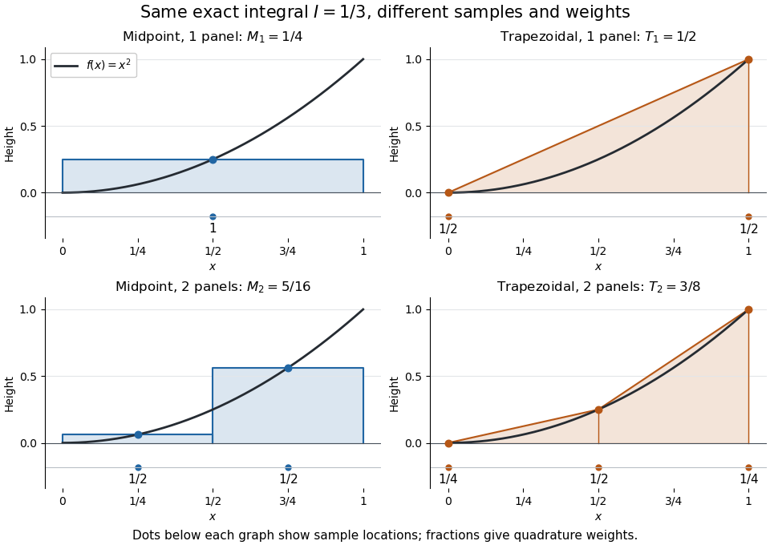
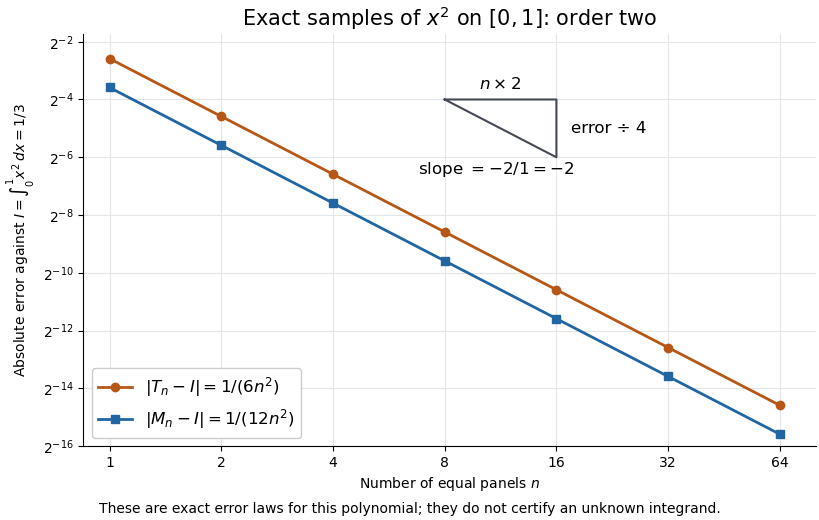
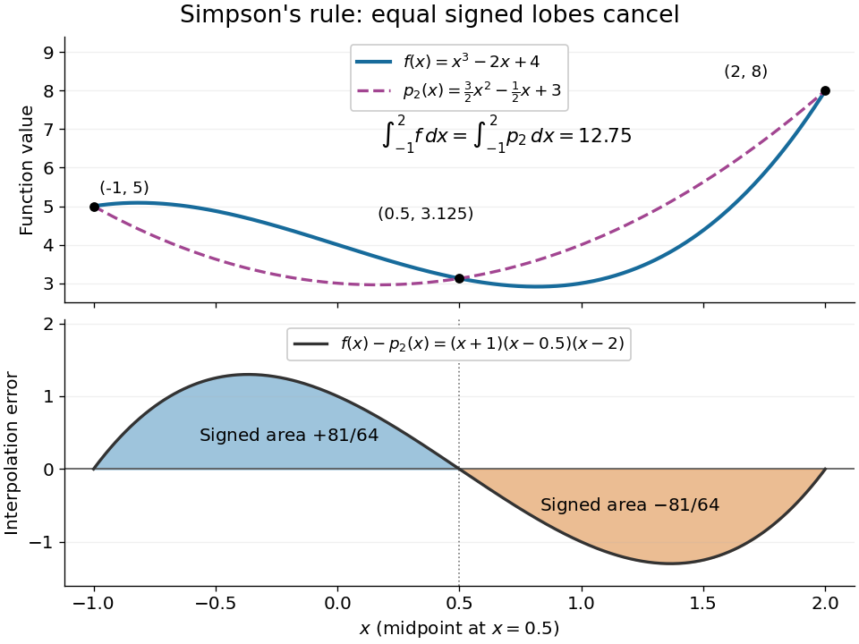
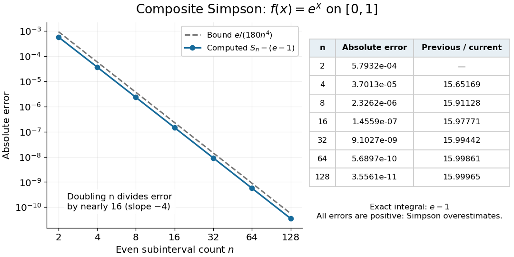

# Numerical integration

↑ **Parent:** [Numerical analysis](numerical-analysis.md)  
ⓦ [Wiki](https://en.wikipedia.org/wiki/Numerical_integration)

[Numerical integration](numerical-integration.md) approximates a [definite integral](integral.md#definite-integral) using finitely many sampled [function](function.md) values. For an [integrand](integral.md#integrand) $f$ on a finite [interval](real-analysis.md#interval-mathematics) $[a,b]$, $a<b$, a [quadrature rule](#quadrature-rule) has the form

$$
I(f)=\int_a^bf(x)\,dx,\qquad Q(f)=\sum_{j=1}^m w_jf(x_j)\approx I(f).
$$

The [quadrature nodes](#quadrature-node) $x_j$ tell us where to evaluate $f$; the [quadrature weights](#quadrature-weight) $w_j$ turn those values into an approximation to the accumulated signed area. The exact [definite integral](integral.md#definite-integral) depends on the [integrand](integral.md#integrand) throughout the [interval](real-analysis.md#interval-mathematics), whereas the [quadrature rule](#quadrature-rule) sees only these samples. Integrating a chosen [interpolant](interpolation.md#interpolant) exactly still generally approximates the original [integrand](integral.md#integrand)'s [integral](integral.md).[Fundamentals of Numerical Computation by Tobin A. Driscoll and others; Definition 5.6.1 and §5.6.1, equations 5.6.2–5.6.5: weighted samples and integration of an interpolant](mathematics-bibliography.md#fundamentals-of-numerical-computation-by-tobin-a-driscoll-and-others/5-6-numerical-integration)

The [fundamental theorem of calculus](calculus.md#fundamental-theorem-of-calculus) evaluates $I(f)$ as $F(b)-F(a)$ when an [antiderivative](integral.md#antiderivative) $F$ is available. [Numerical integration](numerical-integration.md) is useful when no convenient [antiderivative](integral.md#antiderivative) is known, or each evaluation of the [integrand](integral.md#integrand) requires an expensive computation. The task then becomes choosing informative [quadrature nodes](#quadrature-node) and controlling the [quadrature error](real-analysis.md#quadrature-error) with as few evaluations as possible. Fixed data also permit a [quadrature rule](#quadrature-rule), but refinement cannot supply new information between observations.[Fundamentals of Numerical Computation by Tobin A. Driscoll and others; Opening discussion, Example 5.6.1 and the paragraph following Definition 5.6.1: antiderivatives, numerical evaluation and fixed data](mathematics-bibliography.md#fundamentals-of-numerical-computation-by-tobin-a-driscoll-and-others/5-6-numerical-integration)

For an exact comparison, take the [polynomial](polynomial.md) $f(x)=x^2$ on $[0,1]$. Its [antiderivative](integral.md#antiderivative) $x^3/3$ gives $I(f)=1/3$. On a [partition of an interval](real-analysis.md#partition-of-an-interval) into $n\geq1$ equal panels, the [composite midpoint quadrature rule](numerical-analysis.md#composite-midpoint-quadrature-rule) uses $n$ midpoint samples, each with [quadrature weight](#quadrature-weight) $1/n$; the [composite trapezoidal rule](runge-kutta-method.md#composite-trapezoidal-rule) uses $n+1$ endpoint samples, with outer [quadrature weights](#quadrature-weight) $1/(2n)$ and interior [quadrature weights](#quadrature-weight) $1/n$. The existing derivations under these two [quadrature rules](#quadrature-rule) give

$$
M_n(f)=\frac13-\frac{1}{12n^2},\qquad T_n(f)=\frac13+\frac{1}{6n^2}.
$$

In particular, $M_1=1/4$ and $T_1=1/2$ already bracket $1/3$; two panels give $M_2=5/16$ and $T_2=3/8$. The [convex function](real-analysis.md#convex-function) $x^2$ explains the opposite signs. A midpoint [rectangle](euclidean-geometry.md#rectangle) can cross the curve within its panel, so its total signed area, rather than pointwise ordering, determines the underestimate.

**[Figure 1](#image-one-and-two-panels-for-numerical-integration-of-x-2-midpoint-and-endpoint-samples-with-their-quadrature-weights). One and two panels for numerical integration of $x^2$: midpoint and endpoint samples with their quadrature weights**.

Define the signed [approximation error](numerical-analysis.md#approximation-error) as $E_n=Q_n(f)-I(f)$. In this example the [absolute errors](numerical-analysis.md#absolute-error) are $1/(12n^2)$ and $1/(6n^2)$: doubling $n$ reduces each by exactly four. A plot with both axes on a [logarithmic scale](calculus.md#logarithmic-scale) therefore has slope $-2$, expressing order two with respect to panel refinement. This is an exact calculation for this [polynomial](polynomial.md), including $n=1$, rather than an observed rate extrapolated from a few computed answers.

**[Figure 2](#image-exact-absolute-errors-for-midpoint-and-trapezoidal-numerical-integration-of-x-2-slope-2-and-a-factor-four-reduction). Exact absolute errors for midpoint and trapezoidal numerical integration of $x^2$: slope $-2$ and a factor-four reduction**.

For a general [integrand](integral.md#integrand), the [composite midpoint quadrature rule](numerical-analysis.md#composite-midpoint-quadrature-rule) and [composite trapezoidal rule](runge-kutta-method.md#composite-trapezoidal-rule) give second-order [quadrature error](real-analysis.md#quadrature-error) bounds when $f$ has two continuous [derivatives](calculus.md#derivative) on $[a,b]$ and a known bound on $|f''|$. These hypotheses describe behavior between samples. A formal error formula containing an unknown [derivative](calculus.md#derivative) is not a numerical accuracy certificate or a justified sample count. [Finite samples do not certify quadrature accuracy](#finite-samples-do-not-certify-quadrature-accuracy) makes the missing information explicit. Errors in the evaluations and [roundoff error](numerical-analysis.md#round-off-error) must also be considered; [noise sensitivity of a quadrature rule](#noise-sensitivity-of-a-quadrature-rule) treats the former.

More elaborate choices exploit other information: [Gaussian quadrature](numerical-analysis.md#gaussian-quadrature) obtains high [polynomial](polynomial.md) exactness from carefully chosen [quadrature nodes](#quadrature-node), and [Simpson's rule](#simpson-s-rule) uses a quadratic [interpolant](interpolation.md#interpolant). Adaptive [numerical integration](numerical-integration.md) compares approximations and concentrates samples where they disagree, often saving evaluations. Such a difference is an error estimate, not a certified bound without further assumptions: both approximations can miss the same feature.[Fundamentals of Numerical Computation by Tobin A. Driscoll and others; §5.7.1, equation 5.7.4: a difference-based error estimate; §5.7.2: interval bisection; Example 5.7.2 and concluding discussion: requested accuracy is not guaranteed](mathematics-bibliography.md#fundamentals-of-numerical-computation-by-tobin-a-driscoll-and-others/5-7-adaptive-integration)

**Table of contents**

- [Finite samples do not certify quadrature accuracy](#finite-samples-do-not-certify-quadrature-accuracy)
- [Boole's rule](#boole-s-rule)
- [Quadrature rule](#quadrature-rule)
  - [Quadrature node](#quadrature-node)
  - [Quadrature weight](#quadrature-weight)
  - [Degree of precision of a quadrature rule](#degree-of-precision-of-a-quadrature-rule)
  - [Noise sensitivity of a quadrature rule](#noise-sensitivity-of-a-quadrature-rule)
  - [Newton-Cotes closed quadrature](#newton-cotes-closed-quadrature)
  - [Simpson's rule](#simpson-s-rule)
    - [Adaptive Simpson's method](#adaptive-simpson-s-method)
    - [Cubic exactness of Simpson's rule](#cubic-exactness-of-simpson-s-rule)
    - [Composite Simpson's rule](#composite-simpson-s-rule)
      - [Error bound for composite Simpson's rule](#error-bound-for-composite-simpson-s-rule)
  - [Convergence of positive quadrature on continuous functions](#convergence-of-positive-quadrature-on-continuous-functions)
  - [Nodal-polynomial criterion for quadrature exactness](#nodal-polynomial-criterion-for-quadrature-exactness)
  - [Degree ceiling for quadrature exactness](#degree-ceiling-for-quadrature-exactness)
  - [Positivity of quadrature weights from degree 2n exactness](#positivity-of-quadrature-weights-from-degree-2n-exactness)
  - [Convergence of positive quadrature rules](#convergence-of-positive-quadrature-rules)
  - [Moment matching](#moment-matching)

## Finite samples do not certify quadrature accuracy

↑ **Parent:** [Numerical integration](numerical-integration.md)

For any finite set of [quadrature nodes](#quadrature-node) $x_1,\ldots,x_m$ in $[a,b]$, $a<b$, consider the [polynomial](polynomial.md)

$$
p(x)=\prod_{j=1}^m(x-x_j)^2,\qquad A=\int_a^bp(x)\,dx>0.
$$

Every sample is zero, so every [quadrature rule](#quadrature-rule) at these [quadrature nodes](#quadrature-node) gives $Q(p)=0$. Yet $p$ is nonnegative and strictly positive away from its finitely many [polynomial roots](polynomial.md#root-of-a-polynomial); its [continuity](calculus.md#continuous-function) makes the [integral](integral.md) positive. Consequently the [smooth functions](analysis.md#smooth-function) $0$ and $g(x)=p(x)/A$ have identical samples but [definite integrals](integral.md#definite-integral) $0$ and $1$. Multiplying $g$ by any positive constant makes the difference arbitrarily large. This is an information limit, even with exact arithmetic; merely assuming smoothness without quantitative bounds does not remove it. The related [degree ceiling for quadrature exactness](#degree-ceiling-for-quadrature-exactness) uses the same squared nodal [polynomial](polynomial.md) to limit [polynomial](polynomial.md) exactness.

For example, the endpoint [quadrature nodes](#quadrature-node) $0,1$ give $p(x)=x^2(1-x)^2$, $A=1/30$, and $g(x)=30x^2(1-x)^2$. Both the zero [function](function.md) and $g$ produce zero under the one-panel [trapezoidal rule](runge-kutta-method.md#trapezoidal-rule), although $I(g)=1$. More generally, any estimate based only on their shared samples has [absolute error](numerical-analysis.md#absolute-error) at least $1/2$ for one of these two [integrands](integral.md#integrand), by the [triangle inequality](topological-analysis.md#triangle-inequality).

The obstruction also applies to a deterministic adaptive procedure that terminates after finitely many evaluations on the zero [function](function.md): form $p$ using every [quadrature node](#quadrature-node) it visited. On $g$, the same zero responses lead to the same choices and answer. Certified [quadrature error](real-analysis.md#quadrature-error) control therefore needs additional information, such as a known bound on relevant [derivatives](calculus.md#derivative), rather than agreement among sampled approximations alone.

<h2 id="boole-s-rule">Boole's rule</h2>

↑ **Parent:** [Numerical integration](numerical-integration.md)

Integrate the five [Lagrange interpolation polynomials](interpolation.md#lagrange-polynomial) at the equally spaced nodes to obtain the displayed rule. It is exact for [polynomials](polynomial.md) through degree four, and symmetry also makes it exact in degree five. Symmetric endpoint, inner-node and midpoint weights $a,b,c$ satisfy $2a+2b+c=2$, $2a+b/2=2/3$, $2a+b/8=2/5$, giving $a=7/45$, $b=32/45$, $c=12/45$.

## Quadrature rule

↑ **Parent:** [Numerical integration](numerical-integration.md)

A [quadrature rule](#quadrature-rule) approximates an [integral](integral.md) by a finite weighted sum of sampled [function](function.md) values:

$$
I_\rho(f)=\int_a^b\rho(x)f(x)\,dx\approx Q(f)=\sum_{i=1}^m w_i f(x_i).
$$

The [quadrature nodes](#quadrature-node) $x_i$ specify where to sample, and the [quadrature weights](#quadrature-weight) $w_i$ specify how much each sample contributes. The density $\rho(x)$ specifies the target [integral](integral.md), whereas the discrete [quadrature weights](#quadrature-weight) belong to the approximation. Ordinary [numerical integration](numerical-integration.md) has $\rho=1$. [Gaussian quadrature](numerical-analysis.md#gaussian-quadrature) and the [midpoint quadrature rule](numerical-analysis.md#midpoint-quadrature-rule) choose interior [quadrature nodes](#quadrature-node); the [trapezoidal rule](runge-kutta-method.md#trapezoidal-rule) includes endpoints.[§3.5(iv), equation 3.5.15 and the following discussion of nodes and weights](mathematics-bibliography.md#nist-digital-library-of-mathematical-functions/3-5-quadrature-subsection-iv-interpolatory-quadrature-rules)

For ordinary [numerical integration](numerical-integration.md), exactness on the [constant function](function.md#constant-function) $1$ requires $\sum_iw_i=b-a$; exactness on $x$ additionally requires $\sum_iw_ix_i=(b^2-a^2)/2$. These two checks make the [quadrature rule](#quadrature-rule) exact for every [affine function](vector-space.md#affine-function). For example, both the [midpoint quadrature rule](numerical-analysis.md#midpoint-quadrature-rule) and [trapezoidal rule](runge-kutta-method.md#trapezoidal-rule) give $6$ for $\int_0^2(2x+1)\,dx$. Testing progressively higher [polynomial degrees](polynomial.md#degree-of-a-polynomial) defines the [degree of precision of a quadrature rule](#degree-of-precision-of-a-quadrature-rule). Exactness describes a class of [integrands](integral.md#integrand), rather than promising exact results for every [function](function.md).

[Composite midpoint quadrature rules](numerical-analysis.md#composite-midpoint-quadrature-rule) and [composite trapezoidal rules](runge-kutta-method.md#composite-trapezoidal-rule) apply a simple [quadrature rule](#quadrature-rule) on every panel of a [partition of an interval](real-analysis.md#partition-of-an-interval). This buys accuracy by shrinking the panels while keeping the elementary formula fixed. For [continuous functions](calculus.md#continuous-function) sampled exactly, their [quadrature errors](real-analysis.md#quadrature-error) tend to zero as the largest panel width tends to zero. The familiar second-order bounds require stronger assumptions about [derivatives](calculus.md#derivative). The signed [approximation error](numerical-analysis.md#approximation-error) used here is $Q(f)-I_\rho(f)$; some sources define [quadrature error](real-analysis.md#quadrature-error) with the opposite sign, so the convention must accompany any formula.

### Quadrature node

↑ **Parent:** [Quadrature rule](#quadrature-rule)

A [quadrature node](#quadrature-node) is a point at which the [integrand](integral.md#integrand) is sampled by a [quadrature rule](#quadrature-rule). Under the [affine map](geometry-and-topology.md#affine-map) $x=(a+b)/2+(b-a)t/2$ from $[-1,1]$ to $[a,b]$, a reference [quadrature node](#quadrature-node) $t_i$ becomes $x_i=(a+b)/2+(b-a)t_i/2$; for ordinary [numerical integration](numerical-integration.md), the corresponding [quadrature weight](#quadrature-weight) is multiplied by $(b-a)/2$.

### Quadrature weight

↑ **Parent:** [Quadrature rule](#quadrature-rule)

A [quadrature weight](#quadrature-weight) multiplies a sampled [integrand](integral.md#integrand) value in a [quadrature rule](#quadrature-rule). For ordinary [numerical integration](numerical-integration.md), its units match those of the integration variable. Positive [quadrature weights](#quadrature-weight) that sum to $b-a$ make $Q(f)/(b-a)$ a weighted average of the samples; signed [quadrature weights](#quadrature-weight) can magnify sample perturbations, as quantified by [noise sensitivity of a quadrature rule](#noise-sensitivity-of-a-quadrature-rule).

### Degree of precision of a quadrature rule

↑ **Parent:** [Quadrature rule](#quadrature-rule)

The [degree of precision of a quadrature rule](#degree-of-precision-of-a-quadrature-rule) is the largest integer $d$ such that $Q(p)=I_\rho(p)$ for every [polynomial](polynomial.md) $p$ of [polynomial degree](polynomial.md#degree-of-a-polynomial) at most $d$. By [linearity](vector-space.md#linearity), checking the [monomials](polynomial.md#monomial) $1,x,\ldots,x^d$ suffices. Exactness for one higher-degree [polynomial](polynomial.md) alone does not raise this degree: every lower [polynomial degree](polynomial.md#degree-of-a-polynomial) must also be covered.

### Noise sensitivity of a quadrature rule

↑ **Parent:** [Quadrature rule](#quadrature-rule)

If the observed samples are $y_i=f(x_i)+\varepsilon_i$, the resulting [quadrature rule](#quadrature-rule) changes by $\Delta Q=\sum_iw_i\varepsilon_i$. Bounded sample perturbations $|\varepsilon_i|\leq\delta$ therefore satisfy

$$
|\Delta Q|\leq\delta\sum_i|w_i|.
$$

For ordinary [numerical integration](numerical-integration.md) with nonnegative [quadrature weights](#quadrature-weight) exact on [constant functions](function.md#constant-function), the bound is $(b-a)\delta$, independent of panel refinement. A common bias $\varepsilon_i=\delta$ attains it: the [quadrature error](real-analysis.md#quadrature-error) due to the [function](function.md) approximation may vanish while this sample error persists. Interpolating a fixed data set onto a finer grid likewise does not create new observations or remove its uncertainty.

With new samples whose errors are [independent random variables](random-variable.md#independent-random-variables) of zero [expectation](expected-value.md) and common [variance](variance.md) $\sigma^2$, a different model gives

$$
\operatorname{Var}(\Delta Q)=\sigma^2\sum_iw_i^2.
$$

For equal panels this is $\sigma^2(b-a)^2/n$ for the [composite midpoint quadrature rule](numerical-analysis.md#composite-midpoint-quadrature-rule) and $\sigma^2h^2(n-1/2)$ for the [composite trapezoidal rule](runge-kutta-method.md#composite-trapezoidal-rule). These [variance](variance.md) reductions require the stated independence and unbiasedness assumptions; a common bias or correlated sample errors need not shrink. The two displayed perturbation formulas follow directly from the [triangle inequality](topological-analysis.md#triangle-inequality) and the [variance additivity for independent random variables](variance.md#variance-additivity-for-independent-random-variables), respectively.

### Newton-Cotes closed quadrature

↑ **Parent:** [Quadrature rule](#quadrature-rule)

Integrate the [Lagrange polynomial](interpolation.md#lagrange-polynomial) through values at all equally spaced nodes $0,\ldots,s$, including both endpoints. The resulting [quadrature rule](#quadrature-rule) is exact through degree $s$. For even $s$, the node [polynomial](polynomial.md) $\prod_{j=0}^s(t-j)$ is odd about $s/2$, so its integral vanishes and exactness extends through degree $s+1$. The weights need not remain positive as the number of nodes increases.

<h3 id="simpson-s-rule">Simpson's rule</h3>

↑ **Parent:** [Quadrature rule](#quadrature-rule)  
ⓦ [Wiki](https://en.wikipedia.org/wiki/Simpson's_rule)

[Simpson's rule](#simpson-s-rule) approximates a [definite integral](integral.md#definite-integral) by integrating the [quadratic polynomial](polynomial.md#quadratic-polynomial) obtained by [polynomial interpolation](interpolation.md#polynomial-interpolation) at two endpoints and their [midpoint](convex-set.md#midpoint). For an [interval](real-analysis.md#interval-mathematics) $[a,b]$ with $a<b$, write $m=(a+b)/2$ and $h=(b-a)/2$. The three [quadrature nodes](#quadrature-node) are $a,m,b$, and the [quadrature rule](#quadrature-rule) is

$$
S(f)=\frac h3\bigl[f(a)+4f(m)+f(b)\bigr].
$$

Thus its [quadrature weights](#quadrature-weight) are $h/3,4h/3,h/3$. Their sum is $2h=b-a$, as required for exactness on [constant functions](function.md#constant-function). This is the three-node [Newton-Cotes closed quadrature](#newton-cotes-closed-quadrature); its [degree of precision of a quadrature rule](#degree-of-precision-of-a-quadrature-rule) is three, even though the interpolating [polynomial](polynomial.md) has [polynomial degree](polynomial.md#degree-of-a-polynomial) at most two.[NIST Digital Library of Mathematical Functions; §3.5(ii), equation 3.5.6: elementary Simpson rule and its fourth-derivative remainder](mathematics-bibliography.md#nist-digital-library-of-mathematical-functions/3-5-quadrature-subsection-ii-simpson’s-rule)

For an original worked example, take the [cubic polynomial](polynomial.md#cubic-polynomial) $f(x)=x^3-2x+4$ on the [interval](real-analysis.md#interval-mathematics) $[-1,2]$. Here $m=1/2$ and $h=3/2$, so the [function evaluations](function.md#function-evaluation) give

$$
f(-1)=5,\qquad f(1/2)=\frac{25}{8}=3.125,\qquad f(2)=8.
$$

[Simpson's rule](#simpson-s-rule) gives

$$
S(f)=\frac12\left(5+4\cdot\frac{25}{8}+8\right)=\frac{51}{4}=12.75.
$$

An [antiderivative](integral.md#antiderivative) supplies an independent exact [definite integral](integral.md#definite-integral):

$$
\int_{-1}^{2}(x^3-2x+4)\,dx
=\left[\frac{x^4}{4}-x^2+4x\right]_{-1}^{2}
=\frac{51}{4}.
$$

The [quadratic polynomial](polynomial.md#quadratic-polynomial) through the same [quadrature nodes](#quadrature-node) is $p_2(x)=\tfrac32x^2-\tfrac12x+3$. It differs from $f$ between the [quadrature nodes](#quadrature-node), but its [definite integral](integral.md#definite-integral) agrees exactly. The picture shows why: the signed [polynomial interpolation error](algebra.md#polynomial-interpolation-error) has two lobes with opposite [integrals](integral.md).

**[Figure 3](#image-an-original-cubic-and-its-quadratic-interpolant-have-the-same-integral-because-the-two-interpolation-error-lobes-have-signed-integrals-plus-and-minus-81-over-64). An original cubic and its quadratic interpolant have the same integral because the two interpolation-error lobes have signed integrals plus and minus 81 over 64**.

Three [function evaluations](function.md#function-evaluation) therefore capture more information about an [integral](integral.md) than about the whole [function](function.md). When an [antiderivative](integral.md#antiderivative) is unavailable, [composite Simpson's rule](#composite-simpson-s-rule) repeats this inexpensive local construction over a [partition of an interval](real-analysis.md#partition-of-an-interval). For a sufficiently smooth [function](function.md), halving the node spacing reduces its [truncation error](numerical-analysis.md#truncation-error) by approximately a factor of sixteen.

<h4 id="adaptive-simpson-s-method">Adaptive Simpson's method</h4>

↑ **Parent:** [Simpson's rule](#simpson-s-rule)

<h4 id="cubic-exactness-of-simpson-s-rule">Cubic exactness of Simpson's rule</h4>

↑ **Parent:** [Simpson's rule](#simpson-s-rule)

[Polynomial interpolation](interpolation.md#polynomial-interpolation) makes [Simpson's rule](#simpson-s-rule) exact for every [polynomial](polynomial.md) of [polynomial degree](polynomial.md#degree-of-a-polynomial) at most two. To understand the extra [polynomial degree](polynomial.md#degree-of-a-polynomial), centre the coordinate at the [midpoint](convex-set.md#midpoint): $y=x-m$, with endpoints $-h,h$. For any [cubic polynomial](polynomial.md#cubic-polynomial) $p$, let $p_2$ be its interpolating [quadratic polynomial](polynomial.md#quadratic-polynomial). The [polynomial](polynomial.md) $p-p_2$ vanishes at all three [quadrature nodes](#quadrature-node), so

$$
p(x)-p_2(x)=A(x-a)(x-m)(x-b)=A y(y^2-h^2),
$$

where $A$ is the coefficient of $x^3$ in $p$. As a [function](function.md) of $y$, this is an [odd function](calculus.md#odd-function), whose [integral](integral.md) over the symmetric [interval](real-analysis.md#interval-mathematics) $[-h,h]$ is zero. Hence integrating $p_2$ also integrates $p$ exactly. This is the symmetry mechanism in the [nodal-polynomial criterion for quadrature exactness](#nodal-polynomial-criterion-for-quadrature-exactness).

In the worked example, the [polynomial](polynomial.md) difference factors as

$$
f(x)-p_2(x)=(x+1)(x-1/2)(x-2)
=y^3-\frac94y.
$$

Its [definite integrals](integral.md#definite-integral) on $[-1,1/2]$ and $[1/2,2]$ are respectively $81/64$ and $-81/64$. Their cancellation concerns signed [integrals](integral.md), rather than pointwise accuracy of [polynomial interpolation](interpolation.md#polynomial-interpolation).

The [degree of precision of a quadrature rule](#degree-of-precision-of-a-quadrature-rule) stops at three: on the same [interval](real-analysis.md#interval-mathematics), the [monomial](polynomial.md#monomial) $x^4$ gives $S(x^4)=69/8$, whereas $\int_{-1}^{2}x^4\,dx=33/5$. Their difference, exact [integral](integral.md) minus approximation, is $-81/40$.

<h4 id="composite-simpson-s-rule">Composite Simpson's rule</h4>

↑ **Parent:** [Simpson's rule](#simpson-s-rule)

[Composite Simpson's rule](#composite-simpson-s-rule) applies [Simpson's rule](#simpson-s-rule) to consecutive pairs of equal subintervals. Choose a positive even [integer](integer.md) $n\geq2$, put $h=(b-a)/n$, and take [quadrature nodes](#quadrature-node) $x_j=a+jh$ for $j=0,\ldots,n$. There are $n$ subintervals, $n/2$ two-subinterval panels, and $n+1$ [quadrature nodes](#quadrature-node). Then

$$
S_n=\frac h3\left[f(x_0)+4\sum_{j=1}^{n/2}f(x_{2j-1})+2\sum_{j=1}^{n/2-1}f(x_{2j})+f(x_n)\right].
$$

The second [sum](arithmetic.md#sum) is empty when $n=2$, recovering one panel. The [quadrature weights](#quadrature-weight), before multiplication by $h/3$, are $1,4,2,4,\ldots,2,4,1$. Every interior even-indexed [quadrature node](#quadrature-node) is an endpoint of two panels, so its two endpoint contributions add to two; every odd-indexed [quadrature node](#quadrature-node) is a [midpoint](convex-set.md#midpoint) with weight four. An odd $n$ cannot be covered by these pairs. The displayed formula requires equal spacing.[Fundamentals of Numerical Computation by Tobin A. Driscoll and others; §5.6, equations 5.6.20–5.6.21: elementary and composite Simpson formulas](mathematics-bibliography.md#fundamentals-of-numerical-computation-by-tobin-a-driscoll-and-others/5-6-numerical-integration)

For the [exponential function](calculus.md#exponential-function) on the [interval](real-analysis.md#interval-mathematics) $[0,1]$, the exact [integral](integral.md) is $I=e-1$. With $n=2$, the formula gives $S_2\approx1.718861151876593$, an overestimate of about $5.793234175\times10^{-4}$. With $n=128$, it gives $S_{128}\approx1.718281828494607$, an overestimate of about $3.556140064\times10^{-11}$. The figure shows the intermediate refinements and compares every computed [absolute error](numerical-analysis.md#absolute-error) with the [error bound for composite Simpson's rule](#error-bound-for-composite-simpson-s-rule).

**[Figure 4](#image-computed-composite-simpson-errors-for-the-exponential-function-on-zero-to-one-approach-fourth-order-convergence-the-dashed-curve-is-the-rigorous-bound-e-over-180-n-to-the-fourth-power). Computed composite Simpson errors for the exponential function on zero to one approach fourth-order convergence; the dashed curve is the rigorous bound e over 180 n to the fourth power**.

For this [exponential function](calculus.md#exponential-function), a [geometric series](sequence-and-series.md#geometric-series) also gives a compact independent formula. With $q=e^h$ and $h=1/n$, summing the $n/2$ panel contributions yields

$$
S_n=(e-1)\frac{h(1+4q+q^2)}{3(q^2-1)}.
$$

A [Taylor series](calculus.md#taylor-series) at $h=0$ gives

$$
S_n-I=(e-1)\left(\frac{h^4}{180}-\frac{h^6}{1512}+O(h^8)\right).
$$

The [Big O notation](real-analysis.md#big-o-notation) describes the remaining terms as $h$ tends to zero. Consequently $(S_n-I)/(S_{2n}-I)$ tends to sixteen: the computed ratios increase from about $15.65169$ to $15.99965$. Fourth-order [truncation error](numerical-analysis.md#truncation-error) is also obtained by [Richardson extrapolation](numerical-analysis.md#richardson-extrapolation) of the [composite trapezoidal rule](runge-kutta-method.md#composite-trapezoidal-rule).[Fundamentals of Numerical Computation by Tobin A. Driscoll and others; §5.6.2, equations 5.6.14–5.6.15: Simpson extrapolation and fourth-order error](mathematics-bibliography.md#fundamentals-of-numerical-computation-by-tobin-a-driscoll-and-others/5-6-numerical-integration)

<h5 id="error-bound-for-composite-simpson-s-rule">Error bound for composite Simpson's rule</h5>

↑ **Parent:** [Composite Simpson's rule](#composite-simpson-s-rule)

Suppose $f$ has a fourth [derivative](calculus.md#derivative) that is a [continuous function](calculus.md#continuous-function) on the [interval](real-analysis.md#interval-mathematics) $[a,b]$, and $|f^{(4)}(x)|\leq M$ there. With $I=\int_a^b f(x)\,dx$, the signed [quadrature error](real-analysis.md#quadrature-error) here is $I-S_n$. Then, for some [point](geometry-and-topology.md#point-geometry) $\xi\in(a,b)$,

$$
I-S_n=-\frac{b-a}{180}h^4 f^{(4)}(\xi),\qquad
|I-S_n|\leq\frac{M(b-a)}{180}h^4.
$$

In particular, a strictly positive fourth [derivative](calculus.md#derivative) makes $I-S_n<0$: [composite Simpson's rule](#composite-simpson-s-rule) overestimates the [integral](integral.md).[NIST Digital Library of Mathematical Functions; §3.5(ii), equations 3.5.6–3.5.8: continuous fourth derivative, elementary remainder, composite formula and signed error](mathematics-bibliography.md#nist-digital-library-of-mathematical-functions/3-5-quadrature-subsection-ii-simpson’s-rule)

The bound's scale follows by adding the panel errors. A panel of width $2h$ has signed [quadrature error](real-analysis.md#quadrature-error) $-h^5 f^{(4)}(\xi_j)/90$ and [absolute error](numerical-analysis.md#absolute-error) at most $Mh^5/90$. There are $(b-a)/(2h)$ panels, so the [triangle inequality](topological-analysis.md#triangle-inequality) gives $M(b-a)h^4/180$. The [intermediate value theorem](calculus.md#intermediate-value-theorem) for the continuous fourth [derivative](calculus.md#derivative) replaces the average of the panel values $f^{(4)}(\xi_j)$ by a single value $f^{(4)}(\xi)$, giving the signed formula.

The underlying single-panel calculation can be seen through the [Peano kernel theorem](numerical-analysis.md#peano-kernel-theorem). On the [interval](real-analysis.md#interval-mathematics) $[0,2]$, define the raw [Peano kernel](numerical-analysis.md#peano-kernel) $K(t)=L[(x-t)_+^3]$, where $L$ is [integral](integral.md) minus [Simpson's rule](#simpson-s-rule) and $(x-t)_+=\max(x-t,0)$ is the [positive part](function.md#positive-part-of-a-real-valued-function). Then $K(t)=-t^3(4-3t)/12$ for $0\leq t\leq1$ and $K(t)=-(2-t)^3(3t-2)/12$ for $1\leq t\leq2$. It is strictly negative inside the [interval](real-analysis.md#interval-mathematics) and has [integral](integral.md) $-1/15$. Thus

$$
L(f)=\frac1{3!}\int_0^2 K(t)f^{(4)}(t)\,dt,\qquad
|L(f)|\leq\frac{\|f^{(4)}\|_\infty}{90}.
$$

The [uniform norm](normed-vector-space.md#supremum-norm) $\|f^{(4)}\|_\infty$ bounds the fourth [derivative](calculus.md#derivative). The [polynomial](polynomial.md) $f(x)=x^4/24$ attains equality. Scaling to endpoint spacing $h$ multiplies the coefficient by $h^5$, giving the sharp single-panel bound $h^5\|f^{(4)}\|_\infty/90$. The normalized [Peano kernel](numerical-analysis.md#peano-kernel) is $K/3!$, so the external [factorial](combinatorics.md#factorial) must be omitted when using that normalization.

For the [exponential function](calculus.md#exponential-function) on $[0,1]$, $f^{(4)}(x)=e^x$, so $M=e$ and the bound is $e/(180n^4)$. Its leading actual [absolute error](numerical-analysis.md#absolute-error) is $(e-1)/(180n^4)$, smaller than the bound because a uniform upper bound on the fourth [derivative](calculus.md#derivative) does not use its variation across the [interval](real-analysis.md#interval-mathematics). The theorem bounds [truncation error](numerical-analysis.md#truncation-error) with exact [function evaluations](function.md#function-evaluation); sample errors and [roundoff error](numerical-analysis.md#round-off-error) are additional contributions, as described by [noise sensitivity of a quadrature rule](#noise-sensitivity-of-a-quadrature-rule).

### Convergence of positive quadrature on continuous functions

↑ **Parent:** [Quadrature rule](#quadrature-rule)

On a compact interval, positive [quadrature rule](#quadrature-rule) weights whose sum is the interval length define uniformly bounded functionals on [continuous functions](calculus.md#continuous-function). If the rules eventually integrate every fixed [polynomial](polynomial.md) exactly, the [Weierstrass approximation theorem](functional-analysis.md#weierstrass-approximation-theorem) proves convergence for every [continuous function](calculus.md#continuous-function).

### Nodal-polynomial criterion for quadrature exactness

↑ **Parent:** [Quadrature rule](#quadrature-rule)

An $(n+1)$-node [quadrature rule](#quadrature-rule) already exact through degree $n$ is exact through degree $n+1+k$ exactly when its nodal polynomial

$$
Q_{n+1}(x)=\prod_{i=0}^n(x-x_i)
$$

is orthogonal to every polynomial of degree at most $k$.

### Degree ceiling for quadrature exactness

↑ **Parent:** [Quadrature rule](#quadrature-rule)

No $(n+1)$-node quadrature rule for a positive interval weight can be exact through degree $2n+2$, because it evaluates the nonnegative nodal square $Q_{n+1}^2$ as zero although its integral is positive.

### Positivity of quadrature weights from degree 2n exactness

↑ **Parent:** [Quadrature rule](#quadrature-rule)

If an $(n+1)$-node quadrature rule for a positive interval weight is exact through degree $2n$, every weight is positive. Indeed, applying the rule to the square of the corresponding degree-$n$ Lagrange cardinal polynomial isolates that weight.

### Convergence of positive quadrature rules

↑ **Parent:** [Quadrature rule](#quadrature-rule)

If each $(n+1)$-node quadrature rule is exact through degree $n$ and has positive weights, then it converges on every continuous function. The [Weierstrass approximation theorem](functional-analysis.md#weierstrass-approximation-theorem) reduces the error to the uniform polynomial-approximation error, while exactness on constants controls the sum of the weights.

### Moment matching

↑ **Parent:** [Quadrature rule](#quadrature-rule)

A quadrature rule is exact through degree $d$ precisely when its node weights reproduce the first $d+1$ moments of the integration measure.

## ↑ Ancestors (5)

1. [Numerical analysis](numerical-analysis.md)
2. [Analysis](analysis.md)
3. [Area of mathematics](mathematics.md#area-of-mathematics)
4. [Mathematics](mathematics.md)
5. [Codex Wiki](README.md)

## ← Incoming links (18)

- [Bernoulli corrections for polynomial sums](bernoulli-number.md#bernoulli-corrections-for-polynomial-sums)
- [Electrolysis](electrochemistry.md#electrolysis)
- [Function evaluation](function.md#function-evaluation)
- [Galerkin orthogonality](finite-element-method.md#galerkin-orthogonality)
- [Noise sensitivity of a quadrature rule](#noise-sensitivity-of-a-quadrature-rule)
- [Numerical integration](numerical-integration.md)
- [Solution](past-exam-of-the-mathematics-course-of-the-university-of-cambridge/2002/ib/paper-4.md#15f/solution)
- [Solution](past-exam-of-the-mathematics-course-of-the-university-of-cambridge/2006/iii/paper-66.md#3/a/solution)
- [Solution](past-exam-of-the-mathematics-course-of-the-university-of-cambridge/2016/iii/paper-328.md#1/ii/solution)
- [Solution](past-exam-of-the-mathematics-course-of-the-university-of-cambridge/2019/iii/paper-219.md#2/d/solution)
- [Solution](past-exam-of-the-quantum-condensed-matter-course-of-the-university-of-cambridge/2012.md#3/solution)
- [Pressure coefficient](lift-force.md#pressure-coefficient)
- [Quadrature node](#quadrature-node)
- [Quadrature rule](#quadrature-rule)
- [Quadrature weight](#quadrature-weight)
- [Richardson extrapolation](numerical-analysis.md#richardson-extrapolation)
- [Twin paradox with finite acceleration](special-relativity.md#twin-paradox-with-finite-acceleration)
- [Worked supernova distance comparison](cosmology.md#worked-supernova-distance-comparison)
