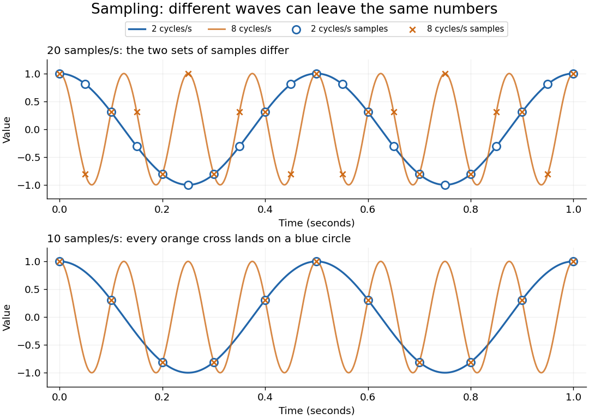

<h1 id="nyquist-shannon-sampling-theorem">Nyquist–Shannon sampling theorem</h1>

↑ **Parent:** [Fourier analysis](fourier-analysis-split.md)  
ⓦ [Wiki](https://en.wikipedia.org/wiki/Nyquist–Shannon_sampling_theorem)

The [Nyquist–Shannon sampling theorem](nyquist-shannon-sampling-theorem.md) says that a [bandlimited function](bandlimited-function.md) can be recovered exactly from equally spaced samples, provided the sampling rate is high enough. It is the bridge between a continuous waveform and a sequence of numbers: the missing values between samples are determined by the restriction on its [frequencies](frequency.md).

Here is a precise finite-energy version. Let $f\in L^2(\mathbb R)$, meaning $\int_{\mathbb R}|f(t)|^2\,dt<\infty$, and suppose its [Fourier transform](fourier-transform-split.md), defined through the [Plancherel theorem](plancherel-theorem.md), is zero outside $[-2\pi B,2\pi B]$. Thus $B>0$ is the largest allowed ordinary [frequency](frequency.md), in cycles per second, rather than an [angular frequency](angular-frequency.md). Set $T=1/f_s$, where $f_s$ is the number of samples per second. If $f_s\geq2B$, the continuous representative of $f$ is recovered by

$$
f(t)=\sum_{n\in\mathbb Z}f(nT)\,\frac{\sin\bigl(\pi(t/T-n)\bigr)}{\pi(t/T-n)}.
$$

The quotient is the normalized [sinc function](sinc-function.md), with value one when its argument is zero. Each shifted [sinc function](sinc-function.md) is one at its own sampling time and zero at every other sampling time. Its coefficient is therefore exactly the required sample value. For this [L2 space](l2-space-is-a-hilbert-space.md) formulation, the reconstruction converges in the [L2 space](l2-space-is-a-hilbert-space.md) norm and uniformly in $t$. The critical rate $f_s=2B$ is allowed for this class; choosing $f_s>2B$ leaves a gap between the occupied [frequencies](frequency.md) and the sampling boundary.

For a numerical example, a [bandlimited function](bandlimited-function.md) with no [frequencies](frequency.md) above $3$ cycles per second can be reconstructed from its samples every $0.1$ seconds: $f_s=10>6$. Exact reconstruction uses the whole sequence indexed by $\mathbb Z$. A finite recording and a finite sum of [sinc functions](sinc-function.md) introduce truncation error; joining adjacent samples by straight lines is generally a different reconstruction.

The obstruction is [aliasing](aliasing.md). At sampling rate $f_s=10$, the two distinct waveforms

$$
f_2(t)=\cos(2\pi\cdot2t),\qquad f_8(t)=\cos(2\pi\cdot8t)
$$

have identical samples at $t=n/10$, because

$$
\cos(2\pi\cdot8n/10)=\cos(2\pi n-2\pi\cdot2n/10)=\cos(2\pi\cdot2n/10).
$$

The samples alone cannot tell whether the waveform oscillates twice or eight times per second. If we know in advance that all [frequencies](frequency.md) are below $5$, the $8$-cycle waveform is excluded and the ambiguity disappears. These pure [cosines](cosine.md) are an illustrative [aliasing](aliasing.md) example, rather than members of the finite-energy [L2 space](l2-space-is-a-hilbert-space.md) class in the stated theorem.

**[Figure 2](#image-two-and-eight-cycles-per-second-are-distinguishable-at-twenty-samples-per-second-but-alias-at-ten). Two and eight cycles per second are distinguishable at twenty samples per second but alias at ten**.

Exactly at a sampling boundary, the function class matters. At rate $f_s$, the [sine](sine.md) $\sin(2\pi(f_s/2)t)$ has zero values at every $n/f_s$. It is a nonzero waveform indistinguishable from zero on that grid, but has infinite energy and is excluded by the finite-energy hypothesis above. This explains why a rule intended to cover arbitrary pure [sinusoids](sinusoid.md) should demand a strict inequality. For spatial data, replace seconds by distance: the [Nyquist spatial frequency](nyquist-spatial-frequency.md) is $1/(2p)$ for sample pitch $p$.

The proof idea is short: the samples are [Fourier coefficients](fourier-coefficient.md) of the [Fourier transform](fourier-transform-split.md) restricted to a sampling-sized [frequency](frequency.md) interval. Because a [bandlimited function](bandlimited-function.md) has no contribution outside that interval, its [Fourier series](fourier-series-split.md) determines the whole [Fourier transform](fourier-transform-split.md); [Fourier inversion](fourier-inversion-theorem.md) then gives the [sinc function](sinc-function.md) expansion. See [sampling expansion by periodic Fourier projection](sampling-expansion-by-periodic-fourier-projection.md) for this connection.

Claude E. Shannon's _Communication in the Presence of Noise_ (1949), Section II, Theorem 1 and equation (7), gives the sampling statement and reconstruction using shifted [sinc functions](sinc-function.md) in a communication setting. Shannon explicitly notes earlier mathematical forms and credits Nyquist with emphasizing the sampling interval in telegraphy.[Shannon 1949, Proceedings of the IRE 37(1), pp. 10–21; sampling theorem on pp. 11–12](https://fab.cba.mit.edu/classes/S62.12/docs/Shannon_noise.pdf)

**Table of contents**

- [Nyquist frequency](nyquist-frequency.md)
- [Aliasing](aliasing.md)
  - [Anti-aliasing filter](anti-aliasing-filter.md)
- [Strictly supercritical sampling alias counterexample](strictly-supercritical-sampling-alias-counterexample.md)
- [Sampling expansion by periodic Fourier projection](sampling-expansion-by-periodic-fourier-projection.md)
- [Nyquist spatial frequency](nyquist-spatial-frequency.md)

## ↑ Ancestors (5)

1. [Fourier analysis](fourier-analysis-split.md)
2. [Analysis](analysis-split.md)
3. [Area of mathematics](area-of-mathematics.md)
4. [Mathematics](mathematics-split.md)
5. [Codex Wiki](split.md)

## ← Incoming links (25)

- [Aliasing](aliasing.md)
- [Aliasing of discrete Fourier modes](aliasing-of-discrete-fourier-modes.md)
- [Anti-aliasing filter](anti-aliasing-filter.md)
- [Diffraction-limited resolution](diffraction-limited-resolution.md)
- [Discrete-time signal](discrete-time-signal.md)
- [Nyquist–Shannon sampling theorem](nyquist-shannon-sampling-theorem.md)
- [Solution](past-exam-of-the-biochemistry-course-of-the-university-of-cambridge/2025/paper-1/section-ii/4/solution.md)
- [Solution](past-exam-of-the-mathematics-course-of-the-university-of-cambridge/2006/iii/paper-7/3/ii/solution.md)
- [Solution](past-exam-of-the-mathematics-course-of-the-university-of-cambridge/2008/iii/paper-88/5/c/solution.md)
- [Solution](past-exam-of-the-mathematics-course-of-the-university-of-cambridge/2017/iii/paper-338/3/a/i/solution.md)
- [Solution](past-exam-of-the-mathematics-course-of-the-university-of-cambridge/2019/iii/paper-338/2/b/i/solution.md)
- [Solution](past-exam-of-the-optics-and-electrodynamics-course-of-the-university-of-cambridge/2021/section-b/b5/d/solution.md)
- [Solution](past-exam-of-the-physics-a-course-of-the-university-of-cambridge/2011/paper-2/section-d/d12/b/solution.md)
- [Solution](past-exam-of-the-physics-a-course-of-the-university-of-cambridge/2012/paper-1/section-d/d12/b/solution.md)
- [Solution](past-exam-of-the-physics-a-course-of-the-university-of-cambridge/2017/paper-1/section-d/d12/solution.md)
- [Solution](past-exam-of-the-physics-a-course-of-the-university-of-cambridge/2017/paper-1/section-d/d13/b/solution.md)
- [Solution](past-exam-of-the-physics-a-course-of-the-university-of-cambridge/2019/paper-1/section-d/d13/c/solution.md)
- [Solution](past-exam-of-the-physics-a-course-of-the-university-of-cambridge/2021/paper-1/section-a/5/solution.md)
- [Solution](past-exam-of-the-physics-a-course-of-the-university-of-cambridge/2022/paper-1/section-a/5/solution.md)
- [Solution](past-exam-of-the-physics-course-of-the-year-4-of-the-natural-sciences-course-of-the-university-of-cambridge/2016/paper-1/section-a/a10/solution.md)
- [Periodization of a Schwartz function](periodization-of-a-schwartz-function.md)
- [Raster sampling and reconstruction](raster-sampling-and-reconstruction.md)
- [Signal sampling](signal-sampling.md)
- [Spatial sampling of a wave](spatial-sampling-of-a-wave.md)
- [Uniform-quantization error bound](uniform-quantization-error-bound.md)
