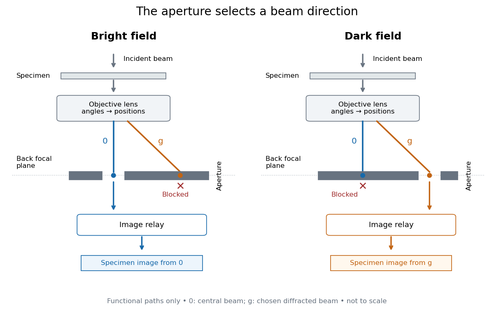

# Objective aperture

↑ **Parent:** [Transmission electron microscopy contrast](transmission-electron-microscopy-contrast.md)

An [objective aperture](objective-aperture.md) selects outgoing [electron](electron.md) directions in the objective lens's back [focal plane](focal-plane.md). Passing the central transmitted beam gives [bright-field transmission electron microscopy](bright-field-transmission-electron-microscopy.md); selecting a separated diffracted beam gives [dark-field transmission electron microscopy](dark-field-transmission-electron-microscopy.md).[Definition: back focal plane and beam selection](objective-aperture-by-jeol.md)

In a [paraxial approximation](paraxial-approximation.md), an outgoing [angle](angle.md) $\theta$ maps approximately to position $r=f\theta$ in this [focal plane](focal-plane.md), where $f$ is the objective [focal length](focal-length.md). A centred opening of [radius](radius.md) $a$ therefore admits $|\theta|\lesssim a/f$. Selecting a direction selects a component of the outgoing [wavefunction](wave-function-split.md); the subsequent image still assigns intensity to specimen positions. The opening is not a hole cut into a real-space specimen image. Its angular selection must be distinguished from selecting a specimen region for [electron diffraction](electron-diffraction.md).

**[Figure 1](#image-objective-aperture-selection-for-bright-field-transmission-electron-microscopy-and-dark-field-transmission-electron-microscopy). Objective aperture selection for bright-field transmission electron microscopy and dark-field transmission electron microscopy**. [Source](tem-objective-aperture-bright-dark-paths.py). Original functional diagram. Lower relay boxes denote image formation, not literal ray paths. Scales and beam angles are illustrative.

**Table of contents**

- [Bright-field transmission electron microscopy](bright-field-transmission-electron-microscopy.md)
- [Dark-field transmission electron microscopy](dark-field-transmission-electron-microscopy.md)

## ↑ Ancestors (9)

1. [Transmission electron microscopy contrast](transmission-electron-microscopy-contrast.md)
2. [Transmission electron microscopy](transmission-electron-microscopy.md)
3. [Electron microscopy](electron-microscopy.md)
4. [Electron microscope](electron-microscope.md)
5. [Electron optics](electron-optics.md)
6. [Optics](optics-split.md)
7. [Branches of physics](branches-of-physics.md)
8. [Physics](physics-split.md)
9. [Codex Wiki](split.md)

## ← Incoming links (6)

- [Diffraction contrast](diffraction-contrast.md)
- [Objective aperture](objective-aperture.md)
- [Solution](past-exam-of-the-mphil-in-micro-and-nanotechnology-enterprise-course-of-the-university-of-cambridge/2022/paper-1/section-a-i/1/i/solution.md)
- [Solution](past-exam-of-the-mphil-in-micro-and-nanotechnology-enterprise-course-of-the-university-of-cambridge/2022/paper-1/section-a-i/1/ii/a/solution.md)
- [Transmission electron microscopy](transmission-electron-microscopy.md)
- [Transmission electron microscopy specimen dose and calibration](transmission-electron-microscopy-specimen-dose-and-calibration.md)
