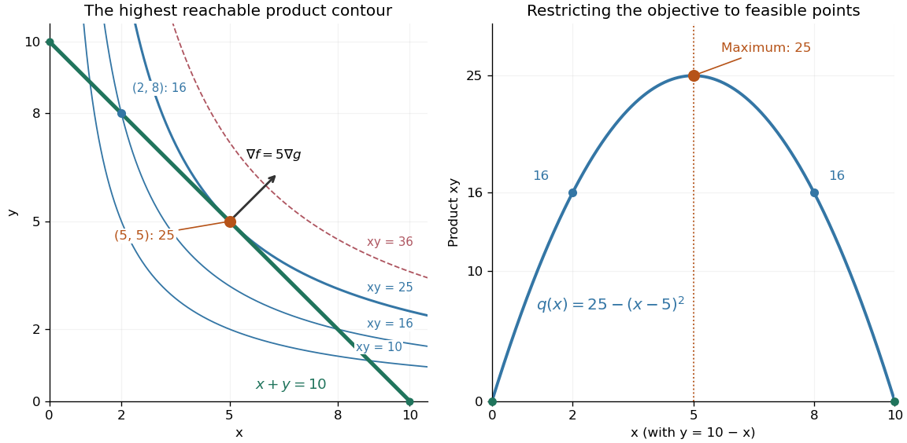

# Objective function

↑ **Parent:** [Mathematical optimization](mathematical-optimization-split.md)

An [objective function](objective-function.md) is a [real-valued function](real-valued-function.md) assigning a score to each decision under consideration. An [optimization](mathematical-optimization-split.md) problem seeks a [feasible solution](feasible-point.md) maximizing or minimizing this score. The optimizing decision and its score are different objects: in the [budget constraint](budget-constraint.md) example, the decision is $(5,5)$ and the optimal value is $25$.

Choosing an [objective function](objective-function.md) expresses what matters. With $x+y=10$ and $x,y\geq0$, maximizing $x+y$ makes every [feasible point](feasible-point.md) equally good; maximizing $x$ selects $(10,0)$; maximizing $xy$ rewards balance. If $x,y$ are side lengths, $xy$ is a [rectangle](rectangle.md)'s [area](surface-area.md), and the [budget constraint](budget-constraint.md) fixes its [perimeter](perimeter.md) at $20$. The same mathematics then says that a [square](square.md) encloses the largest [area](surface-area.md) among these [rectangles](rectangle.md).

For the product [objective function](objective-function.md), the positive [level sets](level-set.md) $xy=c$ are [hyperbolas](hyperbola.md). Each collects decisions with identical scores. The highest attainable [level set](level-set.md) touches the [feasible set](feasible-region.md) at $(5,5)$; higher ones miss it entirely.

**[Figure 1](#image-product-contours-meet-the-feasible-budget-segment-with-a-unique-maximum-of-25-at-5-5). Product contours meet the feasible budget segment, with a unique maximum of 25 at (5,5)**

The product $xy$ is neither a [convex function](convex-function.md) nor a [concave function](concave-function.md) on the positive quadrant: along $(t,t)$ it is $t^2$, while along $(t,10-t)$ it is $10t-t^2$. Yet its restriction to this [feasible set](feasible-region.md) is a [strictly concave function](strictly-concave-function.md). Thus the geometry of the allowed decisions can make an otherwise nonconcave [maximization problem](maximization-problem.md) tractable. Replacing $f$ by $-f$ always converts a [maximization problem](maximization-problem.md) into an equivalent [minimization problem](minimization-problem.md).

// Target: mathematical-optimization.bigb

## ↑ Ancestors (4)

1. [Mathematical optimization](mathematical-optimization-split.md)
2. [Area of mathematics](area-of-mathematics.md)
3. [Mathematics](mathematics-split.md)
4. [Codex Wiki](split.md)

## ← Incoming links (43)

- [Conditional expectation choice invariant](conditional-expectation-choice-invariant.md)
- [Conic primal-dual gap](conic-primal-dual-gap.md)
- [Convex KKT optimality certificate](convex-kkt-optimality-certificate.md)
- [Convex optimization](convex-optimization-split.md)
- [Cooling schedule for simulated annealing](cooling-schedule-for-simulated-annealing.md)
- [Derivative](derivative.md)
- [Empty and open feasible regions](empty-and-open-feasible-regions.md)
- [Equality slice of a feasible triangle](equality-slice-of-a-feasible-triangle.md)
- [Exchange argument](exchange-argument.md)
- [Extreme value theorem](extreme-value-theorem.md)
- [Farkas certificate for linear inequalities](farkas-certificate-for-linear-inequalities.md)
- [Feasible point](feasible-point.md)
- [Feasible region](feasible-region.md)
- [Feasible triangle with a squared-distance objective](feasible-triangle-with-a-squared-distance-objective.md)
- [Fenchel–Young gap](fenchel-young-gap.md)
- [Five-state barrier example for simulated annealing](five-state-barrier-example-for-simulated-annealing.md)
- [Fixed-temperature law of simulated annealing](fixed-temperature-law-of-simulated-annealing.md)
- [Greedy algorithm](greedy-algorithm.md)
- [Interval scheduling](interval-scheduling.md)
- [Karush-Kuhn-Tucker conditions](karush-kuhn-tucker-conditions.md)
- [KKT regularity at a local minimum](kkt-regularity-at-a-local-minimum.md)
- [Lagrange multiplier as a marginal cost](lagrange-multiplier-as-a-marginal-cost.md)
- [Lagrangian duality](lagrangian-duality.md)
- [Lagrangian duality for a quadratic threshold](lagrangian-duality-for-a-quadratic-threshold.md)
- [Mathematical optimization](mathematical-optimization-split.md)
- [Maximin bargaining solution](maximin-bargaining-solution.md)
- [Method of conditional probabilities](method-of-conditional-probabilities.md)
- [Nonnegative-orthant optimality certificate](nonnegative-orthant-optimality-certificate.md)
- [Objective function](objective-function.md)
- [Solution](past-exam-of-the-mathematics-course-of-the-university-of-cambridge/2001/iii/paper-31/1/solution.md)
- [Solution](past-exam-of-the-mathematics-course-of-the-university-of-cambridge/2001/iii/paper-31/2/solution.md)
- [Solution](past-exam-of-the-mathematics-course-of-the-university-of-cambridge/2001/iii/paper-31/3/ii/solution.md)
- [Solution](past-exam-of-the-mathematics-course-of-the-university-of-cambridge/2001/iii/paper-31/3/solution.md)
- [Positive Lagrangian duality gap on a finite domain](positive-lagrangian-duality-gap-on-a-finite-domain.md)
- [Project scheduling](project-scheduling.md)
- [Quadratic minimization with a moving upper bound](quadratic-minimization-with-a-moving-upper-bound.md)
- [Second-order-cone optimality certificate](second-order-cone-optimality-certificate.md)
- [Simulated annealing](simulated-annealing.md)
- [Stability of a supremum under uniform perturbations](stability-of-a-supremum-under-uniform-perturbations.md)
- [Strong duality without dual attainment](strong-duality-without-dual-attainment.md)
- [Supremum of a sum](supremum-of-a-sum.md)
- [Value function](value-function.md)
- [Weighted interval scheduling](weighted-interval-scheduling.md)
