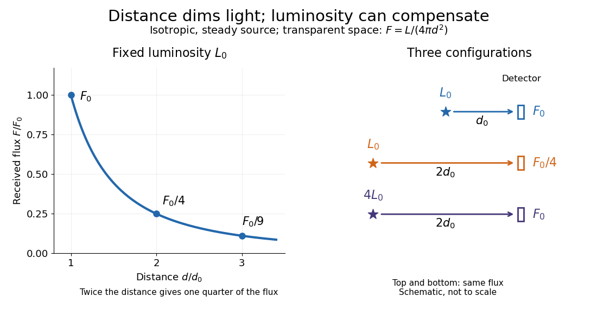

# Observed radiative flux

↑ **Parent:** [Radiative flux](radiative-flux.md)

For a steady [point-like astronomical source](point-like-astronomical-source.md) with [isotropy](isotropy.md) of emission, in transparent space with negligible relativistic or cosmological effects, [conservation of energy](conservation-of-energy.md) spreads its [luminosity](luminosity.md) over a [sphere](sphere.md) of [surface area](surface-area.md) $4\pi d^2$. Its bolometric observed radiative flux is

$$
F=\frac{L}{4\pi d^2},\qquad L=4\pi d^2F.
$$

This [inverse-square law](inverse-square-law.md) reflects geometric dilution: the same emitted [power](power.md) crosses increasingly large [spheres](sphere.md). It does not require [light](light.md) to lose [energy](energy.md) on the journey. For a fixed [luminosity](luminosity.md), doubling [Euclidean distance](euclidean-distance.md) quarters the [observed radiative flux](observed-radiative-flux.md). [NASA: Inverse-square propagation](https://science.nasa.gov/learn/basics-of-space-flight/chapter6-1/).

With $L_0=10^{26}\,\mathrm W$ and $d_0=20$ [parsecs](parsec.md), the result is $F_0\simeq2.09\times10^{-11}\,\mathrm{W\,m^{-2}}$. At $40$ [parsecs](parsec.md), the same source gives $F_0/4\simeq5.22\times10^{-12}\,\mathrm{W\,m^{-2}}$. An ideal collecting area of $1\,\mathrm{m^2}$ at $20$ [parsecs](parsec.md) intercepts approximately $2.09\times10^{-11}\,\mathrm W$, before detector losses.

**[Figure 12](#image-fixed-luminosity-gives-inverse-square-dimming-different-luminosities-can-give-equal-observed-flux-configuration-diagram-schematic-not-to-scale). Fixed luminosity gives inverse-square dimming; different luminosities can give equal observed flux; configuration diagram schematic, not to scale**.

**Table of contents**

- [Flux-distance degeneracy](flux-distance-degeneracy.md)

## ↑ Ancestors (7)

1. [Radiative flux](radiative-flux.md)
2. [Radiation-field moment](radiation-field-moment.md)
3. [Radiative transfer](radiative-transfer.md)
4. [Astrophysics](astrophysics-split.md)
5. [Branches of physics](branches-of-physics.md)
6. [Physics](physics-split.md)
7. [Codex Wiki](split.md)

## ← Incoming links (13)

- [Aperture photometry](aperture-photometry.md)
- [Apparent magnitude](apparent-magnitude.md)
- [Astrophysics](astrophysics-split.md)
- [Exoplanet transit depth](exoplanet-transit-depth.md)
- [Exoplanet transit photometry](exoplanet-transit-photometry.md)
- [Flux-distance degeneracy](flux-distance-degeneracy.md)
- [Light curve](light-curve.md)
- [Limb-darkened disk flux](limb-darkened-disk-flux.md)
- [Luminosity](luminosity.md)
- [Methods of detecting exoplanets](methods-of-detecting-exoplanets.md)
- [Observed radiative flux](observed-radiative-flux.md)
- [Radiative flux](radiative-flux.md)
- [Transit dilution](transit-dilution.md)
