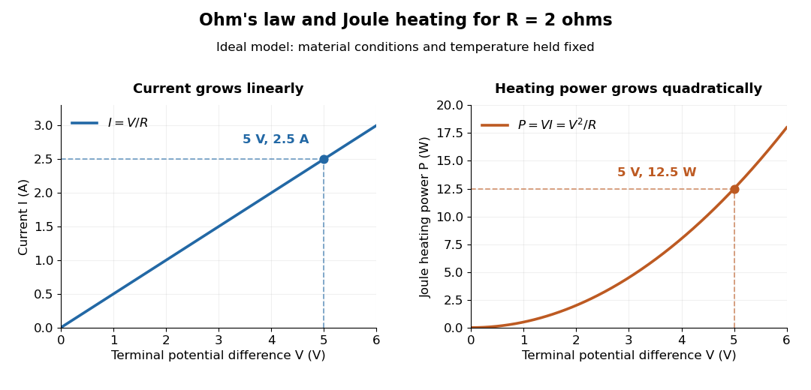

<h1 id="ohm-s-law">Ohm's law</h1>

↑ **Parent:** [Electrical resistance](electrical-resistance.md)  
ⓦ [Wiki](https://en.wikipedia.org/wiki/Ohm's_law)

[Ohm's law](ohm-s-law.md) states that an [Ohmic conductor](ohmic-conductor.md) has [electric current](electric-current.md) proportional to its applied [electric potential difference](electric-potential-difference.md), with constant [electrical resistance](electrical-resistance.md) under fixed material conditions:

$$
V=IR,\qquad I=\frac VR.
$$

Here $V=\phi(A)-\phi(B)$ is the terminal [electric potential difference](electric-potential-difference.md), and positive $I$ enters at $A$ and exits at $B$. This sign convention makes $VI$ the electrical [power](power.md) absorbed. The straight-line relation through the origin lets one constant predict the response at many applied [electric potential differences](electric-potential-difference.md). Merely defining $R=V/I$ at one nonzero operating point does not establish [Ohm's law](ohm-s-law.md): a component may have a ratio that varies with applied [electric potential difference](electric-potential-difference.md). Material and [temperature](temperature.md) must be specified and held fixed; many components have a nonlinear response. [Ling, Sanny and Moebs, §9.4: Ohmic and non-Ohmic responses](https://openstax.org/books/university-physics-volume-2/pages/9-4-ohms-law).

For the ideal [resistor](resistor.md) model $R=2\,\Omega$ at [electric potential difference](electric-potential-difference.md) $V=5\,\mathrm V$,

$$
I=\frac{5\,\mathrm V}{2\,\Omega}=2.5\,\mathrm A,\qquad P=VI=I^2R=\frac{V^2}{R}=12.5\,\mathrm W.
$$

This [power](power.md) is converted to [internal energy](internal-energy.md) by [Joule heating](joule-heating.md); a [watt](watt.md) is a [joule](joule.md) per second. If the model holds for [time](time-in-physics.md) $10\,\mathrm s$, the transferred [energy](energy.md) is $125\,\mathrm J$. Doubling [electric potential difference](electric-potential-difference.md) doubles [electric current](electric-current.md) and quadruples [power](power.md) for the same fixed $R$. The model keeps material [temperature](temperature.md) fixed even while calculating [Joule heating](joule-heating.md); appreciable changes in [temperature](temperature.md) may require a changing [electrical resistance](electrical-resistance.md). [Ling, Sanny and Moebs, §9.5: electrical power and heating](university-physics-volume-2-by-samuel-j-ling-and-others/9-5-electrical-energy-and-power.md).

**[Figure 22](#image-ohm-s-law-gives-linear-electric-current-and-quadratic-joule-heating-power-at-fixed-electrical-resistance). Ohm's law gives linear electric current and quadratic Joule heating power at fixed electrical resistance**. [Source](ohmic-wire-voltage-and-current.py). The ideal model holds $R=2\,\Omega$ fixed. At $V=5\,\mathrm V$, the marked values are $I=2.5\,\mathrm A$ and $P=12.5\,\mathrm W$.

In 1827, [Georg Ohm](georg-ohm.md) published his mathematical account of electrical transport in _Die galvanische Kette, mathematisch bearbeitet_. On printed page 36, his relation $S=A/L$ expresses [electric current](electric-current.md) in terms of total driving tension and a reduced [length](length.md) incorporating [electrical conductivity](electrical-conductivity.md) and geometry. This is historical notation: his $A$ is not the [wire cross-sectional area](wire-cross-sectional-area.md) used here, and his $L$ is not simply the wire's physical [length](length.md). The striking idea is that material response and geometry can be combined into one quantity governing an [electrical circuit](electrical-circuit.md). [Ohm, Die galvanische Kette, mathematisch bearbeitet (1827), p. 36, original edition](https://archive.org/details/diegalvanischek00ohmgoog).

**Table of contents**

- [Georg Ohm](georg-ohm.md)
- [Electrical conductivity](electrical-conductivity.md)
  - [Complex conductivity](complex-conductivity.md)
  - [Electrical resistivity](electrical-resistivity.md)
  - [Uniaxial conductivity tensor](uniaxial-conductivity-tensor.md)
  - [Electrical conductor](electrical-conductor.md)
  - [Ohmic conductor](ohmic-conductor.md)
    - [Uniform current in a straight homogeneous wire](uniform-current-in-a-straight-homogeneous-wire.md)
    - [Charge relaxation](charge-relaxation.md)
      - [Charge relaxation in an isolated conducting cylinder](charge-relaxation-in-an-isolated-conducting-cylinder.md)
  - [Drude model](drude-model.md)
    - [Momentum relaxation time](momentum-relaxation-time.md)
    - [Drude current relaxation](drude-current-relaxation.md)
    - [Drude frequency response](drude-frequency-response.md)
    - [Drude conductivity and Hall experiment](drude-conductivity-and-hall-experiment.md)
    - [High-frequency Drude plasma cutoff](high-frequency-drude-plasma-cutoff.md)
- [Joule heating](joule-heating.md)
  - [Resistor power under fixed drive](resistor-power-under-fixed-drive.md)
  - [Local Joule heating rate](local-joule-heating-rate.md)
  - [Electrical calorimetry of a resistor](electrical-calorimetry-of-a-resistor.md)
  - [Watt](watt.md)

## ↑ Ancestors (8)

1. [Electrical resistance](electrical-resistance.md)
2. [Electrical resistance and conductance](electrical-resistance-and-conductance.md)
3. [Electric current](electric-current.md)
4. [Electric charge](electric-charge.md)
5. [Electromagnetism](electromagnetism-split.md)
6. [Branches of physics](branches-of-physics.md)
7. [Physics](physics-split.md)
8. [Codex Wiki](split.md)

## ← Incoming links (47)

- [Charge relaxation in an isolated conducting cylinder](charge-relaxation-in-an-isolated-conducting-cylinder.md)
- [Current flow](current-flow.md)
- [Daniell cell voltage and load experiment](daniell-cell-voltage-and-load-experiment.md)
- [Drude conductivity and Hall experiment](drude-conductivity-and-hall-experiment.md)
- [Drude current relaxation](drude-current-relaxation.md)
- [Electric potential](electric-potential.md)
- [Electrical calorimetry of a resistor](electrical-calorimetry-of-a-resistor.md)
- [Electrical conductivity](electrical-conductivity.md)
- [Electrical resistance](electrical-resistance.md)
- [Electrical resistance and conductance](electrical-resistance-and-conductance.md)
- [Electrostatics](electrostatics.md)
- [Faraday's law of induction](faraday-s-law-of-induction.md)
- [Georg Ohm](georg-ohm.md)
- [Joule heating](joule-heating.md)
- [Leaky integrate-and-fire model](leaky-integrate-and-fire-model.md)
- [Local Joule heating rate](local-joule-heating-rate.md)
- [Mapping a capacitor fringing field](mapping-a-capacitor-fringing-field.md)
- [Mean spanning-tree path current](mean-spanning-tree-path-current.md)
- [Ohm](ohm.md)
- [Ohm's law](ohm-s-law.md)
- [Passive sign convention](passive-sign-convention.md)
- [Solution](past-exam-of-the-mathematics-course-of-the-university-of-cambridge/2004/ib/paper-1/7b/solution.md)
- [Solution](past-exam-of-the-mathematics-course-of-the-university-of-cambridge/2005/ib/paper-2/17h/solution.md)
- [Solution](past-exam-of-the-mathematics-course-of-the-university-of-cambridge/2006/ib/paper-2/6g/solution.md)
- [Solution](past-exam-of-the-mathematics-course-of-the-university-of-cambridge/2006/iii/paper-37/1/a/solution.md)
- [Solution](past-exam-of-the-mathematics-course-of-the-university-of-cambridge/2006/iii/paper-37/1/b/solution.md)
- [Solution](past-exam-of-the-mathematics-course-of-the-university-of-cambridge/2007/ib/paper-2/6e/solution.md)
- [Solution](past-exam-of-the-mathematics-course-of-the-university-of-cambridge/2007/ib/paper-4/7e/solution.md)
- [Solution](past-exam-of-the-mathematics-course-of-the-university-of-cambridge/2007/iii/paper-38/1/solution.md)
- [Solution](past-exam-of-the-mathematics-course-of-the-university-of-cambridge/2008/ii/paper-4/35d/solution.md)
- [Solution](past-exam-of-the-mathematics-course-of-the-university-of-cambridge/2009/ib/paper-4/7a/solution.md)
- [Solution](past-exam-of-the-mathematics-course-of-the-university-of-cambridge/2013/ib/paper-2/6d/solution.md)
- [Solution](past-exam-of-the-mathematics-course-of-the-university-of-cambridge/2014/ib/paper-4/7a/solution.md)
- [Solution](past-exam-of-the-mathematics-course-of-the-university-of-cambridge/2016/ib/paper-3/17d/b/i/solution.md)
- [Solution](past-exam-of-the-mathematics-course-of-the-university-of-cambridge/2017/iii/paper-214/3/a/solution.md)
- [Solution](past-exam-of-the-mathematics-course-of-the-university-of-cambridge/2018/ib/paper-4/7c/solution.md)
- [Solution](past-exam-of-the-mathematics-course-of-the-university-of-cambridge/2019/ib/paper-2/18a/solution.md)
- [Solution](past-exam-of-the-mathematics-course-of-the-university-of-cambridge/2019/iii/paper-214/3/a/solution.md)
- [Solution](past-exam-of-the-mathematics-course-of-the-university-of-cambridge/2022/ib/paper-2/16d/b/ii/solution.md)
- [Resistance bridge](resistance-bridge.md)
- [Resistor](resistor.md)
- [RL circuit](rl-circuit.md)
- [Single-channel current-voltage relation](single-channel-current-voltage-relation.md)
- [Surface conductivity](surface-conductivity.md)
- [Thermal resistance](thermal-resistance.md)
- [Voltage divider](voltage-divider.md)
- [Wheatstone bridge balance](wheatstone-bridge-balance.md)
