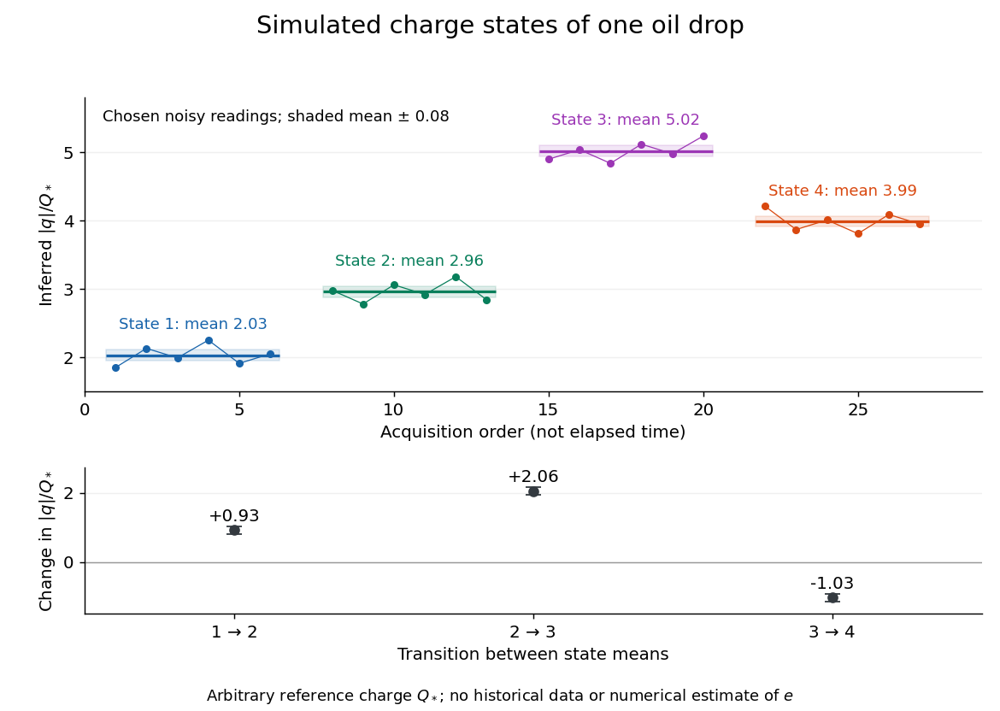

# Oil drop charge readout and calibration

↑ **Parent:** [Oil drop experiment](oil-drop-experiment.md)

[Robert Andrews Millikan](robert-andrews-millikan.md)'s 1911 protocol alternated electrically driven ascent with timed descent after short-circuiting the plates; a changed ascent [speed](speed.md) signalled [ion](ion.md) capture.[pp. 352–353](the-isolation-of-an-ion-a-precision-measurement-of-its-charge-and-the-correction-of-stokes%E2%80%99s-law-by-robert-andrews-millikan.md)

His 1913 refinements checked voltage before and after runs, calibrated optical distance and the clock, compared independent air-[dynamic viscosity](dynamic-viscosity-split.md) measurements, and varied [pressure](pressure-split.md) to test slip.[pp. 112–118](on-the-elementary-electrical-charge-and-the-avogadro-constant-by-robert-andrews-millikan.md) His 1924 lecture describes suppressing [convection](convection-split.md), switching the [electric field](electric-field-split.md), neutralizing drops, and reproducing smallest observed electrical [speed](speed.md) increments.[Nobel Lectures, Physics 1922–1941; pp. 56–60](nobel-lectures-physics-1922-1941/the-electron-and-the-light-quant-from-the-experimental-point-of-view-by-robert-andrews-millikan.md)

[Harvey Fletcher](harvey-fletcher.md)'s posthumous account recalls building the first oil apparatus and measuring with [Robert Andrews Millikan](robert-andrews-millikan.md); priority for suggesting oil remains uncertain.[pp. 44–47](my-work-with-millikan-on-the-oil-drop-experiment-by-harvey-fletcher.md)

To interpret the readout, keep one drop and one [electric field](electric-field-split.md) polarity. Let $u_i$ be its signed upward [terminal velocity](terminal-velocity.md) in charge state $i$, and let $v_f>0$ be its field-off falling [speed](speed.md). Use the [linear drag](linear-drag.md) coefficient $k$ already defined in [elementary charge](elementary-charge.md), with any required [gas slip correction to Stokes drag](gas-slip-correction-to-stokes-drag.md) included. Provided the drop's [radius](radius.md), surrounding air and [electric field](electric-field-split.md) remain fixed, its electrical [speed](speed.md) increment is

$$
S_i=u_i+v_f,\qquad |q_i|=\frac{k}{E}S_i,\qquad
\frac{|q_i|}{|q_j|}=\frac{S_i}{S_j},\qquad
\Delta|q|=\frac{k}{E}(u_{i+1}-u_i).
$$

These relations apply while the [electric force](electric-force.md) points upward in every state. A drop may still descend, with $u_i<0$, when that [force](force-split.md) is too weak to support it. A held drop has $u_i=0$ and therefore $S_i=v_f$, rather than zero electrical response. A neutral drop has $S_i=0$: its signed [terminal velocity](terminal-velocity.md) agrees with field-off descent. Thus neither raw upward [speed](speed.md) nor the ability to hold a drop is itself a count of [electrons](electron.md).

The ratios cancel a fixed $k/E$, even if its value is poorly known. This is why relative [charge quantization](charge-quantization.md) and absolute [measurement calibration](measurement-calibration.md) are different questions. A changed field-off $v_f$ warns that evaporation, air motion or another change has spoiled comparison of charge states. A stable $v_f$ is useful evidence but cannot exclude every compensating change. Repeat field-off checks around a proposed jump, allow the [terminal velocity under linear drag](terminal-velocity-under-linear-drag.md) to settle after switching, and propagate [measurement uncertainty](measurement-uncertainty.md) in both the field-on and field-off readings. Reusing a single estimate of $v_f$ gives the different $S_i$ a shared [covariance](covariance.md).

**[Figure 3](#oil-drop-charge-jump-series). Simulated repeated electric charge states and resolved charge changes of one drop**. Original chosen noisy readings in an arbitrary reference [electric charge](electric-charge-split.md) $Q_*$, with four state means and their stipulated [standard uncertainties](standard-uncertainty.md). These are a simulation, not measurements by [Robert Andrews Millikan](robert-andrews-millikan.md) or [Harvey Fletcher](harvey-fletcher.md). Acquisition order is not elapsed [time](time-in-physics.md); connecting lines only group observations made in the same state.

## ↑ Ancestors (7)

1. [Oil drop experiment](oil-drop-experiment.md)
2. [Elementary charge](elementary-charge.md)
3. [Electric charge](electric-charge-split.md)
4. [Electromagnetism](electromagnetism-split.md)
5. [Branches of physics](branches-of-physics.md)
6. [Physics](physics-split.md)
7. [Codex Wiki](split.md)

## ← Incoming links (1)

- [Gas slip correction to Stokes drag](gas-slip-correction-to-stokes-drag.md)
