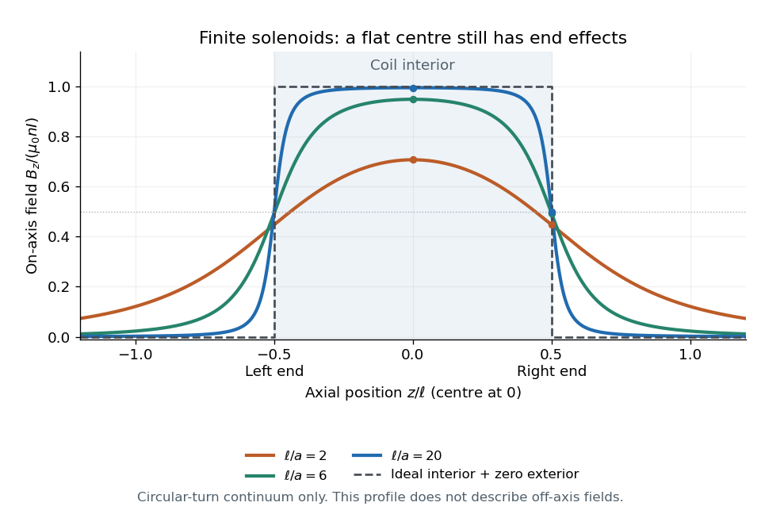

# On-axis magnetic field of a finite solenoid

↑ **Parent:** [Solenoid](solenoid.md)

Model a finite [solenoid](solenoid.md) as a continuum of coaxial turns shaped as [circles](circle.md) of [radius](radius.md) $a>0$, uniformly distributed over length $\ell$ with [solenoid turn density](solenoid-turn-density.md) $n=N/\ell$. Put its centre at $z=0$, so its ends are $z=\pm\ell/2$. With the same [electric current](electric-current.md) orientation as in the [long-solenoid approximation](long-solenoid-approximation.md), its axial [magnetic field](magnetic-field.md) is

$$
B_z(z)=\frac{\mu_0nI}{2}
\left[
\frac{z+\ell/2}{\sqrt{a^2+(z+\ell/2)^2}}
-\frac{z-\ell/2}{\sqrt{a^2+(z-\ell/2)^2}}
\right].
$$

This formula applies only on the axis, where [symmetry](symmetry-physics.md) cancels the transverse [magnetic field](magnetic-field.md). It does not describe points off the axis. It is exact for the continuum circular-turn model, which neglects winding thickness, discrete wire spacing, and helical advance. [MIT 8.02 course notes, §9.4, equations 9.4.5–9.4.6: the finite-solenoid axial field](https://web.mit.edu/8.02t/www/test/materials/StudyGuide/guide09_revised.pdf).

The derivation is an especially direct use of the [superposition principle](superposition-principle.md). The [on-axis magnetic field of a circular current loop](on-axis-magnetic-field-of-a-circular-current-loop.md) at source position $z'$ is $\mu_0Ia^2/[2(a^2+(z-z')^2)^{3/2}]$. There are $n\,dz'$ turns in an axial slice, so

$$
B_z(z)=\frac{\mu_0nIa^2}{2}
\int_{-\ell/2}^{\ell/2}
\frac{dz'}{[a^2+(z-z')^2]^{3/2}}.
$$

Substitute $u=z-z'$ and use the [antiderivative](antiderivative.md) $u/[a^2\sqrt{a^2+u^2}]$ to obtain the displayed expression. If the centre is instead at $z=z_0$, replace every $z$ in that expression by $z-z_0$.

At the centre and at either end, respectively,

$$
\frac{B_z(0)}{\mu_0nI}=\frac{\ell}{\sqrt{\ell^2+4a^2}},
\qquad
\frac{B_z(\ell/2)}{\mu_0nI}
=\frac{\ell}{2\sqrt{\ell^2+a^2}}.
$$

For aspect ratios $\ell/a=2,6,20$, the centre ratios are approximately $0.7071,0.9487,0.9950$. The end ratio tends to $1/2$ as $\ell/a$ becomes large, even though the centre ratio tends to $1$. Thus a long coil can have an excellent central [magnetic field](magnetic-field.md) while the ends still differ strongly from that value. Convergence to the [long-solenoid approximation](long-solenoid-approximation.md) is not uniform across the end region.

**[Figure 33](#image-finite-solenoid-axial-magnetic-fields-compared-with-the-ideal-interior-value). Finite solenoid axial magnetic fields compared with the ideal interior value**. Original profiles for $\ell/a=2,6,20$ on the axis, normalized by $\mu_0nI$. The dashed step is the approximation that assigns the ideal interior value within the coil and zero outside; an infinite [solenoid](solenoid.md) itself has no ends. The finite profiles stay smooth through the end planes and remain nonzero beyond them. These curves describe no off-axis points.

For a concrete geometry, give the earlier coil [radius](radius.md) $a=0.025\,\mathrm m$, so $\ell/a=20$. Its central [magnetic field](magnetic-field.md) is approximately $1.2504\,\mathrm{mT}$, its end value is $0.6275\,\mathrm{mT}$, and at $z=\ell$ its axial [magnetic field](magnetic-field.md) is still $0.00277\,\mathrm{mT}$. The last point is outside the coil: finite length does not permit the zero-exterior conclusion of the infinite model. Off the axis, the [magnetic field lines](magnetic-field-line.md) bend around to form the return field. A central axial value alone also does not determine the total [magnetic flux](magnetic-flux.md) through every turn of a short coil.

## ↑ Ancestors (6)

1. [Solenoid](solenoid.md)
2. [Magnetic field](magnetic-field.md)
3. [Electromagnetism](electromagnetism-split.md)
4. [Branches of physics](branches-of-physics.md)
5. [Physics](physics-split.md)
6. [Codex Wiki](split.md)

## ← Incoming links (1)

- [Solenoid](solenoid.md)
