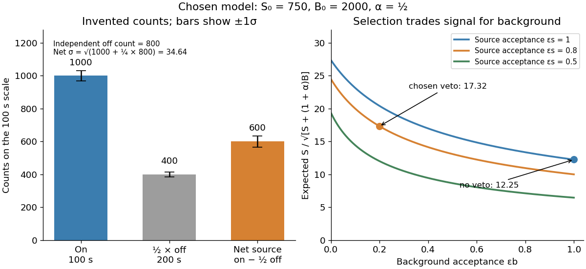

# On-off X-ray photon counting

↑ **Parent:** [X-ray effective area](x-ray-effective-area.md)

[Background subtraction](background-subtraction.md) must account for uncertainty in the background measurement itself. In an original idealized experiment, an on-source exposure contains source and background, while an independent off-source exposure contains background alone. Assume stationary rates and identical background acceptance per unit live time. With $\alpha=t_{\mathrm{on}}/t_{\mathrm{off}}$, let independent counts obey [Poisson distributions](poisson-distribution.md):

$$
N_{\mathrm{on}}\sim\operatorname{Poisson}(S+B),\qquad N_{\mathrm{off}}\sim\operatorname{Poisson}(B/\alpha).
$$

Then [linearity of expectation](linearity-of-expectation.md) and addition of [variances](variance-split.md) for independent [random variables](random-variable-split.md) give

$$
\widehat S=N_{\mathrm{on}}-\alpha N_{\mathrm{off}},\qquad \mathbb E\widehat S=S,\qquad \operatorname{Var}(\widehat S)=S+(1+\alpha)B.
$$

The result concerns accepted source counts $S$, after all efficiencies. For large counts the [normal approximation](normal-approximation.md) gives the descriptive [signal-to-noise ratio in photon counting](signal-to-noise-ratio-in-photon-counting.md)

$$
Z_{\mathrm{approx}}=\frac{\widehat S}{\sqrt{N_{\mathrm{on}}+\alpha^2N_{\mathrm{off}}}}.
$$

This plug-in ratio is not an exact null-hypothesis significance. Small counts require the discrete [Poisson](poisson-distribution.md) model; searching many sky directions also changes a detection claim's [p-value](p-value.md).

Choose $t_{\mathrm{on}}=100\,\mathrm{s}$ and $t_{\mathrm{off}}=200\,\mathrm{s}$, with observed counts $N_{\mathrm{on}}=1000$ and $N_{\mathrm{off}}=800$. Thus $\alpha=1/2$, $\widehat S=600$, and the estimated [standard deviation](standard-deviation.md) is $\sqrt{1200}=34.64$ counts. The inferred $F=\widehat S/(A_{\mathrm{eff}}t_{\mathrm{on}})=0.300\pm0.0173\,\mathrm{photons\,cm^{-2}\,s^{-1}}$ uses the preceding $A_{\mathrm{eff}}=20\,\mathrm{cm^2}$ and includes counting uncertainty only. The descriptive ratio is $17.32$. Treating the scaled off-source background as exact would omit 200 counts squared from the estimated [variance](variance-split.md).

**[Figure 16](#image-invented-on-off-counts-and-the-effect-of-background-rejection). Invented on-off counts and the effect of background rejection**. All numbers are chosen teaching values, not historical measurements. Independent off-source counts contribute uncertainty. The rejection curves hold the source acceptance fixed within each labelled case.

For a selection-design comparison, suppose before a veto the expected source contribution is $S_0=750$, the on-source background is $B_0=2000$, and $\alpha=1/2$. Let source acceptance be $\epsilon_s=0.8$ and background acceptance be $\epsilon_b=0.2$. Then $S=600$, $B=400$, and $S/\sqrt{S+(1+\alpha)B}=17.32$, whereas omitting the veto gives $750/\sqrt{750+3000}=12.25$. Rejection helps because the background is reduced enough to compensate for lost source events. A different veto can make matters worse; source efficiency and background rejection are separate probabilities. This comparison is an independent teaching example, not the efficiency calibration used above.

If both exposure times grow with fixed $\alpha$ and stationary rates, $S=s t_{\mathrm{on}}$ and $B=b t_{\mathrm{on}}$ imply $Z\simeq s\sqrt{t_{\mathrm{on}}}/\sqrt{s+(1+\alpha)b}$. Four times the live time doubles this ideal ratio. Misestimated background rates, uncertain [X-ray effective area](x-ray-effective-area.md), and source variability can defeat that scaling; longer exposure does not remove [systematic error](systematic-error.md).

## ↑ Ancestors (7)

1. [X-ray effective area](x-ray-effective-area.md)
2. [X-ray astronomy](x-ray-astronomy.md)
3. [Observational astronomy](observational-astronomy.md)
4. [Astrophysics](astrophysics-split.md)
5. [Branches of physics](branches-of-physics.md)
6. [Physics](physics-split.md)
7. [Codex Wiki](split.md)
