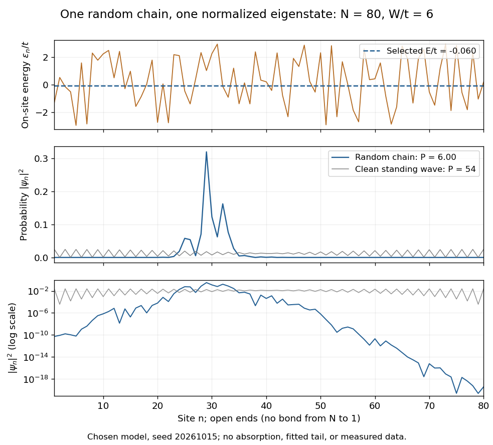
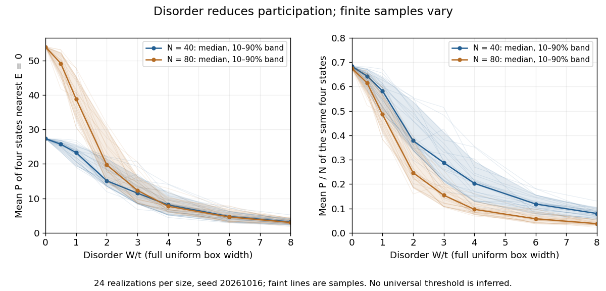

# One-dimensional Anderson chain

↑ **Parent:** [Anderson localization](anderson-localization.md)

Consider a noninteracting [electron](electron.md) in a finite [tight-binding model](tight-binding.md) with open ends:

$$
H=-t\sum_{n=1}^{N-1}\bigl(\lvert n\rangle\langle n+1\rvert+\lvert n+1\rangle\langle n\rvert\bigr)+\sum_{n=1}^N\epsilon_n\lvert n\rangle\langle n\rvert,\qquad t>0.
$$

The [vectors](vector.md) $\lvert n\rangle$ form an [orthonormal basis](orthonormal-basis.md) of site states. The hopping [energy](energy-split.md) is $t$; it is not the time coordinate. Draw each $\epsilon_n$ independently from the [continuous uniform distribution](continuous-uniform-distribution.md) on $[-W/2,W/2]$ and then hold it fixed. The disorder strength $W/t$ is dimensionless. Open ends mean no hopping bond connects sites $N$ and $1$; equivalently set $\psi_0=\psi_{N+1}=0$. There are no [electron](electron.md) interactions, [phonons](phonon.md) or [wave absorption](wave-absorption.md) in this model.

The [eigenvalue equation](eigenvalue-equation.md) in the interior is

$$
-t(\psi_{n-1}+\psi_{n+1})+\epsilon_n\psi_n=E\psi_n.
$$

As a simple local calculation, if a state's peak is at $n_0$, a neighbouring site with $|E-\epsilon_n|\gg t$ receives a small leading contribution $\psi_n\simeq-t\psi_{n_0}/(E-\epsilon_n)$. Several successive large mismatches multiply small factors. This explains why large disorder can restrict spreading, but is not a proof of [Anderson localization](anderson-localization.md): near-resonant denominators and alternative [interference](interference-wave-propagation.md) paths prevent treating this expansion as uniformly valid.

For the first original calculation, take $N=80$, $t=1$, $W/t=6$ and the fixed random seed $20261015$. Diagonalizing the resulting real [symmetric matrix](symmetric-matrix.md) with `numpy.linalg.eigh` and selecting the [eigenvalue](eigenvalue.md) closest to zero gives $E/t\simeq-0.05962$, a probability peak at site $29$, and $P\simeq6.0031$. The selected [eigenvector](eigenvector.md) has total probability one. This is one chosen realization, not a disorder average or a measured specimen.

**[Figure 3](#anderson-chain-eigenstate). One random potential and a concentrated energy eigenstate in a One-dimensional Anderson chain**. Original calculation for $80$ sites and $W/t=6$. The top panel shows all site [energies](energy-split.md) and the selected [eigenvalue](eigenvalue.md). The lower panels show the same probability on linear and logarithmic scales, compared with a clean central [standing wave](standing-wave.md). No fitted [localization length](localization-length.md) is claimed.

The clean comparison needs care. With $W=0$, the open chain has [standing waves](standing-wave.md)

$$
\psi_n^{(m)}=\sqrt{\frac{2}{N+1}}\sin\frac{m\pi n}{N+1},\qquad E_m=-2t\cos\frac{m\pi}{N+1},\qquad m=1,\ldots,N.
$$

For even $N$, the identity $\sin^4x=(3-4\cos2x+\cos4x)/8$ and finite trigonometric sums give $\sum_n|\psi_n^{(m)}|^4=3/[2(N+1)]$, hence $P=2(N+1)/3$. Thus the clean $80$-site comparison has $P=54$, although it extends across the chain. Extended does not mean uniform probability. For odd $N$, the special central mode $m=(N+1)/2$ has zeros on alternating sites and instead $P=(N+1)/2$; the even-size assumption avoids that exception.

The second original calculation compares $N=40$ and $80$ over $W/t=0,0.5,1,2,3,4,6,8$. For each size, draw $24$ independent site patterns using seed $20261016$, with the size included in the random-seed construction. Scale each fixed pattern across disorder strengths. At every point, average $P$ over the four [energy eigenstates](energy-eigenstate.md) closest to $E=0$. The solid line is the median across these sample averages; shading spans their $10$th–$90$th percentiles. The selected states can change as $W/t$ varies: lines connect one sample's selections rather than tracking a single mode.

**[Figure 4](#anderson-participation-disorder). Participation ratio varies across disorder realizations and finite chain sizes**. Original [One-dimensional Anderson chain](one-dimensional-anderson-chain.md) calculations. Faint lines show individual sample averages, solid lines their medians and bands their $10$th–$90$th percentiles. The left panel plots $P$; the right divides by site count $N$. These finite samples illustrate concentration and variability, without a fitted critical disorder.

At $W/t=0$ the two clean values are $27\frac13$ and $54$. At $W/t=8$, the computed median sample averages are approximately $3.17$ and $3.01$. In the latter regime, doubling $N$ hardly changes the typical occupied site count, so $P/N$ falls. At weak disorder the larger chain permits more spatial extent. Neither a single curve nor the overlap of finite-size bands proves the infinite-system statement under [mobility edge](mobility-edge.md); a long [localization length](localization-length.md) can hide confinement in either size.

## ↑ Ancestors (7)

1. [Anderson localization](anderson-localization.md)
2. [Wave propagation in a random medium](wave-propagation-in-a-random-medium.md)
3. [Random medium](random-medium.md)
4. [Wave scattering](wave-scattering.md)
5. [Wave](wave-split.md)
6. [Physics](physics-split.md)
7. [Codex Wiki](split.md)

## ← Incoming links (1)

- [One-dimensional Anderson chain](one-dimensional-anderson-chain.md)
