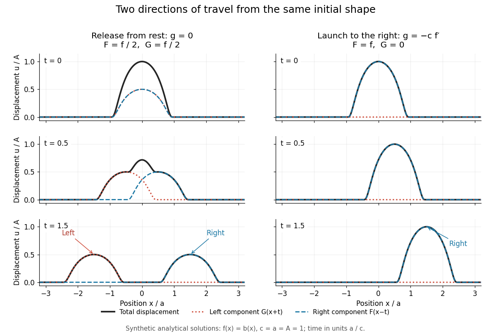

# One-dimensional wave equation

↑ **Parent:** [Wave equation](wave-equation-split.md)

On the whole line, the homogeneous one-dimensional [wave equation](wave-equation-split.md) with constant [wave speed](wave-speed.md) $c>0$ is

$$
u_{tt}-c^2u_{xx}=0,\qquad u(x,0)=f(x),\qquad u_t(x,0)=g(x).
$$

Here $u$ is [displacement](displacement.md) in the string interpretation; $f$ is initial [displacement](displacement.md) and $g$ is initial [velocity](velocity.md). Its two directions of travel give

$$
u(x,t)=F(x-ct)+G(x+ct)=\frac{f(x-ct)+f(x+ct)}2+\frac1{2c}\int_{x-ct}^{x+ct}g(s)\,ds.
$$

This is [D'Alembert's formula](d-alembert-s-formula.md), including both [Cauchy data](cauchy-data.md). The [countertravelling decomposition of the one-dimensional wave equation](countertravelling-decomposition-of-the-one-dimensional-wave-equation.md) identifies $F(x-ct)$ as the right-moving [travelling wave](travelling-wave.md) and $G(x+ct)$ as the left-moving [travelling wave](travelling-wave.md). Their sum is permitted by the [superposition principle](superposition-principle.md). For $f\in C^2$ and $g\in C^1$, it is a [classical solution](classical-solution.md). More generally, [travelling waves](travelling-wave.md) with profiles $F$ and $G$ that are [locally integrable functions](locally-integrable-function.md) solve the equation as [distributions](distribution-mathematical-analysis.md), with derivatives interpreted distributionally.[The 1-D Wave Equation](18-303-linear-partial-differential-equations-fall-2006-by-matthew-j-hancock/the-1-d-wave-equation.md)

**[Figure 2](#image-synthetic-pulse-solutions-release-from-rest-splits-a-profile-while-matched-initial-velocity-launches-it-rightward). Synthetic pulse solutions: release from rest splits a profile, while matched initial velocity launches it rightward**.

The synthetic diagram uses the smooth [bump function](bump-function.md) $b$ defined in [D'Alembert's formula](d-alembert-s-formula.md), with $f(x)=b(x)$ and $c=1$. Releasing this [displacement](displacement.md) from rest, $g=0$, gives $F=G=f/2$. Each emerging [travelling wave](travelling-wave.md) has half the original peak. Launching the identical initial [displacement](displacement.md) solely to the right instead requires $g=-cf'$ and gives $F=f$, $G=0$. At $t=1.5$, the released profiles have peaks $1/2$ at $x=\pm1.5$, while the launched profile has peak $1$ at $x=1.5$. These are calculated model values. A purely left-moving launch requires $g=cf'$. The initial [velocity](velocity.md) therefore selects the balance of directions; the initial shape alone does not.

**Table of contents**

- [Characteristic line for the one-dimensional wave equation](characteristic-line-for-the-one-dimensional-wave-equation.md)
- [Countertravelling decomposition of the one-dimensional wave equation](countertravelling-decomposition-of-the-one-dimensional-wave-equation.md)

## ↑ Ancestors (6)

1. [Wave equation](wave-equation-split.md)
2. [Partial differential equation](partial-differential-equation-split.md)
3. [Analysis](analysis-split.md)
4. [Area of mathematics](area-of-mathematics.md)
5. [Mathematics](mathematics-split.md)
6. [Codex Wiki](split.md)

## ← Incoming links (3)

- [Finite propagation speed](finite-propagation-speed.md)
- [Solution](past-exam-of-the-mathematics-course-of-the-university-of-cambridge/2024/iii/paper-327/2/solution.md)
- [Wave speed](wave-speed.md)
