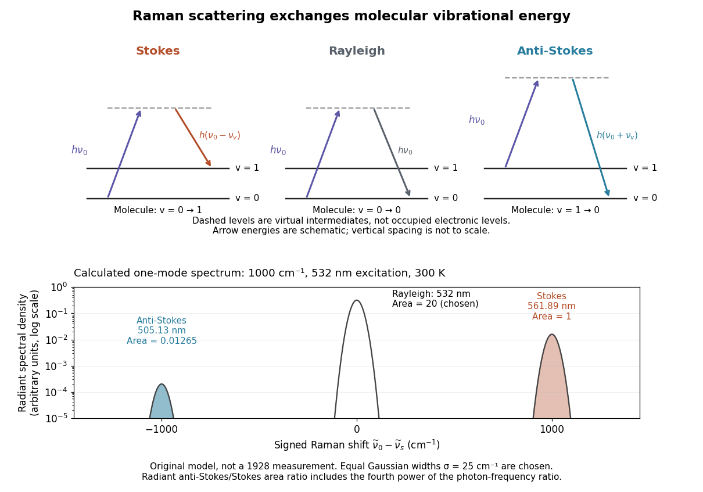

# One-mode Raman spectrum example

↑ **Parent:** [Thermal Raman line ratio](thermal-raman-line-ratio.md)

Choose a vibrational [Raman shift](raman-shift.md) magnitude $\widetilde\nu_v=1000\,\mathrm{cm^{-1}}$, excitation [vacuum](vacuum.md) [wavelength](wavelength.md) $\lambda_0=532\,\mathrm{nm}$ and [temperature](temperature-split.md) $T=300\,\mathrm K$. These are original illustrative inputs, not a measured 1928 [optical spectrum](optical-spectrum.md) or a claim about a particular liquid. They give

$$
\begin{aligned}
\nu_v&=c\widetilde\nu_v=29.9792458\,\mathrm{THz},&
h\nu_v&\simeq0.123984\,\mathrm{eV},\\
\widetilde\nu_0&\simeq18796.9925\,\mathrm{cm^{-1}},&
\lambda_{\rm S}&=\frac{1}{\widetilde\nu_0-\widetilde\nu_v}
\simeq561.893\,\mathrm{nm},\\
\lambda_{\rm AS}&=\frac{1}{\widetilde\nu_0+\widetilde\nu_v}
\simeq505.127\,\mathrm{nm}.&&
\end{aligned}
$$

Take reciprocal lengths in consistent units before converting to nanometres. At $300\,\mathrm K$, $r\simeq0.00826337$ and $\overline v\simeq0.00833222$. The predicted line-integrated [radiant intensity](radiant-intensity.md) ratio is $0.0126522$, whereas the ideal [photon](photon.md) count-rate ratio is $0.0113740$. Thus the radiometric ratio is about $1.27$ percent, rather than the $0.826$ percent obtained by using the [Boltzmann factor](boltzmann-factor.md) alone.

**[Figure 18](#image-molecular-energy-transfer-and-an-original-one-mode-raman-scattering-line-model). Molecular energy transfer and an original one-mode Raman scattering line model**. [Source](raman-vibrational-levels-and-spectrum.py). Upper panels show initial and final vibrational levels with schematic virtual intermediates. Lower panel uses the stated $1000\,\mathrm{cm^{-1}}$, $532\,\mathrm{nm}$, $300\,\mathrm K$ example. Chosen equal [Gaussian function](gaussian-function.md) linewidths have standard deviation $25\,\mathrm{cm^{-1}}$; the [Rayleigh scattering](rayleigh-scattering.md) line has an arbitrarily chosen integrated area of $20$ relative to a unit Stokes area. The anti-Stokes area follows the line-integrated [radiant intensity](radiant-intensity.md) formula. The vertical axis is logarithmic. No line shape, width, relative elastic strength or line position is a historical measurement.

## ↑ Ancestors (7)

1. [Thermal Raman line ratio](thermal-raman-line-ratio.md)
2. [Raman scattering](raman-scattering.md)
3. [Scattering of light](scattering-of-light.md)
4. [Optics](optics-split.md)
5. [Branches of physics](branches-of-physics.md)
6. [Physics](physics-split.md)
7. [Codex Wiki](split.md)
