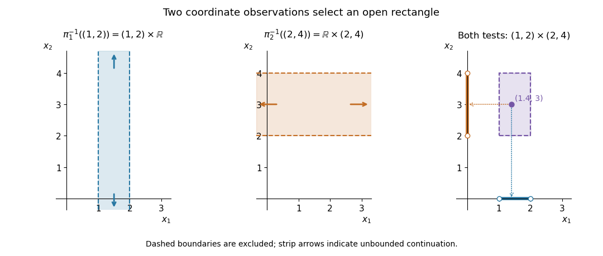

# Open rectangles in a finite product

↑ **Parent:** [Finite-coordinate basis for the product topology](finite-coordinate-basis-for-the-product-topology.md)

On two copies of the [real line](real-line.md) with their usual [topologies](topology-split.md), let $U=(1,2)$ and $V=(2,4)$. The coordinate [projection maps](projection-map.md) give

$$
\pi_1^{-1}(U)=U\times\mathbb R,\qquad
\pi_2^{-1}(V)=\mathbb R\times V,\qquad
\pi_1^{-1}(U)\cap\pi_2^{-1}(V)=U\times V.
$$

The first two [open sets](open-set.md) are unbounded strips; their [set intersection](set-intersection.md) is an open [rectangle](rectangle.md). The point $(1.4,3)$ passes both coordinate tests, whereas $(2,3)$ fails the first because the endpoint $2$ is excluded.

**[Figure 14](#image-an-open-rectangle-is-the-intersection-of-two-coordinate-projection-strips). An open rectangle is the intersection of two coordinate-projection strips**. Dashed boundaries and hollow endpoints are excluded. Arrows at the ends of the strips indicate that the strips continue indefinitely. The final panel projects the interior point onto the two tested intervals.

Every point of an [open set](open-set.md) in the [Euclidean plane](euclidean-plane.md) has such an open [rectangle](rectangle.md) around it inside that [open set](open-set.md). Conversely, every open [rectangle](rectangle.md) contains a small [Euclidean ball](euclidean-ball.md) around each of its points. Thus the [product topology](product-topology.md) here is the usual [metric topology](metric-topology.md) of the [Euclidean plane](euclidean-plane.md). With finitely many factors all coordinates may be restricted; on an infinite [Cartesian product](cartesian-product.md) a basic [cylinder set](cylinder-set.md) must leave all but finitely many factors free.

## ↑ Ancestors (6)

1. [Finite-coordinate basis for the product topology](finite-coordinate-basis-for-the-product-topology.md)
2. [Product topology](product-topology.md)
3. [Geometry and topology](geometry-and-topology-split.md)
4. [Area of mathematics](area-of-mathematics.md)
5. [Mathematics](mathematics-split.md)
6. [Codex Wiki](split.md)
