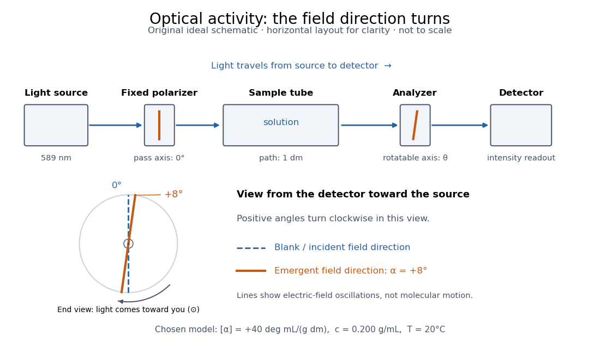

# Optical activity

↑ **Parent:** [Chirality (chemistry)](chirality-chemistry.md)

[Optical activity](optical-activity.md) is the ability to rotate the direction of [linear polarization](linear-polarization.md) of transmitted [light](light.md). In an [achiral](achirality.md) [solvent](solvent.md), the two members of an [enantiomer](enantiomer.md) pair have equal and opposite [optical rotations](optical-rotation.md) at the same [wavelength](wavelength.md), [temperature](temperature-split.md) and [concentration](concentration.md). The measured angle concerns a bulk sample; it is not a geometric rotation of the [molecules](molecule-split.md).[McMurry, Organic Chemistry, §5.3, Figure 5.6 and specific-rotation discussion](organic-chemistry-by-john-mcmurry/5-3-optical-activity.md)

The rotating object in this description is the direction along which the [electric field](electric-field-split.md) oscillates. At each position the transmitted [light](light.md) can still have [linear polarization](linear-polarization.md): its [electric field](electric-field-split.md) moves back and forth along a line, while the orientation of that line changes along the sample. Nothing requires the [molecules](molecule-split.md) to turn bodily through the observed [angle](angle.md). This makes [polarimetry](polarimetry.md) a bridge from molecular [chirality](chirality-chemistry.md) to a visible bulk measurement, and, with a suitable calibration, a way to follow [concentration](concentration.md) or the balance of [enantiomers](enantiomer.md).

In a transparent, isotropic [chemical solution](solution-chemistry.md), natural [optical rotation](optical-rotation.md) can be understood as [circular birefringence](circular-birefringence.md): the two opposite [circular polarizations](circular-polarization.md) accumulate different [wave phases](phase-waves.md), and their equal-amplitude sum remains linearly polarized along a rotated direction. [Circular dichroism](circular-dichroism.md) instead means unequal absorption of those components and can produce [elliptical polarization](elliptical-polarization.md). These are related responses, not interchangeable measurements. General [birefringence](birefringence.md) need not produce this simple rotation of [linear polarization](linear-polarization.md).[Optical Activity and Molecular Dissymmetry in Coordination Chemistry, introduction, printed pp. 335–336: refractive-index difference and absorption counterpart](optical-activity-and-molecular-dissymmetry-in-coordination-chemistry-by-stephen-f-mason.md)

**[Figure 3](#image-polarimeter-apparatus-and-plane-orientation). A polarimeter compares the directions of linear polarization before and after a sample**. Original schematic, not a scale drawing of a commercial instrument. The model stipulates $\alpha=+8^\circ$. The end view faces the source from the detector side: clockwise is positive, with the incoming [light](light.md) directed out of the page. The lines represent [electric field](electric-field-split.md) oscillation directions, not [molecule](molecule-split.md) orientations.

**Table of contents**

- [Optical rotation](optical-rotation.md)
  - [Specific rotation](specific-rotation.md)
    - [Enantiomeric excess](enantiomeric-excess.md)
- [Polarimetry](polarimetry.md)
  - [Polarimeter](polarimeter.md)
    - [Polarimeter analyzer](polarimeter-analyzer.md)
- [Circular dichroism](circular-dichroism.md)

## ↑ Ancestors (4)

1. [Chirality (chemistry)](chirality-chemistry.md)
2. [Stereochemistry](stereochemistry-split.md)
3. [Chemistry](chemistry-split.md)
4. [Codex Wiki](split.md)

## ← Incoming links (7)

- [Circular birefringence](circular-birefringence.md)
- [Faraday rotation on a round trip](faraday-rotation-on-a-round-trip.md)
- [Glucose mutarotation experiment](glucose-mutarotation-experiment.md)
- [Optical activity](optical-activity.md)
- [Solution](past-exam-of-the-optics-and-electrodynamics-course-of-the-university-of-cambridge/2015/paper-1/2/a/solution.md)
- [Solution](past-exam-of-the-optics-and-electrodynamics-course-of-the-university-of-cambridge/2021/section-b/b4/f/solution.md)
- [Stephen F. Mason](stephen-f-mason.md)
