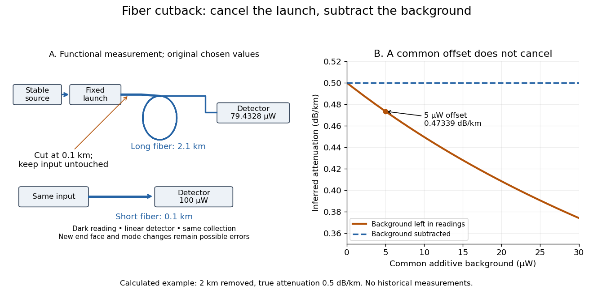

# Optical fiber cutback measurement

↑ **Parent:** [Optical fiber attenuation](optical-fiber-attenuation.md)

An [optical fiber cutback measurement](optical-fiber-cutback-measurement.md) estimates distributed [optical fiber attenuation](optical-fiber-attenuation.md) by comparing a long guide with the short input portion left after cutting the output end back. Keep the launch untouched. For the following original functional model, fix [wavelength](wavelength.md), source output, input alignment and collected output cone; subtract a dark reading and keep the [photodetector](photodetector.md) in its linear range. Renewed end-face quality and changed [normal mode](normal-mode.md) populations can still spoil the comparison. The diagram describes a measurement principle, not Kao's historical short-glass apparatus.

Let $L_\ell>L_s$ be lengths in kilometres, $P_\ell,P_s$ the corresponding positive dark-subtracted readings, and $C$ the same launch and detection factor. A uniform guide obeys

$$
P_\ell=C10^{-\alpha_{\rm dB}L_\ell/10},\qquad P_s=C10^{-\alpha_{\rm dB}L_s/10},\qquad
\widehat\alpha_{\rm dB}=\frac{10}{L_\ell-L_s}\log_{10}\!\frac{P_s}{P_\ell}.
$$

Here $\alpha_{\rm dB}$ and its estimate are numerical values in $\mathrm{dB/km}$. Dividing eliminates $C$; taking a [logarithm](logarithm.md) proves the formula. A changed $C$ instead adds an error $10\log_{10}(C_s/C_\ell)/(L_\ell-L_s)$. Reconnecting the launch between readings defeats this cancellation.

For original chosen values $L_s=0.1\,\mathrm{km}$, $L_\ell=2.1\,\mathrm{km}$, $P_s=100\,\mathrm{\mu W}$ and $\alpha_{\rm dB}=0.5\,\mathrm{dB/km}$, the predicted long reading is $P_\ell=100\,10^{-0.1}\simeq79.4328\,\mathrm{\mu W}$. The ratio gives $1\,\mathrm{dB}$ for the removed $2\,\mathrm{km}$ and hence $0.5\,\mathrm{dB/km}$.

Suppose an unremoved additive detector background contributes $b=5\,\mathrm{\mu W}$ to both readings. Then the apparent coefficient is

$$
\widetilde\alpha_{\rm dB}=\frac{10}{2}\log_{10}\!\frac{100+5}{79.4328+5}\simeq0.47339\,\mathrm{dB/km}.
$$

This is a [bias of an estimator](bias-of-an-estimator.md): a common additive background pushes the ratio toward one, whereas a common multiplicative factor cancels. For independent small zero-mean errors with [standard deviations](standard-deviation.md) $\sigma_s,\sigma_\ell$ on the dark-subtracted readings, a first-order [Taylor expansion](taylor-expansion.md) gives

$$
\sigma_{\widehat\alpha}\simeq\frac{10}{(L_\ell-L_s)\ln10}\sqrt{\left(\frac{\sigma_s}{P_s}\right)^2+\left(\frac{\sigma_\ell}{P_\ell}\right)^2}.
$$

Choosing both [standard deviations](standard-deviation.md) as $1\,\mathrm{\mu W}$ gives $\sigma_{\widehat\alpha}\simeq0.03491\,\mathrm{dB/km}$. A shared estimated dark offset introduces [covariance](covariance.md), so it requires a different uncertainty calculation. Near zero signal, the [logarithm](logarithm.md) and this linear approximation become unreliable.

**[Figure 13](#image-optical-fiber-cutback-measurement-fixed-launch-and-additive-background-bias). Optical fiber cutback measurement: fixed launch and additive-background bias**. Original functional schematic and calculated example. The launch stays fixed while the remote end is cut back. The graph uses the stipulated powers and lengths above; it compares dark-subtracted readings with a common positive unremoved background. No plotted point is a historical measurement.

## ↑ Ancestors (7)

1. [Optical fiber attenuation](optical-fiber-attenuation.md)
2. [Optical fiber](optical-fiber.md)
3. [Optical instrument](optical-instrument-split.md)
4. [Optics](optics-split.md)
5. [Branches of physics](branches-of-physics.md)
6. [Physics](physics-split.md)
7. [Codex Wiki](split.md)

## ← Incoming links (1)

- [Optical fiber cutback measurement](optical-fiber-cutback-measurement.md)
