# Optical instrument

↑ **Parent:** [Optics](optics.md)  
ⓦ [Wiki](https://en.wikipedia.org/wiki/Optical_instrument)

**Table of contents**

- [Hamilton echelle spectrograph](#hamilton-echelle-spectrograph)
- [Optical cavity](#optical-cavity)
  - [Lorentz invariance of optical cavity resonance](#lorentz-invariance-of-optical-cavity-resonance)
- [Mirror](#mirror)
- [Grism](#grism)
- [Camera lucida](#camera-lucida)
- [Optical filter](#optical-filter)
- [Goniometer](#goniometer)
- [Focal ratio](#focal-ratio)
- [Optical camera](#optical-camera)
- [Optical slit](#optical-slit)
- [Focal plane](#focal-plane)
  - [Back focal plane](#back-focal-plane)
- [High-contrast imaging](#high-contrast-imaging)
  - [Differential-imaging self-subtraction](#differential-imaging-self-subtraction)
  - [Simultaneous spectral differential imaging](#simultaneous-spectral-differential-imaging)
  - [Angular differential imaging](#angular-differential-imaging)
- [Fabry–Pérot interferometer](#fabry-perot-interferometer)
  - [Order-safe angular scanning of a Fabry–Pérot spectrum](#order-safe-angular-scanning-of-a-fabry-perot-spectrum)
  - [Air-gap optical path difference in a Fabry–Pérot interferometer](#air-gap-optical-path-difference-in-a-fabry-perot-interferometer)
  - [Fabry–Pérot transmission from multiple reflections](#fabry-perot-transmission-from-multiple-reflections)
  - [Fabry–Pérot resonance spacing](#fabry-perot-resonance-spacing)
  - [Finesse](#finesse)
    - [Etalon resolving power and order overlap](#etalon-resolving-power-and-order-overlap)
  - [Fabry–Pérot etalon](#fabry-perot-etalon)
  - [Scanning Fabry–Pérot measurement](#scanning-fabry-perot-measurement)
- [Lenslet array](#lenslet-array)
- [Beam splitter](#beam-splitter)
  - [Optical port](#optical-port)
  - [Beam splitter scattering matrix](#beam-splitter-scattering-matrix)
    - [Balanced-splitter twin-Fock output distribution](#balanced-splitter-twin-fock-output-distribution)
  - [Coherent beam splitter recombination](#coherent-beam-splitter-recombination)
  - [Nonpolarizing beam splitter](#nonpolarizing-beam-splitter)
  - [Polarizing beam splitter](#polarizing-beam-splitter)
  - [Mach-Zehnder interferometer](#mach-zehnder-interferometer)
- [Field of view](#field-of-view)
- [Optical telescope](#optical-telescope)
  - [Altazimuth mount](#altazimuth-mount)
    - [Zenith blind spot](#zenith-blind-spot)
  - [Giant Magellan Telescope](#giant-magellan-telescope)
  - [Thirty Meter Telescope](#thirty-meter-telescope)
  - [W. M. Keck Observatory](#w-m-keck-observatory)
  - [Large Binocular Telescope](#large-binocular-telescope)
  - [Segmented mirror](#segmented-mirror)
    - [Mirror segment phasing](#mirror-segment-phasing)
  - [Lightweight telescope mirror](#lightweight-telescope-mirror)
  - [Active optics](#active-optics)
  - [Schmidt camera](#schmidt-camera)
  - [Reflecting telescope](#reflecting-telescope)
    - [Gregorian telescope](#gregorian-telescope)
    - [Cassegrain reflector](#cassegrain-reflector)
      - [Ritchey–Chrétien telescope](#ritchey-chretien-telescope)
      - [Classical Cassegrain reflector](#classical-cassegrain-reflector)
    - [Newtonian telescope](#newtonian-telescope)
  - [Diffraction limit of a telescope](#diffraction-limit-of-a-telescope)
- [Entrance pupil](#entrance-pupil)
- [Optical microscope](#optical-microscope)
  - [Polarizing microscope](#polarizing-microscope)
    - [Azimuthal brightness of a birefringent crystallite](#azimuthal-brightness-of-a-birefringent-crystallite)
    - [Conoscopic interference pattern](#conoscopic-interference-pattern)
    - [Maltese cross in polarized-light microscopy](#maltese-cross-in-polarized-light-microscopy)
  - [Microscope objective](#microscope-objective)
  - [Microscope eyepiece](#microscope-eyepiece)
  - [Intermediate microscope image](#intermediate-microscope-image)
  - [Finite-conjugate microscope](#finite-conjugate-microscope)
  - [Infinity-corrected microscope](#infinity-corrected-microscope)
    - [Tube lens](#tube-lens)
  - [Microscope scale calibration](#microscope-scale-calibration)
    - [Ocular micrometer](#ocular-micrometer)
    - [Stage micrometer](#stage-micrometer)
  - [Empty magnification](#empty-magnification)
  - [Differential interference contrast microscopy](#differential-interference-contrast-microscopy)
  - [Phase-contrast microscopy](#phase-contrast-microscopy)
    - [Phase-contrast microscope](#phase-contrast-microscope)
    - [Phase object](#phase-object)
      - [Weak phase object](#weak-phase-object)
    - [Phase plate](#phase-plate)
    - [Coherent zero-mode model of phase contrast](#coherent-zero-mode-model-of-phase-contrast)
    - [Phase-contrast image artifacts](#phase-contrast-image-artifacts)
    - [Zernike's discovery of phase contrast](#zernike-s-discovery-of-phase-contrast)
  - [Bright-field microscopy](#bright-field-microscopy)
  - [Köhler illumination](#kohler-illumination)
  - [Dark-field microscopy](#dark-field-microscopy)
- [Ronchi ruling](#ronchi-ruling)
- [Collimator](#collimator)
  - [Collimation](#collimation)
- [Spectrometer](#spectrometer)
  - [Electron spectrometer](#electron-spectrometer)
  - [Electron energy analyzer](#electron-energy-analyzer)
  - [Magnetic spectrometer](#magnetic-spectrometer)
  - [Fourier transform spectroscopy](#fourier-transform-spectroscopy)
    - [Interferogram apodization](#interferogram-apodization)
    - [Interferogram of an equally spaced spectral multiplet](#interferogram-of-an-equally-spaced-spectral-multiplet)
    - [Delay-range resolution in Fourier transform spectroscopy](#delay-range-resolution-in-fourier-transform-spectroscopy)
  - [Spectrograph](#spectrograph)
    - [Spectrophotometry](#spectrophotometry)
      - [Cuvette](#cuvette)
      - [Spectrophotometer](#spectrophotometer)
    - [Spectral resolution element](#spectral-resolution-element)
    - [Linear spectral dispersion](#linear-spectral-dispersion)
    - [Integral field spectrograph](#integral-field-spectrograph)
      - [Integral-field spectrograph volume scaling](#integral-field-spectrograph-volume-scaling)
      - [Spaxel](#spaxel)
      - [Image slicer](#image-slicer)
      - [Spectral data cube](#spectral-data-cube)
    - [Spectral resolving power](#spectral-resolving-power)
    - [Cross-dispersed echelle spectrograph](#cross-dispersed-echelle-spectrograph)
      - [Cross-disperser](#cross-disperser)
      - [Echellogram](#echellogram)
    - [Multi-object spectrograph](#multi-object-spectrograph)
      - [Multi-slit spectrograph](#multi-slit-spectrograph)
      - [Fiber-fed spectrograph](#fiber-fed-spectrograph)
- [Optical fiber](#optical-fiber)
  - [Fiber Bragg grating](#fiber-bragg-grating)
  - [Optical fiber purity and low-loss transmission](#optical-fiber-purity-and-low-loss-transmission)
  - [Step-index optical fiber](#step-index-optical-fiber)
    - [Optical fiber acceptance angle](#optical-fiber-acceptance-angle)
  - [Multimode optical fiber](#multimode-optical-fiber)
  - [Single-mode optical fiber](#single-mode-optical-fiber)
  - [Graded-index optical fiber](#graded-index-optical-fiber)
  - [Optical fiber coupling and bend experiment](#optical-fiber-coupling-and-bend-experiment)
  - [Optical fiber attenuation](#optical-fiber-attenuation)
    - [Optical fiber cutback measurement](#optical-fiber-cutback-measurement)
  - [Focal-ratio degradation](#focal-ratio-degradation)
  - [Optical fiber core](#optical-fiber-core)
  - [Optical fiber cladding](#optical-fiber-cladding)
- [Adaptive optics](#adaptive-optics)
  - [Deformable mirror](#deformable-mirror)
    - [Deformable-mirror Fourier-mode counting](#deformable-mirror-fourier-mode-counting)
    - [Deformable-mirror control radius](#deformable-mirror-control-radius)
  - [Wavefront sensor](#wavefront-sensor)
    - [Shack–Hartmann wavefront sensor](#shack-hartmann-wavefront-sensor)
  - [Guide star (adaptive optics)](#guide-star-adaptive-optics)
    - [Laser guide star](#laser-guide-star)
  - [Adaptive-optics sky coverage](#adaptive-optics-sky-coverage)
- [Optical attenuator](#optical-attenuator)
- [Monochromator](#monochromator)
- [Optical power meter](#optical-power-meter)
- [Photodetector](#photodetector)
  - [Detector dynamic range](#detector-dynamic-range)
  - [Full well capacity](#full-well-capacity)
  - [Photon pile-up](#photon-pile-up)
  - [Vacuum photodiode](#vacuum-photodiode)
  - [Bolometer](#bolometer)
  - [Spectral responsivity](#spectral-responsivity)
  - [Detector bias frame](#detector-bias-frame)
  - [Flat-field correction](#flat-field-correction)
  - [Analogue-to-digital unit](#analogue-to-digital-unit)
  - [Detector conversion gain](#detector-conversion-gain)
    - [Gain estimation from flat-field ratios](#gain-estimation-from-flat-field-ratios)
      - [Bias of pooled flat-field ratio gain](#bias-of-pooled-flat-field-ratio-gain)
  - [Optical detector pixel](#optical-detector-pixel)
  - [Photodiode](#photodiode)
    - [Balanced photodetection](#balanced-photodetection)
    - [Quadrant photodiode](#quadrant-photodiode)
    - [Photocurrent](#photocurrent)
    - [Photodiode operating mode](#photodiode-operating-mode)
    - [Photodiode responsivity measurement](#photodiode-responsivity-measurement)
  - [Dark current (physics)](#dark-current-physics)
  - [Correlated double sampling](#correlated-double-sampling)
  - [Hybrid infrared detector](#hybrid-infrared-detector)
    - [Detector reference pixel](#detector-reference-pixel)
    - [Nondestructive detector readout](#nondestructive-detector-readout)
      - [Up-the-ramp sampling](#up-the-ramp-sampling)
      - [Fowler sampling](#fowler-sampling)
    - [H2RG detector](#h2rg-detector)
  - [Background subtraction](#background-subtraction)
    - [Radiative temperature uncertainty after background subtraction](#radiative-temperature-uncertainty-after-background-subtraction)
    - [Systematic-error signal-to-noise ceiling](#systematic-error-signal-to-noise-ceiling)
  - [Read noise](#read-noise)
  - [Photon shot noise](#photon-shot-noise)
    - [Calibration subtraction preserves shot noise](#calibration-subtraction-preserves-shot-noise)
  - [Quantum efficiency](#quantum-efficiency)
  - [Active-pixel sensor](#active-pixel-sensor)
  - [Charge-coupled device](#charge-coupled-device)
    - [Fano-limited X-ray CCD energy resolution](#fano-limited-x-ray-ccd-energy-resolution)
    - [CCD noise budget](#ccd-noise-budget)
      - [Aperture photometry with an estimated background](#aperture-photometry-with-an-estimated-background)
    - [CCD clocked charge transfer](#ccd-clocked-charge-transfer)
    - [Charge-transfer efficiency](#charge-transfer-efficiency)
    - [Deferred charge in CCD readout](#deferred-charge-in-ccd-readout)
    - [Early CCD charge-transfer experiment](#early-ccd-charge-transfer-experiment)
    - [Electron-multiplying CCD](#electron-multiplying-ccd)
      - [Multiplication excess noise](#multiplication-excess-noise)
      - [Impact ionization](#impact-ionization)
        - [Impact ionization with a hole at zero momentum](#impact-ionization-with-a-hole-at-zero-momentum)
  - [Signal-to-noise ratio in photon counting](#signal-to-noise-ratio-in-photon-counting)
    - [Poisson variance after sky subtraction](#poisson-variance-after-sky-subtraction)
- [Refractometer](#refractometer)
  - [Abbé refractometer](#abbe-refractometer)
- [Optical chopper](#optical-chopper)
- [Stray light](#stray-light)
- [Optical isolator](#optical-isolator)
- [Photographic plate](#photographic-plate)

## Hamilton echelle spectrograph

↑ **Parent:** [Optical instrument](optical-instrument.md)

## Optical cavity

↑ **Parent:** [Optical instrument](optical-instrument.md)  
ⓦ [Wiki](https://en.wikipedia.org/wiki/Optical_cavity)

An [optical cavity](#optical-cavity) supports optical fields whose phases and spatial profiles reproduce themselves after a round trip through its reflecting or guiding elements. Its resonance conditions include propagation and reflection phases. A cavity bounded by two plane mirrors is a simple example; [Fabry–Pérot resonance spacing](#fabry-perot-resonance-spacing) describes the frequency intervals of an ideal two-mirror arrangement.

### Lorentz invariance of optical cavity resonance

↑ **Parent:** [Optical cavity](#optical-cavity)

A [Lorentz transformation](special-relativity.md#lorentz-transformation) of a resonant [optical cavity](#optical-cavity) transforms both the electromagnetic field and the mirror worldlines. Boundary conditions and event-by-event phase matching remain satisfied. For a longitudinal boost, a cavity of rest length $L$ has length $L/\gamma$ and unequal forward/backward frequencies $\gamma\omega_0(1\mp\beta)$. The coordinate round-trip time is $2\gamma L/c$, while the phase rate on a moving mirror is $\omega_0/\gamma$, so the round-trip phase is still $2\omega_0L/c$. A stationary-mirror resonance formula with only length contraction inserted describes the wrong boundary-value problem.

## Mirror

↑ **Parent:** [Optical instrument](optical-instrument.md)  
ⓦ [Wiki](https://en.wikipedia.org/wiki/Mirror)

A [mirror](#mirror) redirects [light](optics.md#light) according to the [law of reflection](geometrical-optics.md#law-of-reflection). Its orientation determines the reflected beam direction in an [interferometer](physical-optics.md#interferometer).

## Grism

↑ **Parent:** [Optical instrument](optical-instrument.md)  
ⓦ [Wiki](https://en.wikipedia.org/wiki/Grism)

An optical component combining an [optical prism](geometrical-optics.md#prism-optics) and a [diffraction grating](physical-optics.md#diffraction-grating).

## Camera lucida

↑ **Parent:** [Optical instrument](optical-instrument.md)  
ⓦ [Wiki](https://en.wikipedia.org/wiki/Camera_lucida)

A camera lucida superposes the apparent image of an object on a drawing surface, allowing [microscope](physics.md#microscope) positions to be marked by hand.

## Optical filter

↑ **Parent:** [Optical instrument](optical-instrument.md)  
ⓦ [Wiki](https://en.wikipedia.org/wiki/Optical_filter)

An [optical filter](#optical-filter) selectively transmits [light](optics.md#light) according to properties such as [wavelength](wave-equation.md#wavelength) or [polarization of waves](wave.md#polarization-waves).

## Goniometer

↑ **Parent:** [Optical instrument](optical-instrument.md)  
ⓦ [Wiki](https://en.wikipedia.org/wiki/Goniometer)

An instrument for measuring [angles](geometry-and-topology.md#angle).

## Focal ratio

↑ **Parent:** [Optical instrument](optical-instrument.md)

The [focal ratio](#focal-ratio), or f-number, of a converging [optical instrument](optical-instrument.md) focused at infinity is the [dimensionless quantity](physics.md#dimensionless-quantity)

$$
N=F=\frac{f}{D},
$$

where $f>0$ is effective [focal length](geometrical-optics.md#focal-length) and $D$ is the on-axis [entrance pupil](#entrance-pupil) [diameter](topological-analysis.md#diameter). The notation f/4 means $N=4$, not $f=4$ in a particular unit. A $100\,\mathrm{mm}$ [focal length](geometrical-optics.md#focal-length) with $D=25\,\mathrm{mm}$ gives f/4. Closing the [aperture stop](optics.md#aperture-stop) until $D=12.5\,\mathrm{mm}$ gives f/8 while retaining the same [focal length](geometrical-optics.md#focal-length). The mechanical opening need not equal $D$. [Gregory Hollows and Nicholas James, Edmund Optics, System Throughput, f-number, and Numerical Aperture](https://www.edmundoptics.com/knowledge-center/application-notes/imaging/lens-iris-aperture-setting/).

For a [thin lens](geometrical-optics.md#thin-lens) in air with a circular [aperture stop](optics.md#aperture-stop) at the [thin lens](geometrical-optics.md#thin-lens), the converging bundle from a distant on-axis point has half-[angle](geometry-and-topology.md#angle) $\alpha$ satisfying

$$
\tan\alpha=\frac{D}{2f}=\frac{1}{2N},\qquad \alpha\simeq\frac{1}{2N}\quad\hbox{in radians}.
$$

The last step uses the [small-angle approximation](geometry-and-topology.md#small-angle-approximation). For a compound [optical lens](geometrical-optics.md#lens-optics), the cone is set by the image-side [optical pupil](optics.md#optical-pupil) and its distance from the receiving plane; the simple triangle is not an exact high-[angle](geometry-and-topology.md#angle) rule. At finite object distance a [thin lens](geometrical-optics.md#thin-lens) instead gives $v=f(1+|m|)$, by its imaging equation and [transverse magnification](optics.md#transverse-magnification), so its working cone corresponds to $v/D=N(1+|m|)$. Nominal [focal ratio](#focal-ratio) therefore does not alone specify close-range image [irradiance](radiometry.md#irradiance). [Hollows and James, working f-number and image-space cone](https://www.edmundoptics.com/knowledge-center/application-notes/imaging/lens-iris-aperture-setting/).

Two useful scalings follow under stated conditions. For a fixed uniform incident beam and unchanged transmission, collected [radiant flux](radiometry.md#radiant-flux) scales as $D^2$. For an extended source with fixed [radiance](radiometry.md#radiance), the central image [irradiance](radiometry.md#irradiance) scales approximately as $N^{-2}$ in the [paraxial approximation](partial-differential-equation.md#paraxial-approximation): the [solid angle](euclidean-geometry.md#solid-angle) of the cone scales as $(D/f)^2$. For an ideal uniformly illuminated unobscured circular [entrance pupil](#entrance-pupil), the first dark ring of the [point spread function](point-spread-function.md) has angular [radius](topology.md#radius) and [focal plane](#focal-plane) [radius](topology.md#radius)

$$
\theta_1\simeq1.22\frac{\lambda}{D},\qquad r_1\simeq f\theta_1=1.22\lambda N.
$$

Here $\lambda$ is [wavelength](wave-equation.md#wavelength). These are first-zero radii, not diameters or a universal rule for resolving arbitrary objects. A proof outline evaluates the circular [aperture](optics.md#aperture)'s [Fraunhofer diffraction](physical-optics.md#fraunhofer-diffraction) using its [Fourier transform](fourier-transform.md), then uses the first zero of the resulting [Bessel function](bessel-function.md). [Richard Fitzpatrick, University of Texas at Austin, Two-Dimensional Fourier Optics, circular-aperture first minimum](physics-bibliography.md#oscillations-and-waves-by-richard-fitzpatrick/two-dimensional-fourier-optics).

At $\lambda=0.55\,\mathrm{\mu m}$, the example's f/4 and f/8 first-ring radii are $2.684$ and $5.368\,\mathrm{\mu m}$. Closing the [aperture stop](optics.md#aperture-stop) halves $D$, quarters collected [radiant flux](radiometry.md#radiant-flux) and doubles this [diffraction](quantum-scattering.md#diffraction) radius. It can also reduce [optical aberrations](geometrical-optics.md#optical-aberration) by excluding outer [light rays](geometrical-optics.md#light-ray); actual sharpness reflects both effects. This explains why a smaller [aperture](optics.md#aperture) need not produce a sharper image. [Gregory Hollows and Nicholas James, Edmund Optics, The Airy Disk and Diffraction Limit](https://www.edmundoptics.com/knowledge-center/application-notes/imaging/limitations-on-resolution-and-contrast-the-airy-disk/).

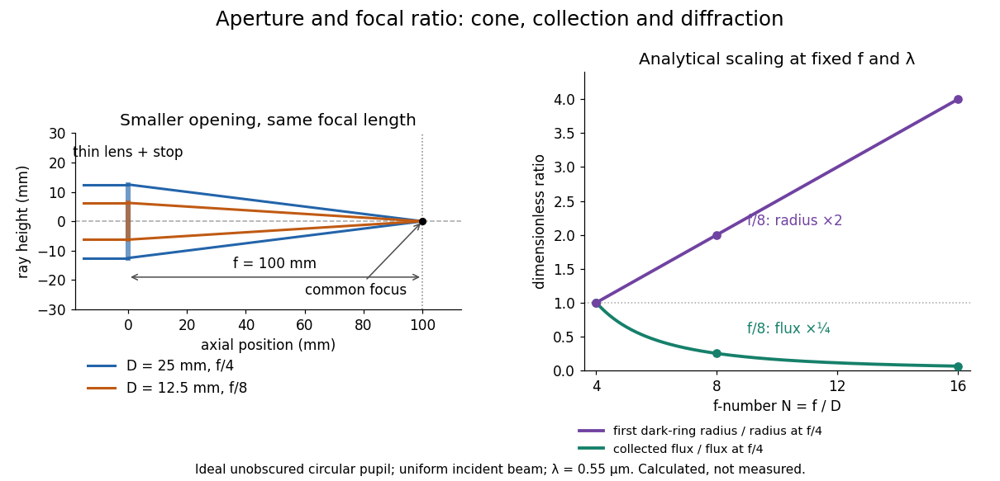

**[Figure 1](#image-aperture-and-focal-ratio-a-common-optical-focus-reduced-collection-and-increased-diffraction-radius). Aperture and focal ratio: a common optical focus, reduced collection and increased diffraction radius**. Original analytical illustration. Left: equal-scale [thin lens](geometrical-optics.md#thin-lens) geometry with $f=100\,\mathrm{mm}$ and $D=25$ or $12.5\,\mathrm{mm}$. Right: collected [radiant flux](radiometry.md#radiant-flux) relative to f/4 is $(4/N)^2$, and first-ring [radius](topology.md#radius) relative to f/4 is $N/4$. The [wavelength](wave-equation.md#wavelength) is $0.55\,\mathrm{\mu m}$; the [entrance pupil](#entrance-pupil) is circular, uniformly illuminated and unobscured. These are calculated quantities, not measurements.

A proposed [optical bench](optics.md#optical-bench) check puts a fixed [collimator](#collimator) before a converging [thin lens](geometrical-optics.md#thin-lens) and a [photodetector](#photodetector) large enough to collect the entire image behind it. Compare two centred [aperture stops](optics.md#aperture-stop) of known [diameters](topological-analysis.md#diameter) while fixing source output, detector gain and integration time. The integrated signal tests the $D^2$ collection law; a spatially resolved [optical camera](#optical-camera) at the [focal plane](#focal-plane) can separately measure the [point spread function](point-spread-function.md). Repeat a dark reading and the first [aperture stop](optics.md#aperture-stop), and check that neither the incoming beam nor detector clips either bundle. A resolved pinhole source, imperfect collimation, [optical aberrations](geometrical-optics.md#optical-aberration) and detector pixel size can dominate the apparent spot width; a single peak reading does not measure total collected [radiant flux](radiometry.md#radiant-flux).

## Optical camera

↑ **Parent:** [Optical instrument](optical-instrument.md)

An [optical camera](#optical-camera) images incident beams on a [photodetector](#photodetector); a [spectrograph](#spectrograph) [optical camera](#optical-camera) maps a diffracted direction into a position in its [focal plane](#focal-plane).

## Optical slit

↑ **Parent:** [Optical instrument](optical-instrument.md)

An [optical slit](#optical-slit) selects a narrow region of a [focal plane](#focal-plane). In a slit-limited [spectrograph](#spectrograph), the width of its image divided by the [linear spectral dispersion](#linear-spectral-dispersion) sets the spectral width.

## Focal plane

↑ **Parent:** [Optical instrument](optical-instrument.md)

A focal plane is a plane in which an optical system forms images of distant directions. Aberrations can make the best-focus surface curved; a flat detector may then require a field-flattening optical element.

### Back focal plane

↑ **Parent:** [Focal plane](#focal-plane)

The plane one [focal length](geometrical-optics.md#focal-length) beyond a lens. In a paraxial imaging system, incident parallel rays of a given direction focus at one point in this plane; it is therefore an angular or diffraction plane distinct from a finite-distance object's image plane.

## High-contrast imaging

↑ **Parent:** [Optical instrument](optical-instrument.md)

High-contrast imaging seeks faint objects near a bright source. Residual [point spread functions](point-spread-function.md) and [speckle patterns](physical-optics.md#speckle-pattern) can dominate [photon shot noise](#photon-shot-noise); [angular differential imaging](#angular-differential-imaging) and [simultaneous spectral differential imaging](#simultaneous-spectral-differential-imaging) use source motion or spectral diversity to distinguish them.

### Differential-imaging self-subtraction

↑ **Parent:** [High-contrast imaging](#high-contrast-imaging)

A companion or extended source contributes to the stellar reference used in differential imaging. Subtracting that reference removes part of the desired signal and distorts its shape, photometry or astrometry. Artificial-source injection and forward modelling can estimate the throughput loss.

### Simultaneous spectral differential imaging

↑ **Parent:** [High-contrast imaging](#high-contrast-imaging)

Simultaneous spectral differential imaging compares images in nearby bands, rescaled so stellar [speckle patterns](physical-optics.md#speckle-pattern) approximately coincide. A companion has a different positional or spectral response. Simultaneity reduces temporal variation but does not remove chromatic and non-common-path errors.

### Angular differential imaging

↑ **Parent:** [High-contrast imaging](#high-contrast-imaging)

Angular differential imaging keeps the instrument pupil fixed while the sky rotates. A stellar reference [point spread function](point-spread-function.md) is subtracted, then the residuals are derotated and combined. Insufficient rotation and imperfect reference selection cause [differential-imaging self-subtraction](#differential-imaging-self-subtraction).

<h2 id="fabry-perot-interferometer">Fabry–Pérot interferometer</h2>

↑ **Parent:** [Optical instrument](optical-instrument.md)

A [Fabry–Pérot interferometer](#fabry-perot-interferometer) uses repeated [specular reflections](optics.md#specular-reflection) between two nearly parallel, partially transmitting surfaces. Its transmitted [light](optics.md#light) is the sum of contributions that have made zero, one, two, or more additional round trips. Their [complex amplitudes](wave.md#complex-amplitude) reinforce only near particular [wave phases](wave.md#phase-waves), producing narrow transmission peaks that select [wavelength](wave-equation.md#wavelength) intervals. Scanning the spacing or [angle of incidence](optics.md#angle-of-incidence) can build an imaging spectral cube: an image at each selected [wavelength](wave-equation.md#wavelength).

The surprising feature is that highly reflecting mirrors can together transmit all the incident [power](energy.md#power) at resonance in the ideal symmetric, lossless model. Each individual contribution is weak, but many contributions arrive in phase. Between resonances the same contributions cancel strongly. Increasing mirror reflectivity sharpens the peaks instead of simply suppressing every transmitted signal; [finesse](#finesse) quantifies that selectivity. An [optical spectrum](optics.md#optical-spectrum) with nearby [spectral lines](stellar-astrophysics.md#spectral-line) can therefore produce distinguishable peaks, provided their separation is large enough relative to the instrument's peak width and their orders are identified.

[Charles Fabry](physicist.md#charles-fabry) and [Alfred Pérot](physicist.md#alfred-perot) developed the instrument together; Optica dates its development from 1896 to 1898.[Charles Fabry biography, paragraphs on collaboration with Alfred Pérot and instrument development](physics-bibliography.md#charles-fabry-optica-history-biography)

<h3 id="order-safe-angular-scanning-of-a-fabry-perot-spectrum">Order-safe angular scanning of a Fabry–Pérot spectrum</h3>

↑ **Parent:** [Fabry–Pérot interferometer](#fabry-perot-interferometer)

Spectral resolution and order identification are separate design constraints. An instrumental width narrower than a line separation does not prevent a different [interference](physical-optics.md#interference-wave-propagation) order from placing another [wavelength](wave-equation.md#wavelength) at the same angle. Choose optical thickness so the source range fits a known order interval, sufficient [finesse](#finesse) to resolve neighbouring lines, and an angular window or order-sorting filter to exclude unwanted orders. Material dispersion and the internal/external angle conversion must be calibrated.

<h3 id="air-gap-optical-path-difference-in-a-fabry-perot-interferometer">Air-gap optical path difference in a Fabry–Pérot interferometer</h3>

↑ **Parent:** [Fabry–Pérot interferometer](#fabry-perot-interferometer)

For an air gap of thickness $d$, an extra internal round trip has length $2d/\cos\theta$, but consecutive transmitted rays emerge at different positions. Comparing them at the same outgoing [wavefront](physical-optics.md#wavefront) subtracts $2d\tan\theta\sin\theta$, leaving [optical path difference](physical-optics.md#optical-path-difference) $2d\cos\theta$. Reflection-coating [wave phases](wave.md#phase-waves) are separate from this geometric path calculation.

<h3 id="fabry-perot-transmission-from-multiple-reflections">Fabry–Pérot transmission from multiple reflections</h3>

↑ **Parent:** [Fabry–Pérot interferometer](#fabry-perot-interferometer)

Consider two identical, lossless parallel mirrors with intensity reflectivity $0\leq R<1$, separation $d$, and a uniform transparent medium of [refractive index](electromagnetic-wave.md#refractive-index) $n$. Fix one [polarization of an electromagnetic wave](electromagnetic-wave.md#polarization-of-an-electromagnetic-wave) and an internal [angle of incidence](optics.md#angle-of-incidence) $\theta$ measured from the mirror [normal vector](differential-geometry.md#normal-vector). Illuminate with a [monochromatic wave](wave.md#monochromatic-wave) having planar [wavefronts](physical-optics.md#wavefront); the emerging contributions must overlap coherently in the detected direction. Define $T=I_{\rm transmitted}/I_{\rm incident}$ using the same incident and exit media. Each mirror transmits a fraction $1-R$ of incident [power](energy.md#power). Its reflected [wave amplitude](wave.md#wave-amplitude) has magnitude $\sqrt R$, so two internal [specular reflections](optics.md#specular-reflection) multiply the circulating [complex amplitude](wave.md#complex-amplitude) by magnitude $R$, not $R^2$.

Let $\lambda$ be the [vacuum](physics.md#vacuum) [wavelength](wave-equation.md#wavelength) and choose the reflection [wave phase](wave.md#phase-waves) convention in which the product of the two internal amplitude reflection coefficients is real and positive. The [phase difference](wave.md#phase-difference) between successive transmitted contributions, evaluated on a common outgoing [wavefront](physical-optics.md#wavefront), is

$$
\delta=\frac{4\pi nd\cos\theta}{\lambda}.
$$

With other mirror coatings or phase conventions, use the total $\delta=4\pi nd\cos\theta/\lambda+\phi_{\rm rt}$, where $\phi_{\rm rt}$ is the sum of the two internal reflection [wave phases](wave.md#phase-waves). The stated resonance positions presume $\phi_{\rm rt}=0$ modulo $2\pi$; a constant nonzero $\phi_{\rm rt}$ shifts them, while a [frequency](wave.md#frequency)-dependent one can also change their spacing.

Why does the [cosine](geometry-and-topology.md#cosine) appear rather than its reciprocal? Inside the gap, the extra two legs have [optical path length](physical-optics.md#optical-path-length) $2nd/\cos\theta$. But the later emerging contribution starts $2d\tan\theta$ farther along the mirror. Comparing both on one outgoing [wavefront](physical-optics.md#wavefront) subtracts $2nd\tan\theta\sin\theta$ from that path difference, leaving $2nd\cos\theta$. Equivalently, a [plane wave](wave-function.md#plane-wave)'s mirror-normal [wavevector](elasticity-physics.md#wavevector) component is $k_z=(2\pi n/\lambda)\cos\theta$, so the round-trip [wave phase](wave.md#phase-waves) is $2k_zd$. The diagram uses the same medium outside and inside to show the common-[wavefront](physical-optics.md#wavefront) subtraction directly; at a refracting exit interface, tangential [wavevector](elasticity-physics.md#wavevector) matching in [Snell's law](partial-differential-equation.md#snell-s-law) supplies the same result.

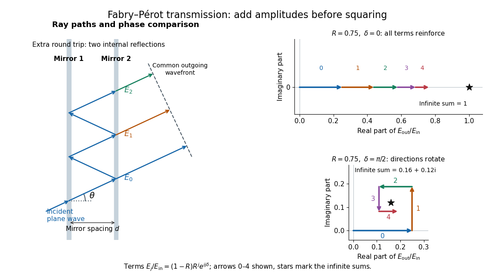

**[Figure 2](#image-multiple-specular-reflections-become-a-coherent-sum-of-transmitted-complex-amplitudes). Multiple specular reflections become a coherent sum of transmitted complex amplitudes**. Original ideal geometry and amplitude construction, not apparatus data. The oblique rays expose successive round trips and the common outgoing [wavefront](physical-optics.md#wavefront); $\theta$ is internal. The amplitude panels independently use $R=0.75$ at $\delta=0$ and $\delta=\pi/2$. Only the first five terms are drawn, with the infinite-sum endpoints marked. At [normal incidence](optics.md#normal-incidence) the outgoing contributions overlap directly.

Absorb the common first-pass [wave phase](wave.md#phase-waves) into the incident [complex amplitude](wave.md#complex-amplitude) $E_{\rm in}$. Successive transmitted contributions are $(1-R)E_{\rm in}$, $(1-R)E_{\rm in}Re^{i\delta}$, and so on. The [superposition principle](vector-space.md#superposition-principle) and the convergent [geometric series](sequence-and-series.md#geometric-series) give

$$
\frac{E_{\rm out}}{E_{\rm in}}=(1-R)\sum_{j=0}^{\infty}R^j e^{ij\delta}
=\frac{1-R}{1-Re^{i\delta}},\qquad
T=\left|\frac{E_{\rm out}}{E_{\rm in}}\right|^2
=\frac{(1-R)^2}{(1-R)^2+4R\sin^2(\delta/2)}.
$$

The last step expands the squared [complex modulus](complex-analysis.md#complex-modulus) as $1+R^2-2R\cos\delta$. This transmission profile is often called the Airy transmission function; it is distinct from the [Airy disk](point-spread-function.md#airy-disk), a [diffraction](quantum-scattering.md#diffraction) image of a circular [aperture](optics.md#aperture). The University of Washington's lab handout gives the same transmission profile and distinguishes mirror reflectivity from other sources of peak broadening.[Fabry-Perot Interferometer, theory equation (2), Finesse discussion, equations (4)–(8)](physics-bibliography.md#fabry-perot-interferometer-university-of-washington-physics-331)

For an original example, set $R=3/4$. At $\delta=0$, the amplitudes add to $(1/4)/(1-3/4)=1$, so $T=1$. At $\delta=\pi$, they alternate in sign and add to $(1/4)/(1+3/4)=1/7$, so $T=1/49$. At $\delta=\pi/2$, the amplitude is $4/25+3i/25$ and $T=1/25$. Adding the individual intensities instead would give $(1-R)^2\sum_j R^{2j}=(1-R)/(1+R)=1/7$, independent of [wave phase](wave.md#phase-waves); that discards the [wave interference](physical-optics.md#interference-wave-propagation) responsible for the peaks.

In general the maximum is $T_{\max}=1$ at $\delta=2\pi m$, with [integer](integer.md) $m$, and the minimum is $T_{\min}=[(1-R)/(1+R)]^2$ halfway between peaks. Perfect resonant transmission requires identical lossless mirrors, coherent illumination, and sufficient time to establish the steady field. Absorption, unequal mirror transmission, finite beams that fail to overlap, and fluctuations of $d$ can reduce it. The exactly reflecting case $R=1$ is excluded: no incident [power](energy.md#power) enters through a perfectly reflecting mirror, and the resonant limit $R\to1^-$ is singular.

<h3 id="fabry-perot-resonance-spacing">Fabry–Pérot resonance spacing</h3>

↑ **Parent:** [Fabry–Pérot interferometer](#fabry-perot-interferometer)

At [normal incidence](optics.md#normal-incidence), with no [optical dispersion](geometrical-optics.md#dispersion-optics) and zero round-trip reflection [wave phase](wave.md#phase-waves) modulo $2\pi$, the resonance condition in [Fabry–Pérot transmission from multiple reflections](#fabry-perot-transmission-from-multiple-reflections) is

$$
2nd=m\lambda_m,\qquad
\nu_m=\frac{mc}{2nd},\qquad
\Delta\nu_{\rm FSR}=\nu_{m+1}-\nu_m=\frac{c}{2nd}.
$$

Here $\nu$ is [frequency](wave.md#frequency) and $c$ is the [speed of light](special-relativity.md#speed-of-light) in [vacuum](physics.md#vacuum). A change of $\nu$ by one [free spectral range](physical-optics.md#free-spectral-range) advances the round-trip [wave phase](wave.md#phase-waves) by $2\pi$. At fixed internal [angle of incidence](optics.md#angle-of-incidence) $\theta$, the same nondispersive model gives $c/(2nd\cos\theta)$. Holding the external [angle of incidence](optics.md#angle-of-incidence) fixed in a dispersive medium need not hold the internal $\theta$ fixed, because of [Snell's law](partial-differential-equation.md#snell-s-law).

For stipulated $n=1$ and $d=10\,\mathrm{mm}$, the [free spectral range](physical-optics.md#free-spectral-range) is $14.9896229\,\mathrm{GHz}$ using $c=299792458\,\mathrm{m\,s^{-1}}$. A [frequency](wave.md#frequency) difference of $0.10\Delta\nu_{\rm FSR}$ is therefore $1.49896229\,\mathrm{GHz}$. Transmission repeats every [free spectral range](physical-optics.md#free-spectral-range): one isolated scan cannot distinguish that separation from $1.10\Delta\nu_{\rm FSR}$. Independent knowledge of the [optical spectrum](optics.md#optical-spectrum), an additional filter, or a changed mirror separation is needed to assign orders.

Equal spacing in [frequency](wave.md#frequency) does not imply equal spacing in [wavelength](wave-equation.md#wavelength). At [normal incidence](optics.md#normal-incidence) the exact adjacent resonance [wavelengths](wave-equation.md#wavelength) obey

$$
\lambda_m-\lambda_{m+1}=\frac{2nd}{m(m+1)}
=\frac{\lambda_m}{m+1}
\simeq\frac{\lambda_m^2}{2nd}\quad(m\gg1).
$$

For example, choosing $2nd=10\lambda_{10}$ makes the exact gap to order 11 equal to $\lambda_{10}/11$, while the high-order estimate gives $\lambda_{10}/10$. The approximation is already ten percent larger at order 10. With [optical dispersion](geometrical-optics.md#dispersion-optics) or frequency-dependent reflection [wave phase](wave.md#phase-waves), obtain local spacings from the total [phase difference](wave.md#phase-difference) instead: $\Delta\nu\simeq2\pi/(d\delta/d\nu)$ when its [derivative](calculus.md#derivative) varies little over one order.

### Finesse

↑ **Parent:** [Fabry–Pérot interferometer](#fabry-perot-interferometer)

The [finesse](#finesse) of a [Fabry–Pérot interferometer](#fabry-perot-interferometer) is its [free spectral range](physical-optics.md#free-spectral-range) divided by a transmission peak's [full width at half maximum](analysis.md#full-width-at-half-maximum). Large [finesse](#finesse) means a narrow accepted [frequency](wave.md#frequency) interval compared with the spacing between repeated orders. Here half maximum means $T=1/2$ of the ideal unit peak, with zero detector background subtracted; it does not mean halfway between the transmission minimum and maximum.

Write $A=4R/(1-R)^2$ for the coefficient multiplying $\sin^2(\delta/2)$ in [Fabry–Pérot transmission from multiple reflections](#fabry-perot-transmission-from-multiple-reflections). This coefficient is sometimes called the coefficient of finesse; it is not the [finesse](#finesse) $\mathcal F$. About a resonance $\delta=2\pi m$, put $\epsilon=\delta-2\pi m$. Solving $T=1/2$ gives

$$
\sin^2(\epsilon/2)=\frac1A,\qquad
\Delta\delta_{\rm FWHM}=4\arcsin\!\left(\frac{1-R}{2\sqrt R}\right),
$$

and, since one [free spectral range](physical-optics.md#free-spectral-range) advances the [wave phase](wave.md#phase-waves) by $2\pi$,

$$
\frac{\Delta\nu_{\rm FWHM}}{\Delta\nu_{\rm FSR}}
=\frac2\pi\arcsin\!\left(\frac{1-R}{2\sqrt R}\right),\qquad
\mathcal F=\frac{\pi}{2\arcsin[(1-R)/(2\sqrt R)]}.
$$

These are exact for the ideal nondispersive model with constant $R$ and linear [frequency](wave.md#frequency) dependence of $\delta$. The [inverse sine](geometry-and-topology.md#inverse-sine) requires $(1-R)/(2\sqrt R)\leq1$, or $R\geq3-2\sqrt2\simeq0.171573$. At equality, neighbouring peaks merely touch half maximum at their shared minima: the nominal width is one full [free spectral range](physical-optics.md#free-spectral-range) and $\mathcal F=1$. Isolated half-maximum peaks require the strict inequality. Below this threshold the transmission never falls to $1/2$, so this peak-width definition supplies no [finesse](#finesse); at $R=0$ the transmission is flat.

For large reflectivity, the [small-angle approximation](geometry-and-topology.md#small-angle-approximation) $\arcsin x\simeq x$ gives

$$
\mathcal F\simeq\frac{\pi\sqrt R}{1-R},\qquad
\frac{\Delta\nu_{\rm FWHM}}{\Delta\nu_{\rm FSR}}\simeq\frac{1-R}{\pi\sqrt R}.
$$

This is a high-reflectivity approximation, not an identity for every $R$. The original dimensionless examples below have exact [full width at half maximum](analysis.md#full-width-at-half-maximum) values obtained from the [inverse sine](geometry-and-topology.md#inverse-sine) formula.

| Mirror intensity reflectivity $R$ | Exact $\Delta\nu_{\rm FWHM}/\Delta\nu_{\rm FSR}$ | Exact [finesse](#finesse) | Approximate [finesse](#finesse) $\pi\sqrt R/(1-R)$ |
| --- | --- | --- | --- |
| $0.25$ | $0.53989$ | $1.85222$ | $2.09440$ |
| $0.75$ | $0.09221$ | $10.84478$ | $10.88280$ |
| $0.95$ | $0.01633$ | $61.23420$ | $61.24092$ |

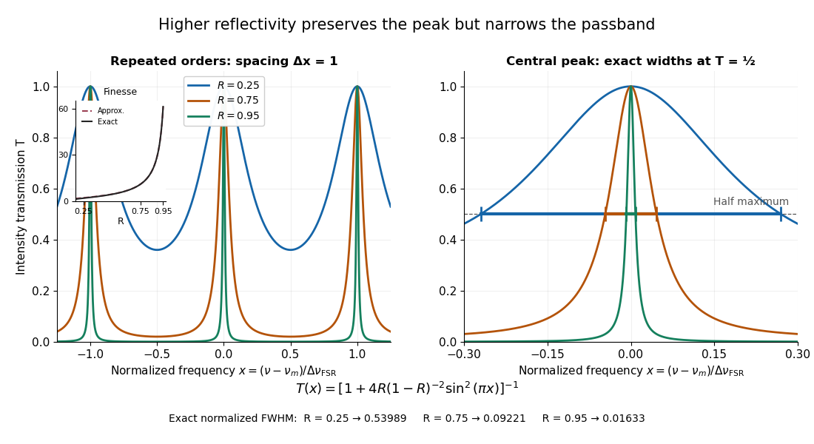

**[Figure 3](#image-increasing-mirror-reflectivity-narrows-fabry-perot-interferometer-transmission-peaks). Increasing mirror reflectivity narrows Fabry–Pérot interferometer transmission peaks**. Original stipulated dimensionless model for $R=0.25,0.75,0.95$, with $x=(\nu-\nu_m)/\Delta\nu_{\rm FSR}$ and $\delta=2\pi x$ modulo $2\pi$. All curves peak at unity and repeat after $\Delta x=1$. The second panel enlarges the central resonance; coloured segments at $T=1/2$ mark each exact [full width at half maximum](analysis.md#full-width-at-half-maximum). The inset compares exact [finesse](#finesse) with the high-reflectivity approximation. These are calculations, not measured scans.

The beauty of the narrowing is visible directly in the [geometric series](sequence-and-series.md#geometric-series): large $R$ preserves contributions from many round trips, so a small [phase difference](wave.md#phase-difference) accumulates across many terms and spoils their addition. For the stipulated $10\,\mathrm{mm}$ vacuum gap, $R=0.95$ gives an ideal [full width at half maximum](analysis.md#full-width-at-half-maximum) of about $244.792\,\mathrm{MHz}$. This instrumental width is not a measured [spectral line](stellar-astrophysics.md#spectral-line) width. A real scan also depends on the source profile, accepted [angles](geometry-and-topology.md#angle), mirror shape, alignment, and scan stability. The University of Washington handout separately discusses mirror-reflectivity, mirror-flatness, and detector-pinhole contributions; increasing $R$ alone cannot remove the others.[Finesse discussion, equations (5)–(8), and §2.3 Determine the Finesse](physics-bibliography.md#fabry-perot-interferometer-university-of-washington-physics-331)

#### Etalon resolving power and order overlap

↑ **Parent:** [Finesse](#finesse)

For an ideal air-gap [Fabry–Pérot etalon](#fabry-perot-etalon) at [normal incidence](optics.md#normal-incidence), the [free spectral range](physical-optics.md#free-spectral-range) is $\nu_{\rm FSR}=c/(2d)$ and the peak [full width at half maximum](analysis.md#full-width-at-half-maximum) is $\delta\nu=\nu_{\rm FSR}/\mathcal F$. To separate a pair of lines spaced by $\Delta\nu$ by at least $M$ peak widths, require $d\mathcal F\ge Mc/(2\Delta\nu)$. Putting both lines inside one unambiguous [free spectral range](physical-optics.md#free-spectral-range) additionally requires $d<c/(2\Delta\nu)$, so $\mathcal F>M$. In terms of their [vacuum](physics.md#vacuum) [wavelengths](wave-equation.md#wavelength), $c/\Delta\nu=\lambda_1\lambda_2/|\lambda_2-\lambda_1|$.

The strict order condition needs a margin if tails from adjacent periodic peaks are to be negligible. If every neighbouring peak in a scanned two-line periodic spectrum must be separated by $M$ widths, the stronger condition is $\min(\Delta\nu,\nu_{\rm FSR}-\Delta\nu)\ge M\nu_{\rm FSR}/\mathcal F$. Ordinary resolving power alone does not prevent ambiguous repeated orders. A fixed etalon's transmission as a function of [wavelength](wave-equation.md#wavelength) is a periodic-in-frequency filter; it is not automatically a plot of the incident source's spectral lines.

<h3 id="fabry-perot-etalon">Fabry–Pérot etalon</h3>

↑ **Parent:** [Fabry–Pérot interferometer](#fabry-perot-interferometer)

A [Fabry–Pérot etalon](#fabry-perot-etalon) fixes mirror separation in a [Fabry–Pérot interferometer](#fabry-perot-interferometer), selecting [wavelengths](wave-equation.md#wavelength) through its transmission resonances.[§1.0 p. 3: fixed-spacing Fabry Perot etalon](physics-bibliography.md#lm-0300-fabry-perot-spectrum-analyser-by-walter-luhs)

<h3 id="scanning-fabry-perot-measurement">Scanning Fabry–Pérot measurement</h3>

↑ **Parent:** [Fabry–Pérot interferometer](#fabry-perot-interferometer)

An actual teaching experiment in LM-0300 Fabry Perot Spectrum Analyser by [Walter Luhs](physicist.md#walter-luhs), §§3.1.1–3.1.2, prepares a green [laser](laser.md) beam by aligning it near and far along a rail, then centring back-reflected [light](optics.md#light) from adjustable curved mirrors. An actuator using [piezoelectricity](quantum-mechanics.md#piezoelectricity) moves one mirror. A screen first displays [interference fringes](physical-optics.md#interference-fringe); a focusing [optical lens](geometrical-optics.md#lens-optics) and [photodiode](#photodiode) then replace the viewing arrangement. The [oscilloscope](wave-equation.md#oscilloscope) records the photodiode signal and the piezo drive reference on separate channels, using the latter as its trigger. Alignment and mirror separation are adjusted to suppress extra transverse [normal modes](wave-equation.md#normal-mode); source [temperature](temperature.md) and drive [electric current](electric-charge.md#electric-current) are controlled. Repeated peaks calibrate the scan using the appropriate [free spectral range](physical-optics.md#free-spectral-range), and their spacing divided by their [full width at half maximum](analysis.md#full-width-at-half-maximum) estimates [finesse](#finesse).[LM-0300 Fabry Perot Spectrum Analyser, §1.0 pp. 3–4; §§3.1.1–3.1.2 pp. 20–21, figures 19–23](physics-bibliography.md#lm-0300-fabry-perot-spectrum-analyser-by-walter-luhs)

This experiment uses a confocal curved-mirror cavity, whose repeated peak families can have spacing $c/(4d)$ in air; it must not be calibrated blindly with the parallel-mirror $c/(2d)$. Extra transverse [normal modes](wave-equation.md#normal-mode) can mimic source features. A finite measured peak width bounds source sharpness only after instrumental broadening is considered; it does not determine the source's intrinsic width by itself.[§3.1.2 p. 20: transverse modes, confocal calibration and source-linewidth inference](physics-bibliography.md#lm-0300-fabry-perot-spectrum-analyser-by-walter-luhs)

For an independent ideal scan calculation, hold a narrow [laser](laser.md) [wavelength](wave-equation.md#wavelength) fixed and vary the parallel-mirror gap $d$ at [normal incidence](optics.md#normal-incidence). Advancing one resonance order requires $\Delta d=\lambda/(2n)$. If $d$ changes uniformly over the measured interval, the [time](classical-mechanics.md#time-in-physics) between repeated peaks divided by their [full width at half maximum](analysis.md#full-width-at-half-maximum) in [time](classical-mechanics.md#time-in-physics) equals [finesse](#finesse). The cancellation of scan rate follows from $d(t)=d_0+vt$: both peak spacing and peak width are divided by the same $|v|$. It fails if the scan rate changes appreciably over that interval. A practical control in the University of Washington's motor-driven flat-mirror experiment is to check that successive peaks are equally spaced before using the time axis this way; its handout also warns that table strain and aggressive low-pass filtering alter the trace.[§2.2 pp. 9–11: central-spot scanning, nonuniform drive, table strain and filtering; §2.3 p. 11: widths and spacings in time](physics-bibliography.md#fabry-perot-interferometer-university-of-washington-physics-331)

## Lenslet array

↑ **Parent:** [Optical instrument](optical-instrument.md)

A lenslet array is a set of small lenses that divides a field or a pupil into many optical samples. In an [integral field spectrograph](#integral-field-spectrograph) each field sample generates a microspectrum or feeds an [optical fiber](#optical-fiber).

## Beam splitter

↑ **Parent:** [Optical instrument](optical-instrument.md)  
ⓦ [Wiki](https://en.wikipedia.org/wiki/Beam_splitter)

A [beam splitter](#beam-splitter) is an [optical instrument](optical-instrument.md) that routes an incident beam of [light](optics.md#light) into transmitted and reflected beams. It also combines incident [complex amplitudes](wave.md#complex-amplitude): two inputs can contribute to the same output. A common geometry has four [optical ports](#optical-port), with two chosen as inputs and two as outputs. A [beam splitter](#beam-splitter) changes the field; a [photodetector](#photodetector) supplies a measurement.[Photon quantum mechanics and beam splitters, §IV, printed p. 262, figure 4: two input and two output ports](physics-bibliography.md#photon-quantum-mechanics-and-beam-splitters-by-charles-h-holbrow-and-others)

For one illuminated input of a passive [beam splitter](#beam-splitter), at specified [wavelength](wave-equation.md#wavelength), [angle of incidence](optics.md#angle-of-incidence) and [electromagnetic polarization](electromagnetic-wave.md#polarization-of-an-electromagnetic-wave), define power [transmittance](radiometry.md#transmittance) $T=P_{\rm transmitted}/P_{\rm in}$, [reflectance](radiometry.md#reflectance) $R=P_{\rm reflected}/P_{\rm in}$ and [radiometric absorptance](radiometry.md#radiometric-absorptance) $A=P_{\rm absorbed}/P_{\rm in}$. In steady operation, with no gain or other source, no net stored [energy](energy.md) change, and all escaping [light](optics.md#light) included in the transmitted or reflected collection,

$$
T+R+A=1.
$$

This is [conservation of energy](mathematical-physics.md#conservation-of-energy) divided by incident [power](energy.md#power). If $T$ and $R$ count only the intended output beams, include a separate scattered or otherwise uncollected fraction $L$: then $T+R+A+L=1$. Missing output [power](energy.md#power) need not be [wave absorption](wave.md#wave-absorption). For an original specified example, $P_{\rm in}=10\,\mathrm{mW}$, $T=0.45$, $R=0.50$ and $A=0.05$ give $4.5\,\mathrm{mW}$ transmitted, $5.0\,\mathrm{mW}$ reflected and $0.5\,\mathrm{mW}$ absorbed; these are assumed values, not measurements.

A 50:50 [beam splitter](#beam-splitter) specifies equal output [powers](energy.md#power) for one input, not equal [complex amplitudes](wave.md#complex-amplitude) without a relative [wave phase](wave.md#phase-waves). Recombination needs the [beam splitter scattering matrix](#beam-splitter-scattering-matrix), including its [wave phases](wave.md#phase-waves). A [nonpolarizing beam splitter](#nonpolarizing-beam-splitter) approximately divides both orthogonal [linear polarizations](electromagnetic-wave.md#linear-polarization) in the same power ratio over its specified operating range; a [polarizing beam splitter](#polarizing-beam-splitter) deliberately routes the two differently.

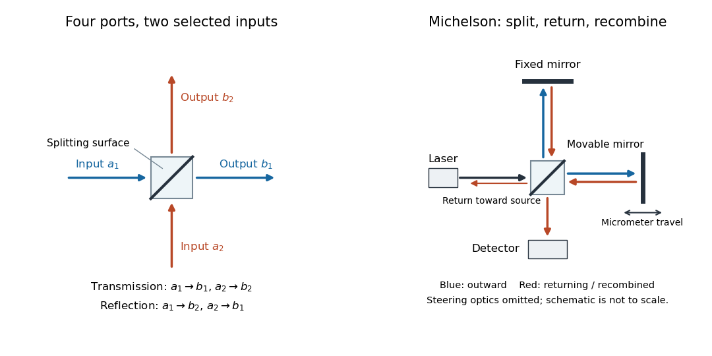

**[Figure 4](#image-four-optical-ports-of-a-beam-splitter-and-a-michelson-interferometer). Four optical ports of a beam splitter and a Michelson interferometer**. Original schematic. Left: the transmitted paths are $a_1\to b_1$ and $a_2\to b_2$; the reflected paths exchange direction. This ordering defines the [beam splitter scattering matrix](#beam-splitter-scattering-matrix) below. Right: one source is split into two mirror arms and the returning fields meet the same [beam splitter](#beam-splitter) again; the [photodetector](#photodetector) supplies the readout. Separate arrows show outward and returning paths, not separate physical beams. The schematic omits alignment steering mirrors and is not to scale.

The useful surprise is that the same component divides [power](energy.md#power) with one input and steers [power](energy.md#power) by [wave interference](physical-optics.md#interference-wave-propagation) with two inputs. In a [Michelson interferometer](physical-optics.md#michelson-interferometer) or [Mach-Zehnder interferometer](#mach-zehnder-interferometer), mirror motion changes relative [wave phase](wave.md#phase-waves), turning a small change in [optical path length](physical-optics.md#optical-path-length) into a measurable change in output [power](energy.md#power).

### Optical port

↑ **Parent:** [Beam splitter](#beam-splitter)

An [optical port](#optical-port) specifies where and in which direction a beam enters or leaves an [optical instrument](optical-instrument.md). To attach one [complex amplitude](wave.md#complex-amplitude) to it, also specify the beam's transverse field profile, [electromagnetic polarization](electromagnetic-wave.md#polarization-of-an-electromagnetic-wave), [frequency](wave.md#frequency) and reference plane for [wave phase](wave.md#phase-waves). Reversing propagation changes the input/output assignment. Four geometrical connections do not imply four independent input [complex amplitudes](wave.md#complex-amplitude) in the chosen two-input configuration.

### Beam splitter scattering matrix

↑ **Parent:** [Beam splitter](#beam-splitter)

For a linear, fixed-frequency [beam splitter](#beam-splitter), choose power-normalized [complex amplitudes](wave.md#complex-amplitude) $a_1,a_2$ at its input [optical ports](#optical-port) and $b_1,b_2$ at its output [optical ports](#optical-port): $|a_j|^2$ and $|b_j|^2$ are [powers](energy.md#power). The scalar description treats one specified [electromagnetic polarization](electromagnetic-wave.md#polarization-of-an-electromagnetic-wave) and matching transverse profiles; other fields require additional components. With the geometrical ordering in the diagram,

$$
\begin{pmatrix}b_1\\b_2\end{pmatrix}
=S\begin{pmatrix}a_1\\a_2\end{pmatrix},
\qquad S=\begin{pmatrix}t&r'\\r&t'\end{pmatrix}.
$$

Here $t,t'$ are transmission [complex amplitudes](wave.md#complex-amplitude) per unit input and $r,r'$ are reflection [complex amplitudes](wave.md#complex-amplitude) per unit input. In this power normalization, a single input gives $T=|t|^2$ and $R=|r|^2$. Raw [electric field](electric-field.md) amplitudes in different media generally need additional power-normalization factors.

If these two output [optical ports](#optical-port) account for all outgoing [power](energy.md#power) and the device has no loss or gain, $S$ is a [unitary matrix](linear-operator-theory.md#unitary-matrix):

$$
S^\dagger S=I,\qquad
|t|^2+|r|^2=|r'|^2+|t'|^2=1,\qquad
t^*r'+r^*t'=0.
$$

The dagger is the [Hermitian transpose](linear-operator-theory.md#conjugate-transpose) and a star is [complex conjugation](complex-analysis.md#complex-conjugation). To prove the condition, substitute $\mathbf b=S\mathbf a$ into conservation of total [power](energy.md#power) for every input [vector](vector-space.md#vector): $\mathbf a^\dagger(S^\dagger S-I)\mathbf a=0$. Inputs $(1,0)$ and $(0,1)$ fix the diagonal entries; $(1,1)$ and $(1,i)$ fix the real and imaginary parts of the off-diagonal entry. A lossy two-output description instead has $S^\dagger S\leq I$ for a passive device.[Photon quantum mechanics and beam splitters, §IV.A, printed p. 262, equations (1)–(5): unitary beam splitter matrix and phase constraints](physics-bibliography.md#photon-quantum-mechanics-and-beam-splitters-by-charles-h-holbrow-and-others)

One consistent ideal symmetric 50:50 choice is

$$
S=\frac1{\sqrt2}\begin{pmatrix}1&i\\i&1\end{pmatrix},
\qquad b_1=\frac{a_1+ia_2}{\sqrt2},\quad b_2=\frac{ia_1+a_2}{\sqrt2}.
$$

Each reflection carries $+\pi/2$ relative [wave phase](wave.md#phase-waves) in this convention. The columns have unit [vector norm](normed-vector-space.md#norm) and zero [inner product](inner-product.md), directly verifying that $S$ is a [unitary matrix](linear-operator-theory.md#unitary-matrix). Choosing a different [phase convention for complex amplitudes](wave.md#phase-convention-for-complex-amplitudes) at the [optical ports](#optical-port) replaces $S$ by $D_{\rm out}SD_{\rm in}^{-1}$, where the $D$ are [diagonal matrices](linear-algebra.md#diagonal-matrix) whose entries have [modulus](complex-analysis.md#modulus) one; the input [complex amplitudes](wave.md#complex-amplitude) must be transformed consistently. Observable [powers](energy.md#power) are unchanged. The displayed $i$ is a convention for this ideal model, not a universal reflection rule for every coating or incidence geometry.

#### Balanced-splitter twin-Fock output distribution

↑ **Parent:** [Beam splitter scattering matrix](#beam-splitter-scattering-matrix)

For two identical bosonic input populations of $N$ in a balanced two-mode mixer, only even occupancies occur at either output. Expanding $[(b_1^\dagger)^2-(b_2^\dagger)^2]^N$ and retaining normalized number-state factorials gives the displayed law. Its sum is one by the [generating function](sequence-and-series.md#generating-function) $(1-4z)^{-1/2}(1-4z)^{-1/2}=(1-4z)^{-1}$.

### Coherent beam splitter recombination

↑ **Parent:** [Beam splitter](#beam-splitter)

Suppose the two input beams share [frequency](wave.md#frequency), [electromagnetic polarization](electromagnetic-wave.md#polarization-of-an-electromagnetic-wave) and overlapping transverse profiles at each output, with stable relative [wave phase](wave.md#phase-waves) during the [photodetector](#photodetector)'s averaging interval. For the ideal [beam splitter scattering matrix](#beam-splitter-scattering-matrix) above, expanding the squared [complex amplitudes](wave.md#complex-amplitude) gives

$$
P_1=\frac{|a_1|^2+|a_2|^2}{2}-\operatorname{Im}(a_1^*a_2),
\qquad P_2=\frac{|a_1|^2+|a_2|^2}{2}+\operatorname{Im}(a_1^*a_2).
$$

The [imaginary part](complex-analysis.md#imaginary-part) terms describe [wave interference](physical-optics.md#interference-wave-propagation). Applying the single-input power split to each input separately and adding the results would discard these terms. Their opposite signs ensure $P_1+P_2=|a_1|^2+|a_2|^2$: [conservation of energy](mathematical-physics.md#conservation-of-energy) survives even when one output is dark.

For an original example, let $a_1=\sqrt P$, $a_2=\sqrt P e^{i\delta}$ and $P=1\,\mathrm{mW}$. Then $P_1=P(1-\sin\delta)$ and $P_2=P(1+\sin\delta)$:

| Relative input [wave phase](wave.md#phase-waves) $\delta$ | Output [power](energy.md#power) $P_1$ | Output [power](energy.md#power) $P_2$ |
| --- | --- | --- |
| $0$ | $1\,\mathrm{mW}$ | $1\,\mathrm{mW}$ |
| $+\pi/2$ | $0$ | $2\,\mathrm{mW}$ |
| $-\pi/2$ | $2\,\mathrm{mW}$ | $0$ |

At $+\pi/2$, $a_2=i\sqrt P$ makes $b_1=(\sqrt P-\sqrt P)/\sqrt2=0$ and $b_2=i\sqrt{2P}$; at $-\pi/2$ the dark output swaps. Thus the two inputs can feed all their combined [power](energy.md#power) into one output without gain. At zero relative input [wave phase](wave.md#phase-waves), the splitter's own relative [wave phase](wave.md#phase-waves) leaves the contributions in quadrature, so neither output is dark.

**[Figure 5](#image-relative-input-wave-phase-redirects-the-combined-power-of-two-coherent-beams). Relative input wave phase redirects the combined power of two coherent beams**. Original ideal-model curves for $a_1=\sqrt P$, $a_2=\sqrt P e^{i\delta}$ and $S=2^{-1/2}\begin{pmatrix}1&i\\i&1\end{pmatrix}$. Output [powers](energy.md#power) are normalized by one input's [power](energy.md#power) $P$; their sum is always $2P$. Markers show the three worked cases. These are calculated curves, not measured data.

For fluctuating fields, average the cross term as $\operatorname{Im}\langle a_1^*a_2\rangle$. It vanishes for mutually uncorrelated inputs, making the independent power-splitting rule valid for the averaged output. Partial [first-order optical coherence](physical-optics.md#first-order-optical-coherence) reduces it. Orthogonal [linear polarizations](electromagnetic-wave.md#linear-polarization) eliminate the cross term in a polarization-insensitive power readout, and spatial mismatch reduces the overlap. Detector averaging can also erase rapid relative [wave phase](wave.md#phase-waves) changes. A fixed relation between two inputs can be prepared by splitting one [laser](laser.md) beam and recombining the two arms.

An actual teaching protocol in Michelson Interferometer & Precision Wavelength Measurement — Week 1, University of Colorado Boulder, §§4–6, starts with an ideal-model prediction, then builds a [Michelson interferometer](physical-optics.md#michelson-interferometer) using a [helium-neon laser](laser.md#helium-neon-laser), a [nonpolarizing beam splitter](#nonpolarizing-beam-splitter), adjustable mirrors, a micrometer translation stage and a [photodetector](#photodetector). Steering mirrors align beam overlap at near and far planes; far-plane [interference fringes](physical-optics.md#interference-fringe) refine alignment. Moving the arm mirror changes the returning relative [wave phase](wave.md#phase-waves); detector voltage is watched with a live acquisition display or [oscilloscope](wave-equation.md#oscilloscope). The guide compares measured arm [powers](energy.md#power) with 50:50 splitting and asks for a revised field model. It tests [electromagnetic polarization](electromagnetic-wave.md#polarization-of-an-electromagnetic-wave) dependence, optionally changing one arm with a [quarter-wave plate](maxwell-equations.md#quarter-wave-plate), and estimates noise from repeated readings at fixed mirror position. These controls test whether fringe changes reflect coherent recombination rather than splitter imbalance or misalignment. The guide supplies a protocol, not a numerical dataset. Its detector noise, imperfect overlap and [electromagnetic polarization](electromagnetic-wave.md#polarization-of-an-electromagnetic-wave) mismatch limit displacement inference.[Michelson Interferometer & Precision Wavelength Measurement — Week 1, §§4.1, 5.1–5.3, 6.1–6.4; figure 1 and live voltage monitor](physics-bibliography.md#michelson-interferometer-and-precision-wavelength-measurement-week-1-university-of-colorado-boulder-laboratory-guide)

Additional [background subtraction](#background-subtraction) controls follow from the field model: block both arms to record the detector offset and ambient [light](optics.md#light), then unblock each arm separately to establish its detected [power](energy.md#power) at fixed gain. With both open, scan the mirror and compare extrema after subtracting that background. Keep the detector below saturation and repeat the scan to check drift. A changing signal alone cannot distinguish source [optical coherence](physical-optics.md#optical-coherence) from motion or changing overlap. For a [vacuum](physics.md#vacuum) round trip, a mirror displacement $x$ changes relative [wave phase](wave.md#phase-waves) by $4\pi x/\lambda$; the useful signal is its modulation after detection, not an optical-frequency oscillation that the detector must resolve.

### Nonpolarizing beam splitter

↑ **Parent:** [Beam splitter](#beam-splitter)

A [nonpolarizing beam splitter](#nonpolarizing-beam-splitter) is designed for approximately equal power splitting ratios for the two orthogonal [linear polarizations](electromagnetic-wave.md#linear-polarization), at specified [wavelengths](wave-equation.md#wavelength) and [angle of incidence](optics.md#angle-of-incidence). It need not be 50:50, lossless, or have equal transmission and reflection [wave phases](wave.md#phase-waves) for both [linear polarizations](electromagnetic-wave.md#linear-polarization). A scalar [beam splitter scattering matrix](#beam-splitter-scattering-matrix) therefore still requires a specified [electromagnetic polarization](electromagnetic-wave.md#polarization-of-an-electromagnetic-wave) and operating range. [Polarizing beam splitters](#polarizing-beam-splitter) instead aim to separate those [linear polarizations](electromagnetic-wave.md#linear-polarization) into different paths.

### Polarizing beam splitter

↑ **Parent:** [Beam splitter](#beam-splitter)

A [polarizing beam splitter](#polarizing-beam-splitter) sends two orthogonal [linear polarizations](electromagnetic-wave.md#linear-polarization) to different output paths. Acting coherently on $\alpha|H\rangle+\beta|V\rangle$, it correlates path with [photon polarization](quantum-mechanics.md#photon-polarization) instead of measuring [photon polarization](quantum-mechanics.md#photon-polarization) unless a path is actually detected or discarded.

For an ideal [polarizing beam splitter](#polarizing-beam-splitter) with one input, choose orthogonal unit [electromagnetic polarization](electromagnetic-wave.md#polarization-of-an-electromagnetic-wave) vectors $\mathbf e_H,\mathbf e_V$ and an incident power-normalized field $a_H\mathbf e_H+a_V\mathbf e_V$. If $H$ is transmitted and $V$ reflected, the output [powers](energy.md#power) are $P_{\rm transmitted}=|a_H|^2$ and $P_{\rm reflected}=|a_V|^2$. The associated [complex amplitudes](wave.md#complex-amplitude) can acquire different [wave phases](wave.md#phase-waves); the routing is not an equal-power split for every incident [electromagnetic polarization](electromagnetic-wave.md#polarization-of-an-electromagnetic-wave). For [linear polarization](electromagnetic-wave.md#linear-polarization) at [angle](geometry-and-topology.md#angle) $\theta$ to $H$, input [power](energy.md#power) $P$ gives $P\cos^2\theta$ and $P\sin^2\theta$, respectively. At $\theta=30^\circ$, a stipulated $4\,\mathrm{mW}$ input gives $3\,\mathrm{mW}$ transmitted and $1\,\mathrm{mW}$ reflected. A $45^\circ$ input gives equal [powers](energy.md#power) even though an $H$ input goes entirely into the transmitted output.[Photon quantum mechanics and beam splitters, §IV.D, printed p. 264, figure 5: polarization routed into different detected paths](physics-bibliography.md#photon-quantum-mechanics-and-beam-splitters-by-charles-h-holbrow-and-others)

Real [polarizing beam splitters](#polarizing-beam-splitter) have leakage into the unwanted output and losses. Each [linear polarization](electromagnetic-wave.md#linear-polarization) has its own field transformation and power coefficients. To make an ordinary power [wave interference](physical-optics.md#interference-wave-propagation) term between the two output contributions, first bring them into the same path with overlapping transverse profiles and a common [electromagnetic polarization](electromagnetic-wave.md#polarization-of-an-electromagnetic-wave), for example using a [polarizer](electromagnetic-wave.md#polarizer). Merely placing two orthogonal [linear polarizations](electromagnetic-wave.md#linear-polarization) on a polarization-insensitive [photodetector](#photodetector) adds their [powers](energy.md#power). Coherent routing can be reversed by suitable optics before detection; discarding a path loses access to that part of the field but supplies no recorded measurement outcome by itself.

// Target: optics.bigb

### Mach-Zehnder interferometer

↑ **Parent:** [Beam splitter](#beam-splitter)  
ⓦ [Wiki](https://en.wikipedia.org/wiki/Mach–Zehnder_interferometer)

A [Mach-Zehnder interferometer](#mach-zehnder-interferometer) splits an incident wave into two arms and recombines them at a second [beam splitter](#beam-splitter). A relative [quantum phase](quantum-system.md#quantum-phase) changes the interference at its output ports. With symmetric lossless 50:50 splitters, the ports can be calibrated to have detection [probabilities](probability-theory.md#probability) $\cos^2(\theta/2)$ and $\sin^2(\theta/2)$.

// Target: optics.bigb

## Field of view

↑ **Parent:** [Optical instrument](optical-instrument.md)  
ⓦ [Wiki](https://en.wikipedia.org/wiki/Field_of_view)

The [field of view](#field-of-view) is the region of object directions sampled by an [optical instrument](optical-instrument.md) in one pointing. State whether it is horizontal, vertical or diagonal, and whether it is a full [angle](geometry-and-topology.md#angle) or a half-[angle](geometry-and-topology.md#angle). An object-plane width in millimetres also describes a [field of view](#field-of-view), but requires a specified object distance. Neither that width nor the angular [field of view](#field-of-view) is the [aperture](optics.md#aperture) [diameter](topological-analysis.md#diameter) or the [diffraction-limited resolution](point-spread-function.md#diffraction-limited-resolution).

For a centred flat rectangular [photodetector](#photodetector) of width $w$ in the [focal plane](#focal-plane), with positive effective [focal length](geometrical-optics.md#focal-length) $f$, infinity focus and ideal rectilinear imaging without [optical distortion](geometrical-optics.md#distortion-optics), the full horizontal [field of view](#field-of-view) is

$$
\Theta_x=2\arctan\left(\frac{w}{2f}\right).
$$

The model maps an object direction $\theta$ to image height of magnitude $|y|=f|\tan\theta|$; set $|y|=w/2$ and use the [inverse tangent](geometry-and-topology.md#inverse-tangent). This retains exact [right triangle](euclidean-geometry.md#right-triangle) geometry within the stipulated imaging model; a paraxial [focal length](geometrical-optics.md#focal-length) alone does not guarantee that a real wide-field [optical lens](geometrical-optics.md#lens-optics) obeys it. With detector height $h$, replace $w$ by $h$ for the vertical [field of view](#field-of-view), and by $\sqrt{w^2+h^2}$ for the diagonal [field of view](#field-of-view). The [small-angle approximation](geometry-and-topology.md#small-angle-approximation) gives $\Theta_x\simeq w/f$ in radians. [Gregory Hollows and Nicholas James, Edmund Optics, Understanding Focal Length and Field of View](https://www.edmundoptics.com/knowledge-center/application-notes/imaging/understanding-focal-length-and-field-of-view/).

For an original worked example, a $36\,\mathrm{mm}$ detector width gives $\Theta_x\approx39.60^\circ$ at $f=50\,\mathrm{mm}$, and $20.41^\circ$ at $f=100\,\mathrm{mm}$. Keeping $D=25\,\mathrm{mm}$ makes these f/2 and f/4 respectively: the [field of view](#field-of-view) changes because $f$ changes. By contrast, closing $D$ from $25$ to $12.5\,\mathrm{mm}$ at $f=100\,\mathrm{mm}$ changes f/4 to f/8 while retaining $20.41^\circ$ in this model. The clean separation is useful: [entrance pupil](#entrance-pupil) [area](differential-geometry.md#surface-area) controls collection, [focal ratio](#focal-ratio) controls the paraxial cone, and $w/f$ controls angular image coverage. Edge clipping, [optical distortion](geometrical-optics.md#distortion-optics), [field curvature](geometrical-optics.md#petzval-field-curvature) and [optical aberrations](geometrical-optics.md#optical-aberration) can restrict the practically usable [field of view](#field-of-view).

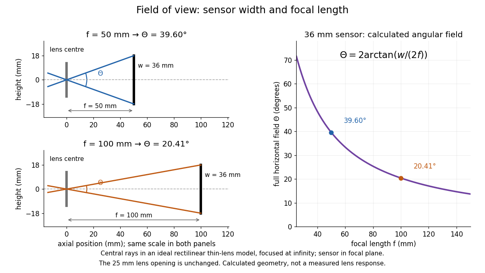

**[Figure 6](#image-field-of-view-a-fixed-detector-width-subtends-a-smaller-angle-at-longer-focal-length). Field of view: a fixed detector width subtends a smaller angle at longer focal length**. Original ideal rectilinear model. Left: central [light rays](geometrical-optics.md#light-ray) cross the [thin lens](geometrical-optics.md#thin-lens) centre and reach the two detector edges, with equal coordinate scales in both panels; the opening is $25\,\mathrm{mm}$ in each. Right: calculated full horizontal [field of view](#field-of-view) for $w=36\,\mathrm{mm}$, with the $50$ and $100\,\mathrm{mm}$ examples marked. The detector lies in the [focal plane](#focal-plane), the object is at infinity, and [optical distortion](geometrical-optics.md#distortion-optics) is absent. No plotted quantity is measured data.

A proposed angular readout on an [optical bench](optics.md#optical-bench) illuminates a small asymmetric target at the [optical focus](geometrical-optics.md#focus-optics) of a [collimator](#collimator), providing a bundle with a known direction. Rotate the [optical camera](#optical-camera) about the centre of its [entrance pupil](#entrance-pupil), reading a graduated rotation stage, and record the target image position on its fixed [photodetector](#photodetector). Centre the target to establish zero; turn left and right until its centre reaches each detector edge. The difference between stage readings measures the full horizontal [field of view](#field-of-view). Repeat with a smaller [aperture stop](optics.md#aperture-stop): unchanged edge directions but reduced signal support the distinction between collection and angular coverage. Keep the same active detector width, infinity focus, illumination, integration time and gain; approach each reading from the same direction to check mechanical backlash. A finite target blurs the edge criterion, detector thresholds can imitate lost coverage, and a wide bundle must illuminate the whole [entrance pupil](#entrance-pupil) at every tested [angle](geometry-and-topology.md#angle). These checks distinguish a geometrical boundary from insufficient signal. The analytical diagram is the prediction for this protocol, not a record of its execution.

## Optical telescope

↑ **Parent:** [Optical instrument](optical-instrument.md)  
ⓦ [Wiki](https://en.wikipedia.org/wiki/Optical_telescope)

### Altazimuth mount

↑ **Parent:** [Optical telescope](#optical-telescope)  
ⓦ [Wiki](https://en.wikipedia.org/wiki/Altazimuth_mount)

An [altazimuth mount](#altazimuth-mount) points an [optical telescope](#optical-telescope) using [altitude](astrophysics.md#altitude) and [azimuth](astrophysics.md#azimuth) rotations. A mount restricted to elevations no greater than the [zenith](astrophysics.md#zenith) must change its [azimuth](astrophysics.md#azimuth) by approximately half a turn when a target crosses the [zenith](astrophysics.md#zenith).

#### Zenith blind spot

↑ **Parent:** [Altazimuth mount](#altazimuth-mount)

A [zenith blind spot](#zenith-blind-spot) is a region in which an [altazimuth mount](#altazimuth-mount) cannot follow a target because the required axis motion exceeds a drive constraint. A finite slew across an exact [zenith](astrophysics.md#zenith) crossing gives a lost-track interval; a full forbidden footprint additionally depends on the target trajectory, acceleration and the control strategy. It need not be circular.

### Giant Magellan Telescope

↑ **Parent:** [Optical telescope](#optical-telescope)  
ⓦ [Wiki](https://en.wikipedia.org/wiki/Giant_Magellan_Telescope)

The Giant Magellan Telescope design combines seven 8.4-metre primary mirrors, including off-axis segments. It was a planned extremely large telescope in the 2018 examination context.

### Thirty Meter Telescope

↑ **Parent:** [Optical telescope](#optical-telescope)  
ⓦ [Wiki](https://en.wikipedia.org/wiki/Thirty_Meter_Telescope)

The Thirty Meter Telescope design uses a thirty-metre primary with 492 hexagonal segments. It was among the planned extremely large telescopes in the 2018 examination context.

### W. M. Keck Observatory

↑ **Parent:** [Optical telescope](#optical-telescope)  
ⓦ [Wiki](https://en.wikipedia.org/wiki/W._M._Keck_Observatory)

The two Keck telescopes each use a ten-metre primary made from 36 hexagonal segments.

### Large Binocular Telescope

↑ **Parent:** [Optical telescope](#optical-telescope)  
ⓦ [Wiki](https://en.wikipedia.org/wiki/Large_Binocular_Telescope)

The Large Binocular Telescope has two 8.4-metre primary mirrors with lightweight honeycomb structures.

### Segmented mirror

↑ **Parent:** [Optical telescope](#optical-telescope)  
ⓦ [Wiki](https://en.wikipedia.org/wiki/Segmented_mirror)

A segmented mirror assembles smaller mirrors into a large aperture. Sensors and actuators maintain position and figure; coherent imaging additionally requires [mirror segment phasing](#mirror-segment-phasing).

#### Mirror segment phasing

↑ **Parent:** [Segmented mirror](#segmented-mirror)

Phasing adjusts relative piston and tilt so adjacent segments form a continuous optical wavefront. Near normal reflection a surface piston changes [optical path length](physical-optics.md#optical-path-length) by twice that displacement.

### Lightweight telescope mirror

↑ **Parent:** [Optical telescope](#optical-telescope)

A lightweight mirror uses a thin optical face backed by ribs or a honeycomb structure. The deep backing provides rigidity with less mass than a solid disk and facilitates thermal equilibration.

### Active optics

↑ **Parent:** [Optical telescope](#optical-telescope)  
ⓦ [Wiki](https://en.wikipedia.org/wiki/Active_optics)

Active optics uses controlled support forces and alignment to correct slow changes in telescope figure, particularly gravity and thermal deformation. It permits thin large primary mirrors. [Adaptive optics](#adaptive-optics) instead corrects rapid [atmospheric turbulence](optics.md#atmospheric-turbulence).

### Schmidt camera

↑ **Parent:** [Optical telescope](#optical-telescope)  
ⓦ [Wiki](https://en.wikipedia.org/wiki/Schmidt_camera)

A Schmidt camera combines a spherical primary mirror with a thin aspheric corrector at the mirror’s centre of curvature. The corrector compensates [spherical aberration](geometrical-optics.md#spherical-aberration); the symmetric stop location gives a wide useful field. The native focal surface is curved and lies inside the instrument.

### Reflecting telescope

↑ **Parent:** [Optical telescope](#optical-telescope)  
ⓦ [Wiki](https://en.wikipedia.org/wiki/Reflecting_telescope)

A reflecting telescope forms an image using curved mirrors. Its primary and secondary shapes, spacing and aperture stop determine its [optical aberrations](geometrical-optics.md#optical-aberration), access to the focus, and obstruction.

#### Gregorian telescope

↑ **Parent:** [Reflecting telescope](#reflecting-telescope)  
ⓦ [Wiki](https://en.wikipedia.org/wiki/Gregorian_telescope)

A Gregorian telescope has a concave parabolic primary and a concave ellipsoidal secondary beyond the primary focus. Light crosses the intermediate focus, reaches the secondary, and returns through the primary to the final focus. The ellipsoid’s two foci are the intermediate and final focus.

#### Cassegrain reflector

↑ **Parent:** [Reflecting telescope](#reflecting-telescope)  
ⓦ [Wiki](https://en.wikipedia.org/wiki/Cassegrain_reflector)

A Cassegrain arrangement places a secondary before the primary focus and returns light through a hole in the primary to a focus behind it. In the classical design the primary is parabolic and the secondary convex hyperbolic. The compact arrangement has a long effective [focal length](geometrical-optics.md#focal-length); its classical implementation retains off-axis [coma](geometrical-optics.md#coma-optics).

<h5 id="ritchey-chretien-telescope">Ritchey–Chrétien telescope</h5>

↑ **Parent:** [Cassegrain reflector](#cassegrain-reflector)

A Ritchey–Chrétien telescope has hyperbolic primary and secondary mirrors chosen to cancel third-order [spherical aberration](geometrical-optics.md#spherical-aberration) and [coma](geometrical-optics.md#coma-optics). It retains [astigmatism](geometrical-optics.md#astigmatism-optical-systems) and [field curvature](geometrical-optics.md#petzval-field-curvature); wide-field instruments may require additional correction.

##### Classical Cassegrain reflector

↑ **Parent:** [Cassegrain reflector](#cassegrain-reflector)

A classical Cassegrain reflector uses a concave parabolic primary and a convex hyperbolic secondary before the prime focus. The secondary returns the converging beam through a hole in the primary. It corrects on-axis [spherical aberration](geometrical-optics.md#spherical-aberration) but retains off-axis [coma](geometrical-optics.md#coma-optics).

#### Newtonian telescope

↑ **Parent:** [Reflecting telescope](#reflecting-telescope)  
ⓦ [Wiki](https://en.wikipedia.org/wiki/Newtonian_telescope)

A Newtonian telescope uses a concave parabolic primary and a flat diagonal secondary to send the converging beam to a side focus. The primary avoids on-axis [spherical aberration](geometrical-optics.md#spherical-aberration), but has off-axis [coma](geometrical-optics.md#coma-optics).

### Diffraction limit of a telescope

↑ **Parent:** [Optical telescope](#optical-telescope)

The angular [diffraction-limited resolution](point-spread-function.md#diffraction-limited-resolution) of a telescope scales as $\lambda/D$, with [wavelength](wave-equation.md#wavelength) $\lambda$ and illuminated diameter $D$. Larger diameter resolves smaller angular structure, while longer wavelength makes atmospheric phase correction easier.

## Entrance pupil

↑ **Parent:** [Optical instrument](optical-instrument.md)  
ⓦ [Wiki](https://en.wikipedia.org/wiki/Entrance_pupil)

## Optical microscope

↑ **Parent:** [Optical instrument](optical-instrument.md)

An [optical microscope](#optical-microscope) uses [light](optics.md#light) and [optical lens](geometrical-optics.md#lens-optics) assemblies to reveal small structures, such as the boundaries of [biological cells](biological-cell.md) or defects in a manufactured surface. In a compound [optical microscope](#optical-microscope), the [microscope objective](#microscope-objective) supplies an enlarged [real image](optics.md#real-image); the [microscope eyepiece](#microscope-eyepiece) makes that [intermediate microscope image](#intermediate-microscope-image) subtend a larger viewing [angle](geometry-and-topology.md#angle). The [transverse magnification](optics.md#transverse-magnification) of the first stage and the [angular magnification](optics.md#angular-magnification) of the second answer different questions.[University Physics Volume 3, §2.8 Microscopes, image formation and Eqs. 2.35–2.37](physics-bibliography.md#university-physics-volume-3-by-samuel-j-ling-and-others/2-8-microscopes-and-telescopes)

Consider an original ideal [finite-conjugate microscope](#finite-conjugate-microscope) in air, with both [optical lens](geometrical-optics.md#lens-optics) assemblies treated as converging [thin lens](geometrical-optics.md#thin-lens) elements in the [paraxial approximation](partial-differential-equation.md#paraxial-approximation). Choose objective [focal length](geometrical-optics.md#focal-length) $f_o=10\,\mathrm{mm}$ and object distance $u_o=12\,\mathrm{mm}$. The [thin lens](geometrical-optics.md#thin-lens) equation and signed [transverse magnification](optics.md#transverse-magnification) give

$$
\frac1{v_o}=\frac1{10\,\mathrm{mm}}-\frac1{12\,\mathrm{mm}}=\frac1{60\,\mathrm{mm}},\qquad v_o=60\,\mathrm{mm},\qquad m_o=-\frac{v_o}{u_o}=-5.
$$

Place a [microscope eyepiece](#microscope-eyepiece) of [focal length](geometrical-optics.md#focal-length) $f_e=25\,\mathrm{mm}$ a further $25\,\mathrm{mm}$ beyond the [intermediate microscope image](#intermediate-microscope-image). The objective-to-eyepiece separation is therefore $85\,\mathrm{mm}$. Each object point then supplies a parallel outgoing bundle of [light rays](geometrical-optics.md#light-ray), appropriate to a relaxed eye focused at infinity. Define the unaided reference as the same object viewed at distance $D=250\,\mathrm{mm}$; this is a rating convention, not a universal property of eyesight. The eyepiece [angular magnification](optics.md#angular-magnification) and total signed [angular magnification](optics.md#angular-magnification) are

$$
M_e=\frac D{f_e}=10,\qquad M=m_oM_e=-50.
$$

For instance, a hypothetical object height $h_o=0.020\,\mathrm{mm}$ becomes $h_i=-0.100\,\mathrm{mm}$ at the [intermediate microscope image](#intermediate-microscope-image). The signed viewing [angles](geometry-and-topology.md#angle) are approximately $h_i/f_e=-0.004\,\mathrm{rad}$ with the instrument and $h_o/D=0.00008\,\mathrm{rad}$ unaided. Their ratio is $-50$: enlarged and inverted. These are stipulated model dimensions, not measurements or specifications of a modern commercial [optical microscope](#optical-microscope).

**[Figure 7](#image-microscope-objective-and-microscope-eyepiece-in-an-ideal-finite-conjugate-microscope). Microscope objective and microscope eyepiece in an ideal finite-conjugate microscope**. Original [light ray](geometrical-optics.md#light-ray) construction for $f_o=10\,\mathrm{mm}$, $u_o=12\,\mathrm{mm}$, $v_o=60\,\mathrm{mm}$ and $f_e=25\,\mathrm{mm}$. Horizontal distances are proportional; object and image heights are enlarged for visibility. The [real image](optics.md#real-image) at $x=60\,\mathrm{mm}$ is the eyepiece's object, and the emerging bundle from its tip is parallel. A detector at that [real image](optics.md#real-image) plane would record [transverse magnification](optics.md#transverse-magnification) $-5$; the relaxed-eye viewing convention gives total [angular magnification](optics.md#angular-magnification) $-50$.

The attraction of an [optical microscope](#optical-microscope) is that seeing can become measuring: a [stage micrometer](#stage-micrometer) supplies a known object-space [length](physics.md#length), and [microscope scale calibration](#microscope-scale-calibration) converts an image readout into a specimen [length](physics.md#length). This also separates a large-looking image from a trustworthy size estimate. Meanwhile, [diffraction-limited resolution](point-spread-function.md#diffraction-limited-resolution) depends on [numerical aperture](point-spread-function.md#numerical-aperture) and [wavelength](wave-equation.md#wavelength); [empty magnification](#empty-magnification) enlarges an existing blur without revealing additional structure.

### Polarizing microscope

↑ **Parent:** [Optical microscope](#optical-microscope)

A microscope that uses controlled incident and analysed [polarization of an electromagnetic wave](electromagnetic-wave.md#polarization-of-an-electromagnetic-wave) to study specimens. Crossed [polarizers](electromagnetic-wave.md#polarizer) reveal orientation-dependent [phase retardation](maxwell-equations.md#phase-retardation) in a birefringent specimen.

#### Azimuthal brightness of a birefringent crystallite

↑ **Parent:** [Polarizing microscope](#polarizing-microscope)

Rotating a uniform crystallite around a fixed propagation direction changes the crossed-polar intensity factor $\sin^2(2\alpha)$. Extinctions repeat every90degrees and maxima occur45degrees away. Similar [interference colour](maxwell-equations.md#interference-colour) can coexist with different brightness if retardation is similar but azimuth differs.

#### Conoscopic interference pattern

↑ **Parent:** [Polarizing microscope](#polarizing-microscope)  
ⓦ [Wiki](https://en.wikipedia.org/wiki/Conoscopic_interference_pattern)

#### Maltese cross in polarized-light microscopy

↑ **Parent:** [Polarizing microscope](#polarizing-microscope)

An extinction pattern with four dark arms produced, for example, by a radial arrangement of local optical principal directions between crossed [polarizers](electromagnetic-wave.md#polarizer). The local intensity factor $\sin^2(2\varphi)$ vanishes along the polarizer axes. Such a radial-material pattern need not be a [conoscopic interference pattern](#conoscopic-interference-pattern).

### Microscope objective

↑ **Parent:** [Optical microscope](#optical-microscope)

The specimen-facing [optical lens](geometrical-optics.md#lens-optics) assembly of an [optical microscope](#optical-microscope). A [microscope objective](#microscope-objective) collects [light](optics.md#light) from the specimen and sets the object-side [numerical aperture](point-spread-function.md#numerical-aperture). In a [finite-conjugate microscope](#finite-conjugate-microscope) it forms the [intermediate microscope image](#intermediate-microscope-image) directly; in an [infinity-corrected microscope](#infinity-corrected-microscope) a [tube lens](#tube-lens) completes that [image formation](optics.md#image-formation). Its label alone does not calibrate a specimen [length](physics.md#length).

### Microscope eyepiece

↑ **Parent:** [Optical microscope](#optical-microscope)

The viewing [optical lens](geometrical-optics.md#lens-optics) assembly that acts as a magnifier of the [intermediate microscope image](#intermediate-microscope-image). With that image at its front [focal plane](#focal-plane), the outgoing [light rays](geometrical-optics.md#light-ray) from each point are parallel. In the [small-angle approximation](geometry-and-topology.md#small-angle-approximation), the viewed [angle](geometry-and-topology.md#angle) is $h_i/f_e$, versus $h_i/D$ for the same image-sized object at reference distance $D$, giving $M_e=D/f_e$.[University Physics Volume 3, §2.8, relaxed viewing and Eq. 2.37](physics-bibliography.md#university-physics-volume-3-by-samuel-j-ling-and-others/2-8-microscopes-and-telescopes)

A finite-distance [virtual image](optics.md#virtual-image) requires a different eyepiece conjugate. In the ideal [thin lens](geometrical-optics.md#thin-lens) model, with the eye close to the eyepiece and the [virtual image](optics.md#virtual-image) at distance $D$, the [angular magnification](optics.md#angular-magnification) becomes $1+D/f_e$. State the viewing condition before multiplying by the objective's [transverse magnification](optics.md#transverse-magnification); the relaxed-eye example above uses $D/f_e$.

### Intermediate microscope image

↑ **Parent:** [Optical microscope](#optical-microscope)

The [real image](optics.md#real-image) of the specimen supplied to the [microscope eyepiece](#microscope-eyepiece) or a recording surface. In the example above, a bare detector placed at $x=60\,\mathrm{mm}$ records an image five times the specimen's [length](physics.md#length), inverted. It does not record a fifty-times image: that number compares viewing [angles](geometry-and-topology.md#angle) under the stated reference convention. An [optical camera](#optical-camera) receiving the eyepiece's outgoing [light](optics.md#light) needs its own [optical lens](geometrical-optics.md#lens-optics) to form a further [real image](optics.md#real-image), with a recording scale determined by that added [image formation](optics.md#image-formation).

### Finite-conjugate microscope

↑ **Parent:** [Optical microscope](#optical-microscope)

An [optical microscope](#optical-microscope) whose [microscope objective](#microscope-objective) is designed to form a [real image](optics.md#real-image) at a specified finite distance. The intended image distance and [optical aberration](geometrical-optics.md#optical-aberration) corrections belong together; mechanical tube length is a mounting specification, not automatically the image distance measured from a [principal plane](geometrical-optics.md#principal-plane).[Infinity Optical Systems, opening finite-system discussion and Fig. 2(a)](physics-bibliography.md#infinity-optical-systems-by-nikon-instruments-inc)

Why can a small displacement produce a large image? For a converging [thin lens](geometrical-optics.md#thin-lens), write $u_o=f_o+\epsilon$ with $epsilon>0$. Substitution into the [thin lens](geometrical-optics.md#thin-lens) equation gives

$$
v_o=\frac{f_o(f_o+\epsilon)}{\epsilon},\qquad m_o=-\frac{f_o}{\epsilon}.
$$

The [similar triangles](euclidean-geometry.md#similar-triangle) construction supplies the minus sign. The example has $epsilon=2\,\mathrm{mm}$ and hence $m_o=-5$. Letting $epsilon$ decrease moves the [real image](optics.md#real-image) farther away; it does not keep the [microscope eyepiece](#microscope-eyepiece) in focus at a fixed position. Large [transverse magnification](optics.md#transverse-magnification) therefore requires the correct conjugate geometry, not merely a short [focal length](geometrical-optics.md#focal-length).

### Infinity-corrected microscope

↑ **Parent:** [Optical microscope](#optical-microscope)

An [optical microscope](#optical-microscope) whose [microscope objective](#microscope-objective), with the specimen at its designed front [focal plane](#focal-plane), sends out a parallel bundle of [light rays](geometrical-optics.md#light-ray) from each specimen point. Different specimen points generally give different bundle directions. A [tube lens](#tube-lens) then forms the finite [intermediate microscope image](#intermediate-microscope-image); the [microscope eyepiece](#microscope-eyepiece) views it. This parallel region permits suitable optical accessories to be inserted. Finite-conjugate and infinity-corrected components must be matched to their intended system.[Infinity Optical Systems, Fig. 2(a–b) and following description of objective, tube lens and eyepieces](physics-bibliography.md#infinity-optical-systems-by-nikon-instruments-inc)

In the ideal [paraxial approximation](partial-differential-equation.md#paraxial-approximation), an object height $h_o$ at objective [focal length](geometrical-optics.md#focal-length) $f_o$ gives bundle slope $-h_o/f_o$. A [tube lens](#tube-lens) of [focal length](geometrical-optics.md#focal-length) $f_t$ maps that slope to $h_i=-f_th_o/f_o$, so

$$
m_o=-\frac{f_t}{f_o}.
$$

This is a two-assembly result. Substituting infinity into the single-objective [transverse magnification](optics.md#transverse-magnification) $-v_o/u_o$ would not describe the finite recorded image. Infinity correction concerns the region after the objective; relaxed-eye viewing concerns the region after the eyepiece. They are distinct conditions.

#### Tube lens

↑ **Parent:** [Infinity-corrected microscope](#infinity-corrected-microscope)

The [optical lens](geometrical-optics.md#lens-optics) assembly that focuses the objective's parallel bundles into the [intermediate microscope image](#intermediate-microscope-image) in an [infinity-corrected microscope](#infinity-corrected-microscope). Its [focal length](geometrical-optics.md#focal-length) participates in the objective-system [transverse magnification](optics.md#transverse-magnification) $-f_t/f_o$.

### Microscope scale calibration

↑ **Parent:** [Optical microscope](#optical-microscope)

[Microscope scale calibration](#microscope-scale-calibration) compares an image readout with a known specimen [length](physics.md#length). This documented practical uses an [eyepiece graticule](#ocular-micrometer), [stage micrometer](#stage-micrometer) and [Köhler illumination](#kohler-illumination). Focus the graticule; place the reference on the stage with the objective-appropriate cover glass. Focus both scales with the chosen [microscope objective](#microscope-objective), then rotate and translate them into parallel alignment. Read widely separated coincidences using consistent line edges. Record the optical configuration and recalibrate for each objective.[Linear Measurements (Micrometry), Stage Micrometers and Eyepiece Reticle Calibration, Fig. 4 and procedure bullets](physics-bibliography.md#linear-measurements-micrometry-by-thomas-j-fellers-and-michael-w-davidson)

The [stage micrometer](#stage-micrometer) is the reference; preserve the optical configuration when substituting the specimen. Line width, focus, edge selection and [optical aberrations](geometrical-optics.md#optical-aberration) limit accuracy. Additional recommended checks are realignment and another known interval: agreement tests repeatability and scale consistency, not absolute reference accuracy.[Linear Measurements (Micrometry), Conclusions, line-edge choice and calibration errors; repeat-after-realignment check is an additional recommendation](physics-bibliography.md#linear-measurements-micrometry-by-thomas-j-fellers-and-michael-w-davidson)

Here is an original toy calculation, not the source's calibration example or measured data. Suppose a reference span $L=100\,\mathrm{\mu m}$ coincides with $N=40$ eyepiece intervals. Then the calibration factor and the [length](physics.md#length) corresponding to $n=18$ specimen intervals are

$$
c=\frac{L}{N}=2.5\,\mathrm{\mu m}\text{ per interval},\qquad \ell=nc=45\,\mathrm{\mu m}.
$$

This works because both readouts use the same image-to-specimen scale: $\ell/L=n/N$. One must count intervals, not tick marks; forty intervals have forty-one bounding ticks. In an ideal linear scale model, if identifying the calibration endpoints introduces a total readout error of $\pm1$ interval, the inferred factor ranges from $100/41$ to $100/39\,\mathrm{\mu m}$ per interval. Holding $n=18$ exact gives $43.90\leq\ell/\mathrm{\mu m}\leq46.15$. This isolates one contribution to [measurement uncertainty](physics.md#measurement-uncertainty); it is not a complete uncertainty budget or a measured confidence interval.

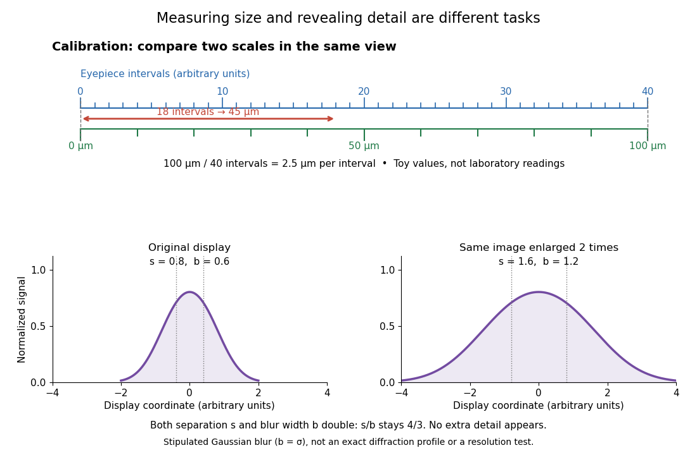

**[Figure 8](#image-microscope-scale-calibration-measures-length-empty-magnification-only-enlarges-an-existing-image). Microscope scale calibration measures length; empty magnification only enlarges an existing image**. Original upper-panel toy alignment: $100\,\mathrm{\mu m}$ spans forty eyepiece intervals, so eighteen intervals represent $45\,\mathrm{\mu m}$. Lower panels show the same stipulated blurred two-source profile on two display scales; both feature separation and blur expand together. A Gaussian illustration is used for legibility, not as a measured profile or an exact [Airy disk](point-spread-function.md#airy-disk).

For a recorded [real image](optics.md#real-image), image a [stage micrometer](#stage-micrometer) at the same capture settings to calibrate [length](physics.md#length) per [detector pixel](#optical-detector-pixel). Resizing changes [length](physics.md#length) per [pixel](computer-graphics.md#pixel); update the scale bar accordingly. Eye-viewing [angular magnification](optics.md#angular-magnification) alone supplies no digital image scale.[Linear Measurements (Micrometry), Conclusions, digital images acquired at identical pixel resolution](physics-bibliography.md#linear-measurements-micrometry-by-thomas-j-fellers-and-michael-w-davidson)

#### Ocular micrometer

↑ **Parent:** [Microscope scale calibration](#microscope-scale-calibration)  
ⓦ [Wiki](https://en.wikipedia.org/wiki/Ocular_micrometer)

A ruled scale viewed together with the [intermediate microscope image](#intermediate-microscope-image). Its intervals acquire specimen [length](physics.md#length) units through [microscope scale calibration](#microscope-scale-calibration).

#### Stage micrometer

↑ **Parent:** [Microscope scale calibration](#microscope-scale-calibration)

A specimen-stage reference bearing a scale of known [length](physics.md#length), imaged through the [microscope objective](#microscope-objective) during [microscope scale calibration](#microscope-scale-calibration).

### Empty magnification

↑ **Parent:** [Optical microscope](#optical-microscope)

[Empty magnification](#empty-magnification) enlarges an image without revealing additional specimen detail. Adequate [angular magnification](optics.md#angular-magnification) can make existing detail visible to the eye, but it cannot undo the objective's [diffraction](quantum-scattering.md#diffraction) blur. For equally bright, mutually incoherent [optical point sources](point-spread-function.md#optical-point-source) and an ideal circular [optical pupil](optics.md#optical-pupil), a commonly used lateral [Rayleigh criterion](point-spread-function.md#rayleigh-criterion) in object space is

$$
d_{\rm R}\simeq\frac{0.61\lambda}{\mathrm{NA}},\qquad \mathrm{NA}=n\sin\alpha,
$$

where $\lambda$ is the vacuum [wavelength](wave-equation.md#wavelength), $n$ is the specimen-medium [refractive index](electromagnetic-wave.md#refractive-index), and $\alpha$ is the admitted half-[angle](geometry-and-topology.md#angle). For this model, $\lambda=550\,\mathrm{nm}$ and $\mathrm{NA}=0.25$ give $d_{\rm R}\simeq1.342\,\mathrm{\mu m}$; changing only [numerical aperture](point-spread-function.md#numerical-aperture) to $0.50$ gives $0.671\,\mathrm{\mu m}$. Changing only the eyepiece leaves this object-space scale unchanged. Illumination, [optical coherence](physical-optics.md#optical-coherence), [optical aberrations](geometrical-optics.md#optical-aberration) and specimen visibility matter in real instruments; this criterion is not a universal threshold.[Formula 2, discussion after Formulas 1–3 and final resolving-power paragraph](physics-bibliography.md#resolution-by-michael-w-davidson)

The geometric reason is especially simple. If a fixed recorded image is enlarged by a factor $q>0$, a feature separation $s$ and a blur width $b$ become $qs$ and $qb$. Their ratio remains

$$
\frac{qs}{qb}=\frac{s}{b}.
$$

This is the lower-panel construction in the diagram. A change to the [microscope objective](#microscope-objective) can change [numerical aperture](point-spread-function.md#numerical-aperture) and hence the specimen detail captured; a display zoom changes how large that captured detail looks. [Microscope scale calibration](#microscope-scale-calibration), [diffraction-limited resolution](point-spread-function.md#diffraction-limited-resolution) and [angular magnification](optics.md#angular-magnification) are three complementary properties to report.

### Differential interference contrast microscopy

↑ **Parent:** [Optical microscope](#optical-microscope)  
ⓦ [Wiki](https://en.wikipedia.org/wiki/Differential_interference_contrast_microscopy)

### Phase-contrast microscopy

↑ **Parent:** [Optical microscope](#optical-microscope)  
ⓦ [Wiki](https://en.wikipedia.org/wiki/Phase-contrast_microscopy)

[Phase-contrast microscopy](#phase-contrast-microscopy) converts specimen-dependent [phase differences](wave.md#phase-difference) into visible [light intensity](wave.md#light-intensity) differences. It can reveal structures in living, unstained [biological cells](biological-cell.md), allowing their changes to be followed without first making an absorbing preparation.[Opening description of the phase-contrast microscope and biological motivation](physics-bibliography.md#phase-contrast-microscope-by-university-of-groningen) The key question is how an [optical microscope](#optical-microscope) can read a [phase](wave.md#phase-waves) when an ordinary detector records [light intensity](wave.md#light-intensity).

Consider a transparent specimen with [complex amplitude](wave.md#complex-amplitude) transmission $t(x,y)=e^{i\phi(x,y)}$. In ideal in-focus [coherent imaging](point-spread-function.md#coherent-imaging) with all relevant [spatial frequencies](fourier-analysis.md#spatial-frequency) transmitted, its image has $I=|t|^2=1$: varying $\phi$ alone produces no brightness detail. This is a particular model, not a claim that all transparent specimens are invisible. [Diffraction](quantum-scattering.md#diffraction), defocus, [absorption](radiometry.md#absorption-electromagnetic-radiation) and a finite [optical pupil](optics.md#optical-pupil) can already change a real image.

A [phase-contrast microscope](#phase-contrast-microscope) images an illuminating annulus onto a [phase plate](#phase-plate) ring near the objective's rear [focal plane](#focal-plane). The aligned ring attenuates and shifts direct light relative to most diffracted light; their [interference](physical-optics.md#interference-wave-propagation) changes image brightness.[Figure 1; Phase Plates and Phase Annuli](physics-bibliography.md#introduction-to-phase-contrast-microscopy-by-nikon-instruments-inc)

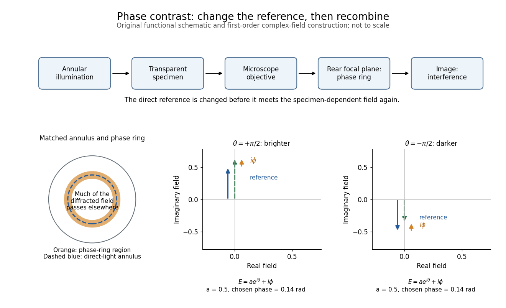

**[Figure 9](#image-separating-the-reference-light-before-recombining-the-image). Separating the reference light before recombining the image**. Original functional diagram of [phase-contrast microscopy](#phase-contrast-microscopy). The annulus and ring indicate their optical correspondence, not an exact ray prescription. The lower [complex amplitude](wave.md#complex-amplitude) construction uses the original [weak phase object](#weak-phase-object) model below, with chosen positive specimen [phase](wave.md#phase-waves) and two opposite quarter-cycle reference shifts.

The method is beautiful because the bright direct beam becomes its own reference: a small specimen-dependent [complex amplitude](wave.md#complex-amplitude) can interfere with it and change the image at first order. Merely magnifying an invisible [phase](wave.md#phase-waves) pattern would leave $|t|^2$ unchanged.

#### Phase-contrast microscope

↑ **Parent:** [Phase-contrast microscopy](#phase-contrast-microscopy)

An [optical microscope](#optical-microscope) configured for [phase-contrast microscopy](#phase-contrast-microscopy).

#### Phase object

↑ **Parent:** [Phase-contrast microscopy](#phase-contrast-microscopy)

A specimen whose leading optical effect is a spatially varying [phase](wave.md#phase-waves), rather than [absorption](radiometry.md#absorption-electromagnetic-radiation). A thin specimen with [refractive index](electromagnetic-wave.md#refractive-index) $n_s$ in a medium of [refractive index](electromagnetic-wave.md#refractive-index) $n_m$ has, in a straight-path approximation,

$$
\phi(x,y)=\frac{2\pi}{\lambda}\int\bigl(n_s(x,y,z)-n_m\bigr)\,dz.
$$

Here $\lambda$ is the vacuum [wavelength](wave-equation.md#wavelength); the integral is an [optical path length](physical-optics.md#optical-path-length) difference. For the chosen values $\lambda=550\,\mathrm{nm}$, thickness $1\,\mathrm{\mu m}$ and $n_s-n_m=0.005$, the [phase](wave.md#phase-waves) is $\pi/55\simeq0.0571$ radians. This calculation does not identify thickness separately from [refractive index](electromagnetic-wave.md#refractive-index) contrast.[Formulas 2–4, optical path difference and phase shift](physics-bibliography.md#introduction-to-phase-contrast-microscopy-by-nikon-instruments-inc)

##### Weak phase object

↑ **Parent:** [Phase object](#phase-object)

A [phase object](#phase-object) for which the relevant relative [phase](wave.md#phase-waves) variations are much smaller than one radian. The [Taylor expansion](calculus.md#taylor-expansion) $e^{i\phi}=1+i\phi+O(\phi^2)$ separates a direct reference term from a small specimen term. A constant overall [phase](wave.md#phase-waves) can be removed before making this approximation: [phase-contrast microscopy](#phase-contrast-microscopy) measures spatial variations, not an absolute common [phase](wave.md#phase-waves).

#### Phase plate

↑ **Parent:** [Phase-contrast microscopy](#phase-contrast-microscopy)

An [optical filter](#optical-filter) that changes selected light's [phase](wave.md#phase-waves) relative to other transmitted light. In [phase-contrast microscopy](#phase-contrast-microscopy), its ring can also attenuate the direct reference; the [amplitude](wave.md#wave-amplitude) transmission and [light intensity](wave.md#light-intensity) transmission must be distinguished. An amplitude transmission $a=1/2$ gives an intensity transmission $a^2=1/4$.

#### Coherent zero-mode model of phase contrast

↑ **Parent:** [Phase-contrast microscopy](#phase-contrast-microscopy)

The following original model isolates the conversion mechanism. Use a periodic image window, unit illumination, ideal unit [magnification](optics.md#magnification), and a [phase plate](#phase-plate) that changes only the zero [spatial frequency](fourier-analysis.md#spatial-frequency). Write $c_0=\langle e^{i\phi}\rangle$ for the spatial [mean](expected-value.md). Multiplying that single [Fourier coefficient](fourier-series.md#fourier-coefficient) by $a e^{i\theta}$, with $0<a\leq1$, gives the exact image field in this model:

$$
E_{\rm out}=e^{i\phi}+(a e^{i\theta}-1)c_0,
\qquad I_{\rm out}=|E_{\rm out}|^2.
$$

This formula follows by splitting $e^{i\phi}=c_0+(e^{i\phi}-c_0)$: the second term has zero [mean](expected-value.md) and is left unchanged. A real annular, partly coherent instrument alters a finite band of directions, so this calculation is a mechanism model rather than its full image-formation law.

For a [weak phase object](#weak-phase-object) with $\langle\phi\rangle=0$, one has $c_0=1+O(\phi^2)$ and hence

$$
E_{\rm out}=a e^{i\theta}+i\phi+O(\phi^2),\qquad
\boxed{I_{\rm out}=a^2+2a\phi\sin\theta+O(\phi^2).}
$$

The cross term is $2\operatorname{Re}(a e^{-i\theta}i\phi)=2a\phi\sin\theta$. Thus $\theta=\pi/2$ makes positive $\phi$ brighter and $\theta=-\pi/2$ makes it darker under this stated [phase convention for complex amplitudes](wave.md#phase-convention-for-complex-amplitudes). The sign comes from this convention and chosen plate; a manufacturer’s positive/negative contrast labels should not be inferred from the sign of $\theta$ alone.

For example, choose $a=0.5$ and a zero-mean periodic pattern whose peak [phase](wave.md#phase-waves) is $0.084$. The first-order peak intensities are $0.25\pm0.084$, compared with the uniform ideal [bright-field microscopy](#bright-field-microscopy) value $1$. The relative change about the reduced background is approximately $2\phi/a$ for a quarter-cycle shift. Attenuating the reference increases relative contrast while reducing the background photon count; it is not light amplification or a universal improvement of [signal-to-noise ratio](electrical-engineering.md#signal-to-noise-ratio).

**[Figure 10](#image-making-a-transparent-periodic-phase-pattern-visible). Making a transparent periodic phase pattern visible**. Original calculation for $\phi(x,y)=0.06[\cos(2\pi x)+0.4\cos(2\pi y)]$ on a unit periodic window and $a=0.5$. The specimen pattern is synthetic, not a cell photograph. The top row compares ideal [bright-field microscopy](#bright-field-microscopy) and the exact [coherent zero-mode model of phase contrast](#coherent-zero-mode-model-of-phase-contrast); brightness is shown relative to the empty-field value for each mode. Lower plots compare exact and first-order results along $y=0$ and as the reference [phase](wave.md#phase-waves) changes at the pattern maximum. These are calculations, not historical observations.

Two checks expose what the model can and cannot measure. A spatially constant [phase](wave.md#phase-waves) gives $E_{\rm out}=a e^{i\theta}e^{i\phi}$ and $I_{\rm out}=a^2$, so no absolute [phase](wave.md#phase-waves) is recovered. Orthogonality of the constant and zero-mean parts also gives

$$
\langle I_{\rm out}\rangle=1-(1-a^2)|c_0|^2.
$$

For $a\leq1$ this cannot exceed the incident mean [light intensity](wave.md#light-intensity). The image redistributes brightness and loses some reference light rather than creating energy.

#### Phase-contrast image artifacts

↑ **Parent:** [Phase-contrast microscopy](#phase-contrast-microscopy)

A finite [phase plate](#phase-plate) also intercepts diffracted light, altering low [spatial frequencies](fourier-analysis.md#spatial-frequency). Halos and shade-off can therefore mimic borders or obscure interiors.[Interpretation of Phase Contrast Images, halo and shade-off](physics-bibliography.md#introduction-to-phase-contrast-microscopy-by-nikon-instruments-inc) In the [coherent zero-mode model of phase contrast](#coherent-zero-mode-model-of-phase-contrast), the separation is perfect by assumption, so that model cannot predict those artifacts.

<h4 id="zernike-s-discovery-of-phase-contrast">Zernike's discovery of phase contrast</h4>

↑ **Parent:** [Phase-contrast microscopy](#phase-contrast-microscopy)

[Frits Zernike](physicist.md#frits-zernike) traced the idea to unwanted companion lines of a [diffraction grating](physical-optics.md#diffraction-grating). Around 1930 he found that visible striping disappeared when a telescope focused exactly on the grating. A phase strip placed over the principal spectral line changed its relation to the companion light and restored contrast. He then applied the separation of direct and diffracted light to a microscope and demonstrated it at Zeiss in 1932.[How I discovered phase contrast, pp. 239–243: grating observations, phase strips and microscope demonstration](physics-bibliography.md#how-i-discovered-phase-contrast-by-frits-zernike)

His later absorbing and annular strips improved contrast and the appearance of halos; commercial Zeiss accessories followed in 1941.[How I discovered phase contrast, pp. 245–246: absorbing strips, annular strips and commercial production](physics-bibliography.md#how-i-discovered-phase-contrast-by-frits-zernike) The route from a grating defect to biological observation illustrates why apparently unwanted instrumental effects can be productive experimental clues.

### Bright-field microscopy

↑ **Parent:** [Optical microscope](#optical-microscope)

Transmitted-light imaging with an [optical microscope](#optical-microscope) in which the directly transmitted illumination contributes the bright background. An absorbing specimen can reduce that background locally. The ideal lossless [phase object](#phase-object) calculation in [coherent zero-mode model of phase contrast](#coherent-zero-mode-model-of-phase-contrast) shows why ordinary brightness detection need not reveal every optical variation.

<h3 id="kohler-illumination">Köhler illumination</h3>

↑ **Parent:** [Optical microscope](#optical-microscope)  
ⓦ [Wiki](https://en.wikipedia.org/wiki/Köhler_illumination)

### Dark-field microscopy

↑ **Parent:** [Optical microscope](#optical-microscope)  
ⓦ [Wiki](https://en.wikipedia.org/wiki/Dark-field_microscopy)

## Ronchi ruling

↑ **Parent:** [Optical instrument](optical-instrument.md)

A [Ronchi ruling](#ronchi-ruling) is a grating of alternating transparent and opaque parallel bands. A known band spacing can calibrate the scale of an [optical microscope](#optical-microscope) image.

## Collimator

↑ **Parent:** [Optical instrument](optical-instrument.md)  
ⓦ [Wiki](https://en.wikipedia.org/wiki/Collimator)

A collimator turns light from a source near its focus into a nearly parallel beam. A slit of width $x$ produces an angular width approximately $x/f$, where $f$ is the [focal length](geometrical-optics.md#focal-length).

### Collimation

↑ **Parent:** [Collimator](#collimator)

Restricting the range of directions in a stream of [light](optics.md#light), [chemical atoms](physics.md#atom-physics) or [electrons](physics.md#electron), for example using a [collimator](#collimator).

## Spectrometer

↑ **Parent:** [Optical instrument](optical-instrument.md)  
ⓦ [Wiki](https://en.wikipedia.org/wiki/Spectrometer)

### Electron spectrometer

↑ **Parent:** [Spectrometer](#spectrometer)

An [electron spectrometer](#electron-spectrometer) measures an [electron](physics.md#electron) [energy](energy.md) distribution. A [time of flight](particle-detection.md#time-of-flight) design infers [kinetic energy](energy.md#kinetic-energy) from calibrated travel times.

### Electron energy analyzer

↑ **Parent:** [Spectrometer](#spectrometer)

An [electron energy analyzer](#electron-energy-analyzer) selects [electrons](physics.md#electron) by [kinetic energy](energy.md#kinetic-energy), allowing their count rate to be recorded as an [energy](energy.md) scan.

### Magnetic spectrometer

↑ **Parent:** [Spectrometer](#spectrometer)

A [spectrometer](#spectrometer) that selects [charged particles](electric-charge.md#charged-particle) using the bending of their trajectories in a [magnetic field](magnetic-field.md). For a uniform [magnetic field](magnetic-field.md) of magnitude $B$, the perpendicular [momentum](momentum.md) component is $p_\perp=|q|Br$, where $q$ is the [electric charge](electric-charge.md) and $r$ is the curvature [radius](topology.md#radius) of the projected trajectory.

### Fourier transform spectroscopy

↑ **Parent:** [Spectrometer](#spectrometer)  
ⓦ [Wiki](https://en.wikipedia.org/wiki/Fourier_transform_spectroscopy)

Fourier transform spectroscopy measures an interferogram as a function of [optical path length](physical-optics.md#optical-path-length) difference. Its [Fourier transform](fourier-transform.md) recovers the spectrum. An imaging implementation obtains an interferogram at every detector pixel, but a scanned cube is not simultaneous at all wavelengths.

#### Interferogram apodization

↑ **Parent:** [Fourier transform spectroscopy](#fourier-transform-spectroscopy)

Multiplying a finite [interferogram](physical-optics.md#interferogram) by a smooth window reduces sharp-edge artifacts. In the recovered [radiation spectrum](electromagnetic-radiation.md#radiation-spectrum) this convolves the true [spectral density](time-series.md#spectral-density-of-a-stationary-process) with the window's [Fourier transform](fourier-transform.md). Smoother windows generally lower sidelobes while broadening the main lobe, so a resolution figure must specify the window and criterion. Apodization does not recover unmeasured long-delay information.[chapter 14, printed pp.57–62, and chapter 15: sidelobe/resolution tradeoff](physics-bibliography.md#introduction-to-fourier-transform-spectroscopy-by-julius-cohen)

#### Interferogram of an equally spaced spectral multiplet

↑ **Parent:** [Fourier transform spectroscopy](#fourier-transform-spectroscopy)

For $N$ equally intense spectral lines at $\omega_n=\omega_0+n\Delta\omega$, sum their delayed self-correlations as a [geometric series](sequence-and-series.md#geometric-series). The result is

$$
g^{(1)}(\tau)=e^{-i[\omega_0+(N-1)\Delta\omega/2]\tau}
\frac{\sin(N\Delta\omega\tau/2)}{N\sin(\Delta\omega\tau/2)}.
$$

The [interferometric visibility](physical-optics.md#interferometric-visibility) revives every $T=2\pi/\Delta\omega$. There are $N-1$ zeros between adjacent revivals, at $\tau=jT/N$ for $j=1,\ldots,N-1$. The removable singularity at a revival has unit modulus. Revival spacing fixes line spacing; the internal zero count fixes $N$ under the equal-intensity model. The interferogram alone does not establish a fixed relative phase between the source lines or prove the emission is a coherent pulse train.

#### Delay-range resolution in Fourier transform spectroscopy

↑ **Parent:** [Fourier transform spectroscopy](#fourier-transform-spectroscopy)

A [Michelson interferometer](physical-optics.md#michelson-interferometer) mirror displacement $x$ changes round-trip [optical path difference](physical-optics.md#optical-path-difference) by $2x$, giving delay $\tau=2x/c$. An interferogram recorded over a finite delay range is multiplied by a window; the recovered spectrum is the true spectrum convolved with that window's [Fourier transform](fourier-transform.md). Its characteristic [frequency](wave.md#frequency) resolution scales inversely with delay range. Consequently a mirror travel range $L$ gives $\delta\nu\propto c/L$ and $\delta\lambda\simeq(\lambda^2/c)\delta\nu\propto\lambda^2/L$. Numerical width factors depend on the scan definition, window and resolution criterion; the inverse-travel scaling does not.

### Spectrograph

↑ **Parent:** [Spectrometer](#spectrometer)

A spectrograph records the [optical spectrum](optics.md#optical-spectrum) dispersed by an instrument. Its [spectral resolving power](#spectral-resolving-power) describes which nearby wavelengths it separates.

#### Spectrophotometry

↑ **Parent:** [Spectrograph](#spectrograph)

[Spectrophotometry](#spectrophotometry) measures received [light](optics.md#light) as a function of [wavelength](wave-equation.md#wavelength), accounting for the instrument's [wavelength](wave-equation.md#wavelength)-dependent response.

##### Cuvette

↑ **Parent:** [Spectrophotometry](#spectrophotometry)  
ⓦ [Wiki](https://en.wikipedia.org/wiki/Cuvette)

A sample holder providing a defined geometric light path through a [chemical solution](mixture.md#solution-chemistry) for [spectrophotometry](#spectrophotometry), as in the [trypsin colorimetric assay](enzyme.md#trypsin-colorimetric-assay).

##### Spectrophotometer

↑ **Parent:** [Spectrophotometry](#spectrophotometry)

A [spectrophotometer](#spectrophotometer) measures [radiant power](radiometry.md#radiant-flux) in selected [wavelength](wave-equation.md#wavelength) bands. Comparing a [chemical solution](mixture.md#solution-chemistry) in a [cuvette](#cuvette) with a [reference blank](physical-chemistry.md#reference-blank) gives [transmittance](radiometry.md#transmittance) and [absorbance](physical-chemistry.md#absorbance).

#### Spectral resolution element

↑ **Parent:** [Spectrograph](#spectrograph)

A [spectral resolution element](#spectral-resolution-element) is a spectral interval at the adopted instrumental resolution. At [spectral resolving power](#spectral-resolving-power) $R$, its width is $\Delta\lambda=\lambda/R$. The number of [photodetector](#photodetector) [detector pixels](#optical-detector-pixel) sampling it is distinct from $R$.

#### Linear spectral dispersion

↑ **Parent:** [Spectrograph](#spectrograph)

[Linear spectral dispersion](#linear-spectral-dispersion) is the derivative of the [photodetector](#photodetector) coordinate in the dispersion direction with respect to [wavelength](wave-equation.md#wavelength). Near the [optical axis](geometrical-optics.md#optical-axis), $q=f_{\rm cam}\,d\beta/d\lambda$.

#### Integral field spectrograph

↑ **Parent:** [Spectrograph](#spectrograph)

An integral field spectrograph records a spectrum for each of many spatial elements across a two-dimensional field, producing a [spectral data cube](#spectral-data-cube). Field reformatters include [lenslet arrays](#lenslet-array), [optical fibers](#optical-fiber) and [image slicers](#image-slicer).

##### Integral-field spectrograph volume scaling

↑ **Parent:** [Integral field spectrograph](#integral-field-spectrograph)

With fixed [spectral resolving power](#spectral-resolving-power), [wavelength](wave-equation.md#wavelength) interval, [diffraction grating](physical-optics.md#diffraction-grating) geometry, [photodetector](#photodetector) sampling and [collimator](#collimator) [focal ratio](#focal-ratio), a beam [diameter](topological-analysis.md#diameter) scales as the [spaxel](#spaxel) width $\theta$, but the [optical camera](#optical-camera) [focal length](geometrical-optics.md#focal-length) stays fixed. A simple on-axis beam-envelope model therefore gives [collimator](#collimator) and disperser volumes proportional to $\theta^3$ and [optical camera](#optical-camera) volume proportional to $\theta^2$. With a fixed number of [spaxels](#spaxel) per [photodetector](#photodetector), replication multiplies these volumes by $M\propto\theta^{-2}$. A fixed [photodetector](#photodetector) field adds transverse clearances and changes the small-$\theta$ limit; these exponents are not universal mechanical-volume laws.

##### Spaxel

↑ **Parent:** [Integral field spectrograph](#integral-field-spectrograph)

A [spaxel](#spaxel) is one spatial sampling element in a [spectral data cube](#spectral-data-cube). For a square field of angular side $\beta$ sampled at angular side $\theta$, the number of [spaxels](#spaxel) is $(\beta/\theta)^2$, before edge rounding.

##### Image slicer

↑ **Parent:** [Integral field spectrograph](#integral-field-spectrograph)

An image slicer divides a two-dimensional image into narrow strips and optically rearranges them into a long pseudo-slit. A [spectrograph](#spectrograph) then disperses each strip while preserving its position along the slit.

##### Spectral data cube

↑ **Parent:** [Integral field spectrograph](#integral-field-spectrograph)

A spectral data cube stores intensity $I(x,y,\lambda)$ with two spatial coordinates and one spectral coordinate. The third coordinate is [wavelength](wave-equation.md#wavelength), not an additional spatial dimension.

#### Spectral resolving power

↑ **Parent:** [Spectrograph](#spectrograph)

Spectral resolving power is $R=\lambda/\Delta\lambda$, where $\Delta\lambda$ is the wavelength separation just resolved under the specified instrumental and source conditions.

#### Cross-dispersed echelle spectrograph

↑ **Parent:** [Spectrograph](#spectrograph)

A cross-dispersed echelle spectrograph uses an [echelle grating](physical-optics.md#echelle-grating) for strong dispersion and a [cross-disperser](#cross-disperser) in the perpendicular direction to separate overlapping [diffraction orders](physical-optics.md#diffraction-order). It records many orders simultaneously in an echellogram.

##### Cross-disperser

↑ **Parent:** [Cross-dispersed echelle spectrograph](#cross-dispersed-echelle-spectrograph)

A cross-disperser is a second dispersing element, often an [optical prism](geometrical-optics.md#prism-optics) or [diffraction grating](physical-optics.md#diffraction-grating), oriented to separate [optical spectra](optics.md#optical-spectrum) perpendicular to their principal dispersion direction.

##### Echellogram

↑ **Parent:** [Cross-dispersed echelle spectrograph](#cross-dispersed-echelle-spectrograph)

An echellogram is the two-dimensional detector pattern of separated [diffraction orders](physical-optics.md#diffraction-order) from a [cross-dispersed echelle spectrograph](#cross-dispersed-echelle-spectrograph).

#### Multi-object spectrograph

↑ **Parent:** [Spectrograph](#spectrograph)

A multi-object spectrograph records [optical spectra](optics.md#optical-spectrum) of many selected objects simultaneously. The main designs are [multi-slit spectrographs](#multi-slit-spectrograph) and [fiber-fed spectrographs](#fiber-fed-spectrograph). The [ESO instrumentation overview](https://www.eso.org/sci/facilities/paranal/instruments/multiobject.html) describes both arrangements.

##### Multi-slit spectrograph

↑ **Parent:** [Multi-object spectrograph](#multi-object-spectrograph)

A multi-slit spectrograph puts separate slits at target positions in the focal plane. Each slit transmits the target plus nearby sky; dispersion places its spatially resolved [optical spectrum](optics.md#optical-spectrum) on the detector.

##### Fiber-fed spectrograph

↑ **Parent:** [Multi-object spectrograph](#multi-object-spectrograph)

A fiber-fed spectrograph places [optical fibers](#optical-fiber) on selected targets and reformats their output into a common entrance slit. Dedicated sky fibers sample [sky brightness](astrophysics.md#sky-brightness). Fiber coupling, transmission, and output beam spreading affect throughput and resolution.

## Optical fiber

↑ **Parent:** [Optical instrument](optical-instrument.md)  
ⓦ [Wiki](https://en.wikipedia.org/wiki/Optical_fiber)

An [optical fiber](#optical-fiber) is a thin, flexible [electromagnetic waveguide](electromagnetic-wave.md#electromagnetic-waveguide) that carries [light](optics.md#light) along its length. In a conventional [step-index optical fiber](#step-index-optical-fiber), an [optical fiber core](#optical-fiber-core) with [refractive index](electromagnetic-wave.md#refractive-index) $n_1$ is surrounded by an [optical fiber cladding](#optical-fiber-cladding) with lower [refractive index](electromagnetic-wave.md#refractive-index) $n_2$. Suitable [light rays](geometrical-optics.md#light-ray) remain confined by [total internal reflection](electromagnetic-wave.md#total-internal-reflection) at this interface. The cladding is an optical part of the guide, distinct from its protective coating.[Introduction to Optical Fibers, dB, Attenuation and Measurements, Optical Fiber Structure, Fig. 1](physics-bibliography.md#introduction-to-optical-fibers-db-attenuation-and-measurements-by-cisco)

The useful surprise is that a transparent strand can deliver [light](optics.md#light) around a route that a free beam would leave. This makes [optical fibers](#optical-fiber) useful for communications and for carrying collected [light](optics.md#light) to a [fiber-fed spectrograph](#fiber-fed-spectrograph). Guidance, successful launch, and surviving [optical power](geometrical-optics.md#optical-power) are separate questions: the [optical fiber acceptance angle](#optical-fiber-acceptance-angle) constrains launch geometry, while [optical fiber attenuation](#optical-fiber-attenuation) describes loss along the route.

### Fiber Bragg grating

↑ **Parent:** [Optical fiber](#optical-fiber)

### Optical fiber purity and low-loss transmission

↑ **Parent:** [Optical fiber](#optical-fiber)

Guiding [light](optics.md#light) and retaining useful [optical power](geometrical-optics.md#optical-power) are different achievements. [Charles Kuen Kao](electrical-engineering.md#charles-kuen-kao) and [George Alfred Hockham](electrical-engineering.md#george-alfred-hockham) argued that impurities need not impose the measured losses of existing [glasses](chemical-substance.md#glass) on every future [optical fiber](#optical-fiber). Their 1966 paper treats [wave absorption](wave.md#wave-absorption), [scattering of light](optics.md#scattering-of-light) and guidance separately; reducing impurity absorption leaves intrinsic material losses and geometric losses to address. This was a route toward practical communication, building on existing [optical fibers](#optical-fiber), rather than the invention of every use of guided [light](optics.md#light).[pp. 1152–1154, §§3.1–4.2; p. 1158, §7](physics-bibliography.md#dielectric-fibre-surface-waveguides-for-optical-frequencies-by-charles-kuen-kao-and-george-alfred-hockham)

The launch experiment used clad [glass](chemical-substance.md#glass) [optical fibers](#optical-fiber) fixed in capillary tubes with epoxy for end polishing. [Laser](laser.md) illumination gave transverse [normal mode](wave-equation.md#normal-mode) patterns; input-spot displacement and [polarization of an electromagnetic wave](electromagnetic-wave.md#polarization-of-an-electromagnetic-wave) controlled excitation. These observations tested guidance, not kilometre-scale [optical fiber attenuation](#optical-fiber-attenuation).[pp. 1157–1158, §6.2, Fig. 15, Table 2](physics-bibliography.md#dielectric-fibre-surface-waveguides-for-optical-frequencies-by-charles-kuen-kao-and-george-alfred-hockham)

[Charles Kuen Kao](electrical-engineering.md#charles-kuen-kao)'s lecture describes the complementary material experiment: short, polished [glass](chemical-substance.md#glass) samples, including plasma-deposited fused [silicon dioxide](chemical-substance.md#silicon-dioxide), were examined with purpose-built single-beam and later double-beam [spectrophotometers](#spectrophotometer). A separate [ellipsometry](optics.md#ellipsometry) measurement assessed end-surface [specular reflection](optics.md#specular-reflection), a check against confusing interface loss with bulk [wave absorption](wave.md#wave-absorption). The readout was loss versus [wavelength](wave-equation.md#wavelength). Comparing [glass](chemical-substance.md#glass) samples supported impurity reduction as a route to lower loss. Surface contamination and the tiny bulk loss of short samples limited inference; the result did not itself demonstrate a long drawn [optical fiber](#optical-fiber). The lecture also credits subsequent manufacturing work at Corning.[Published 2010 version of the 2009 lecture, p. 2302, §V, short-sample measurements, ellipsometer and later fiber manufacture](physics-bibliography.md#nobel-lecture-sand-from-centuries-past-send-future-voices-fast-by-charles-kuen-kao)

An original scale comparison makes the material problem tangible. In the uniform [optical fiber attenuation](#optical-fiber-attenuation) model, a stipulated $20\,\mathrm{dB/km}$ leaves $10^{-2}=0.01$ of launched [optical power](geometrical-optics.md#optical-power) after $1\,\mathrm{km}$; a stipulated $0.2\,\mathrm{dB/km}$ leaves $10^{-0.02}\simeq0.95499$. Both guides could satisfy the same [total internal reflection](electromagnetic-wave.md#total-internal-reflection) condition. A successful spot pattern at the output therefore cannot by itself establish a useful communication distance.

### Step-index optical fiber

↑ **Parent:** [Optical fiber](#optical-fiber)

A [step-index optical fiber](#step-index-optical-fiber) has a nearly uniform [refractive index](electromagnetic-wave.md#refractive-index) $n_1$ throughout its [optical fiber core](#optical-fiber-core), with an abrupt decrease to $n_2<n_1$ in its [optical fiber cladding](#optical-fiber-cladding). In a straight, ideal guide, [meridional rays](geometrical-optics.md#meridional-ray) stay in a plane containing the [optical axis](geometrical-optics.md#optical-axis) and trace a zigzag through repeated [total internal reflection](electromagnetic-wave.md#total-internal-reflection). This is a [geometrical optics](geometrical-optics.md) approximation; it is particularly useful for a [multimode optical fiber](#multimode-optical-fiber) whose core diameter is large compared with the [wavelength](wave-equation.md#wavelength).

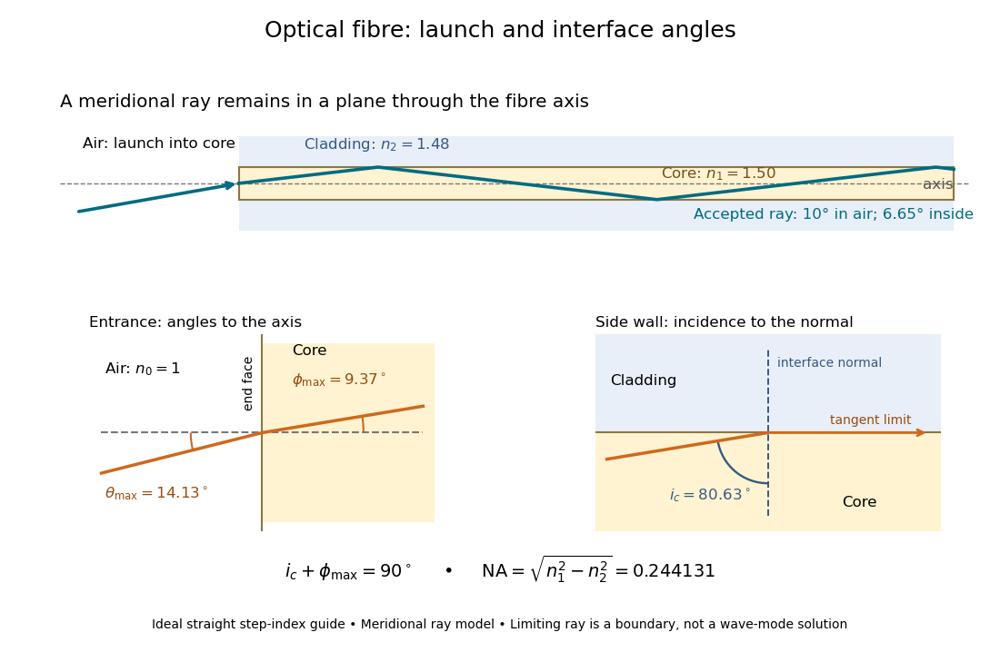

**[Figure 11](#image-launch-angle-to-the-axis-and-incidence-angle-to-the-core-cladding-normal). Launch angle to the axis and incidence angle to the core–cladding normal**.

The upper panel shows an accepted [meridional ray](geometrical-optics.md#meridional-ray); the lower panel enlarges the limiting geometry. The [angle of incidence](optics.md#angle-of-incidence) $i$ at the side wall is measured from its [normal vector](differential-geometry.md#normal-vector), whereas the internal ray [angle](geometry-and-topology.md#angle) $\phi$ and external launch [angle](geometry-and-topology.md#angle) $\theta$ are measured from the [optical axis](geometrical-optics.md#optical-axis). Thus $i+\phi=90^\circ$. The limiting ray is a boundary of the ideal model, rather than a complete [normal mode](wave-equation.md#normal-mode) solution.

#### Optical fiber acceptance angle

↑ **Parent:** [Step-index optical fiber](#step-index-optical-fiber)

The [optical fiber acceptance angle](#optical-fiber-acceptance-angle) is the largest launch half-[angle](geometry-and-topology.md#angle) admitted by the specified guide model. For a flat entrance face perpendicular to the [optical axis](geometrical-optics.md#optical-axis), external [refractive index](electromagnetic-wave.md#refractive-index) $n_0$, and a straight [step-index optical fiber](#step-index-optical-fiber), [Snell's law](partial-differential-equation.md#snell-s-law) at the entrance gives

$$
n_0\sin\theta=n_1\sin\phi.
$$

At the core–cladding interface, the [critical angle for total internal reflection](electromagnetic-wave.md#critical-angle-for-total-internal-reflection) $i_c$ satisfies

$$
\sin i_c=\frac{n_2}{n_1},\qquad i=\frac{\pi}{2}-\phi.
$$

For a [meridional ray](geometrical-optics.md#meridional-ray), strict [total internal reflection](electromagnetic-wave.md#total-internal-reflection) requires $i>i_c$. At the limiting geometry $i=i_c$, the refracted [light ray](geometrical-optics.md#light-ray) is tangent to the interface, so

$$
n_0\sin\theta_{\max}
=n_1\cos i_c
=\sqrt{n_1^2-n_2^2}
\equiv\mathrm{NA}.
$$

This identifies the [numerical aperture](point-spread-function.md#numerical-aperture) with an entrance cone under these assumptions. With $n_0=1$ for air, the conventional inclusive boundary condition is

$$
\sin\theta\leq\sqrt{n_1^2-n_2^2},
$$

for a nonnegative launch [angle](geometry-and-topology.md#angle) $\theta$; a practical launch stays inside the boundary. If $\mathrm{NA}>n_0$, this ideal model imposes no further restriction within the forward hemisphere, and $\arcsin(\mathrm{NA}/n_0)$ must not be used. The [light ray](geometrical-optics.md#light-ray) must also intersect the [optical fiber core](#optical-fiber-core): a suitable [angle](geometry-and-topology.md#angle) alone does not correct a misplaced beam.

For an original example, take $n_1=1.50$, $n_2=1.48$ and air at the entrance. Then

$$
\mathrm{NA}=\sqrt{2.25-2.1904}=\sqrt{0.0596}\simeq0.244131,
\qquad
\theta_{\max}=\arcsin(0.244131)\simeq14.13^\circ.
$$

The internal limiting [angle](geometry-and-topology.md#angle) is only $\phi_{\max}\simeq9.37^\circ$, while the [critical angle for total internal reflection](electromagnetic-wave.md#critical-angle-for-total-internal-reflection) is $i_c\simeq80.63^\circ$. A $10^\circ$ launch has $\phi\simeq6.65^\circ$ and $i\simeq83.35^\circ$, so it satisfies [total internal reflection](electromagnetic-wave.md#total-internal-reflection). A $20^\circ$ launch has $\phi\simeq13.18^\circ$ and $i\simeq76.82^\circ$, so it fails this test.

This cone is a [geometrical optics](geometrical-optics.md) result for [meridional rays](geometrical-optics.md#meridional-ray). A [single-mode optical fiber](#single-mode-optical-fiber) requires the spatial overlap of the incident [electromagnetic wave](electromagnetic-wave.md) with its guided [normal mode](wave-equation.md#normal-mode); its [numerical aperture](point-spread-function.md#numerical-aperture) does not impose an exact angular cutoff on arbitrary beams. [Diffraction](quantum-scattering.md#diffraction), finite cladding, and bends require a [physical optics](physical-optics.md) description.[Insights into Optical Fiber, When does NA provide a good estimate of the fiber's acceptance angle?, Geometry Defines the Relationship and Single Mode Fibers are Different; revised January 20, 2020](physics-bibliography.md#when-does-na-provide-a-good-estimate-of-the-fiber-s-acceptance-angle-by-thorlabs)

### Multimode optical fiber

↑ **Parent:** [Optical fiber](#optical-fiber)

A [multimode optical fiber](#multimode-optical-fiber) supports several guided [normal modes](wave-equation.md#normal-mode) at the operating [wavelength](wave-equation.md#wavelength). Different mode populations can change its output cone, so launch conditions matter when measuring [numerical aperture](point-spread-function.md#numerical-aperture) or interpreting [focal-ratio degradation](#focal-ratio-degradation).

### Single-mode optical fiber

↑ **Parent:** [Optical fiber](#optical-fiber)

A [single-mode optical fiber](#single-mode-optical-fiber) supports only its fundamental spatial guided [normal mode](wave-equation.md#normal-mode) at the operating [wavelength](wave-equation.md#wavelength), with possible distinct states of [polarization of an electromagnetic wave](electromagnetic-wave.md#polarization-of-an-electromagnetic-wave). The designation must include [wavelength](wave-equation.md#wavelength): MIT's fibre laboratory explicitly notes that a fibre sold for single-mode operation can support several [normal modes](wave-equation.md#normal-mode) at its [helium](chemical-substance.md#helium)–[neon](chemical-substance.md#neon) [laser](laser.md) [wavelength](wave-equation.md#wavelength).[Optical Waveguides and Fibers, MIT 6.161 Modern Optics Project Laboratory, Fall 2005, Laboratory Exercise No. 7, p. 8, §7.4(a): operating-wavelength qualification](physics-bibliography.md#optical-waveguides-and-fibers-mit-6-161-laboratory-exercise)

### Graded-index optical fiber

↑ **Parent:** [Optical fiber](#optical-fiber)

A [graded-index optical fiber](#graded-index-optical-fiber) has an [optical fiber core](#optical-fiber-core) whose [refractive index](electromagnetic-wave.md#refractive-index) varies smoothly with distance from the [optical axis](geometrical-optics.md#optical-axis). [Refraction](optics.md#refraction) bends [light rays](geometrical-optics.md#light-ray) through the varying medium; the straight zigzag of a [step-index optical fiber](#step-index-optical-fiber) no longer describes their paths. The local launch cone can depend on entry position.[Fiber Holders and Force Sensors for Multi-Axis Flexure Stages, Insights into Optical Fiber, p. 4, Is the max acceptance angle constant across the core of a multimode fiber?, Figs. 3–5; revised January 2, 2019](physics-bibliography.md#fiber-holders-and-force-sensors-for-multi-axis-flexure-stages-by-thorlabs)

### Optical fiber coupling and bend experiment

↑ **Parent:** [Optical fiber](#optical-fiber)

MIT's [Optical Waveguides and Fibers](https://ocw.mit.edu/courses/6-161-modern-optics-project-laboratory-fall-2005/862b690eb7d638cd6dd5a063942902af_lab7.pdf), Laboratory Exercise No. 7 (Fall 2005), describes a teaching apparatus. A cleaned, flat-ended [multimode optical fiber](#multimode-optical-fiber) receives [helium](chemical-substance.md#helium)–[neon](chemical-substance.md#neon) [laser](laser.md) [light](optics.md#light) through a microscope objective [optical lens](geometrical-optics.md#lens-optics); a micropositioner aligns the input. The launch deliberately overfills the fibre's cone. A [beam splitter](#beam-splitter) sends a sample to a reference [photodetector](#photodetector) to track [laser](laser.md) fluctuations. The fixed output faces a screen or a [photodetector](#photodetector) on a rotation stage with angular [measurement calibration](physics.md#measurement-calibration). Readings every two degrees, divided by simultaneous reference readings, give an angular profile. Repeating with an underfilled launch is a control: too few excited [normal modes](wave-equation.md#normal-mode) underestimate [numerical aperture](point-spread-function.md#numerical-aperture). Optional index-matching fluid removes cladding-carried [light](optics.md#light). Bending the fibre reveals leakage and reduced output on an [oscilloscope](wave-equation.md#oscilloscope). The handout supplies no measured trace or absolute detector [measurement calibration](physics.md#measurement-calibration), and this angular scan does not determine loss per kilometre.[Optical Waveguides and Fibers, MIT 6.161 Modern Optics Project Laboratory, Fall 2005, Laboratory Exercise No. 7, pp. 3 and 6–7, end-face preparation, §7.3 and Fig. 1: reference-normalized angular scan, underfill control and bend test](physics-bibliography.md#optical-waveguides-and-fibers-mit-6-161-laboratory-exercise)

### Optical fiber attenuation

↑ **Parent:** [Optical fiber](#optical-fiber)

[Optical fiber attenuation](#optical-fiber-attenuation) is the reduction of transmitted [optical power](geometrical-optics.md#optical-power) along an [optical fiber](#optical-fiber). Define a positive loss in [decibels](physics.md#decibel) by comparing [optical power](geometrical-optics.md#optical-power) $P(0)$ already launched into the guide with surviving [optical power](geometrical-optics.md#optical-power) $P(z)$:

$$
A(z)=10\log_{10}\!\left(\frac{P(0)}{P(z)}\right)\,\mathrm{dB}.
$$

The factor ten applies to a [power](energy.md#power) ratio; the factor twenty applies to a [wave amplitude](wave.md#wave-amplitude) ratio only when [power](energy.md#power) is proportional to its square under the same conditions.[Introduction to Optical Fibers, dB, Attenuation and Measurements, What is a Decibel?, Base 10 Logarithm Rules and Power/Voltage Gains: attenuation convention](physics-bibliography.md#introduction-to-optical-fibers-db-attenuation-and-measurements-by-cisco)

For a uniform illustrative model with constant loss coefficient $\alpha_{\rm dB}$ in $\mathrm{dB/km}$ and distance $z$ in kilometres,

$$
A(z)=\alpha_{\rm dB}z,\qquad
\frac{P(z)}{P(0)}=10^{-A(z)/(10\,\mathrm{dB})}.
$$

For $\alpha_{\rm dB}=0.2\,\mathrm{dB/km}$ over $10\,\mathrm{km}$, the loss is $2\,\mathrm{dB}$ and

$$
\frac{P(10\,\mathrm{km})}{P(0)}=10^{-0.2}\simeq0.630957.
$$

Thus about $63.1\%$ of the launched [optical power](geometrical-optics.md#optical-power) survives and $36.9\%$ is lost. This is an illustrative coefficient, not a property of all [optical fibers](#optical-fiber), and is independent of the earlier illustrative [refractive indices](electromagnetic-wave.md#refractive-index).

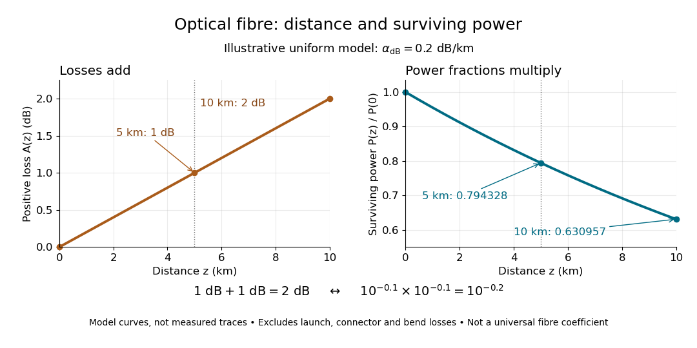

**[Figure 12](#image-equal-distance-increments-add-decibel-loss-and-multiply-surviving-power). Equal distance increments add decibel loss and multiply surviving power**.

The [exponential decay](analysis.md#exponential-decay) follows from assuming each equal distance interval transmits the same fraction. For two such intervals, [power](energy.md#power) ratios multiply; their [logarithms](calculus.md#logarithm) add, so the losses in [decibels](physics.md#decibel) add. Two $5\,\mathrm{km}$ sections each transmit $10^{-0.1}\simeq0.794328$; together they transmit $(0.794328)^2\simeq0.630957$. The loss curve is straight in [decibels](physics.md#decibel) and curved on a linear [power](energy.md#power) scale.

[Wave absorption](wave.md#wave-absorption) and [scattering of light](optics.md#scattering-of-light) can remove guided [optical power](geometrical-optics.md#optical-power) even in a straight fibre, while bends can let it escape. Entrance losses, joints and connectors contribute additional losses; they belong separately from a uniform distance coefficient. This is why a measured end-to-end [power](energy.md#power) ratio need not equal the straight-fibre model.[Introduction to Optical Fibers, dB, Attenuation and Measurements, Understand Insertion Loss and Calculate a Power Budget: joint losses, launch dependence and distance contribution](physics-bibliography.md#introduction-to-optical-fibers-db-attenuation-and-measurements-by-cisco)

#### Optical fiber cutback measurement

↑ **Parent:** [Optical fiber attenuation](#optical-fiber-attenuation)

An [optical fiber cutback measurement](#optical-fiber-cutback-measurement) estimates distributed [optical fiber attenuation](#optical-fiber-attenuation) by comparing a long guide with the short input portion left after cutting the output end back. Keep the launch untouched. For the following original functional model, fix [wavelength](wave-equation.md#wavelength), source output, input alignment and collected output cone; subtract a dark reading and keep the [photodetector](#photodetector) in its linear range. Renewed end-face quality and changed [normal mode](wave-equation.md#normal-mode) populations can still spoil the comparison. The diagram describes a measurement principle, not Kao's historical short-glass apparatus.

Let $L_\ell>L_s$ be lengths in kilometres, $P_\ell,P_s$ the corresponding positive dark-subtracted readings, and $C$ the same launch and detection factor. A uniform guide obeys

$$
P_\ell=C10^{-\alpha_{\rm dB}L_\ell/10},\qquad P_s=C10^{-\alpha_{\rm dB}L_s/10},\qquad
\widehat\alpha_{\rm dB}=\frac{10}{L_\ell-L_s}\log_{10}\!\frac{P_s}{P_\ell}.
$$

Here $\alpha_{\rm dB}$ and its estimate are numerical values in $\mathrm{dB/km}$. Dividing eliminates $C$; taking a [logarithm](calculus.md#logarithm) proves the formula. A changed $C$ instead adds an error $10\log_{10}(C_s/C_\ell)/(L_\ell-L_s)$. Reconnecting the launch between readings defeats this cancellation.

For original chosen values $L_s=0.1\,\mathrm{km}$, $L_\ell=2.1\,\mathrm{km}$, $P_s=100\,\mathrm{\mu W}$ and $\alpha_{\rm dB}=0.5\,\mathrm{dB/km}$, the predicted long reading is $P_\ell=100\,10^{-0.1}\simeq79.4328\,\mathrm{\mu W}$. The ratio gives $1\,\mathrm{dB}$ for the removed $2\,\mathrm{km}$ and hence $0.5\,\mathrm{dB/km}$.

Suppose an unremoved additive detector background contributes $b=5\,\mathrm{\mu W}$ to both readings. Then the apparent coefficient is

$$
\widetilde\alpha_{\rm dB}=\frac{10}{2}\log_{10}\!\frac{100+5}{79.4328+5}\simeq0.47339\,\mathrm{dB/km}.
$$

This is a [bias of an estimator](statistical-modelling.md#bias-of-an-estimator): a common additive background pushes the ratio toward one, whereas a common multiplicative factor cancels. For independent small zero-mean errors with [standard deviations](variance.md#standard-deviation) $\sigma_s,\sigma_\ell$ on the dark-subtracted readings, a first-order [Taylor expansion](calculus.md#taylor-expansion) gives

$$
\sigma_{\widehat\alpha}\simeq\frac{10}{(L_\ell-L_s)\ln10}\sqrt{\left(\frac{\sigma_s}{P_s}\right)^2+\left(\frac{\sigma_\ell}{P_\ell}\right)^2}.
$$

Choosing both [standard deviations](variance.md#standard-deviation) as $1\,\mathrm{\mu W}$ gives $\sigma_{\widehat\alpha}\simeq0.03491\,\mathrm{dB/km}$. A shared estimated dark offset introduces [covariance](variance.md#covariance), so it requires a different uncertainty calculation. Near zero signal, the [logarithm](calculus.md#logarithm) and this linear approximation become unreliable.

**[Figure 13](#image-optical-fiber-cutback-measurement-fixed-launch-and-additive-background-bias). Optical fiber cutback measurement: fixed launch and additive-background bias**. Original functional schematic and calculated example. The launch stays fixed while the remote end is cut back. The graph uses the stipulated powers and lengths above; it compares dark-subtracted readings with a common positive unremoved background. No plotted point is a historical measurement.

### Focal-ratio degradation

↑ **Parent:** [Optical fiber](#optical-fiber)

Focal-ratio degradation is the broadening of the output angular cone of an [optical fiber](#optical-fiber) relative to its input cone. It can make a spectrograph collimator lose transmitted light or require larger optics. Stress, bends, and mode mixing in the fiber can contribute.

### Optical fiber core

↑ **Parent:** [Optical fiber](#optical-fiber)

The central guiding region of a conventional [optical fiber](#optical-fiber); in a [step-index optical fiber](#step-index-optical-fiber), its [refractive index](electromagnetic-wave.md#refractive-index) exceeds that of the surrounding [optical fiber cladding](#optical-fiber-cladding).

### Optical fiber cladding

↑ **Parent:** [Optical fiber](#optical-fiber)

The optical material surrounding the [optical fiber core](#optical-fiber-core). In a conventional [step-index optical fiber](#step-index-optical-fiber), its lower [refractive index](electromagnetic-wave.md#refractive-index) permits [total internal reflection](electromagnetic-wave.md#total-internal-reflection); it is distinct from the protective coating.

## Adaptive optics

↑ **Parent:** [Optical instrument](optical-instrument.md)  
ⓦ [Wiki](https://en.wikipedia.org/wiki/Adaptive_optics)

Adaptive optics measures changing [wavefront errors](physical-optics.md#wavefront-error) and corrects them using a [deformable mirror](#deformable-mirror). A [wavefront sensor](#wavefront-sensor) supplies measurements to a fast feedback controller; a [guide star](#guide-star-adaptive-optics) provides the reference. It improves [astronomical seeing](optics.md#astronomical-seeing) toward [diffraction-limited resolution](point-spread-function.md#diffraction-limited-resolution).

### Deformable mirror

↑ **Parent:** [Adaptive optics](#adaptive-optics)  
ⓦ [Wiki](https://en.wikipedia.org/wiki/Deformable_mirror)

A deformable mirror changes its optical surface using an array of actuators. For reflection near normal incidence, surface displacement changes [optical path length](physical-optics.md#optical-path-length) by twice that displacement.

#### Deformable-mirror Fourier-mode counting

↑ **Parent:** [Deformable mirror](#deformable-mirror)

For actuator pitch $D/N$, full-cycle [spatial frequency](fourier-analysis.md#spatial-frequency) components are limited to $N/2$ by sampling. Integer lattice counting in a circular [frequency](wave.md#frequency) disk gives approximately $\pi N^2/4$ signed points; conjugate pairing halves the number of pairs, and two real [wave phase](wave.md#phase-waves) quadratures per pair restore approximately $\pi N^2/4$ real coefficients. Counting only positive-quadrant [frequency](wave.md#frequency) representatives gives $\pi N^2/16$, but it omits other orientations or quadratures unless a restricted convention is specified. Area approximations have boundary corrections and do not give exact integer ranks. A square sampling cutoff and a circular illuminated actuator footprint are distinct geometric restrictions.

#### Deformable-mirror control radius

↑ **Parent:** [Deformable mirror](#deformable-mirror)

With $N$ actuators across diameter $D$, the projected pitch is approximately $D/N$. The [Nyquist spatial frequency](fourier-analysis.md#nyquist-spatial-frequency) is $N/(2D)$, so the largest correctable angular speckle displacement along an actuator row is $N\lambda/(2D)$. A square actuator array gives a square ideal spatial-frequency region. See the [Bordé–Traub wavefront-control derivation](https://arxiv.org/abs/astro-ph/0510597).

### Wavefront sensor

↑ **Parent:** [Adaptive optics](#adaptive-optics)  
ⓦ [Wiki](https://en.wikipedia.org/wiki/Wavefront_sensor)

A wavefront sensor measures information from which a [wavefront error](physical-optics.md#wavefront-error) can be reconstructed. For example, a [Shack–Hartmann wavefront sensor](#shack-hartmann-wavefront-sensor) measures local wavefront slopes using lenslets.

<h4 id="shack-hartmann-wavefront-sensor">Shack–Hartmann wavefront sensor</h4>

↑ **Parent:** [Wavefront sensor](#wavefront-sensor)  
ⓦ [Wiki](https://en.wikipedia.org/wiki/Shack–Hartmann_wavefront_sensor)

### Guide star (adaptive optics)

↑ **Parent:** [Adaptive optics](#adaptive-optics)  
ⓦ [Wiki](https://en.wikipedia.org/wiki/Guide_star_(adaptive_optics))

A guide star provides photons for a [wavefront sensor](#wavefront-sensor). Its brightness and angular separation from the target limit [adaptive optics](#adaptive-optics) sky coverage.

#### Laser guide star

↑ **Parent:** [Guide star (adaptive optics)](#guide-star-adaptive-optics)  
ⓦ [Wiki](https://en.wikipedia.org/wiki/Laser_guide_star)

A laser guide star is an artificial atmospheric beacon for [adaptive optics](#adaptive-optics). It improves sky coverage but samples a finite-distance cone rather than the full incoming stellar beam. Conventional systems still require a natural reference for absolute image motion.

### Adaptive-optics sky coverage

↑ **Parent:** [Adaptive optics](#adaptive-optics)

Adaptive-optics sky coverage is the fraction of targets for which a sufficiently bright nearby [guide star](#guide-star-adaptive-optics) allows useful correction. [Anisoplanatism](optics.md#anisoplanatism) limits the offset, and photon statistics limit the sensing speed. A [laser guide star](#laser-guide-star) improves coverage but does not remove all low-order and finite-distance limitations.

## Optical attenuator

↑ **Parent:** [Optical instrument](optical-instrument.md)

## Monochromator

↑ **Parent:** [Optical instrument](optical-instrument.md)  
ⓦ [Wiki](https://en.wikipedia.org/wiki/Monochromator)

A [monochromator](#monochromator) selects a narrow, adjustable [wavelength](wave-equation.md#wavelength) interval from an [optical spectrum](optics.md#optical-spectrum). Its finite spectral bandwidth matters when calibrating a [photodetector](#photodetector)'s [spectral responsivity](#spectral-responsivity) in [calibrated radiant-flux measurement](radiometry.md#calibrated-radiant-flux-measurement).

## Optical power meter

↑ **Parent:** [Optical instrument](optical-instrument.md)  
ⓦ [Wiki](https://en.wikipedia.org/wiki/Optical_power_meter)

An [optical power meter](#optical-power-meter) measures collected [radiant flux](radiometry.md#radiant-flux) using a calibrated detector and readout. With a [photodiode](#photodiode), its conversion to [watts](electric-charge.md#watt) depends on [spectral responsivity](#spectral-responsivity), as in [calibrated radiant-flux measurement](radiometry.md#calibrated-radiant-flux-measurement).

## Photodetector

↑ **Parent:** [Optical instrument](optical-instrument.md)  
ⓦ [Wiki](https://en.wikipedia.org/wiki/Photodetector)

### Detector dynamic range

↑ **Parent:** [Photodetector](#photodetector)

The ratio between a stated upper usable detector signal and a lower detectable or resolvable signal under specified measurement conditions. Exposure duration, read noise, saturation, digitization and the required linearity can all affect the quoted value. It is not determined by full well capacity alone.

### Full well capacity

↑ **Parent:** [Photodetector](#photodetector)

The charge that an integrating detector well can hold within its stated operating specification before saturation or overflow compromises the response. It differs from the digitizer limit and from the largest signal that is accurately linear. In a [charge-coupled device](#charge-coupled-device), excess charge can cause blooming into adjacent pixels.

### Photon pile-up

↑ **Parent:** [Photodetector](#photodetector)

Two or more [photons](quantum-mechanics.md#photon) detected within one unresolved spatial and temporal event cell can be registered as one event, have their energies combined, or be rejected by event grading. In an X-ray [CCD](#charge-coupled-device), low mean occupancy per event island per frame is needed for reliable individual-photon [spectroscopy](physics.md#spectroscopy). Reducing frame time or spreading the image can reduce this effect.

### Vacuum photodiode

↑ **Parent:** [Photodetector](#photodetector)

A [photodetector](#photodetector) in which [light](optics.md#light) releases [electrons](physics.md#electron) from a [cathode](electrochemistry.md#cathode) into a [vacuum](physics.md#vacuum), and an [anode](electrochemistry.md#anode) collects them. A positive collecting-anode bias relative to the emitting [cathode](electrochemistry.md#cathode) drives collection across the [vacuum](physics.md#vacuum) gap.

### Bolometer

↑ **Parent:** [Photodetector](#photodetector)  
ⓦ [Wiki](https://en.wikipedia.org/wiki/Bolometer)

A [bolometer](#bolometer) detects absorbed [electromagnetic radiation](electromagnetic-radiation.md) through the resulting change in [temperature](temperature.md), often read as a change in [electrical resistance](electric-charge.md#electrical-resistance). Its response depends on absorbed [power](energy.md#power), so interpreting an [optical spectrum](optics.md#optical-spectrum) requires accounting for the incident [wavelength](wave-equation.md#wavelength) band and detector calibration.

### Spectral responsivity

↑ **Parent:** [Photodetector](#photodetector)

For a [photodiode](#photodiode) in its linear regime, [spectral responsivity](#spectral-responsivity) is the dark-subtracted [electric current](electric-charge.md#electric-current) per incident [radiant flux](radiometry.md#radiant-flux) in a narrow band at [wavelength](wave-equation.md#wavelength) $\lambda$, measured in $\mathrm{A\,W^{-1}}$. More generally a [photodetector](#photodetector)'s readout can be electrical voltage or another quantity, with corresponding units. A broad-band readout weights the incoming [optical spectrum](optics.md#optical-spectrum) by the detector's [spectral responsivity](#spectral-responsivity); it is not the unweighted total incident [power](energy.md#power). [NIST, Spectral responsivity measurements: wavelength-dependent sensitivity and spatial characterization](https://www.nist.gov/programs-projects/spectral-responsivity-measurements-and-spatial-spectral-power-responsivity).

### Detector bias frame

↑ **Parent:** [Photodetector](#photodetector)

A [photodetector](#photodetector) bias frame is an exposure of effectively zero integration [time](classical-mechanics.md#time-in-physics) used to estimate the electronic offset and [read noise](#read-noise). For independent identical bias reads, the [variance](variance.md) of their difference is twice the single-read [variance](variance.md); subtracting an estimated mean bias removes the offset but adds the uncertainty of that estimate.

### Flat-field correction

↑ **Parent:** [Photodetector](#photodetector)  
ⓦ [Wiki](https://en.wikipedia.org/wiki/Flat-field_correction)

[Flat-field correction](#flat-field-correction) compensates stable multiplicative variations in [photodetector](#photodetector) response using calibrated illumination. Identically illuminated exposure ratios cancel the stable response in their mean, but their [photon shot noise](#photon-shot-noise) remains signal dependent.

### Analogue-to-digital unit

↑ **Parent:** [Photodetector](#photodetector)

An analogue-to-digital unit is a unit of a digitized [photodetector](#photodetector) output after electronic conversion. Its relation to collected [electrons](physics.md#electron) is set by the [detector conversion gain](#detector-conversion-gain); an additive electronic offset must be removed before interpreting a count as a [light](optics.md#light) signal.

### Detector conversion gain

↑ **Parent:** [Photodetector](#photodetector)

[Detector conversion gain](#detector-conversion-gain) is the number of collected [electrons](physics.md#electron) per [analogue-to-digital unit](#analogue-to-digital-unit). With independent [Poisson distribution](discrete-probability-distribution.md#poisson-distribution) photoelectron counts, the shot-noise [variance](variance.md) in count units is the mean count divided by the gain. Detected-photon and [electron](physics.md#electron) conventions agree only when each detected [photon](quantum-mechanics.md#photon) contributes one [electron](physics.md#electron).

#### Gain estimation from flat-field ratios

↑ **Parent:** [Detector conversion gain](#detector-conversion-gain)

Let independent exposure sums $A,B$ have mean $N$ [ADU](#analogue-to-digital-unit) at each [detector pixel](#optical-detector-pixel), with pure [Poisson distribution](discrete-probability-distribution.md#poisson-distribution) noise and fixed gain $g$. The [delta method](statistical-inference.md#delta-method) gives $A/B\simeq1+(A-N)/N-(B-N)/N$, so $\operatorname{Var}(A/B)\simeq2/(gN)$ and $g\simeq2/(NE^2)$. For nonuniform [detector pixel](#optical-detector-pixel) means $N_i$, an unweighted spatial ratio [variance](variance.md) is instead $(2/g)\langle1/N_i\rangle$. This high-count approximation requires linear unsaturated data, bias subtraction and negligible [read noise](#read-noise).

##### Bias of pooled flat-field ratio gain

↑ **Parent:** [Gain estimation from flat-field ratios](#gain-estimation-from-flat-field-ratios)

For stable positive [detector pixel](#optical-detector-pixel) means $N_i$ and uniform [detector conversion gain](#detector-conversion-gain) $g$, high-count independent [Poisson distribution](discrete-probability-distribution.md#poisson-distribution) noise gives $\operatorname{Var}(A_i/B_i)\simeq2/(gN_i)$. Thus substituting a global mean in the equal-signal formula yields $g_{\rm naive}=g/[\langle N_i\rangle\langle1/N_i\rangle]\le g$, by the [Jensen inequality](real-analysis.md#jensen-s-inequality). Equality holds for uniform means. The [flat-field correction](#flat-field-correction) pattern cancels from the ratio mean but not from the signal-dependent noise. Local signal bins, or a [variance](variance.md) fit after normalization of differences by the square root of their local mean, avoid this leading bias.

### Optical detector pixel

↑ **Parent:** [Photodetector](#photodetector)

An optical [photodetector](#photodetector) [detector pixel](#optical-detector-pixel) is a spatially sampled photosensitive element. Counts from distinct [detector pixels](#optical-detector-pixel) have independent [photon shot noise](#photon-shot-noise) in the ideal model, but charge transfer, electrical coupling and resampling can produce [covariance](variance.md#covariance).

### Photodiode

↑ **Parent:** [Photodetector](#photodetector)  
ⓦ [Wiki](https://en.wikipedia.org/wiki/Photodiode)

A [photodiode](#photodiode) is a [semiconductor](semiconductor.md) [diode](electrical-circuit.md#diode) producing [photocurrent](#photocurrent) from [photon absorption](quantum-mechanics.md#photon-absorption). Exciting an [electron](physics.md#electron) across the [band gap](bloch-s-theorem.md#band-gap) leaves an [electron hole](quantum-mechanics.md#electron-hole). The [depletion region](semiconductor.md#depletion-region)'s [electric field](electric-field.md) separates the [charge carriers](electric-charge.md#charge-carrier); others can arrive by [diffusion](thermodynamics.md#diffusion) before [electron-hole recombination](quantum-mechanics.md#electron-hole-recombination). Contacts complete the [electrical circuit](electrical-circuit.md).[Si photodiodes, p. 2, §1-1 and Figs. 1-1–1-2: generation, separation and collection](physics-bibliography.md#si-photodiodes-by-hamamatsu-photonics-k-k)

The useful bridge is from [light](optics.md#light) to a measurable [electric current](electric-charge.md#electric-current): [spectral responsivity](#spectral-responsivity) converts incident [radiant flux](radiometry.md#radiant-flux) into [photocurrent](#photocurrent), while [quantum efficiency](#quantum-efficiency) counts collected signal [charge carriers](electric-charge.md#charge-carrier) per incident [photon](quantum-mechanics.md#photon). These answer different questions: how much [electric current](electric-charge.md#electric-current) one watt produces, and how many incident [photons](quantum-mechanics.md#photon) contribute to the signal. The worked calculation below makes their relationship explicit.

**[Figure 14](#image-photon-absorption-junction-separation-and-an-external-electric-current). Photon absorption, junction separation and an external electric current**. Original qualitative [p-n junction](semiconductor.md#p-n-junction) schematic with an external [resistor](electric-charge.md#resistor). Collecting one [electron](physics.md#electron)–[electron hole](quantum-mechanics.md#electron-hole) pair transfers one [elementary charge](electric-charge.md#elementary-charge) through the external [electrical circuit](electrical-circuit.md), rather than twice that amount. Dimensions and paths are schematic.

#### Balanced photodetection

↑ **Parent:** [Photodiode](#photodiode)

Subtracting two [photocurrents](#photocurrent) can suppress a shared classical intensity fluctuation when the optical responses and electronic gains are matched. Independent [shot noise](electrical-engineering.md#shot-noise) contributions do not cancel: their [variances](variance.md) add in the difference. With equal charge $q$ and mean currents $I_1,I_2$, the independent-arrival one-sided current [power spectral density](electrical-engineering.md#power-spectral-density) is $2q(I_1+I_2)$. Correlated optical inputs require their [covariance](variance.md#covariance) as well.

#### Quadrant photodiode

↑ **Parent:** [Photodiode](#photodiode)

A [photodiode](#photodiode) divided into four independently read segments. Differences of opposite segment signals can encode a light distribution's displacement after [measurement calibration](physics.md#measurement-calibration).

#### Photocurrent

↑ **Parent:** [Photodiode](#photodiode)

[Photocurrent](#photocurrent) is the [electric current](electric-charge.md#electric-current) attributable to illumination. Here $I_{\rm ph}\geq0$ denotes its magnitude after [background subtraction](#background-subtraction). For a [photodiode](#photodiode) without internal multiplication, let $P$ be incident [radiant flux](radiometry.md#radiant-flux) concentrated at [wavelength](wave-equation.md#wavelength) $\lambda$, and let $\eta$ be external [quantum efficiency](#quantum-efficiency), including losses before collection. An incident [photon](quantum-mechanics.md#photon) has [energy](energy.md) $E_\gamma=hc/\lambda$, with [Planck constant](quantum-mechanics.md#planck-constant) $h$ and [speed of light](special-relativity.md#speed-of-light) $c$. Dividing [energy](energy.md) per second by [energy](energy.md) per [photon](quantum-mechanics.md#photon) gives the incident [photon](quantum-mechanics.md#photon) rate $\Phi_\gamma$. Multiplying by $\eta$ gives the mean collected pair rate $\dot N_{\rm pair}$; multiplying by [elementary charge](electric-charge.md#elementary-charge) $q$ gives

$$
\Phi_\gamma=\frac{P\lambda}{hc},\qquad
\dot N_{\rm pair}=\eta\Phi_\gamma,\qquad
I_{\rm ph}=q\dot N_{\rm pair},\qquad
R(\lambda)=\frac{I_{\rm ph}}P=\frac{\eta q\lambda}{hc}.
$$

The factor is $q$: each collected pair replenishes an [electron](physics.md#electron) at one contact and removes an [electron](physics.md#electron) at the other. A cross-section of the external wire therefore counts one transferred [electron](physics.md#electron) per completed pair, consistent with [charge conservation](electric-charge.md#charge-conservation). The [electron](physics.md#electron) and [electron hole](quantum-mechanics.md#electron-hole) are two internal [charge carriers](electric-charge.md#charge-carrier), not two independent transfers through that wire.

Choose an illustrative [photodiode](#photodiode) model with $\lambda=650\,\mathrm{nm}$, $\eta=0.75$ and $P=1.00\,\mathrm{\mu W}$. Using the exact SI values $h=6.62607015\times10^{-34}\,\mathrm{J\,s}$, $c=299792458\,\mathrm{m\,s^{-1}}$ and $q=1.602176634\times10^{-19}\,\mathrm C$ gives

$$
\begin{aligned}
E_\gamma&=3.05607055\times10^{-19}\,\mathrm J,\\
\Phi_\gamma&=3.27217577\times10^{12}\,\mathrm{s^{-1}},\\
\dot N_{\rm pair}&=2.45413183\times10^{12}\,\mathrm{s^{-1}},\\
R(650\,\mathrm{nm})&=0.393195267\,\mathrm{A\,W^{-1}},\\
I_{\rm ph}&=0.393195267\,\mathrm{\mu A}.
\end{aligned}
$$

A mean fraction $0.75$ does not require each fourth [photon](quantum-mechanics.md#photon) to be lost in a repeating pattern. It specifies a mean conversion rate. Nor does $0.75$ mean $0.75\,\mathrm{A\,W^{-1}}$: [quantum efficiency](#quantum-efficiency) is dimensionless, whereas [spectral responsivity](#spectral-responsivity) compares [electric current](electric-charge.md#electric-current) with [power](energy.md#power).

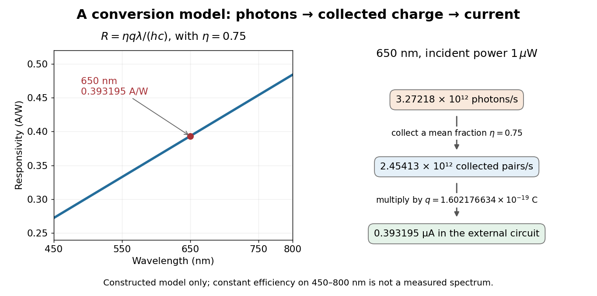

**[Figure 15](#image-calculated-spectral-responsivity-photon-rate-and-photocurrent). Calculated spectral responsivity, photon rate and photocurrent**. Original model, not a measured device spectrum. Left: constant external [quantum efficiency](#quantum-efficiency) $\eta=0.75$ is assumed only on the displayed [wavelength](wave-equation.md#wavelength) [interval](real-analysis.md#interval-mathematics) $450$–$800\,\mathrm{nm}$. Right: the $650\,\mathrm{nm}$ example at $1\,\mathrm{\mu W}$, with [photon](quantum-mechanics.md#photon) and collected-pair rates distinguished.

At fixed [radiant flux](radiometry.md#radiant-flux), longer-[wavelength](wave-equation.md#wavelength) [photons](quantum-mechanics.md#photon) have less [energy](energy.md), so more arrive per second. This explains the rising [straight line](euclidean-geometry.md#straight-line) when [quantum efficiency](#quantum-efficiency) is held constant. A real [photodiode](#photodiode)'s [quantum efficiency](#quantum-efficiency) varies with [wavelength](wave-equation.md#wavelength); the plotted assumption cannot be extended past its [band gap](bloch-s-theorem.md#band-gap) absorption cutoff. At fixed incident [photon](quantum-mechanics.md#photon) rate instead, $I_{\rm ph}=\eta q\Phi_\gamma$ has no additional factor of $\lambda$.

#### Photodiode operating mode

↑ **Parent:** [Photodiode](#photodiode)

Photovoltaic mode uses no external reverse bias: a [transimpedance amplifier](electrical-circuit.md#transimpedance-amplifier) can hold zero terminal [electric potential difference](electric-field.md#electric-potential-difference), while an open [electrical circuit](electrical-circuit.md) develops a photovoltage. Photoconductive mode biases the [diode cathode](electrical-circuit.md#diode-cathode) positive relative to the [diode anode](electrical-circuit.md#diode-anode), generally reducing junction [capacitance](electromagnetism.md#capacitance) and increasing speed and [dark current](#dark-current-physics).[Si photodiodes, pp. 2–3, §2-1; pp. 6–7, §§2-4 and 2-6; p. 9, §3-1: zero-voltage current, reverse operation and amplifier connection](physics-bibliography.md#si-photodiodes-by-hamamatsu-photonics-k-k)

A simple calculation separates the readout from the conversion. If a linear [transimpedance amplifier](electrical-circuit.md#transimpedance-amplifier) has feedback [electrical resistance](electric-charge.md#electrical-resistance) $R_f=1.00\,\mathrm{M\Omega}$, the $650\,\mathrm{nm}$ model above produces an output change of magnitude $R_f I_{\rm ph}=0.393195\,\mathrm V$. The output sign depends on the connection. Increasing $R_f$ increases that [electric potential difference](electric-field.md#electric-potential-difference), but does not create more collected [charge carriers](electric-charge.md#charge-carrier).

For a reverse-biased [photodiode](#photodiode) feeding an [electrical load](electrical-engineering.md#electrical-load) $R_L$, [Ohm's law](electric-charge.md#ohm-s-law) gives a readout magnitude $V_L\simeq I_{\rm ph}R_L$ while the response remains linear. With negligible [dark current](#dark-current-physics) and other series drops, the remaining reverse bias is $V_R\simeq V_b-I_{\rm ph}R_L$, where $V_b$ is the supply magnitude. Thus the chosen [electrical load](electrical-engineering.md#electrical-load) can consume the available bias: a larger readout does not automatically reduce [measurement uncertainty](physics.md#measurement-uncertainty). For the same constructed example, $V_b=5\,\mathrm V$ and $R_L=1\,\mathrm{M\Omega}$ leave about $4.60680\,\mathrm V$; this algebra alone does not establish a real device's linear range.

#### Photodiode responsivity measurement

↑ **Parent:** [Photodiode](#photodiode)

Thorlabs' [silicon](chemical-substance.md#silicon) FDS100 experiment sends a collimated, fibre-coupled [laser](laser.md) beam through a [beam splitter](#beam-splitter) to the [photodiode](#photodiode) and a reference [optical power meter](#optical-power-meter). Varying reverse bias and [electrical load](electrical-engineering.md#electrical-load) tests linearity. The measured readout approaches saturation when its [electric potential difference](electric-field.md#electric-potential-difference) consumes the bias.[Photodiodes, Lab Facts, Photodiode Saturation Limit and Noise Floor, opening experiment description and Figs. 1–3: reference power sensor, bias/load comparisons and saturation](physics-bibliography.md#photodiodes-by-thorlabs) A separate low-signal setup uses a $637\,\mathrm{nm}$ [laser](laser.md), [polarizers](electromagnetic-wave.md#polarizer), an [optical chopper](#optical-chopper), [optical attenuators](#optical-attenuator) and a [lock-in amplifier](electrical-circuit.md#lock-in-amplifier) inside a light-tight enclosure. These are actual apparatus choices, not the parameters of the constructed example above.[Photodiode Saturation and Noise Floor, p. 7 of 12, Experimental Design — Noise Floor: 637 nm source, polarizers, chopper, attenuation filters, lock-in readout and light-tight enclosure](physics-bibliography.md#photodiode-saturation-and-noise-floor-by-thorlabs)

For an independent [dark current](#dark-current-physics) check, Thorlabs enclosed a [photodiode](#photodiode) in nested metal boxes to exclude [light](optics.md#light) and suppress interference, used a Keithley 6487 [ammeter](electric-charge.md#ammeter) supplying reverse bias, and monitored [temperature](temperature.md). Only one specimen per type was tested; the nearby temperature sensor did not directly contact the [semiconductor](semiconductor.md). Such a dark control measures the baseline but cannot certify [spectral responsivity](#spectral-responsivity).[Photodiodes, Lab Facts, Dark Current as a Function of Temperature, Experimental Setup and Experimental Limitations: nested enclosure, ammeter and specimen/temperature limitations](physics-bibliography.md#photodiodes-by-thorlabs)

To infer [spectral responsivity](#spectral-responsivity) at a selected [wavelength](wave-equation.md#wavelength), measure the [radiant flux](radiometry.md#radiant-flux) actually reaching the test [photodiode](#photodiode), rather than just the reference arm. A reference-arm [measurement calibration](physics.md#measurement-calibration) must include the [beam splitter](#beam-splitter) ratio and path losses. With signed readouts in one fixed orientation, subtract a beam-blocked baseline and use

$$
R(\lambda)=\frac{|I_{\rm light}-I_{\rm blocked}|}{P_{\rm test}},\qquad
R(\lambda)=\frac{|V_{\rm light}-V_{\rm blocked}|}{R_fP_{\rm test}}
$$

for direct [electric current](electric-charge.md#electric-current) readout or a calibrated linear [transimpedance amplifier](electrical-circuit.md#transimpedance-amplifier), respectively. Repeating at several incident [powers](energy.md#power) tests whether this ratio is constant. Blocking only the source estimates ambient [light](optics.md#light) plus electronic baseline; covering the detector excludes ambient [light](optics.md#light) too. Their difference distinguishes optical background from [dark current](#dark-current-physics) and readout offset. For a broad [optical spectrum](optics.md#optical-spectrum), the ratio is a spectrum-weighted response, not generally $R$ at one [wavelength](wave-equation.md#wavelength).

For independent [Poisson distribution](discrete-probability-distribution.md#poisson-distribution) collection, the [root mean square](analysis.md#root-mean-square) shot [noise](electrical-engineering.md#noise-signal-processing) in a one-sided rectangular [frequency](wave.md#frequency) band of [signal bandwidth](electrical-engineering.md#signal-bandwidth) $B>0$ is

$$
i_{\rm shot}=\sqrt{2q(I_{\rm ph}+I_d)B},
$$

Here $I_d$ is reverse [dark current](#dark-current-physics); [thermal electrical noise](electrical-engineering.md#thermal-electrical-noise) and amplifier [noise](electrical-engineering.md#noise-signal-processing) also contribute.[Si photodiodes, p. 6, §2-4, equations (2-4)–(2-7): independent thermal, dark-current and photocurrent noise terms](physics-bibliography.md#si-photodiodes-by-hamamatsu-photonics-k-k)

Subtracting a mean [dark current](#dark-current-physics) removes its offset, not its fluctuations: subtracting a constant leaves the [variance](variance.md) unchanged. Consequently $I_{\rm ph}\gg I_d$ makes [dark current](#dark-current-physics) shot [noise](electrical-engineering.md#noise-signal-processing) small relative to signal shot [noise](electrical-engineering.md#noise-signal-processing); it does not by itself establish high [signal-to-noise ratio](electrical-engineering.md#signal-to-noise-ratio). With an independently measured baseline, the [variance](variance.md) of that estimate must also be propagated. Increasing the measurement [signal bandwidth](electrical-engineering.md#signal-bandwidth) raises the admitted [noise](electrical-engineering.md#noise-signal-processing). Calibration of [wavelength](wave-equation.md#wavelength), reference [radiant flux](radiometry.md#radiant-flux), readout gain and collection geometry, together with drift and linearity, determines what [measurement uncertainty](physics.md#measurement-uncertainty) can be claimed.

### Dark current (physics)

↑ **Parent:** [Photodetector](#photodetector)  
ⓦ [Wiki](https://en.wikipedia.org/wiki/Dark_current_(physics))

Dark current is charge produced in a detector without illumination, often by thermally excited carriers. Cooling reduces it, although cooling requirements also depend on the wavelength range and thermal background.

### Correlated double sampling

↑ **Parent:** [Photodetector](#photodetector)  
ⓦ [Wiki](https://en.wikipedia.org/wiki/Correlated_double_sampling)

Correlated double sampling differences a signal reading and its associated reset or baseline reading. It suppresses correlated offsets and reset noise, while the noise of the two measurements must still be propagated.

### Hybrid infrared detector

↑ **Parent:** [Photodetector](#photodetector)

A hybrid infrared detector bonds a photosensitive [semiconductor](semiconductor.md) array to a separate silicon readout circuit. Each pixel has its own electrical connection; charge need not be transferred across the array as in a [charge-coupled device](#charge-coupled-device).

#### Detector reference pixel

↑ **Parent:** [Hybrid infrared detector](#hybrid-infrared-detector)

A detector reference pixel has no illuminated photosensitive connection and samples readout offsets. Reference-pixel subtraction can suppress common electronic drifts but does not measure the sky background or all pixel-dependent errors.

#### Nondestructive detector readout

↑ **Parent:** [Hybrid infrared detector](#hybrid-infrared-detector)

A nondestructive read samples a pixel’s accumulated signal without resetting it. Repeated samples permit [Fowler sampling](#fowler-sampling) and [up-the-ramp sampling](#up-the-ramp-sampling), and can help identify saturation and cosmic-ray charge steps.

##### Up-the-ramp sampling

↑ **Parent:** [Nondestructive detector readout](#nondestructive-detector-readout)

Up-the-ramp sampling measures accumulated charge repeatedly through an exposure and estimates flux from its slope. Cosmic-ray steps, saturation and nonlinearity must be identified or modelled.

##### Fowler sampling

↑ **Parent:** [Nondestructive detector readout](#nondestructive-detector-readout)

Fowler sampling averages several nondestructive reads near the start and end of an integration and differences the two averages. For independent equal read noise, averaging lowers the read-noise variance; correlated noise limits the improvement.

#### H2RG detector

↑ **Parent:** [Hybrid infrared detector](#hybrid-infrared-detector)

The HAWAII-2RG architecture has a $2048\times2048$ grid with an 18-micrometre pitch. For infrared work its readout circuit is normally bonded to a [mercury cadmium telluride](semiconductor.md#mercury-cadmium-telluride) absorber. Reference pixels track electronic offsets and an independently addressed guide window can be read alongside the science array.

### Background subtraction

↑ **Parent:** [Photodetector](#photodetector)

Background subtraction estimates a source contribution by removing a sky or detector-background measurement. An independent background estimate adds [photon shot noise](#photon-shot-noise); a mismatched background adds [bias of an estimator](statistical-modelling.md#bias-of-an-estimator).

#### Radiative temperature uncertainty after background subtraction

↑ **Parent:** [Background subtraction](#background-subtraction)

If emitted [power](energy.md#power) obeys $P=AT^4$ with known constant $A$, then small relative [temperature](temperature.md) uncertainty is one quarter of relative net-power uncertainty. For measured quantities $X,Y$ with [covariance](variance.md#covariance) $C_{XY}$, $\operatorname{Var}(X-Y)=\sigma_X^2+\sigma_Y^2-2C_{XY}$. A weak net signal obtained by subtracting a large background can therefore have poor relative precision even when both original [powers](energy.md#power) are measured accurately. Correlated [standard uncertainties](physics.md#standard-uncertainty) and worst-case error bounds require different propagation rules.

#### Systematic-error signal-to-noise ceiling

↑ **Parent:** [Background subtraction](#background-subtraction)

Let $X\sim\operatorname{Poisson}(Q+B)$ and $Y\sim\operatorname{Poisson}(fB)$ be independent. Then $X-Y$ has source-estimation bias $(1-f)B$ and variance $Q+(1+f)B$. Its accuracy ratio $Q/\sqrt{\mathbb E[(X-Y-Q)^2]}$ tends to $R_Q/(|1-f|R_B)$ when $Q=R_QT$, $B=R_BT$ and $T$ grows. This uses [mean squared error](statistical-modelling.md#mean-squared-error), not variance alone, and assumes a fixed uncorrected mismatch.

### Read noise

↑ **Parent:** [Photodetector](#photodetector)

Read noise is uncertainty added by measuring detector charge or voltage. It is often expressed as an equivalent number of input electrons per pixel per read.

### Photon shot noise

↑ **Parent:** [Photodetector](#photodetector)

Independent photon arrivals have a [Poisson distribution](discrete-probability-distribution.md#poisson-distribution): a mean count $\mu$ has variance $\mu$ and standard deviation $\sqrt\mu$. Subtraction of independent counting measurements adds their variances.

#### Calibration subtraction preserves shot noise

↑ **Parent:** [Photon shot noise](#photon-shot-noise)

Subtracting a reproducible sky, dark or bias mean removes its offset but does not undo random arrivals or electronic fluctuations already present in a science exposure. An independently estimated [calibration](differential-geometry.md#calibration-differential-geometry) adds its own uncertainty. Longer integration reduces relative independent counting [noise](electrical-engineering.md#noise-signal-processing); correlated backgrounds and systematic residuals need separate models and may set an accuracy floor.

### Quantum efficiency

↑ **Parent:** [Photodetector](#photodetector)  
ⓦ [Wiki](https://en.wikipedia.org/wiki/Quantum_efficiency)

Quantum efficiency is the mean fraction of incident photons producing collected signal carriers. Noise-equivalent quantum efficiency can be lower when amplification adds fluctuations; this does not imply a corresponding loss of actual photon absorption.

### Active-pixel sensor

↑ **Parent:** [Photodetector](#photodetector)  
ⓦ [Wiki](https://en.wikipedia.org/wiki/Active-pixel_sensor)

An image sensor with active circuitry at its [optical detector pixels](#optical-detector-pixel) to buffer or amplify collected signals. [CMOS](semiconductor.md#cmos) implementations can select pixel signals without transporting every charge packet through the entire image.

### Charge-coupled device

↑ **Parent:** [Photodetector](#photodetector)  
ⓦ [Wiki](https://en.wikipedia.org/wiki/Charge-coupled_device)

A charge-coupled device stores photoelectrons in potential wells and transfers the charge through clocked stages to an output amplifier. The transfer differs from independently addressed pixels in a [hybrid infrared detector](#hybrid-infrared-detector).

In an imaging [charge-coupled device](#charge-coupled-device), absorbed [photons](quantum-mechanics.md#photon) produce mobile [charge carriers](electric-charge.md#charge-carrier) in a [semiconductor](semiconductor.md); collection stores an [electric charge](electric-charge.md) packet associated with each [optical detector pixel](#optical-detector-pixel). Closely spaced [MOS capacitors](electromagnetism.md#mos-capacitor) allow applied [electric potential differences](electric-field.md#electric-potential-difference) to move the packet from site to site. [Willard Sterling Boyle](physicist.md#willard-sterling-boyle) and [George Elwood Smith](physicist.md#george-elwood-smith) described storage, transfer and detection as distinct operations, including imaging as one application.[Charge Coupled Semiconductor Devices, April 1970, p. 587, abstract and opening device-concept paragraphs; scanned original hosted by VTDA](physics-bibliography.md#charge-coupled-semiconductor-devices-by-willard-sterling-boyle-and-george-elwood-smith)

The useful architectural trick is that many [optical detector pixels](#optical-detector-pixel) can send their [electric charge](electric-charge.md) to a shared output [electronic amplifier](electrical-circuit.md#electronic-amplifier). This makes repeatable conversion possible but makes fidelity depend on every transfer along the route. An [active-pixel sensor](#active-pixel-sensor) made with [CMOS](semiconductor.md#cmos) technology instead uses circuitry at pixels to convert or buffer their signal and select it for readout; independent pixel addressing does not require transporting each packet through the whole image. This compares readout architectures, not whether either technology can use a [photodiode](#photodiode).[NASA Spinoff, 2017, NASA Technology, pixel-to-pixel transfer and amplification at individual pixels](physics-bibliography.md#cmos-sensors-enable-phone-cameras-hd-video-by-national-aeronautics-and-space-administration)

#### Fano-limited X-ray CCD energy resolution

↑ **Parent:** [Charge-coupled device](#charge-coupled-device)

A [photon](quantum-mechanics.md#photon) of energy $E$ fully absorbed in [silicon](chemical-substance.md#silicon) produces on average $E/w$ [electron-hole pairs](quantum-mechanics.md#electron-hole-pair), with [variance](variance.md) $F E/w$ rather than necessarily a Poisson [variance](variance.md). Thus $\sigma_E=\sqrt{FwE}$ and Gaussian FWHM is $2\sqrt{2\ln2}\,\sigma_E$. Representative [silicon](chemical-substance.md#silicon) values $w\simeq3.65$ eV and $F\simeq0.12$ give about $156$ eV FWHM at $10$ keV. [read noise](#read-noise) in split-event [pixels](computer-graphics.md#pixel), trapping and gain errors broaden that limit; optical [pixel](computer-graphics.md#pixel) size alone does not specify the [energy resolution](physics.md#energy-resolution).[§4.7, non-uniform CTI and Fano-limited FWHM expression](physics-bibliography.md#the-asca-data-reduction-guide-by-nasa-heasarc)

#### CCD noise budget

↑ **Parent:** [Charge-coupled device](#charge-coupled-device)

For source [electrons](physics.md#electron) $S$, sky [electrons](physics.md#electron) $B$, dark-current rate $d$, total exposure $t$, $M$ reads and rms [read noise](#read-noise) $r$, independent [variances](variance.md) add to $S+B+dt+Mr^2$. [calibration](differential-geometry.md#calibration-differential-geometry) can remove reproducible means but cannot remove the science exposure's random [photon](quantum-mechanics.md#photon) or dark-current fluctuations. A finite background estimate and imperfect [calibration](differential-geometry.md#calibration-differential-geometry) add further uncertainty.

##### Aperture photometry with an estimated background

↑ **Parent:** [CCD noise budget](#ccd-noise-budget)

For total source electrons $S$, $n$ aperture pixels, sky-plus-dark rate $b+d$, time $t$, $M$ reads with rms $r$, and an independent mean-background estimate of [variance](variance.md) $\sigma_{\widehat B}^2$ per pixel, the aperture [variance](variance.md) is $S+n(b+d)t+nMr^2+n^2\sigma_{\widehat B}^2$ before additional [calibration](differential-geometry.md#calibration-differential-geometry) terms. The last factor is $n^2$ because one uncertain background mean is subtracted from all aperture pixels. Pixel correlations require [covariance](variance.md#covariance) terms.

#### CCD clocked charge transfer

↑ **Parent:** [Charge-coupled device](#charge-coupled-device)

For an [electron](physics.md#electron) packet, a sufficiently positive gate [electric potential](electric-field.md#electric-potential) attracts [electrons](physics.md#electron) beneath the insulating layer of a [MOS capacitor](electromagnetism.md#mos-capacitor). The corresponding [potential energy](energy.md#potential-energy) is $U=-e\phi$, where $e>0$ is the magnitude of [elementary charge](electric-charge.md#elementary-charge): a larger [electric potential](electric-field.md#electric-potential) gives a deeper [potential well](energy.md#potential-well) for [electrons](physics.md#electron). A drawing of [potential energy](energy.md#potential-energy) must therefore reverse the vertical sense of a drawing of [electric potential](electric-field.md#electric-potential).

A simplified three-phase transfer raises the adjacent gate's [electric potential](electric-field.md#electric-potential) before lowering the old holding gate. This overlaps the accessible regions, then leaves the packet under the new gate. Repeat with the next gate to move it forward. Isolated wells with an intervening barrier would store the packet without transferring it.[Boyle and Smith, 1970, p. 587, neighboring capacitors and manipulated electrode potentials](physics-bibliography.md#charge-coupled-semiconductor-devices-by-willard-sterling-boyle-and-george-elwood-smith)

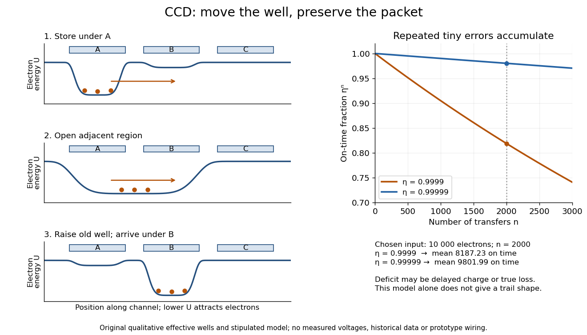

**[Figure 16](#image-ccd-clocked-charge-transfer-and-cumulative-charge-transfer-efficiency). CCD clocked charge transfer and cumulative charge-transfer efficiency**. Original explanatory [potential energy](energy.md#potential-energy) profiles show storage, overlap and arrival, with lower curves meaning more attractive regions for [electrons](physics.md#electron). These are qualitative effective profiles, not measured voltages or prototype wiring. The right panel calculates the main-packet fraction for the stipulated constant-efficiency model; charge absent from that packet may be deferred or truly lost.

#### Charge-transfer efficiency

↑ **Parent:** [Charge-coupled device](#charge-coupled-device)

The [charge-transfer efficiency](#charge-transfer-efficiency) is the fraction of a packet delivered into its intended next site or time slot in one transfer, under stated conditions. It is distinct from [quantum efficiency](#quantum-efficiency), which concerns conversion of incident [photons](quantum-mechanics.md#photon) into collected [charge carriers](electric-charge.md#charge-carrier). Define the complementary inefficiency as $\epsilon=1-\eta_{\rm tr}$.

In an original model with constant $0\leq\eta_{\rm tr}\leq1$, let $N_j$ denote the mean number of original packet [electrons](physics.md#electron) still delivered on time after $j$ transfers. Assuming no reinjection into that packet,

$$
N_{j+1}=\eta_{\rm tr}N_j,\qquad N_{\rm out}=N_{\rm in}\eta_{\rm tr}^{n}.
$$

Repeated substitution proves the result; for different efficiencies the fraction is $\prod_{j=1}^{n}\eta_j$. For $\epsilon\ll1$, a [Taylor expansion](calculus.md#taylor-expansion) of $\ln(1-\epsilon)$ gives $\eta_{\rm tr}^n\simeq e^{-n\epsilon}$, while the simpler $1-n\epsilon$ requires $n\epsilon\ll1$.

Choose $N_{\rm in}=10000$ and $n=2000$. For $\eta_{\rm tr}=0.9999$, the expected on-time output is $8187.23$ [electrons](physics.md#electron); for $\eta_{\rm tr}=0.99999$, it is $9801.99$. These are model means, so fractional [electron](physics.md#electron) counts do not describe an individual packet. Even a small per-transfer imperfection can imprint distance-dependent image errors.

If every original [electron](physics.md#electron) independently stays on time with [probability](probability-theory.md#probability) $p=\eta_{\rm tr}^n$, a fixed initial count gives a [binomial distribution](discrete-probability-distribution.md#binomial-distribution) with [variance](variance.md) $N_{\rm in}p(1-p)$. An initial [Poisson distribution](discrete-probability-distribution.md#poisson-distribution) with mean $\mu$ instead gives an on-time [Poisson distribution](discrete-probability-distribution.md#poisson-distribution) with mean and [variance](variance.md) $\mu p$, by [Poisson thinning](poisson-process.md#poisson-thinning). A deterministic attenuation formula alone does not specify noise. Real trapping can correlate packets and depends on timing, illumination and [temperature](temperature.md); the independent constant-efficiency model then fails.

#### Deferred charge in CCD readout

↑ **Parent:** [Charge-coupled device](#charge-coupled-device)

[Deferred charge in CCD readout](#deferred-charge-in-ccd-readout) reaches later output samples than its originating packet. [George Elwood Smith](physicist.md#george-elwood-smith) describes [surface states](semiconductor.md#surface-state) at the [silicon](chemical-substance.md#silicon)–[silicon dioxide](chemical-substance.md#silicon-dioxide) interface capturing [electrons](physics.md#electron) and releasing them later, smearing the image. A buried channel keeps the stored packet away from that interface.[pp. 2310–2311, Figs. 10–11, trapping](physics-bibliography.md#nobel-lecture-the-invention-and-early-history-of-the-ccd-by-george-elwood-smith)

An original comparison separates two interpretations of the same main-packet deficit. If a single transfer defers fraction $\epsilon$ by exactly one sample and loses nothing, an isolated input packet $N$ produces samples $\eta_{\rm tr}N$ followed by $\epsilon N$: summing both recovers $N$. A truly lossy transfer yields only $\eta_{\rm tr}N$, with no later recovery. For $N=10000$ and $\epsilon=0.01$, both give $9900$ in the intended sample, but only the deferred case gives a $100$-[electron](physics.md#electron) trail. Such a trail redistributes position information even when total [electric charge](electric-charge.md) is conserved. Repeated delays require a time-response model; $N_{\rm in}\eta_{\rm tr}^n$ alone cannot predict trail shape. [Electron-hole recombination](quantum-mechanics.md#electron-hole-recombination), escape to another contact, or release beyond the recorded window can instead remove signal from the measured sum.

#### Early CCD charge-transfer experiment

↑ **Parent:** [Charge-coupled device](#charge-coupled-device)

[George Elwood Smith](physicist.md#george-elwood-smith) reports fabricating [MOS capacitors](electromagnetism.md#mos-capacitor), thermally generating the first packet, and clocking it to an output that pushed it into the substrate for [electric current](electric-charge.md#electric-current) detection. A later integrated eight-bit device demonstrated imaging. Dark or reversed-clock control traces are not specified; feasibility alone does not calibrate [charge-transfer efficiency](#charge-transfer-efficiency).[pp. 2309–2310, Figs. 7–9, prototype and imager](physics-bibliography.md#nobel-lecture-the-invention-and-early-history-of-the-ccd-by-george-elwood-smith)

A discriminating repeat would compare identical cycles with and without initial [carrier injection](semiconductor.md#carrier-injection), then suppress or reverse the transfer sequence while retaining output switching. An [electric current](electric-charge.md#electric-current) transient synchronized with gate switching can include [capacitor](electromagnetism.md#capacitor) feedthrough; only the difference tied to initial [electric charge](electric-charge.md) and the expected transfer delay tests packet transport. These are proposed controls, not controls documented in the lecture. For an optical version, a blocked exposure estimates [dark current](#dark-current-physics) and [read noise](#read-noise); a spatially isolated illuminated [optical detector pixel](#optical-detector-pixel) exposes any [deferred charge in CCD readout](#deferred-charge-in-ccd-readout) trail. [Photon shot noise](#photon-shot-noise) persists even with ideal transfer.

#### Electron-multiplying CCD

↑ **Parent:** [Charge-coupled device](#charge-coupled-device)

An electron-multiplying CCD adds a high-field multiplication register before the output amplifier. [Impact ionization](#impact-ionization) generates a large mean gain, reducing input-referred [read noise](#read-noise) but adding [multiplication excess noise](#multiplication-excess-noise).

##### Multiplication excess noise

↑ **Parent:** [Electron-multiplying CCD](#electron-multiplying-ccd)

Random multiplication increases the noise relative to deterministic gain. If the output from one input electron has mean $g$ and variance $g^2$, a [Poisson distribution](discrete-probability-distribution.md#poisson-distribution) of input electrons with mean $\mu$ produces output variance $2g^2\mu$, by the [law of total variance](probability-theory.md#law-of-total-variance). The high-gain analog-mode excess-noise factor is $\sqrt2$.

##### Impact ionization

↑ **Parent:** [Electron-multiplying CCD](#electron-multiplying-ccd)  
ⓦ [Wiki](https://en.wikipedia.org/wiki/Impact_ionization)

An energetic charge carrier creates an additional electron–hole pair. In a multiplication register this is stochastic, so the output charge fluctuates even when the input electron number is fixed.

###### Impact ionization with a hole at zero momentum

↑ **Parent:** [Impact ionization](#impact-ionization)

For a direct-gap semiconductor with equal parabolic conduction-electron effective masses, restrict the final valence hole to zero crystal momentum and consider a normal process. Momentum conservation gives $\boldsymbol k_1=\boldsymbol k_2+\boldsymbol k_3$, while energy conservation gives $E_1=E_g+\alpha(k_2^2+k_3^2)$ with $\alpha=\hbar^2/(2m^*)$. The [Cauchy-Schwarz inequality](probability-and-statistics.md#cauchy-schwarz-inequality) gives $k_2^2+k_3^2\geq k_1^2/2$, so $E_1\geq E_g+E_1/2$ and the threshold is $2E_g$. Equal final wavevectors attain the bound; opposite spins allow the two electrons to occupy that wavevector. This is the threshold under the stated hole constraint, not the general threshold when the final hole can carry momentum.

### Signal-to-noise ratio in photon counting

↑ **Parent:** [Photodetector](#photodetector)

For source counts $S$ and independent background counts $B$ with [Poisson distributions](discrete-probability-distribution.md#poisson-distribution), the ideal counting [standard deviation](variance.md#standard-deviation) is $\sqrt{S+B}$, so the signal-to-noise ratio is $S/\sqrt{S+B}$. Detector noise and uncertainty in the estimated background add further variance. A larger sky aperture raises $B$, while better throughput raises $S$; both affect the faintness limit of a [spectrograph](#spectrograph).

#### Poisson variance after sky subtraction

↑ **Parent:** [Signal-to-noise ratio in photon counting](#signal-to-noise-ratio-in-photon-counting)

Subtracting an exactly known mean sky level leaves source-plus-sky [variance](variance.md) of a [Poisson distribution](discrete-probability-distribution.md#poisson-distribution) $S+B$. If the sky per source [pixel](computer-graphics.md#pixel) is estimated from $n_b$ equal-area, equally exposed independent sky [pixels](computer-graphics.md#pixel), its additional [variance](variance.md) is $B/n_b$, so $R=S/\sqrt{S+B+B/n_b}$ before read and dark terms. The [variance](variance.md) of removed background [photons](quantum-mechanics.md#photon) does not disappear with their mean.

## Refractometer

↑ **Parent:** [Optical instrument](optical-instrument.md)  
ⓦ [Wiki](https://en.wikipedia.org/wiki/Refractometer)

<h3 id="abbe-refractometer">Abbé refractometer</h3>

↑ **Parent:** [Refractometer](#refractometer)

## Optical chopper

↑ **Parent:** [Optical instrument](optical-instrument.md)  
ⓦ [Wiki](https://en.wikipedia.org/wiki/Optical_chopper)

An [optical chopper](#optical-chopper) periodically interrupts a beam of [light](optics.md#light), for example with a rotating slotted wheel. Its timing can provide a reference for a [lock-in amplifier](electrical-circuit.md#lock-in-amplifier) measuring the modulated [photodiode](#photodiode) [signal](electrical-engineering.md#signal).

## Stray light

↑ **Parent:** [Optical instrument](optical-instrument.md)

[Stray light](#stray-light) reaches a [photodetector](#photodetector) by an unintended path or from outside the intended [wavelength](wave-equation.md#wavelength) band. It can bias [spectrophotometry](#spectrophotometry) by adding received [radiant power](radiometry.md#radiant-flux).

## Optical isolator

↑ **Parent:** [Optical instrument](optical-instrument.md)  
ⓦ [Wiki](https://en.wikipedia.org/wiki/Optical_isolator)

An [optical isolator](#optical-isolator) transmits [light](optics.md#light) preferentially in one direction. An ideal [Faraday effect](electromagnetic-wave.md#faraday-effect) device combines a $45^\circ$ rotator with [polarizers](electromagnetic-wave.md#polarizer) at $0^\circ$ and $45^\circ$: forward [light](optics.md#light) passes, while backward [light](optics.md#light) acquires another $45^\circ$ rotation and reaches the entrance [polarizer](electromagnetic-wave.md#polarizer) at $90^\circ$. See [Faraday rotation on a round trip](electromagnetic-wave.md#faraday-rotation-on-a-round-trip).

## Photographic plate

↑ **Parent:** [Optical instrument](optical-instrument.md)

A plate bearing a photosensitive coating that records an exposure, including exposure to [X-rays](electromagnetic-radiation.md#x-ray).

## ↑ Ancestors (4)

1. [Optics](optics.md)
2. [Branches of physics](physics.md#branches-of-physics)
3. [Physics](physics.md)
4. [Codex Wiki](README.md)

## ← Incoming links (13)

- [Angular magnification](optics.md#angular-magnification)
- [Aperture](optics.md#aperture)
- [Area-angle tradeoff](geometrical-optics.md#area-angle-tradeoff)
- [Beam splitter](#beam-splitter)
- [Coronagraph](optics.md#coronagraph)
- [Etendue](geometrical-optics.md#etendue)
- [Field of view](#field-of-view)
- [Focal ratio](#focal-ratio)
- [Free spectral range](physical-optics.md#free-spectral-range)
- [Lens (optics)](geometrical-optics.md#lens-optics)
- [Optical aberration](geometrical-optics.md#optical-aberration)
- [Optical port](#optical-port)
- [Optician (optical instruments)](optics.md#optician-optical-instruments)
