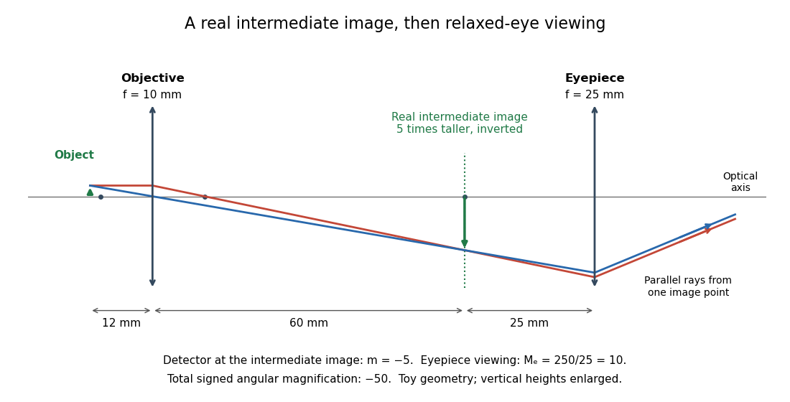

# Optical microscope

↑ **Parent:** [Optical instrument](optical-instrument-split.md)

An [optical microscope](optical-microscope.md) uses [light](light.md) and [optical lens](lens-optics.md) assemblies to reveal small structures, such as the boundaries of [biological cells](biological-cell-split.md) or defects in a manufactured surface. In a compound [optical microscope](optical-microscope.md), the [microscope objective](microscope-objective.md) supplies an enlarged [real image](real-image.md); the [microscope eyepiece](microscope-eyepiece.md) makes that [intermediate microscope image](intermediate-microscope-image.md) subtend a larger viewing [angle](angle.md). The [transverse magnification](transverse-magnification.md) of the first stage and the [angular magnification](angular-magnification.md) of the second answer different questions.[University Physics Volume 3, §2.8 Microscopes, image formation and Eqs. 2.35–2.37](university-physics-volume-3-by-samuel-j-ling-and-others/2-8-microscopes-and-telescopes.md)

Consider an original ideal [finite-conjugate microscope](finite-conjugate-microscope.md) in air, with both [optical lens](lens-optics.md) assemblies treated as converging [thin lens](thin-lens.md) elements in the [paraxial approximation](paraxial-approximation.md). Choose objective [focal length](focal-length.md) $f_o=10\,\mathrm{mm}$ and object distance $u_o=12\,\mathrm{mm}$. The [thin lens](thin-lens.md) equation and signed [transverse magnification](transverse-magnification.md) give

$$
\frac1{v_o}=\frac1{10\,\mathrm{mm}}-\frac1{12\,\mathrm{mm}}=\frac1{60\,\mathrm{mm}},\qquad v_o=60\,\mathrm{mm},\qquad m_o=-\frac{v_o}{u_o}=-5.
$$

Place a [microscope eyepiece](microscope-eyepiece.md) of [focal length](focal-length.md) $f_e=25\,\mathrm{mm}$ a further $25\,\mathrm{mm}$ beyond the [intermediate microscope image](intermediate-microscope-image.md). The objective-to-eyepiece separation is therefore $85\,\mathrm{mm}$. Each object point then supplies a parallel outgoing bundle of [light rays](light-ray.md), appropriate to a relaxed eye focused at infinity. Define the unaided reference as the same object viewed at distance $D=250\,\mathrm{mm}$; this is a rating convention, not a universal property of eyesight. The eyepiece [angular magnification](angular-magnification.md) and total signed [angular magnification](angular-magnification.md) are

$$
M_e=\frac D{f_e}=10,\qquad M=m_oM_e=-50.
$$

For instance, a hypothetical object height $h_o=0.020\,\mathrm{mm}$ becomes $h_i=-0.100\,\mathrm{mm}$ at the [intermediate microscope image](intermediate-microscope-image.md). The signed viewing [angles](angle.md) are approximately $h_i/f_e=-0.004\,\mathrm{rad}$ with the instrument and $h_o/D=0.00008\,\mathrm{rad}$ unaided. Their ratio is $-50$: enlarged and inverted. These are stipulated model dimensions, not measurements or specifications of a modern commercial [optical microscope](optical-microscope.md).

**[Figure 7](#image-microscope-objective-and-microscope-eyepiece-in-an-ideal-finite-conjugate-microscope). Microscope objective and microscope eyepiece in an ideal finite-conjugate microscope**. Original [light ray](light-ray.md) construction for $f_o=10\,\mathrm{mm}$, $u_o=12\,\mathrm{mm}$, $v_o=60\,\mathrm{mm}$ and $f_e=25\,\mathrm{mm}$. Horizontal distances are proportional; object and image heights are enlarged for visibility. The [real image](real-image.md) at $x=60\,\mathrm{mm}$ is the eyepiece's object, and the emerging bundle from its tip is parallel. A detector at that [real image](real-image.md) plane would record [transverse magnification](transverse-magnification.md) $-5$; the relaxed-eye viewing convention gives total [angular magnification](angular-magnification.md) $-50$.

The attraction of an [optical microscope](optical-microscope.md) is that seeing can become measuring: a [stage micrometer](stage-micrometer.md) supplies a known object-space [length](length.md), and [microscope scale calibration](microscope-scale-calibration.md) converts an image readout into a specimen [length](length.md). This also separates a large-looking image from a trustworthy size estimate. Meanwhile, [diffraction-limited resolution](diffraction-limited-resolution.md) depends on [numerical aperture](numerical-aperture.md) and [wavelength](wavelength.md); [empty magnification](empty-magnification.md) enlarges an existing blur without revealing additional structure.

**Table of contents**

- [Polarizing microscope](polarizing-microscope.md)
  - [Azimuthal brightness of a birefringent crystallite](azimuthal-brightness-of-a-birefringent-crystallite.md)
  - [Conoscopic interference pattern](conoscopic-interference-pattern.md)
  - [Maltese cross in polarized-light microscopy](maltese-cross-in-polarized-light-microscopy.md)
- [Microscope objective](microscope-objective.md)
- [Microscope eyepiece](microscope-eyepiece.md)
- [Intermediate microscope image](intermediate-microscope-image.md)
- [Finite-conjugate microscope](finite-conjugate-microscope.md)
- [Infinity-corrected microscope](infinity-corrected-microscope.md)
  - [Tube lens](tube-lens.md)
- [Microscope scale calibration](microscope-scale-calibration.md)
  - [Ocular micrometer](ocular-micrometer.md)
  - [Stage micrometer](stage-micrometer.md)
- [Empty magnification](empty-magnification.md)
- [Differential interference contrast microscopy](differential-interference-contrast-microscopy.md)
- [Phase-contrast microscopy](phase-contrast-microscopy.md)
  - [Phase-contrast microscope](phase-contrast-microscope.md)
  - [Phase object](phase-object.md)
    - [Weak phase object](weak-phase-object.md)
  - [Phase plate](phase-plate.md)
  - [Coherent zero-mode model of phase contrast](coherent-zero-mode-model-of-phase-contrast.md)
  - [Phase-contrast image artifacts](phase-contrast-image-artifacts.md)
  - [Zernike's discovery of phase contrast](zernike-s-discovery-of-phase-contrast.md)
- [Bright-field microscopy](bright-field-microscopy.md)
- [Köhler illumination](kohler-illumination.md)
- [Dark-field microscopy](dark-field-microscopy.md)

## ↑ Ancestors (5)

1. [Optical instrument](optical-instrument-split.md)
2. [Optics](optics-split.md)
3. [Branches of physics](branches-of-physics.md)
4. [Physics](physics-split.md)
5. [Codex Wiki](split.md)

## ← Incoming links (21)

- [Bright-field microscopy](bright-field-microscopy.md)
- [Calcium carbonate precipitation experiment](calcium-carbonate-precipitation-experiment.md)
- [Early two-stage electron microscope experiment](early-two-stage-electron-microscope-experiment.md)
- [Electron microscope](electron-microscope.md)
- [Ellipsoid rotational diffusion microscopy experiment](ellipsoid-rotational-diffusion-microscopy-experiment.md)
- [Finite-conjugate microscope](finite-conjugate-microscope.md)
- [Geiger-Marsden angular-scattering experiment of 1913](geiger-marsden-angular-scattering-experiment-of-1913.md)
- [Geiger-Marsden experiment](geiger-marsden-experiment.md)
- [Graphene exfoliation and field-effect experiments](graphene-exfoliation-and-field-effect-experiments.md)
- [HeLa culture viability experiment](hela-culture-viability-experiment.md)
- [Infinity-corrected microscope](infinity-corrected-microscope.md)
- [Michelson measurement of length in cadmium wavelengths](michelson-measurement-of-length-in-cadmium-wavelengths.md)
- [Microscope objective](microscope-objective.md)
- [Off-axis pinhole test for coma](off-axis-pinhole-test-for-coma.md)
- [Optical microscope](optical-microscope.md)
- [Phase-contrast microscope](phase-contrast-microscope.md)
- [Phase-contrast microscopy](phase-contrast-microscopy.md)
- [Pollen tube germination assay](pollen-tube-germination-assay.md)
- [Ronchi ruling](ronchi-ruling.md)
- [Thomas J. Fellers](thomas-j-fellers.md)
- [Toroidal sand dollar egg experiment](toroidal-sand-dollar-egg-experiment.md)
