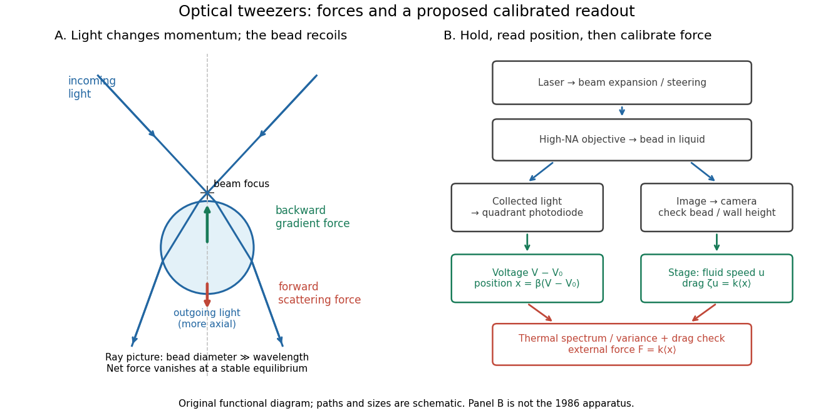

# Optical trap position readout

↑ **Parent:** [Optical tweezers](optical-tweezers.md)

A detector measures a [signal](signal.md), not a [force](force-split.md). One proposed arrangement collects transmitted and scattered [light](light.md) onto a [quadrant photodiode](quadrant-photodiode.md), using a normalized difference of opposite segments as a position-sensitive [signal](signal.md). A [camera](camera.md) can supply an independent image and bead-height check. Near a chosen operating point, a voltage channel may obey $V-V_0=x/\beta$, but its linear range and sensitivity $\beta$ must be measured at that bead size, focus and collection geometry. An arbitrary scattered-light intensity is not automatically proportional to [displacement](displacement.md).

**[Figure 14](#image-momentum-transfer-in-optical-tweezers-and-a-proposed-calibrated-optical-trap-position-readout). Momentum transfer in optical tweezers and a proposed calibrated optical trap position readout**. [Source](optical-tweezers-force-readout.py). Original functional schematic. Left: qualitative large-bead [geometrical optics](geometrical-optics-split.md) paths; more axial outgoing [momentum](momentum-split.md) produces a backward recoil contribution, competing with forward [optical scattering force](optical-scattering-force.md). Right: a proposed detector and stage arrangement distinguishes illumination, sensing, position sensitivity and [force](force-split.md) calibration; it is not the historical 1986 apparatus.

A useful proposed control sequence is to record detector offsets with illumination blocked, calibrate image scale against known stage travel, and test the detector response with independently known bead-relative motion. Moving a free trapped bead's chamber is not by itself a known bead [displacement](displacement.md): fluid drag and trap stiffness determine the shift. Use a separate immobilized bead or an independently imaged trajectory for the position response, then check whether the response transfers to the actual trapped bead. Repeat the calibration after changing trapping power or optics.

Measure the acquisition [frequency response](frequency-response.md) and choose a sample rate that resolves $f_c$, with sufficient [signal bandwidth](signal-bandwidth.md) and control of [aliasing](aliasing.md). Compare [thermal calibration of an optical trap](thermal-calibration-of-an-optical-trap.md) with [optical trap drag calibration](optical-trap-drag-calibration.md), sweep small positive and negative flow speeds, inspect for multiple beads, and repeat at several wall distances. Check [temperature](temperature-split.md) and drift before interpreting a power-dependent stiffness: a changed fluid [viscosity](dynamic-viscosity-split.md) can change $f_c$ even at unchanged $k$. These are proposed diagnostics of the model, not procedures attributed to the 1970 or 1986 papers.

## ↑ Ancestors (5)

1. [Optical tweezers](optical-tweezers.md)
2. [Optics](optics-split.md)
3. [Branches of physics](branches-of-physics.md)
4. [Physics](physics-split.md)
5. [Codex Wiki](split.md)

## ← Incoming links (2)

- [Optical trap position readout](optical-trap-position-readout.md)
- [Single-beam gradient trapping experiment](single-beam-gradient-trapping-experiment.md)
