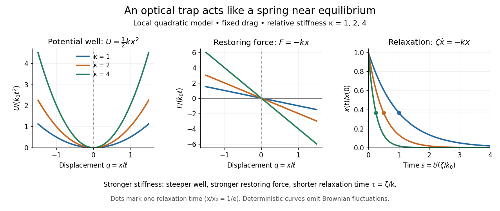

# Optical trap relaxation time

↑ **Parent:** [Harmonic optical trap](harmonic-optical-trap.md)

For a bead in a stationary viscous liquid, [linear drag](linear-drag.md) often dominates [inertia](inertia.md) on the observed timescale. Neglecting both [inertia](inertia.md) and the random thermal [force](force.md), the deterministic [force balance](force-balance.md) gives

$$
\zeta\dot x=-kx,\qquad x(t)=x(0)e^{-t/\tau},\qquad \tau=\frac{\zeta}{k}.
$$

Here $\zeta>0$ is the drag coefficient and $\tau$ the [optical trap relaxation time](optical-trap-relaxation-time.md): the time to reduce the deterministic [displacement](displacement.md) by a factor $e$. The bead approaches [equilibrium](equilibrium-point-of-a-dynamical-system.md) without oscillation in this overdamped model. The approximation requires times long compared with the inertial time $m/\zeta$ and, for separated timescales, $m/\zeta\ll\zeta/k$, where $m$ is the bead's [mass](mass.md). For a no-slip spherical bead of radius $a$ in an unbounded liquid of [dynamic viscosity](dynamic-viscosity.md) $\eta$, [Stokes drag law](stokes-s-law.md) gives $\zeta=6\pi\eta a$. Nearby walls change that drag coefficient.

For example, $a=0.5\,\mathrm{\mu m}$, $\eta=10^{-3}\,\mathrm{Pa\,s}$ and $k=0.01\,\mathrm{pN/nm}=10^{-5}\,\mathrm{N/m}$ give $\zeta\approx9.42\times10^{-9}\,\mathrm{N\,s/m}$ and $\tau\approx0.942\,\mathrm{ms}$. A [displacement](displacement.md) of $100\,\mathrm{nm}$ gives a [restoring force](restoring-force.md) of magnitude $1\,\mathrm{pN}$, and its deterministic [displacement](displacement.md) drops to $100/e\approx36.8\,\mathrm{nm}$ after one [optical trap relaxation time](optical-trap-relaxation-time.md). These are predictions for the stated model, not measured trajectories.

**[Figure 13](#image-local-harmonic-optical-trap-potential-well-restoring-force-and-deterministic-overdamped-relaxation). Local harmonic optical trap: potential well, restoring force and deterministic overdamped relaxation**.

The figure uses $q=x/\ell$, $\kappa=k/k_0$ and $s=t/(\zeta/k_0)$, with arbitrary positive reference length $\ell$ and stiffness $k_0$. Thus $U/(k_0\ell^2)=\kappa q^2/2$, $F/(k_0\ell)=-\kappa q$ and, from $q(0)=1$, $q(s)=e^{-\kappa s}$. At fixed drag, greater stiffness gives both a steeper [potential energy](potential-energy.md) well and faster relaxation. Thermal [Brownian motion](brownian-motion-split.md) is omitted from these deterministic curves.

## ↑ Ancestors (6)

1. [Harmonic optical trap](harmonic-optical-trap.md)
2. [Optical tweezers](optical-tweezers.md)
3. [Optics](optics-split.md)
4. [Branches of physics](branches-of-physics.md)
5. [Physics](physics-split.md)
6. [Codex Wiki](split.md)

## ← Incoming links (3)

- [Equipartition theorem](equipartition-theorem.md)
- [Optical trap relaxation time](optical-trap-relaxation-time.md)
- [Thermal calibration of an optical trap](thermal-calibration-of-an-optical-trap.md)
