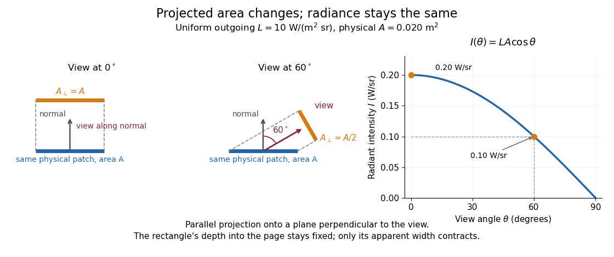
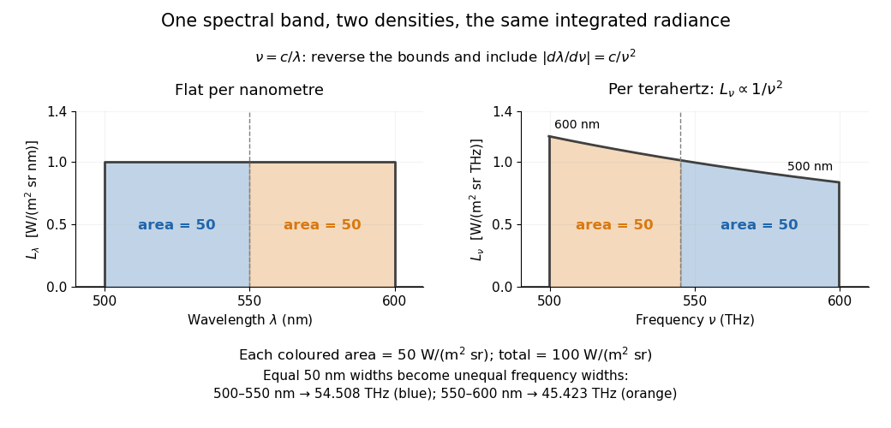
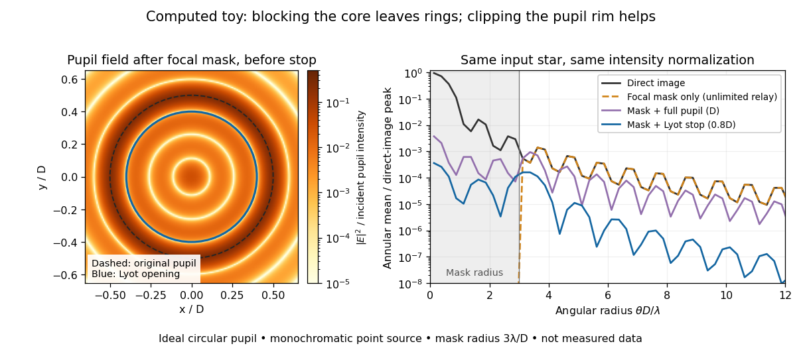
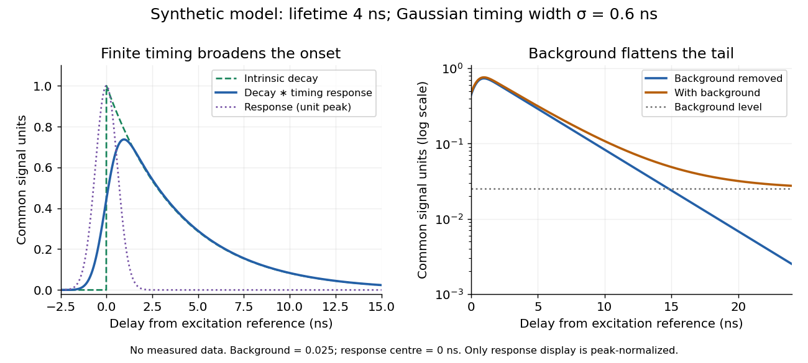
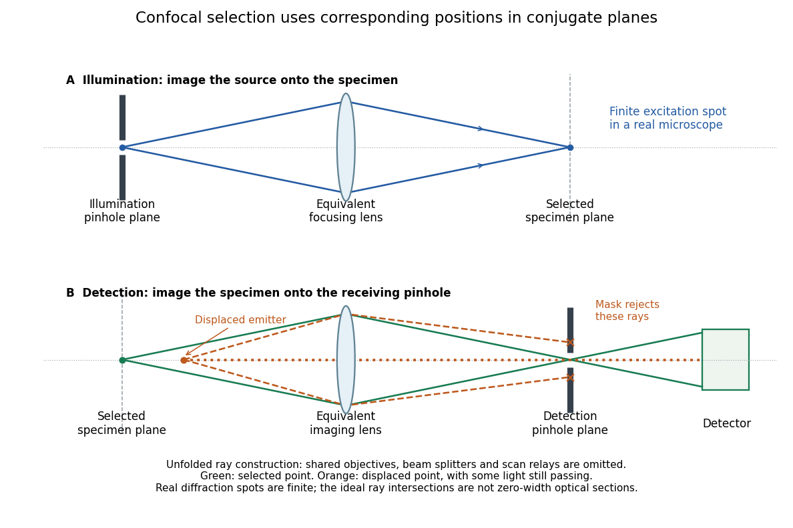
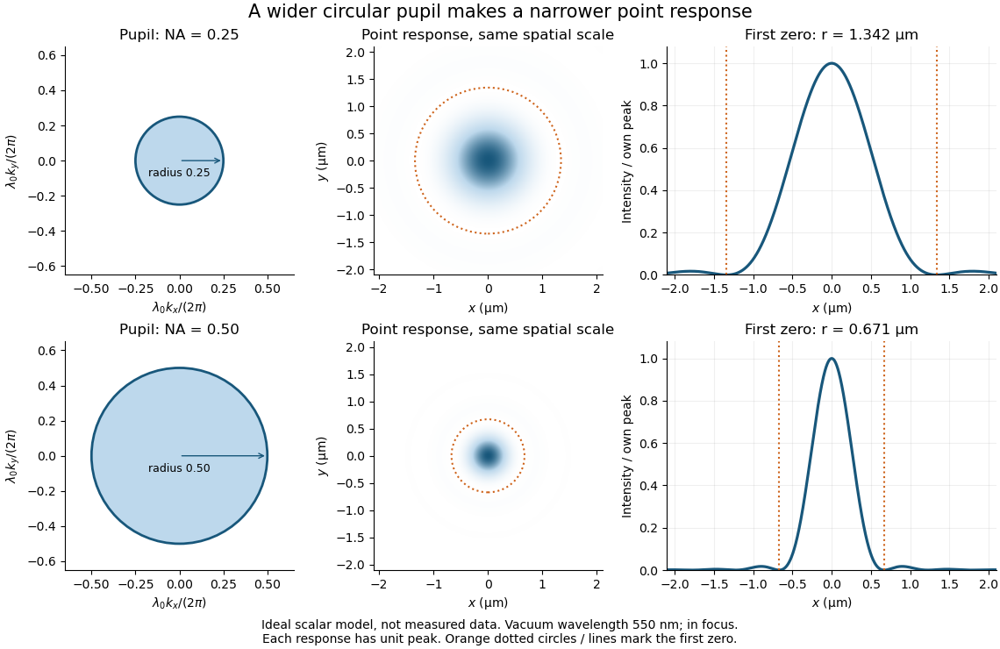
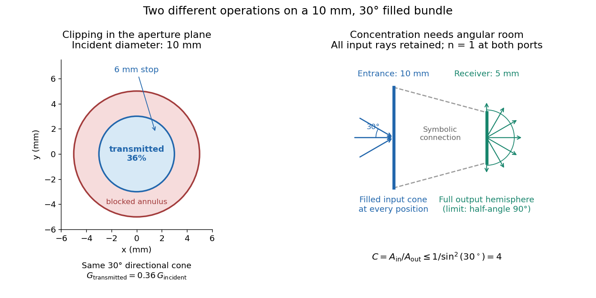
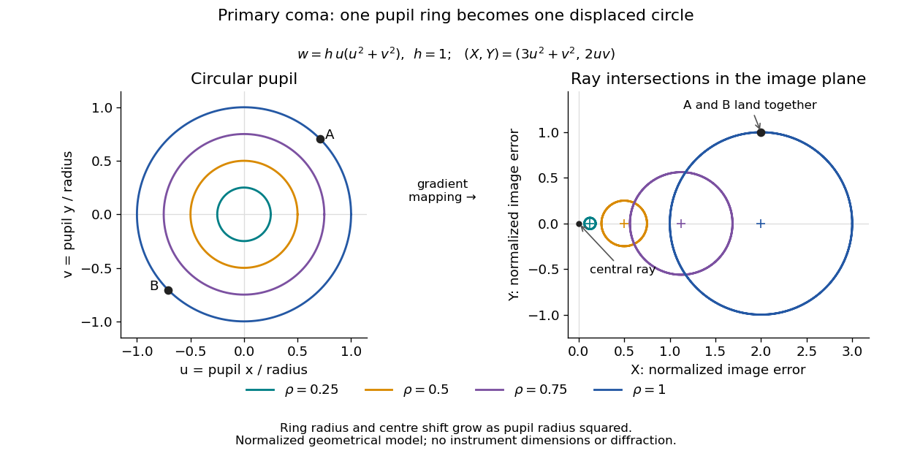
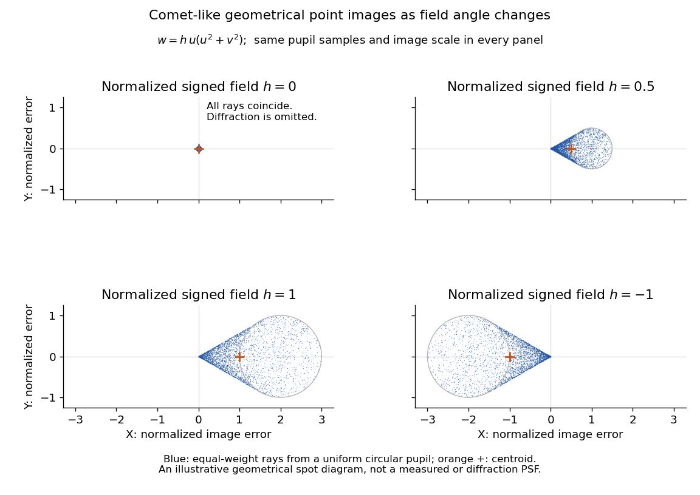

# Optics

↑ **Parent:** [Branches of physics](physics.md#branches-of-physics)  
ⓦ [Wiki](https://en.wikipedia.org/wiki/Optics)

Optics studies [light](#light), its propagation, and instruments for forming images and measuring [optical spectra](#optical-spectrum).

The central question is how [light](#light) carries information from a source to an observer. A useful description must explain both where the [light](#light) goes and how its distribution changes. In [geometrical optics](#geometrical-optics), [light rays](#light-ray) locate paths and images; in [physical optics](#physical-optics), an [electromagnetic wave](electromagnetism.md#electromagnetic-wave) has a [wave amplitude](physics.md#wave-amplitude) and a [wave phase](physics.md#phase-waves), so overlapping contributions can produce [wave interference](#interference-wave-propagation) and [diffraction](quantum-mechanics.md#diffraction). These descriptions address different levels of detail within the same subject. [OpenStax: The propagation of light](https://openstax.org/books/university-physics-volume-3/pages/1-1-the-propagation-of-light).

An image is especially interesting because a single object point emits [light](#light) in many directions. An [optical lens](#lens-optics) redirects part of that spreading bundle toward a corresponding image point; repeating this construction over the object preserves spatial information. Simply gathering more [light](#light) is insufficient: [light rays](#light-ray) from distinct object points must arrive at distinct locations. This is why an [optical camera](#optical-camera) needs both an [optical lens](#lens-optics) and a correctly positioned receiving surface. The [thin lens](#thin-lens) example below makes that correspondence quantitative. [OpenStax: Images formed by refraction](https://openstax.org/books/university-physics-volume-3/pages/2-3-images-formed-by-refraction).

**Table of contents**

- [Radiometry](#radiometry)
  - [Radiant flux](#radiant-flux)
    - [Radiant flux through an oriented surface](#radiant-flux-through-an-oriented-surface)
    - [Beam collection at fixed radiant flux](#beam-collection-at-fixed-radiant-flux)
    - [Spectral radiant flux](#spectral-radiant-flux)
    - [Calibrated radiant-flux measurement](#calibrated-radiant-flux-measurement)
  - [Radiant intensity](#radiant-intensity)
  - [Radiance](#radiance)
    - [Projected area](#projected-area)
    - [Spectral radiance](#spectral-radiance)
      - [Frequency and wavelength spectral radiance conversion](#frequency-and-wavelength-spectral-radiance-conversion)
      - [Vacuum conservation of specific intensity](#vacuum-conservation-of-specific-intensity)
      - [Limb darkening](#limb-darkening)
        - [Linear limb-darkening law](#linear-limb-darkening-law)
          - [Limb-darkening coefficient](#limb-darkening-coefficient)
        - [Limb-darkened disk flux](#limb-darkened-disk-flux)
        - [Small-planet transit weighting](#small-planet-transit-weighting)
        - [Solar limb-darkening drift-scan experiment](#solar-limb-darkening-drift-scan-experiment)
  - [Radiant exitance](#radiant-exitance)
  - [Irradiance](#irradiance)
  - [Electrical substitution radiometer](#electrical-substitution-radiometer)
    - [Cryogenic radiometer](#cryogenic-radiometer)
- [Photometry (optics)](#photometry-optics)
  - [Photopic luminous efficiency function](#photopic-luminous-efficiency-function)
  - [Photopic vision](#photopic-vision)
  - [Scotopic vision](#scotopic-vision)
  - [Spectral luminous efficacy](#spectral-luminous-efficacy)
  - [Luminous efficacy](#luminous-efficacy)
  - [Equal radiant power under visual weighting](#equal-radiant-power-under-visual-weighting)
  - [Luminous intensity](#luminous-intensity)
    - [Candela](#candela)
  - [Illuminance](#illuminance)
    - [Lux](#lux)
  - [Photometer](#photometer)
    - [Photometric matching filter](#photometric-matching-filter)
    - [Photometric calibration](#photometric-calibration)
      - [Spectral mismatch correction](#spectral-mismatch-correction)
        - [Calibrated photometer model](#calibrated-photometer-model)
  - [Luminous flux](#luminous-flux)
    - [Lumen (unit)](#lumen-unit)
- [Lambertian reflectance](#lambertian-reflectance)
- [Lambert's cosine law](#lambert-s-cosine-law)
- [Optical lattice](#optical-lattice)
  - [Condensate compressibility in an optical lattice](#condensate-compressibility-in-an-optical-lattice)
  - [Recoil energy](#recoil-energy)
- [Refraction](#refraction)
- [Image formation](#image-formation)
  - [Optical bench](#optical-bench)
  - [Real image](#real-image)
  - [Virtual image](#virtual-image)
    - [Parallax localization of a virtual image](#parallax-localization-of-a-virtual-image)
  - [Magnification](#magnification)
    - [Transverse magnification](#transverse-magnification)
    - [Angular magnification](#angular-magnification)
- [Specular reflection](#specular-reflection)
  - [Reflection curve on a surface](#reflection-curve-on-a-surface)
- [Spatial light modulator](#spatial-light-modulator)
- [Spectral pulse shaping](#spectral-pulse-shaping)
  - [4f pulse shaper](#4f-pulse-shaper)
- [Laser](#laser)
  - [Stimulated emission](#stimulated-emission)
    - [Population inversion](#population-inversion)
  - [Optical gain](#optical-gain)
    - [Laser threshold](#laser-threshold)
- [Optical tweezers](#optical-tweezers)
  - [Optical gradient force](#optical-gradient-force)
  - [Optical scattering force](#optical-scattering-force)
  - [Harmonic optical trap](#harmonic-optical-trap)
    - [Optical trap relaxation time](#optical-trap-relaxation-time)
    - [Thermal calibration of an optical trap](#thermal-calibration-of-an-optical-trap)
  - [Optical momentum efficiency](#optical-momentum-efficiency)
  - [Passage through a translating optical trap](#passage-through-a-translating-optical-trap)
    - [High-speed passage expansion of a localized trap](#high-speed-passage-expansion-of-a-localized-trap)
    - [Sufficient escape condition for a translating trap](#sufficient-escape-condition-for-a-translating-trap)
    - [Repeated kicks from a circular optical trap](#repeated-kicks-from-a-circular-optical-trap)
      - [Large-speed approximation for circular-trap kicks](#large-speed-approximation-for-circular-trap-kicks)
      - [Triangular optical-trap response](#triangular-optical-trap-response)
    - [Forward displacement from a translating localized potential](#forward-displacement-from-a-translating-localized-potential)
- [Redshift](#redshift)
- [Coronagraph](#coronagraph)
  - [Lyot coronagraph](#lyot-coronagraph)
    - [Coronagraphic focal plane mask](#coronagraphic-focal-plane-mask)
    - [Lyot stop](#lyot-stop)
    - [Fourier model of a Lyot coronagraph](#fourier-model-of-a-lyot-coronagraph)
    - [Coronagraph pupil-stop observing experiment](#coronagraph-pupil-stop-observing-experiment)
  - [Coronagraph throughput](#coronagraph-throughput)
  - [Coronagraph inner working angle](#coronagraph-inner-working-angle)
- [Scattering of light](#scattering-of-light)
- [Aperture](#aperture)
  - [Optical pinhole](#optical-pinhole)
  - [Aperture stop](#aperture-stop)
    - [Optical pupil](#optical-pupil)
- [Light](#light)
  - [Optical pulse](#optical-pulse)
- [Optical spectrum](#optical-spectrum)
- [Infrared](#infrared)
- [Ultraviolet](#ultraviolet)
- [Physical optics](#physical-optics)
  - [Gaussian beam](#gaussian-beam)
    - [Beam waist](#beam-waist)
    - [Rayleigh length](#rayleigh-length)
    - [Gaussian beam with one transverse coordinate](#gaussian-beam-with-one-transverse-coordinate)
  - [Beam divergence](#beam-divergence)
  - [Phase conjugation](#phase-conjugation)
  - [Wavefront](#wavefront)
    - [Optical path length](#optical-path-length)
      - [Optical path difference](#optical-path-difference)
      - [Group refractive index](#group-refractive-index)
        - [Group delay](#group-delay)
    - [Wavefront error](#wavefront-error)
      - [Modal amplitude norm versus wavefront RMS](#modal-amplitude-norm-versus-wavefront-rms)
  - [Interference (wave propagation)](#interference-wave-propagation)
    - [Constructive interference intensity](#constructive-interference-intensity)
    - [Destructive interference intensity](#destructive-interference-intensity)
    - [Interference fringe](#interference-fringe)
      - [Interference fringe spacing](#interference-fringe-spacing)
    - [Which-path information](#which-path-information)
    - [Interferometric visibility](#interferometric-visibility)
  - [Fraunhofer diffraction](#fraunhofer-diffraction)
    - [Single-slit diffraction](#single-slit-diffraction)
  - [Optical coherence](#optical-coherence)
    - [First-order optical coherence](#first-order-optical-coherence)
      - [Temporal optical coherence](#temporal-optical-coherence)
        - [Optical coherence time](#optical-coherence-time)
          - [Optical coherence length](#optical-coherence-length)
        - [Michelson interferometer](#michelson-interferometer)
      - [Spatial optical coherence](#spatial-optical-coherence)
  - [Diffraction grating](#diffraction-grating)
    - [Diffraction order](#diffraction-order)
    - [Grating equation](#grating-equation)
      - [Grating dispersion](#grating-dispersion)
      - [Anamorphic magnification of a grating](#anamorphic-magnification-of-a-grating)
        - [Slit-limited resolving power of a grating](#slit-limited-resolving-power-of-a-grating)
    - [Littrow configuration](#littrow-configuration)
    - [Echelle grating](#echelle-grating)
  - [Free spectral range](#free-spectral-range)
    - [Free spectral range of an echelle grating](#free-spectral-range-of-an-echelle-grating)
      - [Adjacent-order spacing versus nearest-axis echelle interval](#adjacent-order-spacing-versus-nearest-axis-echelle-interval)
  - [Fluorescence](#fluorescence)
    - [Fluorophore](#fluorophore)
    - [Jablonski diagram](#jablonski-diagram)
    - [Stokes shift](#stokes-shift)
    - [Fluorescence excitation spectrum](#fluorescence-excitation-spectrum)
    - [Fluorescence emission spectrum](#fluorescence-emission-spectrum)
    - [Fluorescence quantum yield](#fluorescence-quantum-yield)
    - [Photobleaching](#photobleaching)
    - [Fluorescence lifetime](#fluorescence-lifetime)
      - [Time-correlated single-photon counting](#time-correlated-single-photon-counting)
        - [Fluorescence instrument response](#fluorescence-instrument-response)
        - [Fluorescence lifetime measurement with pulsed excitation](#fluorescence-lifetime-measurement-with-pulsed-excitation)
    - [Fluorescence microscope](#fluorescence-microscope)
      - [Fluorescence excitation filter](#fluorescence-excitation-filter)
      - [Fluorescence emission filter](#fluorescence-emission-filter)
      - [Confocal microscopy](#confocal-microscopy)
        - [Conjugate pinholes in confocal microscopy](#conjugate-pinholes-in-confocal-microscopy)
        - [Confocal optical sectioning](#confocal-optical-sectioning)
        - [Confocal excitation and detection point spread function](#confocal-excitation-and-detection-point-spread-function)
        - [Confocal pinhole throughput](#confocal-pinhole-throughput)
        - [Fluorescent bead experiment for confocal microscopy](#fluorescent-bead-experiment-for-confocal-microscopy)
  - [Point spread function](#point-spread-function)
    - [Point spread function normalization](#point-spread-function-normalization)
    - [Optical point source](#optical-point-source)
    - [Incoherent imaging](#incoherent-imaging)
    - [Coherent imaging](#coherent-imaging)
      - [Amplitude spread function](#amplitude-spread-function)
    - [Airy disk](#airy-disk)
    - [Defocus aberration](#defocus-aberration)
    - [Optical transfer function](#optical-transfer-function)
    - [Diffraction-limited system](#diffraction-limited-system)
      - [Numerical aperture](#numerical-aperture)
      - [Diffraction-limited resolution](#diffraction-limited-resolution)
        - [Rayleigh criterion](#rayleigh-criterion)
        - [Spatial resolution element](#spatial-resolution-element)
    - [Strehl ratio](#strehl-ratio)
      - [Maréchal approximation](#marechal-approximation)
  - [Speckle pattern](#speckle-pattern)
    - [Speckle contrast of a sinusoidal wavefront error](#speckle-contrast-of-a-sinusoidal-wavefront-error)
- [Geometrical optics](#geometrical-optics)
  - [Wave caustic](#wave-caustic)
  - [Light ray](#light-ray)
    - [Circular light ray in a linear speed profile](#circular-light-ray-in-a-linear-speed-profile)
  - [Eikonal equation for a variable-speed wave](#eikonal-equation-for-a-variable-speed-wave)
    - [Wave-action transport for a variable-speed wave](#wave-action-transport-for-a-variable-speed-wave)
      - [Stationary wave amplitude in a stratified wavespeed](#stationary-wave-amplitude-in-a-stratified-wavespeed)
    - [Phase compatibility in geometrical optics](#phase-compatibility-in-geometrical-optics)
  - [Lagrange optical invariant](#lagrange-optical-invariant)
  - [Etendue](#etendue)
    - [Conservation of etendue](#conservation-of-etendue)
      - [Basic radiance](#basic-radiance)
    - [Etendue of a circular aperture and cone](#etendue-of-a-circular-aperture-and-cone)
    - [Area-angle tradeoff](#area-angle-tradeoff)
    - [Aperture truncation of etendue](#aperture-truncation-of-etendue)
    - [Optical concentrator](#optical-concentrator)
      - [Etendue concentration limit](#etendue-concentration-limit)
    - [Etendue bench measurement](#etendue-bench-measurement)
  - [Optical axis](#optical-axis)
  - [Law of reflection](#law-of-reflection)
  - [Reversibility of an optical ray](#reversibility-of-an-optical-ray)
  - [Lens (optics)](#lens-optics)
    - [Focus (optics)](#focus-optics)
    - [Focal length](#focal-length)
      - [Optical power](#optical-power)
        - [Dioptre](#dioptre)
    - [Thin lens](#thin-lens)
      - [Bessel lens displacement method](#bessel-lens-displacement-method)
      - [Lensmaker's equation](#lensmaker-s-equation)
  - [Optical aberration](#optical-aberration)
    - [Seidel aberration](#seidel-aberration)
      - [Spherical aberration](#spherical-aberration)
      - [Coma (optics)](#coma-optics)
        - [Seidel coma pupil mapping](#seidel-coma-pupil-mapping)
        - [Off-axis pinhole test for coma](#off-axis-pinhole-test-for-coma)
      - [Astigmatism (optical systems)](#astigmatism-optical-systems)
      - [Petzval field curvature](#petzval-field-curvature)
      - [Distortion (optics)](#distortion-optics)
    - [Chromatic aberration](#chromatic-aberration)
      - [Axial chromatic aberration](#axial-chromatic-aberration)
      - [Lateral chromatic aberration](#lateral-chromatic-aberration)
      - [Achromatic lens](#achromatic-lens)
        - [Achromatic doublet](#achromatic-doublet)
        - [Achromatic doublet power balance](#achromatic-doublet-power-balance)
        - [Secondary spectrum](#secondary-spectrum)
  - [Dispersion (optics)](#dispersion-optics)
    - [Abbe number](#abbe-number)
      - [Abbe diagram](#abbe-diagram)
  - [Prism (optics)](#prism-optics)
    - [Minimum deviation](#minimum-deviation)
- [Optical material](#optical-material)
  - [Silver chloride](#silver-chloride)
  - [Butadiene](#butadiene)
  - [Optical glass](#optical-glass)
    - [Crown glass (optics)](#crown-glass-optics)
    - [Flint glass](#flint-glass)
- [Atmospheric optics](#atmospheric-optics)
  - [Atmospheric extinction](#atmospheric-extinction)
  - [Atmospheric window](#atmospheric-window)
  - [Atmospheric refraction](#atmospheric-refraction)
    - [Atmospheric dispersion](#atmospheric-dispersion)
  - [Atmospheric turbulence](#atmospheric-turbulence)
    - [Astronomical seeing](#astronomical-seeing)
      - [Fried parameter](#fried-parameter)
      - [Anisoplanatism](#anisoplanatism)
        - [Isoplanatic patch](#isoplanatic-patch)
          - [Isoplanatic angle](#isoplanatic-angle)
    - [Scintillation (astronomy)](#scintillation-astronomy)
- [Optical instrument](#optical-instrument)
  - [Focal ratio](#focal-ratio)
  - [Optical camera](#optical-camera)
  - [Optical slit](#optical-slit)
  - [Focal plane](#focal-plane)
  - [High-contrast imaging](#high-contrast-imaging)
    - [Differential-imaging self-subtraction](#differential-imaging-self-subtraction)
    - [Simultaneous spectral differential imaging](#simultaneous-spectral-differential-imaging)
    - [Angular differential imaging](#angular-differential-imaging)
  - [Fabry–Pérot interferometer](#fabry-perot-interferometer)
  - [Lenslet array](#lenslet-array)
  - [Beam splitter](#beam-splitter)
    - [Polarizing beam splitter](#polarizing-beam-splitter)
    - [Mach-Zehnder interferometer](#mach-zehnder-interferometer)
  - [Field of view](#field-of-view)
  - [Optical telescope](#optical-telescope)
    - [Altazimuth mount](#altazimuth-mount)
      - [Zenith blind spot](#zenith-blind-spot)
    - [Giant Magellan Telescope](#giant-magellan-telescope)
    - [Thirty Meter Telescope](#thirty-meter-telescope)
    - [W. M. Keck Observatory](#w-m-keck-observatory)
    - [Large Binocular Telescope](#large-binocular-telescope)
    - [Segmented mirror](#segmented-mirror)
      - [Mirror segment phasing](#mirror-segment-phasing)
    - [Lightweight telescope mirror](#lightweight-telescope-mirror)
    - [Active optics](#active-optics)
    - [Schmidt camera](#schmidt-camera)
    - [Reflecting telescope](#reflecting-telescope)
      - [Gregorian telescope](#gregorian-telescope)
      - [Cassegrain reflector](#cassegrain-reflector)
        - [Ritchey–Chrétien telescope](#ritchey-chretien-telescope)
        - [Classical Cassegrain reflector](#classical-cassegrain-reflector)
      - [Newtonian telescope](#newtonian-telescope)
    - [Diffraction limit of a telescope](#diffraction-limit-of-a-telescope)
  - [Entrance pupil](#entrance-pupil)
  - [Optical microscope](#optical-microscope)
    - [Phase-contrast microscopy](#phase-contrast-microscopy)
      - [Phase-contrast microscope](#phase-contrast-microscope)
  - [Ronchi ruling](#ronchi-ruling)
  - [Collimator](#collimator)
  - [Spectrometer](#spectrometer)
    - [Fourier transform spectroscopy](#fourier-transform-spectroscopy)
    - [Spectrograph](#spectrograph)
      - [Spectrophotometry](#spectrophotometry)
      - [Spectral resolution element](#spectral-resolution-element)
      - [Linear spectral dispersion](#linear-spectral-dispersion)
      - [Integral field spectrograph](#integral-field-spectrograph)
        - [Integral-field spectrograph volume scaling](#integral-field-spectrograph-volume-scaling)
        - [Spaxel](#spaxel)
        - [Image slicer](#image-slicer)
        - [Spectral data cube](#spectral-data-cube)
      - [Spectral resolving power](#spectral-resolving-power)
      - [Cross-dispersed echelle spectrograph](#cross-dispersed-echelle-spectrograph)
        - [Cross-disperser](#cross-disperser)
        - [Echellogram](#echellogram)
      - [Multi-object spectrograph](#multi-object-spectrograph)
        - [Multi-slit spectrograph](#multi-slit-spectrograph)
        - [Fiber-fed spectrograph](#fiber-fed-spectrograph)
  - [Optical fiber](#optical-fiber)
    - [Focal-ratio degradation](#focal-ratio-degradation)
  - [Adaptive optics](#adaptive-optics)
    - [Deformable mirror](#deformable-mirror)
      - [Deformable-mirror Fourier-mode counting](#deformable-mirror-fourier-mode-counting)
      - [Deformable-mirror control radius](#deformable-mirror-control-radius)
    - [Wavefront sensor](#wavefront-sensor)
      - [Shack–Hartmann wavefront sensor](#shack-hartmann-wavefront-sensor)
    - [Guide star (adaptive optics)](#guide-star-adaptive-optics)
      - [Laser guide star](#laser-guide-star)
    - [Adaptive-optics sky coverage](#adaptive-optics-sky-coverage)
  - [Optical attenuator](#optical-attenuator)
  - [Monochromator](#monochromator)
  - [Optical power meter](#optical-power-meter)
  - [Photodetector](#photodetector)
    - [Spectral responsivity](#spectral-responsivity)
    - [Detector bias frame](#detector-bias-frame)
    - [Flat-field correction](#flat-field-correction)
    - [Analogue-to-digital unit](#analogue-to-digital-unit)
    - [Detector conversion gain](#detector-conversion-gain)
      - [Gain estimation from flat-field ratios](#gain-estimation-from-flat-field-ratios)
        - [Bias of pooled flat-field ratio gain](#bias-of-pooled-flat-field-ratio-gain)
    - [Optical detector pixel](#optical-detector-pixel)
    - [Photodiode](#photodiode)
    - [Dark current (physics)](#dark-current-physics)
    - [Correlated double sampling](#correlated-double-sampling)
    - [Hybrid infrared detector](#hybrid-infrared-detector)
      - [Detector reference pixel](#detector-reference-pixel)
      - [Nondestructive detector readout](#nondestructive-detector-readout)
        - [Up-the-ramp sampling](#up-the-ramp-sampling)
        - [Fowler sampling](#fowler-sampling)
      - [H2RG detector](#h2rg-detector)
    - [Background subtraction](#background-subtraction)
      - [Systematic-error signal-to-noise ceiling](#systematic-error-signal-to-noise-ceiling)
    - [Read noise](#read-noise)
    - [Photon shot noise](#photon-shot-noise)
    - [Quantum efficiency](#quantum-efficiency)
    - [Charge-coupled device](#charge-coupled-device)
      - [Electron-multiplying CCD](#electron-multiplying-ccd)
        - [Multiplication excess noise](#multiplication-excess-noise)
        - [Impact ionization](#impact-ionization)
    - [Signal-to-noise ratio in photon counting](#signal-to-noise-ratio-in-photon-counting)

## Radiometry

↑ **Parent:** [Optics](optics.md)  
ⓦ [Wiki](https://en.wikipedia.org/wiki/Radiometry)

[Radiometry](#radiometry) measures the [energy](classical-mechanics.md#energy) and [power](classical-mechanics.md#power) carried by [electromagnetic radiation](electromagnetism.md#electromagnetic-radiation), including [light](#light). It asks how much radiation a source supplies, where it travels, and how much reaches a receiving surface. The measurements are physical rather than weighted by the sensitivity of the human eye: equal [radiant fluxes](#radiant-flux) at different [wavelengths](wave-equation.md#wavelength) need not look equally bright. [Yoshihiro Ohno, Radiometry and Photometry: Review for Vision Optics, 2000](https://www.nist.gov/publications/radiometry-and-photometry-review-vision-optics).

The five quantities below answer different questions about the same radiation. The [International System of Units](physics.md#international-system-of-units) makes the distinctions visible: a watt is a joule per second, while a steradian measures [solid angle](geometry-and-topology.md#solid-angle). [NIST Guide to the SI, Chapter 4: derived units](https://www.nist.gov/pml/special-publication-811/nist-guide-si-chapter-4-two-classes-si-units-and-si-prefixes).

| Quantity | What is resolved? | Units |
| --- | --- | --- |
| [Radiant flux](#radiant-flux) $\Phi$ | Total radiation [power](classical-mechanics.md#power) in the specified beam or collection | $\mathrm W$ |
| [Radiant intensity](#radiant-intensity) $I$ | [Power](classical-mechanics.md#power) per outgoing [solid angle](geometry-and-topology.md#solid-angle) | $\mathrm{W\,sr^{-1}}$ |
| [Radiance](#radiance) $L$ | [Power](classical-mechanics.md#power) per [projected area](#projected-area) and per [solid angle](geometry-and-topology.md#solid-angle) | $\mathrm{W\,m^{-2}\,sr^{-1}}$ |
| [Irradiance](#irradiance) $E$ | Incident [power](classical-mechanics.md#power) per receiving [area](differential-geometry.md#surface-area) | $\mathrm{W\,m^{-2}}$ |
| [Radiant exitance](#radiant-exitance) $M$ | Outward emitted [power](classical-mechanics.md#power) per emitting [area](differential-geometry.md#surface-area) | $\mathrm{W\,m^{-2}}$ |

Resolving [wavelength](wave-equation.md#wavelength) or [frequency](physics.md#frequency) adds a further “per unit interval”, as in [spectral radiance](#spectral-radiance). The notation is consistent with NIST's table of spectral quantities. In particular, [radiant flux](#radiant-flux) is [power](classical-mechanics.md#power), whereas the existing astronomical [radiative flux](astrophysics.md#radiative-flux) is [power](classical-mechanics.md#power) per [area](differential-geometry.md#surface-area). [NISTIR 6657, A Rational Methodology for Estimating the Luminous Flux Based upon Color Primaries from Digital Projection Displays, 2009, Table 1](https://tsapps.nist.gov/publication/get_pdf.cfm?pub_id=901354).

This bookkeeping makes an [optical camera](#optical-camera)'s collected signal calculable from a source's [radiance](#radiance) and the geometry of the receiving aperture. It also lets radiation measurements from different instruments be compared. For example, NIST describes separate calibrations of [spectral radiance](#spectral-radiance) and spectral [irradiance](#irradiance) for instruments used to observe Earth. [Johnson, Brown and Rice, Metrology for remote sensing radiometry, §§3.4.1–3.4.2](https://tsapps.nist.gov/publication/get_pdf.cfm?pub_id=104550).

### Radiant flux

↑ **Parent:** [Radiometry](#radiometry)  
ⓦ [Wiki](https://en.wikipedia.org/wiki/Radiant_flux)

[Radiant flux](#radiant-flux) is the [power](classical-mechanics.md#power) carried by [electromagnetic radiation](electromagnetism.md#electromagnetic-radiation): radiation [energy](classical-mechanics.md#energy) transferred per unit [time](classical-mechanics.md#time-in-physics), measured in [watts](electromagnetism.md#watt), $\mathrm W=\mathrm{J\,s^{-1}}$. Specify what is counted: all radiation emitted by a source, radiation within one beam, or radiation intercepted by a [photodetector](#photodetector). Writing $Q(t)$ for the cumulative [energy](classical-mechanics.md#energy) crossing the specified boundary gives

$$
\Phi_e(t)=\frac{dQ}{dt},\qquad
\overline\Phi_e=\frac{Q(t_2)-Q(t_1)}{t_2-t_1},\qquad
Q(t_2)-Q(t_1)=\int_{t_1}^{t_2}\Phi_e(t)\,dt.
$$

The first expression is an instantaneous [derivative](calculus.md#derivative); the second is an average over the stated [time](classical-mechanics.md#time-in-physics) interval. If $0.020\,\mathrm J$ arrives during $0.010\,\mathrm s$, the mean [radiant flux](#radiant-flux) is $2\,\mathrm W$. The [photodetector](#photodetector)'s absorbed [power](classical-mechanics.md#power) equals this incident [radiant flux](#radiant-flux) only if it absorbs all of the incident radiation.

Keeping [radiant flux](#radiant-flux) fixed while widening a beam reduces its [irradiance](#irradiance), the incident [power](classical-mechanics.md#power) per receiving [area](differential-geometry.md#surface-area). [Radiance](#radiance) additionally resolves the propagation direction and has units $\mathrm{W\,m^{-2}\,sr^{-1}}$; an [optical camera](#optical-camera) can collect different [radiant fluxes](#radiant-flux) from sources with the same [radiance](#radiance) but different apparent [solid angles](geometry-and-topology.md#solid-angle). [Luminous flux](#luminous-flux), measured in lumens, weights the [optical spectrum](#optical-spectrum) by the human eye's standardized response instead of counting [energy](classical-mechanics.md#energy) equally at every [wavelength](wave-equation.md#wavelength). Equal [radiant fluxes](#radiant-flux) need not give equal [luminous fluxes](#luminous-flux).[Radiometry and Photometry: Review for Vision Optics](physics-bibliography.md#osa-handbook-of-optics-volume-iii-visual-optics-and-vision/radiometry-and-photometry-review-for-vision-optics)

[Radiant power](#radiant-flux) also differs from the [optical power](#optical-power) of an [optical lens](#lens-optics), which is reciprocal [focal length](#focal-length) in [dioptres](#dioptre). Likewise, astronomical [radiative flux](astrophysics.md#radiative-flux) is [power](classical-mechanics.md#power) per [area](differential-geometry.md#surface-area). Stating the units prevents these shared words from hiding different physical quantities.

#### Radiant flux through an oriented surface

↑ **Parent:** [Radiant flux](#radiant-flux)

In [geometrical optics](#geometrical-optics), suppose radiation has a nonnegative [radiance](#radiance) $L(\mathbf x,\mathbf s)$ whose directional contributions add as [power](classical-mechanics.md#power). Here $\mathbf s$ is the actual propagation [unit vector](vector-space.md#unit-vector), $d\Omega$ is a [solid angle](geometry-and-topology.md#solid-angle) element, and the collecting [oriented surface](differential-geometry.md#oriented-surface) $A$ has chosen [unit normal](differential-geometry.md#unit-normal) $\mathbf n(\mathbf x)$. Assume the following [integrals](calculus.md#integral) exist. The outward and inward [radiant fluxes](#radiant-flux) are

$$
\Phi_+=\int_A\!\int_{\mathbf n\cdot\mathbf s>0}
L(\mathbf x,\mathbf s)(\mathbf n\cdot\mathbf s)\,d\Omega\,dA,
\qquad
\Phi_-=\int_A\!\int_{\mathbf n\cdot\mathbf s<0}
L(\mathbf x,\mathbf s)(-\mathbf n\cdot\mathbf s)\,d\Omega\,dA.
$$

Both quantities are nonnegative; their difference is the signed net [radiant flux](#radiant-flux). The [dot product](linear-algebra.md#dot-product) supplies the [cosine](geometry-and-topology.md#cosine) of the [angle](geometry-and-topology.md#angle) with the [unit normal](differential-geometry.md#unit-normal), hence the [projected area](#projected-area). For incoming radiation the outward [unit normal](differential-geometry.md#unit-normal) gives a negative [dot product](linear-algebra.md#dot-product); the minus sign makes the collected [power](classical-mechanics.md#power) positive. Measuring the incoming [angle](geometry-and-topology.md#angle) from a source-facing [unit normal](differential-geometry.md#unit-normal) instead gives the familiar positive $\cos\theta$. The units check is $\mathrm{W\,m^{-2}\,sr^{-1}}\times\mathrm{m^2}\times\mathrm{sr}=\mathrm W$.

Equivalently, the incoming [surface integral](calculus.md#surface-integral) is $\Phi_-=\int_A E\,dA$ with local [irradiance](#irradiance) $E$; the emitted part of $\Phi_+$ is $\int_A M\,dA$ with [radiant exitance](#radiant-exitance) $M$. For a small flat patch and a narrow accepted cone, nearly constant [radiance](#radiance) and [angle](geometry-and-topology.md#angle) give $\Phi\simeq LA\cos\theta\,\Delta\Omega$. This approximation requires uniformity across the patch and cone. Direction-independent outgoing [radiance](#radiance) over a whole [hemisphere](geometry-and-topology.md#hemisphere) gives the different exact result $\Phi_+=\pi LA$, by [Lambert's cosine law](#lambert-s-cosine-law) and the [spherical coordinates](calculus.md#spherical-coordinate-system) calculation in [radiant exitance](#radiant-exitance). Replacing the [cosine](geometry-and-topology.md#cosine)-weighted [integral](calculus.md#integral) by the [hemisphere](geometry-and-topology.md#hemisphere)'s $2\pi$ [solid angle](geometry-and-topology.md#solid-angle) would double the answer.[Radiometry and Photometry](physics-bibliography.md#radiometry-and-photometry)

These [radiance](#radiance) formulas presume a description in additive directional [power](classical-mechanics.md#power); they do not reconstruct arbitrary coherent [wave interference](#interference-wave-propagation) from separate ray contributions. For general [electromagnetic fields](electromagnetism.md#electromagnetic-field), the signed instantaneous [power](classical-mechanics.md#power) crossing an [oriented surface](differential-geometry.md#oriented-surface) is $\int_A\mathbf S\cdot\mathbf n\,dA$, using the [Poynting vector](electromagnetism.md#poynting-vector) $\mathbf S$; optical measurements commonly average over many [wave periods](physics.md#wave-period). A zero net [radiant flux](#radiant-flux) can conceal equal nonzero incoming and outgoing [radiant fluxes](#radiant-flux).

#### Beam collection at fixed radiant flux

↑ **Parent:** [Radiant flux](#radiant-flux)

Consider an ideal parallel circular beam with uniform [irradiance](#irradiance) inside radius $b$, zero outside, and total [radiant flux](#radiant-flux) $P=2\,\mathrm W$. A centred circular collector of radius $a$, perpendicular to the [light rays](#light-ray), intercepts

$$
E_b=\frac{P}{\pi b^2},\qquad
\Phi_{\rm collected}=E_b\pi\min(a,b)^2
=P\min\!\left(1,\frac{a^2}{b^2}\right).
$$

For $b=1\,\mathrm{cm}$ and $a=0.5\,\mathrm{cm}$, $E_b=20000/\pi\,\mathrm{W\,m^{-2}}\simeq6366.20\,\mathrm{W\,m^{-2}}$ and the collected [radiant flux](#radiant-flux) is $0.50\,\mathrm W$. Expanding the beam to $b=2\,\mathrm{cm}$ while keeping $P$ fixed divides [irradiance](#irradiance) and the same collector's [radiant flux](#radiant-flux) by four: $E_b\simeq1591.55\,\mathrm{W\,m^{-2}}$ and $\Phi_{\rm collected}=0.125\,\mathrm W$. A collector covering either entire beam still receives $2\,\mathrm W$.

Tilting a flat collector of actual [area](differential-geometry.md#surface-area) $A$ by an [angle](geometry-and-topology.md#angle) $\theta$ to the beam direction gives $\Phi_{\rm collected}=E_b A\cos\theta$ if its entire [projected area](#projected-area) remains inside the uniform beam. At $60^\circ$ the small collector's [radiant flux](#radiant-flux) halves. A collector large enough to intercept the whole beam after tilting still receives $P$: the footprint on its surface grows as $1/\cos\theta$ and cancels the [irradiance](#irradiance) factor. This model ignores [diffraction](quantum-mechanics.md#diffraction), beam-edge structure, and changes in absorption with incidence [angle](geometry-and-topology.md#angle); it counts incident rather than absorbed [power](classical-mechanics.md#power).

**[Figure 1](#radiant-flux-beam-collection-geometry). Fixed radiant flux, different beam widths and collecting projected areas**. Original ideal geometry, not measurements. The beam cross-sections use the same centimetre scale and total [radiant flux](#radiant-flux) of $2\,\mathrm W$; both collectors have radius $0.5\,\mathrm{cm}$. The side view shows a collector's cross-section at $60^\circ$: its projection perpendicular to the [light rays](#light-ray) has half the width, with depth unchanged. The stated half-power result requires the projected collector to stay inside the uniform beam.

#### Spectral radiant flux

↑ **Parent:** [Radiant flux](#radiant-flux)

[Spectral radiant flux](#spectral-radiant-flux) resolves [radiant flux](#radiant-flux) by [wavelength](wave-equation.md#wavelength) or [frequency](physics.md#frequency):

$$
\Phi_e=\int_0^\infty\Phi_{e,\lambda}(\lambda)\,d\lambda
=\int_0^\infty\Phi_{e,\nu}(\nu)\,d\nu.
$$

Its units are $\mathrm{W\,m^{-1}}$ per metre of [wavelength](wave-equation.md#wavelength) or $\mathrm{W\,Hz^{-1}}$ per hertz of [frequency](physics.md#frequency). A density quoted per nanometre must be integrated with [wavelength](wave-equation.md#wavelength) intervals in nanometres; its numerical value is $10^{-9}$ times the per-metre density. The [frequency and wavelength spectral radiance conversion](#frequency-and-wavelength-spectral-radiance-conversion) applies equally to [spectral radiant flux](#spectral-radiant-flux), through the [change of variables formula](calculus.md#change-of-variables-formula):

$$
\Phi_{e,\nu}(\nu)=\Phi_{e,\lambda}(c/\nu)\frac{c}{\nu^2},
$$

with $c$ the [speed of light](special-relativity.md#speed-of-light) in [vacuum](physics.md#vacuum) and $\Phi_{e,\lambda}$ expressed per metre. The [Jacobian determinant](calculus.md#jacobian-determinant) preserves integrated [power](classical-mechanics.md#power) rather than the height or location of an [optical spectrum](#optical-spectrum)'s peak.

For two explicitly synthetic [optical spectra](#optical-spectrum), let $x=\lambda/(1\,\mathrm{nm})$ and quote the following densities in $\mathrm{mW\,nm^{-1}}$:

$$
f_A(x)=\begin{cases}0.020(1-|x-500|/100),&400\leq x\leq600,\\0,&\text{otherwise},\end{cases}
\qquad
f_B(x)=\begin{cases}0.010,&600\leq x\leq800,\\0,&\text{otherwise}.\end{cases}
$$

The [triangle](geometry-and-topology.md#triangle) under $f_A$ and the [rectangle](geometry-and-topology.md#rectangle) under $f_B$ both have [area](differential-geometry.md#surface-area) $2\,\mathrm{mW}$: $200\times0.020/2=200\times0.010=2$. Their band [radiant fluxes](#radiant-flux) differ: $450$–$550\,\mathrm{nm}$ contains $1.5\,\mathrm{mW}$ of $A$, while $650$–$750\,\mathrm{nm}$ contains $1.0\,\mathrm{mW}$ of $B$. These are specified functions, not measured source spectra.

**[Figure 2](#radiant-flux-synthetic-spectral-integrals). Equal total radiant flux can hide different band radiant fluxes and detector signals**. Original synthetic [optical spectra](#optical-spectrum) with exact total [radiant flux](#radiant-flux) $2\,\mathrm{mW}$ each. Darker shading marks the stated 100 nm bands. The lower panel uses a stipulated linear [spectral responsivity](#spectral-responsivity) $R(\lambda)=\bigl(0.2+0.001(x-400)\bigr)\,\mathrm{A\,W^{-1}}$; integrating it against the two [spectral radiant fluxes](#spectral-radiant-flux) gives dark-subtracted [electric currents](electromagnetism.md#electric-current) $0.60$ and $1.00\,\mathrm{mA}$. The response is illustrative and is not a calibration curve for a real [photodiode](#photodiode).

The dark-subtracted [electric current](electromagnetism.md#electric-current) of a linear [photodiode](#photodiode) is

$$
i=\int R(\lambda)\Phi_{e,\lambda}(\lambda)\,d\lambda,
\qquad [R]=\mathrm{A\,W^{-1}},
$$

using its [spectral responsivity](#spectral-responsivity). The figure's stipulated $R$ gives $i_A=0.60\,\mathrm{mA}$ and $i_B=1.00\,\mathrm{mA}$ despite equal total [radiant flux](#radiant-flux). Symmetry places $A$'s mean [wavelength](wave-equation.md#wavelength) at $500\,\mathrm{nm}$ and $B$'s at $700\,\mathrm{nm}$; a linear $R$ averages to its value at that mean. A single [electric current](electromagnetism.md#electric-current) therefore cannot determine an unknown broadband [radiant flux](#radiant-flux) without additional spectral information or a sufficiently flat calibrated response.

#### Calibrated radiant-flux measurement

↑ **Parent:** [Radiant flux](#radiant-flux)

An [optical power meter](#optical-power-meter) makes the definition operational: collect a specified beam on a calibrated [photodiode](#photodiode), measure its [electric current](electromagnetism.md#electric-current), and infer incident [radiant flux](#radiant-flux) using [spectral responsivity](#spectral-responsivity). In the manufacturer-authored [Model 1830-R Series Optical Power Meters User's Manual by Newport Corporation](physics-bibliography.md#model-1830-r-series-optical-power-meters-user-s-manual-by-newport-corporation), §5.5.1 specifies a concrete sequence: connect the detector and its calibration module, select watt mode and the source [wavelength](wave-equation.md#wavelength), block the beam and press ZERO, then unblock it and read the display. The stored background includes [dark current](#dark-current-physics) and ambient [light](#light) present during zeroing. For narrowband radiation,

$$
\Phi_{\rm indicated}=\frac{i_{\rm illuminated}-i_{\rm zero}}{R(\lambda)}.
$$

The [electric current](electromagnetism.md#electric-current) difference divided by [spectral responsivity](#spectral-responsivity) has units $\mathrm A/(\mathrm{A\,W^{-1}})=\mathrm W$. For a stipulated $R=0.40\,\mathrm{A\,W^{-1}}$ and difference $0.20\,\mathrm{mA}$, the inferred [radiant flux](#radiant-flux) is $0.50\,\mathrm{mW}$; these numbers illustrate the inference and are not reported measurements. The entire beam must hit the active [area](differential-geometry.md#surface-area), and §5.6 calls for correct [wavelength](wave-equation.md#wavelength), background subtraction, and operation below detector saturation. If an [optical attenuator](#optical-attenuator) is fitted, §5.4 requires the calibrated detector–attenuator pair and the matching meter setting.

The calibration itself must connect [electric current](electromagnetism.md#electric-current) to independently known incident [power](classical-mechanics.md#power). NIST's [Spectroradiometric Detector Measurements: Ultraviolet, Visible, and Near-Infrared Detectors for Spectral Power by Thomas C. Larason and others](physics-bibliography.md#spectroradiometric-detector-measurements-ultraviolet-visible-and-near-infrared-detectors-for-spectral-power-by-thomas-c-larason-and-others) describes this chain. A [cryogenic radiometer](#cryogenic-radiometer), an [electrical substitution radiometer](#electrical-substitution-radiometer), compares [temperature](thermodynamics.md#temperature) changes from absorbed [light](#light) with those from known [Joule heating](electromagnetism.md#joule-heating) (§5.2). Transfer and working detectors carry that [watt](electromagnetism.md#watt) scale to a spectral comparator (§5.1). A source, [monochromator](#monochromator), focusing optics, shutter, [beam splitter](#beam-splitter), and monitor [photodiode](#photodiode) illuminate a standard and test detector in turn; calibrated current-to-voltage electronics and voltmeters provide the readout (§§3.2.2–3.2.4, 4.3.1). At each [wavelength](wave-equation.md#wavelength), subtract blocked-beam signals and normalize each detector signal by the simultaneously sampled monitor signal. Comparison with the standard yields the test detector's [spectral responsivity](#spectral-responsivity). NIST uses two working standards and alignment normal to the beam (§6.1.1).

Controls distinguish a smaller collected [radiant flux](#radiant-flux) from a faulty conversion: block and unblock the beam to check the baseline; check that its footprint fits the active [area](differential-geometry.md#surface-area); verify the calibrated [optical attenuator](#optical-attenuator) configuration; and test proportional response within the specified operating range. Source drift faster than monitor sampling is not removed. NIST discusses finite spectral bandwidth, stray [light](#light), [temperature](thermodynamics.md#temperature), and spatial response variations (§§3.1.1, 6.2, 7.2). A broadband [optical spectrum](#optical-spectrum) requires the weighted [integral](calculus.md#integral) in [spectral radiant flux](#spectral-radiant-flux), rather than dividing by an arbitrary single [spectral responsivity](#spectral-responsivity). These limitations explain why the meter's displayed [watts](electromagnetism.md#watt) need a stated collection boundary, spectral assumptions, and calibration conditions.

### Radiant intensity

↑ **Parent:** [Radiometry](#radiometry)  
ⓦ [Wiki](https://en.wikipedia.org/wiki/Radiant_intensity)

[Radiant intensity](#radiant-intensity) describes how a source distributes its [radiant flux](#radiant-flux) over directions. A small cone of [solid angle](geometry-and-topology.md#solid-angle) $\Delta\Omega$ carries approximately $I\Delta\Omega$ when $I$ varies little across it; integrating $I$ over all emitting directions recovers the total [radiant flux](#radiant-flux). For a source with [isotropy](continuum-mechanics.md#isotropy) emitting $4\pi\,\mathrm W$ over a full [sphere](geometry-and-topology.md#sphere), $I=1\,\mathrm{W\,sr^{-1}}$ and a $0.01\,\mathrm{sr}$ cone carries $0.01\,\mathrm W$. A planar source satisfying [Lambert's cosine law](#lambert-s-cosine-law) instead has direction-dependent [radiant intensity](#radiant-intensity), even though its [radiance](#radiance) is direction-independent.

### Radiance

↑ **Parent:** [Radiometry](#radiometry)  
ⓦ [Wiki](https://en.wikipedia.org/wiki/Radiance)

[Radiance](#radiance) resolves both position and direction: it is [radiant flux](#radiant-flux) per [projected area](#projected-area) and per [solid angle](geometry-and-topology.md#solid-angle). For a surface element of [area](differential-geometry.md#surface-area) $dA$, and a small outgoing cone $d\Omega$ at [angle](geometry-and-topology.md#angle) $0\leq\theta<\pi/2$ to its outward [unit normal](differential-geometry.md#unit-normal),

$$
d^2\Phi=L(\mathbf x,\mathbf s)\cos\theta\,dA\,d\Omega,
\qquad [L]=\mathrm{W\,m^{-2}\,sr^{-1}}.
$$

Here $\mathbf x$ locates the patch and $\mathbf s$ is a [unit vector](vector-space.md#unit-vector) along the outgoing direction. The factor $dA\cos\theta$ is the patch's apparent [area](differential-geometry.md#surface-area) viewed along that direction. The same local definition applies to transmitted or received radiation, choosing the positive [projected area](#projected-area) for the crossing direction. [Marianne Breinig, University of Tennessee, Radiometry: radiance and Lambert's law](https://labs.phys.utk.edu/mbreinig/phys421/modules/m5/Radiometry.html).

For a planar patch of [area](differential-geometry.md#surface-area) $A$ with spatially uniform, direction-independent [radiance](#radiance) $L$, integrating over the patch gives

$$
I(\theta)=LA\cos\theta.
$$

Take $L=10\,\mathrm{W\,m^{-2}\,sr^{-1}}$ and $A=0.020\,\mathrm{m^2}$. The [radiant intensities](#radiant-intensity) are $I(0)=0.20\,\mathrm{W\,sr^{-1}}$ and $I(60^\circ)=0.10\,\mathrm{W\,sr^{-1}}$. A sufficiently narrow $0.010\,\mathrm{sr}$ cone therefore carries approximately $2.0\,\mathrm{mW}$ or $1.0\,\mathrm{mW}$, respectively. Both views have the same [radiance](#radiance) $L$: the oblique view presents half the [projected area](#projected-area). This is [Lambert's cosine law](#lambert-s-cosine-law), not a loss of [radiance](#radiance) with viewing [angle](geometry-and-topology.md#angle).

**[Figure 3](#image-one-uniform-patch-halving-projected-area-halves-radiant-intensity-while-preserving-radiance). One uniform patch: halving projected area halves radiant intensity while preserving radiance**. The geometric panels show a cross-section of a rectangular patch with the same depth perpendicular to the page. Parallel projection onto a plane perpendicular to the viewing direction changes its width by $\cos\theta$. The graph gives $I(\theta)=LA\cos\theta$ for the stated patch and marks the exact $0^\circ$ and $60^\circ$ cases.

[Radiance](#radiance) is useful because it separates a source's local directional output from the geometry of an observation. Integrating over outgoing directions gives [radiant exitance](#radiant-exitance); integrating incoming [radiance](#radiance) at a receiver gives [irradiance](#irradiance). In the stationary [vacuum](physics.md#vacuum) setting of [vacuum conservation of specific intensity](#vacuum-conservation-of-specific-intensity), a resolved uniform source retains its [radiance](#radiance) along each [light ray](#light-ray), while the [radiant flux](#radiant-flux) received from the whole source can decrease as its apparent [solid angle](geometry-and-topology.md#solid-angle) shrinks.

#### Projected area

↑ **Parent:** [Radiance](#radiance)

The [projected area](#projected-area) of a planar patch viewed from a direction is the [area](differential-geometry.md#surface-area) of its perpendicular shadow onto a plane normal to that direction. If $\mathbf n$ and $\mathbf s$ are its [unit normal](differential-geometry.md#unit-normal) and viewing [unit vector](vector-space.md#unit-vector), then $A_\perp=A|\mathbf n\cdot\mathbf s|$ by the [dot product](linear-algebra.md#dot-product). On the outward side, this is $A\cos\theta$. For a [rectangle](geometry-and-topology.md#rectangle) tilted around one edge, the width perpendicular to that edge contracts by $\cos\theta$ and the edge length stays fixed, proving the formula. At grazing view $A_\perp=0$; interpret the [radiance](#radiance) definition by a limit rather than dividing by zero.

#### Spectral radiance

↑ **Parent:** [Radiance](#radiance)  
ⓦ [Wiki](https://en.wikipedia.org/wiki/Spectral_radiance)

[Spectral radiance](#spectral-radiance) is [radiance](#radiance) per unit [frequency](physics.md#frequency) or [wavelength](wave-equation.md#wavelength) interval. Its astronomical synonym [specific intensity](#spectral-radiance) is usually written $I_\nu=L_\nu$ or $I_\lambda=L_\lambda$; this $I_\nu$ is a spectral [radiance](#radiance), distinct from the [radiant intensity](#radiant-intensity) $I$ in [radiometry](#radiometry). For positive small intervals,

$$
d^3\Phi=L_\nu\cos\theta\,dA\,d\Omega\,d\nu
=L_\lambda\cos\theta\,dA\,d\Omega\,d\lambda.
$$

The two expressions refer to the same spectral slice, with the positive widths related through [frequency](physics.md#frequency) $\nu$ and [wavelength](wave-equation.md#wavelength) $\lambda$. For [frequency](physics.md#frequency) measured in hertz, $\mathrm{Hz}=\mathrm{s^{-1}}$, the units are $[L_\nu]=\mathrm{W\,m^{-2}\,sr^{-1}\,Hz^{-1}}$. For [wavelength](wave-equation.md#wavelength) measured in metres, $[L_\lambda]=\mathrm{W\,m^{-2}\,sr^{-1}\,m^{-1}}$. Integrating over a spectral band gives its [radiance](#radiance), and then multiplying by the collecting [projected area](#projected-area) and accepted [solid angle](geometry-and-topology.md#solid-angle) gives a small uniform beam's [radiant flux](#radiant-flux). A spectral measurement therefore retains information that the band-integrated [power](classical-mechanics.md#power) alone loses.

For an ideal [blackbody](astrophysics.md#blackbody), [Planck's law](statistical-physics.md#planck-s-law) gives $L_\nu=B_\nu(T)$ and $L_\lambda=B_\lambda(T)$ at [temperature](thermodynamics.md#temperature) $T$, independent of outgoing direction. Its existing [frequency and wavelength peaks of Planck's law](statistical-physics.md#frequency-and-wavelength-peaks-of-planck-s-law) illustrate why the coordinate matters. The simpler flat-band calculation below isolates that same [change of variables](calculus.md#change-of-variables-formula) without the thermal physics.

##### Frequency and wavelength spectral radiance conversion

↑ **Parent:** [Spectral radiance](#spectral-radiance)

In [vacuum](physics.md#vacuum), $\nu=c/\lambda$, where $c$ is the [speed of light](special-relativity.md#speed-of-light). Increasing [wavelength](wave-equation.md#wavelength) decreases [frequency](physics.md#frequency), so the ordinary signed [differentials](differential-geometry.md#differential-of-a-smooth-map) satisfy $d\nu=-c\lambda^{-2}d\lambda$. A spectral slice's positive contribution to [radiance](#radiance) must be unchanged. The [change of variables formula](calculus.md#change-of-variables-formula) therefore gives the absolute [Jacobian determinant](calculus.md#jacobian-determinant)

$$
L_\nu(\nu)=L_\lambda(c/\nu)\left|\frac{d\lambda}{d\nu}\right|
=L_\lambda(c/\nu)\frac{c}{\nu^2},
\qquad
L_\lambda(\lambda)=L_\nu(c/\lambda)\frac{c}{\lambda^2}.
$$

These formulas use $L_\lambda$ per metre and $L_\nu$ per hertz. The factor $c/\nu^2$ has units $\mathrm{m\,s}=\mathrm{m\,Hz^{-1}}$, which converts the former density into the latter. If $\ell_{\rm nm}$ denotes the numerical density per nanometre in $\mathrm{W\,m^{-2}\,sr^{-1}\,nm^{-1}}$, its per-metre value is $10^9\ell_{\rm nm}$. Conversely, the per-nanometre value is $10^{-9}$ times the per-metre value. Likewise, a density per terahertz is $10^{12}$ times its per-hertz value because $1\,\mathrm{THz}=10^{12}\,\mathrm{Hz}$.

For a concrete stipulated spectrum, let $L_\lambda=C=10^9\,\mathrm{W\,m^{-2}\,sr^{-1}\,m^{-1}}$ between $\lambda_1=500\,\mathrm{nm}$ and $\lambda_2=600\,\mathrm{nm}$, and zero outside. This is exactly $1\,\mathrm{W\,m^{-2}\,sr^{-1}\,nm^{-1}}$ throughout the band. Using the exact [International System of Units](physics.md#international-system-of-units) value $c=299792458\,\mathrm{m\,s^{-1}}$, the corresponding [frequency](physics.md#frequency) bounds are

$$
\nu_1=\frac{c}{\lambda_2}=499.654096666\ldots\,\mathrm{THz},
\qquad
\nu_2=\frac{c}{\lambda_1}=599.584916\,\mathrm{THz}.
$$

The transformed [spectral radiance](#spectral-radiance) is $L_\nu=Cc/\nu^2$ on this interval. At $\nu_1$ it is approximately $1.200830743\times10^{-12}\,\mathrm{W\,m^{-2}\,sr^{-1}\,Hz^{-1}}$, and at $\nu_2$ it is $8.339102380\times10^{-13}$ in the same units. These are respectively $1.200830743$ and $0.833910238$ per terahertz. Thus a flat [wavelength](wave-equation.md#wavelength) density becomes a decreasing [frequency](physics.md#frequency) density; relabelling the horizontal axis alone would miss both the shape and the units. [NIST, Meet the Constants: exact speed of light](https://www.nist.gov/si-redefinition/meet-constants).

The equality of band [radiances](#radiance) has a short exact proof:

$$
\int_{\lambda_1}^{\lambda_2}C\,d\lambda
=C(\lambda_2-\lambda_1)
=100\,\mathrm{W\,m^{-2}\,sr^{-1}},
$$

$$
\int_{\nu_1}^{\nu_2}\frac{Cc}{\nu^2}\,d\nu
=Cc\left(\frac1{\nu_1}-\frac1{\nu_2}\right)
=C(\lambda_2-\lambda_1).
$$

The reversed bounds and the [Jacobian determinant](calculus.md#jacobian-determinant) preserve the same spectral measure. Each half-band, $500$–$550\,\mathrm{nm}$ and $550$–$600\,\mathrm{nm}$, carries $50\,\mathrm{W\,m^{-2}\,sr^{-1}}$, although the corresponding [frequency](physics.md#frequency) widths are about $54.508$ and $45.423\,\mathrm{THz}$.

**[Figure 4](#image-a-flat-wavelength-spectrum-becomes-curved-in-frequency-with-equal-band-radiances). A flat wavelength spectrum becomes curved in frequency, with equal band radiances**. Matching colours identify the same two spectral half-bands. The shaded areas are $50\,\mathrm{W\,m^{-2}\,sr^{-1}}$ each in either coordinate. The right-hand density is plotted per terahertz; the longer-wavelength half-band occupies the lower-frequency, narrower interval. Both total shaded areas are exactly $100\,\mathrm{W\,m^{-2}\,sr^{-1}}$.

A spectrum's peak is consequently a statement about a particular density and coordinate. The [frequency and wavelength peaks of Planck's law](statistical-physics.md#frequency-and-wavelength-peaks-of-planck-s-law) differ for precisely this reason. Integrated [radiance](#radiance) over a specified physical band supplies a comparison that survives the [change of variables](calculus.md#change-of-variables-formula).

##### Vacuum conservation of specific intensity

↑ **Parent:** [Spectral radiance](#spectral-radiance)

In a transparent, stationary [vacuum](physics.md#vacuum) with [Euclidean geometry](geometry-and-topology.md#euclidean-geometry) and observers at rest in the same frame, the [radiative transfer equation](astrophysics.md#radiative-transfer-equation) has zero absorption and emission, so $dI_\nu/ds=0$ along a [light ray](#light-ray). The same [specific intensity](#spectral-radiance) reaches the observer without geometric dilution. More generally, $I_\nu/\nu^3$ is a [Lorentz invariant](special-relativity.md#lorentz-invariance); collisionless propagation preserves this ratio along a ray even with gravitational or cosmological [redshift](#redshift), rather than preserving $I_\nu$ at shifted [frequencies](physics.md#frequency). [John Peacock, Radiation and Matter, 2018–2019, §4.1, Conservation of intensity and equation (140)](https://www.roe.ac.uk/japwww/teaching/ram5/ram5_2018.pdf#page=27).

The elementary geometry is instructive. Two facing surface elements separated by distance $s$ exchange spectral [radiant flux](#radiant-flux)

$$
d^3\Phi=I_\nu\frac{\cos\theta_1\cos\theta_2}{s^2}\,dA_1\,dA_2\,d\nu.
$$

The receiver subtends $d\Omega_2=\cos\theta_2\,dA_2/s^2$ at the source. Describing that same traveling beam at the receiver instead uses $d\Omega_1=\cos\theta_1\,dA_1/s^2$. Both descriptions have identical geometric factors, so conservation of its [radiant flux](#radiant-flux) gives equal [specific intensities](#spectral-radiance) at the two ends. This compares the same propagation direction at both ends, not emission in the opposite direction.

A uniform source remains equally bright per resolved direction under these assumptions, but occupies a smaller apparent [solid angle](geometry-and-topology.md#solid-angle) farther away. For a small source of [projected area](#projected-area) $A_\perp$ at distance $d$ and a small receiver facing it, [irradiance](#irradiance) is approximately $E=L\Omega_{\rm source}\simeq LA_\perp/d^2$. The [radiant flux](#radiant-flux) intercepted by receiver [area](differential-geometry.md#surface-area) $A_d$ is approximately $EA_d$. With $L=10\,\mathrm{W\,m^{-2}\,sr^{-1}}$, $A_\perp=0.020\,\mathrm{m^2}$ and $A_d=10^{-4}\,\mathrm{m^2}$, distances $10$ and $20\,\mathrm m$ give $E\simeq0.002$ and $0.0005\,\mathrm{W\,m^{-2}}$, and received [radiant fluxes](#radiant-flux) of $0.20$ and $0.050\,\mu\mathrm W$. The [inverse-square law](physics.md#inverse-square-law) concerns collected radiation from the whole source; $L$ remains $10$ at either distance.

##### Limb darkening

↑ **Parent:** [Spectral radiance](#spectral-radiance)  
ⓦ [Wiki](https://en.wikipedia.org/wiki/Limb_darkening)

Limb darkening is the decrease of emergent [specific intensity](#spectral-radiance) toward the apparent edge of a stellar disc. A transit depth then depends on the intensity sampled by the planet as well as its projected area; the uniform-disc area ratio is only an approximation.

For a spherical [star](stellar-astrophysics.md#star) of [radius](topology.md#radius) $R_\star$, let $r$ be distance from the centre of its projected disk and let $\theta$ be the [angle](geometry-and-topology.md#angle) between the outward [unit normal](differential-geometry.md#unit-normal) and the [line of sight](astrophysics.md#line-of-sight). The angular coordinate is

$$
\mu=\cos\theta=\sqrt{1-(r/R_\star)^2}.
$$

Disk centre has $\mu=1$; the apparent edge approaches $\mu=0$. A resolved image measures [specific intensity](#spectral-radiance) in each direction. [Limb darkening](#limb-darkening) means that this [specific intensity](#spectral-radiance) itself falls toward the edge; the [projected area](#projected-area) factor used when collecting [radiant flux](#radiant-flux) is a separate geometric effect.

A simple explanation assumes a horizontally uniform [plane-parallel atmosphere](astrophysics.md#plane-parallel-atmosphere), a sufficiently deep [optically thick medium](astrophysics.md#optically-thick-medium), negligible [scattering of light](#scattering-of-light), and thermal absorption and emission in [local thermodynamic equilibrium](astrophysics.md#local-thermodynamic-equilibrium). Let $\tau_\nu$ be inward vertical [optical depth](astrophysics.md#optical-depth) at fixed [frequency](physics.md#frequency) $\nu$. An oblique [light ray](#light-ray) has [line of sight](astrophysics.md#line-of-sight) [optical depth](astrophysics.md#optical-depth) $\tau_\nu/\mu$, so it encounters the same attenuation at a smaller vertical [optical depth](astrophysics.md#optical-depth). The [formal solution of the radiative transfer equation](astrophysics.md#formal-solution-of-the-radiative-transfer-equation) gives

$$
I_\nu(0,\mu)=\int_0^\infty S_\nu(\tau_\nu)e^{-\tau_\nu/\mu}\frac{d\tau_\nu}{\mu},\qquad 0<\mu\le1.
$$

Here $S_\nu$ is the [source function](astrophysics.md#radiative-transfer-source-function); under these assumptions it is the [Planck function](astrophysics.md#planck-function) $B_\nu[T(\tau_\nu)]$. If [temperature](thermodynamics.md#temperature) increases inward, an oblique view preferentially samples cooler layers and hence lower [specific intensity](#spectral-radiance). [§2.2.2, pp. 17–19, equations (2.37)–(2.44) and Figure 2.4](physics-bibliography.md#radiative-transfer-in-stellar-atmospheres-by-robert-j-rutten-8th-edition)

The weight $e^{-\tau_\nu/\mu}/\mu$ is an [exponential distribution](continuous-probability-distribution.md#exponential-distribution) in vertical [optical depth](astrophysics.md#optical-depth), with [expected value](probability-theory.md#expected-value) $\mu$ and [standard deviation](variance.md#standard-deviation) $\mu$. Thus “seeing down to [optical depth](astrophysics.md#optical-depth) one” refers to the [line of sight](astrophysics.md#line-of-sight), and represents a broad sampling of layers rather than a sharp emitting surface. For a [source function](astrophysics.md#radiative-transfer-source-function) that is linear throughout the atmosphere, the [Eddington-Barbier relation](astrophysics.md#eddington-barbier-relation) is exact:

$$
S_\nu(\tau_\nu)=a_\nu+b_\nu\tau_\nu
\quad\Longrightarrow\quad
I_\nu(0,\mu)=a_\nu+b_\nu\mu=S_\nu(\mu).
$$

This follows by integrating the constant and linear terms separately. A constant [source function](astrophysics.md#radiative-transfer-source-function) instead gives constant [specific intensity](#spectral-radiance), as in the [blackbody limit of an isothermal atmosphere](astrophysics.md#blackbody-limit-of-an-isothermal-atmosphere). An outward-rising [temperature](thermodynamics.md#temperature) or important [scattering of light](#scattering-of-light) changes the argument. Close enough to the actual edge, a [plane-parallel atmosphere](astrophysics.md#plane-parallel-atmosphere) also loses validity because of curvature. Neither one [limb-darkening coefficient](#limb-darkening-coefficient) nor a universal dependence on [wavelength](wave-equation.md#wavelength) follows from this simple model.

###### Linear limb-darkening law

↑ **Parent:** [Limb darkening](#limb-darkening)

The [linear limb-darkening law](#linear-limb-darkening-law) parametrizes angular [specific intensity](#spectral-radiance) by a stipulated [limb-darkening coefficient](#limb-darkening-coefficient) $u$:

$$
I(\mu)=I_c[1-u(1-\mu)],\qquad I_c=I(1),\qquad 0\le u\le1.
$$

Here $I$ denotes [specific intensity](#spectral-radiance) at one [frequency](physics.md#frequency), or [radiance](#radiance) integrated over a specified interval of [frequency](physics.md#frequency) or [wavelength](wave-equation.md#wavelength); it does not denote [radiant intensity](#radiant-intensity). Within this stipulated range, $u=0$ gives a uniform disk and $I(0)/I_c=1-u$. The [linear limb-darkening law](#linear-limb-darkening-law) is linear in $\mu$, while its radial profile $I(r)=I_c[1-u+u\sqrt{1-(r/R_\star)^2}]$ is curved. In the linear [source function](astrophysics.md#radiative-transfer-source-function) example above, $u=b_\nu/(a_\nu+b_\nu)$ when $a_\nu,b_\nu\ge0$ and $a_\nu+b_\nu>0$.

For the illustrative choice $u=0.6$, the [specific intensity](#spectral-radiance) at $r/R_\star=0$, $0.8$, and the limiting edge is respectively $I_c$, $0.76I_c$, and $0.4I_c$. These are synthetic values, not measurements of the [Sun](stellar-astrophysics.md#sun). Real [optical spectra](#optical-spectrum) and [stellar atmospheres](stellar-astrophysics.md#stellar-atmosphere) need not obey a [linear limb-darkening law](#linear-limb-darkening-law); more flexible profiles can be necessary for accurate [exoplanet transit photometry](exoplanet.md#exoplanet-transit-photometry). [§1, p. L171: the linear law is insufficient for the cited high-quality transit observations; §4 defines a quadratic law](physics-bibliography.md#analytic-light-curves-for-planetary-transit-searches-by-kaisey-mandel-and-eric-agol)

**[Figure 5](#image-synthetic-stellar-disk-and-angular-and-radial-limb-darkening-profiles). Synthetic stellar disk and angular and radial limb darkening profiles**. The disk uses the stipulated [linear limb-darkening law](#linear-limb-darkening-law) with $u=0.6$. The profiles compare four stipulated [limb-darkening coefficients](#limb-darkening-coefficient) at equal central [specific intensity](#spectral-radiance). Shading represents relative brightness, without prescribing a [wavelength](wave-equation.md#wavelength) or copying a solar measurement.

###### Limb-darkening coefficient

↑ **Parent:** [Linear limb-darkening law](#linear-limb-darkening-law)

The parameter $u$ in the [linear limb-darkening law](#linear-limb-darkening-law) specifies its contrast between disk centre and the limiting edge. Its interpretation requires the chosen law and interval of [frequency](physics.md#frequency) or [wavelength](wave-equation.md#wavelength). A [limb-darkening coefficient](#limb-darkening-coefficient) fitted to an [exoplanet transit](exoplanet.md#exoplanet-transit) may trade off against the [transit impact parameter](exoplanet.md#transit-impact-parameter) and [planet](planetary-science.md#planet) [radius](topology.md#radius); it is not a direct measurement of one layer's [temperature](thermodynamics.md#temperature).

###### Limb-darkened disk flux

↑ **Parent:** [Limb darkening](#limb-darkening)

For a circular stellar disk whose [specific intensity](#spectral-radiance) is independent of [azimuth](astrophysics.md#azimuth), its mean [specific intensity](#spectral-radiance) over [projected area](#projected-area) is

$$
\overline I=\frac{1}{\pi R_\star^2}\int_{\rm disk} I\,dA_{\rm proj}
=2\int_0^1 I(\mu)\mu\,d\mu.
$$

The [polar coordinates](calculus.md#polar-coordinates) element is $dA_{\rm proj}=2\pi r\,dr$ after angular integration, and $r\,dr=-R_\star^2\mu\,d\mu$. Substitution of the [linear limb-darkening law](#linear-limb-darkening-law) gives

$$
\overline I=2I_c\int_0^1(1-u+u\mu)\mu\,d\mu=I_c(1-u/3).
$$

For a distant observer at distance $D\gg R_\star$ receiving [light](#light) normally to the detecting plane, the [observed radiative flux](astrophysics.md#observed-radiative-flux) is

$$
f_\nu\simeq\frac{\pi R_\star^2}{D^2}\overline I_\nu
=\pi\left(\frac{R_\star}{D}\right)^2I_{\nu,c}(1-u_\nu/3).
$$

It is spectral [irradiance](#irradiance), with units $\mathrm{W\,m^{-2}\,Hz^{-1}}$ when $I_\nu$ is per hertz. The local outward [radiative flux](astrophysics.md#radiative-flux) per actual surface [area](differential-geometry.md#surface-area) is instead $F_\nu=2\pi\int_0^1 I_\nu(\mu)\mu\,d\mu=\pi\overline I_\nu$, a spectral [radiant exitance](#radiant-exitance). In a spherical model with the same [stellar atmosphere](stellar-astrophysics.md#stellar-atmosphere) everywhere, the [luminosity](astrophysics.md#luminosity) is $L_\nu=4\pi R_\star^2F_\nu$ and $f_\nu=L_\nu/(4\pi D^2)$, consistent with the [inverse-square law](physics.md#inverse-square-law). Compare disks at fixed $I_c$ or fixed total [observed radiative flux](astrophysics.md#observed-radiative-flux) explicitly: increasing $u$ lowers the total in the first comparison, while the second requires a larger $I_c$.

###### Small-planet transit weighting

↑ **Parent:** [Limb darkening](#limb-darkening)

A dark, opaque circular [planet](planetary-science.md#planet) of [radius](topology.md#radius) $R_p$ blocks [specific intensity](#spectral-radiance) over its overlap with the projected [star](stellar-astrophysics.md#star). With $k=R_p/R_\star$ and no [transit dilution](exoplanet.md#transit-dilution), the instantaneous [exoplanet transit depth](exoplanet.md#exoplanet-transit-depth) is exactly

$$
\delta=\frac{\displaystyle\int_{\rm overlap}I\,dA_{\rm proj}}{\pi R_\star^2\overline I}.
$$

When $k\ll1$, the entire planetary disk is inside the stellar disk, and [specific intensity](#spectral-radiance) varies little across that disk, [small-planet transit weighting](#small-planet-transit-weighting) reduces to

$$
\delta\simeq k^2\frac{I(\mu_p)}{\overline I}
=k^2\frac{1-u+u\mu_p}{1-u/3},\qquad
\mu_p=\sqrt{1-z^2},\qquad z<1-k.
$$

Here $z$ is the projected centre separation divided by $R_\star$. The numerator samples the local [specific intensity](#spectral-radiance); the denominator normalizes by the whole [star](stellar-astrophysics.md#star)'s mean [specific intensity](#spectral-radiance). The small-size argument and the distinction between full overlap and ingress are explicit in the original analytic treatment. [§2, p. L171, geometry; §5, p. L174, small-planet approximation restricted to the interior $z<1-p$](physics-bibliography.md#analytic-light-curves-for-planetary-transit-searches-by-kaisey-mandel-and-eric-agol)

For a short approximately straight crossing at constant transverse [velocity](classical-mechanics.md#velocity) $v_\perp$, write $x=v_\perp t/R_\star$ with $t=0$ at mid-transit, and let $b$ be the [transit impact parameter](exoplanet.md#transit-impact-parameter). Then $z^2=x^2+b^2$ and $\mu_p=\sqrt{1-b^2-x^2}$. With stipulated $u=0.6$ and $k=0.05$, a central crossing has mid-transit [exoplanet transit depth](exoplanet.md#exoplanet-transit-depth) approximately $0.003125$, whereas $b=0.8$ gives $0.002375$. A uniform disk would give $k^2=0.0025$ for either fully overlapping crossing. The brighter central chord produces a deeper dip and the off-centre chord a shorter crossing at the same $v_\perp$.

**[Figure 6](#image-two-transit-chords-across-the-same-synthetic-limb-darkened-disk-flux-distribution). Two transit chords across the same synthetic limb-darkened disk flux distribution**. Stipulated $u=0.6$ and $k=0.05$; the coloured curves integrate the occulted [specific intensity](#spectral-radiance) over the finite planetary disk, including ingress and egress. Dashed curves show [small-planet transit weighting](#small-planet-transit-weighting) only where the whole planetary disk is inside the [star](stellar-astrophysics.md#star). Horizontal dotted segments give the uniform-disk full-overlap depth $k^2$. The chord panel shows mid-transit positions; the horizontal coordinate in the [light curve](astrophysics.md#light-curve) is distance travelled divided by stellar [radius](topology.md#radius), equivalent to scaled [time](classical-mechanics.md#time-in-physics) at constant transverse [velocity](classical-mechanics.md#velocity).

At fixed $z<1$ away from the edge, a two-dimensional [Taylor's theorem](calculus.md#taylor-s-theorem) expansion over the symmetric planetary disk cancels the first [derivatives](calculus.md#derivative); the first correction to the blocked [radiant flux](#radiant-flux) is of order $k^4$ if the second [derivatives](calculus.md#derivative) remain bounded. This error estimate is not uniform at the edge, where the radial [derivative](calculus.md#derivative) of the [linear limb-darkening law](#linear-limb-darkening-law) diverges. Ingress, egress, a grazing [exoplanet transit](exoplanet.md#exoplanet-transit), and a crossing of a [starspot](exoplanet.md#starspot) require the overlap [integral](calculus.md#integral) or a suitable more complete model. Inferring $k=\sqrt\delta$ without the local-to-mean [specific intensity](#spectral-radiance) ratio can bias the estimated [planet](planetary-science.md#planet) [radius](topology.md#radius).

###### Solar limb-darkening drift-scan experiment

↑ **Parent:** [Limb darkening](#limb-darkening)

A motivating measurement used the McMath solar [optical telescope](#optical-telescope) at Kitt Peak. The [Sun](stellar-astrophysics.md#sun)'s image drifted across a $10\,\mathrm{mm}$-high, $0.2\,\mathrm{mm}$-wide [optical slit](#optical-slit); a double-pass [spectrograph](#spectrograph) selected [wavelength](wave-equation.md#wavelength) intervals from $0.0015\,\mathrm{nm}$ wide at $303\,\mathrm{nm}$ to $0.007\,\mathrm{nm}$ at $1099\,\mathrm{nm}$. An EMI 9750 QB [photodetector](#photodetector) or [silicon](chemistry.md#silicon) [photodiode](#photodiode) supplied a digitized signal: $1\,\mathrm{kHz}$ samples were summed into 4096 positions per crossing, including dark and off-limb sky readings. [§2, p. 93, instrumental compilation: slit dimensions, double pass, detectors, sampling and drift-curve layout; p. 113, acknowledgements identifying the telescope](physics-bibliography.md#solar-limb-darkening-1986-1990-lambda-lambda-303-to-1099-nm-by-heinz-neckel-and-dietrich-labs)

Controls included daily realignment of [optical telescope](#optical-telescope) mirrors, [wavelength](wave-equation.md#wavelength) settings between [spectral lines](stellar-astrophysics.md#spectral-line) insensitive to the rotational [Doppler shift](physics.md#doppler-effect), selection of detectors without detectable [hysteresis](critical-phenomenon.md#hysteresis), and measured electronic nonlinearity corrections below $0.1\%$ of maximum signal. Limb-position calibration combined centres of gravity of the edge [derivative](calculus.md#derivative) profiles with almanac semidiameters; the preliminary edge shifts were consistent with [astronomical seeing](#astronomical-seeing) of approximately $5$ [arcseconds](geometry-and-topology.md#arcsecond) [full width at half maximum](analysis.md#full-width-at-half-maximum). [§2, pp. 93–94, precautions (1), (6)–(8); §3.1, p. 94, two-step limb positions and seeing estimate](physics-bibliography.md#solar-limb-darkening-1986-1990-lambda-lambda-303-to-1099-nm-by-heinz-neckel-and-dietrich-labs)

The decreasing centre-to-limb readout gives a [specific intensity](#spectral-radiance) profile, constraining stratification of the [photosphere](stellar-structure.md#photosphere) under a [radiative transfer](astrophysics.md#radiative-transfer) model. [Astronomical seeing](#astronomical-seeing), instrumental [scattering of light](#scattering-of-light), and [solar granulation](stellar-astrophysics.md#solar-granulation) limit this inference; brightness alone does not uniquely determine [temperature](thermodynamics.md#temperature) versus geometric height. These observations need not follow the stipulated [linear limb-darkening law](#linear-limb-darkening-law).

### Radiant exitance

↑ **Parent:** [Radiometry](#radiometry)  
ⓦ [Wiki](https://en.wikipedia.org/wiki/Radiant_exitance)

[Radiant exitance](#radiant-exitance) is total outward emitted [radiant flux](#radiant-flux) per actual emitting [area](differential-geometry.md#surface-area), measured in $\mathrm{W\,m^{-2}}$. Integrate [radiance](#radiance) over the outward [hemisphere](geometry-and-topology.md#hemisphere), keeping the [projected area](#projected-area) factor:

$$
M=\int_{\Omega_{\rm outward}}L(\theta,\varphi)\cos\theta\,d\Omega.
$$

If the [radiance](#radiance) is direction-independent, the [spherical coordinates](calculus.md#spherical-coordinate-system) element is $d\Omega=\sin\theta\,d\theta\,d\varphi$, so

$$
M=L\int_0^{2\pi}\!d\varphi\int_0^{\pi/2}\cos\theta\sin\theta\,d\theta=\pi L.
$$

The weighted [solid angle](geometry-and-topology.md#solid-angle) is $\pi\,\mathrm{sr}$, although the whole [hemisphere](geometry-and-topology.md#hemisphere) covers $2\pi\,\mathrm{sr}$. Directions near grazing contribute less because of the [projected area](#projected-area). This geometric factor is the bridge between [Lambert's cosine law](#lambert-s-cosine-law) and the total output of a diffuse patch. [Breinig, Radiometry: hemispherical integration of radiance](https://labs.phys.utk.edu/mbreinig/phys421/modules/m5/Radiometry.html).

For the uniform patch with $L=10\,\mathrm{W\,m^{-2}\,sr^{-1}}$, [radiant exitance](#radiant-exitance) is $M=10\pi\,\mathrm{W\,m^{-2}}$. Its [area](differential-geometry.md#surface-area) $0.020\,\mathrm{m^2}$ gives total [radiant flux](#radiant-flux) $\Phi=MA=0.20\pi\,\mathrm W\approx0.628319\,\mathrm W$ over the outward [hemisphere](geometry-and-topology.md#hemisphere). This total differs from its [radiant intensity](#radiant-intensity) $I(0)=0.20\,\mathrm{W\,sr^{-1}}$, which describes only one direction.

For an ideal [blackbody](astrophysics.md#blackbody), integrate [Planck's law](statistical-physics.md#planck-s-law) over [frequency](physics.md#frequency) as well: $M=M_e=j^*=\sigma T^4$ by the [Stefan–Boltzmann law](thermodynamics.md#stefan-boltzmann-law). An ideal $6000\,\mathrm K$ emitting patch of [area](differential-geometry.md#surface-area) $1\,\mathrm{mm^2}$ emits about $73.4881\,\mathrm W$ outward. [Irradiance](#irradiance) counts incoming radiation separately; for purely emitted output the net outward exchange per [area](differential-geometry.md#surface-area) is $M-E$. Reflected output must also be included if the surface reflects incident radiation.

### Irradiance

↑ **Parent:** [Radiometry](#radiometry)  
ⓦ [Wiki](https://en.wikipedia.org/wiki/Irradiance)

[Irradiance](#irradiance) measures incident [radiant flux](#radiant-flux) per actual receiving [area](differential-geometry.md#surface-area). Its units $\mathrm{W\,m^{-2}}$ match [radiant exitance](#radiant-exitance), but it counts the incoming side of the radiation exchange. Measure incoming [angles](geometry-and-topology.md#angle) from the [unit normal](differential-geometry.md#unit-normal) pointing toward the incident hemisphere. Then

$$
E=\int_{\Omega_{\rm incident}}L_{\rm incoming}(\theta,\varphi)\cos\theta\,d\Omega.
$$

For $2\,\mathrm W$ distributed uniformly over $0.010\,\mathrm{m^2}$, $E=200\,\mathrm{W\,m^{-2}}$. If the receiving plane is tilted $60^\circ$ in the same broad uniform parallel beam, the incident [power](classical-mechanics.md#power) per actual [area](differential-geometry.md#surface-area) is halved to $100\,\mathrm{W\,m^{-2}}$. This receiving-surface [cosine](geometry-and-topology.md#cosine) factor is geometric and does not assume [Lambertian reflectance](#lambertian-reflectance). Together, [irradiance](#irradiance) and [radiant exitance](#radiant-exitance) describe how radiation supplies and removes [energy](classical-mechanics.md#energy) at a surface, while [radiance](#radiance) preserves the directional information.

### Electrical substitution radiometer

↑ **Parent:** [Radiometry](#radiometry)

#### Cryogenic radiometer

↑ **Parent:** [Electrical substitution radiometer](#electrical-substitution-radiometer)

## Photometry (optics)

↑ **Parent:** [Optics](optics.md)  
ⓦ [Wiki](https://en.wikipedia.org/wiki/Photometry_(optics))

[Photometry](#photometry-optics) weights visible [electromagnetic radiation](electromagnetism.md#electromagnetic-radiation) by standardized visual response functions; [radiometry](#radiometry) measures its [energy](classical-mechanics.md#energy) and [power](classical-mechanics.md#power) without visual weighting.[Radiometry and Photometry: Review for Vision Optics](physics-bibliography.md#osa-handbook-of-optics-volume-iii-visual-optics-and-vision/radiometry-and-photometry-review-for-vision-optics)

The question is how much [light](#light) a source supplies under a stated visual weighting. A beam containing $1\,\mathrm{mW}$ at the defining [frequency](physics.md#frequency) $540\,\mathrm{THz}$ has [luminous flux](#luminous-flux) $0.683\,\mathrm{lm}$. Moving the same [radiant flux](#radiant-flux) to a region of smaller [spectral luminous efficacy](#spectral-luminous-efficacy) reduces its [luminous flux](#luminous-flux). Changing the [optical spectrum](#optical-spectrum) changes this conversion even when its total [power](classical-mechanics.md#power) stays fixed. This makes [photometry](#photometry-optics) useful for comparing lighting, while [radiometry](#radiometry) remains necessary for an [energy](classical-mechanics.md#energy) budget. The [lumen](#lumen-unit) counts [luminous flux](#luminous-flux); the [candela](#candela) additionally specifies its distribution over [solid angle](geometry-and-topology.md#solid-angle).

Two measurement routes implement the weighting: measure an [optical spectrum](#optical-spectrum) and evaluate a weighted [integral](calculus.md#integral), or use a [photometer](#photometer) whose [spectral responsivity](#spectral-responsivity) approximates the prescribed weighting. Both require a specified collection geometry. Neither is a complete prediction of an individual's perception of a scene.[Radiometry and Photometry: Review for Vision Optics](physics-bibliography.md#osa-handbook-of-optics-volume-iii-visual-optics-and-vision/radiometry-and-photometry-review-for-vision-optics)

### Photopic luminous efficiency function

↑ **Parent:** [Photometry (optics)](#photometry-optics)

The [photopic luminous efficiency function](#photopic-luminous-efficiency-function) $V(\lambda)$ is dimensionless and describes standardized relative sensitivity for [photopic vision](#photopic-vision). It is normalized to $V(555\,\mathrm{nm})=1$ and tabulated over $360$–$830\,\mathrm{nm}$. The [wavelength](wave-equation.md#wavelength) coordinate is in standard air, rather than [vacuum](physics.md#vacuum); changing coordinates requires converting the [spectral radiant flux](#spectral-radiant-flux) density as well. The official prescription uses linear [interpolation](numerical-analysis.md#interpolation) between the specified 1 nm entries.[§3.1, printed pp. 2–3: wavelength convention, normalized functions and interpolation](physics-bibliography.md#the-international-system-of-units-si-ninth-edition-si-brochure/mise-en-pratique-for-the-definition-of-the-candela-and-associated-derived-units-for-photometric-and-radiometric-quantities-in-the-si)

Write $\lambda_a$ for the standard-air [wavelength](wave-equation.md#wavelength) at $540\,\mathrm{THz}$. With [spectral radiant flux](#spectral-radiant-flux) $\Phi_{e,\lambda}$ in $\mathrm{W\,nm^{-1}}$ and $d\lambda$ in nanometres, the [luminous flux](#luminous-flux) is

$$
\Phi_v=K_m\int_{360\,\mathrm{nm}}^{830\,\mathrm{nm}}V(\lambda)\Phi_{e,\lambda}(\lambda)\,d\lambda,
\qquad K_m=\frac{K_{\mathrm{cd}}}{V(\lambda_a)},\qquad K_{\mathrm{cd}}=683\,\mathrm{lm\,W^{-1}}.
$$

The [integral](calculus.md#integral) has units of [watts](electromagnetism.md#watt), and $K_m$ converts them to [lumens](#lumen-unit). For radiation at a single [wavelength](wave-equation.md#wavelength) $\lambda_0$ with total [radiant flux](#radiant-flux) $P$, this reduces to $\Phi_v=K_mV(\lambda_0)P$. For a sufficiently narrow finite band, this is an approximation requiring nearly constant $V$ across the band.[§3.1, equation (2), printed p. 3: spectral weighting normalized at the defining frequency](physics-bibliography.md#the-international-system-of-units-si-ninth-edition-si-brochure/mise-en-pratique-for-the-definition-of-the-candela-and-associated-derived-units-for-photometric-and-radiometric-quantities-in-the-si)

### Photopic vision

↑ **Parent:** [Photometry (optics)](#photometry-optics)  
ⓦ [Wiki](https://en.wikipedia.org/wiki/Photopic_vision)

[Photopic vision](#photopic-vision) means vision under light-adapted conditions. Standard [photometry](#photometry-optics) here uses the [photopic luminous efficiency function](#photopic-luminous-efficiency-function); [scotopic vision](#scotopic-vision) uses a different weighting for dark-adapted conditions. The response function and adaptation conditions must be stated when comparing [luminous fluxes](#luminous-flux).[§3.1, printed p. 3: photopic and scotopic luminous efficiency functions](physics-bibliography.md#the-international-system-of-units-si-ninth-edition-si-brochure/mise-en-pratique-for-the-definition-of-the-candela-and-associated-derived-units-for-photometric-and-radiometric-quantities-in-the-si)

### Scotopic vision

↑ **Parent:** [Photometry (optics)](#photometry-optics)  
ⓦ [Wiki](https://en.wikipedia.org/wiki/Scotopic_vision)

### Spectral luminous efficacy

↑ **Parent:** [Photometry (optics)](#photometry-optics)

[Spectral luminous efficacy](#spectral-luminous-efficacy) converts [radiant flux](#radiant-flux) at one [wavelength](wave-equation.md#wavelength) to [luminous flux](#luminous-flux). The [candela](#candela) convention fixes $K_{\mathrm{cd}}$ exactly at $540\times10^{12}\,\mathrm{Hz}$, not at an exactly specified [wavelength](wave-equation.md#wavelength) of $555\,\mathrm{nm}$. [SI base unit: candela (cd)](physics-bibliography.md#si-base-unit-candela-cd)

In [vacuum](physics.md#vacuum), that [frequency](physics.md#frequency) corresponds to $c/(540\times10^{12}\,\mathrm{Hz})\simeq555.1712\,\mathrm{nm}$, using the [speed of light](special-relativity.md#speed-of-light). In standard air it is approximately $555.017\,\mathrm{nm}$, close to the $555\,\mathrm{nm}$ maximum of the [photopic luminous efficiency function](#photopic-luminous-efficiency-function). Thus $K_m$ is slightly larger than $683\,\mathrm{lm\,W^{-1}}$; using $K_m\simeq683\,\mathrm{lm\,W^{-1}}$ in ordinary calculations is a rounded convention. The exact anchor is $K(\lambda_a)=683\,\mathrm{lm\,W^{-1}}$. [luminous efficacy of radiation, for a specified photometric condition](physics-bibliography.md#luminous-efficacy-of-radiation-for-a-specified-photometric-condition)

### Luminous efficacy

↑ **Parent:** [Photometry (optics)](#photometry-optics)  
ⓦ [Wiki](https://en.wikipedia.org/wiki/Luminous_efficacy)

The [luminous efficacy](#luminous-efficacy) of radiation is [luminous flux](#luminous-flux) divided by total [radiant flux](#radiant-flux), in $\mathrm{lm\,W^{-1}}$, for the specified visual conditions. For nonzero [radiant flux](#radiant-flux), it is a spectral [weighted mean](arithmetic.md#weighted-arithmetic-mean) of [spectral luminous efficacy](#spectral-luminous-efficacy). Specify the denominator: a lamp's [luminous efficacy](#luminous-efficacy) relative to electrical input [power](classical-mechanics.md#power) also includes conversion losses and is a different ratio. [luminous efficacy of radiation, for a specified photometric condition](physics-bibliography.md#luminous-efficacy-of-radiation-for-a-specified-photometric-condition)

### Equal radiant power under visual weighting

↑ **Parent:** [Photometry (optics)](#photometry-optics)

An original declared model makes the distinction visible without substituting invented numbers for the [photopic luminous efficiency function](#photopic-luminous-efficiency-function). Define a triangular weight

$$
w(\lambda)=\max\!\left(0,1-\frac{|\lambda-555\,\mathrm{nm}|}{150\,\mathrm{nm}}\right),\qquad
\widetilde\Phi_v=(683\,\mathrm{lm\,W^{-1}})\int w(\lambda)\Phi_{e,\lambda}(\lambda)\,d\lambda.
$$

This $w$ is an illustrative function, not a fit or table of $V$. Three ideal spectral lines, each carrying [radiant flux](#radiant-flux) $1\,\mathrm{mW}$, at $450$, $555$ and $650\,\mathrm{nm}$ have weights $3/10$, $1$ and $11/30$. Their model weighted outputs are respectively $0.2049$, $0.6830$ and approximately $0.25043\,\mathrm{lm}$. These are model calculations, not standard [luminous fluxes](#luminous-flux) or measured data. For mixtures of these lines the model outputs add, just as the [integral](calculus.md#integral) adds independent spectral contributions.

**[Figure 7](#photometry-declared-spectral-weighting). Equal radiant fluxes give different outputs under a declared spectral weight**. Original triangular weighting model, not CIE data. Each ideal line carries $1\,\mathrm{mW}$; its drawn height represents line [power](classical-mechanics.md#power), not a finite spectral density. The lower bars apply the stipulated $683\,\mathrm{lm\,W^{-1}}$ model scale. The model demonstrates the mechanism without supplying calibration data for actual [photometry](#photometry-optics).

### Luminous intensity

↑ **Parent:** [Photometry (optics)](#photometry-optics)  
ⓦ [Wiki](https://en.wikipedia.org/wiki/Luminous_intensity)

[Luminous intensity](#luminous-intensity) is [luminous flux](#luminous-flux) per outgoing [solid angle](geometry-and-topology.md#solid-angle), measured in [candelas](#candela). It is the visually weighted counterpart of [radiant intensity](#radiant-intensity). The same total [luminous flux](#luminous-flux) concentrated into a narrower cone can give a greater [luminous intensity](#luminous-intensity) within that cone.[Radiometry and Photometry: Review for Vision Optics](physics-bibliography.md#osa-handbook-of-optics-volume-iii-visual-optics-and-vision/radiometry-and-photometry-review-for-vision-optics)

#### Candela

↑ **Parent:** [Luminous intensity](#luminous-intensity)  
ⓦ [Wiki](https://en.wikipedia.org/wiki/Candela)

At exactly $540\,\mathrm{THz}$, [radiant intensity](#radiant-intensity) $1/683\,\mathrm{W\,sr^{-1}}$ corresponds to [luminous intensity](#luminous-intensity) $1\,\mathrm{cd}$. This convention specifies a direction, rather than the source's total [luminous flux](#luminous-flux). [SI base unit: candela (cd)](physics-bibliography.md#si-base-unit-candela-cd)

### Illuminance

↑ **Parent:** [Photometry (optics)](#photometry-optics)  
ⓦ [Wiki](https://en.wikipedia.org/wiki/Illuminance)

[Illuminance](#illuminance) is incident [luminous flux](#luminous-flux) per receiving [area](differential-geometry.md#surface-area), measured in [lux](#lux). It is the visually weighted counterpart of [irradiance](#irradiance). Uniform illumination of an aperture of [area](differential-geometry.md#surface-area) $A$ gives collected [luminous flux](#luminous-flux) $AE_v$. An aperture measurement alone does not give a source's total emitted [luminous flux](#luminous-flux).[Radiometry and Photometry: Review for Vision Optics](physics-bibliography.md#osa-handbook-of-optics-volume-iii-visual-optics-and-vision/radiometry-and-photometry-review-for-vision-optics)

#### Lux

↑ **Parent:** [Illuminance](#illuminance)  
ⓦ [Wiki](https://en.wikipedia.org/wiki/Lux)

### Photometer

↑ **Parent:** [Photometry (optics)](#photometry-optics)  
ⓦ [Wiki](https://en.wikipedia.org/wiki/Photometer)

A [photometer](#photometer) measures a visually weighted radiation quantity. A filtered [photodiode](#photodiode) approximates the [photopic luminous efficiency function](#photopic-luminous-efficiency-function) with its [spectral responsivity](#spectral-responsivity); calibration establishes how its [electric current](electromagnetism.md#electric-current) maps to [illuminance](#illuminance) or collected [luminous flux](#luminous-flux). NIST's detector-based realization traces the [spectral responsivity](#spectral-responsivity) to a [cryogenic radiometer](#cryogenic-radiometer) and the aperture [area](differential-geometry.md#surface-area) to length measurements. [Realization of the candela](physics-bibliography.md#realization-of-the-candela)

#### Photometric matching filter

↑ **Parent:** [Photometer](#photometer)

A [photometric matching filter](#photometric-matching-filter) shapes a [photodiode](#photodiode)'s combined [spectral responsivity](#spectral-responsivity) toward the [photopic luminous efficiency function](#photopic-luminous-efficiency-function). Matching is imperfect, so [photometric calibration](#photometric-calibration) must retain spectral information. [Realization of the candela](physics-bibliography.md#realization-of-the-candela)

#### Photometric calibration

↑ **Parent:** [Photometer](#photometer)

[NIST Measurement Services: Photometric Calibrations by Yuqin Zong and others](physics-bibliography.md#nist-measurement-services-photometric-calibrations-by-yuqin-zong-and-others) describes a concrete experiment (§§3.2–3.3.2): a [silicon](chemistry.md#silicon) [photodiode](#photodiode), multilayer [photometric matching filter](#photometric-matching-filter), precision aperture, [temperature](thermodynamics.md#temperature) sensor and current-to-voltage converter. A [monochromator](#monochromator) supplies a small beam; scanning [wavelength](wave-equation.md#wavelength) yields [spectral responsivity](#spectral-responsivity), and scanning position checks response across the aperture. Finite spectral bandwidth requires correction. The average aperture response converts uniform illumination to [illuminance](#illuminance).

On the photometric bench (§§3.4.1, 3.5.3, 3.5.6), align lamp and aperture reference planes, set the lamp's [electric current](electromagnetism.md#electric-current), stabilize, and compare a check lamp with standard [photometers](#photometer). The readout is a [voltmeter](electromagnetism.md#voltmeter) signal. Subtract the shutter-closed reading (§3.4.4), divide by converter gain to infer [electric current](electromagnetism.md#electric-current), and use calibrated [illuminance](#illuminance) responsivity $S_A$ to obtain $E_v=i/S_A$. For a distant source, [luminous intensity](#luminous-intensity) follows from $I_v=E_vd^2$, with $d$ between reference planes.

Controls include repeat lamp operations, distance changes to test the [inverse-square law](physics.md#inverse-square-law), [temperature](thermodynamics.md#temperature) corrections and gain [linearity](vector-space.md#linearity) checks. [Spectral mismatch correction](#spectral-mismatch-correction) is source dependent (§3.4.3). Unknown [optical spectra](#optical-spectrum), spatial nonuniformity and incorrect reference planes remain limitations.[§§3.2–3.5.6, printed pp. 16–19, 22–28, 33–37: apparatus, dark subtraction, readout, corrections and check-lamp procedure](physics-bibliography.md#nist-measurement-services-photometric-calibrations-by-yuqin-zong-and-others)

##### Spectral mismatch correction

↑ **Parent:** [Photometric calibration](#photometric-calibration)

For collected [spectral radiant flux](#spectral-radiant-flux) $f(\lambda)$ and a linear [photodiode](#photodiode) with [spectral responsivity](#spectral-responsivity) $r(\lambda)$, the dark-subtracted [electric current](electromagnetism.md#electric-current) is $i=\int r f\,d\lambda$. A reference [optical spectrum](#optical-spectrum) $f_A$ sets the conversion $C_A$ from [electric current](electromagnetism.md#electric-current) to collected [luminous flux](#luminous-flux). Applying it to another [optical spectrum](#optical-spectrum) $f_T$ gives

$$
C_A=\frac{K_m\int V f_A\,d\lambda}{\int r f_A\,d\lambda},\qquad
\Phi_{v,\mathrm{indicated}}=C_A\int r f_T\,d\lambda,
\qquad
F=\frac{\int V f_T\,d\lambda}{\int r f_T\,d\lambda}
\frac{\int r f_A\,d\lambda}{\int V f_A\,d\lambda}.
$$

Assume nonzero calibration and test signals. Then $F\Phi_{v,\mathrm{indicated}}$ is the corrected [luminous flux](#luminous-flux). Multiplying either [optical spectrum](#optical-spectrum) by an overall positive scale leaves $F$ unchanged. If $r$ is proportional to $V$, $F=1$ for every [optical spectrum](#optical-spectrum). Uniformly overfilled aperture measurements use [wavelength](wave-equation.md#wavelength)-resolved [irradiance](#irradiance) instead, multiplying the [electric current](electromagnetism.md#electric-current) expression by aperture [area](differential-geometry.md#surface-area); the same ratio cancellation gives the [illuminance](#illuminance) correction. This is the algebra behind source-dependent calibration, rather than a new measured correction curve. [Realization of the candela](physics-bibliography.md#realization-of-the-candela)

###### Calibrated photometer model

↑ **Parent:** [Spectral mismatch correction](#spectral-mismatch-correction)

Use the triangular $w$ in [equal radiant power under visual weighting](#equal-radiant-power-under-visual-weighting) and stipulate the detector's [spectral responsivity](#spectral-responsivity)

$$
r(\lambda)=(0.5\,\mathrm{A\,W^{-1}})w(\lambda)
\left(1+\frac{\lambda-555\,\mathrm{nm}}{150\,\mathrm{nm}}\right).
$$

This model has nonnegative response: $w$ is zero outside $405$–$705\,\mathrm{nm}$. For a $1\,\mathrm{mW}$ ideal calibration line at $555\,\mathrm{nm}$, $i_A=0.5\,\mathrm{mA}$ and $\widetilde\Phi_{v,A}=0.683\,\mathrm{lm}$, so $C_A=1366\,\mathrm{lm\,A^{-1}}$. An equal-[radiant flux](#radiant-flux) test line at $630\,\mathrm{nm}$ gives $w=1/2$, $r=0.375\,\mathrm{A\,W^{-1}}$ and $i_T=0.375\,\mathrm{mA}$. The unchanged conversion indicates $0.51225\,\mathrm{lm}$, whereas the model's intended weighted result is $0.3415\,\mathrm{lm}$. The required [spectral mismatch correction](#spectral-mismatch-correction) is $F=2/3$: the uncorrected result is 50% too large. All these numbers are declared model outputs, not instrument measurements or standard [photometry](#photometry-optics) data.

**[Figure 8](#photometry-calibrated-detector-spectral-mismatch). Calibration at one wavelength leaves a spectral mismatch at another**. Original schematic and analytic model. The apparatus shows the signal path of a filtered [photodiode](#photodiode) [photometer](#photometer), with shutter-closed subtraction; it is not a drawing to scale of a specific instrument. The lower panels use the declared triangular weighting and detector response, not CIE tables. The two ideal lines carry the same collected [radiant flux](#radiant-flux); the source-dependent factor $2/3$ corrects the test indication within this model only.

### Luminous flux

↑ **Parent:** [Photometry (optics)](#photometry-optics)  
ⓦ [Wiki](https://en.wikipedia.org/wiki/Luminous_flux)

[Luminous flux](#luminous-flux) is the visually weighted counterpart of [radiant flux](#radiant-flux), measured in lumens. Its value depends on the [optical spectrum](#optical-spectrum) and the specified visual response; it is distinct from [radiant flux](#radiant-flux) in [watts](electromagnetism.md#watt).[Radiometry and Photometry: Review for Vision Optics](physics-bibliography.md#osa-handbook-of-optics-volume-iii-visual-optics-and-vision/radiometry-and-photometry-review-for-vision-optics)

#### Lumen (unit)

↑ **Parent:** [Luminous flux](#luminous-flux)  
ⓦ [Wiki](https://en.wikipedia.org/wiki/Lumen_(unit))

The [lumen](#lumen-unit) is the [International System of Units](physics.md#international-system-of-units) unit of [luminous flux](#luminous-flux): $1\,\mathrm{lm}=1\,\mathrm{cd}\,\mathrm{sr}$. A source with constant [luminous intensity](#luminous-intensity) $1\,\mathrm{cd}$ within a cone of [solid angle](geometry-and-topology.md#solid-angle) $1\,\mathrm{sr}$ supplies $1\,\mathrm{lm}$ into that cone. A source with the same [luminous intensity](#luminous-intensity) in every direction supplies $4\pi\,\mathrm{lm}$ over a full [sphere](geometry-and-topology.md#sphere). [SI base unit: candela (cd)](physics-bibliography.md#si-base-unit-candela-cd)

## Lambertian reflectance

↑ **Parent:** [Optics](optics.md)  
ⓦ [Wiki](https://en.wikipedia.org/wiki/Lambertian_reflectance)

[Lambertian reflectance](#lambertian-reflectance) is the ideal diffuse-reflection model with direction-independent outgoing [radiance](#radiance), the [frequency](physics.md#frequency)-integrated [specific intensity](#spectral-radiance). If a fraction $0\leq\rho\leq1$ of incident [radiant flux](#radiant-flux) is reflected, a surface receiving [irradiance](#irradiance) $E$ has reflected [radiance](#radiance) $L=\rho E/\pi$. The reflected outward [power](classical-mechanics.md#power) per [area](differential-geometry.md#surface-area) is $\pi L=\rho E$ by the same hemispherical integral used for [radiant exitance](#radiant-exitance). Its [radiant intensity](#radiant-intensity) still acquires the [projected area](#projected-area) factor in [Lambert's cosine law](#lambert-s-cosine-law).

For $E=100\,\mathrm{W\,m^{-2}}$ and $\rho=0.80$, the reflected [radiance](#radiance) is $80/\pi\approx25.4648\,\mathrm{W\,m^{-2}\,sr^{-1}}$. A patch of [area](differential-geometry.md#surface-area) $0.020\,\mathrm{m^2}$ reflects $1.6\,\mathrm W$ in total, and its [radiant intensities](#radiant-intensity) at $0^\circ$ and $60^\circ$ are respectively $1.6/\pi$ and $0.8/\pi\,\mathrm{W\,sr^{-1}}$. The [radiance](#radiance) stays fixed as the view changes, provided the illumination stays fixed. Changing the incident [angle](geometry-and-topology.md#angle) can change [irradiance](#irradiance) and therefore the reflected [radiance](#radiance).

<h2 id="lambert-s-cosine-law">Lambert's cosine law</h2>

↑ **Parent:** [Optics](optics.md)  
ⓦ [Wiki](https://en.wikipedia.org/wiki/Lambert's_cosine_law)

For an ideal diffuse emitting or reflecting planar surface with uniform direction-independent [radiance](#radiance), the [radiant intensity](#radiant-intensity) in a direction at [angle](geometry-and-topology.md#angle) $\theta$ to its [unit normal](differential-geometry.md#unit-normal) is $I(\theta)=I(0)\cos\theta$. This follows immediately from $I=LA\cos\theta$ and the [projected area](#projected-area) formula. The worked [radiance](#radiance) example and diagram show the $0^\circ$ and $60^\circ$ cases. [Lambertian reflectance](#lambertian-reflectance) supplies one physical idealization realizing the law; an ideal [blackbody](astrophysics.md#blackbody) provides an emitting example.

The historical setting is Johann Heinrich Lambert's _Photometria sive de mensura et gradibus luminis, colorum et umbrae_, published in Augsburg in 1760. Its Part I, §139, explicitly compares normal and oblique illumination using the sine of the source's elevation, equivalently the [cosine](geometry-and-topology.md#cosine) of its [angle](geometry-and-topology.md#angle) from the receiving [normal vector](differential-geometry.md#normal-vector). This is an early receiving-surface projection calculation; the modern outgoing-patch statement above keeps [radiance](#radiance), [radiant intensity](#radiant-intensity) and [irradiance](#irradiance) distinct. [Lambert, Photometria, 1760, digitized original held by ETH-Bibliothek Zürich](https://www.e-rara.ch/zut/content/titleinfo/2814923) [Photometria, searchable text, Part I, §139](https://www.e-rara.ch/zut/download/ftpack/plain/2814923).

## Optical lattice

↑ **Parent:** [Optics](optics.md)  
ⓦ [Wiki](https://en.wikipedia.org/wiki/Optical_lattice)

An optical lattice is a periodic [optical trap](#optical-tweezers) produced by interfering light fields. Its [periodic potential](quantum-theory.md#periodic-potential) gives atomic [Bloch states](quantum-theory.md#bloch-state) and [energy bands](quantum-theory.md#energy-band). For the displayed one-dimensional lattice, the [recoil energy](#recoil-energy) is $E_R=\hbar^2\pi^2/(2md^2)$ and $s$ measures the depth in recoil units.

### Condensate compressibility in an optical lattice

↑ **Parent:** [Optical lattice](#optical-lattice)

Here $n$ is average [number density](statistical-physics.md#number-density) and $\mu$ the ground-state [chemical potential](thermodynamics.md#chemical-potential). This commonly used condensate response has units of inverse energy; thermodynamic [isothermal compressibility](thermodynamics.md#isothermal-compressibility) is instead $\kappa/n$. In a weakly interacting repulsive condensate, the normalized one-cell ground state $f_s$, with average $|f_s|^2=1$, gives $\mu=E_0(s)+Un I(s)+\cdots$, $I(s)=d^{-1}\int_0^d|f_s|^4dx$. Localization raises $I$ and reduces $\kappa$ at fixed $n,U,d$. In deep harmonic wells $I\propto s^{1/4}$, hence $\kappa\propto s^{-1/4}$. This is a ground-band, repulsive-superfluid statement with the held variables specified, not a theorem for arbitrary signs of the interaction or arbitrary excited branches.

### Recoil energy

↑ **Parent:** [Optical lattice](#optical-lattice)

Recoil energy is the [kinetic energy](classical-mechanics.md#kinetic-energy) gained by an initially stationary atom absorbing a photon of momentum $p_R$. In a standing-wave [optical lattice](#optical-lattice) of spacing $d$, the photon wavenumber is $\pi/d$, giving $E_R=\hbar^2\pi^2/(2md^2)$.

## Refraction

↑ **Parent:** [Optics](optics.md)  
ⓦ [Wiki](https://en.wikipedia.org/wiki/Refraction)

Refraction changes the direction of a transmitted [wave](physics.md#wave) when it crosses between media with different [phase velocities](wave-equation.md#phase-velocity). For [light](#light) at a planar interface, [Snell's law](partial-differential-equation.md#snell-s-law) relates the angles measured from the [normal vector](differential-geometry.md#normal-vector) through the [refractive indices](electromagnetism.md#refractive-index). At normal incidence the direction remains unchanged even though the [wavelength](wave-equation.md#wavelength) and [phase velocity](wave-equation.md#phase-velocity) can change. The worked example under [geometrical optics](#geometrical-optics) distinguishes transmission from [total internal reflection](electromagnetism.md#total-internal-reflection).

## Image formation

↑ **Parent:** [Optics](optics.md)

[Image formation](#image-formation) assigns each object point a corresponding image point: outgoing [light rays](#light-ray) from that object point either converge there, giving a [real image](#real-image), or diverge as though they originated there, giving a [virtual image](#virtual-image). The requirement applies separately to each point. Bringing unrelated [light rays](#light-ray) together makes a bright patch, but does not preserve the object's pattern. This point-by-point correspondence explains how an [optical camera](#optical-camera) records a scene. [Ling, Sanny and Moebs, University Physics Volume 3, §2.4: Image formation by thin lenses](https://openstax.org/books/university-physics-volume-3/pages/2-4-thin-lenses).

Use the same convention as [thin lens](#thin-lens): place the [optical lens](#lens-optics) at $x=0$, with incident [light](#light) travelling to the right and a real object at $x=-u$, $u>0$. Write the image coordinate as $x=v$, so $v>0$ for a [real image](#real-image) and $v<0$ for a [virtual image](#virtual-image). Heights $h_o,h_i$ are positive above the [optical axis](#optical-axis) and negative below it. In air, within the [paraxial approximation](partial-differential-equation.md#paraxial-approximation), a [thin lens](#thin-lens) obeys

$$
\frac1u+\frac1v=\frac1f,\qquad v=\frac{fu}{u-f},\qquad m=\frac{h_i}{h_o}=-\frac vu.
$$

Here $f$ is the signed [focal length](#focal-length), positive for a converging [optical lens](#lens-optics) and negative for a diverging [optical lens](#lens-optics); the expression for $v$ assumes $u\ne f$. Object distance $u$ is positive even though the object's coordinate is negative. These coordinate rules describe transmission through the [optical lens](#lens-optics); a mirror reverses the outgoing direction, so do not identify its image distance with this same rightward coordinate. [Urone and Hinrichs, College Physics 2e, §25.6: Lens equation and sign conventions](https://openstax.org/books/college-physics-2e/pages/25-6-image-formation-by-lenses).

The beauty of [geometrical optics](#geometrical-optics) is that two convenient [light rays](#light-ray) can locate a point, while a whole admitted bundle forms its image. For a converging [thin lens](#thin-lens), an incident [light ray](#light-ray) parallel to the [optical axis](#optical-axis) exits through the rear [optical focus](#focus-optics); a [light ray](#light-ray) through the centre continues undeviated. Real [optical lens](#lens-optics) elements do not focus every admitted [light ray](#light-ray) exactly: [optical aberrations](#optical-aberration) and [diffraction](quantum-mechanics.md#diffraction) limit the point correspondence. The diagrams below are original ideal-model constructions, not measured data. [Ling, Sanny and Moebs, §2.4: Ray tracing and imaging limits](https://openstax.org/books/university-physics-volume-3/pages/2-4-thin-lenses).

### Optical bench

↑ **Parent:** [Image formation](#image-formation)

An [optical bench](#optical-bench) is a rail or aligned platform carrying an object, [optical lens](#lens-optics) elements and a screen or detector at readable positions. It turns [image formation](#image-formation) into measurements of position and [transverse magnification](#transverse-magnification). Read distances between the optical planes rather than arbitrary holder boundaries; keep heights and [optical axis](#optical-axis) alignment controlled. [PASCO, Object and Image Distances Thin Lens: bench apparatus and measurements](https://www.pasco.com/resources/lab-experiments/484).

### Real image

↑ **Parent:** [Image formation](#image-formation)  
ⓦ [Wiki](https://en.wikipedia.org/wiki/Real_image)

A [real image](#real-image) lies where the outgoing [light rays](#light-ray) from each object point actually intersect in [geometrical optics](#geometrical-optics). A screen or detector placed at that image plane receives the focused pattern. The screen reveals the [real image](#real-image); it does not create the intersection. A viewer can also see a [real image](#real-image) without a screen if their eye receives the diverging [light rays](#light-ray) beyond the intersection. [Urone and Hinrichs, College Physics 2e, §25.7: Real images and their observation](https://openstax.org/books/college-physics-2e/pages/25-7-image-formation-by-mirrors).

For a converging [thin lens](#thin-lens) and real object with $u>f>0$, the [real image](#real-image) has $v>0$ and signed [transverse magnification](#transverse-magnification) $m<0$. Inversion is a property of this particular setup, not the definition of a [real image](#real-image). With $f=10\,\mathrm{cm}$ and $h_o=0.50\,\mathrm{cm}$, the following are predictions:

| Object distance $u$ | Image distance $v$ | [Transverse magnification](#transverse-magnification) $m$ | Signed image height $h_i$ |
| --- | --- | --- | --- |
| $30\,\mathrm{cm}$ | $15\,\mathrm{cm}$ | $-1/2$ | $-0.25\,\mathrm{cm}$ |
| $20\,\mathrm{cm}$ | $20\,\mathrm{cm}$ | $-1$ | $-0.50\,\mathrm{cm}$ |
| $15\,\mathrm{cm}$ | $30\,\mathrm{cm}$ | $-2$ | $-1.00\,\mathrm{cm}$ |

**[Figure 9](#image-a-converging-thin-lens-forms-reduced-and-enlarged-real-images). A converging thin lens forms reduced and enlarged real images**. Original ideal-model [ray tracing](wave-equation.md#ray-tracing) for $f=10\,\mathrm{cm}$ and $h_o=0.50\,\mathrm{cm}$. Solid coloured [light rays](#light-ray) travel rightward and meet at the image tip on the screen. Both panels use the same coordinate scales, with the vertical scale enlarged for readability. Values are predictions, not measured data.

To test both image position and [transverse magnification](#transverse-magnification), use an [optical bench](#optical-bench) with an illuminated arrow or millimetre target, a converging [optical lens](#lens-optics) of nominal [focal length](#focal-length) $10\,\mathrm{cm}$, a movable white screen and a ruler. Measure corresponding target and image intervals, rather than guessing the whole image size when it exceeds the screen. PASCO's Experiment 12 compares distance-based and size-based [magnification](#magnification); the following procedure uses several object distances, as in the Northern Virginia laboratory. [PASCO, Basic Optics System manual, Experiment 12, pp. 33–36](https://tecnoedu.com/recursos/UNLCHidrologia/ManualesOriginalesPasco/Basic-Optics-System-Manual-OS-8515C.pdf); [PASCO, Object and Image Distances Thin Lens](https://www.pasco.com/resources/lab-experiments/484).

- Align target centre, [optical lens](#lens-optics) centre and screen along one [optical axis](#optical-axis), with target and screen perpendicular to it. Record bench positions of the actual target plane, [optical lens](#lens-optics) plane and screen surface; distances between holder edges introduce an offset.
- Start at $u=30\,\mathrm{cm}$. Move the screen through the expected $v=15\,\mathrm{cm}$ region until the target's central detail is sharpest. Record $u$, measured $v$, the corresponding target and image intervals, and whether the arrow is inverted. Give the measured size ratio a negative sign if inverted.
- Repeat at $u=20\,\mathrm{cm}$ and $u=15\,\mathrm{cm}$. Compare the measured signed size ratio with $-v/u$, and calculate $f_{\mathrm{est}}=uv/(u+v)$ for each pair. The three ideal rows above are predictions to compare against, not entries to copy into the measurement record. [Northern Virginia Community College, Physics 242 Lab 11, pp. 2–4: screen focusing, orientation and size measurements](https://sites.nvcc.edu/alphy/_files/Manuals/Physics%20242%20Lab%2011%20-%20Thin%20Lenses.pdf).

Keep the [optical lens](#lens-optics), illumination and central target detail fixed between trials. Approach best focus from both sides and record the interval over which sharpness is difficult to distinguish; repeat focusing to estimate its reproducibility. A modest central [aperture stop](#aperture-stop) tests whether peripheral [light rays](#light-ray) change the result, but also reduces brightness. [Spherical aberration](#spherical-aberration), [chromatic aberration](#chromatic-aberration) and [diffraction](quantum-mechanics.md#diffraction) can broaden the optimum; a thick [optical lens](#lens-optics) also makes the chosen reference plane imperfect. Treat nominal $f$ as an initial prediction, and report position and interval-reading limits instead of forcing exact agreement. [Feynman, Leighton and Sands, §§27-5–27-7: principal planes and imaging limits](https://www.feynmanlectures.caltech.edu/I_27.html).

Moving the object toward the front [optical focus](#focus-optics) from outside makes the [real image](#real-image) larger and farther away. A failed screen search near $u=f$ can therefore mean that the [real image](#real-image) is beyond the bench, rather than that a [virtual image](#virtual-image) has formed. At exactly $u=f$, the outgoing bundle from each point is parallel and no finite screen position focuses it.

### Virtual image

↑ **Parent:** [Image formation](#image-formation)  
ⓦ [Wiki](https://en.wikipedia.org/wiki/Virtual_image)

A [virtual image](#virtual-image) is the apparent origin of an outgoing diverging bundle: the backward extensions of its [light rays](#light-ray) intersect at the image point. Those extensions are geometric constructions, not backward-travelling [light](#light). A screen placed there cannot intercept the outgoing bundle to display that [virtual image](#virtual-image). An eye or a second [optical lens](#lens-optics) receiving the actual outgoing [light rays](#light-ray) can nevertheless form a subsequent [real image](#real-image). “Virtual” describes this imaging stage, not whether the image can be seen or photographed. [PASCO, Basic Optics System manual, Experiment 14, pp. 41–43: viewing and reimaging virtual images](https://tecnoedu.com/recursos/UNLCHidrologia/ManualesOriginalesPasco/Basic-Optics-System-Manual-OS-8515C.pdf).

For a converging [thin lens](#thin-lens) with $0<u<f$, the same equations give $v<0$ and $m=f/(f-u)>1$: the [virtual image](#virtual-image) is upright and enlarged. For the illustrative choice $f=10\,\mathrm{cm}$, $u=7.5\,\mathrm{cm}$, $h_o=0.30\,\mathrm{cm}$,

$$
v=-30\,\mathrm{cm},\qquad m=4,\qquad h_i=1.20\,\mathrm{cm}.
$$

The image appears farther from the [optical lens](#lens-optics) than the object. A diverging [thin lens](#thin-lens) with a real object instead has $v<0$ and $0<m<1$, so a [virtual image](#virtual-image) need not be enlarged. A plane mirror provides another [virtual image](#virtual-image), located behind the reflecting surface by backward extensions of the reflected [light rays](#light-ray). [Urone and Hinrichs, College Physics 2e, §25.7: Plane-mirror images](https://openstax.org/books/college-physics-2e/pages/25-7-image-formation-by-mirrors).

**[Figure 10](#image-backward-ray-extensions-locate-a-virtual-image-u-f-gives-parallel-outgoing-light-rays). Backward ray extensions locate a virtual image; $u=f$ gives parallel outgoing light rays**. Original ideal-model diagrams for a converging [thin lens](#thin-lens) with $f=10\,\mathrm{cm}$ and $h_o=0.30\,\mathrm{cm}$. Above, solid [light rays](#light-ray) travel rightward while dashed backward extensions meet at $(-30,1.20)\,\mathrm{cm}$. Below, each object point at $u=f$ sends out a parallel bundle, so there is no finite image position. Vertical distances are enlarged; both panels share coordinate scales. These are predictions, not measurements.

For a direct viewing test, bring the target to $u=7.5\,\mathrm{cm}$, search for a sharp screen image on the outgoing side, then remove the screen and look through the [optical lens](#lens-optics) toward the target. Expect an upright enlarged view if the eye receives the bundle and can focus. Record the eye position: $5\,\mathrm{cm}$ beyond the [optical lens](#lens-optics) gives a predicted apparent distance $35\,\mathrm{cm}$. This adapts the Northern Virginia laboratory's comparison. [Northern Virginia Community College, Physics 242 Lab 11, pp. 4–5: Virtual images with a converging lens](https://sites.nvcc.edu/alphy/_files/Manuals/Physics%20242%20Lab%2011%20-%20Thin%20Lenses.pdf).

For a position measurement, use [parallax localization of a virtual image](#parallax-localization-of-a-virtual-image). Place a movable pencil tip or narrow comparison marker beside the apparent image, and view that marker directly beside or above the [optical lens](#lens-optics), while viewing the image through it. Move the head a little sideways and move the marker along the bench until relative lateral motion vanishes. Read its coordinate $x_m$; the estimate is $v=x_m<0$. Deliberately place the marker nearer and farther to check that relative motion reverses on opposite sides of the match. This follows Orhan Aytür's lens laboratory, which uses a pencil to locate a [virtual image](#virtual-image). [Orhan Aytür, Bilkent University, Experiment 2: Imaging with mirrors and lenses, §2](https://www.ee.bilkent.edu.tr/~ee428/manual/html/node6.html).

Keep target and [optical lens](#lens-optics) fixed, use one eye and the central image detail, and ensure the marker itself is not viewed through the [optical lens](#lens-optics). A marker blocked by the target, or a head movement that loses the bundle through the [aperture](#aperture), invalidates that trial. Repeat the match from both directions and record its depth range. This measures apparent depth; comparing apparent sizes at different depths does not directly measure [transverse magnification](#transverse-magnification). Near $u=f$, apparent depth becomes very large and the match is poorly constrained. A failed screen search alone therefore needs the distance check and the viewing test.

#### Parallax localization of a virtual image

↑ **Parent:** [Virtual image](#virtual-image)

[Parallax localization of a virtual image](#parallax-localization-of-a-virtual-image) matches the apparent depth of a [virtual image](#virtual-image) to a directly viewed physical marker. A sideways change of viewpoint changes their relative apparent positions if their depths differ. Adjust the marker until that relative motion vanishes, and use its coordinate to estimate image position. The marker must be viewed directly; viewing it through the same [optical lens](#lens-optics) compares two images rather than an image and a known physical depth. [Orhan Aytür, Bilkent University, Experiment 2, §2: Pencil parallax test](https://www.ee.bilkent.edu.tr/~ee428/manual/html/node6.html).

For two nearly aligned points at distances $L_i,L_m$ from an eye displaced sideways by $\delta$, the [small-angle approximation](geometry-and-topology.md#small-angle-approximation) gives a change of relative viewing [angle](geometry-and-topology.md#angle) proportional to $\delta(1/L_i-1/L_m)$. It vanishes when $L_i=L_m$, and changes sign across that match. When both distances are large, the difference is small, explaining the poor depth precision near the [thin lens](#thin-lens) condition $u=f$.

### Magnification

↑ **Parent:** [Image formation](#image-formation)  
ⓦ [Wiki](https://en.wikipedia.org/wiki/Magnification)

[Magnification](#magnification) compares an image's scale with a specified reference. [Transverse magnification](#transverse-magnification) compares signed lengths in object and image planes; [angular magnification](#angular-magnification) compares viewing [angles](geometry-and-topology.md#angle) at an observer. Both are [dimensionless quantities](physics.md#dimensionless-quantity), but they answer different questions. A projected [real image](#real-image) twice as tall has $|m|=2$; an [optical telescope](#optical-telescope)'s advertised viewing enlargement normally concerns [angular magnification](#angular-magnification). [Ling, Sanny and Moebs, University Physics Volume 3, §2.8: Angular magnification and telescopes](https://openstax.org/books/university-physics-volume-3/pages/2-8-microscopes-and-telescopes).

Always specify the sign and the reference arrangement. For signed [transverse magnification](#transverse-magnification), $m<0$ means inverted and $m>0$ means upright; $|m|>1$ means enlarged and $0<|m|<1$ means reduced. A larger [virtual image](#virtual-image) can subtend a modest viewing [angle](geometry-and-topology.md#angle) if it is farther away. At $u=f$, an ideal converging [thin lens](#thin-lens) has no finite image height and hence no finite [transverse magnification](#transverse-magnification), while [angular magnification](#angular-magnification) can remain finite. Enlargement also does not guarantee extra detail: [diffraction-limited resolution](#diffraction-limited-resolution) and [optical aberrations](#optical-aberration) limit the information available to enlarge. [Feynman, Leighton and Sands, §§27-6–27-7](https://www.feynmanlectures.caltech.edu/I_27.html).

#### Transverse magnification

↑ **Parent:** [Magnification](#magnification)

[Transverse magnification](#transverse-magnification) is the ratio of corresponding signed lengths perpendicular to the [optical axis](#optical-axis). For an ideal image of a small arrow of nonzero height,

$$
m=\frac{h_i}{h_o}.
$$

Use the same upward-positive height convention in both planes. Thus an upright $0.50\,\mathrm{cm}$ arrow imaged as $-0.25\,\mathrm{cm}$ has $m=-1/2$: inverted and half as tall. The sign describes orientation; [real image](#real-image) versus [virtual image](#virtual-image) describes ray intersections. They are separate properties, even when a particular [thin lens](#thin-lens) setup correlates them.[§H: Magnification](physics-bibliography.md#mit-2-71-and-2-710-optics-spring-2014-by-nicholas-x-fang/lecture-notes-on-geometrical-optics)

For a [thin lens](#thin-lens) with object coordinate $-u$ and image coordinate $v$, the undeviated centre [light ray](#light-ray) is the [straight line](geometry-and-topology.md#straight-line) through $(-u,h_o)$ and $(0,0)$, so its height at $x=v$ is $h_i=-h_ov/u$. This is the signed [similar triangles](geometry-and-topology.md#similar-triangle) argument. Combining it with the [thin lens](#thin-lens) equation gives

$$
m=-\frac vu=-\frac{f}{u-f}\qquad (u\ne f).
$$

For $f>0$, $u>2f$ gives $-1<m<0$; $u=2f$ gives $m=-1$; $f<u<2f$ gives $m<-1$; and $0<u<f$ gives $m>1$. At $u=f$, the image is conventionally “at infinity”: the divergent expressions for $v$ and $m$ describe the limiting behaviour, not a finite image of infinite height. Different object points produce parallel bundles in different directions, which is why [angular magnification](#angular-magnification) remains meaningful.

The [real image](#real-image) experiment tests $m$ in two independent ways: signed ratios of measured corresponding intervals, and $-v/u$ from measured longitudinal distances. As a further prediction, moving from $u=30\,\mathrm{cm}$ to $u=15\,\mathrm{cm}$ for $f=10\,\mathrm{cm}$ swaps $u,v$, changing $m=-1/2$ to $m=-2$. The two image sizes differ by a factor of four, while both images remain inverted. This reversal follows from the symmetric [thin lens](#thin-lens) equation and connects to the [Bessel lens displacement method](#bessel-lens-displacement-method).

#### Angular magnification

↑ **Parent:** [Magnification](#magnification)

[Angular magnification](#angular-magnification) is the ratio of the signed viewing [angle](geometry-and-topology.md#angle) with an [optical instrument](#optical-instrument) to the signed viewing [angle](geometry-and-topology.md#angle) in a stated reference arrangement. Measure both as apparent directions from the eye, positive toward the same side of the [optical axis](#optical-axis); then an inverted view has negative $M_\theta$. If only positive angular sizes are compared, the result is $|M_\theta|$ and carries no orientation information. [Urone and Hinrichs, College Physics 2e, §26.5: Telescope angular magnification and inversion](https://openstax.org/books/college-physics-2e/pages/26-5-telescopes).

For the upright [virtual image](#virtual-image) of a converging [thin lens](#thin-lens), let the eye be at $x=e\geq0$ and take the unaided reference to be the same small object at a distance $D$ from the eye. Within the [small-angle approximation](geometry-and-topology.md#small-angle-approximation),

$$
\theta_i\simeq\frac{h_i}{e-v},\qquad \theta_o\simeq\frac{h_o}{D},\qquad M_\theta\simeq m\frac{D}{e-v}.
$$

Specify $D$: keeping the object in its original position means $D=e+u$, whereas the customary magnifier rating uses a near-point reference, often $D=25\,\mathrm{cm}$. A reference distance is a convention, not a claim that every eye has that near point. [Ling, Sanny and Moebs, University Physics Volume 3, §2.7: Angle ratio and viewing distances](https://openstax.org/books/university-physics-volume-3/pages/2-7-the-simple-magnifier).

For the [virtual image](#virtual-image) diagram, $m=4$, $v=-30\,\mathrm{cm}$ and $e=5\,\mathrm{cm}$. With $D=25\,\mathrm{cm}$, $M_\theta\simeq20/7$, whereas keeping the object at $D=e+u=12.5\,\mathrm{cm}$ gives $M_\theta\simeq10/7$. Thus neither viewing comparison gives the [transverse magnification](#transverse-magnification) four. A person may also be unable to focus on the unaided object at the shorter reference distance.

At $u=f$, each outgoing bundle is parallel with slope $-h_o/f$; its apparent viewing direction has [angle](geometry-and-topology.md#angle) $\theta_i\simeq h_o/f$. Consequently $M_\theta\simeq D/f$ remains finite even though $m$ is undefined at a finite image plane. Equivalently, in the limit $u\to f^-$, the factors $m$ and $e-v$ both grow without bound but their ratio tends to $1/f$. For $f=10\,\mathrm{cm}$ and $D=25\,\mathrm{cm}$, the relaxed-view prediction is $M_\theta\simeq2.5$. [Ling, Sanny and Moebs, §2.7: Image at infinity](https://openstax.org/books/university-physics-volume-3/pages/2-7-the-simple-magnifier).

## Specular reflection

↑ **Parent:** [Optics](optics.md)  
ⓦ [Wiki](https://en.wikipedia.org/wiki/Specular_reflection)

At a smooth mirror with unit [normal vector](differential-geometry.md#normal-vector) $n$, an incoming unit direction $i$ has outgoing direction $i-2(i\cdot n)n$. Thus the incident and reflected rays make equal angles with the normal.

More precisely, [specular reflection](#specular-reflection) redirects each incident [light ray](#light-ray) into the direction prescribed by the [law of reflection](#law-of-reflection), rather than spreading it over many outgoing directions. The incident [light ray](#light-ray), reflected [light ray](#light-ray), and local [normal vector](differential-geometry.md#normal-vector) lie in one plane. The surface must be sufficiently smooth on the scale of the [wavelength](wave-equation.md#wavelength) for this model to describe its reflected beam; a visibly flat surface can still scatter [light](#light) if its microscopic roughness is appreciable. [OpenStax: The law of reflection](https://openstax.org/books/university-physics-volume-3/pages/1-2-the-law-of-reflection).

The displayed formula uses [unit vectors](vector-space.md#unit-vector) $\mathbf i,\mathbf n,\mathbf r$ and the [dot product](linear-algebra.md#dot-product). It preserves the component parallel to the mirror and reverses the [normal component](differential-geometry.md#normal-component). For a mirror along $y=0$, take $\mathbf n=(0,1)$ and $\mathbf i=(3/5,-4/5)$. Then $\mathbf i\cdot\mathbf n=-4/5$ and $\mathbf r=(3/5,4/5)$: both directions have [vector norm](functional-analysis.md#norm) one, and both make an [angle](geometry-and-topology.md#angle) $\arccos(4/5)\approx36.87^\circ$ with the relevant normal direction. Replacing $\mathbf n$ by $-\mathbf n$ leaves the result unchanged.

This same local rule explains a flat mirror's [virtual image](#virtual-image). For a source at $(0,a)$ above $y=0$, backward extensions of reflected [light rays](#light-ray) intersect at $(0,-a)$. The [light](#light) remains above the mirror; its apparent origin lies below it. A curved mirror changes its [normal vector](differential-geometry.md#normal-vector) from point to point and can instead make reflected [light rays](#light-ray) converge. The geometry of image formation therefore starts with one simple direction rule. [OpenStax: Images formed by plane mirrors](https://openstax.org/books/university-physics-volume-3/pages/2-1-images-formed-by-plane-mirrors).

// Target: optics.bigb

### Reflection curve on a surface

↑ **Parent:** [Specular reflection](#specular-reflection)

For a [parametric surface](differential-geometry.md#parametric-surface) $P(u,v)$, source [parametric curve](topology.md#parametric-curve) $Q(t)$ and eye $E$, put $a=(Q-P)/\lVert Q-P\rVert$ and $b=(E-P)/\lVert E-P\rVert$. The visible reflection locus satisfies $(a+b)\cdot P_u=(a+b)\cdot P_v=0$, with the source and eye on the reflecting side. Rank two of the resulting [Jacobian matrix](calculus.md#jacobian-matrix) gives a locally one-dimensional locus in $(u,v,t)$ by the [implicit function theorem](calculus.md#implicit-function-theorem).

// Target: analysis.bigb

## Spatial light modulator

↑ **Parent:** [Optics](optics.md)  
ⓦ [Wiki](https://en.wikipedia.org/wiki/Spatial_light_modulator)

A [spatial light modulator](#spatial-light-modulator) applies an electronically controlled spatially varying optical phase, amplitude, or polarization change. In a [4f pulse shaper](#4f-pulse-shaper), frequency maps to transverse position, allowing the pixels to implement a calibrated spectral mask. A phase-only modulator generally needs additional polarization optics or another modulation stage for independent amplitude control.

## Spectral pulse shaping

↑ **Parent:** [Optics](optics.md)

[Spectral pulse shaping](#spectral-pulse-shaping) changes an optical pulse by applying a complex amplitude-and-phase mask $M(\omega)$ to its frequency components. The output in time is the inverse [Fourier transform](analysis.md#fourier-transform) of the masked spectrum. A passive device cannot amplify unavailable spectral components; finite bandwidth and spectral resolution constrain the realizable waveforms and time window.

### 4f pulse shaper

↑ **Parent:** [Spectral pulse shaping](#spectral-pulse-shaping)

A [4f pulse shaper](#4f-pulse-shaper) uses a [diffraction grating](#diffraction-grating) to disperse an input pulse, a lens to focus its frequencies at different positions in a shared Fourier plane, a spectral mask or [spatial light modulator](#spatial-light-modulator) there to modify them, and a second lens and grating to recombine them. In the symmetric idealization the distances are $f,f,f,f$, with the lenses separated by $2f$. Shaping the spatially resolved spectrum implements [spectral pulse shaping](#spectral-pulse-shaping) rather than a direct time-domain mask.

## Laser

↑ **Parent:** [Optics](optics.md)  
ⓦ [Wiki](https://en.wikipedia.org/wiki/Laser)

A laser generates amplified [light](#light) through [stimulated emission](#stimulated-emission). Its name abbreviates “light amplification by stimulated emission of radiation”. Lasers supply the intense beams used in [optical tweezers](#optical-tweezers); [optical coherence](#optical-coherence) also makes them useful for [wave interference](#interference-wave-propagation) measurements. [OpenStax University Physics 3, §8.6: lasers](https://openstax.org/books/university-physics-volume-3/pages/8-6-lasers).

In the usual material picture, a gain medium stores [energy](classical-mechanics.md#energy) supplied by pumping, for example by incident [light](#light) or an [electric current](electromagnetism.md#electric-current). [Stimulated emission](#stimulated-emission) transfers that stored [energy](classical-mechanics.md#energy) to a selected optical [normal mode](wave-equation.md#normal-mode), while competing [photon absorption](quantum-mechanics.md#photon-absorption) removes [light](#light). Producing net [optical gain](#optical-gain) requires a suitable population distribution, such as [population inversion](#population-inversion) in the simple model below.

A familiar [laser](#laser) oscillator uses mirrors to return [light](#light) through the gain medium. This optical feedback favours resonant [normal modes](wave-equation.md#normal-mode); a partly transmitting mirror lets useful [power](classical-mechanics.md#power) escape. Feedback and mode selection have different implementations, including ring arrangements: every [laser](#laser) need not resemble the same two-mirror device. The [laser threshold](#laser-threshold) example treats just that device. [Shaoul Ezekiel, MIT, Laser fundamentals I: Simple laser, transcript](https://ocw.mit.edu/courses/res-6-006-video-demonstrations-in-lasers-and-optics-spring-2008/37b4c2aa5a6e3e0c119688024ce90ce5_Iqp7NxnwaGY.pdf) [Franz Kärtner, MIT 6.974, Chapter 7, §7.1: laser oscillator concept](https://ocw.mit.edu/courses/6-974-fundamentals-of-photonics-quantum-electronics-spring-2006/18f30fad63a62ef4dd894d3752b55a60_chapter7.pdf).

The useful combination is concentrated [power](classical-mechanics.md#power) and controlled optical [normal modes](wave-equation.md#normal-mode). It gives [optical tweezers](#optical-tweezers) a localized source of [force](classical-mechanics.md#force) and [wave interference](#interference-wave-propagation) measurements a source with useful [optical coherence](#optical-coherence). A [laser](#laser) can nevertheless emit several [frequencies](physics.md#frequency); “laser” alone does not guarantee a single [frequency](physics.md#frequency). [Shaoul Ezekiel, MIT, Laser fundamentals I: Spectrum of laser light, transcript](https://ocw.mit.edu/courses/res-6-006-video-demonstrations-in-lasers-and-optics-spring-2008/674c0c322cf0d87072e31de3e51f8e27_--Zi_cn4kPE.pdf).

An original experimental landmark is T. H. Maiman's 1960 report of stimulated optical radiation from optically pumped ruby at about $694.3\,\mathrm{nm}$. His paper describes both the pumping path and the observed emission, connecting stored material [energy](classical-mechanics.md#energy) with amplified [light](#light). [T. H. Maiman, Stimulated Optical Radiation in Ruby, Nature 187, 493–494, 1960, original paper](https://www.dpma.de/docs/dpma/veroeffentlichungen/meilensteine/2020/artikellasermaimannature1960.pdf).

### Stimulated emission

↑ **Parent:** [Laser](#laser)  
ⓦ [Wiki](https://en.wikipedia.org/wiki/Stimulated_emission)

Stimulated emission is emission induced by incident [light](#light), in contrast with the unprompted decay in [spontaneous emission](physics.md#spontaneous-emission). It supplies the amplification mechanism of a [laser](#laser). [OpenStax, §8.6: stimulated emission](https://openstax.org/books/university-physics-volume-3/pages/8-6-lasers).

For an emitter with upper and lower [energy](classical-mechanics.md#energy) values $E_2>E_1$, the resonant [photon](quantum-mechanics.md#photon) has [frequency](physics.md#frequency) $\nu$ satisfying

$$
\Delta E=E_2-E_1=h\nu,
$$

where $h$ is the [Planck constant](quantum-mechanics.md#planck-constant). In the elementary [photon](quantum-mechanics.md#photon) picture, an incident [photon](quantum-mechanics.md#photon) stimulates an emitter in the upper [quantum state](quantum-mechanics.md#quantum-state) to emit an additional [photon](quantum-mechanics.md#photon) into the same optical [normal mode](wave-equation.md#normal-mode), with the same [frequency](physics.md#frequency), propagation direction and [photon polarization](quantum-mechanics.md#photon-polarization). The emitter supplies the extra [energy](classical-mechanics.md#energy); the stimulating [photon](quantum-mechanics.md#photon) is not consumed. This builds the existing field and its [optical coherence](#optical-coherence). An emitter in the lower [quantum state](quantum-mechanics.md#quantum-state) can instead undergo [photon absorption](quantum-mechanics.md#photon-absorption), so [stimulated emission](#stimulated-emission) alone does not establish net [optical gain](#optical-gain).

For example, a $2.0\,\mathrm{eV}$ gap corresponds to $\nu\approx4.8360\times10^{14}\,\mathrm{Hz}$ and a [vacuum](physics.md#vacuum) [wavelength](wave-equation.md#wavelength) of about $620\,\mathrm{nm}$. One ideal [stimulated emission](#stimulated-emission) event converts one incoming [photon](quantum-mechanics.md#photon) into two outgoing [photons](quantum-mechanics.md#photon) in the selected optical [normal mode](wave-equation.md#normal-mode), adding $2.0\,\mathrm{eV}$ of [light](#light) [energy](classical-mechanics.md#energy) while lowering the emitter's [energy](classical-mechanics.md#energy) by that amount.

**[Figure 11](#image-stimulated-emission-and-one-illustrative-four-level-laser-pumping-cycle). Stimulated emission and one illustrative four-level laser pumping cycle**. Left: one incoming [photon](quantum-mechanics.md#photon) induces an additional [photon](quantum-mechanics.md#photon) while the emitter falls from $E_2$ to $E_1$. Right: pumping supplies [energy](classical-mechanics.md#energy), rapid relaxation feeds the upper lasing state, [stimulated emission](#stimulated-emission) supplies [light](#light), and rapid lower-state relaxation completes a four-level cycle. These paths are schematic, not universal to all [lasers](#laser); line spacing is not to scale.

#### Population inversion

↑ **Parent:** [Stimulated emission](#stimulated-emission)  
ⓦ [Wiki](https://en.wikipedia.org/wiki/Population_inversion)

A [population inversion](#population-inversion) puts more emitters in the upper than in the lower [quantum state](quantum-mechanics.md#quantum-state) of a transition in the nondegenerate two-level model. Let $N_2,N_1$ be their number densities. Equal stimulated-transition strengths make the emission rate proportional to $N_2$ and the competing [photon absorption](quantum-mechanics.md#photon-absorption) rate proportional to $N_1$, so net [optical gain](#optical-gain) is proportional to $N_2-N_1$. For $N_2=6\times10^{20}\,\mathrm{m^{-3}}$ and $N_1=4\times10^{20}\,\mathrm{m^{-3}}$, the difference is positive; swapping them makes the medium absorb. Equal populations give zero net stimulated contribution. With degenerate levels, the relevant comparison uses populations per [statistical weight of an atomic level](physics.md#statistical-weight-of-an-atomic-level), rather than simply $N_2>N_1$.

Why pump through extra levels? Ordinary steady resonant pumping of a nondegenerate two-level system drives both [photon absorption](quantum-mechanics.md#photon-absorption) and [stimulated emission](#stimulated-emission). With equal induced rate $W$ and upper-state decay rate $\Gamma$, its elementary population equation is

$$
\dot N_2=W(N_1-N_2)-\Gamma N_2,
\qquad
\frac{N_2}{N_1}=\frac{W}{W+\Gamma}\leq1
$$

at a stationary population. Increasing this pump saturates towards $N_2=N_1$; it cannot sustain [population inversion](#population-inversion) in this model. This is a steady rate-equation conclusion, not a universal prohibition on all driven two-level dynamics or all possible [laser](#laser) gain mechanisms. [Franz Kärtner, MIT 6.974, Chapter 6, §§6.7–6.8: saturation and rate equations](https://ocw.mit.edu/courses/6-974-fundamentals-of-photonics-quantum-electronics-spring-2006/2641db6431ea70989c29e8512d5d91a7_chapter6.pdf).

In a familiar three-level path, pumping excites a higher level which relaxes into the upper lasing level; the lower lasing level is the ground state, so substantial ground-state depletion is needed. A four-level path also provides rapid emptying of the lower lasing level into a separate ground state. Suitable lifetimes then allow accumulation above and depletion below the lasing transition. Pumping still supplies the [energy](classical-mechanics.md#energy): extra levels provide a route to [population inversion](#population-inversion), not free [energy](classical-mechanics.md#energy). [Franz Kärtner, MIT 6.974, §7.2.1: three- and four-level laser media](https://ocw.mit.edu/courses/6-974-fundamentals-of-photonics-quantum-electronics-spring-2006/18f30fad63a62ef4dd894d3752b55a60_chapter7.pdf).

### Optical gain

↑ **Parent:** [Laser](#laser)

[Optical gain](#optical-gain) is amplification of [light](#light) by a medium. Here the small-signal intensity gain coefficient $g$ has units $\mathrm{m^{-1}}$: for fixed populations, a weak beam obeys

$$
\frac{dI}{dz}=gI,
\qquad I(z)=I(0)e^{gz},
\qquad g=\sigma(N_2-N_1)
$$

in the nondegenerate resonant two-level model, with common transition cross-section $\sigma$. Thus $g$ includes the competition between [stimulated emission](#stimulated-emission) and [photon absorption](quantum-mechanics.md#photon-absorption) on that transition. Separate passive intensity loss $\alpha$ gives $I(z)=I(0)e^{(g-\alpha)z}$. Both coefficients describe [light intensity](physics.md#light-intensity), not [wave amplitude](physics.md#wave-amplitude); the corresponding field-amplitude exponent is half as large. [Franz Kärtner, MIT 6.974, §§6.7–6.8: amplification and stimulated-transition cross-section](https://ocw.mit.edu/courses/6-974-fundamentals-of-photonics-quantum-electronics-spring-2006/2641db6431ea70989c29e8512d5d91a7_chapter6.pdf).

For $g=0.30\,\mathrm{m^{-1}}$, $\alpha=0.10\,\mathrm{m^{-1}}$ and $z=0.50\,\mathrm m$, the single-pass intensity multiplier is $e^{0.10}\approx1.10517$. This is amplification during one passage, before mirror losses. [Population inversion](#population-inversion) can therefore yield positive [optical gain](#optical-gain) while the complete oscillator remains below [laser threshold](#laser-threshold).

#### Laser threshold

↑ **Parent:** [Optical gain](#optical-gain)

In a simple two-mirror oscillator, [laser threshold](#laser-threshold) is the small-signal [optical gain](#optical-gain) at which a resonant optical [normal mode](wave-equation.md#normal-mode) exactly replaces its round-trip intensity loss. Assume constant intensity coefficients $g$ and $\alpha$ throughout a one-way distance $L$, and mirror intensity reflectivities $0<R_1,R_2\leq1$. One round trip has multiplier

$$
M=R_1R_2\exp\bigl(2(g-\alpha)L\bigr),
\qquad
I_{n+1}=MI_n.
$$

Two traversals give the distance $2L$; multiplying the two mirror factors completes the bookkeeping. Setting $M=1$ and taking a [logarithm](calculus.md#logarithm) gives

$$
g_{\mathrm{th}}=\alpha-\frac{\ln(R_1R_2)}{2L}.
$$

The reflectivities here are intensity fractions, not field-amplitude reflectivities. A shorter gain region or nonuniform loss requires replacing the path exponent by the appropriate path integral. The balance also presumes a permitted resonant optical [normal mode](wave-equation.md#normal-mode). [Franz Kärtner, MIT 6.974, §§7.1 and 7.5: round-trip balance and steady state; intensity convention specified here](https://ocw.mit.edu/courses/6-974-fundamentals-of-photonics-quantum-electronics-spring-2006/18f30fad63a62ef4dd894d3752b55a60_chapter7.pdf).

For $L=0.50\,\mathrm m$, $R_1=1$, $R_2=0.90$ and $\alpha=0.10\,\mathrm{m^{-1}}$, the threshold is $g_{\mathrm{th}}\approx0.2053605\,\mathrm{m^{-1}}$. At $g=0.15\,\mathrm{m^{-1}}$, $M\approx0.946144$: a small circulating signal decays even though the material has positive [optical gain](#optical-gain). At $g=0.30\,\mathrm{m^{-1}}$, $M\approx1.099262$: the signal initially grows. Raising passive loss or lowering mirror reflectivity raises [laser threshold](#laser-threshold).

**[Figure 12](#image-round-trip-intensity-balance-and-laser-threshold-in-a-two-mirror-model). Round-trip intensity balance and laser threshold in a two-mirror model**. The curve uses $M=R_1R_2e^{2(g-\alpha)L}$ with intensity reflectivities $R_1=1$, $R_2=0.90$, one-way length $L=0.50\,\mathrm m$ and passive intensity loss $\alpha=0.10\,\mathrm{m^{-1}}$. The two worked cases straddle $M=1$. The right panel shows how a smaller output-mirror reflectivity raises the required small-signal intensity gain.

For $M>1$, the fixed-gain recurrence predicts startup amplification, not infinite actual output. Growing [light intensity](physics.md#light-intensity) depletes the available [population inversion](#population-inversion), reducing [optical gain](#optical-gain) through saturation. In the simplest steady oscillator, the saturated round-trip gain balances loss and pumping supplies the outgoing [power](classical-mechanics.md#power) and dissipated [energy](classical-mechanics.md#energy). The small-signal model locates the onset; it does not determine the final output [power](classical-mechanics.md#power). [Franz Kärtner, MIT 6.974, §7.5: gain saturation and steady output](https://ocw.mit.edu/courses/6-974-fundamentals-of-photonics-quantum-electronics-spring-2006/18f30fad63a62ef4dd894d3752b55a60_chapter7.pdf).

## Optical tweezers

↑ **Parent:** [Optics](optics.md)  
ⓦ [Wiki](https://en.wikipedia.org/wiki/Optical_tweezers)

[Optical tweezers](#optical-tweezers) hold and move a small particle using the [force](classical-mechanics.md#force) exerted by a tightly focused beam of [light](#light), usually from a [laser](#laser). They can position transparent beads in a liquid and manipulate suitable [biological cells](biology.md#biological-cell). Attaching a [molecule](chemistry.md#molecule) to a trapped bead turns the bead into a handle: a measured bead [displacement](classical-mechanics.md#displacement), together with a calibrated [spring constant](continuum-mechanics.md#spring-constant), reveals the [force](classical-mechanics.md#force) exerted on the attachment. This makes microscopic manipulation and measurement possible without a mechanical tool touching the bead. Living [biological cells](biology.md#biological-cell) were manipulated with [infrared](#infrared) beams by Ashkin, Dziedzic and Yamane in 1987; Svoboda and Block used trapped beads to measure [forces](classical-mechanics.md#force) from individual [molecules](chemistry.md#molecule) in 1994. [Ashkin, Dziedzic and Yamane, Optical trapping and manipulation of single cells using infrared laser beams, 1987](https://doi.org/10.1038/330769a0) [Svoboda and Block, Force and Velocity Measured for Single Kinesin Molecules, 1994](https://www.andrew.cmu.edu/course/42-620/handouts/svoboda_cell_94.pdf).

Why can [light](#light) pull a bead towards a focus? [Light](#light) carries [momentum](classical-mechanics.md#momentum). A transparent bead with a higher [refractive index](electromagnetism.md#refractive-index) than the surrounding liquid bends transmitted [light rays](#light-ray) by [refraction](#refraction), changing their [momentum](classical-mechanics.md#momentum); [conservation of momentum](classical-mechanics.md#momentum-conservation) requires an opposite transfer to the bead. In the [geometrical optics](#geometrical-optics) picture, unequal illumination of a displaced bead produces a net [restoring force](classical-mechanics.md#restoring-force) towards the brighter region. For a particle much smaller than the [wavelength](wave-equation.md#wavelength), a [physical optics](#physical-optics) description replaces that ray picture. The detailed [force](classical-mechanics.md#force) depends on particle size, [refractive index](electromagnetism.md#refractive-index), beam shape and [wavelength](wave-equation.md#wavelength); the qualitative attraction does not supply a universal formula for every particle.

The [optical gradient force](#optical-gradient-force) draws a suitable transparent bead towards high illumination, while the [optical scattering force](#optical-scattering-force) generally pushes along beam propagation. A stable three-dimensional [optical trap](#optical-tweezers) needs a balance with a [restoring force](classical-mechanics.md#restoring-force) in each direction: transverse confinement alone does not ensure axial confinement. Strong focusing can make the backward axial gradient contribution large enough to balance the forward scattering contribution, with the [equilibrium](dynamical-systems.md#equilibrium-point-of-a-dynamical-system) displaced from the focus. Higher [refractive index](electromagnetism.md#refractive-index) alone is insufficient; absorbing particles, different index contrasts and different beam geometries can behave differently. [Ashkin, Dziedzic, Bjorkholm and Chu, Observation of a single-beam gradient force optical trap for dielectric particles, 1986, pp. 288–289](https://doi.org/10.1364/OL.11.000288).

Historically, Ashkin's 1970 experiments accelerated and trapped particles using [radiation pressure](thermodynamics.md#radiation-pressure). The 1986 paper by Ashkin, Dziedzic, Bjorkholm and Chu demonstrated the single-beam gradient [optical trap](#optical-tweezers) for transparent particles. These are distinct steps: the earlier work established optical manipulation, and the later work supplied the tightly focused single-beam arrangement. [Ashkin, Acceleration and Trapping of Particles by Radiation Pressure, 1970](https://doi.org/10.1103/PhysRevLett.24.156) [Ashkin, Dziedzic, Bjorkholm and Chu, 1986](https://doi.org/10.1364/OL.11.000288).

Near a stable [equilibrium](dynamical-systems.md#equilibrium-point-of-a-dynamical-system), a [harmonic optical trap](#harmonic-optical-trap) behaves like a [spring](continuum-mechanics.md#spring); [thermal calibration of an optical trap](#thermal-calibration-of-an-optical-trap) uses its [Brownian motion](brownian-motion.md) to determine the effective [spring constant](continuum-mechanics.md#spring-constant). The later [passage through a translating optical trap](#passage-through-a-translating-optical-trap) sections instead consider a moving localized [potential energy](classical-mechanics.md#potential-energy), which need not remain harmonic throughout a passage.

### Optical gradient force

↑ **Parent:** [Optical tweezers](#optical-tweezers)

An optical gradient force arises from spatial variation in illumination. In a usual [optical trap](#optical-tweezers) for a suitable transparent particle with higher [refractive index](electromagnetism.md#refractive-index) than its surroundings, it draws the particle towards high [light intensity](physics.md#light-intensity). It supplies a [restoring force](classical-mechanics.md#restoring-force) near a stable trap, but three-dimensional confinement also depends on the [optical scattering force](#optical-scattering-force). The direction and size depend on the particle and field; attraction to the brightest point is not universal. [Ashkin and colleagues, single-beam gradient optical trap, 1986](https://doi.org/10.1364/OL.11.000288).

### Optical scattering force

↑ **Parent:** [Optical tweezers](#optical-tweezers)

An optical scattering force transfers [momentum](classical-mechanics.md#momentum) from [light](#light) to a particle through [scattering of light](#scattering-of-light). In a usual single-beam [optical trap](#optical-tweezers), its axial contribution pushes along beam propagation; the [optical gradient force](#optical-gradient-force) must balance it for axial confinement. This balance can place the stable [equilibrium](dynamical-systems.md#equilibrium-point-of-a-dynamical-system) away from the beam focus.

### Harmonic optical trap

↑ **Parent:** [Optical tweezers](#optical-tweezers)

A harmonic [optical trap](#optical-tweezers) approximates one coordinate near a stable [equilibrium](dynamical-systems.md#equilibrium-point-of-a-dynamical-system) by a quadratic [potential energy](classical-mechanics.md#potential-energy). Measure [displacement](classical-mechanics.md#displacement) $x$ from that [equilibrium](dynamical-systems.md#equilibrium-point-of-a-dynamical-system), set its [potential energy](classical-mechanics.md#potential-energy) to zero there, and take a positive effective [spring constant](continuum-mechanics.md#spring-constant) $k$, also called the trap stiffness:

$$
U(x)=\frac12kx^2,\qquad F(x)=-\frac{dU}{dx}=-kx,\qquad k>0.
$$

The [restoring force](classical-mechanics.md#restoring-force) points left when $x>0$ and right when $x<0$. This is a local model: a [Taylor series](calculus.md#taylor-series) of a smooth [potential energy](classical-mechanics.md#potential-energy) about a nondegenerate [local minimum](analysis.md#local-minimum) gives $k=U''(0)>0$ as its leading curvature. A real [optical trap](#optical-tweezers) has a finite capture region; the endlessly rising parabola does not describe its escape boundary. A three-dimensional [optical trap](#optical-tweezers) can have different stiffnesses along different axes, and nonconservative optical [forces](classical-mechanics.md#force) can limit the [potential energy](classical-mechanics.md#potential-energy) description.

#### Optical trap relaxation time

↑ **Parent:** [Harmonic optical trap](#harmonic-optical-trap)

For a bead in a stationary viscous liquid, [linear drag](fluid-mechanics.md#linear-drag) often dominates [inertia](classical-mechanics.md#inertia) on the observed timescale. Neglecting both [inertia](classical-mechanics.md#inertia) and the random thermal [force](classical-mechanics.md#force), the deterministic [force balance](classical-mechanics.md#force-balance) gives

$$
\zeta\dot x=-kx,\qquad x(t)=x(0)e^{-t/\tau},\qquad \tau=\frac{\zeta}{k}.
$$

Here $\zeta>0$ is the drag coefficient and $\tau$ the [optical trap relaxation time](#optical-trap-relaxation-time): the time to reduce the deterministic [displacement](classical-mechanics.md#displacement) by a factor $e$. The bead approaches [equilibrium](dynamical-systems.md#equilibrium-point-of-a-dynamical-system) without oscillation in this overdamped model. The approximation requires times long compared with the inertial time $m/\zeta$ and, for separated timescales, $m/\zeta\ll\zeta/k$, where $m$ is the bead's [mass](classical-mechanics.md#mass). For a no-slip spherical bead of radius $a$ in an unbounded liquid of [dynamic viscosity](fluid-mechanics.md#dynamic-viscosity) $\eta$, [Stokes drag law](stokes-flow.md#stokes-s-law) gives $\zeta=6\pi\eta a$. Nearby walls change that drag coefficient.

For example, $a=0.5\,\mathrm{\mu m}$, $\eta=10^{-3}\,\mathrm{Pa\,s}$ and $k=0.01\,\mathrm{pN/nm}=10^{-5}\,\mathrm{N/m}$ give $\zeta\approx9.42\times10^{-9}\,\mathrm{N\,s/m}$ and $\tau\approx0.942\,\mathrm{ms}$. A [displacement](classical-mechanics.md#displacement) of $100\,\mathrm{nm}$ gives a [restoring force](classical-mechanics.md#restoring-force) of magnitude $1\,\mathrm{pN}$, and its deterministic [displacement](classical-mechanics.md#displacement) drops to $100/e\approx36.8\,\mathrm{nm}$ after one [optical trap relaxation time](#optical-trap-relaxation-time). These are predictions for the stated model, not measured trajectories.

**[Figure 13](#image-local-harmonic-optical-trap-potential-well-restoring-force-and-deterministic-overdamped-relaxation). Local harmonic optical trap: potential well, restoring force and deterministic overdamped relaxation**.

The figure uses $q=x/\ell$, $\kappa=k/k_0$ and $s=t/(\zeta/k_0)$, with arbitrary positive reference length $\ell$ and stiffness $k_0$. Thus $U/(k_0\ell^2)=\kappa q^2/2$, $F/(k_0\ell)=-\kappa q$ and, from $q(0)=1$, $q(s)=e^{-\kappa s}$. At fixed drag, greater stiffness gives both a steeper [potential energy](classical-mechanics.md#potential-energy) well and faster relaxation. Thermal [Brownian motion](brownian-motion.md) is omitted from these deterministic curves.

#### Thermal calibration of an optical trap

↑ **Parent:** [Harmonic optical trap](#harmonic-optical-trap)

A bead in a liquid keeps undergoing [Brownian motion](brownian-motion.md) even when an [optical trap](#optical-tweezers) holds its average position fixed. For a stationary [harmonic optical trap](#harmonic-optical-trap) in [thermal equilibrium](thermodynamics.md#thermal-equilibrium) at absolute [temperature](thermodynamics.md#temperature) $T$, the [equipartition theorem](statistical-physics.md#equipartition-theorem) assigns mean [potential energy](classical-mechanics.md#potential-energy) $k_BT/2$ to this one quadratic coordinate. With $k_B$ the [Boltzmann constant](thermodynamics.md#boltzmann-constant) and $x=0$ at [equilibrium](dynamical-systems.md#equilibrium-point-of-a-dynamical-system),

$$
\langle x\rangle=0,\qquad \sigma^2=\operatorname{Var}(x)=\langle x^2\rangle=\frac{k_BT}{k}.
$$

At the same [temperature](thermodynamics.md#temperature), quadrupling the [spring constant](continuum-mechanics.md#spring-constant) divides the position [variance](variance.md) by four and the [standard deviation](variance.md#standard-deviation) by two. The [Boltzmann factor](statistical-physics.md#boltzmann-factor) gives the complete equilibrium [probability density function](continuous-probability-distribution.md#probability-density-function), a [Gaussian distribution](probability-theory.md#normal-distribution):

$$
p(x)=\sqrt{\frac{k}{2\pi k_BT}}\exp\!\left(-\frac{kx^2}{2k_BT}\right),\qquad -\infty<x<\infty.
$$

The prefactor makes $\int_{-\infty}^{\infty}p(x)\,dx=1$; its second moment is $\int_{-\infty}^{\infty}x^2p(x)\,dx=k_BT/k$. The [probability density function](continuous-probability-distribution.md#probability-density-function) has units of inverse length, and its area gives [probability](probability-theory.md#probability). This density is exact for the ideal quadratic model. In a finite [optical trap](#optical-tweezers) it approximates the occupied well when thermal excursions remain within the harmonic region and escape is negligible during observation. Driven motion, appreciable nonconservative [forces](classical-mechanics.md#force) or [laser](#laser) heating need not give this equilibrium density.

**[Figure 14](#image-thermal-force-calibration-model-exact-gaussian-position-densities-for-relative-trap-stiffnesses-1-2-and-4-at-a-common-temperature). Thermal force calibration model: exact Gaussian position densities for relative trap stiffnesses 1, 2 and 4 at a common temperature**.

Here $\ell=\sqrt{k_BT/k_0}$, $q=x/\ell$ and $\kappa=k/k_0$. The plotted density per unit $q$ is $p_q(q)=\ell p(\ell q)=\sqrt{\kappa/(2\pi)}e^{-\kappa q^2/2}$. Each curve has total area one; their dimensionless [standard deviations](variance.md#standard-deviation) are $1$, $1/\sqrt2$ and $1/2$. The curves are exact model densities, not noisy experimental data.

[Brownian motion](brownian-motion.md) becomes a measuring tool: a calibrated position measurement supplies $\sigma^2=\langle(x-\langle x\rangle)^2\rangle$, and the known [temperature](thermodynamics.md#temperature) supplies $k=k_BT/\sigma^2$. Once $k$ is known, a slowly applied constant external [force](classical-mechanics.md#force) $f$ shifts the mean by $\langle x\rangle=f/k$, so $f=k\langle x\rangle$ in the same harmonic range. Fluctuations therefore calibrate the conversion from [displacement](classical-mechanics.md#displacement) to [force](classical-mechanics.md#force). Svoboda and Block used this [equipartition theorem](statistical-physics.md#equipartition-theorem) method when calibrating their bead traps. [Svoboda and Block, 1994, trap stiffness calibration](https://www.andrew.cmu.edu/course/42-620/handouts/svoboda_cell_94.pdf).

For the example stiffness $0.01\,\mathrm{pN/nm}$ and $T=300\,\mathrm K$, $k_BT\approx4.142\,\mathrm{pN\,nm}$ and $\sigma\approx20.35\,\mathrm{nm}$. Using a [variance](variance.md) measured in uncalibrated detector units would not determine that physical stiffness. Measurement noise, finite exposure time, drift and insufficient sampling of the correlated [Brownian motion](brownian-motion.md) can bias the estimate; record positions over many [optical trap relaxation times](#optical-trap-relaxation-time) and account for the detector response. The deterministic relaxation curve above describes relaxation without thermal forcing; an individual thermal trajectory continues to fluctuate.

### Optical momentum efficiency

↑ **Parent:** [Optical tweezers](#optical-tweezers)

An optical momentum efficiency $Q$ expresses the net axial momentum transferred to a bead relative to incident power $P$ divided by vacuum light speed. It absorbs medium-index factors and the incident/outgoing ray geometry. Refractive-index contrast alone does not determine $Q$ for a transparent bead illuminated by a focused beam. The estimate $Q\sim m-1$ is a weak-contrast scale, not a universal force formula. An effective reflector with power reflectance $\mathcal R$ instead gives $Q\simeq2\mathcal R$ in the simple vacuum-momentum convention.

### Passage through a translating optical trap

↑ **Parent:** [Optical tweezers](#optical-tweezers)

For a [force](classical-mechanics.md#force) profile supported on an interval of width $w$, set $u=F/\zeta$. If a trap of speed $v$ overtakes an overdamped particle with $v-u>0$, then $\Delta t=\int dy/(v-u)$ and $\Delta x=v\Delta t-w$. These expressions follow by changing to the trap-frame coordinate, whose [velocity](classical-mechanics.md#velocity) is $u-v$. Smooth zeroes of $v-u$ can prevent finite passage.

#### High-speed passage expansion of a localized trap

↑ **Parent:** [Passage through a translating optical trap](#passage-through-a-translating-optical-trap)

If the maximum force-induced speed is smaller in magnitude than $v_T$, expand the passage denominator as a uniformly convergent [geometric series](real-analysis.md#geometric-series). For a localized conservative well with equal outside potential levels, the first force moment vanishes and displacement starts at order $v_T^{-2}$. An odd force has no cubic moment, giving the next correction at order $v_T^{-4}$. Compact force support alone does not guarantee a vanishing first moment or positive displacement.

#### Sufficient escape condition for a translating trap

↑ **Parent:** [Passage through a translating optical trap](#passage-through-a-translating-optical-trap)

In the trap frame, a particle under [linear drag](fluid-mechanics.md#linear-drag) has relative speed $F(y)/\zeta-v_T$. A uniform strictly negative relative speed guarantees finite passage through a [compact support](function.md#compact-support). For a bounded continuous force, $v_T>\sup F/\zeta$ supplies that condition. For ordinary smooth forces, an encountered zero of the relative speed is an equilibrium or a passage bottleneck, not a finite crossing. Negative forces do not impede forward trap passage.

#### Repeated kicks from a circular optical trap

↑ **Parent:** [Passage through a translating optical trap](#passage-through-a-translating-optical-trap)

For a passing [optical trap](#optical-tweezers) on a circle of circumference $L$ with nonoverlapping support, a particle that is stationary between encounters receives displacement $\Delta x$ in each encounter. The trap revolution [frequency](physics.md#frequency) $f_T$ and particle revolution [frequency](physics.md#frequency) obey $Lf_p=\Delta x(f_T-f_p)$. This corrects the naive independent-kick estimate when the particle motion changes the encounter rate.

##### Large-speed approximation for circular-trap kicks

↑ **Parent:** [Repeated kicks from a circular optical trap](#repeated-kicks-from-a-circular-optical-trap)

The exact separated-kick response is $f_p=f_T\Delta x/(C+\Delta x)$ for circumference $C=2\pi R$. Its relative correction to the independent-kick estimate is controlled by $\Delta x/C$. For a localized well with force-induced speed bounded by $\epsilon v_T$, $\Delta x/C\leq(w/C)\epsilon^2/(1-\epsilon)$. Thus high speed is sufficient when the support width is below one circumference. The local straight-force approximation also requires a narrow trap on the curved track.

##### Triangular optical-trap response

↑ **Parent:** [Repeated kicks from a circular optical trap](#repeated-kicks-from-a-circular-optical-trap)

A triangular localized [potential energy](classical-mechanics.md#potential-energy) has forces $+F$ behind and $-F$ ahead of the trap centre. With $v_c=F/\zeta=Lf_c$, $\alpha=2X_0/L$ and $\beta=f_T/f_c$, its circular response is $f_p/f_c=\alpha\beta/(\beta^2-1+\alpha)$ for $\beta>1$. A trapped particle has $f_p/f_c=\beta$ for $0\le\beta\le1$, interpreting the discontinuous [force](classical-mechanics.md#force) at the cusp by a sticking or rounded-well limit.

#### Forward displacement from a translating localized potential

↑ **Parent:** [Passage through a translating optical trap](#passage-through-a-translating-optical-trap)

For a translating [potential energy](classical-mechanics.md#potential-energy) profile with equal values at the two ends and [linear drag](fluid-mechanics.md#linear-drag) [force](classical-mechanics.md#force) $-\zeta\dot x$, a finite passing trajectory satisfies $v\Delta x=\int\dot x^2dt\ge0$. Equivalently, since $\int F\,dy=0$, $\Delta x=\int u^2/[v(v-u)]\,dy$. [Compact support](function.md#compact-support) of the [force](classical-mechanics.md#force) alone is insufficient. At high speed the displacement is $v^{-2}\int(F/\zeta)^2dy+O(v^{-3})$.

## Redshift

↑ **Parent:** [Optics](optics.md)

The [redshift](#redshift) $z$ compares emitted and received local [frequencies](physics.md#frequency) or [wavelengths](wave-equation.md#wavelength): $1+z=\lambda_{\rm rec}/\lambda_{\rm em}=\nu_{\rm em}/\nu_{\rm rec}$. Motion, gravitation, and cosmological expansion can all contribute.

## Coronagraph

↑ **Parent:** [Optics](optics.md)  
ⓦ [Wiki](https://en.wikipedia.org/wiki/Coronagraph)

A [coronagraph](#coronagraph) is an [optical instrument](#optical-instrument) that suppresses a bright source's [light](#light) before detection while transmitting some [light](#light) from nearby directions. Its purpose is to reveal faint structure buried in the bright source's [point spread function](#point-spread-function), as in [exoplanet direct imaging](exoplanet.md#exoplanet-direct-imaging). A [Lyot coronagraph](#lyot-coronagraph) combines a [coronagraphic focal plane mask](#coronagraphic-focal-plane-mask) with a [Lyot stop](#lyot-stop) in a reimaged [optical pupil](#optical-pupil); blocking the central image alone does not remove its [diffraction](quantum-mechanics.md#diffraction) rings. [Olivier Guyon, Coronagraph concepts & systems, 2014, PDF pages 3 and 6](https://subarutelescope.org/staff/guyon/15teaching.web/03AstrOptics2014.web/wdir.web/AstrOpt2014_20highcontrast.pdf).

**[Figure 15](#image-the-four-principal-planes-of-a-lyot-coronagraph-a-focal-plane-mask-and-a-reimaged-optical-pupil-stop-select-different-parts-of-the-wave-amplitude-distribution-qualitative-schematic-with-illustrative-sizes-and-brightness). The four principal planes of a Lyot coronagraph: a focal plane mask and a reimaged optical pupil stop select different parts of the wave amplitude distribution. Qualitative schematic, with illustrative sizes and brightness.**

The original motivation was the [solar corona](stellar-astrophysics.md#solar-corona): hiding the bright [photosphere](stellar-structure.md#photosphere) would allow longer, repeated observations of faint surrounding [light](#light). In his 1930 paper, Lyot explained that short total eclipses restricted observing time and prevented some long exposures for [spectral lines](stellar-astrophysics.md#spectral-line). The attraction is an instrument that makes the faint neighborhood accessible on demand. [Bernard Lyot, La couronne solaire étudiée en dehors des éclipses, 1930, p. 305](https://www.persee.fr/doc/bastr_0245-9760_1930_num_6_1_14031). The [Sun](stellar-astrophysics.md#sun) is an extended source; the point-source calculation below illustrates imaging of an unresolved [star](stellar-astrophysics.md#star) and is not a quantitative model of the [solar corona](stellar-astrophysics.md#solar-corona).

### Lyot coronagraph

↑ **Parent:** [Coronagraph](#coronagraph)

A classical [Lyot coronagraph](#lyot-coronagraph) first forms an image of a bright source on the [optical axis](#optical-axis). A [coronagraphic focal plane mask](#coronagraphic-focal-plane-mask) hides its core. Relay optics then form an image of the [entrance pupil](#entrance-pupil), where a [Lyot stop](#lyot-stop) blocks the outer rim and, when needed, borders around internal obstructions. Finally an [optical camera](#optical-camera) forms the science image. The [focal plane](#focal-plane) sorts incoming directions into image positions; the [optical pupil](#optical-pupil) sorts contributions across the [aperture](#aperture). This change of plane makes it possible to reject additional stellar [light](#light) that survives the first mask. [Olivier Guyon, Coronagraph concepts & systems, 2014, PDF pages 6–8](https://subarutelescope.org/staff/guyon/15teaching.web/03AstrOptics2014.web/wdir.web/AstrOpt2014_20highcontrast.pdf).

#### Coronagraphic focal plane mask

↑ **Parent:** [Lyot coronagraph](#lyot-coronagraph)

A [coronagraphic focal plane mask](#coronagraphic-focal-plane-mask) modifies the [wave amplitude](physics.md#wave-amplitude) or [wave phase](physics.md#phase-waves) in an intermediate [focal plane](#focal-plane). Here it is a perfectly opaque circular disk centered on the bright source. A finite [aperture](#aperture) produces an extended [point spread function](#point-spread-function), so a finite disk blocks only part of the stellar [light](#light). Its sharp edge also changes the transmitted field and hence the later [diffraction](quantum-mechanics.md#diffraction) pattern. The exact model below makes both effects visible.

#### Lyot stop

↑ **Parent:** [Lyot coronagraph](#lyot-coronagraph)  
ⓦ [Wiki](https://en.wikipedia.org/wiki/Lyot_stop)

A [Lyot stop](#lyot-stop) is a mask in the reimaged [optical pupil](#optical-pupil) after a [coronagraphic focal plane mask](#coronagraphic-focal-plane-mask). For an unobstructed circular [entrance pupil](#entrance-pupil), it usually transmits a smaller concentric disk. In a classical [Lyot coronagraph](#lyot-coronagraph), much of the residual stellar field lies near the [optical pupil](#optical-pupil) boundary; the [Lyot stop](#lyot-stop) rejects that field before the final image is formed. It also rejects useful off-axis [light](#light), so choosing its opening involves a [coronagraph throughput](#coronagraph-throughput) tradeoff. [Sivaramakrishnan et al., 2001, §2.1](https://ao.jpl.nasa.gov/Publications/Technical/2001ApJ.sivaramakrishnan.AO.pdf).

#### Fourier model of a Lyot coronagraph

↑ **Parent:** [Lyot coronagraph](#lyot-coronagraph)

Consider an ideal coherent [monochromatic wave](physics.md#monochromatic-wave) from an unresolved source on the [optical axis](#optical-axis), a uniform circular [entrance pupil](#entrance-pupil) of [diameter](topological-analysis.md#diameter) $D$, and ideal relay optics without [wavefront errors](#wavefront-error). In the scalar [Fraunhofer diffraction](#fraunhofer-diffraction) approximation, a [Fourier transform](analysis.md#fourier-transform) carries the pupil's [complex amplitude](physics.md#complex-amplitude) into the image plane. Choose dimensionless pupil coordinates $\mathbf x$ in units of $D$ and angular coordinates $\mathbf u=D\boldsymbol\theta/\lambda$, where $\lambda$ is the [wavelength](wave-equation.md#wavelength). Define

$$
P(\mathbf x)=\begin{cases}1,&|\mathbf x|\leq1/2,\\0,&|\mathbf x|>1/2,\end{cases}
\qquad A=\mathcal F P,\qquad
(\mathcal F P)(\mathbf u)=\int_{\mathbb R^2}P(\mathbf x)e^{-2\pi i\mathbf x\cdot\mathbf u}\,d^2\mathbf x.
$$

The [coronagraphic focal plane mask](#coronagraphic-focal-plane-mask) has transmission $M=1-W$, with $W=1$ inside the occulting disk and $W=0$ outside. Thus the field immediately after the mask is $MA$. Outside the disk $M=1$, so the local [wave intensity](physics.md#intensity-physics) is still $|A|^2$: hiding the core has left those rings intact. Reimaging an unlimited pupil gives

$$
E_{\rm L}=\mathcal F^{-1}(MA)=P-P*\mathcal F^{-1}W,
\qquad
A_{\rm final}=\mathcal F(LE_{\rm L}),
\qquad I_{\rm final}=|A_{\rm final}|^2,
$$

where $*$ is [convolution](fourier-analysis.md#convolution), $L$ is the [Lyot stop](#lyot-stop) transmission, and the proportionality constant in the [irradiance](#irradiance) is omitted. Coordinate reversals from physical relay optics are absorbed into the coordinate choice. These equations use [wave amplitudes](physics.md#wave-amplitude) throughout propagation; applying a [Fourier transform](analysis.md#fourier-transform) to [wave intensity](physics.md#intensity-physics) would give a different and incorrect model. This is the pupil/image calculation described by Sivaramakrishnan et al.; the circular disk and numerical choices below are our illustrative specialization. [Sivaramakrishnan et al., 2001, §2.1, equations 2–6](https://ao.jpl.nasa.gov/Publications/Technical/2001ApJ.sivaramakrishnan.AO.pdf).

The subtraction explains the beauty of the arrangement: in much of the interior, the original pupil field and the [convolution](fourier-analysis.md#convolution) term nearly cancel. Near a boundary, that cancellation is incomplete. The [Lyot stop](#lyot-stop) can therefore block a region containing disproportionately much unwanted [light](#light). A hard-edged [coronagraphic focal plane mask](#coronagraphic-focal-plane-mask) has a transform with extended tails, so the interior need not be perfectly dark. With an unlimited relay, $L=1$ gives $A_{\rm final}=MA$ exactly: no further ring suppression occurs. A stop covering the full original [optical pupil](#optical-pupil) instead uses $L=P$ and already clips field outside the [optical pupil](#optical-pupil); an undersized [Lyot stop](#lyot-stop) clips more of the remaining rim.

**[Figure 16](#image-original-fourier-transform-calculation-for-a-circular-entrance-pupil-the-residual-wave-intensity-before-the-lyot-stop-and-final-radial-profiles-with-different-pupil-openings-all-curves-use-the-same-unmasked-stellar-peak-normalization-ideal-toy-not-measured-data). Original Fourier transform calculation for a circular entrance pupil: the residual wave intensity before the Lyot stop, and final radial profiles with different pupil openings. All curves use the same unmasked stellar peak normalization. Ideal toy, not measured data.**

The toy uses a [coronagraphic focal plane mask](#coronagraphic-focal-plane-mask) of angular [radius](topology.md#radius) $3\lambda/D$ and a [Lyot stop](#lyot-stop) of [diameter](topological-analysis.md#diameter) $0.8D$. The [discrete Fourier transform](numerical-analysis.md#discrete-fourier-transform) grid has $1024\times1024$ samples, with 128 across $D$ and angular sampling $0.125\lambda/D$; it approximates the continuous equations on a finite periodic domain. The plot averages [wave intensity](physics.md#intensity-physics) in annuli of width $0.25\lambda/D$. Over the annulus $4\leq|\mathbf u|\leq10$, the mean [wave intensity](physics.md#intensity-physics) divided by the direct stellar peak is approximately $1.40\times10^{-4}$ without a [coronagraph](#coronagraph), the same with only the focal mask and an unlimited relay, $4.44\times10^{-5}$ with the mask and full pupil, and $1.66\times10^{-6}$ with the mask and $0.8D$ [Lyot stop](#lyot-stop). Thus the undersized opening reduces this particular annular mean about 27-fold relative to the full-pupil comparison. It does not suppress every direction by that factor, and these values do not predict a real instrument's detection limit.

The ideal toy excludes a central obstruction, support vanes, [scattering of light](#scattering-of-light), [wavefront errors](#wavefront-error), atmospheric effects, a spread of [wavelengths](wave-equation.md#wavelength), pointing drift and detector noise. It also contains only the star: no simulated planet or [solar corona](stellar-astrophysics.md#solar-corona). For a far off-axis source whose image misses the [coronagraphic focal plane mask](#coronagraphic-focal-plane-mask), the continuous geometric [coronagraph throughput](#coronagraph-throughput) of the $0.8D$ opening tends to $0.8^2=0.64$ relative to the full disk. Rejecting stellar [light](#light) therefore costs some desired [light](#light) as well. Enlarging the [coronagraphic focal plane mask](#coronagraphic-focal-plane-mask) narrows the characteristic scale of its pupil-plane transform by the [scaling property of the Fourier transform](analysis.md#scaling-property-of-the-fourier-transform), but also hides a larger neighborhood of the source.

#### Coronagraph pupil-stop observing experiment

↑ **Parent:** [Lyot coronagraph](#lyot-coronagraph)

Schmid et al. tested the [Lyot stop](#lyot-stop) on sky using the close binary $\alpha$ Hydri with SPHERE/ZIMPOL at the Very Large Telescope. They kept the CLC-S-WF [coronagraphic focal plane mask](#coronagraphic-focal-plane-mask), the NB730 filter and pupil-stabilized imaging mode, and compared observations without a pupil stop and with stopB1\_2. Each configuration used ten 8-second exposures. One camera imaged the [optical pupil](#optical-pupil) while the other simultaneously imaged the [focal plane](#focal-plane), connecting the blocked pupil features to the image improvement. [Schmid et al., 2018, §4.2, figures 19–20 and table 10, test A](https://doi.org/10.1051/0004-6361/201833620).

Bright rings occurred at the inner and outer pupil boundaries; the stop covered them and other unwanted features. To compare [point spread functions](#point-spread-function), the authors multiplied the no-stop image by $0.68$, accounting for lost off-axis transmission. The companion's reported detection significance rose from $5.2$ to $9.7$. This demonstrates a useful gain despite lost companion [light](#light). It measures the complete stop, including obstruction, support-vane and faulty-actuator blockers; it does not isolate outer-rim clipping alone or establish a universal suppression factor. The figures here are independent toys, not reproductions of those observations. [Schmid et al., 2018, §4.2 and table 10](https://doi.org/10.1051/0004-6361/201833620).

### Coronagraph throughput

↑ **Parent:** [Coronagraph](#coronagraph)

For a specified [photodetector](#photodetector) measurement, [coronagraph throughput](#coronagraph-throughput) $T(\theta)$ is the fraction of a source's [light](#light) transmitted into that measurement at angular separation $\theta$ from the blocked source, relative to a stated reference configuration. Total transmitted [power](classical-mechanics.md#power) and [power](classical-mechanics.md#power) inside a small image opening can give different fractions; one must specify which is used. Throughput usually depends on [wavelength](wave-equation.md#wavelength) and separation. A lower stellar residual is useful only in relation to the retained companion signal and noise. Guyon's worked designs plot transmitted off-axis [light](#light) against separation to expose that tradeoff. [Olivier Guyon, High Performance Lyot and PIAA Coronagraphy for Arbitrarily shaped Apertures, §3.4](https://subarutelescope.org/staff/guyon/04research.web/10coronagraphy.web/60complexApertures.web/content_nomenu.html).

### Coronagraph inner working angle

↑ **Parent:** [Coronagraph](#coronagraph)

The [coronagraph inner working angle](#coronagraph-inner-working-angle) describes how close to the blocked source a specified [coronagraph](#coronagraph) can usefully transmit or detect a faint neighbor. It requires a criterion, such as a chosen fraction of the far off-axis [coronagraph throughput](#coronagraph-throughput), and is often expressed in units of $\lambda/D$. It is not automatically the [coronagraphic focal plane mask](#coronagraphic-focal-plane-mask) [radius](topology.md#radius) or a guarantee of detection. Small separations make useful source transmission and accurate control of [wavefront errors](#wavefront-error) particularly demanding. [Olivier Guyon, Low order aberrations and high performance coronagraphy](https://subarutelescope.org/staff/guyon/04research.web/01adaptiveoptics.web/lowfs.web/content_nomenu.html).

## Scattering of light

↑ **Parent:** [Optics](optics.md)

Scattering of light redirects radiation through interaction with particles or spatial variations in a medium. It can remove light from a beam without true absorption, or add light from other directions. Wavelength and particle-size dependence make [Rayleigh scattering](electromagnetism.md#rayleigh-scattering) and aerosol scattering useful probes of planetary atmospheres.

## Aperture

↑ **Parent:** [Optics](optics.md)  
ⓦ [Wiki](https://en.wikipedia.org/wiki/Aperture)

An [aperture](#aperture) is an opening that admits [light](#light) into or through an [optical instrument](#optical-instrument). Its shape and size select the transmitted [light rays](#light-ray); an [aperture](#aperture) alone does not bend them as an [optical lens](#lens-optics) does. The [aperture stop](#aperture-stop) is the opening that most restricts the bundle from an on-axis object point. The [entrance pupil](#entrance-pupil) is the image of that [aperture stop](#aperture-stop) formed by the preceding [optical lens](#lens-optics) elements, viewed from the object side. Consequently the effective collecting [diameter](topological-analysis.md#diameter) $D$ is the [entrance pupil](#entrance-pupil) [diameter](topological-analysis.md#diameter), which can differ from the physical hole's [diameter](topological-analysis.md#diameter). For example, preceding [optical lens](#lens-optics) elements that enlarge a $10\,\mathrm{mm}$ [aperture stop](#aperture-stop) by a factor of two give $D=20\,\mathrm{mm}$; measuring the physical hole alone would misidentify the [focal ratio](#focal-ratio). [Rüdiger Paschotta, RP Photonics Encyclopedia, Entrance and Exit Pupil](https://www.rp-photonics.com/entrance_and_exit_pupil.html).

For an unobscured circular [entrance pupil](#entrance-pupil) under a uniform beam normal to its plane, the collecting [area](differential-geometry.md#surface-area) and admitted [radiant flux](#radiant-flux) are

$$
A=\frac{\pi D^2}{4},\qquad \Phi_{\rm admitted}=E_{\rm pupil}A,
$$

where $E_{\rm pupil}$ is incident [irradiance](#irradiance). Doubling $D$ quadruples admitted [radiant flux](#radiant-flux). Obstructions, nonuniform illumination and losses after the [entrance pupil](#entrance-pupil) require the actual illuminated [area](differential-geometry.md#surface-area) and transmission to be included. The same $D$ also sets an angular [diffraction-limited resolution](#diffraction-limited-resolution) scale $\lambda/D$ at [wavelength](wave-equation.md#wavelength) $\lambda$. Collection and [diffraction](quantum-mechanics.md#diffraction) therefore answer different questions from [field of view](#field-of-view): an [aperture](#aperture) selects the bundle from each object point, while the receiving plane's extent helps select which object directions appear in the image.

NASA/JPL's published pinhole demonstration uses two white cards, foil taped over a window in one card, and a small hole pierced in the foil. Sunlight passes through the hole onto the second card; the projected image is viewed on that card. The activity describes a larger image when the card separation increases, improved visibility when the receiving card is shaded, and a separate image from each of several holes. These are qualitative observations of [image formation](#image-formation), rather than calibrated measurements of [radiant flux](#radiant-flux) or [diffraction](quantum-mechanics.md#diffraction). [NASA/JPL Education, How to Make a Pinhole Camera, apparatus and projection observations](https://www.jpl.nasa.gov/edu/resources/project/how-to-make-a-pinhole-camera/).

A proposed quantitative extension replaces sunlight by a steadily illuminated asymmetric target and puts the foil and a translucent receiving screen in a dark box. Record target distance $u$, hole-to-screen distance $b$, hole [diameter](topological-analysis.md#diameter) $d$, image height, orientation and edge blur. Measure screen brightness with a fixed [photodetector](#photodetector), or record the screen with an [optical camera](#optical-camera) whose integration time and gain stay fixed. Exchange centred foils of measured $d$ at fixed $u,b$; then vary $b$ with the same foil. [Geometrical optics](#geometrical-optics) predicts an inverted image with [transverse magnification](#transverse-magnification) $m=-b/u$ and a point's geometric blur [diameter](topological-analysis.md#diameter) $d(1+b/u)$. Thus a larger hole admits more [radiant flux](#radiant-flux) without changing the central image scale, whereas increasing $b$ enlarges the image. These are predictions to test, not reported data. Keep target illumination and detector position fixed, subtract a hole-covered dark reading, repeat the original foil to check drift, and avoid clipping the detector response. Foil thickness and ragged edges can block oblique [light rays](#light-ray); at sufficiently small $d$, [diffraction](quantum-mechanics.md#diffraction) invalidates the claim that ever smaller holes always sharpen the image. A lensless [optical camera](#optical-camera) has no [optical lens](#lens-optics) [focal length](#focal-length): $b$ is a propagation distance, not that [focal length](#focal-length).

### Optical pinhole

↑ **Parent:** [Aperture](#aperture)

An [optical pinhole](#optical-pinhole) is a small [aperture](#aperture) used to select a narrow part of a beam or approximate an [optical point source](#optical-point-source). Its finite [diameter](topological-analysis.md#diameter) and [diffraction](quantum-mechanics.md#diffraction) limit that approximation; an illuminated [optical pinhole](#optical-pinhole) at a [collimator](#collimator)'s [optical focus](#focus-optics) supplies a narrow bundle of nearly parallel [light rays](#light-ray).

### Aperture stop

↑ **Parent:** [Aperture](#aperture)

An [aperture stop](#aperture-stop) is the physical opening that limits the angular cone of rays from an on-axis object point. Its images through preceding and following optics are the entrance and exit [optical pupils](#optical-pupil); it differs from a field stop, which limits the extent of the imaged field.

#### Optical pupil

↑ **Parent:** [Aperture stop](#aperture-stop)

An [optical pupil](#optical-pupil) is an image of the [aperture stop](#aperture-stop). The [entrance pupil](#entrance-pupil) is its image viewed through optics before the stop; the exit [optical pupil](#optical-pupil) is its image through the optics after it. [optical pupil](#optical-pupil) reimaging maps the telescope aperture onto devices such as a [deformable mirror](#deformable-mirror).

## Light

↑ **Parent:** [Optics](optics.md)  
ⓦ [Wiki](https://en.wikipedia.org/wiki/Light)

Light is [electromagnetic radiation](electromagnetism.md#electromagnetic-radiation) in the visible range; [optics](optics.md) also studies neighboring [infrared](#infrared) and [ultraviolet](#ultraviolet) radiation.

### Optical pulse

↑ **Parent:** [Light](#light)

An optical pulse is a finite-duration envelope of [light](#light). A nearly monochromatic pulse has many carrier oscillations within its duration $\tau$: in units with light speed one, its [wavelength](wave-equation.md#wavelength) obeys $\lambda\ll\tau$. A slowly varying propagation-time map stretches the pulse duration by its derivative and divides the observed [frequency](physics.md#frequency) by the same factor.

// Target: general-relativity.bigb

## Optical spectrum

↑ **Parent:** [Optics](optics.md)

An optical spectrum describes the distribution of optical radiation over [wavelength](wave-equation.md#wavelength) or [frequency](physics.md#frequency). A [spectrograph](#spectrograph) records it by separating wavelengths, while a [photometric passband](astrophysics.md#photometric-passband) integrates a chosen part.

## Infrared

↑ **Parent:** [Optics](optics.md)  
ⓦ [Wiki](https://en.wikipedia.org/wiki/Infrared)

[Infrared](#infrared) is [electromagnetic radiation](electromagnetism.md#electromagnetic-radiation) with [wavelengths](wave-equation.md#wavelength) longer than the red end of ordinarily visible [light](#light). A useful named convention is the CIE range $780\,\mathrm{nm}$ to $1\,\mathrm{mm}$; the approximate visible range $400$–$700\,\mathrm{nm}$ used in some teaching texts puts the boundary nearer $700\,\mathrm{nm}$. [Andrew Fraknoi, David Morrison and Sidney C. Wolff, Astronomy 2e, §5.2: approximate visible range](https://openstax.org/books/astronomy-2e/pages/5-2-the-electromagnetic-spectrum). Neither number is a sharp physical cutoff of human vision. The CIE divisions IR-A, IR-B and IR-C are respectively $0.78$–$1.4\,\mathrm{\mu m}$, $1.4$–$3\,\mathrm{\mu m}$ and $3$–$1000\,\mathrm{\mu m}$; the boundaries of near-, middle- and far-[infrared](#infrared) vary between applications. [CIE, International Lighting Vocabulary (2020), infrared radiation: ranges and boundary caveats](https://cie.co.at/eilvterm/17-21-004).

Use [vacuum](physics.md#vacuum) [wavelength](wave-equation.md#wavelength) $\lambda$ when comparing these ranges. With [frequency](physics.md#frequency) $\nu$, [speed of light](special-relativity.md#speed-of-light) $c$, [Planck constant](quantum-mechanics.md#planck-constant) $h$ and [photon](quantum-mechanics.md#photon) [energy](classical-mechanics.md#energy) $E$,

$$
\nu=\frac{c}{\lambda},\qquad E=h\nu=\frac{hc}{\lambda}.
$$

Thus the CIE [infrared](#infrared) interval corresponds approximately to $3.00\times10^{11}$–$3.84\times10^{14}\,\mathrm{Hz}$ and $1.99\times10^{-22}$–$2.55\times10^{-19}\,\mathrm J$ per [photon](quantum-mechanics.md#photon), with the smaller [energy](classical-mechanics.md#energy) at the longer [wavelength](wave-equation.md#wavelength). A $940\,\mathrm{nm}$ [infrared](#infrared) [photon](quantum-mechanics.md#photon) has $E\simeq2.11\times10^{-19}\,\mathrm J$, whereas a $254\,\mathrm{nm}$ [ultraviolet](#ultraviolet) [photon](quantum-mechanics.md#photon) has $E\simeq7.82\times10^{-19}\,\mathrm J$. These are calculations from $hc/\lambda$, not measurements of a particular source. A television remote is a familiar approximately $940\,\mathrm{nm}$ source; its information is carried by variations in the emitted [radiant flux](#radiant-flux). [NASA Science Mission Directorate, Infrared Waves: remote controls and thermal imaging](https://science.nasa.gov/ems/07_infraredwaves/).

Detection and visual perception answer different questions. A [photodetector](#photodetector) can respond to [infrared](#infrared) even when an observer perceives no [light](#light); a [thermometer](thermodynamics.md#thermometer) detects an increase in [temperature](thermodynamics.md#temperature) after [photon absorption](quantum-mechanics.md#photon-absorption). Conversely, a small readout can reflect a small [spectral responsivity](#spectral-responsivity), rather than absence of incident [electromagnetic radiation](electromagnetism.md#electromagnetic-radiation). Images made from [infrared](#infrared) readouts use display colors chosen by the imaging system; those colors are not the colors of the incoming [infrared](#infrared).

The important microscopic mechanisms also differ. In [infrared spectroscopy](chemistry.md#infrared-spectroscopy), [photon absorption](quantum-mechanics.md#photon-absorption) often increases the [energy](classical-mechanics.md#energy) of a [normal mode](wave-equation.md#normal-mode) in which [chemical bonds](chemistry.md#chemical-bond) stretch or bend. The corresponding [optical spectrum](#optical-spectrum) helps distinguish [molecules](chemistry.md#molecule) by their motions. For the usual [electric dipole](electromagnetism.md#electric-dipole) mechanism, the motion must change the [electric dipole moment](electromagnetism.md#electric-dipole-moment); matching the [frequency](physics.md#frequency) alone is not sufficient. [MIT 5.35, Fundamentals of Spectroscopy, p. 6: electric-dipole condition for infrared absorption](https://ocw.mit.edu/courses/5-35-introduction-to-experimental-chemistry-fall-2012/3f54ecef6f159a0a11dd60251491e075_MIT5_35F12_Mod1_Background.pdf). Electronic processes can also emit or absorb [infrared](#infrared), so it is not exclusively radiation from molecular motion. [John McMurry, Organic Chemistry, §12.6: molecular motions and infrared absorption](https://openstax.org/books/organic-chemistry/pages/12-6-infrared-spectroscopy); [Paul Peter Urone and Roger Hinrichs, College Physics 2e, §24.3: sources of infrared radiation](https://openstax.org/books/college-physics-2e/pages/24-3-the-electromagnetic-spectrum).

[Infrared](#infrared) is especially useful for observing [thermal radiation](electromagnetism.md#thermal-radiation) from objects near everyday [temperatures](thermodynamics.md#temperature). For an ideal $300\,\mathrm K$ [blackbody](astrophysics.md#blackbody), [Wien's displacement law](astrophysics.md#wien-s-displacement-law) gives a [wavelength](wave-equation.md#wavelength) peak near $9.66\,\mathrm{\mu m}$. A thermal camera's readout nevertheless depends on [emissivity](thermodynamics.md#emissivity), reflected surroundings and transmission along the path, as well as [temperature](thermodynamics.md#temperature). [Teledyne FLIR, How Does Emissivity Affect Thermal Imaging?: emitted and reflected contributions](https://www.flir.com/discover/professional-tools/how-does-emissivity-affect-thermal-imaging/). A source emitting [infrared](#infrared) need not be hot: an [infrared](#infrared) remote is useful precisely because a [photodetector](#photodetector) can distinguish its signal from a background. Visible [light](#light) and [ultraviolet](#ultraviolet) can also cause heating when absorbed; “infrared” names a [wavelength](wave-equation.md#wavelength) range, not a unique form of [heat](thermodynamics.md#heat).

Herschel's 1800 discovery made the distinction between sight and detection experimentally concrete. His report describes a [optical prism](#prism-optics) spreading sunlight across a white, ruled receiving surface, with three [thermometers](thermodynamics.md#thermometer) at different positions near the end of the visible [optical spectrum](#optical-spectrum). He observed heating beyond the red edge where no visible color appeared. The result established that sunlight contained invisible radiation less strongly refracted by that [optical prism](#prism-optics) than the visible red; it did not measure a [photon](quantum-mechanics.md#photon) [energy](classical-mechanics.md#energy) or establish today's [infrared](#infrared) boundaries. [William Herschel, Experiments on the refrangibility of the invisible rays of the sun (1800), Royal Society manuscript record](https://makingscience.royalsociety.org/items/l-and-p_11_125/paper-experiments-on-the-refrangibility-of-the-invisible-rays-of-the-sun-by-william-herschel); [Royal Society proceedings, contemporary abstract of Herschel's experiment: apparatus and observations](https://en.wikisource.org/wiki/Page:Proceedings_of_the_Royal_Society_of_London_Vol_1.djvu/42).

A documented modern version by Caltech/IPAC uses a glass [optical prism](#prism-optics), white paper in a shaded box and three blackened liquid-filled [thermometers](thermodynamics.md#thermometer). Initial readings in shade provide each [thermometer](thermodynamics.md#thermometer)'s baseline; subsequent readings compare blue, yellow and just beyond red after the bulbs have had time to warm. The measured quantity is the rise in [temperature](thermodynamics.md#temperature), not a “temperature of a color”. The lesson reports the expected largest rise beyond visible red and specifically discusses matching the bulb coatings and [thermometer calibration](thermodynamics.md#thermometer-calibration). Clouds and changes in the projected [optical spectrum](#optical-spectrum) affect the comparison. [Caltech/IPAC Cool Cosmos, The Herschel Experiment (2022): apparatus, readout and calibration controls](https://coolcosmos.ipac.caltech.edu/page/lesson_herschel_experiment).

For a stronger modern interpretation, an additional shaded [thermometer](thermodynamics.md#thermometer) would monitor ambient drift, exchanging bulbs between positions would test differences between [thermometers](thermodynamics.md#thermometer), and blocking the incident beam would distinguish beam-dependent heating from warmed supports or air. These are suggested controls, not claims about Herschel's historical procedure. [Thermal conduction](thermodynamics.md#thermal-conduction) through the mounting and [convection](fluid-mechanics.md#convection) can change the readout. A broad bulb also samples a range of [wavelengths](wave-equation.md#wavelength); the [optical prism](#prism-optics)'s transmission and [optical dispersion](#dispersion-optics), the bulb's absorption and heat loss all affect the position of the largest rise. In particular, the result does not show that an [infrared](#infrared) [photon](quantum-mechanics.md#photon) carries more [energy](classical-mechanics.md#energy) than a visible [photon](quantum-mechanics.md#photon).

A simple analytical illustration makes those limitations explicit. Let $\theta=T-T_{\mathrm{amb}}$ be the bulb's excess [temperature](thermodynamics.md#temperature), $C$ its [heat capacity](thermodynamics.md#heat-capacity), $G$ its effective heat-loss coefficient in $\mathrm{W\,K^{-1}}$, and $P_{\mathrm{abs}}$ the absorbed [power](classical-mechanics.md#power). Assume one uniform bulb [temperature](thermodynamics.md#temperature), constant ambient [temperature](thermodynamics.md#temperature), constant $C,G$, and losses linear in $\theta$. Then

$$
C\frac{d\theta}{dt}=P_{\mathrm{abs}}-G\theta,\qquad
\theta(t)=\frac{P_{\mathrm{abs}}}{G}\left(1-e^{-t/\tau}\right),\qquad \tau=\frac{C}{G},
$$

for a beam switched on at $t=0$ with $\theta(0)=0$. After switching the beam off at $t=t_s$, $\theta(t)=\theta(t_s)e^{-(t-t_s)/\tau}$. The [exponential function](calculus.md#exponential-function) follows by solving this [linear differential equation](differential-equation.md#linear-differential-equation). The steady excess [temperature](thermodynamics.md#temperature) measures $P_{\mathrm{abs}}/G$; it is not a direct measurement of the [optical spectrum](#optical-spectrum). With illustrative $C=0.020\,\mathrm{J\,K^{-1}}$ and $G=0.0010\,\mathrm{W\,K^{-1}}$, $\tau=20\,\mathrm s$. Absorbed [powers](classical-mechanics.md#power) of $1.0$ and $0.5\,\mathrm{mW}$ give steady rises of $1.0$ and $0.5\,\mathrm K$, regardless of which [wavelengths](wave-equation.md#wavelength) supplied that absorbed [power](classical-mechanics.md#power).

**[Figure 17](#image-detecting-infrared-by-a-temperature-rise-a-herschel-style-schematic-and-an-analytical-thermal-response-model). Detecting infrared by a temperature rise: a Herschel-style schematic and an analytical thermal-response model**.

The upper schematic represents the logic of the [optical prism](#prism-optics) experiment; its [light ray](#light-ray) positions are not a calibrated [wavelength](wave-equation.md#wavelength) scale. The lower curves use the illustrative heat-balance model, with the beam blocked at $60\,\mathrm s$; they are not historical or modern measured data. The beauty of the experiment is that a simple change of detector extends observation beyond what the eye can perceive.

## Ultraviolet

↑ **Parent:** [Optics](optics.md)  
ⓦ [Wiki](https://en.wikipedia.org/wiki/Ultraviolet)

[Ultraviolet](#ultraviolet) is [electromagnetic radiation](electromagnetism.md#electromagnetic-radiation) with [wavelengths](wave-equation.md#wavelength) shorter than the violet end of ordinarily visible [light](#light). The CIE convention uses $100$–$400\,\mathrm{nm}$, subdivided into UV-A at $315$–$400\,\mathrm{nm}$, UV-B at $280$–$315\,\mathrm{nm}$ and UV-C at $100$–$280\,\mathrm{nm}$. These divisions name intervals; they do not mark universal changes in every material's response. The boundary with visible [light](#light) is not sharp, and other fields use near-, far-, vacuum- and extreme-[ultraviolet](#ultraviolet) divisions. [CIE, International Lighting Vocabulary (2020), ultraviolet radiation: ranges and boundary caveats](https://cie.co.at/eilvterm/17-21-008). For example, NASA's Solar Dynamics Observatory observes extreme-[ultraviolet](#ultraviolet) bands below $100\,\mathrm{nm}$; the CIE interval is therefore not the full extent of astronomical [ultraviolet](#ultraviolet) usage. [NASA, Solar Dynamics Observatory HMI and AIA channels: the Atmospheric Imaging Assembly's ultraviolet and extreme-ultraviolet bands](https://sdo.gsfc.nasa.gov/data/channels.php).

The CIE [ultraviolet](#ultraviolet) interval corresponds to [frequencies](physics.md#frequency) about $7.49\times10^{14}$–$3.00\times10^{15}\,\mathrm{Hz}$ and [photon](quantum-mechanics.md#photon) [energies](classical-mechanics.md#energy) $4.97\times10^{-19}$–$1.99\times10^{-18}\,\mathrm J$, using [vacuum](physics.md#vacuum) [wavelength](wave-equation.md#wavelength) and $E=hc/\lambda$ with [Planck constant](quantum-mechanics.md#planck-constant) $h$ and [speed of light](special-relativity.md#speed-of-light) $c$. Shorter [wavelength](wave-equation.md#wavelength) means larger [energy](classical-mechanics.md#energy) per [photon](quantum-mechanics.md#photon); larger [irradiance](#irradiance) means more incident [power](classical-mechanics.md#power) per [area](differential-geometry.md#surface-area). These are different comparisons. At the same incident [power](classical-mechanics.md#power), a $254\,\mathrm{nm}$ [ultraviolet](#ultraviolet) beam has fewer [photons](quantum-mechanics.md#photon) per second than a $940\,\mathrm{nm}$ [infrared](#infrared) beam, even though each [ultraviolet](#ultraviolet) [photon](quantum-mechanics.md#photon) has more [energy](classical-mechanics.md#energy).

A common [ultraviolet](#ultraviolet) mechanism is [photon absorption](quantum-mechanics.md#photon-absorption) promoting an [Electron](physics.md#electron) from a [ground state](quantum-mechanics.md#ground-state) to an [excited state](quantum-mechanics.md#excited-state) of a [chemical atom](physics.md#atom-physics) or [molecule](chemistry.md#molecule). By contrast, many [infrared](#infrared) absorption bands involve stretching or bending [chemical bonds](chemistry.md#chemical-bond). For either mechanism, both the [energy](classical-mechanics.md#energy) difference and the coupling to the incident [electromagnetic field](electromagnetism.md#electromagnetic-field) matter. One concrete example is the $217\,\mathrm{nm}$ absorption discussed for [butadiene](#butadiene): an [Electron](physics.md#electron) moves between [molecular orbitals](chemistry.md#molecular-orbital), and the position of the absorption reveals their [energy](classical-mechanics.md#energy) separation. [Ultraviolet](#ultraviolet) absorption can therefore probe [molecular orbitals](chemistry.md#molecular-orbital), while [infrared spectroscopy](chemistry.md#infrared-spectroscopy) probes many molecular motions. [John McMurry, Organic Chemistry, §14.7: ultraviolet excitation and the 217 nm butadiene example](https://openstax.org/books/organic-chemistry/pages/14-7-ultraviolet-spectroscopy).

Subsequent [chemical reactions](chemistry.md#chemical-reaction) depend on the absorbing [chemical substance](chemistry.md#chemical-substance) and its environment; the label [ultraviolet](#ultraviolet) alone does not predict a [reaction rate](chemistry.md#reaction-rate). At sufficiently short [wavelength](wave-equation.md#wavelength), a [photon](quantum-mechanics.md#photon) can cause [photoionization](physics.md#photoionization) if its [energy](classical-mechanics.md#energy) exceeds the relevant [ionization energy](physics.md#ionization-energy). There is no single [wavelength](wave-equation.md#wavelength) that separates all ionizing from all nonionizing behavior for every [chemical substance](chemistry.md#chemical-substance). Likewise, eventual heating after [photon absorption](quantum-mechanics.md#photon-absorption) is possible in both [ultraviolet](#ultraviolet) and [infrared](#infrared). The distinction is useful because different [optical spectra](#optical-spectrum) expose different processes, not because the two ranges obey different laws of [electromagnetism](electromagnetism.md).

Ritter's 1801 observation used a chemical readout rather than a [thermometer](thermodynamics.md#thermometer). In Caltech/IPAC's account, sunlight passed through a glass [optical prism](#prism-optics) and [silver chloride](#silver-chloride) was placed in different parts of the [optical spectrum](#optical-spectrum). Darkening was weak toward red, stronger toward violet, and pronounced beyond the visible violet edge. The measured evidence was a change in the [chemical substance](chemistry.md#chemical-substance)'s appearance at a spatial location with no visible color, establishing radiation beyond the eye's ordinary range. It was not a calibrated measurement of a universal [ultraviolet](#ultraviolet) [optical spectrum](#optical-spectrum). [Caltech/IPAC Cool Cosmos, The Ritter Experiment (2022): the historical silver-chloride observation](https://coolcosmos.ipac.caltech.edu/page/lesson_ritter_experiment).

A controlled modern interpretation of such a chemical test would compare equal exposure durations and matched fresh samples, keep an unexposed sample in darkness, monitor [temperature](thermodynamics.md#temperature), and distinguish scattered visible [light](#light) from the intended short-[wavelength](wave-equation.md#wavelength) beam with characterized filtering. These are proposed controls, not an assertion that Ritter performed them. Unequal sample preparation or heating can change a [reaction rate](chemistry.md#reaction-rate). The [optical prism](#prism-optics), [terrestrial atmosphere](planetary-science.md#terrestrial-atmosphere) and sample response restrict which [wavelengths](wave-equation.md#wavelength) the test detects. Darkening is a detector-weighted response, so its spatial maximum is not automatically the maximum of incoming [radiant flux](#radiant-flux) or of [photon](quantum-mechanics.md#photon) [energy](classical-mechanics.md#energy).

Thomas Larason and Jeanne Houston's NIST report documents a quantitative [ultraviolet](#ultraviolet) detector comparison. An argon source feeds a double-[diffraction grating](#diffraction-grating) [spectrometer](#spectrometer); a shutter and mirrors deliver the selected band to a working-standard or test [photodiode](#photodiode), successively at the same position. A [beam splitter](#beam-splitter) supplies a monitor [photodiode](#photodiode). Amplifiers and voltmeters record detector and monitor simultaneously; shutter-closed readings provide dark baselines. The $200$–$500\,\mathrm{nm}$ scan, typically with $4\,\mathrm{nm}$ bandpass, measures [spectral responsivity](#spectral-responsivity). Monitor normalization suppresses source drift; known [spectral lines](stellar-astrophysics.md#spectral-line) calibrate [wavelength](wave-equation.md#wavelength). The report assesses [temperature](thermodynamics.md#temperature) effects and unwanted [light](#light) outside the band, weighted by detector response. The latter need not cancel between different [spectral responsivities](#spectral-responsivity). [Thomas C. Larason and Jeanne M. Houston, NIST SP 250-41 (2008), §§3.2, 4.2 and 7.2: apparatus, readouts and controls](https://nvlpubs.nist.gov/nistpubs/Legacy/SP/nistspecialpublication250-41e2008.pdf).

This determines electrical response without visual perception. Bandpass and spatial nonuniformity limit the calibration; aging and changed [temperature](thermodynamics.md#temperature) can affect later use. The scan includes visible [light](#light) and [ultraviolet](#ultraviolet); no response below $200\,\mathrm{nm}$ follows from it.

For a narrow beam, the idealized substitution calculation is

$$
R_{\mathrm{test}}(\lambda)=R_{\mathrm{std}}(\lambda)
\frac{I_{\mathrm{test}}/M_{\mathrm{test}}}{I_{\mathrm{std}}/M_{\mathrm{std}}}.
$$

Here $R$ is [spectral responsivity](#spectral-responsivity); $I$ and $M$ are dark-subtracted detector and monitor [electric currents](electromagnetism.md#electric-current). This follows by writing $I=RP$ for each detector and using the monitor to track changes in [radiant flux](#radiant-flux). It assumes linear response, unchanged beam splitting and collection geometry, and a sufficiently narrow band. For an illustrative standard with $R_{\mathrm{std}}=0.15\,\mathrm{A\,W^{-1}}$, ratios $I_{\mathrm{std}}/M_{\mathrm{std}}=2.0$ and $I_{\mathrm{test}}/M_{\mathrm{test}}=1.6$ give $R_{\mathrm{test}}=0.12\,\mathrm{A\,W^{-1}}$. These invented arithmetic inputs illustrate the method; they are not NIST measurements.

An independent [photon](quantum-mechanics.md#photon)-counting model connects [spectral responsivity](#spectral-responsivity) to [quantum efficiency](#quantum-efficiency). If $\eta(\lambda)$ is the number of collected [Electrons](physics.md#electron) per incident [photon](quantum-mechanics.md#photon), there is no internal multiplication, and $q$ is the [elementary charge](electromagnetism.md#elementary-charge), then

$$
\dot N=\frac{P\lambda}{hc},\qquad I=q\eta\dot N,\qquad
R(\lambda)=\frac{I}{P}=\eta(\lambda)\frac{q\lambda}{hc}.
$$

At illustrative constant $\eta=0.60$ and $P=1\,\mathrm{\mu W}$, this gives about $0.123\,\mathrm{\mu A}$ at $254\,\mathrm{nm}$ and $0.455\,\mathrm{\mu A}$ at $940\,\mathrm{nm}$. The [ultraviolet](#ultraviolet) readout is smaller in this model because there are fewer incident [photons](quantum-mechanics.md#photon), not because their individual [energies](classical-mechanics.md#energy) are smaller. Real [quantum efficiency](#quantum-efficiency) depends on [wavelength](wave-equation.md#wavelength), windows, absorption and carrier collection; a detector's [band gap](quantum-theory.md#band-gap) and construction determine its usable range. Constant $\eta$ across these two [wavelengths](wave-equation.md#wavelength) is an analytical comparison, not a claimed specification of a real [photodiode](#photodiode).

**[Figure 18](#image-photon-energy-across-conventional-ultraviolet-and-infrared-ranges-with-a-schematic-detector-substitution-experiment). Photon energy across conventional ultraviolet and infrared ranges, with a schematic detector-substitution experiment**.

The curve is the calculated relation $E=hc/\lambda$, and the shaded ranges use the stated CIE conventions. The lower diagram abstracts the detector comparison rather than reproducing an instrument drawing. Together with the [infrared](#infrared) heat-balance illustration, it shows why a calibrated detector response, rather than what looks bright to an observer, is the bridge between invisible radiation and a quantitative measurement.

## Physical optics

↑ **Parent:** [Optics](optics.md)  
ⓦ [Wiki](https://en.wikipedia.org/wiki/Physical_optics)

Physical optics describes light as a [wave](physics.md#wave), including [wave interference](#interference-wave-propagation) and [diffraction](quantum-mechanics.md#diffraction).

### Gaussian beam

↑ **Parent:** [Physical optics](#physical-optics)  
ⓦ [Wiki](https://en.wikipedia.org/wiki/Gaussian_beam)

A fundamental [Gaussian beam](#gaussian-beam) is an ideal beam of [light](#light) whose transverse [wave amplitude](physics.md#wave-amplitude) has a [Gaussian function](calculus.md#gaussian-function) profile. Here consider a circularly symmetric beam in [vacuum](physics.md#vacuum), with propagation along $z$, two transverse coordinates $x,y$, and [radius](topology.md#radius) $r=\sqrt{x^2+y^2}$ from the [optical axis](#optical-axis). With the [beam waist](#beam-waist) at $z=0$, total [power](classical-mechanics.md#power) $P>0$, and [vacuum](physics.md#vacuum) [wavelength](wave-equation.md#wavelength) $\lambda$, its time-averaged [light intensity](physics.md#light-intensity), meaning [irradiance](#irradiance) in $\mathrm{W\,m^{-2}}$, is

$$
I(r,z)=\frac{2P}{\pi w(z)^2}\exp\!\left(-\frac{2r^2}{w(z)^2}\right),
\qquad w(z)=w_0\sqrt{1+\left(\frac{z}{z_R}\right)^2},
\qquad z_R=\frac{\pi w_0^2}{\lambda}.
$$

Here $w_0$ is the minimum beam [radius](topology.md#radius), and $z_R$ is the [Rayleigh range](#rayleigh-length). Far from the [beam waist](#beam-waist), $w(z)\sim\theta|z|$ with [beam divergence](#beam-divergence) half-angle $\theta=\lambda/(\pi w_0)$. These are the fundamental circular [Gaussian beam](#gaussian-beam) laws within the scalar [paraxial approximation](partial-differential-equation.md#paraxial-approximation), appropriate when $w_0\gg\lambda$ and the [beam divergence](#beam-divergence) is small. The underlying envelope solves the [parabolic wave equation](partial-differential-equation.md#parabolic-wave-equation) exactly; this does not make it an exact vector solution of [Maxwell equations](electromagnetism.md#maxwell-equations). [Franz Kärtner, MIT 6.974 notes, 2006, §2.4, equations 2.219 and 2.227–2.238](https://ocw.mit.edu/courses/6-974-fundamentals-of-photonics-quantum-electronics-spring-2006/8e54d1625e9e71eb5b4e4998e6967e4e_chapter2.pdf).

The [radius](topology.md#radius) convention matters. Writing $U$ for the complex [wave amplitude](physics.md#wave-amplitude) envelope, the same $w(z)$ is the [wave amplitude](physics.md#wave-amplitude) $1/e$ [radius](topology.md#radius) and the [light intensity](physics.md#light-intensity) $1/e^2$ [radius](topology.md#radius):

$$
\frac{|U(r,z)|}{|U(0,z)|}=e^{-r^2/w(z)^2},
\qquad \frac{I(r,z)}{I(0,z)}=e^{-2r^2/w(z)^2}.
$$

At $r=w(z)$ these ratios are $e^{-1}\approx0.367879$ and $e^{-2}\approx0.135335$, respectively. The [light intensity](physics.md#light-intensity) $1/e$ [radius](topology.md#radius) is instead $w(z)/\sqrt2$. None of these radii is a sharp edge: the ideal [Gaussian function](calculus.md#gaussian-function) has nonzero tails at every finite [radius](topology.md#radius). Kogelnik and Li explicitly use the [wave amplitude](physics.md#wave-amplitude) $1/e$ [radius](topology.md#radius) in their fundamental-mode treatment. [Herwig Kogelnik and Tingye Li, Laser Beams and Resonators, Applied Optics 5, 1550–1567, 1966, §3.2](https://dielslab.unm.edu/sites/default/files/Kogelnik66_0.pdf).

For a numerical example, take [vacuum](physics.md#vacuum) [wavelength](wave-equation.md#wavelength) $\lambda=632.8\,\mathrm{nm}$ and [beam waist](#beam-waist) [radius](topology.md#radius) $w_0=0.500\,\mathrm{mm}$. Substitution gives [Rayleigh range](#rayleigh-length) $z_R\approx1.24114754\,\mathrm m$ and far-field [beam divergence](#beam-divergence) half-angle $\theta\approx0.402852992\,\mathrm{mrad}$. At $z=z_R$, the beam [radius](topology.md#radius) is $w=\sqrt2w_0\approx0.707107\,\mathrm{mm}$ and the on-axis [irradiance](#irradiance) is half its waist value. At the same [wavelength](wave-equation.md#wavelength), halving the [beam waist](#beam-waist) [radius](topology.md#radius) to $0.250\,\mathrm{mm}$ quarters the [Rayleigh range](#rayleigh-length) to $0.310286885\,\mathrm m$ and doubles the [beam divergence](#beam-divergence) half-angle to $0.805705984\,\mathrm{mrad}$. At fixed [power](classical-mechanics.md#power), that smaller [beam waist](#beam-waist) also quadruples the peak [irradiance](#irradiance).

**[Figure 19](#image-gaussian-beam-radii-at-632-8-nm-a-smaller-beam-waist-gives-a-shorter-rayleigh-range-and-greater-beam-divergence). Gaussian beam radii at 632.8 nm: a smaller beam waist gives a shorter Rayleigh range and greater beam divergence**.

The contours in the left panel are $r=\pm w(z)$ in a plane through the [optical axis](#optical-axis); they mark an [light intensity](physics.md#light-intensity) level, not an outer boundary. The right panel compares the exact model radii with the far-field asymptotes $w=\theta z$. The horizontal and vertical axes use different length units, so the drawn slopes are not physical [angles](geometry-and-topology.md#angle).

The normalization expresses conserved [power](classical-mechanics.md#power) during free propagation. In transverse [polar coordinates](calculus.md#polar-coordinates), an [annulus](topology.md#annulus-mathematics) has [area](differential-geometry.md#surface-area) $2\pi r\,dr$, so

$$
\int_{\mathbb R^2}I\,dx\,dy
=2\pi\int_0^\infty I(r,z)r\,dr=P,
\qquad \frac{P(r<a)}{P}=1-e^{-2a^2/w(z)^2}.
$$

A proof outline is the substitution $s=2r^2/w(z)^2$ in this [integral](calculus.md#integral). Spreading reduces peak [irradiance](#irradiance) as $w^{-2}$ while increasing transverse [area](differential-geometry.md#surface-area) as $w^2$, leaving [power](classical-mechanics.md#power) unchanged. In particular, the [disk](topology.md#disk-mathematics) of [radius](topology.md#radius) $w(z)$ contains $1-e^{-2}\approx0.8646647168$, or $86.4665\%$, of the total [power](classical-mechanics.md#power); the local [light intensity](physics.md#light-intensity) at its rim is only $13.5335\%$ of the on-axis [light intensity](physics.md#light-intensity). These are different quantities.

**[Figure 20](#image-gaussian-beam-radius-conventions-and-the-fraction-of-power-inside-a-centered-disk). Gaussian beam radius conventions and the fraction of power inside a centered disk**.

The left panel compares normalized [wave amplitude](physics.md#wave-amplitude) magnitude and [irradiance](#irradiance); the right panel integrates the transverse [area](differential-geometry.md#surface-area) to show enclosed [power](classical-mechanics.md#power). For an ideal absorbing circular [aperture](#aperture) of [radius](topology.md#radius) $a$ centered on the [optical axis](#optical-axis), the same fraction gives the [power](classical-mechanics.md#power) passing the [aperture](#aperture) at that plane. An [aperture](#aperture) of [radius](topology.md#radius) $w$ clips about $13.5335\%$ of the incident [power](classical-mechanics.md#power); [radius](topology.md#radius) $2w$ clips only $e^{-8}\approx0.000335463$, or $0.0335463\%$. After clipping, extra [diffraction](quantum-mechanics.md#diffraction) means the transmitted field no longer obeys the unmodified ideal [Gaussian beam](#gaussian-beam) law. Every finite [aperture](#aperture) cuts some ideal tail. Kogelnik and Li distinguish their large-[aperture](#aperture) beam analysis from their finite-[aperture](#aperture) [diffraction](quantum-mechanics.md#diffraction) analysis. [Kogelnik and Li, 1966, §§3–4](https://dielslab.unm.edu/sites/default/files/Kogelnik66_0.pdf).

The useful tradeoff is that a small bright spot cannot remain narrow indefinitely. An [optical lens](#lens-optics) can create a smaller [beam waist](#beam-waist), but [diffraction](quantum-mechanics.md#diffraction) then makes the beam spread faster. The particularly simple relation $w_0\theta=\lambda/\pi$ ties localization directly to [beam divergence](#beam-divergence). A proof outline for the propagation law starts with $U(x,y,0)=U_0e^{-(x^2+y^2)/w_0^2}$. The [parabolic wave equation](partial-differential-equation.md#parabolic-wave-equation) separates into two transverse factors, and a [Gaussian integral](calculus.md#gaussian-integral) in each coordinate gives

$$
U(x,y,z)=\frac{U_0}{q(z)}\exp\!\left(-\frac{x^2+y^2}{w_0^2q(z)}\right),
\qquad q(z)=1+i\frac{z}{z_R},\qquad k=\frac{2\pi}{\lambda}.
$$

Here $q$ is dimensionless and $k$ is the [wavenumber](wave-equation.md#wavenumber); the carrier convention is $e^{i(kz-\omega t)}$, with [angular frequency](classical-mechanics.md#angular-frequency) $\omega$. Taking the squared [complex modulus](complex-analysis.md#complex-modulus) gives the stated $w(z)$ and its $w^{-2}$ [light intensity](physics.md#light-intensity) scaling. Each transverse factor contributes $q^{-1/2}$, explaining the $q^{-1}$ prefactor here and the different prefactor in the preserved [Gaussian beam with one transverse coordinate](#gaussian-beam-with-one-transverse-coordinate).

Historically, [Gaussian beam](#gaussian-beam) theory developed alongside early [laser](#laser) resonator theory and lens-guided transmission. In their 1966 review, Kogelnik and Li credit Boyd and Gordon, and Goubau and Schwering, with early beam treatments; they summarize earlier work rather than claim the whole construction as a new discovery. Their paper brings beam propagation, focusing and finite-[aperture](#aperture) [diffraction](quantum-mechanics.md#diffraction) into a common practical account. [Kogelnik and Li, 1966, introduction and §3](https://dielslab.unm.edu/sites/default/files/Kogelnik66_0.pdf).

#### Beam waist

↑ **Parent:** [Gaussian beam](#gaussian-beam)

The [beam waist](#beam-waist) is the narrowest cross-section of a freely propagating [Gaussian beam](#gaussian-beam). Its [radius](topology.md#radius) $w_0$ uses the [wave amplitude](physics.md#wave-amplitude) $1/e$, or [light intensity](physics.md#light-intensity) $1/e^2$, convention; its [diameter](topological-analysis.md#diameter) is $2w_0$. Specifying a “spot size” without saying [radius](topology.md#radius) or [diameter](topological-analysis.md#diameter) can introduce a factor-of-two error. Within the scalar [paraxial approximation](partial-differential-equation.md#paraxial-approximation), the [wavefront](#wavefront) at the [beam waist](#beam-waist) is planar. The minimum [radius](topology.md#radius) sets both the [Rayleigh range](#rayleigh-length) and the far-field [beam divergence](#beam-divergence).

#### Rayleigh length

↑ **Parent:** [Gaussian beam](#gaussian-beam)  
ⓦ [Wiki](https://en.wikipedia.org/wiki/Rayleigh_length)

The [Rayleigh range](#rayleigh-length) of a fundamental [Gaussian beam](#gaussian-beam) in [vacuum](physics.md#vacuum) is the positive axial distance from the [beam waist](#beam-waist) at which its [radius](topology.md#radius) grows from $w_0$ to $\sqrt2w_0$. Thus its contour [area](differential-geometry.md#surface-area) doubles and its peak [irradiance](#irradiance) halves. Within $|z|\leq z_R$, the [radius](topology.md#radius) stays at most $\sqrt2w_0$; for $|z|\gg z_R$, [beam divergence](#beam-divergence) dominates. At fixed [vacuum](physics.md#vacuum) [wavelength](wave-equation.md#wavelength), the [Rayleigh range](#rayleigh-length) scales quadratically with the [beam waist](#beam-waist) [radius](topology.md#radius). The formula here uses the [vacuum](physics.md#vacuum) [wavelength](wave-equation.md#wavelength), not an unlabelled [wavelength](wave-equation.md#wavelength) in a material.

#### Gaussian beam with one transverse coordinate

↑ **Parent:** [Gaussian beam](#gaussian-beam)

For the free [parabolic wave equation](partial-differential-equation.md#parabolic-wave-equation) $E_x=iE_{zz}/(2k)$, input $E(0,z)=e^{-Az^2}$ with $\operatorname{Re}A>0$ propagates as

$$
 E(x,z)=q(x)^{-1/2}e^{-Az^2/q(x)},\qquad q(x)=1+2iAx/k.
$$

The branch is continuous from $q(0)^{-1/2}=1$. [One-dimensional transverse Fresnel propagation](partial-differential-equation.md#one-dimensional-transverse-fresnel-propagation) or two [Gaussian integrals](calculus.md#gaussian-integral) prove the formula. With $A=D^{-2}+ik/(2F)$, the squared envelope is $|q|^{-1}\exp[-2z^2/(D^2|q|^2)]$. The amplitude power is $-1/2$ because there is only one transverse coordinate. A two-transverse-coordinate [Gaussian beam](#gaussian-beam) instead has power $-1$ when both coordinates share the same $q$.

### Beam divergence

↑ **Parent:** [Physical optics](#physical-optics)  
ⓦ [Wiki](https://en.wikipedia.org/wiki/Beam_divergence)

[Beam divergence](#beam-divergence) describes the angular spread of a beam away from its [optical axis](#optical-axis); specify the [radius](topology.md#radius) convention and whether the quoted [angle](geometry-and-topology.md#angle) is a half-angle or full [angle](geometry-and-topology.md#angle). For the fundamental [Gaussian beam](#gaussian-beam) in [vacuum](physics.md#vacuum), the far-field $1/e^2$ [light intensity](physics.md#light-intensity) [radius](topology.md#radius) obeys

$$
w(z)\sim\theta|z|,\qquad
\theta=\lim_{z\to\infty}\frac{w(z)}{z}=\frac{w_0}{z_R}=\frac{\lambda}{\pi w_0}.
$$

Here $\theta$ is the small-[angle](geometry-and-topology.md#angle) half-angle in radians under the [paraxial approximation](partial-differential-equation.md#paraxial-approximation); the full [angle](geometry-and-topology.md#angle) is $2\theta$. The geometric asymptote has [angle](geometry-and-topology.md#angle) $\arctan(w_0/z_R)$, approximated by $w_0/z_R$ in this regime. Other beam profiles need their own [beam divergence](#beam-divergence) definitions and propagation laws.

### Phase conjugation

↑ **Parent:** [Physical optics](#physical-optics)  
ⓦ [Wiki](https://en.wikipedia.org/wiki/Phase_conjugation)

### Wavefront

↑ **Parent:** [Physical optics](#physical-optics)  
ⓦ [Wiki](https://en.wikipedia.org/wiki/Wavefront)

A [wavefront](#wavefront) connects points with the same [wave phase](physics.md#phase-waves) at one specified time. It is a surface, rather than the trajectory of a particular piece of [light](#light). For a scalar [monochromatic wave](physics.md#monochromatic-wave) written as $u(\mathbf r,t)=A(\mathbf r)\cos\Phi(\mathbf r,t)$, a [wavefront](#wavefront) is a connected [level set](topology.md#level-set) of the [phase function](distribution-theory.md#phase-function) $\Phi$; different surfaces can share the same [wave phase](physics.md#phase-waves) modulo $2\pi$. A [plane wave](quantum-mechanics.md#plane-wave) has planar [wavefronts](#wavefront). An outward wave from an ideal point source in a uniform medium has [spheres](geometry-and-topology.md#sphere) as [wavefronts](#wavefront), while an [optical lens](#lens-optics) can turn nearly planar [wavefronts](#wavefront) into converging ones. The [wavefront](#wavefront) describes [wave phase](physics.md#phase-waves), not [wave amplitude](physics.md#wave-amplitude): drawing it does not say how bright the beam is. [Wavefronts](physics-bibliography.md#rp-photonics-encyclopedia-by-rudiger-paschotta/wavefronts)

The relation to [light rays](#light-ray) becomes precise in a stationary medium with [isotropy](continuum-mechanics.md#isotropy), negligible loss and a real positive scalar [refractive index](electromagnetism.md#refractive-index) $n(\mathbf r,\omega)$. In the [geometrical optics](#geometrical-optics) limit, spatial changes in the [refractive index](electromagnetism.md#refractive-index) and [wave amplitude](physics.md#wave-amplitude) are slow on the local [wavelength](wave-equation.md#wavelength) scale. For a single smooth propagation branch, write

$$
\Phi(\mathbf r,t)=k_0S(\mathbf r,\omega)-\omega t+\phi_0,\qquad k_0=\frac{\omega}{c},\qquad |\nabla S|^2=n^2.
$$

Here $\omega>0$ is the [angular frequency](classical-mechanics.md#angular-frequency), $c$ is the [vacuum](physics.md#vacuum) [speed of light](special-relativity.md#speed-of-light), $S$ has units of length, and the last relation is the optical [eikonal equation](continuum-mechanics.md#eikonal-equation). The local [wavevector](continuum-mechanics.md#wavevector) is $\mathbf k=\nabla\Phi=k_0\nabla S$. Its direction is normal to a smooth [wavefront](#wavefront), since a [gradient](calculus.md#gradient) is normal to its [level sets](topology.md#level-set). A forward [light ray](#light-ray) has [unit tangent vector](differential-geometry.md#unit-tangent-vector) $d\mathbf r/ds=\nabla S/n$, so it follows this normal under the stated assumptions. Along that [light ray](#light-ray), $dS/ds=\nabla S\cdot(d\mathbf r/ds)=n$: the change in $S$ is the [optical path length](#optical-path-length). This is the short geometric argument linking [wavefronts](#wavefront), [light rays](#light-ray) and [optical path length](#optical-path-length). [Optics, Lecture 10: Eikonal Equations, Superposition of EM Waves](physics-bibliography.md#mit-2-71-and-2-710-optics-spring-2014-by-nicholas-x-fang/optics-lecture-10-eikonal-equations-superposition-of-em-waves)

**[Figure 21](#wavefront-refraction-phase-and-rays). Wavefronts and normal light rays at an interface: an original plane wave model of refraction**.

The diagram shows incident and transmitted branches separately, with the reflected branch omitted. Its stipulated [refractive indices](electromagnetism.md#refractive-index) are $n_1=1$ and $n_2=3/2$, and its incident [angle](geometry-and-topology.md#angle) is $30^\circ$ to the interface normal. At a stationary interface, the [frequency](physics.md#frequency) and tangential [wavevector](continuum-mechanics.md#wavevector) agree on the two sides: [Snell's law](partial-differential-equation.md#snell-s-law) gives $\sin\theta_2=1/3$, hence $\theta_2\approx19.4712^\circ$. The [wavefronts](#wavefront) turn while their normal spacing decreases from $\lambda_0$ to $2\lambda_0/3$, where $\lambda_0$ is the [vacuum](physics.md#vacuum) [wavelength](wave-equation.md#wavelength). More explicitly, with $x$ normal to the interface and $y$ tangential, take $S_1=\sqrt3x/2+y/2$ for $x<0$ and $S_2=\sqrt2x+y/2$ for $x>0$. These functions agree at $x=0$; the drawn [wavefronts](#wavefront) are $S_j=m\lambda_0$ at $t=0$ with $\phi_0=0$. This is an exact piecewise [plane wave](quantum-mechanics.md#plane-wave) phase construction for the stipulated transparent media, not measured material data. [Laws of Geometric Optics](physics-bibliography.md#electromagnetism-lecture-notes-by-richard-fitzpatrick/laws-of-geometric-optics)

The normal-to-[wavefront](#wavefront) rule requires its assumptions. In a medium with [anisotropy](continuum-mechanics.md#anisotropy), the [wavevector](continuum-mechanics.md#wavevector) remains normal to a smooth [wavefront](#wavefront), but the [group velocity](wave-equation.md#group-velocity) and [energy flux](physics.md#energy-flux) need not follow it. [Wavefronts](physics-bibliography.md#rp-photonics-encyclopedia-by-rudiger-paschotta/wavefronts) Near a [wave caustic](#wave-caustic), where multiple [light rays](#light-ray) meet, one smooth [phase function](distribution-theory.md#phase-function) may no longer describe the field; [diffraction](quantum-mechanics.md#diffraction) and the full [wave amplitude](physics.md#wave-amplitude) matter. A [wavefront](#wavefront) is also not generally a surface of equal pulse arrival time. In a medium with [optical dispersion](#dispersion-optics), a monochromatic [wave phase](physics.md#phase-waves) moves with the [phase velocity](wave-equation.md#phase-velocity), while a sufficiently narrow [wave packet](wave-equation.md#wave-packet) follows the [group velocity](wave-equation.md#group-velocity). Even identical [optical path lengths](#optical-path-length) at one [frequency](physics.md#frequency) can give different [group delays](#group-delay). The usual equal-travel-time picture needs a common launch reference and a nondispersive ray model; an arbitrary broadband disturbance has no single monochromatic [wavefront](#wavefront).[The Feynman Lectures on Physics, Volume I by Richard Feynman and others](physics-bibliography.md#the-feynman-lectures-on-physics-volume-i-by-richard-feynman-and-others)

#### Optical path length

↑ **Parent:** [Wavefront](#wavefront)  
ⓦ [Wiki](https://en.wikipedia.org/wiki/Optical_path_length)

An [optical path length](#optical-path-length) measures how much propagation [wave phase](physics.md#phase-waves) a path accumulates, expressed as the distance that would accumulate the same [wave phase](physics.md#phase-waves) in [vacuum](physics.md#vacuum). A centimetre in a uniform medium with [refractive index](electromagnetism.md#refractive-index) $3/2$ has [optical path length](#optical-path-length) $1.5\,\mathrm{cm}$, although its geometric length remains $1\,\mathrm{cm}$. This makes [optical path length](#optical-path-length) useful whenever two contributions must arrive with matching [wave phases](physics.md#phase-waves), from an [optical lens](#lens-optics) to a [Michelson interferometer](#michelson-interferometer). [Optical Path Length](physics-bibliography.md#rp-photonics-encyclopedia-by-rudiger-paschotta/optical-path-length)

For a specified path $\gamma$ at fixed [angular frequency](classical-mechanics.md#angular-frequency) $\omega$, the [optical path length](#optical-path-length) is the [line integral](calculus.md#line-integral)

$$
\operatorname{OPL}_\gamma(\omega)=\int_\gamma n(\mathbf r,\omega)\,ds,\qquad
ds=|d\mathbf r|,\qquad
\operatorname{OPL}=\sum_j n_jL_j\ \text{for uniform segments}.
$$

Here $s$ is geometric [arc length](riemannian-geometry.md#arc-length), and $n$ is the phase [refractive index](electromagnetism.md#refractive-index), evaluated at the same [frequency](physics.md#frequency) everywhere. The propagation interpretation assumes a stationary linear medium with [isotropy](continuum-mechanics.md#isotropy), a real positive scalar [refractive index](electromagnetism.md#refractive-index) and negligible loss, on a valid [geometrical optics](#geometrical-optics) branch. The path can curve; at sharp interfaces apply the appropriate matching conditions to each segment. A prescribed curve has a mathematical [line integral](calculus.md#line-integral), but it predicts a propagation [wave phase](physics.md#phase-waves) only when it represents the physical branch. [Lecture Notes on Geometrical Optics](physics-bibliography.md#mit-2-71-and-2-710-optics-spring-2014-by-nicholas-x-fang/lecture-notes-on-geometrical-optics) [Optical fibers](#optical-fiber) can require a mode [wavenumber](wave-equation.md#wavenumber) rather than the bulk [refractive index](electromagnetism.md#refractive-index) along a guessed [light ray](#light-ray). [Optical Path Length](physics-bibliography.md#rp-photonics-encyclopedia-by-rudiger-paschotta/optical-path-length)

Fix the [vacuum](physics.md#vacuum) [wavelength](wave-equation.md#wavelength) $\lambda_0=c/f=2\pi c/\omega$, with [frequency](physics.md#frequency) $f=\omega/(2\pi)$ and [vacuum](physics.md#vacuum) [wavenumber](wave-equation.md#wavenumber) $k_0=2\pi/\lambda_0$. In a locally uniform medium the [wavelength](wave-equation.md#wavelength) is $\lambda=\lambda_0/n$, while the [frequency](physics.md#frequency) stays unchanged at a stationary interface. With the convention $\Phi=k_0S-\omega t+\phi_0$, propagation from a specified starting [wave phase](physics.md#phase-waves) contributes

$$
\phi_{\mathrm{prop}}=k_0\operatorname{OPL},\qquad
\delta=\delta_{\mathrm{ref}}+k_0\bigl(\operatorname{OPL}_2-\operatorname{OPL}_1\bigr)\pmod{2\pi}.
$$

The relative reference $\delta_{\mathrm{ref}}$ includes launch [wave phases](physics.md#phase-waves) and any extra [wave phase](physics.md#phase-waves) from mirrors, [beam splitters](#beam-splitter) or coatings. Thus $k_0\operatorname{OPL}$ is a propagation contribution, not an absolute detector [wave phase](physics.md#phase-waves) independent of the apparatus. If the reference contributions stay fixed, a change in [optical path difference](#optical-path-difference) $h$ changes the [phase difference](physics.md#phase-difference) by $2\pi h/\lambda_0$. Using the material [wavelength](wave-equation.md#wavelength) again in this formula would count the [refractive index](electromagnetism.md#refractive-index) twice. [Laws of Geometric Optics](physics-bibliography.md#electromagnetism-lecture-notes-by-richard-fitzpatrick/laws-of-geometric-optics)

**[Figure 22](#optical-path-michelson-phase-readout). Optical path difference in a Michelson interferometer: apparatus schematic and a calculated phase difference readout**.

A motivating measurement turns invisible optical oscillations into a slowly changing electrical signal. MIT's teaching experiment uses a [laser](#laser), a [beam splitter](#beam-splitter), two returning mirrors, an amplified [photodiode](#photodiode), an oscilloscope and a calibrated mirror actuator driven by a function generator. The returning beams overlap on the [photodiode](#photodiode); one channel records detector voltage and another the actuator drive. The measured observable is the changing [light intensity](physics.md#light-intensity), including its maxima and minima, rather than direct timing of an optical cycle. A calibrated displacement per drive voltage and the spacing of the extrema relate geometric motion to the [phase difference](physics.md#phase-difference). The guide infers the [laser](#laser) [wavelength](wave-equation.md#wavelength) from known actuator calibration; conversely, with independently known [vacuum](physics.md#vacuum) [wavelength](wave-equation.md#wavelength) and ambient [refractive index](electromagnetism.md#refractive-index), the same relation calibrates mirror motion. These two unknowns cannot both be inferred from fringe spacing alone. [Optical Interferometry](physics-bibliography.md#mit-8-13-14-experimental-physics-i-and-ii-junior-lab-fall-2016-spring-2017-by-mit-department-of-physics/optical-interferometry)

For a proposed change-of-medium measurement, keep the mirrors fixed and put a transparent cell of internal length $L$ in one arm. Compare its contents at [refractive indices](electromagnetism.md#refractive-index) $n_a$ and $n_b$, leaving its windows in place. At normal incidence the two traversals give

$$
\Delta\operatorname{OPL}=2L(n_b-n_a),\qquad
\Delta\delta=\frac{4\pi L(n_b-n_a)}{\lambda_0},\qquad
N=\frac{\Delta\delta}{2\pi}=\frac{2L(n_b-n_a)}{\lambda_0}.
$$

Here $N$ is the signed number of whole [interference fringe](#interference-fringe) cycles plus any resolved fractional cycle, counted continuously. A mirror displacement $x$ instead gives $\Delta\operatorname{OPL}=2n_{\mathrm{amb}}x$; distinguish this double-pass factor from a single pass in a [Mach-Zehnder interferometer](#mach-zehnder-interferometer). OpenStax's gas-cell worked example provides the same double-pass reasoning; it is a teaching calculation rather than a published measurement dataset.[Example 3.6: mirror displacement and a gas cell](physics-bibliography.md#university-physics-volume-3-by-samuel-j-ling-and-others/3-5-the-michelson-interferometer)

An exact toy calculation makes the sensitivity visible. Stipulate $\lambda_0=600\,\mathrm{nm}$, $L=10\,\mathrm{mm}$ and $n_b-n_a=3/100000=0.00003$. Then $\Delta\operatorname{OPL}=600\,\mathrm{nm}$ and $\Delta\delta=2\pi$: a full [interference fringe](#interference-fringe) cycle, despite unchanged geometric lengths. For a continuous change $n_b-n_a=q(3/100000)$, let $0\leq q\leq2$ and choose the initial detector [phase difference](physics.md#phase-difference) to be zero. Equal coherent detected arm contributions of [light intensity](physics.md#light-intensity) $I_0$ predict

$$
\frac{I(q)}{4I_0}=\frac{1+\cos(2\pi q)}{2}=\cos^2(\pi q).
$$

The plot is this stipulated model: $q=1/2$ gives a minimum, $q=1$ restores a maximum, and the reference level is chosen by adjustment of the apparatus. It contains no measured values or assigned properties of a real gas. The equivalent mirror travel in [vacuum](physics.md#vacuum) is $300\,\mathrm{nm}$ per cycle. A single endpoint [light intensity](physics.md#light-intensity) cannot distinguish $q=0$ from $q=1$; the continuous fringe count carries the missing information.

For an interpretable cell measurement, establish the initial [phase difference](physics.md#phase-difference) with a small calibrated mirror scan, then track slow changes through successive [interference fringes](#interference-fringe). Measure the dark signal and each arm separately, keep [photodiode](#photodiode) gain within its linear range, align both beams on the same region and match their [linear polarizations](electromagnetism.md#linear-polarization). Monitor [interferometric visibility](#interferometric-visibility) and keep arm delays within the useful [optical coherence time](#optical-coherence-time). Record cell length, contents, [pressure](thermodynamics.md#pressure) and [temperature](thermodynamics.md#temperature); return to the starting condition to check drift. Changes in window deformation, cell length, external air or mirror position also change [optical path length](#optical-path-length), so a reference cell or an independently monitored mechanical path is needed to isolate the contents' [refractive index](electromagnetism.md#refractive-index). These controls are deductions from the model, not a claim that the illustrated apparatus was operated. Loss of fringe count leaves a whole-cycle ambiguity; at an intensity extremum the first [derivative](calculus.md#derivative) with respect to [phase difference](physics.md#phase-difference) vanishes, so a scan around [phase quadrature](physics.md#phase-quadrature) is more sensitive to small changes. Broadband illumination, unstable [optical coherence](#optical-coherence), vibration and strong loss can invalidate a simple one-[frequency](physics.md#frequency) inference.

##### Optical path difference

↑ **Parent:** [Optical path length](#optical-path-length)

An [optical path difference](#optical-path-difference) subtracts two [optical path lengths](#optical-path-length) at the same [frequency](physics.md#frequency) and with specified endpoints and sign. Its [phase difference](physics.md#phase-difference) contribution is $k_0h$, in addition to any apparatus reference [wave phase](physics.md#phase-waves). For [wavefront error](#wavefront-error), the comparison is usually between an actual [wavefront](#wavefront) and an ideal reference [wavefront](#wavefront).

##### Group refractive index

↑ **Parent:** [Optical path length](#optical-path-length)

The [group refractive index](#group-refractive-index) is $n_g=c/v_g$ for a transparent [isotropic](continuum-mechanics.md#isotropy) propagation branch with forward [group velocity](wave-equation.md#group-velocity) $v_g=d\omega/dk>0$. Differentiating the local [wavenumber](wave-equation.md#wavenumber) $k=n(\omega)\omega/c$ gives

$$
n_g=n+\omega\frac{\partial n}{\partial\omega}=n-\lambda_0\frac{\partial n}{\partial\lambda_0},\qquad
\tau_g=\frac{\partial\phi_{\mathrm{prop}}}{\partial\omega}=\frac1c\int_\gamma n_g(\mathbf r,\omega)\,ds.
$$

The last formula gives the propagation [group delay](#group-delay) along a path whose geometry is fixed as [frequency](physics.md#frequency) varies; additional apparatus [wave phases](physics.md#phase-waves) require their own [frequency](physics.md#frequency) derivatives. For a narrow [wave packet](wave-equation.md#wave-packet) with little loss and negligible reshaping, it approximates the transit of its [wave envelope](wave-equation.md#envelope-waves). In the nondispersive case $\partial_\omega n=0$, it reduces to $\operatorname{OPL}/c$. An [optical path length](#optical-path-length) at one [frequency](physics.md#frequency) contains no information about $\partial_\omega n$, so in a medium with [optical dispersion](#dispersion-optics) it cannot by itself determine the [group delay](#group-delay). [Group Index](physics-bibliography.md#rp-photonics-encyclopedia-by-rudiger-paschotta/group-index)

For an original local model near $\omega_*$, choose two equal geometric paths of length $L$, with $n_A(\omega)=3/2$ and $n_B(\omega)=3/2+(\omega-\omega_*)/(10\omega_*)$. At $\omega_*$ both [optical path lengths](#optical-path-length) equal $3L/2$, and matched launch and interface references give equal carrier [wave phases](physics.md#phase-waves). But $n_{g,A}=3/2$ and $n_{g,B}=8/5$, so their [group delays](#group-delay) differ by $L/(10c)$. This local stipulated model is a counterexample to identifying equal [wave phase](physics.md#phase-waves) with equal pulse arrival; it asserts no material response outside the narrow band considered. Strong loss or pulse reshaping requires a fuller propagation model, and [group delay](#group-delay) need not time the earliest causal response.

###### Group delay

↑ **Parent:** [Group refractive index](#group-refractive-index)

The [group delay](#group-delay) is the [frequency](physics.md#frequency) derivative of an unwrapped transfer [wave phase](physics.md#phase-waves), using the $e^{-i\omega t}$ convention. It predicts the leading delay of a narrow [wave envelope](wave-equation.md#envelope-waves) when the transfer [wave amplitude](physics.md#wave-amplitude) and the delay vary little across its band; it is not generally a signal-front arrival time.

#### Wavefront error

↑ **Parent:** [Wavefront](#wavefront)

A wavefront error is the difference in [optical path length](#optical-path-length) from a reference wavefront, often an ideal plane or sphere. Its [root mean square](analysis.md#root-mean-square) should specify the illuminated pupil and which modes, such as constant phase or image displacement, have been removed.

##### Modal amplitude norm versus wavefront RMS

↑ **Parent:** [Wavefront error](#wavefront-error)

For a real [wavefront error](#wavefront-error) $h=\sum_k a_k s_k$, its squared spatial [root mean square](analysis.md#root-mean-square) is $\langle h^2\rangle=\sum_{k,l}a_ka_l\langle s_ks_l\rangle$. Orthogonal unit-peak [sine](geometry-and-topology.md#sine) modes have mean square $1/2$, so $h_{\rm rms}^2=\frac12\sum_k a_k^2$, whereas the coefficient norm is $\sqrt{\sum_k a_k^2}$. On a finite [optical pupil](#optical-pupil) [orthogonality](linear-algebra.md#orthogonal-vectors) needs checking; independent uniform random [wave phases](physics.md#phase-waves) give the same $1/2$ diagonal after [wave phase](physics.md#phase-waves) averaging. This normalization matters when a [speckle contrast of a sinusoidal wavefront error](#speckle-contrast-of-a-sinusoidal-wavefront-error) is specified by peak [wave amplitude](physics.md#wave-amplitude).

### Interference (wave propagation)

↑ **Parent:** [Physical optics](#physical-optics)  
ⓦ [Wiki](https://en.wikipedia.org/wiki/Interference_(wave_propagation))

[Wave interference](#interference-wave-propagation) is the reinforcement or cancellation that occurs when overlapping [wave amplitudes](physics.md#wave-amplitude) add by the [superposition principle](vector-space.md#superposition-principle). For two [monochromatic waves](physics.md#monochromatic-wave) of the same [frequency](physics.md#frequency), mutual [optical coherence](#optical-coherence) means that their relative [wave phase](physics.md#phase-waves) is stable during the observation. Equal [wave phases](physics.md#phase-waves) give [constructive interference](fourier-analysis.md#constructive-interference); a half-cycle [phase difference](physics.md#phase-difference) gives the [destructive interference intensity](#destructive-interference-intensity) minimum. [Wave amplitudes](physics.md#wave-amplitude) add before their squares determine [wave intensity](physics.md#intensity-physics). [Ling, Sanny and Moebs, University Physics Volume 3, §3.1: coherent waves and interference](https://openstax.org/books/university-physics-volume-3/pages/3-1-youngs-double-slit-interference).

Consider two overlapping beams in a homogeneous medium, with the same [polarization of an electromagnetic wave](electromagnetism.md#polarization-of-an-electromagnetic-wave) and individual local time-averaged [light intensities](physics.md#light-intensity) $I_1,I_2$. Their [phase difference](physics.md#phase-difference) $\delta$ is measured in [radians](geometry-and-topology.md#radian). In the scalar detection convention, the combined local time-averaged [wave intensity](physics.md#intensity-physics) is

$$
I=I_1+I_2+2\sqrt{I_1I_2}\cos\delta.
$$

The last term records [wave interference](#interference-wave-propagation); adding $I_1+I_2$ alone misses it. The formula describes [irradiance](#irradiance) when both fields propagate along the same direction, or when the same detector geometry factor is included in all three intensities. For crossing beams it describes the squared [electric field](electromagnetism.md#electric-field) response, proportional to [scalar wave intensity](physics.md#scalar-wave-intensity); a specified component of the [Poynting vector](electromagnetism.md#poynting-vector) also requires the propagation geometry. The ideal crossing [plane waves](quantum-mechanics.md#plane-wave) below make that distinction explicit.

For equal individual [light intensities](physics.md#light-intensity) $I_1=I_2=I_0>0$, the [cosine](geometry-and-topology.md#cosine) half-angle identity gives

$$
I=2I_0(1+\cos\delta)=4I_0\cos^2(\delta/2).
$$

The [constructive interference intensity](#constructive-interference-intensity) is $4I_0$ at $\delta=0$ modulo $2\pi$, and the [destructive interference intensity](#destructive-interference-intensity) is zero at $\delta=\pi$ modulo $2\pi$. At [phase quadrature](physics.md#phase-quadrature), $\delta=\pi/2$, it is $2I_0$. With $I_1=1$ and $I_2=0.25$ in the same arbitrary [wave intensity](physics.md#intensity-physics) unit, the maximum is $2.25$, the minimum is $0.25$, and the [phase quadrature](physics.md#phase-quadrature) value is $1.25$: unequal [wave amplitudes](physics.md#wave-amplitude) cannot cancel completely.

**[Figure 23](#image-two-beam-wave-intensity-versus-phase-difference-equal-beams-reach-4-and-0-unequal-beams-reach-2-25-and-0-25). Two-beam wave intensity versus phase difference: equal beams reach 4 and 0; unequal beams reach 2.25 and 0.25**.

Both curves use the same [wave intensity](physics.md#intensity-physics) unit and a horizontal [angle](geometry-and-topology.md#angle) in [radians](geometry-and-topology.md#radian). The dashed levels are the averages over a full [phase difference](physics.md#phase-difference) cycle. Equal beams have [interferometric visibility](#interferometric-visibility) one; the unequal example has [interferometric visibility](#interferometric-visibility) $0.8$.

A spatially varying [phase difference](physics.md#phase-difference) turns the same law into [interference fringes](#interference-fringe). Take two ideal [plane electromagnetic waves](electromagnetism.md#plane-electromagnetic-wave) with common [wavelength](wave-equation.md#wavelength) $\lambda$, equal individual [light intensities](physics.md#light-intensity) $I_0$, and propagation directions at [angles](geometry-and-topology.md#angle) $+\theta$ and $-\theta$ from the $z$ axis in the $xz$ plane, with $0<\theta<\pi/2$. Both have [linear polarization](electromagnetism.md#linear-polarization) along $y$, perpendicular to both propagation directions. Choose equal initial [wave phases](physics.md#phase-waves); their [wavevectors](continuum-mechanics.md#wavevector) and [phase difference](physics.md#phase-difference) are

$$
\mathbf k_\pm=k(\pm\sin\theta,0,\cos\theta),\qquad k=\frac{2\pi}{\lambda},\qquad
\phi_\pm=\pm kx\sin\theta+kz\cos\theta-\omega t,\qquad
\delta=\phi_+-\phi_-=2kx\sin\theta.
$$

Here $k$ is the [wavenumber](wave-equation.md#wavenumber) and $\omega$ the [angular frequency](classical-mechanics.md#angular-frequency). The common $z$ and time terms cancel, so the [interference fringes](#interference-fringe) stay at fixed $x$ for every $z$. Their [interference fringe spacing](#interference-fringe-spacing) is

$$
\Lambda=\frac{2\pi}{2k\sin\theta}=\frac{\lambda}{2\sin\theta},\qquad
\frac{I(x,z)}{I_0}=4\cos^2(kx\sin\theta).
$$

Set the length unit to $\lambda$, so that $\lambda=1$, and take $\theta=30^\circ=\pi/6$: then $\Lambda=1$. The [constructive interference intensity](#constructive-interference-intensity) bands lie at integer $x/\lambda$; the [destructive interference intensity](#destructive-interference-intensity) bands lie at half-integer $x/\lambda$.

**[Figure 24](#image-ideal-crossing-plane-waves-at-pm30-circ-stationary-interference-fringes-with-spacing-one-wavelength). Ideal crossing plane waves at $\pm30^\circ$: stationary interference fringes with spacing one wavelength**.

The grid covers $-3\leq x/\lambda\leq3$ and $0\leq z/\lambda\leq4$; both axes are dimensionless lengths in [wavelength](wave-equation.md#wavelength) units. The colour scale is $I/I_0$ from zero to four, using the same single-beam normalization as the equal-beam curve above. This is an ideal [plane wave](quantum-mechanics.md#plane-wave) superposition, with no slits or point sources and no near-field approximation. For these $y$-polarized [plane electromagnetic waves](electromagnetism.md#plane-electromagnetic-wave) in [vacuum](physics.md#vacuum), the longitudinal time-averaged [Poynting vector](electromagnetism.md#poynting-vector) obeys $\langle S_z\rangle=I\cos\theta$; the plotted scalar $I$ therefore differs from the [irradiance](#irradiance) through a plane normal to $z$ by that common factor. This relation follows by adding the [magnetic fields](electromagnetism.md#magnetic-field) as well as the [electric fields](electromagnetism.md#electric-field).

The bright peaks do not create [energy](classical-mechanics.md#energy). Averaging over one [interference fringe spacing](#interference-fringe-spacing), or equivalently over one full [phase difference](physics.md#phase-difference) cycle, gives

$$
\frac1{2\pi}\int_0^{2\pi}I(\delta)\,d\delta=I_1+I_2,
$$

because the [integral](calculus.md#integral) of the [cosine](geometry-and-topology.md#cosine) is zero, with [sine](geometry-and-topology.md#sine) as its [antiderivative](calculus.md#antiderivative). Equal beams thus average to $2I_0$, despite bright bands at $4I_0$. For the crossing-wave geometry, the average longitudinal [energy flux](physics.md#energy-flux) is correspondingly $2I_0\cos\theta$. Bright and dark regions redistribute the incoming [energy](classical-mechanics.md#energy); [conservation of energy](physics.md#conservation-of-energy) concerns the full [energy flux](physics.md#energy-flux), rather than the height of one peak.

[Wave interference](#interference-wave-propagation) is useful because [phase differences](physics.md#phase-difference) convert small changes in [optical path length](#optical-path-length) into measurable changes of [wave intensity](physics.md#intensity-physics), as in a [Mach-Zehnder interferometer](#mach-zehnder-interferometer). Its beauty is that the same [superposition principle](vector-space.md#superposition-principle) produces both complete cancellation and fourfold brightening; adding more coherent contributions also produces the narrow peaks of a [diffraction grating](#diffraction-grating). Feynman's treatment connects this many-source pattern directly to addition of [complex amplitudes](physics.md#complex-amplitude). [Feynman, Leighton and Sands, The Feynman Lectures on Physics, I §30–1: the resultant amplitude of identical oscillators](https://www.feynmanlectures.caltech.edu/I_30.html#Ch30-S1).

A short proof outline uses local real fields $E_j(t)=A_j\cos(\omega t+\phi_j)$ with parallel [linear polarizations](electromagnetism.md#linear-polarization). Write $I=C\langle(E_1+E_2)^2\rangle_t$ and $I_j=CA_j^2/2$ for the same positive conversion factor $C$. Averaging over many [wave periods](physics.md#wave-period) while the [phase difference](physics.md#phase-difference) stays fixed uses $\langle\cos^2(\omega t+\phi_j)\rangle_t=1/2$ and $\langle\cos(\omega t+\phi_1)\cos(\omega t+\phi_2)\rangle_t=\cos\delta/2$, giving the stated law. Equivalently, add the [complex amplitudes](physics.md#complex-amplitude) and take the squared [complex modulus](complex-analysis.md#complex-modulus). [Feynman, Leighton and Sands, The Feynman Lectures on Physics, I §29–5: the mathematics of interference](https://www.feynmanlectures.caltech.edu/I_29.html#Ch29-S5).

For different fixed [linear polarizations](electromagnetism.md#linear-polarization) in a common transverse plane, the cross term acquires the [dot product](linear-algebra.md#dot-product) of their real [unit vectors](vector-space.md#unit-vector), equal to $\cos\alpha$ for relative [angle](geometry-and-topology.md#angle) $\alpha$. Orthogonal [linear polarizations](electromagnetism.md#linear-polarization) remove the cross term in polarization-insensitive scalar detection; different orientations generally only reduce it. A common [polarizer](electromagnetism.md#polarizer) can select overlapping components and recover [wave interference](#interference-wave-propagation). Likewise, rapid random variation of the [phase difference](physics.md#phase-difference) removes the observed cross term only when the detector's time average has $\langle e^{i\delta(t)}\rangle_t=0$. Slowly varying [wave phases](physics.md#phase-waves) can instead move resolved [interference fringes](#interference-fringe), and biased or incompletely sampled [wave phases](physics.md#phase-waves) can leave residual contrast. Finite [optical coherence](#optical-coherence) therefore depends on the observation time as well as the fields.

#### Constructive interference intensity

↑ **Parent:** [Interference (wave propagation)](#interference-wave-propagation)

For mutually coherent [monochromatic waves](physics.md#monochromatic-wave) with the same [polarization of waves](physics.md#polarization-waves) in the scalar convention of [wave interference](#interference-wave-propagation), [constructive interference](fourier-analysis.md#constructive-interference) reaches its maximum at [phase difference](physics.md#phase-difference) $\delta=2\pi m$, with [integer](number-theory.md#integer) $m$. The [wave amplitudes](physics.md#wave-amplitude) add, giving $I_{\max}=I_1+I_2+2\sqrt{I_1I_2}$. Equal individual [wave intensities](physics.md#intensity-physics) $I_0$ give $4I_0$; individual [wave intensities](physics.md#intensity-physics) $1$ and $0.25$ give $2.25$ in their common unit. This maximum assumes the [optical coherence](#optical-coherence) and detection conditions stated in [wave interference](#interference-wave-propagation).

#### Destructive interference intensity

↑ **Parent:** [Interference (wave propagation)](#interference-wave-propagation)

For the same mutually coherent, equally polarized [monochromatic waves](physics.md#monochromatic-wave), the [wave interference](#interference-wave-propagation) minimum occurs at [phase difference](physics.md#phase-difference) $\delta=(2m+1)\pi$, with [integer](number-theory.md#integer) $m$. The [wave amplitudes](physics.md#wave-amplitude) subtract, giving $I_{\min}=I_1+I_2-2\sqrt{I_1I_2}$. Complete cancellation requires equal individual [wave intensities](physics.md#intensity-physics); $1$ and $0.25$ leave $0.25$ in their common unit. A dark band is a local minimum, and the average across an [interference fringe spacing](#interference-fringe-spacing) still obeys [conservation of energy](physics.md#conservation-of-energy).

#### Interference fringe

↑ **Parent:** [Interference (wave propagation)](#interference-wave-propagation)

An [interference fringe](#interference-fringe) is a spatial band of enhanced or reduced [wave intensity](physics.md#intensity-physics) caused by a spatially varying [phase difference](physics.md#phase-difference). Uniform crossing [plane waves](quantum-mechanics.md#plane-wave) produce straight parallel [interference fringes](#interference-fringe); curved [wavefronts](#wavefront) can give curved bands. The [interference fringes](#interference-fringe) mark the relative [wave phase](physics.md#phase-waves), rather than the individual instantaneous [wavefronts](#wavefront).

##### Interference fringe spacing

↑ **Parent:** [Interference fringe](#interference-fringe)

The distance between adjacent bright [interference fringes](#interference-fringe), or between adjacent dark [interference fringes](#interference-fringe), measured along a specified direction. For the symmetric crossing [plane waves](quantum-mechanics.md#plane-wave) in [wave interference](#interference-wave-propagation), measured along $x$, $\Lambda=\lambda/(2\sin\theta)$. Bright-to-dark separation is $\Lambda/2$. As $\theta$ tends to zero the spacing diverges; at $\theta=0$ the [phase difference](physics.md#phase-difference) is spatially constant and there are no periodic bands.

#### Which-path information

↑ **Parent:** [Interference (wave propagation)](#interference-wave-propagation)

If the two arms have internal marker states $|a\rangle,|b\rangle$, an interference cross term is multiplied by $\langle a|b\rangle$. Orthogonal markers remove interference from polarization-insensitive detection even if nobody reads the markers. Coherently making the two markers identical erases that distinguishing information and restores the cross term.

// Target: quantum-measurement.bigb

#### Interferometric visibility

↑ **Parent:** [Interference (wave propagation)](#interference-wave-propagation)  
ⓦ [Wiki](https://en.wikipedia.org/wiki/Interferometric_visibility)

[Interferometric visibility](#interferometric-visibility) measures the contrast of a scanned [interference fringe](#interference-fringe). For the mutually coherent, equally polarized two-beam model in [wave interference](#interference-wave-propagation), with fixed individual [wave intensities](physics.md#intensity-physics) and $I_1+I_2>0$, the [constructive interference intensity](#constructive-interference-intensity) and [destructive interference intensity](#destructive-interference-intensity) give

$$
\mathcal V=\frac{I_{\max}-I_{\min}}{I_{\max}+I_{\min}}=\frac{2\sqrt{I_1I_2}}{I_1+I_2}.
$$

Equal nonzero [wave intensities](physics.md#intensity-physics) give $\mathcal V=1$; $I_1=1,I_2=0.25$ give $\mathcal V=0.8$. Unequal [wave intensities](physics.md#intensity-physics) can therefore reduce [interferometric visibility](#interferometric-visibility) even with perfect mutual [optical coherence](#optical-coherence). Random [phase differences](physics.md#phase-difference) or distinguishable [wave polarizations](physics.md#polarization-waves) can reduce it further; zero contrast alone does not identify the cause. Both intensities zero leave the ratio undefined.

For normalized paths with [complex amplitudes](physics.md#complex-amplitude) $\alpha,\beta$ and identical internal states, the output [probability](probability-theory.md#probability) is $1/2+\operatorname{Re}(\alpha^*\beta e^{i\theta})$, so $\mathcal V=2|\alpha\beta|$. A [photon polarization](quantum-mechanics.md#photon-polarization) fringe alone determines transverse [quantum coherence](quantum-theory.md#quantum-coherence-in-a-specified-basis) but not the sign of the population difference.

// Target: optics.bigb

### Fraunhofer diffraction

↑ **Parent:** [Physical optics](#physical-optics)  
ⓦ [Wiki](https://en.wikipedia.org/wiki/Fraunhofer_diffraction)

[Fraunhofer diffraction](#fraunhofer-diffraction) is the far-field approximation for [diffraction](quantum-mechanics.md#diffraction): contributions from an [aperture](#aperture) reach a selected observation direction with approximately linear path-dependent [wave phases](physics.md#phase-waves). Adding their [complex amplitudes](physics.md#complex-amplitude) gives a [Fourier transform](analysis.md#fourier-transform) of the field across the [aperture](#aperture). It also describes the appropriate rear [focal plane](#focal-plane) of an ideal [optical lens](#lens-optics) under coherent plane-wave illumination. The [diffraction grating](#diffraction-grating) examples use this regime. [Richard Fitzpatrick, Wave Optics, §10.9: Two-dimensional Fourier optics](https://farside.ph.utexas.edu/teaching/315/Waves/node98.html); [MIT 2.71/2.710 Optics, The ideal thin lens as a Fourier transform engine, slides 12–14: back focal plane diffraction](https://web.mit.edu/2.710/Fall06/2.710-wk10-a-sl.pdf).

For a slit of width $a$, [wavelength](wave-equation.md#wavelength) $\lambda$ and screen distance $L$, sufficient conditions near the forward direction are

$$
L\gg a,\qquad L\gg\frac{a^2}{\lambda},\qquad \frac{a^2}{\lambda L}\ll1.
$$

The last two statements are equivalent: the important comparison is with $a^2/\lambda$, rather than just with the slit width. For a finite rectangular [aperture](#aperture), check the corresponding condition for both transverse dimensions. The [single-slit diffraction](#single-slit-diffraction) calculation treats the transverse cut associated with width $a$. [Richard Fitzpatrick, Wave Optics, §10.10, equations 10.93–10.96: far-field conditions](https://farside.ph.utexas.edu/teaching/315/Waves/node99.html).

A short explanation is that the distance from slit coordinate $x$ to an observation point at distance $R$ and [angle](geometry-and-topology.md#angle) $\theta$ is

$$
r(x)=\sqrt{R^2-2Rx\sin\theta+x^2}=R-x\sin\theta+\frac{x^2\cos^2\theta}{2R}+O(a^3/R^2).
$$

The linear term supplies the [phase difference](physics.md#phase-difference); the quadratic term supplies a [wave phase](physics.md#phase-waves) error of order $a^2/(\lambda R)$, since the [wavenumber](wave-equation.md#wavenumber) is $2\pi/\lambda$. Near the forward direction $R\approx L$, so the stated condition makes this error small. This is why a distant screen permits the simple [single-slit diffraction](#single-slit-diffraction) formula. [Fitzpatrick, §10.9, equations 10.70–10.74: path expansion and aperture superposition](https://farside.ph.utexas.edu/teaching/315/Waves/node98.html).

#### Single-slit diffraction

↑ **Parent:** [Fraunhofer diffraction](#fraunhofer-diffraction)

[Single-slit diffraction](#single-slit-diffraction) is the spreading of [light](#light) transmitted by one slit. Consider an ideal rectangular slit of width $a$, illuminated normally by a uniform [plane wave](quantum-mechanics.md#plane-wave) with a single [wavelength](wave-equation.md#wavelength) $\lambda$ in the surrounding medium. This [monochromatic wave](physics.md#monochromatic-wave) has uniform [wave amplitude](physics.md#wave-amplitude) and equal incident [wave phases](physics.md#phase-waves) across the slit, providing the required [optical coherence](#optical-coherence). In the scalar [Fraunhofer diffraction](#fraunhofer-diffraction) model, the normalized angular [wave intensity](physics.md#intensity-physics) is

$$
\frac{I(\theta)}{I_0}=\left(\frac{\sin u}{u}\right)^2,\qquad u=\frac{\pi a\sin\theta}{\lambda},\qquad I_0=I(0),\qquad \lim_{u\to0}\frac{\sin u}{u}=1.
$$

Here $\theta$ is measured from the forward normal in the plane across the slit width. The [sinc function](analysis.md#sinc-function) uses the unnormalized convention $\operatorname{sinc}u=\sin u/u$. The [limit](calculus.md#limit-of-a-function) makes the central value one. This ideal envelope neglects additional direction-dependent propagation and detector factors; near the forward direction it describes the normalized screen [irradiance](#irradiance). [Ling, Sanny and Moebs, University Physics Volume 3, §4.2: single-slit intensity](https://openstax.org/books/university-physics-volume-3/pages/4-2-intensity-in-single-slit-diffraction).

The noncentral zeros satisfy

$$
a\sin\theta_m=m\lambda,\qquad m\in\mathbb Z\setminus\{0\},\qquad \left|\frac{m\lambda}{a}\right|\leq1.
$$

The restriction follows from the range of the [sine](geometry-and-topology.md#sine) of a real [angle](geometry-and-topology.md#angle). The first minima have $\sin\theta=\pm\lambda/a$ when $\lambda/a\leq1$. If $a<\lambda$, this model has no noncentral zero in the forward hemisphere; equality puts the first zeros at grazing directions, outside the [small-angle approximation](geometry-and-topology.md#small-angle-approximation) and off any finite perpendicular screen. [Ling, Sanny and Moebs, University Physics Volume 3, §4.1: positions of diffraction minima](https://openstax.org/books/university-physics-volume-3/pages/4-1-single-slit-diffraction).

For $0<\lambda/a<1$, define the central width as the separation between the two first minima. Its angular width and its width on a perpendicular screen are

$$
\Delta\theta=2\arcsin(\lambda/a)\approx\frac{2\lambda}{a},\qquad y=L\tan\theta,\qquad W=2L\tan\!\bigl(\arcsin(\lambda/a)\bigr)\approx\frac{2L\lambda}{a}.
$$

The angular approximation uses [radians](geometry-and-topology.md#radian) and requires $\lambda/a\ll1$; the screen approximation uses $y\approx L\theta$. The [tangent](geometry-and-topology.md#tangent) relation is exact straight-line geometry, even though the underlying [Fraunhofer diffraction](#fraunhofer-diffraction) field is approximate. This width is distinct from the [full width at half maximum](analysis.md#full-width-at-half-maximum).

For $\lambda=500\,\mathrm{nm}$, $a=0.1\,\mathrm{mm}$ and $L=1\,\mathrm m$, the positive first minimum is

$$
\theta_1=\arcsin(0.005)\approx0.286480^\circ,\qquad y_1=\frac{L(0.005)}{\sqrt{1-0.005^2}}\approx5.00006\,\mathrm{mm},\qquad W\approx10.0001\,\mathrm{mm}.
$$

The dimensionless far-field parameter is $a^2/(\lambda L)=0.02$. Doubling the slit width to $a=0.2\,\mathrm{mm}$ gives $W\approx5.00002\,\mathrm{mm}$ and parameter $0.08$; both curves below use the [Fraunhofer diffraction](#fraunhofer-diffraction) approximation. Choosing $L=2\,\mathrm m$ halves those parameters and doubles both screen widths.

**[Figure 25](#image-normalized-single-slit-diffraction-on-a-screen-a-narrower-slit-produces-a-wider-central-maximum). Normalized single-slit diffraction on a screen: a narrower slit produces a wider central maximum**.

Each curve is normalized to its own $I_0$; the arrows measure between first minima. The calculation uses $\theta=\arctan(y/L)$ before evaluating the [sinc function](analysis.md#sinc-function), rather than replacing $\sin\theta$ by $y/L$. The lower diagram shows the exact screen geometry with the vertical scale enlarged. Normalization removes the change in peak brightness when the slit width changes.

The [wave interference](#interference-wave-propagation) explanation is especially simple: divide the slit into equal narrow strips and add their [complex amplitudes](physics.md#complex-amplitude), rather than their [wave intensities](physics.md#intensity-physics). With [wavenumber](wave-equation.md#wavenumber) $k=2\pi/\lambda$, the continuous slit gives

$$
\frac{A(\theta)}{A(0)}=\frac1a\int_{-a/2}^{a/2}e^{ikx\sin\theta}\,dx=\frac{e^{iu}-e^{-iu}}{2iu}=\frac{\sin u}{u}.
$$

Integrating the [complex exponential](calculus.md#complex-exponential-function) gives the endpoint difference; its continuous value at zero is one. Taking the squared [complex modulus](complex-analysis.md#complex-modulus) gives the stated [wave intensity](physics.md#intensity-physics). This is the [Fourier transform of an interval indicator](analysis.md#fourier-transform-of-an-interval-indicator) expressed in angular coordinates. Feynman's continuous-source argument obtains the same pattern by letting the number of sources tend to infinity. [Feynman, Leighton and Sands, I §30–2: continuous distributions of oscillators](https://www.feynmanlectures.caltech.edu/I_30.html#Ch30-S2).

At the positive first minimum, the [wave phases](physics.md#phase-waves) span exactly $2\pi$ across the slit. Every strip in one half has a partner $a/2$ away, with equal [wave amplitude](physics.md#wave-amplitude) and [phase difference](physics.md#phase-difference) $\pi$, so the pairs cancel. At $\theta=0$, all the [wave phases](physics.md#phase-waves) align instead. [Ling, Sanny and Moebs, §4.1: cancellation between the slit halves](https://openstax.org/books/university-physics-volume-3/pages/4-1-single-slit-diffraction).

**[Figure 26](#image-complex-amplitudes-across-a-slit-aligned-contributions-at-broadside-and-cancellation-at-the-first-minimum). Complex amplitudes across a slit: aligned contributions at broadside and cancellation at the first minimum**.

The drawing uses $N=8$ equally weighted midpoint samples $x_j/a=-1/2+(j+1/2)/8$, with $j=0,\ldots,7$. At the first minimum their [complex amplitudes](physics.md#complex-amplitude) are a common rotation of the eight [roots of unity](algebra.md#root-of-unity), so their head-to-tail polygon closes exactly. This finite sum illustrates cancellation; the continuous [integral](calculus.md#integral), rather than eight point sources, defines the slit pattern at general [angles](geometry-and-topology.md#angle). The circle shows the continuous range of [wave phases](physics.md#phase-waves); coloured arrows show the eight samples.

A narrower [aperture](#aperture) requires a larger [angle](geometry-and-topology.md#angle) to accumulate the cancelling [phase difference](physics.md#phase-difference), so narrowing the slit widens the beam. This is a useful limit on [geometrical optics](#geometrical-optics): confining [light](#light) more tightly at an opening increases its subsequent angular spread. At fixed incident [irradiance](#irradiance) and slit height, reducing $a$ also reduces transmitted [power](classical-mechanics.md#power), exposing a practical balance between [diffraction-limited resolution](#diffraction-limited-resolution) and light throughput. In a [diffraction grating](#diffraction-grating), this [single-slit diffraction](#single-slit-diffraction) envelope modulates the [wave interference](#interference-wave-propagation) between different slits.

### Optical coherence

↑ **Parent:** [Physical optics](#physical-optics)

[Optical coherence](#optical-coherence) describes correlations between the [wave amplitudes](physics.md#wave-amplitude) and [wave phases](physics.md#phase-waves) of [light](#light) sampled at different places or times. Its most direct classical test is [wave interference](#interference-wave-propagation): combine two samples of a field and see how much the detected [light intensity](physics.md#light-intensity) changes when their relative [wave phase](physics.md#phase-waves) is scanned. [First-order optical coherence](#first-order-optical-coherence) makes this statement quantitative; [temporal optical coherence](#temporal-optical-coherence) compares delayed samples, while [spatial optical coherence](#spatial-optical-coherence) compares different positions. These properties are relative to the samples and averaging procedure, rather than a single yes-or-no label for a source. [Rüdiger Paschotta, RP Photonics Encyclopedia, Coherence: field correlations and the two kinds of coherence](https://www.rp-photonics.com/coherence.html).

A useful surprise is that two copies of a fluctuating source can interfere strongly when they have matched delays: the copies share the fluctuations. Conversely, two individually steady-looking beams need not have correlated [wave phases](physics.md#phase-waves). The ideal [diffraction grating](#diffraction-grating) calculation requires [spatial optical coherence](#spatial-optical-coherence) across its illuminated elements; unequal-arm measurements with a [Michelson interferometer](#michelson-interferometer) test [temporal optical coherence](#temporal-optical-coherence).

#### First-order optical coherence

↑ **Parent:** [Optical coherence](#optical-coherence)

Consider one selected [polarization of waves](physics.md#polarization-waves), represented by complex fields $E_1(t)$ and $E_2(t)$ at two sampling positions. Suppose their second moments are finite and stationary: $J_j=\langle|E_j(t)|^2\rangle$ and the following uncentered [wave-field correlation](physics.md#uncentered-wave-field-correlation) do not depend on the absolute time $t$. Define

$$
\Gamma_{12}(\tau)=\langle E_1^*(t)E_2(t+\tau)\rangle,
\qquad g^{(1)}_{12}(\tau)=\frac{\Gamma_{12}(\tau)}{\sqrt{J_1J_2}},
\qquad J_1,J_2>0.
$$

The star denotes the [complex conjugate](complex-analysis.md#complex-conjugate); brackets denote an [ensemble average](probability-theory.md#expected-value). A long detector average estimates this quantity only if it adequately samples the fluctuations. The superscript $1$ identifies a field correlation: it does not mean the [autocorrelation](time-series.md#autocorrelation) of the measured [light intensity](physics.md#light-intensity). The one-position version is $g^{(1)}(\tau)=\langle E^*(t)E(t+\tau)\rangle/\langle|E|^2\rangle$, so $g^{(1)}(0)=1$ for every nonzero field covered by this definition; this alone says nothing about its correlation at nonzero delay. [Rüdiger Paschotta, RP Photonics Encyclopedia, Coherence Time: stationary complex field correlation](https://www.rp-photonics.com/coherence_time.html).

The [Cauchy-Schwarz inequality](probability-and-statistics.md#cauchy-schwarz-inequality) gives $0\leq|g^{(1)}_{12}(\tau)|\leq1$. At a specified delay, magnitude one means $E_2(t+\tau)=aE_1(t)$ in mean square for a fixed nonzero complex $a$: the samples have a reproducible relation in both [wave amplitude](physics.md#wave-amplitude) and [wave phase](physics.md#phase-waves). Magnitude zero means the averaged field cross term vanishes. It need not mean statistical [independence](random-variable.md#independent-random-variables). A deterministic [phase difference](physics.md#phase-difference) changes the argument of $g^{(1)}$, not its [complex modulus](complex-analysis.md#complex-modulus); a distorted but fixed [wavefront](#wavefront) can therefore remain fully coherent. [Paschotta, Coherence: static distortions versus fluctuating distortions](https://www.rp-photonics.com/coherence.html).

To see the observable, recombine the samples in the same detected spatial mode with matched [wave polarizations](physics.md#polarization-waves). With a common positive conversion factor $C$, let $I_j=CJ_j$ be the single-arm [light intensities](physics.md#light-intensity) reaching that detector. Adding $E_1(t)+e^{i\phi}E_2(t+\tau)$ gives

$$
I(\phi,\tau)=I_1+I_2+2\sqrt{I_1I_2}\,\operatorname{Re}\!\left[e^{i\phi}g^{(1)}_{12}(\tau)\right],
\qquad \mathcal V(\tau)=\frac{2\sqrt{I_1I_2}}{I_1+I_2}|g^{(1)}_{12}(\tau)|.
$$

This follows simply by expanding the squared [complex modulus](complex-analysis.md#complex-modulus) and averaging, then taking the maximum and minimum as $\phi$ spans a full cycle. The extra [wave phase](physics.md#phase-waves) scan must leave $I_1,I_2$ and the magnitude of the correlation effectively unchanged. Thus [interferometric visibility](#interferometric-visibility) equals $|g^{(1)}|$ only for equal nonzero [light intensities](physics.md#light-intensity) and ideal mode matching. For $I_2/I_1=1/4$, perfectly coherent beams have [interferometric visibility](#interferometric-visibility) $0.8$; a measured value $0.4$ would imply $|g^{(1)}|=0.5$ under these assumptions. Orthogonal [linear polarizations](electromagnetism.md#linear-polarization), background light, unresolved [interference fringes](#interference-fringe) or vibrations can reduce measured contrast further. One absent arm gives zero contrast and makes the normalized two-sample correlation undefined.

##### Temporal optical coherence

↑ **Parent:** [First-order optical coherence](#first-order-optical-coherence)

[Temporal optical coherence](#temporal-optical-coherence) compares a field at one position with a delayed copy. In a [Michelson interferometer](#michelson-interferometer), unequal round-trip lengths supply this delay. Even a source with rapidly changing [wave phase](physics.md#phase-waves) can give high [interferometric visibility](#interferometric-visibility) close to zero delay, because both arms then deliver nearly the same source history. A source narrowed in [optical spectrum](#optical-spectrum) generally retains correlation over larger delays; a single width does not describe sources with several separated lines. [MIT 2.71/2.710, lecture 22, slides 2–5: temporal and spatial coherence](https://ocw.mit.edu/courses/2-71-optics-spring-2009/bebe78c6a2ae2603a0d1a3ea85e0b4ca_MIT2_71S09_lec22.pdf).

For a stationary scalar field, choose the carrier convention $e^{-i2\pi\nu t}$, with [frequency](physics.md#frequency) $\nu$ in cycles per second. Let $S(\nu)\geq0$ be its [spectral density](time-series.md#spectral-density-of-a-stationary-process) per unit [frequency](physics.md#frequency), with $0<\int S(\nu)\,d\nu<\infty$. Its normalized field correlation is the [Fourier transform](analysis.md#fourier-transform)

$$
g^{(1)}(\tau)=\frac{\int S(\nu)e^{-i2\pi\nu\tau}\,d\nu}{\int S(\nu)\,d\nu}.
$$

The [optical spectrum](#optical-spectrum) weights the rotating contributions; a broad spread of [frequencies](physics.md#frequency) allows them to cancel at short delays. This is the stationary field correlation–spectrum relation. The relevant spectrum is that of the optical field in the detected mode, rather than the low-frequency fluctuations of a detector's [light intensity](physics.md#light-intensity). [Rüdiger Paschotta, RP Photonics Encyclopedia, Optical Spectrum: optical field spectrum and temporal coherence](https://www.rp-photonics.com/optical_spectrum.html).

Here are two stipulated line profiles, each centered at $\nu_0$ with [full width at half maximum](analysis.md#full-width-at-half-maximum) $\Delta\nu>0$. Write $f=\nu-\nu_0$ and use normalized profiles on the whole detuning line:

$$
p_{\mathrm L}(f)=\frac{\Delta\nu/2}{\pi[f^2+(\Delta\nu/2)^2]},
\qquad p_{\mathrm G}(f)=\frac{2\sqrt{\ln2}}{\sqrt\pi\,\Delta\nu}\exp\!\left(-4\ln2\frac{f^2}{\Delta\nu^2}\right).
$$

The first is a Lorentzian, mathematically a [Cauchy distribution](probability-theory.md#cauchy-distribution); the second is a [Gaussian function](calculus.md#gaussian-function). Taking their [Fourier transforms](analysis.md#fourier-transform) gives, with the carrier factor $e^{-i2\pi\nu_0\tau}$ omitted from the magnitudes,

$$
|g^{(1)}_{\mathrm L}(\tau)|=e^{-\pi\Delta\nu|\tau|},
\qquad |g^{(1)}_{\mathrm G}(\tau)|=\exp\!\left(-\frac{\pi^2\Delta\nu^2\tau^2}{4\ln2}\right).
$$

These are calculated model results, not measured line profiles. The detuning approximation treats the narrow line as extending to arbitrarily large positive and negative $f$; for optical applications require $\Delta\nu\ll\nu_0$. Exact spectra of the complex positive-frequency field have no negative absolute [frequencies](physics.md#frequency). Changing to [angular frequency](classical-mechanics.md#angular-frequency) replaces $\Delta\nu$ by $\Delta\omega/(2\pi)$; it must not silently preserve the same numerical constant.

**[Figure 27](#image-michelson-interferometer-geometry-and-calculated-interferometric-visibility-versus-delay-for-stipulated-line-profiles). Michelson interferometer geometry and calculated interferometric visibility versus delay for stipulated line profiles**.

Equal detected single-arm [light intensities](physics.md#light-intensity) give [interferometric visibility](#interferometric-visibility) equal to the correlation magnitude. Doubling the Gaussian [full width at half maximum](analysis.md#full-width-at-half-maximum) from $1$ to $2\,\mathrm{GHz}$ halves every fixed-contrast delay. At $\tau=0.5\,\mathrm{ns}$ the model gives Gaussian [interferometric visibility](#interferometric-visibility) approximately $0.410686$ at $1\,\mathrm{GHz}$ and $0.0284471$ at $2\,\mathrm{GHz}$; the $1\,\mathrm{GHz}$ Lorentzian gives $0.207880$. The dashed curve instead keeps the $1\,\mathrm{GHz}$ Gaussian correlation and changes $I_2/I_1$ to $1/4$, multiplying all [interferometric visibilities](#interferometric-visibility) by $0.8$. Its lower contrast at zero delay therefore comes entirely from intensity imbalance.

###### Optical coherence time

↑ **Parent:** [Temporal optical coherence](#temporal-optical-coherence)

An [optical coherence time](#optical-coherence-time) summarizes the delay scale of [temporal optical coherence](#temporal-optical-coherence), but requires a convention. Two useful choices are the first positive delay $\tau_{1/e}$ where $|g^{(1)}|=e^{-1}$, for a monotonically decaying envelope, and the integral definition

$$
\tau_{\mathrm{int}}=\int_{-\infty}^{\infty}|g^{(1)}(\tau)|^2\,d\tau.
$$

The latter counts correlation over both signs of delay and may diverge for ideal discrete lines. [Paschotta, Coherence Time: exponential time constant and integral definition](https://www.rp-photonics.com/coherence_time.html).

For the stipulated Lorentzian and Gaussian profiles in [temporal optical coherence](#temporal-optical-coherence), direct substitution and a [Gaussian integral](calculus.md#gaussian-integral) give

$$
\begin{array}{c|cc}
\text{profile}&\tau_{1/e}&\tau_{\mathrm{int}}\\
\hline
\text{Lorentzian}&1/(\pi\Delta\nu)&1/(\pi\Delta\nu)\\
\text{Gaussian}&2\sqrt{\ln2}/(\pi\Delta\nu)&\sqrt{2\ln2/\pi}/\Delta\nu
\end{array}
$$

The respective dimensionless coefficients are $0.318310$ for both Lorentzian conventions, and $0.530021$ and $0.664282$ for the Gaussian conventions. The familiar scale $1/\Delta\nu$ is consequently an estimate, not a convention-independent equality. A source with narrow discrete lines can have repeated revivals instead of one monotonically decaying envelope, so recording the full $|g^{(1)}(\tau)|$ can be more informative than one [optical coherence time](#optical-coherence-time).

###### Optical coherence length

↑ **Parent:** [Optical coherence time](#optical-coherence-time)

In this temporal sense, the [optical coherence length](#optical-coherence-length) is $L_c=c\tau_c$, where $c$ is the [vacuum](physics.md#vacuum) [speed of light](special-relativity.md#speed-of-light) and $\tau_c$ is an explicitly chosen [optical coherence time](#optical-coherence-time). It measures a delay as a vacuum-equivalent path difference; it does not measure transverse [spatial optical coherence](#spatial-optical-coherence). [Rüdiger Paschotta, RP Photonics Encyclopedia, Coherence Length: temporal definition and path difference](https://www.rp-photonics.com/coherence_length.html).

For the stipulated $1\,\mathrm{GHz}$ profiles, the $1/e$ convention gives $L_c\approx9.54269\,\mathrm{cm}$ for the Lorentzian and $15.8896\,\mathrm{cm}$ for the Gaussian. In a [vacuum](physics.md#vacuum) [Michelson interferometer](#michelson-interferometer), changing one mirror position by $x$ changes the round-trip delay by $2x/c$, so the mirror travel to either of these delays is $L_c/2$. In a medium, convert physical travel using the actual group delay, which can depend on [frequency](physics.md#frequency). For a narrow line centered at [vacuum](physics.md#vacuum) [wavelength](wave-equation.md#wavelength) $\lambda_0$, differentiating $\nu=c/\lambda$ gives $\Delta\nu\approx c\Delta\lambda/\lambda_0^2$; this small-width approximation must use consistently defined spectral widths.

###### Michelson interferometer

↑ **Parent:** [Temporal optical coherence](#temporal-optical-coherence)  
ⓦ [Wiki](https://en.wikipedia.org/wiki/Michelson_interferometer)

A [Michelson interferometer](#michelson-interferometer) divides [light](#light) at a [beam splitter](#beam-splitter), reflects the two arms at mirrors and recombines the returning fields. For [vacuum](physics.md#vacuum) arm lengths $\ell_1,\ell_2$, the delay magnitude is $|\tau|=2|\ell_2-\ell_1|/c$. At each coarse delay, a small mirror scan produces maxima and minima of the detected [light intensity](physics.md#light-intensity). A [photodiode](#photodiode) and its electrical readout resolve these changes; the scan should cover several carrier cycles while changing $|g^{(1)}|$ negligibly. MIT's laboratory guide uses a mirror actuator, [photodiode](#photodiode) and electrical drive to scan [interference fringes](#interference-fringe) and extract [interferometric visibility](#interferometric-visibility).[§§II–IV: apparatus and visibility measurement](physics-bibliography.md#mit-8-13-14-experimental-physics-i-and-ii-junior-lab-fall-2016-spring-2017-by-mit-department-of-physics/optical-interferometry)

A verified motivating experiment is Shaoul Ezekiel's MIT demonstration of source-spectrum control. A [polarizer](electromagnetism.md#polarizer) selects one or several lines from a [laser](#laser) whose adjacent lines have orthogonal [linear polarizations](electromagnetism.md#linear-polarization). A sampled beam goes to a scanning [Fabry–Pérot interferometer](#fabry-perot-interferometer) to check the [optical spectrum](#optical-spectrum); the main beam enters a [Michelson interferometer](#michelson-interferometer), and a lens projects its [interference fringes](#interference-fringe) onto a screen. With one selected line the fringes retain good contrast through the demonstrated delay range. With several lines their contrast falls and returns as the arm length changes. At a fixed delay with poor contrast, selecting one line restores it; at matched arms both selections give good contrast. This control isolates the role of spectral composition rather than simply the arm position. The presentation is a qualitative demonstration, not a calibrated linewidth measurement. [Shaoul Ezekiel, MIT, Coherence length and source spectrum, demonstration transcript](https://ocw.mit.edu/courses/res-6-006-video-demonstrations-in-lasers-and-optics-spring-2008/203f69980203861f374be32d61f9940e_LixwAXsN8vg.pdf).

A deliberately simpler two-line model explains the return of contrast. Take two stationary, mutually uncorrelated monochromatic contributions of equal power at $\nu_0\pm\delta\nu/2$. Their normalized [wave-field correlation](physics.md#uncentered-wave-field-correlation) is

$$
g^{(1)}(\tau)=e^{-i2\pi\nu_0\tau}\cos(\pi\delta\nu\tau),
\qquad \mathcal V(\tau)=|\cos(\pi\delta\nu\tau)|
$$

for equal detected single-arm [light intensities](physics.md#light-intensity). At $\tau=1/(2\delta\nu)$ the two contributions' [interference fringes](#interference-fringe) cancel on averaging; at $\tau=1/\delta\nu$ they agree again. This is a deduction from the stipulated spectrum, not a fit to Ezekiel's two- or three-line source. Finite individual linewidths eventually damp these revivals.

For a quantitative version of the experiment, the visibility law suggests explicit controls. Measure each arm separately at every coarse delay, subtract the detector's dark signal and any measured background, then normalize by $2\sqrt{I_1I_2}/(I_1+I_2)$. Keep the returning beams aligned on the same detector region with parallel [linear polarizations](electromagnetism.md#linear-polarization); keep detector gain fixed and avoid saturation. Resolve the small mirror scan electrically, rather than averaging over its moving [interference fringes](#interference-fringe). Repeat scans to identify vibration or drift. These controls follow from the averaging and mode-matching assumptions in [first-order optical coherence](#first-order-optical-coherence); loss of contrast alone cannot distinguish source decorrelation from apparatus motion, misalignment or insufficient spatial resolution. The finite travel range gives access only to a finite range of delays.

The practical gain is that [wave interference](#interference-wave-propagation) measures field correlations even when the detector cannot follow the optical oscillation itself. A long [optical coherence length](#optical-coherence-length) allows unequal-arm measurements; a short one localizes high contrast near matched delays. The beautiful feature is that both fading and reappearance of [interference fringes](#interference-fringe) are sums of the same rotating [complex amplitudes](physics.md#complex-amplitude).

##### Spatial optical coherence

↑ **Parent:** [First-order optical coherence](#first-order-optical-coherence)

[Spatial optical coherence](#spatial-optical-coherence) compares field samples at different positions, usually across a transverse plane at equal time. Two small openings separated by $d$ sample this correlation: recombine their [light](#light) with nearly matched travel times and measure [interferometric visibility](#interferometric-visibility) near the central [interference fringes](#interference-fringe). A narrow opening in front of a broad-spectrum lamp can improve transverse [spatial optical coherence](#spatial-optical-coherence) while leaving its short [temporal optical coherence](#temporal-optical-coherence). These are separate controls: narrow spectral selection by itself need not make an extended source spatially coherent. MIT's lecture notes illustrate the two-opening test and these contrasting source preparations. [MIT 2.71/2.710, lecture 22, slides 3–5: spatial sampling and source examples](https://ocw.mit.edu/courses/2-71-optics-spring-2009/bebe78c6a2ae2603a0d1a3ea85e0b4ca_MIT2_71S09_lec22.pdf).

To isolate source width, stipulate a distant, narrowband source with uniform angular brightness on $-\Theta/2\leq\alpha\leq\Theta/2$, and mutually uncorrelated emission from distinct source directions. Here $\Theta\ll1$ is the full angular width in [radians](geometry-and-topology.md#radian), $\lambda$ the common [wavelength](wave-equation.md#wavelength), and the two openings are separated by $d$ along the same transverse direction as the source extent. Neglect amplitude differences across the openings. Each source direction contributes a [phase difference](physics.md#phase-difference) approximately $2\pi d\alpha/\lambda$. Averaging its complex cross term gives

$$
g^{(1)}_{12}(0)=\frac1\Theta\int_{-\Theta/2}^{\Theta/2}e^{i2\pi d\alpha/\lambda}\,d\alpha
=\frac{\sin(\pi d\Theta/\lambda)}{\pi d\Theta/\lambda},
\qquad \mathcal V=\left|\frac{\sin(\pi q)}{\pi q}\right|,
\qquad q=\frac{d\Theta}{\lambda}.
$$

The [sinc function](analysis.md#sinc-function) is extended continuously to one at $q=0$. The sign convention in the exponential depends on which opening is numbered first; the symmetric model gives the same real result either way. Equal detected single-opening [light intensities](physics.md#light-intensity) make the magnitude equal to [interferometric visibility](#interferometric-visibility). A displaced source center adds a deterministic [wave phase](physics.md#phase-waves), shifting the [interference fringes](#interference-fringe) without changing their contrast.

**[Figure 28](#image-calculated-spatial-optical-coherence-for-a-stipulated-uniform-incoherent-angular-source-wider-sources-wash-out-and-invert-interference-fringes). Calculated spatial optical coherence for a stipulated uniform incoherent angular source: wider sources wash out and invert interference fringes**.

The strips show $I/(I_1+I_2)=1+g^{(1)}_{12}(0)\cos\phi$ with equal single-opening [light intensities](physics.md#light-intensity), a common [phase difference](physics.md#phase-difference) coordinate $\phi$ and no [single-slit diffraction](#single-slit-diffraction) envelope. At $q=1/2$, contrast is $2/\pi\approx0.636620$; at $q=1$, it vanishes. At $q=3/2$, the correlation is $-2/(3\pi)\approx-0.212207$: weak fringes return with bright and dark positions exchanged. For $\lambda=500\,\mathrm{nm}$ and $d=0.5\,\mathrm{mm}$, the first zero occurs at $\Theta=1\,\mathrm{mrad}$. This is a calculated example, not an experimental measurement or a universal source-width law.

A proposed source-width control follows directly from this model: illuminate two fixed openings with a distant adjustable luminous slit of full width $w$ at distance $R$, so $\Theta\approx w/R$ under the [small-angle approximation](geometry-and-topology.md#small-angle-approximation), and hold $d$ and the spectral selection fixed. Increasing $w$ overlays more mutually incoherent, displaced [interference fringe](#interference-fringe) patterns. Record profiles over several near-central fringes, measure each opening separately and correct intensity imbalance as in [first-order optical coherence](#first-order-optical-coherence). Restrict the recorded region so the path difference stays small compared with the [optical coherence length](#optical-coherence-length), and resolve the fringes with the detector. Real source nonuniformity, finite opening widths and spectral spread modify the stipulated [sinc function](analysis.md#sinc-function) law. This protocol is a model-based extension of the verified two-opening method, not a claim that the plotted curves were measured.

Thus an extended incoherent source can give locally excellent [wave interference](#interference-wave-propagation) when the sampled separation is small, and almost none when it is larger. The useful scale $d\Theta\sim\lambda$ expresses how source extent limits the aperture over which coherent addition is available. The same angular averaging explains why narrowing a source opening can recover visible [interference fringes](#interference-fringe), even without narrowing its [optical spectrum](#optical-spectrum).

### Diffraction grating

↑ **Parent:** [Physical optics](#physical-optics)  
ⓦ [Wiki](https://en.wikipedia.org/wiki/Diffraction_grating)

A diffraction grating is a periodic optical structure whose repeated slits or grooves direct [light](#light) into [diffraction orders](#diffraction-order) through [wave interference](#interference-wave-propagation). Its beauty is that many individually broad contributions cooperate to select narrow directions: the spacing determines where the principal peaks occur, while the number of illuminated elements determines how sharply they are selected. This makes a [diffraction grating](#diffraction-grating) useful in a [spectrometer](#spectrometer), where separating [wavelengths](wave-equation.md#wavelength) spatially lets us examine an [optical spectrum](#optical-spectrum). [MIT 6.007: Multiple-slit diffraction and spectrometer application, slides 5-6](https://ocw.mit.edu/courses/6-007-electromagnetic-energy-from-motors-to-lasers-spring-2011/4835d62777f42e82a40c319defcc80a6_MIT6_007S11_lec28.pdf).

Consider a transmission [diffraction grating](#diffraction-grating) in air, illuminated at normal incidence by a [plane wave](quantum-mechanics.md#plane-wave). Let $d$ be the centre-to-centre slit spacing, $\lambda$ the [wavelength](wave-equation.md#wavelength) in the surrounding medium, and $\theta$ the signed outgoing [angle](geometry-and-topology.md#angle) from the forward normal. In [Fraunhofer diffraction](#fraunhofer-diffraction), where observation directions specify the far-field pattern, adjacent contributions have path difference $d\sin\theta$ and [phase difference](physics.md#phase-difference) $\delta=2\pi d\sin\theta/\lambda$. Their [wave amplitudes](physics.md#wave-amplitude) reinforce whenever $\delta=2\pi m$, giving $d\sin\theta=m\lambda$. This normal-incidence geometry should be kept distinct from the incident and reflected [angle](geometry-and-topology.md#angle) convention in the [grating equation](#grating-equation) below. [MIT: Interference and diffraction, section 14.8](https://www.mit.edu/course/other/viz/EM/visualizations/notes/modules/guide14.pdf).

Angular colour separation follows immediately. At fixed nonzero [diffraction order](#diffraction-order), increasing the [wavelength](wave-equation.md#wavelength) moves the peak farther from the normal. With $d=2\,\mathrm{\mu m}$, first-order [light](#light) at $450\,\mathrm{nm}$ leaves at $13.003^\circ$, whereas $650\,\mathrm{nm}$ leaves at $18.966^\circ$: a separation of $5.963^\circ$. The zero [diffraction order](#diffraction-order) stays at $0^\circ$ for both [wavelengths](wave-equation.md#wavelength). Thus [grating dispersion](#grating-dispersion) comes from an orderly dependence of [wave interference](#interference-wave-propagation) on [wavelength](wave-equation.md#wavelength), rather than an arbitrary assignment of colours to directions.

**[Figure 29](#image-normal-incidence-diffraction-orders-at-600-mathrm-nm-and-first-order-angular-colour-separation). Normal-incidence diffraction orders at $600\,\mathrm{nm}$ and first-order angular colour separation**.

For $N$ identical slits with uniform coherent illumination, meaning stable relative [wave phases](physics.md#phase-waves) across the array, the normalized [wave interference](#interference-wave-propagation) factor is

$$
F_N(\theta)=\left|\frac1N\sum_{j=0}^{N-1}e^{ij\delta}\right|^2=\left[\frac{\sin(N\delta/2)}{N\sin(\delta/2)}\right]^2,\qquad \delta=\frac{2\pi d\sin\theta}{\lambda}.
$$

The apparent $0/0$ at a principal peak has limiting value one. A short explanation uses the [geometric series](real-analysis.md#geometric-series): equal [wave phases](physics.md#phase-waves) add $N$ equal [complex amplitudes](physics.md#complex-amplitude); a small directional change distributes those contributions around the complex plane and allows cancellation. With each slit's contribution held fixed, peak [scalar wave intensity](physics.md#scalar-wave-intensity) scales as $N^2$. The normalized plots remove that height change to make the narrowing visible. Stable relative [wave phases](physics.md#phase-waves), or [optical coherence](#optical-coherence), are essential; a sum of independent intensities would lose this array structure. [Richard Fitzpatrick, University of Texas: Multi-slit interference, equations 10.38-10.40](https://farside.ph.utexas.edu/teaching/315/Waveshtml/node93.html).

For finite slit width $a$, the ideal rectangular-slit model multiplies $F_N$ by a broad [single-slit diffraction](#single-slit-diffraction) envelope:

$$
\frac{I(\theta)}{I(0)}=\left[\frac{\sin u}{u}\right]^2F_N(\theta),\qquad u=\frac{\pi a\sin\theta}{\lambda}.
$$

The [sinc function](analysis.md#sinc-function) factor, extended continuously at $u=0$, controls the brightness available to the narrow peaks. For example, $a=0.5\,\mathrm{\mu m}$ gives envelope values about $0.811$, $0.405$, and $0.090$ at [diffraction orders](#diffraction-order) $1$, $2$, and $3$ in the $600\,\mathrm{nm}$ example. If an envelope zero coincides with an allowed [diffraction order](#diffraction-order), that peak disappears. A permitted direction therefore need not produce a visible bright spot. [MIT: Single-slit envelope and absent interference maxima, sections 14.6-14.7](https://www.mit.edu/course/other/viz/EM/visualizations/notes/modules/guide14.pdf).

Historically, [Joseph von Fraunhofer](physics.md#joseph-von-fraunhofer) used fine parallel wires stretched between threaded rods to make [diffraction gratings](#diffraction-grating). Kenyon's historical apparatus account describes both this construction and a later reconstruction with visible [light](#light). The example makes the governing idea tangible: regular spacing can turn a simple array of obstacles into an instrument for distinguishing [wavelengths](wave-equation.md#wavelength). [Thomas B. Greenslade Jr., Kenyon College: Diffraction grating](https://physics.kenyon.edu/EarlyApparatus/Optics/Diffraction_Grating/Diffraction_Grating.html).

#### Diffraction order

↑ **Parent:** [Diffraction grating](#diffraction-grating)

A diffraction order is the [integer](number-theory.md#integer) $m$ labeling a principal [constructive interference](fourier-analysis.md#constructive-interference) direction of a [diffraction grating](#diffraction-grating): adjacent elements differ in path length by $m$ [wavelengths](wave-equation.md#wavelength). In the normal-incidence transmission geometry described above,

$$
\sin\theta_m=\frac{m\lambda}{d},\qquad \left|\frac{m\lambda}{d}\right|\leq1.
$$

Positive and negative [diffraction orders](#diffraction-order) lie on opposite sides of the forward normal. The condition expresses the range of the [sine](geometry-and-topology.md#sine) of a real [angle](geometry-and-topology.md#angle), so it also limits the propagating [diffraction orders](#diffraction-order).

For $\lambda=600\,\mathrm{nm}$ and $d=2\,\mathrm{\mu m}$, $\sin\theta_m=0.3m$. Taking the [inverse sine](geometry-and-topology.md#inverse-sine) gives

$$
\begin{aligned}
m=0 &: \quad \theta_0=0^\circ,\\
m=\pm1 &: \quad \theta_m=\pm17.458^\circ,\\
m=\pm2 &: \quad \theta_m=\pm36.870^\circ,\\
m=\pm3 &: \quad \theta_m=\pm64.158^\circ.
\end{aligned}
$$

These are seven allowed propagating [diffraction orders](#diffraction-order). Order $m=4$ would require $\sin\theta_4=1.2$, and $m=-4$ would require $-1.2$, so neither has a propagating far-field direction. The allowed [diffraction orders](#diffraction-order) are equally spaced in $\sin\theta$, while their actual [angles](geometry-and-topology.md#angle) become farther apart toward grazing propagation.

Each principal peak has finite width. For the ideal uniform coherent array, the nearest zeros around order $m$ obey

$$
\sin\theta_{m,\pm}=\frac{m\lambda}{d}\pm\frac{\lambda}{Nd}.
$$

Thus the one-sided distance from the order direction to the first zero is $\Delta(\sin\theta)=\lambda/(Nd)$. Near the first [diffraction order](#diffraction-order) in our example, $N=10$ puts the zeros at $0.27$ and $0.33$, while $N=40$ puts them at $0.2925$ and $0.3075$. The respective one-sided widths are $0.03$ and $0.0075$; the full zero-to-zero widths are $0.06$ and $0.015$. These are calculated coherent peak widths, with the slit envelope omitted, and do not describe a measured instrument response. [Richard Fitzpatrick: Principal maxima and their neighbouring zeros, equations 10.39-10.42](https://farside.ph.utexas.edu/teaching/315/Waveshtml/node93.html).

**[Figure 30](#image-single-slit-diffraction-envelope-and-calculated-first-order-peak-widths-for-n-10-and-n-40). Single-slit diffraction envelope and calculated first-order peak widths for $N=10$ and $N=40$**.

Four times as many illuminated slits therefore give a fourfold narrowing in this coordinate without moving the [diffraction order](#diffraction-order). That sharper directional selection helps distinguish nearby [wavelengths](wave-equation.md#wavelength) in a [spectrograph](#spectrograph). Actual performance also depends on illumination, [optical coherence](#optical-coherence), and source width; the separate [slit-limited resolving power of a grating](#slit-limited-resolving-power-of-a-grating) describes the contribution of the entrance slit.

#### Grating equation

↑ **Parent:** [Diffraction grating](#diffraction-grating)

For a reflection [diffraction grating](#diffraction-grating) with both ray directions measured on the same side of its normal, adjacent grooves have path difference $d(\sin\alpha+\sin\beta)$. [Constructive interference](fourier-analysis.md#constructive-interference) requires this to be an integer multiple $m\lambda$. Signed-angle conventions can turn the sum into a difference; the physical path difference is unchanged.

##### Grating dispersion

↑ **Parent:** [Grating equation](#grating-equation)

At fixed incidence angle, differentiating the [grating equation](#grating-equation) gives $d\beta/d\lambda=m/(d\cos\beta)$. A camera with [focal length](#focal-length) $f$ therefore has local focal-plane dispersion $q=fm/(d\cos\beta)$ near its optical axis. With coordinate $X=f\tan(\beta-\beta_0)$, the full derivative is $q=f\sec^2(\beta-\beta_0)m/(d\cos\beta)$.

##### Anamorphic magnification of a grating

↑ **Parent:** [Grating equation](#grating-equation)

At fixed [wavelength](wave-equation.md#wavelength), the [grating equation](#grating-equation) gives $d\beta/d\alpha=-\cos\alpha/\cos\beta$. Thus an incident angular width is magnified by $\cos\alpha/\cos\beta$ in the dispersion direction. Including the ratio of camera and [collimator](#collimator) [focal lengths](#focal-length) gives the projected slit width. The [ESO B&C operating manual, Appendix A](https://www.eso.org/sci/libraries/historicaldocuments/Operating_Manuals/Operating_Manual_No.9_A1b.pdf) explicitly includes this anamorphic factor.

###### Slit-limited resolving power of a grating

↑ **Parent:** [Anamorphic magnification of a grating](#anamorphic-magnification-of-a-grating)

A slit of width $x$ at the focus of a [collimator](#collimator) subtends $x/f_{\rm coll}$. Its projected width is $x f_{\rm cam}\cos\alpha/(f_{\rm coll}\cos\beta)$. Dividing this width by the [grating dispersion](#grating-dispersion) gives $\Delta\lambda=xd\cos\alpha/(mf_{\rm coll})$. Thus the [spectral resolving power](#spectral-resolving-power) is $R=m\lambda f_{\rm coll}/(xd\cos\alpha)$. Omitting the anamorphic factor gives a denominator $\cos\beta$ instead; these agree in the [Littrow configuration](#littrow-configuration).

#### Littrow configuration

↑ **Parent:** [Diffraction grating](#diffraction-grating)

In the Littrow configuration the selected diffracted ray retraces the incident ray, so $\alpha=\beta$ and the [grating equation](#grating-equation) becomes $m\lambda=2d\sin\alpha$.

#### Echelle grating

↑ **Parent:** [Diffraction grating](#diffraction-grating)  
ⓦ [Wiki](https://en.wikipedia.org/wiki/Echelle_grating)

An echelle grating works in high [diffraction orders](#diffraction-order). A separate [cross-disperser](#cross-disperser) separates their overlapping [optical spectra](#optical-spectrum) on a two-dimensional detector.

### Free spectral range

↑ **Parent:** [Physical optics](#physical-optics)  
ⓦ [Wiki](https://en.wikipedia.org/wiki/Free_spectral_range)

The free spectral range is the wavelength or frequency spacing between adjacent orders or resonances of an optical instrument. It identifies when different orders can overlap.

#### Free spectral range of an echelle grating

↑ **Parent:** [Free spectral range](#free-spectral-range)

At fixed incident and central outgoing angles, the [grating equation](#grating-equation) gives $m\lambda_m=K=d(\sin\alpha+\sin\beta_0)$. Adjacent central wavelengths are separated by

$$
\lambda_m-\lambda_{m+1}=\frac K{m(m+1)}\sim\frac{\lambda_m}m.
$$

This is the usual adjacent-order [free spectral range](#free-spectral-range). A detector width of approximately $q\Delta\lambda_{\rm FSR}$, where $q$ is the [grating dispersion](#grating-dispersion), covers one such interval.

##### Adjacent-order spacing versus nearest-axis echelle interval

↑ **Parent:** [Free spectral range of an echelle grating](#free-spectral-range-of-an-echelle-grating)

At a fixed camera-axis direction, the [grating equation](#grating-equation) gives $m\lambda_m=K=d(\sin\alpha+\sin\beta_0)$, so adjacent central [wavelengths](wave-equation.md#wavelength) differ by $K/[m(m+1)]$. This differs from the exact [wavelength](wave-equation.md#wavelength) cell where an order is nearest the [optical camera](#optical-camera) axis. For $\beta_0=0$ and $x=f\tan\beta$, equal distances of orders $m$ and $m+1$ mean opposite [diffraction](quantum-mechanics.md#diffraction) [angles](geometry-and-topology.md#angle); adding their [diffraction grating](#diffraction-grating) equations gives $\lambda=K/(m+1/2)$. The full order-$m$ cell is bounded by $K/(m+1/2)$ and $K/(m-1/2)$, hence has width $K/(m^2-1/4)$ for $m\ge2$ and accessible neighbouring orders. Both widths approach $K/m^2$ at high order.

### Fluorescence

↑ **Parent:** [Physical optics](#physical-optics)  
ⓦ [Wiki](https://en.wikipedia.org/wiki/Fluorescence)

[Fluorescence](#fluorescence) is [photon emission](quantum-mechanics.md#photon-emission) following [photon absorption](quantum-mechanics.md#photon-absorption) by matter: an [excited state](quantum-mechanics.md#excited-state) releases some of its [energy](classical-mechanics.md#energy) as [light](#light). A [fluorophore](#fluorophore) can therefore mark where something is, while its [fluorescence emission spectrum](#fluorescence-emission-spectrum) and [fluorescence lifetime](#fluorescence-lifetime) report different aspects of its environment. [Fluorescein](chemistry.md#fluorescein) is one example; [FRET](biology.md#forster-resonance-energy-transfer) exploits a competing route for excitation [energy](classical-mechanics.md#energy) rather than requiring a second emitted [photon](quantum-mechanics.md#photon).

The usual molecular sequence is excitation, relaxation, then emission, as in the [Jablonski diagram](#jablonski-diagram). The emitted [photon](quantum-mechanics.md#photon) commonly has lower [energy](classical-mechanics.md#energy) and longer [wavelength](wave-equation.md#wavelength), giving a [Stokes shift](#stokes-shift); the exceptions are discussed below.[Stokes Shift in Fluorescence Spectroscopy, Figure 4 and relaxation discussion](physics-bibliography.md#what-is-the-stokes-shift-by-edinburgh-instruments)

#### Fluorophore

↑ **Parent:** [Fluorescence](#fluorescence)  
ⓦ [Wiki](https://en.wikipedia.org/wiki/Fluorophore)

A [fluorophore](#fluorophore) is a fluorescent [molecule](chemistry.md#molecule) or fluorescent part of a [molecule](chemistry.md#molecule). Its usefulness as a label depends on how efficiently it absorbs the chosen excitation [light](#light), its [fluorescence quantum yield](#fluorescence-quantum-yield), and its resistance to [photobleaching](#photobleaching). A large [fluorescence quantum yield](#fluorescence-quantum-yield) alone does not guarantee a bright image if few excitation [photons](quantum-mechanics.md#photon) are absorbed or collected.

#### Jablonski diagram

↑ **Parent:** [Fluorescence](#fluorescence)  
ⓦ [Wiki](https://en.wikipedia.org/wiki/Jablonski_diagram)

A [Jablonski diagram](#jablonski-diagram) arranges molecular [energy eigenstates](quantum-mechanics.md#energy-eigenstate) vertically and draws arrows for changes between them. In the usual closed-shell molecular example, $S_0$ is the electronic [ground state](quantum-mechanics.md#ground-state), $S_1$ and $S_2$ are electronic [excited states](quantum-mechanics.md#excited-state) with [singlet state](quantum-mechanics.md#singlet-state) spin, and $T_1$ has [triplet state](quantum-mechanics.md#spin-one-half-triplet-state) spin. Each electronic state also has levels of [molecular vibration](chemistry.md#molecular-vibration). The diagram records possible processes, not molecular paths in space.[§1.1.1, Figure 2B; §1.1.2, Figure 4: singlet and triplet levels](biology-bibliography.md#advanced-fluorescence-microscopy-techniques-frap-flip-flap-fret-and-flim-by-hellen-c-ishikawa-ankerhold-and-others)

[Photon absorption](quantum-mechanics.md#photon-absorption) can populate an upper level of [molecular vibration](chemistry.md#molecular-vibration) in $S_1$. Relaxation removes excess [energy](classical-mechanics.md#energy) without [photon emission](quantum-mechanics.md#photon-emission); [fluorescence](#fluorescence) commonly starts from relaxed $S_1$.[Stokes Shift in Fluorescence Spectroscopy, Figure 4 and its discussion](physics-bibliography.md#what-is-the-stokes-shift-by-edinburgh-instruments) The drawing also includes relaxation from a higher electronic [excited state](quantum-mechanics.md#excited-state) and a competing spin-changing route to a [triplet state](quantum-mechanics.md#spin-one-half-triplet-state).

**[Figure 31](#fluorescence-jablonski-level-processes). Molecular excitation, relaxation and fluorescence in a Jablonski diagram**. Original schematic for a usual molecular sequence. Straight coloured arrows represent [photon absorption](quantum-mechanics.md#photon-absorption) and [photon emission](quantum-mechanics.md#photon-emission); dashed arrows show routes without [photon emission](quantum-mechanics.md#photon-emission). Vertical position indicates [energy](classical-mechanics.md#energy), while horizontal spacing only separates processes. The level spacings and arrows are illustrative, not measurements or a prediction of transition rates. The selected emission ends above the lowest $S_0$ level, so subsequent relaxation releases additional [energy](classical-mechanics.md#energy) without another fluorescent [photon](quantum-mechanics.md#photon).

#### Stokes shift

↑ **Parent:** [Fluorescence](#fluorescence)  
ⓦ [Wiki](https://en.wikipedia.org/wiki/Stokes_shift)

The [Stokes shift](#stokes-shift) compares the lowest absorption-band maximum with the [fluorescence emission spectrum](#fluorescence-emission-spectrum) maximum. Relaxation often makes $\Delta\lambda>0$. This comparison differs from using an arbitrary excitation [wavelength](wave-equation.md#wavelength). A spectral-density maximum can move when changing from per unit [wavelength](wave-equation.md#wavelength) to per unit [spectroscopic wavenumber](wave-equation.md#spectroscopic-wavenumber); specify the spectral convention.[Stokes Shift in Fluorescence Spectroscopy, definition, spectral-coordinate caveat, Figures 2 and 4](physics-bibliography.md#what-is-the-stokes-shift-by-edinburgh-instruments)

An original illustrative [energy](classical-mechanics.md#energy) budget makes the distinction concrete. Excitation at $450\,\mathrm{nm}$ and emission at $520\,\mathrm{nm}$ correspond to about $2.76$ and $2.38\,\mathrm{eV}$ per [photon](quantum-mechanics.md#photon), using $E=h c/\lambda$ with [Planck constant](quantum-mechanics.md#planck-constant) $h$ and [speed of light](special-relativity.md#speed-of-light) $c$ in [vacuum](physics.md#vacuum). The difference, about $0.37\,\mathrm{eV}$, must go elsewhere in the complete [energy](classical-mechanics.md#energy) balance. These chosen [wavelengths](wave-equation.md#wavelength) are not measured band maxima for a particular [fluorophore](#fluorophore).

Anti-Stokes emission has shorter [wavelength](wave-equation.md#wavelength) than excitation. Additional [energy](classical-mechanics.md#energy), for example from a thermally populated level of [molecular vibration](chemistry.md#molecular-vibration) or multiple excitation [photons](quantum-mechanics.md#photon), makes it possible. The one-photon, initially relaxed drawing does not cover these cases.[§1.1.1, final paragraphs: anti-Stokes emission and multiphoton excitation](biology-bibliography.md#advanced-fluorescence-microscopy-techniques-frap-flip-flap-fret-and-flim-by-hellen-c-ishikawa-ankerhold-and-others)

#### Fluorescence excitation spectrum

↑ **Parent:** [Fluorescence](#fluorescence)

A [fluorescence excitation spectrum](#fluorescence-excitation-spectrum) scans excitation [wavelength](wave-equation.md#wavelength) while detecting [fluorescence](#fluorescence) in a fixed emission band. A [fluorescence emission spectrum](#fluorescence-emission-spectrum) does the converse. The inspected spectrofluorometer example uses an excitation [monochromator](#monochromator) scan with the emission [monochromator](#monochromator) fixed, and reverses their roles for emission.[What are Absorption, Excitation and Emission Spectra?, Excitation Spectra, PDF pp. 2–3, Figures 3–4; Emission Spectra, p. 4, Figures 5–6](physics-bibliography.md#what-are-absorption-excitation-and-emission-spectra-by-edinburgh-instruments)

An operational model explains why this need not reproduce absorption. For one dilute, unsaturated emitting species, write $a(\lambda)$ for absorbed fraction, $R_{\rm in}(\lambda)$ for incident [photon](quantum-mechanics.md#photon) rate, $\Phi(\lambda)$ for [fluorescence quantum yield](#fluorescence-quantum-yield), and $\eta_{\rm band}(\lambda)$ for the fraction of emitted [photons](quantum-mechanics.md#photon) counted in the selected band. The background-subtracted count rate is

$$
C_{\rm ex}(\lambda)=R_{\rm in}(\lambda)a(\lambda)\Phi(\lambda)\eta_{\rm band}(\lambda).
$$

Only after correcting incident [photon](quantum-mechanics.md#photon) rate, and with constant yield and emission-band collection, is this proportional to absorbed fraction. A nonfluorescent absorber contributes to absorption but not this readout. Thick samples, multiple emitting species, and reabsorption of [fluorescence](#fluorescence) complicate the model.

#### Fluorescence emission spectrum

↑ **Parent:** [Fluorescence](#fluorescence)

A [fluorescence emission spectrum](#fluorescence-emission-spectrum) resolves emitted [photons](quantum-mechanics.md#photon) by [wavelength](wave-equation.md#wavelength) at fixed excitation settings. Subtract a matched sample-container and solvent background, and correct the wavelength-dependent throughput and [photodetector](#photodetector) sensitivity when estimating the emitted distribution. A camera image through one [fluorescence emission filter](#fluorescence-emission-filter) instead measures a weighted band [integral](calculus.md#integral), not a whole [fluorescence emission spectrum](#fluorescence-emission-spectrum). A [fluorescence lifetime](#fluorescence-lifetime) resolves delay after excitation; its horizontal axis is [time](classical-mechanics.md#time-in-physics), not [wavelength](wave-equation.md#wavelength).

#### Fluorescence quantum yield

↑ **Parent:** [Fluorescence](#fluorescence)

[Fluorescence quantum yield](#fluorescence-quantum-yield) counts emitted fluorescent [photons](quantum-mechanics.md#photon) per absorbed excitation [photon](quantum-mechanics.md#photon). It differs from [quantum efficiency](#quantum-efficiency), which describes the [photodetector](#photodetector).[§1.1.2, Quantum yield, equation 2 and the quantum-efficiency distinction](biology-bibliography.md#advanced-fluorescence-microscopy-techniques-frap-flip-flap-fret-and-flim-by-hellen-c-ishikawa-ankerhold-and-others)

For an original constant-rate model, let $k_{\rm r}$ be the radiative decay rate and $k_{\rm nr}$ the sum of competing rates without fluorescent [photon emission](quantum-mechanics.md#photon-emission). An initial population $N_0$ in the emitting [excited state](quantum-mechanics.md#excited-state) obeys the [rate equation](mathematical-biology.md#rate-equation)

$$
\frac{dN}{dt}=-(k_{\rm r}+k_{\rm nr})N,\qquad
N(t)=N_0e^{-t/\tau},\qquad
\tau=\frac{1}{k_{\rm r}+k_{\rm nr}}.
$$

Integrating $k_{\rm r}N(t)$ over all [time](classical-mechanics.md#time-in-physics) gives

$$
\Phi=\frac{1}{N_0}\int_0^\infty k_{\rm r}N(t)\,dt
=\frac{k_{\rm r}}{k_{\rm r}+k_{\rm nr}}=k_{\rm r}\tau.
$$

Here every absorbed excitation is assumed to reach this emitting population; additional losses before that stage require another factor. Under steady weak excitation, absorbed [photon](quantum-mechanics.md#photon) rate $R_{\rm abs}$ and total detection fraction $\eta$ give $C=\eta\Phi R_{\rm abs}$. The count rate therefore mixes excitation, yield, and detection, whereas $\tau$ specifies a decay timescale.

#### Photobleaching

↑ **Parent:** [Fluorescence](#fluorescence)  
ⓦ [Wiki](https://en.wikipedia.org/wiki/Photobleaching)

[Photobleaching](#photobleaching) is an irreversible loss of fluorescent capacity caused by illumination. It changes the number of active [fluorophores](#fluorophore) over experimental [time](classical-mechanics.md#time-in-physics); [fluorescence lifetime](#fluorescence-lifetime) concerns the delay after an individual excitation. Reversible dark states and ordinary return to the [ground state](quantum-mechanics.md#ground-state) are different processes.

In a stipulated population-loss model, let $T$ denote elapsed illumination [time](classical-mechanics.md#time-in-physics) and $t$ denote delay after a pulse. If active population declines as $e^{-k_{\rm b}T}$ while surviving [fluorophores](#fluorophore) retain the same decay rates, then $I(t;T)=A_0e^{-k_{\rm b}T}e^{-t/\tau}$. Brightness falls while $\tau$ stays fixed. This example does not assert that all bleaching follows [exponential decay](analysis.md#exponential-decay): chemical changes and selective loss from a mixture can also change the observed decay shape. The existing [FRET photobleaching controls](biology.md#fret-photobleaching-controls) illustrate why deliberate bleaching requires careful interpretation.

#### Fluorescence lifetime

↑ **Parent:** [Fluorescence](#fluorescence)

For the constant-rate model in [fluorescence quantum yield](#fluorescence-quantum-yield), [fluorescence lifetime](#fluorescence-lifetime) is the mean residence [time](classical-mechanics.md#time-in-physics) in the emitting [excited state](quantum-mechanics.md#excited-state) and the $1/e$ timescale of its [exponential decay](analysis.md#exponential-decay). The detected fluorescent [photon](quantum-mechanics.md#photon) rate after an ideal instantaneous pulse is $I(t)=\eta k_{\rm r}N_0e^{-t/\tau}$ for $t\geq0$. Its amplitude and its decay timescale are separate quantities.

For a stipulated example, rates $(k_{\rm r},k_{\rm nr})=(0.05,0.20)\,\mathrm{ns}^{-1}$ give $\tau=4\,\mathrm{ns}$ and $\Phi=0.20$. Rates $(0.20,0.05)\,\mathrm{ns}^{-1}$ give the same $\tau$ but $\Phi=0.80$. Conversely, doubling $N_0$ doubles the ideal amplitude without changing $\tau$. Equal [fluorescence lifetimes](#fluorescence-lifetime) need not imply equal brightness or equal [fluorescence quantum yields](#fluorescence-quantum-yield).

Different environments can supply several populations, giving $I(t)=\sum_j A_j e^{-t/\tau_j}$ rather than one [exponential decay](analysis.md#exponential-decay). A fitted single timescale then depends on the selected model and detection band. [FRET donor lifetime](biology.md#fret-donor-lifetime) uses the change in a donor's decay when transfer introduces an additional loss route; the [FRET](biology.md#forster-resonance-energy-transfer) branch develops that interpretation.

##### Time-correlated single-photon counting

↑ **Parent:** [Fluorescence lifetime](#fluorescence-lifetime)  
ⓦ [Wiki](https://en.wikipedia.org/wiki/Time-correlated_single-photon_counting)

[TCSPC](#time-correlated-single-photon-counting) accumulates a [histogram](probability-and-statistics.md#histogram) of detected [photon](quantum-mechanics.md#photon) delays relative to repeated excitation pulses. Each cycle supplies a timing reference; many cycles provide the decay distribution. The [fluorescence instrument response](#fluorescence-instrument-response) broadens that distribution. In conventional first-event acquisition, losing later [photons](quantum-mechanics.md#photon) in a cycle preferentially preserves early arrivals: this pile-up can falsely shorten the inferred [fluorescence lifetime](#fluorescence-lifetime). Keep detection probability per cycle low and check stability when the illumination is attenuated.[How Does TCSPC Work?, delay histogram, instrument response and first-photon pile-up paragraphs](physics-bibliography.md#time-correlated-single-photon-counting-tcspc-by-picoquant)

###### Fluorescence instrument response

↑ **Parent:** [Time-correlated single-photon counting](#time-correlated-single-photon-counting)

A [fluorescence instrument response](#fluorescence-instrument-response) is the distribution of recorded delays for an effectively prompt optical signal. Finite excitation-pulse width and timing variation in the [photodetector](#photodetector) and electronics contribute. With a normalized response $R$, intrinsic fluorescent [photon](quantum-mechanics.md#photon) rate $I$, and background rate $B$, the expected trace is

$$
M(t)=\int_{-\infty}^{\infty}R(u)I(t-u)\,du+B(t),\qquad
\int_{-\infty}^{\infty}R(u)\,du=1.
$$

Fit a candidate decay after this [convolution](fourier-analysis.md#convolution) with the measured response; treating the broadened leading edge as the intrinsic decay can bias [fluorescence lifetime](#fluorescence-lifetime). The accessible technical note describes measuring prompt scattered excitation with a nonfluorescent scattering sample.[Michael Wahl, Time-Correlated Single Photon Counting, v. 2.1, p. 3: scattering-medium response measurement and iterative reconvolution](physics-bibliography.md#time-correlated-single-photon-counting-technical-note-v-2-1-by-michael-wahl)

**[Figure 32](#fluorescence-decay-instrument-convolution). Synthetic fluorescence lifetime decay broadened by an instrument response**. Original stipulated model, not measurements: $I(t)=e^{-t/(4\,\mathrm{ns})}$ for $t\geq0$ and zero otherwise; $R$ is a normalized [Gaussian function](calculus.md#gaussian-function) of [standard deviation](variance.md#standard-deviation) $0.6\,\mathrm{ns}$ centred at zero; the background is $B=0.025$ in the common signal units. The left panel compares intrinsic and convolved traces; the right shows how an unremoved background flattens the tail on a logarithmic scale. Negative delays come from the stipulated timing response about the pulse reference, not emission before excitation. Only the instrument-response curve is rescaled to unit peak for display.

###### Fluorescence lifetime measurement with pulsed excitation

↑ **Parent:** [Time-correlated single-photon counting](#time-correlated-single-photon-counting)

The inspected apparatus sends picosecond diode-[laser](#laser) pulses into a sample cuvette. A neutral attenuation filter keeps detected events rare; an emission cut-off filter rejects scattered excitation. Collection optics deliver [fluorescence](#fluorescence) to a [photodetector](#photodetector); detector pulses and the laser-driver synchronization signal feed the timing electronics. The illustrated arrangement uses a PDL 800-B driver and TimeHarp 200 electronics. The note's recorded comparison uses two dye solutions and a prompt instrument-response trace; the dye tails have distinct slopes on a logarithmic display. Its Figure 9 measurement specifies an 80 MHz source, separately from the Figure 8 driver-setting example.[Michael Wahl, Time-Correlated Single Photon Counting, v. 2.1, pp. 7–9, Figures 8–9: cuvette/filter/detector setup; Toluidine Blue and Oxazin 4 curves; explicit 80 MHz measurement setting](physics-bibliography.md#time-correlated-single-photon-counting-technical-note-v-2-1-by-michael-wahl)

For a defensible new measurement, separately acquire detector background with excitation blocked, a solvent/container blank under excitation, and a prompt response appropriate to the timing channel. Compare successively attenuated acquisitions to expose pile-up; compare early and late acquisition intervals to expose [photobleaching](#photobleaching). Choose a repetition period long enough for the relevant decay or include residual population from earlier pulses in the model. These are proposed checks, not additional controls claimed for the published curves. [Photon shot noise](#photon-shot-noise), background mismatch, and uncertainty in the [fluorescence instrument response](#fluorescence-instrument-response) limit how uniquely multiple decay components can be inferred.

#### Fluorescence microscope

↑ **Parent:** [Fluorescence](#fluorescence)  
ⓦ [Wiki](https://en.wikipedia.org/wiki/Fluorescence_microscope)

A [fluorescence microscope](#fluorescence-microscope) maps [photon emission](quantum-mechanics.md#photon-emission) to an image. Excitation [light](#light) passes through a [fluorescence excitation filter](#fluorescence-excitation-filter) and reflects from a wavelength-selective [beam splitter](#beam-splitter) into the objective [optical lens](#lens-optics). Returning [fluorescence](#fluorescence) passes through that [beam splitter](#beam-splitter) and a [fluorescence emission filter](#fluorescence-emission-filter) to the [photodetector](#photodetector). Rejecting excitation makes faint emission visible.[§1.2.1, Figure 5 and excitation/emission-filter paragraphs](biology-bibliography.md#advanced-fluorescence-microscopy-techniques-frap-flip-flap-fret-and-flim-by-hellen-c-ishikawa-ankerhold-and-others)

An ordinary image records emission-band counts at each [pixel](computer-science.md#pixel). Adding pulse-delay measurements gives a [fluorescence lifetime](#fluorescence-lifetime) map; scanning emission [wavelength](wave-equation.md#wavelength) gives spectral information instead. [Confocal microscopy](#confocal-microscopy) adds spatial rejection and [confocal optical sectioning](#confocal-optical-sectioning), as developed in its own branch. An unlabeled specimen under the same illumination reveals intrinsic [fluorescence](#fluorescence) and excitation leakage; excitation-blocked frames reveal detector background. A blank cannot perfectly predict background in a differently prepared specimen.

##### Fluorescence excitation filter

↑ **Parent:** [Fluorescence microscope](#fluorescence-microscope)

A [fluorescence excitation filter](#fluorescence-excitation-filter) selects the illumination [wavelength](wave-equation.md#wavelength) band reaching the specimen. Its finite transmission changes the absorbed [photon](quantum-mechanics.md#photon) rate and thus image brightness. Specify that band when interpreting a [fluorescence excitation spectrum](#fluorescence-excitation-spectrum) or comparing images.

##### Fluorescence emission filter

↑ **Parent:** [Fluorescence microscope](#fluorescence-microscope)

A [fluorescence emission filter](#fluorescence-emission-filter) transmits the chosen emitted [wavelength](wave-equation.md#wavelength) band while rejecting excitation leakage. Finite rejection, overlap of the [fluorescence emission spectrum](#fluorescence-emission-spectrum) with excitation, and the [photodetector](#photodetector)'s wavelength-dependent response can all affect the count. A darker filtered image alone does not establish a changed [fluorescence lifetime](#fluorescence-lifetime) or increased [photobleaching](#photobleaching).

##### Confocal microscopy

↑ **Parent:** [Fluorescence microscope](#fluorescence-microscope)  
ⓦ [Wiki](https://en.wikipedia.org/wiki/Confocal_microscopy)

[Confocal microscopy](#confocal-microscopy) forms an image by scanning a localized illumination spot and preferentially detecting [light](#light) from the same small region. In a thick specimen emitting [fluorescence](#fluorescence), a conventional [fluorescence microscope](#fluorescence-microscope) also collects a haze from material away from the selected [optical focus](#focus-optics). [Confocal optical sectioning](#confocal-optical-sectioning) suppresses that haze, revealing structure at a chosen depth without cutting the specimen. The useful idea is a paired selection: where excitation occurs, and which emitted [photons](quantum-mechanics.md#photon) reach the [photodetector](#photodetector). [Introductory Confocal Concepts, opening paragraphs and Fig. 2: out-of-focus fluorescence and optical sections](physics-bibliography.md#introductory-confocal-concepts-by-nikon-instruments-inc)

The scope here is single-point, linear [fluorescence](#fluorescence) imaging. [Confocal microscopy](#confocal-microscopy) can also use reflected [light](#light); its broader implementations need not all have the same scanning mechanism. The patent [Microscopy apparatus, US3013467A, by Marvin Minsky](https://patents.google.com/patent/US3013467A/en) describes a point source imaged onto a specimen, a second pinhole receiving its image, specimen scanning, and a synchronized display. It was filed on 7 November 1957 and published on 19 December 1961; the filing date should not be described as the grant date. This is evidence for that apparatus and those dates, rather than a claim that all later [fluorescence](#fluorescence) instruments were already present in it. [Front-page filing/publication metadata; description, Optical System, Fig. 1; Stage Scanning System](physics-bibliography.md#microscopy-apparatus-by-marvin-minsky)

###### Conjugate pinholes in confocal microscopy

↑ **Parent:** [Confocal microscopy](#confocal-microscopy)

Two planes are optically conjugate when an [optical lens](#lens-optics) system images one onto the other. In [confocal microscopy](#confocal-microscopy), an illumination pinhole is imaged onto the selected specimen point, and that specimen point is imaged onto the detection pinhole. Thus the two [apertures](#aperture) select corresponding positions in different planes; they need not occupy the same physical plane. Modern [laser](#laser) instruments can supply the illumination point with an [optical fiber](#optical-fiber) or a suitable focused [laser](#laser) mode instead of a separate metal illumination pinhole. [Amos, McConnell and Wilson, Confocal microscopy, manuscript pp. 5, 7–8: conjugate foci, Fig. 3, fiber-delivered illumination](physics-bibliography.md#confocal-microscopy-chapter-manuscript-by-brad-amos-and-others)

A fluorescent emitter at the selected [optical focus](#focus-optics) forms a compact [point spread function](#point-spread-function) at the detection [aperture](#aperture). An emitter displaced axially produces a broadened spot there through [defocus](#defocus-aberration); a smaller fraction of its collected [light](#light) passes. The emitter still exists and still emits [photons](quantum-mechanics.md#photon). Rejected [photons](quantum-mechanics.md#photon) strike the opaque mask or other parts of the instrument instead of contributing to the accepted detector channel. Neither a finite pinhole nor [diffraction](quantum-mechanics.md#diffraction) makes the accepted out-of-focus contribution exactly zero.

**[Figure 33](#confocal-conjugate-pinhole-ray-geometry). Conjugate illumination and detection pinholes in confocal microscopy**. Original unfolded [geometrical optics](#geometrical-optics) schematic, not a scale drawing of an instrument. The top panel images an illumination pinhole onto the specimen; the lower panel images the selected specimen point onto the detection pinhole. Dashed orange [light rays](#light-ray) from an axially displaced point strike the mask, while an axial orange [light ray](#light-ray) passes. Real spots have finite [point spread functions](#point-spread-function) through [diffraction](quantum-mechanics.md#diffraction); the drawing's perfect green intersection is only a ray construction. A [fluorescence](#fluorescence) instrument may fold both paths through the same objective [optical lens](#lens-optics) using a wavelength-selective [beam splitter](#beam-splitter).

###### Confocal optical sectioning

↑ **Parent:** [Confocal microscopy](#confocal-microscopy)

At one depth, scan the illumination spot across $x$ and $y$ and assign the detector reading during each dwell interval to a [pixel](computer-science.md#pixel). Move the specimen or objective [optical lens](#lens-optics) axially to acquire the next depth. A stack of these optical sections samples three-dimensional structure. With beam scanning, the returning [fluorescence](#fluorescence) commonly retraces the scanning optics: this descanning holds the image of the currently illuminated point at the detection pinhole. With stage scanning, the fixed spot and pinhole remain aligned while the specimen moves. [Introduction, manuscript p. 2; Fig. 3 and caption, pp. 7–8: scanning and stationary return beam](physics-bibliography.md#confocal-microscopy-chapter-manuscript-by-brad-amos-and-others)

An optical section is a depth-weighted image of an intact specimen, with a finite axial response and tails. A physical cut actually separates a slice of material; its thickness and cutting damage are properties of the preparation. Changing [optical focus](#focus-optics) selects another optical section without removing a slice, although illumination can still damage a specimen. Neither a thin physical slice nor a sharply displayed optical section makes the imaging [point spread function](#point-spread-function) infinitely narrow. [Fig. 2 discussion: focused-light sections rather than physical sectioning](physics-bibliography.md#introductory-confocal-concepts-by-nikon-instruments-inc)

Point response and section thickness answer different questions. For a spatially uniform, very thin fluorescent sheet, its response versus axial displacement is proportional to the lateral [integral](calculus.md#integral) of the three-dimensional confocal response,

$$
R_{\rm sheet}(z)\propto\int_{\mathbb R^2}H_a(x,y,z)\,dx\,dy.
$$

Consequently a trace through a single bead, $H_a(0,0,z)$, does not by itself give the sheet's optical-section thickness. State which object and which [full width at half maximum](analysis.md#full-width-at-half-maximum) are being measured. A smaller axial sampling step gives more samples of the same response, rather than automatically improving [diffraction-limited resolution](#diffraction-limited-resolution). [Appendix §6, manuscript pp. 42–43: thin fluorescent sheet translated through focus](physics-bibliography.md#confocal-microscopy-chapter-manuscript-by-brad-amos-and-others)

###### Confocal excitation and detection point spread function

↑ **Parent:** [Confocal microscopy](#confocal-microscopy)

For an isolated fluorescent molecule at displacement $\mathbf r$ from the scanning [optical focus](#focus-optics), write $E(\mathbf r)$ for relative excitation [light intensity](physics.md#light-intensity) and $D_a(\mathbf r)$ for the fraction of its collected emission passed by a centred detection pinhole of radius $a$. The expected response, apart from a common brightness and collection factor, is

$$
H_a(\mathbf r)=E(\mathbf r)D_a(\mathbf r),\qquad
D_a(\mathbf r)=\int_{|\mathbf u|\leq a}p_{\rm em}(\mathbf u;\mathbf r)\,d^2\mathbf u,\qquad
\int_{\mathbb R^2}p_{\rm em}(\mathbf u;\mathbf r)\,d^2\mathbf u=1.
$$

Here $\mathbf u$ is position in the detection-pinhole plane and $p_{\rm em}$ is the emitted [light intensity](physics.md#light-intensity) distribution there conditional on collection, with units of inverse [area](differential-geometry.md#surface-area). This [point spread function normalization](#point-spread-function-normalization) retains throughput: $D_a$ is a fraction, not a curve rescaled to have peak one. The product expresses excitation followed by detection; it is an intensity/probability product, not multiplication of coherent [wave amplitudes](physics.md#wave-amplitude) from different molecules. [Manuscript p. 16, Fig. 4 discussion; Appendix §5, p. 37, Eq. A17: illumination-times-detection response](physics-bibliography.md#confocal-microscopy-chapter-manuscript-by-brad-amos-and-others)

Assume linear, unsaturated [fluorescence](#fluorescence), independent emitters whose [light intensities](physics.md#light-intensity) add, a stationary specimen, fixed collection efficiency and [quantum efficiency](#quantum-efficiency), and negligible changes from scattering, absorption or bleaching during a scan. Different excitation and emission [wavelengths](wave-equation.md#wavelength) generally give different excitation and detection responses. For a sufficiently small pinhole, $D_a$ is approximately its [area](differential-geometry.md#surface-area) times $p_{\rm em}$ at the centre; this is the familiar excitation-times-detection [point spread function](#point-spread-function). It is not universally the square of one [point spread function](#point-spread-function). A spatially invariant response further allows the image to be expressed as a [convolution](fourier-analysis.md#convolution) with the emitter distribution; depth-dependent [optical aberrations](#optical-aberration) can invalidate that approximation.

For an explicitly synthetic axial example, put $t=z/z_0$ and choose an on-axis excitation $E(t)=1/(1+t^2)$, inspired by a [Gaussian beam](#gaussian-beam). Stipulate a circular [Gaussian function](calculus.md#gaussian-function) for the detection-plane [light intensity](physics.md#light-intensity), with standard deviation $s(t)=s_0\sqrt{1+t^2}$. In dimensionless coordinates $\mathbf v=\mathbf u/s_0$, put $\alpha=a/s_0$. Then

$$
p(\mathbf v;t)=\frac{\exp[-|\mathbf v|^2/(2(1+t^2))]}{2\pi(1+t^2)},\qquad
D_\alpha(t)=1-\exp\!\left[-\frac{\alpha^2}{2(1+t^2)}\right],\qquad
H_\alpha(t)=\frac{D_\alpha(t)}{1+t^2}.
$$

The expression for $D_\alpha$ follows by integrating $p$ over a [disk](topology.md#disk-mathematics) using [polar coordinates](calculus.md#polar-coordinates). The assumptions specify a toy model with matched axial scales; its parameters are not a calibration for a real objective [optical lens](#lens-optics). It omits [Airy disk](#airy-disk) rings, vector [diffraction](quantum-mechanics.md#diffraction), and unequal excitation and emission [wavelengths](wave-equation.md#wavelength).

**[Figure 34](#confocal-synthetic-axial-pinhole-response). Synthetic axial response: narrower pinholes reduce throughput and suppress defocus**. Original Gaussian toy model, not measurements. The left panel keeps a common signal scale; the right divides each response by its own peak to compare widths. Here $\alpha=a/s_0$ is a radius in units of detection-plane Gaussian standard deviation, not an Airy-unit diameter. The dashed reference is the same scanned excitation with all collected emission accepted, not conventional uniform widefield illumination. Both panels retain nonzero out-of-focus tails.

For a vanishingly small pinhole, the peak-normalized synthetic response tends to $(1+t^2)^{-2}$, whose [full width at half maximum](analysis.md#full-width-at-half-maximum) is $2\sqrt{\sqrt2-1}\,z_0\simeq1.2872z_0$. With all collected emission accepted it tends to $(1+t^2)^{-1}$, of width $2z_0$. Meanwhile $H_\alpha(0)=1-e^{-\alpha^2/2}\to0$ as the pinhole closes. The narrower normalized curve therefore accompanies a vanishing detected signal; peak normalization must not conceal that loss.

###### Confocal pinhole throughput

↑ **Parent:** [Confocal microscopy](#confocal-microscopy)

Opening the pinhole increases accepted in-focus and out-of-focus [photons](quantum-mechanics.md#photon); closing it strengthens [confocal optical sectioning](#confocal-optical-sectioning) while discarding some useful in-focus [photons](quantum-mechanics.md#photon) too. In the synthetic model, $\alpha=0.5,1.5,4$ transmits approximately $0.1175,0.6753,0.9997$ of the collected in-focus emission. At $t=2$ the corresponding peak-normalized signals are about $0.0420,0.0597,0.1597$. These are calculated fractions under stated assumptions, not instrument measurements.

An Airy unit conventionally specifies a pinhole diameter equal to the first-zero diameter of the emission [Airy disk](#airy-disk) in that plane. For an ideal circular pupil,

$$
d_{\rm AU}\simeq1.22\,\frac{\lambda_{\rm em}|M|}{\mathrm{NA}},
$$

where $M$ is the total specimen-to-pinhole [magnification](#magnification), $\lambda_{\rm em}$ the emission [wavelength](wave-equation.md#wavelength) in [vacuum](physics.md#vacuum), and $\mathrm{NA}$ the objective [numerical aperture](#numerical-aperture). A software setting needs its specified [wavelength](wave-equation.md#wavelength) and relay [magnification](#magnification); it is not a universal micrometre diameter. [Appendix §6, manuscript pp. 42–43: Airy unit defined between the focal spot's zeros and conversion to real units](physics-bibliography.md#confocal-microscopy-chapter-manuscript-by-brad-amos-and-others)

For ideal independent counting, accepted source and background means $S$ and $B$ give [photon shot noise](#photon-shot-noise) with [variance](variance.md) $S+B$ and [signal-to-noise ratio in photon counting](#signal-to-noise-ratio-in-photon-counting) $S/\sqrt{S+B}$. Closing a pinhole need not improve that ratio: it depends on how both $S$ and $B$ change. Increasing exposure or excitation to replace discarded [photons](quantum-mechanics.md#photon) can cause bleaching, an irreversible loss of fluorescent emission capacity, or damage. Detection rejection occurs after excitation and therefore does not undo excitation outside the selected depth. Such material can absorb illumination and emit [photons](quantum-mechanics.md#photon) even when their emission is omitted from the recorded image.

###### Fluorescent bead experiment for confocal microscopy

↑ **Parent:** [Confocal microscopy](#confocal-microscopy)

A useful motivating experiment moves a bead emitting [fluorescence](#fluorescence) through the selected [optical focus](#focus-optics) and records the detector signal against position. [Measurement of point-spread function (PSF) for confocal fluorescence microscopy by InCheon Song and others](physics-bibliography.md#measurement-of-point-spread-function-psf-for-confocal-fluorescence-microscopy-by-incheon-song-and-others) (2005, §2 and Fig. 1) describes a $543.8\,\mathrm{nm}$ [laser](#laser) delivered through a single-mode [optical fiber](#optical-fiber), collimation, beam-size adjustment and a dichroic [beam splitter](#beam-splitter). A $100\times$, [numerical aperture](#numerical-aperture) $1.3$ oil-immersion objective [optical lens](#lens-optics) excites slide-mounted fluorescent beads and collects their emission. Emission passes a filter and collecting [optical lens](#lens-optics), then a pinhole, before an avalanche [photodiode](#photodiode). A three-dimensional positioning stage moves the specimen. The apparatus also contains a phase plate for deliberately modified responses.[§2 and Fig. 1, pp. 2–3: apparatus and readout](physics-bibliography.md#measurement-of-point-spread-function-psf-for-confocal-fluorescence-microscopy-by-incheon-song-and-others)

The published comparison uses nominal bead diameters $0.17,0.5,1\,\mathrm{\mu m}$: larger beads give broader measured spots. This is a control on the finite emitter, because the image is the [convolution](fourier-analysis.md#convolution) of bead emission with the confocal [point spread function](#point-spread-function). The smallest bead has weaker [signal](electrical-engineering.md#signal) relative to [noise](electrical-engineering.md#noise-signal-processing); incorrect bead size, [defocus](#defocus-aberration), bleaching and [optical aberrations](#optical-aberration) limit inference from a restored response. The reported bead-size comparison concerns lateral responses; it is not a measured pinhole-size series or a measured sheet-sectioning curve.[§3.2 and Figs. 4–5, pp. 4–5; p. 6, paragraph before §3.3: error sources](physics-bibliography.md#measurement-of-point-spread-function-psf-for-confocal-fluorescence-microscopy-by-incheon-song-and-others)

To test axial pinhole selection with this kind of apparatus, the following is a proposed extension, not an additional result from that paper. Choose an isolated bead small relative to the response, centre it laterally, then step $z$ through [optical focus](#focus-optics) while recording background-subtracted signal at several pinhole settings. Hold excitation [power](classical-mechanics.md#power), dwell interval, detector gain, emission band and sampling fixed. Preserve raw peaks before also plotting peak-normalized traces. A lower peak and faster relative decay with axial displacement would support the paired-selection mechanism; fitting only normalized widths would miss the throughput cost.

Measure blocked-excitation background, include a bead-free region, avoid detector saturation, and repeat scans in reversed order to reveal drift or bleaching. Check pinhole centring separately, since misalignment can mimic signal loss. Record bead diameter, immersion medium, [refractive index](electromagnetism.md#refractive-index), [numerical aperture](#numerical-aperture), [wavelengths](wave-equation.md#wavelength) and axial step. A finite bead is an approximation to an [optical point source](#optical-point-source); a point trace does not certify [confocal optical sectioning](#confocal-optical-sectioning) of a whole fluorescent sheet. Depth-dependent [spherical aberration](#spherical-aberration), scattering and sample motion can broaden or distort the response. Increasing [magnification](#magnification) or making a display brighter does not correct those effects.

### Point spread function

↑ **Parent:** [Physical optics](#physical-optics)  
ⓦ [Wiki](https://en.wikipedia.org/wiki/Point_spread_function)

A [point spread function](#point-spread-function) is an imaging system's response to an [optical point source](#optical-point-source). Here it means the distribution of image [light intensity](physics.md#light-intensity): an ideal point object becomes a finite spot, often with faint rings, because of [diffraction](quantum-mechanics.md#diffraction). An unresolved [star](stellar-astrophysics.md#star) and a sufficiently small bead emitting [fluorescence](#fluorescence) are practical approximations to an [optical point source](#optical-point-source). Their image tells us how nearby object details will overlap, and reveals blurring from [optical aberrations](#optical-aberration), [defocus](#defocus-aberration), and, for an [optical telescope](#optical-telescope), [astronomical seeing](#astronomical-seeing).

A useful convention separates shape from throughput. At a fixed image plane, let $p(\mathbf x)\geq0$ be the [point spread function](#point-spread-function) with $\int_{\mathbb R^2}p(\mathbf x)\,d^2\mathbf x=1$. Its units are inverse [area](differential-geometry.md#surface-area). A point delivering detected [radiant flux](#radiant-flux) $F$ at image position $\mathbf x_0$ produces [light intensity](physics.md#light-intensity) $Fp(\mathbf x-\mathbf x_0)$; this [point spread function normalization](#point-spread-function-normalization) makes the [integral](calculus.md#integral) over the image equal to $F$. A profile divided by its own peak is convenient for comparing widths, but is a different [point spread function normalization](#point-spread-function-normalization) and does not by itself compare total [radiant flux](#radiant-flux).

In [incoherent imaging](#incoherent-imaging), different object points have negligible mutual [spatial optical coherence](#spatial-optical-coherence) over the measurement, so their image [light intensities](physics.md#light-intensity) add. If the response also obeys [translation invariance](physics.md#translation-invariance) over the chosen [field of view](#field-of-view), the expected continuous image is the [convolution](fourier-analysis.md#convolution)

$$
I(\mathbf x)=\tau\int_{\mathbb R^2}O(\mathbf u)p(\mathbf x-\mathbf u)\,d^2\mathbf u=\tau(O*p)(\mathbf x).
$$

Here $O$ is the object brightness distribution expressed in image-scaled coordinates, with [magnification](#magnification) already included, and $\tau$ is constant transmission. For $O(\mathbf u)=F_0\delta(\mathbf u-\mathbf u_0)$, where $\delta$ is the two-dimensional [Dirac delta function](distribution-theory.md#dirac-delta-function), this gives $I=\tau F_0p(\mathbf x-\mathbf u_0)$. A changing response across the [field of view](#field-of-view) instead requires a position-dependent [integral kernel](functional-analysis.md#integral-kernel) $p(\mathbf x;\mathbf u)$; one measured [point spread function](#point-spread-function) is then only a local calibration.

In [coherent imaging](#coherent-imaging), the [superposition principle](vector-space.md#superposition-principle) applies to the complex [wave amplitudes](physics.md#wave-amplitude). With [amplitude spread function](#amplitude-spread-function) $h$, the corresponding ideal model is

$$
E_{\rm image}=h*E_{\rm object},\qquad I_{\rm image}=|E_{\rm image}|^2,\qquad p=\frac{|h|^2}{\int_{\mathbb R^2}|h|^2\,d^2\mathbf x}.
$$

Thus $|h*E|^2$ generally differs from $|h|^2*|E|^2$: coherent contributions produce [wave interference](#interference-wave-propagation) terms that depend on their relative [wave phases](physics.md#phase-waves). Their time average vanishes for mutually incoherent emitters, which explains the intensity [convolution](fourier-analysis.md#convolution). Partial [optical coherence](#optical-coherence) requires the correlations between object points as well.[pp. 7–8, §E(a–b): coherent field and incoherent intensity imaging](physics-bibliography.md#mit-2-71-and-2-710-optics-spring-2014-by-nicholas-x-fang/review-for-optics)

**[Figure 35](#image-ideal-circular-pupil-point-responses-and-the-overlap-of-two-mutually-incoherent-sources). Ideal circular-pupil point responses and the overlap of two mutually incoherent sources**.

The figure is an original [diffraction](quantum-mechanics.md#diffraction) model, not measured data. All panels have the same total [radiant flux](#radiant-flux): each member of a pair contributes half the single-source [radiant flux](#radiant-flux). Dashed curves show the separate [light intensity](physics.md#light-intensity) contributions; the solid curve is their sum. The [point spread functions](#point-spread-function) have tails, so even sources satisfying the [Rayleigh criterion](#rayleigh-criterion) overlap. As separation decreases, the image changes continuously; there is no abrupt disappearance of all information at one separation.

A motivating measured example is [Measurement of point-spread function (PSF) for confocal fluorescence microscopy by InCheon Song and others](physics-bibliography.md#measurement-of-point-spread-function-psf-for-confocal-fluorescence-microscopy-by-incheon-song-and-others) (2005). A $543.8\,\mathrm{nm}$ [laser](#laser), delivered through an [optical fiber](#optical-fiber), excited fluorescent beads on a slide through a $100\times$, [numerical aperture](#numerical-aperture) $1.3$ oil-immersion objective. A moving stage scanned the bead; emitted [light](#light) returned through the objective, an emission filter and a pinhole to a [photodiode](#photodiode). The readout was [fluorescence](#fluorescence) [light intensity](physics.md#light-intensity) against scanned position. Under the same setup, nominal bead [diameters](topological-analysis.md#diameter) $0.17$, $0.5$, and $1\,\mathrm{\mu m}$ produced progressively broader measured spots. The size comparison controls for the finite object: the measured response is the [convolution](fourier-analysis.md#convolution) of bead emission with the effective [point spread function](#point-spread-function), rather than a pure point response. Inverting this [convolution](fourier-analysis.md#convolution) model gave a response compared with the theoretical one. The smaller bead gave a weaker [signal](electrical-engineering.md#signal) relative to [noise](electrical-engineering.md#noise-signal-processing); uncertainty in actual bead [diameter](topological-analysis.md#diameter) also affected the restored width. These are limits of the calibration. In [confocal microscopy](#confocal-microscopy), excitation and pinhole detection jointly determine the effective [point spread function](#point-spread-function); this experiment does not measure the ideal widefield [Airy disk](#airy-disk) plotted above.[§2 and Fig. 1, pp. 2–3: apparatus; §3.2 and Figs. 4–5, pp. 4–5: bead-size comparison and limitations](physics-bibliography.md#measurement-of-point-spread-function-psf-for-confocal-fluorescence-microscopy-by-incheon-song-and-others)

For a new calibration, useful additional controls are to measure detector background, avoid saturating the [photodetector](#photodetector), repeat the scan to check stability, and compare isolated beads at several positions in the [field of view](#field-of-view). Record [wavelength](wave-equation.md#wavelength), [numerical aperture](#numerical-aperture), pinhole setting, sampling interval and [optical focus](#focus-optics). These are practical recommendations, not extra measurements claimed for the published experiment.

#### Point spread function normalization

↑ **Parent:** [Point spread function](#point-spread-function)

[Point spread function normalization](#point-spread-function-normalization) specifies how the response is scaled. Unit-[integral](calculus.md#integral) scaling separates image shape from total [radiant flux](#radiant-flux); unit-peak scaling compares shapes but does not make their total [radiant fluxes](#radiant-flux) equal.

#### Optical point source

↑ **Parent:** [Point spread function](#point-spread-function)

An [optical point source](#optical-point-source) has spatial extent negligible relative to the imaging scale being tested. The [Dirac delta function](distribution-theory.md#dirac-delta-function) is its idealization; a finite bead or unresolved [star](stellar-astrophysics.md#star) only approximates it.

#### Incoherent imaging

↑ **Parent:** [Point spread function](#point-spread-function)

In [incoherent imaging](#incoherent-imaging), contributions from distinct object points add as [light intensities](physics.md#light-intensity) because their mutual [spatial optical coherence](#spatial-optical-coherence) is negligible. A single [convolution](fourier-analysis.md#convolution) additionally requires [translation invariance](physics.md#translation-invariance) of the [point spread function](#point-spread-function).

#### Coherent imaging

↑ **Parent:** [Point spread function](#point-spread-function)

In [coherent imaging](#coherent-imaging), complex [wave amplitudes](physics.md#wave-amplitude) add with their relative [wave phases](physics.md#phase-waves) preserved. The measured [light intensity](physics.md#light-intensity) includes [wave interference](#interference-wave-propagation) between the contributions.

##### Amplitude spread function

↑ **Parent:** [Coherent imaging](#coherent-imaging)

The [amplitude spread function](#amplitude-spread-function) is the complex field response to an [optical point source](#optical-point-source). Its squared magnitude, with a specified [point spread function normalization](#point-spread-function-normalization), gives the intensity [point spread function](#point-spread-function).

#### Airy disk

↑ **Parent:** [Point spread function](#point-spread-function)  
ⓦ [Wiki](https://en.wikipedia.org/wiki/Airy_disk)

The [Airy disk](#airy-disk) is the central bright region, up to the first dark ring, in the scalar [diffraction](quantum-mechanics.md#diffraction) pattern of a uniformly illuminated, unobscured circular [aperture](#aperture). The whole pattern includes the weaker surrounding rings; its radius is distinct from its [full width at half maximum](analysis.md#full-width-at-half-maximum).

#### Defocus aberration

↑ **Parent:** [Point spread function](#point-spread-function)  
ⓦ [Wiki](https://en.wikipedia.org/wiki/Defocus_aberration)

[Defocus](#defocus-aberration) is the mismatch between the receiving plane and the intended [optical focus](#focus-optics). Changing the plane changes the [point spread function](#point-spread-function) even when the [optical lens](#lens-optics) is otherwise ideal.

#### Optical transfer function

↑ **Parent:** [Point spread function](#point-spread-function)  
ⓦ [Wiki](https://en.wikipedia.org/wiki/Optical_transfer_function)

The [optical transfer function](#optical-transfer-function) is the [Fourier transform](analysis.md#fourier-transform) of the normalized intensity [point spread function](#point-spread-function) for [incoherent imaging](#incoherent-imaging) with [translation invariance](physics.md#translation-invariance), using [spatial frequency](fourier-analysis.md#spatial-frequency) in cycles per unit length. It has $H(\mathbf0)=1$. For an ideal circular pupil it is the normalized pupil autocorrelation, with cutoff $2\mathrm{NA}/\lambda_0$ in object coordinates: no overlap remains when two pupil copies are shifted apart by more than one pupil [diameter](topological-analysis.md#diameter).[p. 8, §E(b): OTF as Fourier transform of intensity PSF and pupil autocorrelation](physics-bibliography.md#mit-2-71-and-2-710-optics-spring-2014-by-nicholas-x-fang/review-for-optics)

#### Diffraction-limited system

↑ **Parent:** [Point spread function](#point-spread-function)  
ⓦ [Wiki](https://en.wikipedia.org/wiki/Diffraction-limited_system)

A [diffraction-limited system](#diffraction-limited-system) has an optical response close to the ideal [diffraction](quantum-mechanics.md#diffraction) response for its specified [optical pupil](#optical-pupil), [wavelength](wave-equation.md#wavelength) and [optical focus](#focus-optics). Improving the [optical aberrations](#optical-aberration) further makes little difference to that response. This describes the optics: a poorly sampled or noisy detector can still deliver an image with much worse usable [diffraction-limited resolution](#diffraction-limited-resolution).

The [optical pupil](#optical-pupil) determines which [wave amplitudes](physics.md#wave-amplitude) and [wave phases](physics.md#phase-waves) contribute to an image point. In a scalar, [paraxial approximation](partial-differential-equation.md#paraxial-approximation) at the [focal plane](#focal-plane) of an [optical lens](#lens-optics) in air, write the pupil transmission as $T(u,v)e^{i\phi(u,v)}$, after removing the ideal focusing phase. The [amplitude spread function](#amplitude-spread-function) is proportional to its scaled [Fourier transform](analysis.md#fourier-transform):

$$
h(x,y)\propto\iint T(u,v)e^{i\phi(u,v)}\exp\left[-\frac{2\pi i}{\lambda f}(ux+vy)\right]\,du\,dv.
$$

Here $(u,v)$ are pupil coordinates, $(x,y)$ are image coordinates, $f$ is [focal length](#focal-length), and $\lambda$ is the [wavelength](wave-equation.md#wavelength) in air. For a uniformly transmitting, unobscured circular [optical pupil](#optical-pupil) at ideal [optical focus](#focus-optics), the result is an [Airy disk](#airy-disk) with surrounding rings. A blocked centre, support structures, or nonuniform transmission changes the ideal [point spread function](#point-spread-function); “diffraction limited” does not specify one universal spot shape. The existing [Fourier model of a Lyot coronagraph](#fourier-model-of-a-lyot-coronagraph) illustrates how pupil and focal masks deliberately alter this response.[pp. 6–8, §§D(c), E: lens Fourier transform and pupil transfer function](physics-bibliography.md#mit-2-71-and-2-710-optics-spring-2014-by-nicholas-x-fang/review-for-optics)

[Optical aberrations](#optical-aberration) add pupil [wave phase](physics.md#phase-waves) errors. [Defocus](#defocus-aberration) contributes a quadratic pupil [wave phase](physics.md#phase-waves) in the [paraxial approximation](partial-differential-equation.md#paraxial-approximation), redistributing [light intensity](physics.md#light-intensity) from the best-focused spot. The [Strehl ratio](#strehl-ratio) compares the peak with the ideal response for the same pupil and total [radiant flux](#radiant-flux). A broad [optical spectrum](#optical-spectrum) produces a weighted sum of wavelength-dependent [point spread functions](#point-spread-function); [chromatic aberration](#chromatic-aberration) can additionally change [optical focus](#focus-optics) with [wavelength](wave-equation.md#wavelength). Thus the operating conditions belong with any claim that a system is diffraction limited.

##### Numerical aperture

↑ **Parent:** [Diffraction-limited system](#diffraction-limited-system)  
ⓦ [Wiki](https://en.wikipedia.org/wiki/Numerical_aperture)

The [numerical aperture](#numerical-aperture) is $n\sin\alpha$, where $n$ is the [refractive index](electromagnetism.md#refractive-index) of the medium between object and objective, and $\alpha$ is the half-[angle](geometry-and-topology.md#angle) of the admitted cone of [light](#light). Specify object-side or image-side [numerical aperture](#numerical-aperture); the microscope convention usually means the object side.[Numerical Aperture by Michael W. Davidson](physics-bibliography.md#numerical-aperture-by-michael-w-davidson)

##### Diffraction-limited resolution

↑ **Parent:** [Diffraction-limited system](#diffraction-limited-system)

[Diffraction-limited resolution](#diffraction-limited-resolution) is a scale for distinguishing details with a specified ideal [diffraction](quantum-mechanics.md#diffraction) response and a specified criterion. For two equally bright, mutually incoherent [optical point sources](#optical-point-source) imaged through a uniformly transmitting, unobscured circular [optical pupil](#optical-pupil), the [Rayleigh criterion](#rayleigh-criterion) places the centre of one [Airy disk](#airy-disk) at the first zero of the other. At small [angles](geometry-and-topology.md#angle) in air this separation is

$$
\theta_{\rm R}=\frac{j_{1,1}}{\pi}\frac{\lambda}{D}\simeq1.22\frac{\lambda}{D},\qquad j_{1,1}\simeq3.831706.
$$

Here $D$ is pupil [diameter](topological-analysis.md#diameter), $\lambda$ is [wavelength](wave-equation.md#wavelength) in air, and $j_{1,1}$ is the first positive zero of the order-one [Bessel function of the first kind](analysis.md#bessel-function-of-the-first-kind). This is the radius to the first zero, not the diameter of the central spot. [Fraunhofer diffraction](#fraunhofer-diffraction) gives the radial peak-normalized [light intensity](physics.md#light-intensity)

$$
P(q)=\left[\frac{2J_1(q)}q\right]^2,\qquad q=\frac{\pi D\theta}{\lambda},\qquad P(0)=1.
$$

The removable value at zero follows from $J_1(q)\sim q/2$. The pupil [Fourier transform](analysis.md#fourier-transform) reduces to a radial [integral](calculus.md#integral) by circular symmetry, which produces the [Bessel function of the first kind](analysis.md#bessel-function-of-the-first-kind); its first zero supplies the factor $1.22$.[Two-Dimensional Fourier Optics](physics-bibliography.md#oscillations-and-waves-by-richard-fitzpatrick/two-dimensional-fourier-optics)

In the usual scalar circular-pupil approximation for a [fluorescence microscope](#fluorescence-microscope), the corresponding object-plane [Rayleigh criterion](#rayleigh-criterion) is

$$
r_{\rm R}=\frac{j_{1,1}}{2\pi}\frac{\lambda_0}{\mathrm{NA}}\simeq0.61\frac{\lambda_0}{\mathrm{NA}},\qquad q=\frac{2\pi\mathrm{NA}\,r}{\lambda_0}.
$$

Here $\lambda_0$ is the vacuum emission [wavelength](wave-equation.md#wavelength), and the object-side [numerical aperture](#numerical-aperture) already includes the medium's [refractive index](electromagnetism.md#refractive-index). Do not divide $\lambda_0$ by $n$ again. For small cone [angles](geometry-and-topology.md#angle) in air, $\mathrm{NA}\simeq D/(2f)$ and image-plane radius $f\theta_{\rm R}$ agrees with this form. The assumptions include a single [wavelength](wave-equation.md#wavelength), ideal [optical focus](#focus-optics), and mutually incoherent emitters. High [numerical aperture](#numerical-aperture) can require a vector description with [polarization of an electromagnetic wave](electromagnetism.md#polarization-of-an-electromagnetic-wave) and emitter orientation; [confocal microscopy](#confocal-microscopy) has its own excitation-and-detection response. The same $0.61$ formula therefore does not describe every microscope or illumination method.[Resolution by Michael W. Davidson](physics-bibliography.md#resolution-by-michael-w-davidson)

**[Figure 36](#image-doubling-numerical-aperture-halves-the-ideal-circular-pupil-point-response-scale-at-fixed-wavelength). Doubling numerical aperture halves the ideal circular-pupil point-response scale at fixed wavelength**.

In this original model, $\lambda_0=550\,\mathrm{nm}$ and [numerical apertures](#numerical-aperture) $0.25$ and $0.50$ give first-zero radii $1.342\,\mathrm{\mu m}$ and $0.671\,\mathrm{\mu m}$. Each [point spread function](#point-spread-function) is divided by its own peak to compare shape. The pupil axes are transverse [wave vector](continuum-mechanics.md#wavevector) components multiplied by $\lambda_0/(2\pi)$, so pupil radius equals [numerical aperture](#numerical-aperture). A wider pupil accepts a wider range of transverse [wave vectors](continuum-mechanics.md#wavevector), producing a narrower image. Increasing [magnification](#magnification) alone enlarges the same spot and does not reduce its object-plane radius.

The [Rayleigh criterion](#rayleigh-criterion) is a useful visual convention, not an absolute information barrier. For equal incoherent sources with total detected [radiant flux](#radiant-flux) $F$ and separation vector $\mathbf s$, the ideal image is

$$
I(\mathbf x)=\frac F2\left[p(\mathbf x-\mathbf s/2)+p(\mathbf x+\mathbf s/2)\right].
$$

Below the [Rayleigh criterion](#rayleigh-criterion) this still differs from $Fp(\mathbf x)$; for small $\mathbf s$, symmetry cancels the linear change and the first change is quadratic in separation. Estimating two unknown source positions is then increasingly sensitive to [noise](electrical-engineering.md#noise-signal-processing), background, relative brightness and uncertainty in the [point spread function](#point-spread-function). Localizing one isolated source and recovering an arbitrary extended object are different inference tasks. Measurements that separate optical modes can also extract separation information differently from direct image [light intensity](physics.md#light-intensity) measurement.[Quantum Theory of Superresolution for Two Incoherent Optical Point Sources by Mankei Tsang and others](physics-bibliography.md#quantum-theory-of-superresolution-for-two-incoherent-optical-point-sources-by-mankei-tsang-and-others)

There remains a real limit for arbitrary images in this model: the [optical transfer function](#optical-transfer-function) is zero above the transmitted [spatial frequency](fourier-analysis.md#spatial-frequency) band. Its cutoff for scalar [incoherent imaging](#incoherent-imaging) is $\nu_c=2\mathrm{NA}/\lambda_0$ in object-plane cycles per unit length. The [Nyquist–Shannon sampling theorem](fourier-analysis.md#nyquist-shannon-sampling-theorem) therefore suggests object-referred [detector pixel](#optical-detector-pixel) pitch $p_{\rm pix}\leq\lambda_0/(4\mathrm{NA})$, with finer sampling providing margin. Finite [detector pixels](#optical-detector-pixel) also integrate over their [area](differential-geometry.md#surface-area), suppressing contrast; coarse sampling can cause [aliasing](fourier-analysis.md#aliasing). Finer sampling cannot alone recover [spatial frequencies](fourier-analysis.md#spatial-frequency) removed by the optics, and [Fourier deconvolution](nonparametric-statistics.md#fourier-deconvolution) amplifies [noise](electrical-engineering.md#noise-signal-processing) where the [optical transfer function](#optical-transfer-function) is small. [Photon shot noise](#photon-shot-noise), [read noise](#read-noise), [optical aberrations](#optical-aberration) and [defocus](#defocus-aberration) can all worsen practical discrimination. A useful resolution claim therefore reports the object model, criterion, [wavelength](wave-equation.md#wavelength), [numerical aperture](#numerical-aperture), sampling and [signal-to-noise ratio in photon counting](#signal-to-noise-ratio-in-photon-counting).

###### Rayleigh criterion

↑ **Parent:** [Diffraction-limited resolution](#diffraction-limited-resolution)

The [Rayleigh criterion](#rayleigh-criterion) calls two equal, mutually incoherent [optical point sources](#optical-point-source) just resolved when one circular-pupil [Airy disk](#airy-disk)'s centre coincides with the other's first zero. It is a specified discrimination convention, distinct from [full width at half maximum](analysis.md#full-width-at-half-maximum) and from precision in estimating one source's position.

###### Spatial resolution element

↑ **Parent:** [Diffraction-limited resolution](#diffraction-limited-resolution)

A [spatial resolution element](#spatial-resolution-element) is one independently resolved angular or spatial scale under a specified resolution criterion. For an ideal telescope of [diameter](topological-analysis.md#diameter) $D$, its angular scale is of order $\lambda/D$ and its angular area of order $(\lambda/D)^2$. A [photodetector](#photodetector) [detector pixel](#optical-detector-pixel) or [spaxel](#spaxel) can be smaller than a resolution element without adding independent spatial information.

#### Strehl ratio

↑ **Parent:** [Point spread function](#point-spread-function)  
ⓦ [Wiki](https://en.wikipedia.org/wiki/Strehl_ratio)

The Strehl ratio compares the peak of an observed [point spread function](#point-spread-function) with the ideal [diffraction-limited system](#diffraction-limited-system) peak for the same pupil and total flux. It measures how strongly [wavefront errors](#wavefront-error) redistribute light away from the central peak.

<h5 id="marechal-approximation">Maréchal approximation</h5>

↑ **Parent:** [Strehl ratio](#strehl-ratio)

For small residual phase errors, $S\simeq e^{-\sigma_\phi^2}$, where $\sigma_\phi=2\pi h_{\rm rms}/\lambda$. The variance is taken after removing irrelevant constant phase. This approximation to the [Strehl ratio](#strehl-ratio) is most useful near the [diffraction limit of a telescope](#diffraction-limit-of-a-telescope).

### Speckle pattern

↑ **Parent:** [Physical optics](#physical-optics)  
ⓦ [Wiki](https://en.wikipedia.org/wiki/Speckle_pattern)

A speckle pattern is a granular intensity pattern from coherent [wave interference](#interference-wave-propagation). In stellar imaging, residual [wavefront errors](#wavefront-error) produce speckles around the central [point spread function](#point-spread-function).

#### Speckle contrast of a sinusoidal wavefront error

↑ **Parent:** [Speckle pattern](#speckle-pattern)

For a small sinusoidal [optical path length](#optical-path-length) error $h_0\cos(2\pi x/\Lambda)$, expand its phase factor to first order. The two exponential harmonics each have field amplitude $i\pi h_0/\lambda$ relative to the unperturbed field, so each speckle has contrast $C=(\pi h_0/\lambda)^2$. Its angular displacement is $\lambda/\Lambda$. Here $h_0$ is optical path error, not physical mirror displacement; a reflecting mirror introduces twice its surface displacement in the near-normal limit.

## Geometrical optics

↑ **Parent:** [Optics](optics.md)  
ⓦ [Wiki](https://en.wikipedia.org/wiki/Geometrical_optics)

Geometrical optics describes propagation by rays and [Snell's law](partial-differential-equation.md#snell-s-law), neglecting [diffraction](quantum-mechanics.md#diffraction) on scales much larger than the [wavelength](wave-equation.md#wavelength).

A [light ray](#light-ray) is a path in an approximation, not a physical thread of zero width. In a transparent, homogeneous, isotropic medium it is straight and perpendicular to a [wavefront](#wavefront); boundaries redirect it by the [law of reflection](#law-of-reflection) or [Snell's law](partial-differential-equation.md#snell-s-law). The approximation is useful when the [wavelength](wave-equation.md#wavelength) is small compared with relevant apertures, surface curvature scales, and distances over which the [refractive index](electromagnetism.md#refractive-index) changes. For an illustrative [wavelength](wave-equation.md#wavelength) of $500\,\mathrm{nm}$ and a $10\,\mathrm{mm}$ aperture, their ratio is $5\times10^{-5}$. That small ratio supports [ray tracing](wave-equation.md#ray-tracing) for image location, but does not eliminate [diffraction](quantum-mechanics.md#diffraction) when calculating the fine structure of a focused spot. At a [wave caustic](#wave-caustic), [geometrical optics](#geometrical-optics) can fail despite large optical elements. [Lecture Notes on Geometrical Optics](physics-bibliography.md#mit-2-71-and-2-710-optics-spring-2014-by-nicholas-x-fang/lecture-notes-on-geometrical-optics).

The mechanism of [refraction](#refraction) is a change in [phase velocity](wave-equation.md#phase-velocity). For transparent isotropic media at the chosen [frequency](physics.md#frequency), the [refractive index](electromagnetism.md#refractive-index) is

$$
n=\frac{c}{v_{\mathrm{phase}}},\qquad n_1\sin\theta_1=n_2\sin\theta_2,
$$

where $c$ is the vacuum [speed of light](special-relativity.md#speed-of-light) and the [angles](geometry-and-topology.md#angle) are measured from the interface [normal vector](differential-geometry.md#normal-vector). At a stationary planar interface the [frequency](physics.md#frequency) and tangential [wavevector](continuum-mechanics.md#wavevector) match across the boundary. Since the [wavenumber](wave-equation.md#wavenumber) is $k=n\omega/c$, that matching gives [Snell's law](partial-differential-equation.md#snell-s-law). The transmitted [wavelength](wave-equation.md#wavelength) changes while the [frequency](physics.md#frequency) stays fixed. Here $n$ uses [phase velocity](wave-equation.md#phase-velocity), which need not equal [group velocity](wave-equation.md#group-velocity). [OpenStax: Refraction](https://openstax.org/books/university-physics-volume-3/pages/1-3-refraction). [MIT: Classical electromagnetism and optics, phase and group velocities](https://ocw.mit.edu/courses/6-974-fundamentals-of-photonics-quantum-electronics-spring-2006/ce6075363fa304e0a61078f7048e96f9_maxwell_eq_iso.pdf).

Choose model air with $n_1=1$ and model glass with $n_2=1.5$, without claiming these are exact values for every sample or [wavelength](wave-equation.md#wavelength). At $\theta_1=45^\circ$, [Snell's law](partial-differential-equation.md#snell-s-law) gives

$$
\theta_2=\arcsin\!\left(\frac{\sin45^\circ}{1.5}\right)\approx28.1255^\circ.
$$

The transmitted [light ray](#light-ray) bends toward the [normal vector](differential-geometry.md#normal-vector); its [phase velocity](wave-equation.md#phase-velocity) is $c/1.5$, and its [wavelength](wave-equation.md#wavelength) is two thirds of the air value. By [reversibility of an optical ray](#reversibility-of-an-optical-ray), incidence from glass at $28.1255^\circ$ returns the outgoing air [angle](geometry-and-topology.md#angle) $45^\circ$.

Incidence from glass at $45^\circ$ is a different experiment. It would require $\sin\theta_2=1.5\sin45^\circ\approx1.06066$, so there is no real transmitted [angle](geometry-and-topology.md#angle). The [critical angle for total internal reflection](electromagnetism.md#critical-angle-for-total-internal-reflection) is

$$
\theta_c=\arcsin(1/1.5)\approx41.8103^\circ.
$$

Above this [angle](geometry-and-topology.md#angle), an ideal lossless glass-air boundary produces [total internal reflection](electromagnetism.md#total-internal-reflection). The [physical optics](#physical-optics) description still permits an [evanescent wave](continuum-mechanics.md#evanescent-wave) in the air, although no propagating transmitted [light ray](#light-ray) crosses the boundary. [OpenStax: Total internal reflection](https://openstax.org/books/university-physics-volume-3/pages/1-4-total-internal-reflection). [MIT optics: Total internal reflection and evanescent waves, slide 40](https://web.mit.edu/2.710/Fall06/2.710-wk7-b-ho.pdf).

**[Figure 37](#image-refraction-into-glass-and-total-internal-reflection-on-incidence-from-glass-all-angles-are-measured-from-the-normal). Refraction into glass and total internal reflection on incidence from glass; all angles are measured from the normal**.

The usefulness of [geometrical optics](#geometrical-optics) is that complicated instruments can be assembled from these local rules. Applying [Snell's law](partial-differential-equation.md#snell-s-law) at successive curved surfaces changes a spreading bundle into a converging one. The [Fermat principle](physics.md#fermat-principle) unifies the construction through stationary [optical path length](#optical-path-length); stationarity does not require a global minimum. [Feynman Lectures: The principle of least time, section 26-5](https://www.feynmanlectures.caltech.edu/I_26.html). Fang's MIT notes explicitly connect this principle to [specular reflection](#specular-reflection), [refraction](#refraction), and [thin lens](#thin-lens) imaging, providing a route from individual paths to complete instruments. [Lecture Notes on Geometrical Optics](physics-bibliography.md#mit-2-71-and-2-710-optics-spring-2014-by-nicholas-x-fang/lecture-notes-on-geometrical-optics).

### Wave caustic

↑ **Parent:** [Geometrical optics](#geometrical-optics)

A [wave caustic](#wave-caustic) is a locus where the projection of a family of rays or wavefronts becomes singular. Several ray paths may coalesce there, and the geometrical approximation can predict divergent intensity. Finite-wavelength [diffraction](quantum-mechanics.md#diffraction) replaces that ideal divergence by a resolved wave pattern. The construction applies to acoustic as well as optical waves.

### Light ray

↑ **Parent:** [Geometrical optics](#geometrical-optics)

A path of light propagation in the [geometrical optics](#geometrical-optics) approximation. In a smoothly varying propagation speed, [Fermat principle](physics.md#fermat-principle) makes its travel time stationary.

#### Circular light ray in a linear speed profile

↑ **Parent:** [Light ray](#light-ray)

For speed $c(y)=y+c_0>0$, [Fermat principle](physics.md#fermat-principle) and the [Beltrami identity](analysis.md#beltrami-identity) yield circular [light rays](#light-ray) whose centres lie on $y=-c_0$. The ray between $(\pm a,0)$ in the upper half-plane is $y=\sqrt{a^2+c_0^2-x^2}-c_0$.

### Eikonal equation for a variable-speed wave

↑ **Parent:** [Geometrical optics](#geometrical-optics)

For the [wave equation](wave-equation.md) $\varphi_{tt}-\nabla\cdot(c^2\nabla\varphi)=0$ with slow variables and phase $e^{i\theta/\varepsilon}$, define $\omega=-\theta_T$ and $\mathbf k=\nabla\theta$. The leading balance is $\omega^2=c^2|\mathbf k|^2$. Its positive-frequency [dispersion relation](wave-equation.md#dispersion-relation) is $\Omega=c|\mathbf k|$, and the [group velocity](wave-equation.md#group-velocity) is $c\mathbf k/|\mathbf k|$.

#### Wave-action transport for a variable-speed wave

↑ **Parent:** [Eikonal equation for a variable-speed wave](#eikonal-equation-for-a-variable-speed-wave)

The first-order imaginary balance of the [wave equation](wave-equation.md) in [geometrical optics](#geometrical-optics) gives $\partial_T(\omega A^2)+\nabla\cdot(c^2\mathbf k A^2)=0$ for a real leading [amplitude](physics.md#wave-amplitude). The action density $\omega A^2$ travels with the [group velocity](wave-equation.md#group-velocity) $c^2\mathbf k/\omega$. For a complex [amplitude](physics.md#wave-amplitude) replace $A^2$ by $|A|^2$.

##### Stationary wave amplitude in a stratified wavespeed

↑ **Parent:** [Wave-action transport for a variable-speed wave](#wave-action-transport-for-a-variable-speed-wave)

For an individual monochromatic component in $c=c(Y)$, conserved $\omega,k$ give $\ell=\sqrt{\omega^2/c^2-k^2}$. With amplitude independent of $X,T$, [wave-action transport for a variable-speed wave](#wave-action-transport-for-a-variable-speed-wave) conserves $c^2\ell A^2$ on a positive-$\ell$ branch, hence $A=\mu/(c\sqrt\ell)$. The divergence at $\ell=0$ signals failure of the outer [WKB approximation](analysis.md#wkb-approximation).

#### Phase compatibility in geometrical optics

↑ **Parent:** [Eikonal equation for a variable-speed wave](#eikonal-equation-for-a-variable-speed-wave)

A smooth phase gives $\partial_{X_i}k_j=\partial_{X_j}k_i$ and $\mathbf k_T=-\nabla\omega$. These mixed-[derivative](calculus.md#derivative) identities allow the spatially differentiated [dispersion relation](wave-equation.md#dispersion-relation) to be rewritten as [Hamiltonian ray equations for a local dispersion relation](wave-equation.md#hamiltonian-ray-equations-for-a-local-dispersion-relation). Away from phase singularities they express the curl-free character of a local wavevector.

### Lagrange optical invariant

↑ **Parent:** [Geometrical optics](#geometrical-optics)

For paraxial rays, the [Lagrange optical invariant](#lagrange-optical-invariant) is $H=n(y_1u_2-y_2u_1)$. Lossless paraxial ray transfer preserves this quantity: in coordinates $(y,nu)$, free propagation and a [thin lens](#thin-lens) act by [matrices](vector-space.md#matrix) with [determinant](linear-algebra.md#determinant) one, which preserve the oriented area of two ray vectors. Consequently a full angular [optical slit](#optical-slit) width $\theta$ at an [optical pupil](#optical-pupil) [diameter](topological-analysis.md#diameter) $D$ satisfies $D\theta=A_{\rm cam}p/f_{\rm cam}$ for its image width $p$ and [optical camera](#optical-camera) [optical pupil](#optical-pupil) width $A_{\rm cam}$ in the same meridional plane.

### Etendue

↑ **Parent:** [Geometrical optics](#geometrical-optics)

[Etendue](#etendue) measures how much position-and-direction space a bundle of [light rays](#light-ray) occupies. A small spot accepting a wide range of directions can have the same [etendue](#etendue) as a large spot accepting a narrow range. This makes [etendue](#etendue) useful for deciding whether an [optical instrument](#optical-instrument) can deliver an extended source's entire admitted [radiant flux](#radiant-flux) to a small receiver. For forward crossings of a surface, the [geometrical optics](#geometrical-optics) definition is

$$
G=\int_{\mathcal B}n^2\cos\theta\,dA\,d\Omega,
\qquad 0\leq\theta<\frac{\pi}{2},
$$

where $\mathcal B$ is the occupied set of surface positions and directions, $n$ is the local [refractive index](electromagnetism.md#refractive-index), $dA$ is actual surface [area](differential-geometry.md#surface-area), $d\Omega$ is [solid angle](geometry-and-topology.md#solid-angle), and $\theta$ is the [angle](geometry-and-topology.md#angle) to the forward [unit normal](differential-geometry.md#unit-normal). The [cosine](geometry-and-topology.md#cosine) supplies the [projected area](#projected-area). Opposite crossing directions must be counted separately with positive [projected area](#projected-area), rather than cancelling them in a signed [integral](calculus.md#integral). [Étendue, p. 1, equation (1.1): refractive-index-weighted projected-area integral](physics-bibliography.md#etendue-photon-snacks-by-r-john-koshel)

The shorthand $G\simeq n^2A\Omega$ assumes constant [refractive index](electromagnetism.md#refractive-index), a narrow nearly normal bundle, and the same admitted directions across the whole [area](differential-geometry.md#surface-area) $A$. At larger [angles](geometry-and-topology.md#angle), use the [cosine](geometry-and-topology.md#cosine)-weighted [integral](calculus.md#integral); a position-dependent angular acceptance cannot generally be replaced by the product of two independent extents.

#### Conservation of etendue

↑ **Parent:** [Etendue](#etendue)

Lossless reversible propagation preserves the [etendue](#etendue) of the same bundle of [light rays](#light-ray). Here the model uses stationary isotropic media, [specular reflection](#specular-reflection) and [refraction](#refraction), with every selected [light ray](#light-ray) reaching the output and with no [optical gain](#optical-gain) or [scattering of light](#scattering-of-light). An [aperture](#aperture) that blocks some incident [light rays](#light-ray) changes which bundle is counted; the full incident and transmitted [etendue](#etendue) need not be equal. [Étendue, pp. 1–2, lossless-system and entrance-pupil restrictions; p. 3, Figure 1, preserved generalized phase-space element](physics-bibliography.md#etendue-photon-snacks-by-r-john-koshel)

The underlying [phase space](classical-mechanics.md#phase-space) has four coordinates. In a planar section with constant [refractive index](electromagnetism.md#refractive-index), let $(x,y)$ locate a [light ray](#light-ray) and set

$$
p_x=n\sin\theta\cos\phi,\qquad p_y=n\sin\theta\sin\phi.
$$

The [Jacobian determinant](calculus.md#jacobian-determinant) from [spherical coordinates](calculus.md#spherical-coordinate-system) gives

$$
dp_x\,dp_y=n^2\sin\theta\cos\theta\,d\theta\,d\phi
=n^2\cos\theta\,d\Omega,
\qquad dG=dx\,dy\,dp_x\,dp_y.
$$

Thus [etendue](#etendue) is a four-dimensional volume, preserved by the optical counterpart of [Liouville theorem in Hamiltonian mechanics](classical-mechanics.md#liouville-s-theorem-hamiltonian). Individual position and direction extents may change, and correlations between them matter. The [Lagrange optical invariant](#lagrange-optical-invariant) is a related [paraxial approximation](partial-differential-equation.md#paraxial-approximation) invariant for pairs of [light rays](#light-ray), rather than the full four-dimensional [measure](measure-theory.md#measure).

##### Basic radiance

↑ **Parent:** [Conservation of etendue](#conservation-of-etendue)

[Basic radiance](#basic-radiance) is [radiance](#radiance) divided by the square of the [refractive index](electromagnetism.md#refractive-index). For [radiance](#radiance) $L$ at a fixed [wavelength](wave-equation.md#wavelength),

$$
d\Phi=\frac{L}{n^2}\,dG.
$$

Lossless propagation conserves [reduced radiance](#basic-radiance) along each [light ray](#light-ray); $L$ itself is conserved only when the endpoint [refractive indices](electromagnetism.md#refractive-index) agree. A larger [irradiance](#irradiance) at a smaller image can result from admitting more directions without increasing [reduced radiance](#basic-radiance). Uniform [wave absorption](physics.md#wave-absorption) can lower [radiant flux](#radiant-flux) while leaving the occupied geometric [etendue](#etendue) unchanged; an opaque [aperture](#aperture) removes part of that occupied set. [Section 22, slides 22-18 and 22-20: lossless radiance conservation and invariant basic radiance L/n²](physics-bibliography.md#radiative-transfer-lecture-notes-by-john-e-greivenkamp)

#### Etendue of a circular aperture and cone

↑ **Parent:** [Etendue](#etendue)

Consider a planar circular [aperture](#aperture) of [diameter](topological-analysis.md#diameter) $D$ in constant [refractive index](electromagnetism.md#refractive-index) $n$. Suppose every position in its [area](differential-geometry.md#surface-area) $A=\pi D^2/4$ is filled with directions inside the same rotationally symmetric cone about the [unit normal](differential-geometry.md#unit-normal), with half-[angle](geometry-and-topology.md#angle) $\theta_{\max}$. Using [spherical coordinates](calculus.md#spherical-coordinate-system), the exact [etendue](#etendue) is

$$
G=n^2A\int_0^{2\pi}\!\int_0^{\theta_{\max}}
\cos\theta\sin\theta\,d\theta\,d\phi
=n^2A\pi\sin^2\theta_{\max}=\pi A\,\mathrm{NA}^2,
$$

where $\mathrm{NA}=n\sin\theta_{\max}$ is the appropriate side's [numerical aperture](#numerical-aperture). The ordinary cone [solid angle](geometry-and-topology.md#solid-angle) is $2\pi(1-\cos\theta_{\max})$; its [cosine](geometry-and-topology.md#cosine)-weighted value is $\pi\sin^2\theta_{\max}$. A full forward [hemisphere](geometry-and-topology.md#hemisphere) therefore gives $G=n^2A\pi$, rather than $2\pi n^2A$. [Section 22, slides 22-3–22-4, solid-angle element and exact cone solid angle; slide 22-7, projected-area hemisphere factor](physics-bibliography.md#radiative-transfer-lecture-notes-by-john-e-greivenkamp)

For an original model example, choose $n=1$, $D=10\,\mathrm{mm}$, and $\theta_{\max}=30^\circ$. Then

$$
A=25\pi\,\mathrm{mm^2},\qquad
G=\frac{25\pi^2}{4}\,\mathrm{mm^2\,sr}
\approx61.685\,\mathrm{mm^2\,sr}.
$$

If the [radiance](#radiance) is uniform across this filled bundle and equals $L=100\,\mathrm{W\,m^{-2}\,sr^{-1}}$, its [radiant flux](#radiant-flux) is $\Phi=LG/n^2\approx6.1685\,\mathrm{mW}$. Neither the geometry nor the chosen [radiance](#radiance) is an experimental measurement.

#### Area-angle tradeoff

↑ **Parent:** [Etendue](#etendue)

When both endpoint bundles have the filled circular-cone geometry of [etendue of a circular aperture and cone](#etendue-of-a-circular-aperture-and-cone), [conservation of etendue](#conservation-of-etendue) gives

$$
n_1^2A_1\sin^2\theta_1=n_2^2A_2\sin^2\theta_2.
$$

For the same [refractive index](electromagnetism.md#refractive-index), quadrupling the [area](differential-geometry.md#surface-area) halves the [sine](geometry-and-topology.md#sine) of the cone half-[angle](geometry-and-topology.md#angle). In the $10\,\mathrm{mm}$, $30^\circ$ example, an ideal output of [diameter](topological-analysis.md#diameter) $20\,\mathrm{mm}$ must have $\sin\theta_2=1/4$, so $\theta_2\approx14.4775^\circ$. The exact result differs from simply halving $30^\circ$. Conversely, reducing the [diameter](topological-analysis.md#diameter) to $5\,\mathrm{mm}$ requires a complete forward [hemisphere](geometry-and-topology.md#hemisphere), $\theta_2=90^\circ$, as a limiting case.

**[Figure 38](#image-equal-etendue-four-times-the-spatial-area-exchanges-for-one-quarter-of-the-directional-area). Equal etendue: four times the spatial area exchanges for one quarter of the directional area**. The circles are cross-sections of the four-dimensional [phase space](classical-mechanics.md#phase-space): spatial disks in $(x,y)$ and direction disks in $(p_x,p_y)$. Scales agree within each row. The displayed transformation preserves their product volume; it is a schematic of endpoint bundles, not a claim that a particular [optical lens](#lens-optics) exactly realizes the transformation at every [angle](geometry-and-topology.md#angle).

Equal bounding [area](differential-geometry.md#surface-area) and [solid angle](geometry-and-topology.md#solid-angle) do not alone prove equal [etendue](#etendue): an actual output can have unoccupied directions or position-direction correlations. The filled-cone equation is an exact model of the specified bundles and a capacity constraint on an [optical instrument](#optical-instrument), not a guarantee of an aberration-free implementation.

#### Aperture truncation of etendue

↑ **Parent:** [Etendue](#etendue)

Insert a centred opaque circular stop of [diameter](topological-analysis.md#diameter) $d=6\,\mathrm{mm}$ directly in the plane of the $D=10\,\mathrm{mm}$ bundle. It transmits the same $30^\circ$ directions at every surviving position, but discards the surrounding annulus. Therefore

$$
\frac{G_{\rm transmitted}}{G_{\rm incident}}=\frac{d^2}{D^2}=0.36,
\qquad
G_{\rm transmitted}=\frac{9\pi^2}{4}\,\mathrm{mm^2\,sr}
\approx22.207\,\mathrm{mm^2\,sr}.
$$

With the uniform [radiance](#radiance) of [etendue of a circular aperture and cone](#etendue-of-a-circular-aperture-and-cone), the transmitted [radiant flux](#radiant-flux) is $2.2207\,\mathrm{mW}$ and the blocked fraction is $64\%$. Surviving [light rays](#light-ray) retain their [radiance](#radiance); the stop has not concentrated them. Lossless propagation after the stop preserves the [etendue](#etendue) of this surviving subset, not that of the original incident bundle. A stop placed elsewhere can select positions and directions together, so its physical [area](differential-geometry.md#surface-area) ratio alone need not give the transmitted [radiant flux](#radiant-flux) fraction.

#### Optical concentrator

↑ **Parent:** [Etendue](#etendue)

An [optical concentrator](#optical-concentrator) redirects [light](#light) from an entrance [area](differential-geometry.md#surface-area) $A_{\rm in}$ to a smaller receiver [area](differential-geometry.md#surface-area) $A_{\rm out}$. Its geometric concentration ratio is $C=A_{\rm in}/A_{\rm out}$. Specify the admitted angular distribution and losses before interpreting $C$ as an [irradiance](#irradiance) gain: if a fraction $\eta$ of incident [radiant flux](#radiant-flux) reaches the receiver, the ratio of mean receiver to mean entrance [irradiance](#irradiance) is $\eta C$.

##### Etendue concentration limit

↑ **Parent:** [Optical concentrator](#optical-concentrator)

Suppose an extended source fills every position of the entrance [aperture](#aperture) with a cone of half-[angle](geometry-and-topology.md#angle) $\theta_{\rm in}$, and all these [light rays](#light-ray) must reach a one-sided planar receiver. If the receiver accepts at most a cone of half-[angle](geometry-and-topology.md#angle) $\theta_{\rm out}$, its available [etendue](#etendue) bounds the admitted [etendue](#etendue):

$$
n_{\rm in}^2A_{\rm in}\pi\sin^2\theta_{\rm in}
\leq n_{\rm out}^2A_{\rm out}\pi\sin^2\theta_{\rm out}.
$$

Consequently

$$
C\leq\frac{n_{\rm out}^2\sin^2\theta_{\rm out}}
{n_{\rm in}^2\sin^2\theta_{\rm in}}
\leq\frac{n_{\rm out}^2}{n_{\rm in}^2\sin^2\theta_{\rm in}}.
$$

This original derivation combines [conservation of etendue](#conservation-of-etendue) with the exact cone [integral](calculus.md#integral); the second inequality allows the complete output [hemisphere](geometry-and-topology.md#hemisphere). It bounds capacity and does not prove that a chosen shape attains the bound.

**[Figure 39](#image-aperture-clipping-discards-etendue-full-flux-concentration-requires-a-larger-output-angular-range). Aperture clipping discards etendue; full-flux concentration requires a larger output angular range**. Left: a $6\,\mathrm{mm}$ stop transmits $36\%$ of the spatial disk with unchanged directional acceptance. Right: endpoint geometry for the ideal air-to-air $30^\circ$ input-cone bound, $C\leq4$. Interior sides are only a symbolic connection between ports, not a designed reflector or a traced ray path.

For the $30^\circ$ input cone with $n_{\rm in}=n_{\rm out}=1$, $C\leq4$: a $10\,\mathrm{mm}$ entrance cannot deliver the entire filled bundle to a circular receiver smaller than $5\,\mathrm{mm}$ in [diameter](topological-analysis.md#diameter). If the output half-[angle](geometry-and-topology.md#angle) is restricted to $60^\circ$, $C\leq3$ and the receiver [diameter](topological-analysis.md#diameter) must be at least $10/\sqrt3\approx5.7735\,\mathrm{mm}$. For a receiver medium with model [refractive index](electromagnetism.md#refractive-index) $n_{\rm out}=1.5$, the full-[hemisphere](geometry-and-topology.md#hemisphere) capacity bound instead gives $C\leq9$; that larger value also depends on transmitting the bundle into that medium.

Attempting $C=10$ in the air-to-air example forces rejection of some input. For the uniform [radiance](#radiance) already specified, even filling the entire output [hemisphere](geometry-and-topology.md#hemisphere) gives

$$
\eta=\frac{\Phi_{\rm out}}{\Phi_{\rm in}}
\leq\frac{G_{\rm out,capacity}}{G_{\rm in}}=\frac4{10}=0.4.
$$

The maximum mean [irradiance](#irradiance) gain remains $\eta C\leq4$. With nonuniform [radiance](#radiance), rejecting a given fraction of geometric [etendue](#etendue) need not reject the same fraction of [radiant flux](#radiant-flux).

These bounds use a filled extended-source bundle in passive reversible [geometrical optics](#geometrical-optics), comparing the same [wavelength](wave-equation.md#wavelength) and the same radiation channels. An ideal [optical point source](#optical-point-source) does not fill that four-dimensional set. [Diffraction](quantum-mechanics.md#diffraction), [optical coherence](#optical-coherence), or coupling a [Gaussian beam](#gaussian-beam) into an [optical fiber](#optical-fiber) require a [physical optics](#physical-optics) calculation; the cone bound is not a universal guarantee for a single wave mode. Likewise, [optical gain](#optical-gain) or [fluorescence](#fluorescence) changes the propagation assumptions.

#### Etendue bench measurement

↑ **Parent:** [Etendue](#etendue)

A proposed [optical bench](#optical-bench) test uses a steady illuminated diffuse patch, a relay made from two [optical lens](#lens-optics) elements, interchangeable centred circular stops, and a calibrated [optical power meter](#optical-power-meter) large enough to collect the whole output bundle. Start with small cone [angles](geometry-and-topology.md#angle) so an ordinary relay approximates the [area-angle tradeoff](#area-angle-tradeoff). Measure the patch's image [diameter](topological-analysis.md#diameter) and the accepted angular extent at both conjugate planes; the [transverse magnification](#transverse-magnification) gives the spatial scale, but does not by itself measure [etendue](#etendue).

Map the local [radiance](#radiance) with a baffled [photodiode](#photodiode) on translation and rotation stages, using two small aligned holes to select a narrow known [solid angle](geometry-and-topology.md#solid-angle). Keep the sampled position fixed while scanning direction, calibrate the sampling footprint and angular response, and repeat at several positions. Numerically integrate $n^2\cos\theta\,dA\,d\Omega$ over the occupied samples, and integrate $(L/n^2)dG$ to predict the collected [radiant flux](#radiant-flux). This checks the filled-cone assumption instead of inferring it from two outer dimensions.

Compare the relay without a stop and with a stop of $0.6$ times the illuminated [diameter](topological-analysis.md#diameter) in the same plane. The uniform-bundle prediction is a [radiant flux](#radiant-flux) ratio of $0.36$, with unchanged local [radiance](#radiance) in the surviving samples. Cover the input for a dark reading, monitor source drift, repeat the open-stop reading, check detector linearity with calibrated [optical attenuators](#optical-attenuator), and enlarge the collecting detector or scan it to check for missed [light rays](#light-ray). Lens losses, angular response, illumination gradients, alignment errors and [diffraction](quantum-mechanics.md#diffraction) can spoil the ideal prediction; their effects must be measured separately. This is a procedure to try, with predicted readouts, not purported experimental data.

### Optical axis

↑ **Parent:** [Geometrical optics](#geometrical-optics)  
ⓦ [Wiki](https://en.wikipedia.org/wiki/Optical_axis)

An optical axis is the reference line through the centres of rotational symmetry of an optical system. A folded system can have successive axis segments related by reflection.

### Law of reflection

↑ **Parent:** [Geometrical optics](#geometrical-optics)

The incident ray, reflected ray and surface normal lie in one plane; incidence and reflection angles measured from the normal are equal. For a unit incident direction $\mathbf d$ and unit normal $\mathbf n$, reflection gives $\mathbf d-2(\mathbf d\cdot\mathbf n)\mathbf n$.

### Reversibility of an optical ray

↑ **Parent:** [Geometrical optics](#geometrical-optics)

In a stationary reciprocal optical medium, reversing the direction of a ray produces a ray along the same path. [Snell's law](partial-differential-equation.md#snell-s-law) is unchanged when its two media and ray directions are interchanged.

### Lens (optics)

↑ **Parent:** [Geometrical optics](#geometrical-optics)  
ⓦ [Wiki](https://en.wikipedia.org/wiki/Lens_(optics))

An [optical lens](#lens-optics) is a transparent element, or assembly of elements, that redirects a bundle of [light rays](#light-ray) to form images or change how the bundle spreads. In an ordinary glass [optical lens](#lens-optics), [refraction](#refraction) at the surfaces provides the redirection: their changing [normal vectors](differential-geometry.md#normal-vector) make [Snell's law](partial-differential-equation.md#snell-s-law) bend different [light rays](#light-ray) by different amounts. A converging [optical lens](#lens-optics) brings incoming [light rays](#light-ray) parallel to its [optical axis](#optical-axis) toward an [optical focus](#focus-optics); a diverging [optical lens](#lens-optics) makes them spread as if from an [optical focus](#focus-optics) on the incoming side. [Ling, Sanny and Moebs, OpenStax University Physics Volume 3, §2.4: Thin lenses](https://openstax.org/books/university-physics-volume-3/pages/2-4-thin-lenses).

For a usual glass [thin lens](#thin-lens) in air, a form thicker at the centre than at the edges normally converges, with positive [focal length](#focal-length); one thinner at the centre normally diverges. Shape alone is insufficient: the [refractive index](electromagnetism.md#refractive-index) relative to the surroundings also matters, as the [lensmaker's equation](#lensmaker-s-equation) shows. An [aperture](#aperture) selects which [light rays](#light-ray) pass; an [optical lens](#lens-optics) also changes their directions. The distinction explains how an [optical camera](#optical-camera) can gather [light](#light) from one object point over many incoming directions and deliver it to one image location.

The beautiful simplification is that an entire bundle can be characterized by a [focal length](#focal-length), and two constructed [light rays](#light-ray) can locate an image. The [thin lens](#thin-lens) examples below turn that geometry into a prediction of image position, orientation and [transverse magnification](#transverse-magnification). A real [optical lens](#lens-optics) retains [optical aberrations](#optical-aberration) and [diffraction](quantum-mechanics.md#diffraction), so the construction is a useful leading model rather than an exact solution of [Maxwell's equations](electromagnetism.md#maxwell-equations).[§H](physics-bibliography.md#mit-2-71-and-2-710-optics-spring-2014-by-nicholas-x-fang/lecture-notes-on-geometrical-optics)

Early mathematical treatments include [Johannes Kepler](astronomy.md#johannes-kepler)'s 1611 Dioptrice, whose title explicitly concerns vision through newly invented instruments using transparent glass, and René Descartes's 1637 La Dioptrique, whose seventh discourse discusses improving vision with shaped glass. These are landmarks in explaining and designing [optical instruments](#optical-instrument), rather than dates for the invention of the [optical lens](#lens-optics). [Kepler, Dioptrice, 1611, original edition digitized by ETH-Bibliothek](https://www.e-rara.ch/zut/content/titleinfo/120202); [Descartes, La Dioptrique, 1637, seventh discourse, UQAM text edition](https://classiques.uqam.ca/classiques/Descartes/dioptrique/dioptrique.html).

#### Focus (optics)

↑ **Parent:** [Lens (optics)](#lens-optics)  
ⓦ [Wiki](https://en.wikipedia.org/wiki/Focus_(optics))

An [optical focus](#focus-optics) is a point where a specified bundle of [light rays](#light-ray) converges, or where its backward extensions meet. For a converging [thin lens](#thin-lens) receiving [light rays](#light-ray) parallel to the [optical axis](#optical-axis), the rear [optical focus](#focus-optics) is $(f,0)$ when the [thin lens](#thin-lens) is at $x=0$; its front [optical focus](#focus-optics) is $(-f,0)$. An object's image is generally elsewhere: the [optical focus](#focus-optics) describes the parallel incoming bundle, while the [thin lens](#thin-lens) equation locates the image for a finite object distance.

#### Focal length

↑ **Parent:** [Lens (optics)](#lens-optics)  
ⓦ [Wiki](https://en.wikipedia.org/wiki/Focal_length)

The [focal length](#focal-length) $f$ specifies the signed distance from an ideal [thin lens](#thin-lens) to its [optical focus](#focus-optics) for incident [light rays](#light-ray) parallel to the [optical axis](#optical-axis). A converging [thin lens](#thin-lens) has $f>0$, with a rear [optical focus](#focus-optics) beyond the [thin lens](#thin-lens); a diverging [thin lens](#thin-lens) has $f<0$, with a virtual [optical focus](#focus-optics) on the incoming side. The [focal length](#focal-length) is a property of the [optical lens](#lens-optics) in its specified surroundings, not the image distance for every object. For example, a converging [thin lens](#thin-lens) with $f=1\,\mathrm m$ images an object $3\,\mathrm m$ away at $1.5\,\mathrm m$, as computed below. [Feynman, Leighton and Sands, The Feynman Lectures on Physics I, §§27-3–27-4](https://www.feynmanlectures.caltech.edu/I_27.html).

##### Optical power

↑ **Parent:** [Focal length](#focal-length)  
ⓦ [Wiki](https://en.wikipedia.org/wiki/Optical_power)

The [optical power](#optical-power) is reciprocal signed [focal length](#focal-length), $\Phi=1/f$. With $f$ expressed in metres, [optical power](#optical-power) is expressed in [dioptres](#dioptre): $f=1\,\mathrm m$ gives $\Phi=+1\,\mathrm D$, while $f=-0.5\,\mathrm m$ gives $\Phi=-2\,\mathrm D$. The sign distinguishes converging and diverging [optical lens](#lens-optics) elements; the magnitude measures how strongly they change the direction of a [light ray](#light-ray) at a given height. [Urone and Hinrichs, OpenStax College Physics 2e, §25.6: Optical power and diopters](https://openstax.org/books/college-physics-2e/pages/25-6-image-formation-by-lenses).

For two ideal [thin lens](#thin-lens) elements in contact in air, [optical powers](#optical-power) add: $\Phi_{\rm total}=\Phi_1+\Phi_2$. Thus $+2\,\mathrm D$ and $-1\,\mathrm D$ combine to give $+1\,\mathrm D$, or $f_{\rm total}=1\,\mathrm m$. Separation changes the rule: for two ideal [thin lens](#thin-lens) elements separated by $d$ in air, their equivalent [optical power](#optical-power) is $\Phi_1+\Phi_2-d\Phi_1\Phi_2$. The contact rule is the $d=0$ case.[§J: Composite lenses](physics-bibliography.md#mit-2-71-and-2-710-optics-spring-2014-by-nicholas-x-fang/lecture-notes-on-geometrical-optics)

###### Dioptre

↑ **Parent:** [Optical power](#optical-power)  
ⓦ [Wiki](https://en.wikipedia.org/wiki/Dioptre)

A [dioptre](#dioptre), also spelled [diopter](#dioptre), is the unit of [optical power](#optical-power) equal to one reciprocal metre. In $\Phi=1/f$, convert [focal length](#focal-length) to metres before taking the reciprocal: $f=25\,\mathrm{cm}=0.25\,\mathrm m$ gives $\Phi=4\,\mathrm D$, not $0.04\,\mathrm D$. A [dioptre](#dioptre) measures focusing strength, distinct from the [transverse magnification](#transverse-magnification) of an image.

#### Thin lens

↑ **Parent:** [Lens (optics)](#lens-optics)  
ⓦ [Wiki](https://en.wikipedia.org/wiki/Thin_lens)

A [thin lens](#thin-lens) models an [optical lens](#lens-optics) by collapsing its refracting surfaces into one plane, neglecting thickness relative to the relevant [radius of curvature](differential-geometry.md#radius-of-curvature) values and object and image distances. Here use an ideal converging [thin lens](#thin-lens) in air and the [paraxial approximation](partial-differential-equation.md#paraxial-approximation): [light rays](#light-ray) make small [angles](geometry-and-topology.md#angle) with the [optical axis](#optical-axis), so [Snell's law](partial-differential-equation.md#snell-s-law) can be linearized using the [small-angle approximation](geometry-and-topology.md#small-angle-approximation). Equal surrounding [refractive indices](electromagnetism.md#refractive-index) on both sides give the familiar symmetric equation.[§§E–G](physics-bibliography.md#mit-2-71-and-2-710-optics-spring-2014-by-nicholas-x-fang/lecture-notes-on-geometrical-optics)

Put the [thin lens](#thin-lens) at $x=0$, with incident [light](#light) travelling to the right. An object at $x=-u$ has $u>0$. The image coordinate is $x=v$: $v>0$ for a [real image](#real-image) and $v<0$ for a [virtual image](#virtual-image). The converging [thin lens](#thin-lens) has [focal length](#focal-length) $f>0$, and heights $h_o,h_i$ are signed relative to the [optical axis](#optical-axis). The [thin lens](#thin-lens) equation and [transverse magnification](#transverse-magnification) are

$$
\frac1f=\frac1u+\frac1v,\qquad v=\frac{fu}{u-f},\qquad m=\frac{h_i}{h_o}=-\frac vu.
$$

The expression for $v$ requires $u\ne f$. Negative [transverse magnification](#transverse-magnification) means inverted; positive [transverse magnification](#transverse-magnification) means upright. Remember that the positive distance $u$ differs in sign from the object's coordinate $-u$. [Ling, Sanny and Moebs, OpenStax University Physics Volume 3, §2.4: Sign conventions](https://openstax.org/books/university-physics-volume-3/pages/2-4-thin-lenses).

For [focal length](#focal-length) $f=1\,\mathrm m$, object distance $u=3\,\mathrm m$, and object height $h_o=0.1\,\mathrm m$, calculation gives

$$
\frac1v=\left(1-\frac13\right)\,\mathrm{m^{-1}}=\frac23\,\mathrm{m^{-1}},\qquad v=1.5\,\mathrm m,\qquad m=-0.5,\qquad h_i=-0.05\,\mathrm m.
$$

The [real image](#real-image) is inverted, half as tall, and located $1.5\,\mathrm m$ to the right of the [thin lens](#thin-lens). A screen at that position receives the image because the outgoing [light rays](#light-ray) actually meet there.

**[Figure 40](#image-a-converging-thin-lens-forms-a-real-image-f-1-mathrm-m-u-3-mathrm-m-v-1-5-mathrm-m-m-0-5). A converging thin lens forms a real image: $f=1\,\mathrm m$, $u=3\,\mathrm m$, $v=1.5\,\mathrm m$, $m=-0.5$**. The object height is exactly $0.1\,\mathrm m$ and the image height is $-0.05\,\mathrm m$ in the ideal [thin lens](#thin-lens) model. Both outgoing [light rays](#light-ray) travel to the right and intersect at the image tip. The vertical scale is enlarged for visibility; the drawing is a schematic of [geometrical optics](#geometrical-optics).

For the same [focal length](#focal-length) $f=1\,\mathrm m$ and object height $h_o=0.1\,\mathrm m$, move the object inside the front [optical focus](#focus-optics), to $u=0.5\,\mathrm m$. Then

$$
\frac1v=(1-2)\,\mathrm{m^{-1}}=-1\,\mathrm{m^{-1}},\qquad v=-1\,\mathrm m,\qquad m=2,\qquad h_i=0.2\,\mathrm m.
$$

The [virtual image](#virtual-image) is upright, twice as tall, and apparently $1\,\mathrm m$ to the left of the [thin lens](#thin-lens). Outgoing [light rays](#light-ray) still travel to the right; only their backward extensions intersect at the [virtual image](#virtual-image). A screen there cannot collect that image from the outgoing bundle. This geometry explains why a converging [optical lens](#lens-optics) can act as a magnifier when held close to an object. [Urone and Hinrichs, OpenStax College Physics 2e, §25.6: Virtual images inside the focus](https://openstax.org/books/college-physics-2e/pages/25-6-image-formation-by-lenses).

**[Figure 41](#image-a-converging-thin-lens-forms-a-virtual-image-f-1-mathrm-m-u-0-5-mathrm-m-v-1-mathrm-m-m-2). A converging thin lens forms a virtual image: $f=1\,\mathrm m$, $u=0.5\,\mathrm m$, $v=-1\,\mathrm m$, $m=2$**. The object height is exactly $0.1\,\mathrm m$ and the image height is $0.2\,\mathrm m$ in the ideal [thin lens](#thin-lens) model. Solid outgoing [light rays](#light-ray) have arrows to the right. Dashed backward extensions meet at the image tip; they are not transmitted [light rays](#light-ray). The vertical scale is enlarged for visibility.

Both diagrams use two rules for [ray tracing](wave-equation.md#ray-tracing). A [light ray](#light-ray) from the object's tip parallel to the [optical axis](#optical-axis) reaches the [thin lens](#thin-lens) at $(0,h_o)$ and exits along the [straight line](geometry-and-topology.md#straight-line) through the rear [optical focus](#focus-optics) $(f,0)$. Another [light ray](#light-ray) through the centre $(0,0)$ continues undeviated in the ideal [thin lens](#thin-lens) model. Their intersection, or the intersection of their backward extensions, locates the image tip. [Ling, Sanny and Moebs, OpenStax University Physics Volume 3, §2.4: Ray tracing](https://openstax.org/books/university-physics-volume-3/pages/2-4-thin-lenses).

A short geometric proof outline makes the signs transparent. The two outgoing [straight lines](geometry-and-topology.md#straight-line) are

$$
y_{\rm parallel}(x)=h_o\left(1-\frac xf\right),\qquad y_{\rm centre}(x)=-\frac{h_o}{u}x.
$$

For nonzero $h_o$, equating their heights at $x=v$ gives $1-v/f=-v/u$, hence the [thin lens](#thin-lens) equation; the centre [light ray](#light-ray) gives $h_i/h_o=-v/u$, hence the [transverse magnification](#transverse-magnification). This derives the image equations from the ideal [ray tracing](wave-equation.md#ray-tracing) rules, whose physical justification comes from [Snell's law](partial-differential-equation.md#snell-s-law) in the [paraxial approximation](partial-differential-equation.md#paraxial-approximation).

At $u=f$, the two outgoing [straight lines](geometry-and-topology.md#straight-line) are parallel: there is no finite image position. For $u>f$ the [real image](#real-image) has $m<0$; for $0<u<f$ the [virtual image](#virtual-image) has $m>0$. These cases let an [optical camera](#optical-camera) designer choose a receiving position and let a user understand a magnifier. An actual [optical lens](#lens-optics) has finite [apertures](#aperture), which cause [diffraction](quantum-mechanics.md#diffraction) and impose [diffraction-limited resolution](#diffraction-limited-resolution); [optical aberrations](#optical-aberration) can further blur the image. The diagrams are ideal [geometrical optics](#geometrical-optics), with exact coordinates within that model, rather than exact predictions of [Maxwell's equations](electromagnetism.md#maxwell-equations). [Feynman, Leighton and Sands, The Feynman Lectures on Physics I, §§27-6–27-7: Aberrations and resolving power](https://www.feynmanlectures.caltech.edu/I_27.html).

##### Bessel lens displacement method

↑ **Parent:** [Thin lens](#thin-lens)

For fixed object-screen separation $L>4f$, a converging [thin lens](#thin-lens) focuses at two positions separated by $d=\sqrt{L^2-4Lf}$. Thus $f=(L^2-d^2)/(4L)$. The method finds [focal length](#focal-length) without needing to locate a thin lens's optical center precisely.

<h5 id="lensmaker-s-equation">Lensmaker's equation</h5>

↑ **Parent:** [Thin lens](#thin-lens)

The [lensmaker's equation](#lensmaker-s-equation) connects [focal length](#focal-length) to the [refractive index](electromagnetism.md#refractive-index) and shape of a [thin lens](#thin-lens). For a [thin lens](#thin-lens) in air with surfaces shaped as parts of [spheres](geometry-and-topology.md#sphere), [refractive index](electromagnetism.md#refractive-index) $n$, and incident [light](#light) travelling to the right,

$$
\frac1f=(n-1)\left(\frac1{R_a}-\frac1{R_b}\right).
$$

Each signed [radius of curvature](differential-geometry.md#radius-of-curvature) is positive when its centre of [curvature](differential-geometry.md#curvature) lies to the right of that surface, and negative when it lies to the left. A symmetric biconvex [thin lens](#thin-lens) with $n=1.5$, $R_a=1\,\mathrm m$, and $R_b=-1\,\mathrm m$ therefore has $1/f=0.5(1+1)\,\mathrm{m^{-1}}=1\,\mathrm{m^{-1}}$, giving $f=1\,\mathrm m$ and [optical power](#optical-power) $+1\,\mathrm D$. This is an ideal shape example consistent with the [thin lens](#thin-lens) diagrams, not a specification of their finite thickness.

In a uniform surrounding medium of [refractive index](electromagnetism.md#refractive-index) $n_s$ on both sides, replace $n-1$ by $n/n_s-1$. Thus the same shape reverses its focusing sign if its [refractive index](electromagnetism.md#refractive-index) is lower than its surroundings: for $n=1.5$ and $n_s=2$, the same radii give $1/f=-0.5\,\mathrm{m^{-1}}$, or $f=-2\,\mathrm m$. Positive [focal length](#focal-length) therefore cannot be inferred from convex shape in every environment. A proof outline applies [Snell's law](partial-differential-equation.md#snell-s-law) with the [small-angle approximation](geometry-and-topology.md#small-angle-approximation) at each surface, adds their direction changes, and neglects the distance between them. [Feynman, Leighton and Sands, The Feynman Lectures on Physics I, §27-3, equations 27.10–27.12](https://www.feynmanlectures.caltech.edu/I_27.html).

### Optical aberration

↑ **Parent:** [Geometrical optics](#geometrical-optics)  
ⓦ [Wiki](https://en.wikipedia.org/wiki/Optical_aberration)

An [optical aberration](#optical-aberration) is a departure from ideal [image formation](#image-formation): [light rays](#light-ray) from one object point may miss their intended common image point, or image positions may depart from the intended mapping. [Spherical aberration](#spherical-aberration), [coma](#coma-optics), and [astigmatism](#astigmatism-optical-systems) describe different ways of spreading a point's [light rays](#light-ray); [optical distortion](#distortion-optics) can change image shape without spreading each point. In [physical optics](#physical-optics), these departures can be described by [wavefront error](#wavefront-error) relative to a reference [wavefront](#wavefront). [Diffraction](quantum-mechanics.md#diffraction) also gives a finite [point spread function](#point-spread-function) in a perfect [optical instrument](#optical-instrument), so an extended image alone does not establish an [optical aberration](#optical-aberration).

#### Seidel aberration

↑ **Parent:** [Optical aberration](#optical-aberration)

The five Seidel aberrations of a rotationally symmetric optical system are [spherical aberration](#spherical-aberration), [coma](#coma-optics), [astigmatism](#astigmatism-optical-systems), [field curvature](#petzval-field-curvature), and [optical distortion](#distortion-optics).

##### Spherical aberration

↑ **Parent:** [Seidel aberration](#seidel-aberration)  
ⓦ [Wiki](https://en.wikipedia.org/wiki/Spherical_aberration)

Spherical aberration makes rays at different pupil radii focus at different axial positions. Its primary pupil dependence is quartic; the balanced [Zernike spherical mode](numerical-analysis.md#zernike-spherical-mode) also contains quadratic and constant terms to remove defocus and piston.

##### Coma (optics)

↑ **Parent:** [Seidel aberration](#seidel-aberration)  
ⓦ [Wiki](https://en.wikipedia.org/wiki/Coma_(optics))

[Coma](#coma-optics) makes an off-axis [optical point source](#optical-point-source) appear asymmetric, often with a compact head and a flaring tail like a comet. Different parts of the [optical pupil](#optical-pupil) send its [light rays](#light-ray) to different transverse image positions. A sharp central [star](stellar-astrophysics.md#star) image therefore does not guarantee sharp images across an [optical telescope](#optical-telescope)'s [field of view](#field-of-view). In an idealized, aligned system with [rotational symmetry](linear-algebra.md#rotational-symmetry), [coma](#coma-optics) vanishes on the [optical axis](#optical-axis); misalignment can introduce [coma](#coma-optics) even at the nominal field centre.[Amateur Telescope Optics, §4.2, opening paragraphs and Figure 39: field coma versus misalignment coma](physics-bibliography.md#amateur-telescope-optics-by-vladimir-sacek/coma-aberration)

[Coma](#coma-optics) differs from [spherical aberration](#spherical-aberration), whose dependence on [optical pupil](#optical-pupil) radius can blur an on-axis point without selecting a transverse direction. [Astigmatism](#astigmatism-optical-systems) gives different [optical foci](#focus-optics) in two perpendicular sections of an off-axis bundle; a through-focus sequence can change its elongated image's orientation. [Diffraction](quantum-mechanics.md#diffraction) persists when these [optical aberrations](#optical-aberration) vanish. A real asymmetric [point spread function](#point-spread-function) may mix several effects, so its appearance alone is not a unique diagnosis of [coma](#coma-optics).

The classical primary description belongs to the nineteenth-century [Seidel aberration](#seidel-aberration) classification of five primary monochromatic image errors.[Amateur Telescope Optics, §3.5.1, opening paragraph: historical classification and equation 5](physics-bibliography.md#amateur-telescope-optics-by-vladimir-sacek/seidel-aberrations-wavefront-aberration-function) It remains useful in modern design: OpticStudio's [Seidel Coefficients by ANSYS, Inc.](physics-bibliography.md#seidel-coefficients-by-ansys-inc) documentation lists [coma](#coma-optics) as $W_{131}$ and tabulates each surface's contribution as well as the system sum (Discussion). Cancellation of contributions can reduce [coma](#coma-optics) without making every surface individually free of it. The same documentation limits this calculation to specified systems with axially symmetric surfaces; higher-order terms and broken [rotational symmetry](linear-algebra.md#rotational-symmetry) require more general [ray tracing](wave-equation.md#ray-tracing).

###### Seidel coma pupil mapping

↑ **Parent:** [Coma (optics)](#coma-optics)

Consider an original, explicitly normalized model of primary [coma](#coma-optics), rather than a prescription for a particular [optical lens](#lens-optics). Let $(u,v)$ be [Cartesian coordinates](linear-algebra.md#cartesian-coordinate-system) in a circular [optical pupil](#optical-pupil) divided by its radius $a$, with $u^2+v^2\leq1$. Let $h=\alpha/\alpha_0$ be a signed small field [angle](geometry-and-topology.md#angle) divided by an arbitrary positive reference [angle](geometry-and-topology.md#angle). With [polar coordinates](calculus.md#polar-coordinates) $u=\rho\cos\theta$, $v=\rho\sin\theta$, prescribe the [wavefront error](#wavefront-error)

$$
W(u,v)=W_0w(u,v),\qquad
w(u,v)=h\rho^3\cos\theta=h\,u(u^2+v^2).
$$

Here $W_0$ is an arbitrary positive [optical path difference](#optical-path-difference) scale, not a measured error. The cubic [optical pupil](#optical-pupil) dependence and linear field dependence are the classical Seidel form.[Amateur Telescope Optics, §4.2, classical coma formula after equation 15 and equation 13: pupil-cubic and field-linear dependence](physics-bibliography.md#amateur-telescope-optics-by-vladimir-sacek/coma-aberration)

In the [paraxial approximation](partial-differential-equation.md#paraxial-approximation), [light ray](#light-ray) direction errors follow the transverse [gradient](calculus.md#gradient) of [wavefront error](#wavefront-error). For a reference sphere a distance $L$ from the exit [optical pupil](#optical-pupil) in a uniform image medium of [refractive index](electromagnetism.md#refractive-index) $n$, the corresponding image-error scale is $s=LW_0/(na)$. Choose image-error coordinate signs so the normalized displacement is $\nabla w$; reversing the convention reverses the plotted orientation. Image coordinates below are errors relative to the ideal image of this particular object point, rather than positions of different objects:

$$
X=\frac{\partial w}{\partial u}=h(3u^2+v^2),\qquad
Y=\frac{\partial w}{\partial v}=2huv.
$$

The [partial derivatives](calculus.md#partial-derivative) explain the asymmetry: opposite [optical pupil](#optical-pupil) points $(u,v)$ and $(-u,-v)$ land together, rather than on opposite sides of the ideal image. For $h>0$, every $X$ is nonnegative, while $Y$ can have either sign. The figures stipulate this single [wavefront error](#wavefront-error), omit other [optical aberrations](#optical-aberration) and [diffraction](quantum-mechanics.md#diffraction), and assign no instrument dimensions.

For a ring of fixed [optical pupil](#optical-pupil) radius $\rho$, the double-angle formulas for [trigonometric functions](geometry-and-topology.md#trigonometric-function) give

$$
X=h\rho^2(2+\cos2\theta),\qquad
Y=h\rho^2\sin2\theta,\qquad
(X-2h\rho^2)^2+Y^2=h^2\rho^4.
$$

Thus each ring maps into a [circle](topology.md#circle) of radius $|h|\rho^2$ whose centre is displaced by $2h\rho^2$. Doubling $\rho$ quadruples both sizes; for $h=1$, the edge ring has centre $(2,0)$ and radius $1$, while the half-radius ring has centre $(1/2,0)$ and radius $1/4$. Superposing these displaced [circles](topology.md#circle) produces the comet-like envelope.

**[Figure 42](#seidel-coma-pupil-ring-mapping). Primary coma: optical pupil rings map into displaced image circles**. Original normalized [Seidel coma pupil mapping](#seidel-coma-pupil-mapping) at $h=1$. Colours identify equal-radius [optical pupil](#optical-pupil) rings and their image [circles](topology.md#circle); crosses mark circle centres. The opposite points A and B have the same image position. These are [light ray](#light-ray) intersections, with no instrument dimensions or [diffraction](quantum-mechanics.md#diffraction) calculation.

For uniform [irradiance](#irradiance) over the circular [optical pupil](#optical-pupil), equal [area](differential-geometry.md#surface-area) samples give an equal-weight geometrical image. Its [centroid](geometry-and-topology.md#centroid) is $(h,0)$ because $\langle u^2\rangle=\langle v^2\rangle=1/4$ and $\langle uv\rangle=0$. Moving the coordinate origin to that [centroid](geometry-and-topology.md#centroid) translates the image; it does not remove its asymmetric shape. Adding a linear term to $w$ likewise translates all [light rays](#light-ray) equally. These origin choices must be distinguished from changing the [optical aberration](#optical-aberration) itself.

**[Figure 43](#seidel-coma-off-axis-point-image). The normalized geometrical point image grows and reverses with field angle**. Original equal-[area](differential-geometry.md#surface-area) sampling of the same circular [optical pupil](#optical-pupil), mapped at $h=0,1/2,1,-1$ with one image scale. The orange cross is the geometrical [centroid](geometry-and-topology.md#centroid). Each blue point represents one equal-weight [light ray](#light-ray); point density is not a calibrated [light intensity](physics.md#light-intensity) display or a measured [point spread function](#point-spread-function). At $h=0$ all model [light rays](#light-ray) coincide, while a real finite [aperture](#aperture) still gives [diffraction](quantum-mechanics.md#diffraction).

The model's full transverse extent is $3|h|$ along $X$ and $2|h|$ along $Y$. Halving the field [angle](geometry-and-topology.md#angle) halves the blur, and reversing it reverses the pattern about the ideal image. This isolates why [coma](#coma-optics) matters for an [optical camera](#optical-camera)'s usable [field of view](#field-of-view): collecting more [light](#light) does not ensure that off-axis points remain compact. Near [diffraction-limited resolution](#diffraction-limited-resolution), a [physical optics](#physical-optics) calculation of the [point spread function](#point-spread-function) is needed instead of interpreting the geometrical tip as an infinitely sharp image.[Amateur Telescope Optics, §4.2, Figure 41: geometrical spots versus diffraction images](physics-bibliography.md#amateur-telescope-optics-by-vladimir-sacek/coma-aberration)

###### Off-axis pinhole test for coma

↑ **Parent:** [Coma (optics)](#coma-optics)

The institution-issued [AY 105 Lab Experiment 3: Optical aberrations by California Institute of Technology](physics-bibliography.md#ay-105-lab-experiment-3-optical-aberrations-by-california-institute-of-technology) (Spring 2011 offering, Part A, pp. 2–3, 7–8) specifies a concrete [optical bench](#optical-bench): a lamp, opal diffuser and condensing [optical lens](#lens-optics) illuminate a $25$ or $30\,\mu\mathrm m$ [optical pinhole](#optical-pinhole); a photographic telephoto [optical lens](#lens-optics) acts as a [collimator](#collimator), producing an approximately $75\,\mathrm{mm}$ beam. A test [optical lens](#lens-optics) sits on a rotation stage, followed by an adjustable [optical microscope](#optical-microscope). The procedure establishes the on-axis image, then rotates the test [optical lens](#lens-optics) a few degrees and examines the off-axis image through [optical focus](#focus-optics). It compares this readout with through-focus [ray tracing](wave-equation.md#ray-tracing) at the corresponding field [angles](geometry-and-topology.md#angle) and offers a [Ronchi ruling](#ronchi-ruling) to calibrate the measuring eyepiece.

Part B (pp. 9–10) substitutes a spherical mirror of $1\,\mathrm m$ radius of [curvature](differential-geometry.md#curvature), with the [optical microscope](#optical-microscope) beside the incoming beam so the image is necessarily off-axis. It calls for measuring the field [angle](geometry-and-topology.md#angle), calibrating the eyepiece and recording the image's length and width at minimum size. These are specified apparatus dimensions and instructions, not supplied measurement results or dimensions of the normalized figures.

A controlled extension would record images at zero and equal positive and negative field [angles](geometry-and-topology.md#angle), repeat zero afterwards, and scan through [optical focus](#focus-optics) at every setting. Keep the illuminated [optical pupil](#optical-pupil) and illumination fixed, recenter the [optical microscope](#optical-microscope) without clipping the bundle, and use its calibrated scale to separate a mere image displacement from a change in blur shape. The pure [Seidel coma pupil mapping](#seidel-coma-pupil-mapping) predicts reversal and linear growth; a stationary asymmetric central image instead calls for checking alignment. A focus-dependent change between perpendicular elongations suggests an [astigmatism](#astigmatism-optical-systems) contribution. These comparisons test the model rather than assuming every off-axis flare is pure [coma](#coma-optics).

The [optical pinhole](#optical-pinhole) has finite angular size, approximately its [diameter](topological-analysis.md#diameter) divided by the [collimator](#collimator)'s [focal length](#focal-length); the [collimator](#collimator) and observing [optical microscope](#optical-microscope) also contribute their own [optical aberrations](#optical-aberration). A broadband lamp can mix [chromatic aberration](#chromatic-aberration) with the geometric blur, and [diffraction](quantum-mechanics.md#diffraction) limits the smallest visible structure. A narrow spectral band, repeated field settings and a reference image help separate these effects. Consequently a measured length and width are useful checks on off-axis [image formation](#image-formation), but they cannot by themselves determine a unique [coma](#coma-optics) coefficient or recover the full [point spread function](#point-spread-function).

##### Astigmatism (optical systems)

↑ **Parent:** [Seidel aberration](#seidel-aberration)  
ⓦ [Wiki](https://en.wikipedia.org/wiki/Astigmatism_(optical_systems))

##### Petzval field curvature

↑ **Parent:** [Seidel aberration](#seidel-aberration)  
ⓦ [Wiki](https://en.wikipedia.org/wiki/Petzval_field_curvature)

##### Distortion (optics)

↑ **Parent:** [Seidel aberration](#seidel-aberration)  
ⓦ [Wiki](https://en.wikipedia.org/wiki/Distortion_(optics))

#### Chromatic aberration

↑ **Parent:** [Optical aberration](#optical-aberration)  
ⓦ [Wiki](https://en.wikipedia.org/wiki/Chromatic_aberration)

An [optical camera](#optical-camera) can focus a white object sharply in one colour while leaving coloured fringes around its edges in another. [Chromatic aberration](#chromatic-aberration) is the dependence of image position or image scale on [wavelength](wave-equation.md#wavelength), caused by [optical dispersion](#dispersion-optics) in the [optical lens](#lens-optics) materials. [Axial chromatic aberration](#axial-chromatic-aberration) separates the [optical foci](#focus-optics) along the [optical axis](#optical-axis); [lateral chromatic aberration](#lateral-chromatic-aberration) changes the [transverse magnification](#transverse-magnification) with [wavelength](wave-equation.md#wavelength). Moving the receiving plane can favour one colour without bringing all colours into focus. [Richard Fitzpatrick, University of Texas at Austin, Chromatic aberration](https://farside.ph.utexas.edu/teaching/302l/lectures/node142.html); [Nikon, Comparison of ED glass and ordinary lens](https://imaging.nikon.com/sport-optics/guide/fieldscopes/choosing/choosing_03/).

For ordinary [optical glass](#optical-glass) in the visible range, the blue [refractive index](electromagnetism.md#refractive-index) exceeds the red [refractive index](electromagnetism.md#refractive-index). For a fixed positive [thin lens](#thin-lens) in air, the [lensmaker's equation](#lensmaker-s-equation) then gives

$$
\Phi(\lambda)=\frac{1}{f(\lambda)}=[n(\lambda)-1]\left(\frac{1}{R_a}-\frac{1}{R_b}\right),\qquad n_{\rm blue}>n_{\rm red}\ \Longrightarrow\ \Phi_{\rm blue}>\Phi_{\rm red}>0,\quad f_{\rm blue}<f_{\rm red}.
$$

Here $\lambda$ is [wavelength](wave-equation.md#wavelength), $n$ is [refractive index](electromagnetism.md#refractive-index), $\Phi$ is [optical power](#optical-power), $f$ is [focal length](#focal-length), and $R_a,R_b$ are the signed surface [radius of curvature](differential-geometry.md#radius-of-curvature) values in the [lensmaker's equation](#lensmaker-s-equation). The blue [light rays](#light-ray) therefore bend more strongly and meet sooner. This ordering is a statement about ordinary visible [optical dispersion](#dispersion-optics), not a universal rule for every material and every spectral range. [Fitzpatrick, Chromatic aberration, colour-dependent focusing](https://farside.ph.utexas.edu/teaching/302l/lectures/node142.html).

For a worked example, take a single positive [thin lens](#thin-lens) with reference [optical power](#optical-power) $\Phi_d=5\,\mathrm D$ and [Abbe number](#abbe-number) $V_d=60$, hence reference [focal length](#focal-length) $f_d=0.2\,\mathrm m$. Its F–C [optical power](#optical-power) difference is $\Delta\Phi=\Phi_F-\Phi_C=\Phi_d/V_d=5/60\,\mathrm D\approx0.08333\,\mathrm D$, by the [achromatic doublet power balance](#achromatic-doublet-power-balance) relation below. This difference alone does not locate the reference [optical power](#optical-power) within the F–C interval. To draw a transparent example, introduce a synthetic colour coordinate $q$, a [dimensionless quantity](physics.md#dimensionless-quantity), with red $q=-1/2$, reference $q=0$, and blue $q=+1/2$, and choose the toy [optical dispersion](#dispersion-optics) model

$$
\Phi(q)=\Phi_d\left(1+\frac{q}{V_d}\right),\qquad f(q)=\frac{1}{\Phi(q)}.
$$

The diagram's red and blue endpoints represent the C and F endpoints of this toy model. Its reference point is placed symmetrically in [optical power](#optical-power) by construction; $q$ is not a measured [wavelength](wave-equation.md#wavelength) scale, and the model is not measured [optical glass](#optical-glass) data. The endpoint [focal lengths](#focal-length) are

$$
f_{\rm red}=\frac{1}{5(1-1/120)}\,\mathrm m=\frac{24}{119}\,\mathrm m\approx0.201681\,\mathrm m,\qquad f_{\rm blue}=\frac{1}{5(1+1/120)}\,\mathrm m=\frac{24}{121}\,\mathrm m\approx0.198347\,\mathrm m.
$$

Thus the [axial chromatic aberration](#axial-chromatic-aberration) in this example separates the endpoint [optical foci](#focus-optics) by about $3.334\,\mathrm{mm}$. A single receiving plane cannot coincide with both [optical foci](#focus-optics).

**[Figure 44](#image-chromatic-aberration-the-blue-optical-focus-precedes-the-red-optical-focus-in-a-toy-single-thin-lens). Chromatic aberration: the blue optical focus precedes the red optical focus in a toy single thin lens**. Parallel incoming [light rays](#light-ray) meet an ideal positive [thin lens](#thin-lens) at $x=0$. The right panel enlarges the neighbourhood of the three [optical foci](#focus-optics); the reference [focal length](#focal-length) is $200\,\mathrm{mm}$. The synthetic model uses $\Phi_d=5\,\mathrm D$, $V_d=60$, and $q=-1/2,0,+1/2$. This is toy [optical dispersion](#dispersion-optics), not measured [optical glass](#optical-glass); the vertical scales are enlarged.

The useful design idea is to cancel changes of [optical power](#optical-power) while retaining a positive total [optical power](#optical-power). An [achromatic lens](#achromatic-lens) does this with materials having different [Abbe numbers](#abbe-number). It greatly reduces [chromatic aberration](#chromatic-aberration), but correcting two chosen [wavelengths](wave-equation.md#wavelength) still leaves the possibility of a [secondary spectrum](#secondary-spectrum).

##### Axial chromatic aberration

↑ **Parent:** [Chromatic aberration](#chromatic-aberration)

[Axial chromatic aberration](#axial-chromatic-aberration), also called [longitudinal chromatic aberration](#axial-chromatic-aberration), is colour-dependent focus position along the [optical axis](#optical-axis). For incident [light rays](#light-ray) parallel to the [optical axis](#optical-axis), it appears as a changing [focal length](#focal-length). The [chromatic aberration](#chromatic-aberration) diagram isolates this effect using an ideal [thin lens](#thin-lens) at each colour.

##### Lateral chromatic aberration

↑ **Parent:** [Chromatic aberration](#chromatic-aberration)

[Lateral chromatic aberration](#lateral-chromatic-aberration), also called [transverse chromatic aberration](#lateral-chromatic-aberration), is colour-dependent image scale: an object away from the [optical axis](#optical-axis) can have different image heights at different [wavelengths](wave-equation.md#wavelength). Its changing [transverse magnification](#transverse-magnification) produces displaced coloured edges. The on-axis parallel bundle in the [chromatic aberration](#chromatic-aberration) diagram illustrates [axial chromatic aberration](#axial-chromatic-aberration), and does not measure [lateral chromatic aberration](#lateral-chromatic-aberration). [Nikon, wavelength-dependent focal point and magnification](https://imaging.nikon.com/sport-optics/guide/fieldscopes/choosing/choosing_03/).

##### Achromatic lens

↑ **Parent:** [Chromatic aberration](#chromatic-aberration)  
ⓦ [Wiki](https://en.wikipedia.org/wiki/Achromatic_lens)

An [achromatic lens](#achromatic-lens) combines [optical lens](#lens-optics) elements with different [optical dispersion](#dispersion-optics) so that two specified [wavelengths](wave-equation.md#wavelength) have the same [focal length](#focal-length) in the [paraxial approximation](partial-differential-equation.md#paraxial-approximation). This brings their parallel incoming [light rays](#light-ray) to a common [optical focus](#focus-optics), helping an [optical camera](#optical-camera) form a sharper image under mixed-colour illumination. A common implementation is an [achromatic doublet](#achromatic-doublet): a positive [crown glass](#crown-glass-optics) element paired with a negative [flint glass](#flint-glass) element. [Fitzpatrick, Chromatic aberration, compound lenses](https://farside.ph.utexas.edu/teaching/302l/lectures/node142.html).

The [achromatic doublet](#achromatic-doublet) does not require either material to have zero [optical dispersion](#dispersion-optics). Instead, the positive element gains positive [optical power](#optical-power) toward blue, while the negative element becomes more negative. Suitable [Abbe numbers](#abbe-number) and signed [optical powers](#optical-power) let these changes cancel even though their reference [optical powers](#optical-power) do not cancel. For example, the [achromatic doublet power balance](#achromatic-doublet-power-balance) calculation below combines $+10\,\mathrm D$ with $-5\,\mathrm D$ to obtain $+5\,\mathrm D$, or [focal length](#focal-length) $0.2\,\mathrm m$, with zero primary F–C [optical power](#optical-power) difference. The smaller [Abbe number](#abbe-number) of the negative element makes its weaker reference [optical power](#optical-power) sufficient to oppose the positive element's colour change.

An [achromatic lens](#achromatic-lens) is corrected at two chosen [wavelengths](wave-equation.md#wavelength), not necessarily at every [wavelength](wave-equation.md#wavelength) between them. The remaining [focal length](#focal-length) variation is the [secondary spectrum](#secondary-spectrum). Correcting [axial chromatic aberration](#axial-chromatic-aberration) also does not automatically remove [lateral chromatic aberration](#lateral-chromatic-aberration) throughout an imaging system, [spherical aberration](#spherical-aberration), or [diffraction](quantum-mechanics.md#diffraction). Actual designs therefore need [ray tracing](wave-equation.md#ray-tracing) with the intended [wavelengths](wave-equation.md#wavelength), element thicknesses, separations and [apertures](#aperture). [Nikon, ED glass and secondary spectrum](https://imaging.nikon.com/sport-optics/guide/fieldscopes/choosing/choosing_03/); [Caltech AY 105, Optical aberrations, 2011, Part A: doublet ray tracing and through-focus comparison](physics-bibliography.md#ay-105-lab-experiment-3-optical-aberrations-by-california-institute-of-technology).

###### Achromatic doublet

↑ **Parent:** [Achromatic lens](#achromatic-lens)

An [achromatic doublet](#achromatic-doublet) is an [achromatic lens](#achromatic-lens) with two [optical lens](#lens-optics) elements. In the contact [thin lens](#thin-lens) model, their [optical powers](#optical-power) add and their primary colour changes cancel according to [achromatic doublet power balance](#achromatic-doublet-power-balance). The conventional positive [achromatic doublet](#achromatic-doublet) uses a converging [crown glass](#crown-glass-optics) element and a weaker diverging [flint glass](#flint-glass) element; these names describe a common choice, not a universal ordering of every modern [optical glass](#optical-glass) composition.

###### Achromatic doublet power balance

↑ **Parent:** [Achromatic lens](#achromatic-lens)

[Achromatic doublet power balance](#achromatic-doublet-power-balance) chooses two signed [optical powers](#optical-power) to meet two goals: obtain the required [focal length](#focal-length) and cancel the primary F–C colour difference. Model two [thin lens](#thin-lens) elements in contact in air, using the [paraxial approximation](partial-differential-equation.md#paraxial-approximation). Let $i=c,f$ label the [crown glass](#crown-glass-optics) and [flint glass](#flint-glass) elements, and let $\Phi_{i,d}$ denote each element's [optical power](#optical-power) at the reference d line. The [Abbe number](#abbe-number) for each material is

$$
V_i=\frac{n_{i,d}-1}{n_{i,F}-n_{i,C}}.
$$

The subscripts label standard [spectral lines](stellar-astrophysics.md#spectral-line): blue F near $486.1\,\mathrm{nm}$, red C near $656.3\,\mathrm{nm}$, and reference d near $587.6\,\mathrm{nm}$. These are three specified [wavelengths](wave-equation.md#wavelength), not colour bands. A larger [Abbe number](#abbe-number) means less relative [optical dispersion](#dispersion-optics) between F and C. [SCHOTT, Optical Glass 2025, §1.1 and §10: Wavelength table](https://media.schott.com/api/public/content/b37dbd8fa7e64662b2d0ae523ae56238?download=true&v=97f67105).

For a fixed [thin lens](#thin-lens) shape in air, write the [lensmaker's equation](#lensmaker-s-equation) as $\Phi_i(\lambda)=K_i[n_i(\lambda)-1]$, with signed shape factor $K_i=1/R_{i,a}-1/R_{i,b}$. Subtracting its C value from its F value gives the primary [optical power](#optical-power) difference

$$
\Delta\Phi_i=\Phi_{i,F}-\Phi_{i,C}=K_i(n_{i,F}-n_{i,C})=\frac{\Phi_{i,d}}{V_i}.
$$

The negative element has negative $\Delta\Phi_i$: its blue [optical power](#optical-power) is more negative, not less negative. The contact rule for [optical power](#optical-power) therefore gives

$$
\Phi_d=\Phi_{c,d}+\Phi_{f,d}=\frac{1}{f_d},\qquad \Delta\Phi_{\rm total}=\frac{\Phi_{c,d}}{V_c}+\frac{\Phi_{f,d}}{V_f}=0.
$$

This zero is equality of the total F and C [optical powers](#optical-power), hence equality of their [focal lengths](#focal-length) when the total [optical power](#optical-power) is nonzero. The relation follows directly from the [lensmaker's equation](#lensmaker-s-equation) and the [Abbe number](#abbe-number); it is exact within the fixed-shape contact [thin lens](#thin-lens) model. [Jeremy Tatum, University of Victoria, Geometric Optics §2.10, equations 2.10.8–2.10.11, authored text hosted by LibreTexts](https://phys.libretexts.org/Bookshelves/Optics/Geometric_Optics_(Tatum)/02:_Lens_and_Mirror_Calculations/2.10:_Designing_an_Achromatic_Doublet). Tatum uses a yellow D-line reference; here the [Abbe number](#abbe-number) convention uses the d line consistently.

For a toy design, choose $V_c=60$, $V_f=30$, $\Phi_{c,d}=10\,\mathrm D$ and $\Phi_{f,d}=-5\,\mathrm D$. Then

$$
\Phi_d=(10-5)\,\mathrm D=5\,\mathrm D,\qquad f_d=\frac{1}{5\,\mathrm{m^{-1}}}=0.2\,\mathrm m,\qquad \Delta\Phi_{\rm total}=\left(\frac{10}{60}-\frac{5}{30}\right)\mathrm D=0.
$$

The positive element contributes $+1/6\,\mathrm D$ to the F–C difference and the negative element contributes $-1/6\,\mathrm D$. This retains the same reference [focal length](#focal-length) as the single $5\,\mathrm D$, $V_d=60$ [thin lens](#thin-lens) in [chromatic aberration](#chromatic-aberration), while cancelling its primary colour split. The values are illustrative design parameters, not a catalogue [optical glass](#optical-glass) pair.

Use the same synthetic colour coordinate $q=-1/2,0,+1/2$ and toy [optical dispersion](#dispersion-optics) as in [chromatic aberration](#chromatic-aberration). The two element [optical powers](#optical-power) and their sum become

$$
\Phi_c(q)=10\left(1+\frac{q}{60}\right)\mathrm D,\qquad \Phi_f(q)=-5\left(1+\frac{q}{30}\right)\mathrm D,\qquad \Phi_{\rm total}(q)=\left(5+q\left[\frac{10}{60}-\frac{5}{30}\right]\right)\mathrm D=5\,\mathrm D.
$$

At the red endpoint, the element [optical powers](#optical-power) are $9.916667\,\mathrm D$ and $-4.916667\,\mathrm D$; at the blue endpoint, they are $10.083333\,\mathrm D$ and $-5.083333\,\mathrm D$. Both sums are $5\,\mathrm D$. In this first-order toy model alone, the sum is constant for every $q$ and the [focal length](#focal-length) remains $0.2\,\mathrm m$ throughout. Real material [optical dispersion](#dispersion-optics) is not captured by these two straight slopes, so the flat line is not a claim that a real [achromatic doublet](#achromatic-doublet) focuses all colours perfectly.

**[Figure 45](#image-achromatic-doublet-power-balance-opposite-colour-changes-preserve-5-mathrm-d-in-the-first-order-toy-model). Achromatic doublet power balance: opposite colour changes preserve $5\,\mathrm D$ in the first-order toy model**. The left panel shows each signed [optical power](#optical-power) and their sum against synthetic colour coordinate $q$. The right panel magnifies their changes from the reference [optical powers](#optical-power): equal and opposite slopes cancel. The [crown glass](#crown-glass-optics) and [flint glass](#flint-glass) labels denote toy elements with $V_c=60$ and $V_f=30$, not measured [optical glass](#optical-glass). Only this linear toy [optical dispersion](#dispersion-optics) makes the total exactly flat throughout the interval; a real [achromatic lens](#achromatic-lens) can retain a [secondary spectrum](#secondary-spectrum).

For specified nonzero reference [optical power](#optical-power) $\Phi_d$ and distinct [Abbe numbers](#abbe-number), solving the two balance equations gives

$$
\Phi_{c,d}=\frac{\Phi_d V_c}{V_c-V_f},\qquad \Phi_{f,d}=-\frac{\Phi_d V_f}{V_c-V_f}.
$$

Thus $\Phi_d>0$ and $V_c>V_f>0$ require positive [crown glass](#crown-glass-optics) [optical power](#optical-power) and negative [flint glass](#flint-glass) [optical power](#optical-power). If the two finite [Abbe numbers](#abbe-number) were equal, cancellation would force zero total [optical power](#optical-power). If they are close, the required element [optical powers](#optical-power) become large compared with the total: cancelling primary colour can demand much stronger individual elements.

The contact assumption matters. For two [thin lens](#thin-lens) elements separated by distance $s$ in air, the equivalent [optical power](#optical-power) is $\Phi_c+\Phi_f-s\Phi_c\Phi_f$, evaluated at each [wavelength](wave-equation.md#wavelength); its colour change need not satisfy the contact balance. Finite thickness, departures from the [paraxial approximation](partial-differential-equation.md#paraxial-approximation), and the [secondary spectrum](#secondary-spectrum) also limit the simple prediction.[§J: Composite lenses](physics-bibliography.md#mit-2-71-and-2-710-optics-spring-2014-by-nicholas-x-fang/lecture-notes-on-geometrical-optics)

###### Secondary spectrum

↑ **Parent:** [Achromatic lens](#achromatic-lens)

The [secondary spectrum](#secondary-spectrum) is residual [chromatic aberration](#chromatic-aberration) after an [achromatic lens](#achromatic-lens) brings two selected [wavelengths](wave-equation.md#wavelength) to the same [optical focus](#focus-optics). For example, equal red and blue [focal lengths](#focal-length) can coexist with a different green [focal length](#focal-length). The [Abbe number](#abbe-number) fixes one F–C relative difference, not the complete shape of [optical dispersion](#dispersion-optics) between or beyond those [wavelengths](wave-equation.md#wavelength). The perfectly flat sum in the [achromatic doublet power balance](#achromatic-doublet-power-balance) diagram deliberately omits this residual effect. [Nikon, ED glass and secondary spectrum](https://imaging.nikon.com/sport-optics/guide/fieldscopes/choosing/choosing_03/).

### Dispersion (optics)

↑ **Parent:** [Geometrical optics](#geometrical-optics)  
ⓦ [Wiki](https://en.wikipedia.org/wiki/Dispersion_(optics))

Optical dispersion is the dependence of [refractive index](electromagnetism.md#refractive-index) or [phase velocity](wave-equation.md#phase-velocity) on [frequency](physics.md#frequency). It gives an [optical prism](#prism-optics) wavelength-dependent deviation and causes [chromatic aberration](#chromatic-aberration).

#### Abbe number

↑ **Parent:** [Dispersion (optics)](#dispersion-optics)  
ⓦ [Wiki](https://en.wikipedia.org/wiki/Abbe_number)

The Abbe number compares refractive strength with visible [optical dispersion](#dispersion-optics). The traditional $C,F,d$ reference lines are near $656.3,486.1,587.6$ nm, respectively. A large $V_d$ means weak relative dispersion.

##### Abbe diagram

↑ **Parent:** [Abbe number](#abbe-number)

An Abbe diagram plots [refractive index](electromagnetism.md#refractive-index) $n_d$ against [Abbe number](#abbe-number) $V_d$ to show available [optical glass](#optical-glass) families. Many diagrams put increasing $V_d$ to the left. Ordinary [crown glasses](#crown-glass-optics) have larger $V_d$ than ordinary [flint glasses](#flint-glass), while modern compositions occupy a broader region.

### Prism (optics)

↑ **Parent:** [Geometrical optics](#geometrical-optics)  
ⓦ [Wiki](https://en.wikipedia.org/wiki/Prism_(optics))

#### Minimum deviation

↑ **Parent:** [Prism (optics)](#prism-optics)  
ⓦ [Wiki](https://en.wikipedia.org/wiki/Minimum_deviation)

For a homogeneous [optical prism](#prism-optics) in air, with apex angle $\phi$ and [refractive index](electromagnetism.md#refractive-index) $n>1$, minimum deviation occurs at the symmetric ray path. Then both internal angles are $\phi/2$ and both external angles are $(\gamma_{\min}+\phi)/2$, so [Snell's law](partial-differential-equation.md#snell-s-law) gives

$$
n=\frac{\sin[(\gamma_{\min}+\phi)/2]}{\sin(\phi/2)}.
$$

Measuring the deviation therefore determines the refractive index at the chosen [wavelength](wave-equation.md#wavelength).

## Optical material

↑ **Parent:** [Optics](optics.md)

### Silver chloride

↑ **Parent:** [Optical material](#optical-material)  
ⓦ [Wiki](https://en.wikipedia.org/wiki/Silver_chloride)

[Silver chloride](#silver-chloride) is a [chemical compound](chemistry.md#chemical-compound) with formula $\mathrm{AgCl}$. Its darkening under illumination supplied the chemical readout in the historical [ultraviolet](#ultraviolet) discovery described above. That response depends on the incident [optical spectrum](#optical-spectrum) and the sample's condition; it does not provide an uncalibrated direct measurement of incident [power](classical-mechanics.md#power). [Caltech/IPAC, Ritter's silver-chloride detector](https://coolcosmos.ipac.caltech.edu/page/lesson_ritter_experiment).

### Butadiene

↑ **Parent:** [Optical material](#optical-material)  
ⓦ [Wiki](https://en.wikipedia.org/wiki/Butadiene)

Here [butadiene](#butadiene) denotes the 1,3-butadiene [molecule](chemistry.md#molecule), with formula $\mathrm{C}_4\mathrm{H}_6$. It supplies a concrete [ultraviolet](#ultraviolet) absorption example: a [photon](quantum-mechanics.md#photon) can promote an [Electron](physics.md#electron) between [molecular orbitals](chemistry.md#molecular-orbital) with the appropriate [energy](classical-mechanics.md#energy) separation. [John McMurry, ultraviolet absorption by butadiene](https://openstax.org/books/organic-chemistry/pages/14-7-ultraviolet-spectroscopy).

### Optical glass

↑ **Parent:** [Optical material](#optical-material)  
ⓦ [Wiki](https://en.wikipedia.org/wiki/Optical_glass)

#### Crown glass (optics)

↑ **Parent:** [Optical glass](#optical-glass)  
ⓦ [Wiki](https://en.wikipedia.org/wiki/Crown_glass_(optics))

#### Flint glass

↑ **Parent:** [Optical glass](#optical-glass)  
ⓦ [Wiki](https://en.wikipedia.org/wiki/Flint_glass)

## Atmospheric optics

↑ **Parent:** [Optics](optics.md)  
ⓦ [Wiki](https://en.wikipedia.org/wiki/Atmospheric_optics)

### Atmospheric extinction

↑ **Parent:** [Atmospheric optics](#atmospheric-optics)

Atmospheric extinction attenuates starlight through absorption and scattering. It depends on [wavelength](wave-equation.md#wavelength) and path length, and is described by an [optical depth](astrophysics.md#optical-depth) or an extinction coefficient in astronomical magnitudes per airmass.

### Atmospheric window

↑ **Parent:** [Atmospheric optics](#atmospheric-optics)  
ⓦ [Wiki](https://en.wikipedia.org/wiki/Atmospheric_window)

An atmospheric window is a wavelength interval of relatively high atmospheric transmission. [Infrared photometric bands](astrophysics.md#infrared-photometric-band) are largely chosen to lie in such windows.

### Atmospheric refraction

↑ **Parent:** [Atmospheric optics](#atmospheric-optics)  
ⓦ [Wiki](https://en.wikipedia.org/wiki/Atmospheric_refraction)

Atmospheric refraction bends a ray through the vertical [refractive index](electromagnetism.md#refractive-index) gradient, shifting its apparent direction. Because of [optical dispersion](#dispersion-optics), the shift varies with [wavelength](wave-equation.md#wavelength).

#### Atmospheric dispersion

↑ **Parent:** [Atmospheric refraction](#atmospheric-refraction)

Atmospheric dispersion is the wavelength dependence of [atmospheric refraction](#atmospheric-refraction). It spreads a broadband stellar image along the vertical direction toward the zenith.

### Atmospheric turbulence

↑ **Parent:** [Atmospheric optics](#atmospheric-optics)

Atmospheric turbulence produces changing [refractive index](electromagnetism.md#refractive-index) fluctuations. These alter [optical path lengths](#optical-path-length), distorting [wavefronts](#wavefront) and causing [astronomical seeing](#astronomical-seeing) and [atmospheric scintillation](#scintillation-astronomy).

#### Astronomical seeing

↑ **Parent:** [Atmospheric turbulence](#atmospheric-turbulence)  
ⓦ [Wiki](https://en.wikipedia.org/wiki/Astronomical_seeing)

Astronomical seeing is the atmospheric blurring of a stellar image, conventionally expressed as the angular full width at half maximum of its long-exposure [point spread function](#point-spread-function), usually in arcseconds. For a large aperture in the ideal Kolmogorov model, it is approximately $0.98\lambda/r_0$ radians, with [Fried parameter](#fried-parameter) $r_0$.

##### Fried parameter

↑ **Parent:** [Astronomical seeing](#astronomical-seeing)  
ⓦ [Wiki](https://en.wikipedia.org/wiki/Fried_parameter)

The Fried parameter is the atmospheric coherence length for optical phase. In the standard inertial-range model, the phase structure function is $6.88(\rho/r_0)^{5/3}$. For unchanged atmospheric turbulence, $r_0\propto\lambda^{6/5}$. The [NACO manual, section 3.1](https://www.eso.org/sci/facilities/paranal/decommissioned/naco/doc/VLT-MAN-ESO-14200-2761_v103.pdf) describes this scaling and its role in adaptive correction.

##### Anisoplanatism

↑ **Parent:** [Astronomical seeing](#astronomical-seeing)

Anisoplanatism is the loss of correlation between [wavefront errors](#wavefront-error) along different viewing directions. Correcting a [guide star](#guide-star-adaptive-optics) therefore leaves a larger residual for a sufficiently separated target.

###### Isoplanatic patch

↑ **Parent:** [Anisoplanatism](#anisoplanatism)  
ⓦ [Wiki](https://en.wikipedia.org/wiki/Isoplanatic_patch)

###### Isoplanatic angle

↑ **Parent:** [Isoplanatic patch](#isoplanatic-patch)

The isoplanatic angle is the characteristic angular separation over which a single-direction atmospheric correction remains useful. It depends on the altitude distribution of [atmospheric turbulence](#atmospheric-turbulence) as well as on [wavelength](wave-equation.md#wavelength).

#### Scintillation (astronomy)

↑ **Parent:** [Atmospheric turbulence](#atmospheric-turbulence)  
ⓦ [Wiki](https://en.wikipedia.org/wiki/Scintillation_(astronomy))

Atmospheric scintillation is the fluctuation of received stellar intensity produced by propagation through [atmospheric turbulence](#atmospheric-turbulence). A phase-only [deformable mirror](#deformable-mirror) does not generally remove these amplitude fluctuations.

## Optical instrument

↑ **Parent:** [Optics](optics.md)  
ⓦ [Wiki](https://en.wikipedia.org/wiki/Optical_instrument)

### Focal ratio

↑ **Parent:** [Optical instrument](#optical-instrument)

The [focal ratio](#focal-ratio), or f-number, of a converging [optical instrument](#optical-instrument) focused at infinity is the [dimensionless quantity](physics.md#dimensionless-quantity)

$$
N=F=\frac{f}{D},
$$

where $f>0$ is effective [focal length](#focal-length) and $D$ is the on-axis [entrance pupil](#entrance-pupil) [diameter](topological-analysis.md#diameter). The notation f/4 means $N=4$, not $f=4$ in a particular unit. A $100\,\mathrm{mm}$ [focal length](#focal-length) with $D=25\,\mathrm{mm}$ gives f/4. Closing the [aperture stop](#aperture-stop) until $D=12.5\,\mathrm{mm}$ gives f/8 while retaining the same [focal length](#focal-length). The mechanical opening need not equal $D$. [Gregory Hollows and Nicholas James, Edmund Optics, System Throughput, f-number, and Numerical Aperture](https://www.edmundoptics.com/knowledge-center/application-notes/imaging/lens-iris-aperture-setting/).

For a [thin lens](#thin-lens) in air with a circular [aperture stop](#aperture-stop) at the [thin lens](#thin-lens), the converging bundle from a distant on-axis point has half-[angle](geometry-and-topology.md#angle) $\alpha$ satisfying

$$
\tan\alpha=\frac{D}{2f}=\frac{1}{2N},\qquad \alpha\simeq\frac{1}{2N}\quad\hbox{in radians}.
$$

The last step uses the [small-angle approximation](geometry-and-topology.md#small-angle-approximation). For a compound [optical lens](#lens-optics), the cone is set by the image-side [optical pupil](#optical-pupil) and its distance from the receiving plane; the simple triangle is not an exact high-[angle](geometry-and-topology.md#angle) rule. At finite object distance a [thin lens](#thin-lens) instead gives $v=f(1+|m|)$, by its imaging equation and [transverse magnification](#transverse-magnification), so its working cone corresponds to $v/D=N(1+|m|)$. Nominal [focal ratio](#focal-ratio) therefore does not alone specify close-range image [irradiance](#irradiance). [Hollows and James, working f-number and image-space cone](https://www.edmundoptics.com/knowledge-center/application-notes/imaging/lens-iris-aperture-setting/).

Two useful scalings follow under stated conditions. For a fixed uniform incident beam and unchanged transmission, collected [radiant flux](#radiant-flux) scales as $D^2$. For an extended source with fixed [radiance](#radiance), the central image [irradiance](#irradiance) scales approximately as $N^{-2}$ in the [paraxial approximation](partial-differential-equation.md#paraxial-approximation): the [solid angle](geometry-and-topology.md#solid-angle) of the cone scales as $(D/f)^2$. For an ideal uniformly illuminated unobscured circular [entrance pupil](#entrance-pupil), the first dark ring of the [point spread function](#point-spread-function) has angular [radius](topology.md#radius) and [focal plane](#focal-plane) [radius](topology.md#radius)

$$
\theta_1\simeq1.22\frac{\lambda}{D},\qquad r_1\simeq f\theta_1=1.22\lambda N.
$$

Here $\lambda$ is [wavelength](wave-equation.md#wavelength). These are first-zero radii, not diameters or a universal rule for resolving arbitrary objects. A proof outline evaluates the circular [aperture](#aperture)'s [Fraunhofer diffraction](#fraunhofer-diffraction) using its [Fourier transform](analysis.md#fourier-transform), then uses the first zero of the resulting [Bessel function](analysis.md#bessel-function). [Richard Fitzpatrick, University of Texas at Austin, Two-Dimensional Fourier Optics, circular-aperture first minimum](https://farside.ph.utexas.edu/teaching/315/Waves/node98.html).

At $\lambda=0.55\,\mathrm{\mu m}$, the example's f/4 and f/8 first-ring radii are $2.684$ and $5.368\,\mathrm{\mu m}$. Closing the [aperture stop](#aperture-stop) halves $D$, quarters collected [radiant flux](#radiant-flux) and doubles this [diffraction](quantum-mechanics.md#diffraction) radius. It can also reduce [optical aberrations](#optical-aberration) by excluding outer [light rays](#light-ray); actual sharpness reflects both effects. This explains why a smaller [aperture](#aperture) need not produce a sharper image. [Gregory Hollows and Nicholas James, Edmund Optics, The Airy Disk and Diffraction Limit](https://www.edmundoptics.com/knowledge-center/application-notes/imaging/limitations-on-resolution-and-contrast-the-airy-disk/).

**[Figure 46](#image-aperture-and-focal-ratio-a-common-optical-focus-reduced-collection-and-increased-diffraction-radius). Aperture and focal ratio: a common optical focus, reduced collection and increased diffraction radius**. Original analytical illustration. Left: equal-scale [thin lens](#thin-lens) geometry with $f=100\,\mathrm{mm}$ and $D=25$ or $12.5\,\mathrm{mm}$. Right: collected [radiant flux](#radiant-flux) relative to f/4 is $(4/N)^2$, and first-ring [radius](topology.md#radius) relative to f/4 is $N/4$. The [wavelength](wave-equation.md#wavelength) is $0.55\,\mathrm{\mu m}$; the [entrance pupil](#entrance-pupil) is circular, uniformly illuminated and unobscured. These are calculated quantities, not measurements.

A proposed [optical bench](#optical-bench) check puts a fixed [collimator](#collimator) before a converging [thin lens](#thin-lens) and a [photodetector](#photodetector) large enough to collect the entire image behind it. Compare two centred [aperture stops](#aperture-stop) of known [diameters](topological-analysis.md#diameter) while fixing source output, detector gain and integration time. The integrated signal tests the $D^2$ collection law; a spatially resolved [optical camera](#optical-camera) at the [focal plane](#focal-plane) can separately measure the [point spread function](#point-spread-function). Repeat a dark reading and the first [aperture stop](#aperture-stop), and check that neither the incoming beam nor detector clips either bundle. A resolved pinhole source, imperfect collimation, [optical aberrations](#optical-aberration) and detector pixel size can dominate the apparent spot width; a single peak reading does not measure total collected [radiant flux](#radiant-flux).

### Optical camera

↑ **Parent:** [Optical instrument](#optical-instrument)

An [optical camera](#optical-camera) images incident beams on a [photodetector](#photodetector); a [spectrograph](#spectrograph) [optical camera](#optical-camera) maps a diffracted direction into a position in its [focal plane](#focal-plane).

### Optical slit

↑ **Parent:** [Optical instrument](#optical-instrument)

An [optical slit](#optical-slit) selects a narrow region of a [focal plane](#focal-plane). In a slit-limited [spectrograph](#spectrograph), the width of its image divided by the [linear spectral dispersion](#linear-spectral-dispersion) sets the spectral width.

### Focal plane

↑ **Parent:** [Optical instrument](#optical-instrument)

A focal plane is a plane in which an optical system forms images of distant directions. Aberrations can make the best-focus surface curved; a flat detector may then require a field-flattening optical element.

### High-contrast imaging

↑ **Parent:** [Optical instrument](#optical-instrument)

High-contrast imaging seeks faint objects near a bright source. Residual [point spread functions](#point-spread-function) and [speckle patterns](#speckle-pattern) can dominate [photon shot noise](#photon-shot-noise); [angular differential imaging](#angular-differential-imaging) and [simultaneous spectral differential imaging](#simultaneous-spectral-differential-imaging) use source motion or spectral diversity to distinguish them.

#### Differential-imaging self-subtraction

↑ **Parent:** [High-contrast imaging](#high-contrast-imaging)

A companion or extended source contributes to the stellar reference used in differential imaging. Subtracting that reference removes part of the desired signal and distorts its shape, photometry or astrometry. Artificial-source injection and forward modelling can estimate the throughput loss.

#### Simultaneous spectral differential imaging

↑ **Parent:** [High-contrast imaging](#high-contrast-imaging)

Simultaneous spectral differential imaging compares images in nearby bands, rescaled so stellar [speckle patterns](#speckle-pattern) approximately coincide. A companion has a different positional or spectral response. Simultaneity reduces temporal variation but does not remove chromatic and non-common-path errors.

#### Angular differential imaging

↑ **Parent:** [High-contrast imaging](#high-contrast-imaging)

Angular differential imaging keeps the instrument pupil fixed while the sky rotates. A stellar reference [point spread function](#point-spread-function) is subtracted, then the residuals are derotated and combined. Insufficient rotation and imperfect reference selection cause [differential-imaging self-subtraction](#differential-imaging-self-subtraction).

<h3 id="fabry-perot-interferometer">Fabry–Pérot interferometer</h3>

↑ **Parent:** [Optical instrument](#optical-instrument)

A Fabry–Pérot interferometer uses multiple reflections between two nearly parallel surfaces. Its transmission peaks select narrow [wavelength](wave-equation.md#wavelength) intervals; scanning the spacing or incidence angle can build an imaging spectral cube.

### Lenslet array

↑ **Parent:** [Optical instrument](#optical-instrument)

A lenslet array is a set of small lenses that divides a field or a pupil into many optical samples. In an [integral field spectrograph](#integral-field-spectrograph) each field sample generates a microspectrum or feeds an [optical fiber](#optical-fiber).

### Beam splitter

↑ **Parent:** [Optical instrument](#optical-instrument)  
ⓦ [Wiki](https://en.wikipedia.org/wiki/Beam_splitter)

#### Polarizing beam splitter

↑ **Parent:** [Beam splitter](#beam-splitter)

A [polarizing beam splitter](#polarizing-beam-splitter) sends two orthogonal [linear polarizations](electromagnetism.md#linear-polarization) to different output paths. Acting coherently on $\alpha|H\rangle+\beta|V\rangle$, it correlates path with [photon polarization](quantum-mechanics.md#photon-polarization) instead of measuring [photon polarization](quantum-mechanics.md#photon-polarization) unless a path is actually detected or discarded.

// Target: optics.bigb

#### Mach-Zehnder interferometer

↑ **Parent:** [Beam splitter](#beam-splitter)  
ⓦ [Wiki](https://en.wikipedia.org/wiki/Mach–Zehnder_interferometer)

A [Mach-Zehnder interferometer](#mach-zehnder-interferometer) splits an incident wave into two arms and recombines them at a second [beam splitter](#beam-splitter). A relative [quantum phase](quantum-mechanics.md#quantum-phase) changes the interference at its output ports. With symmetric lossless 50:50 splitters, the ports can be calibrated to have detection [probabilities](probability-theory.md#probability) $\cos^2(\theta/2)$ and $\sin^2(\theta/2)$.

// Target: optics.bigb

### Field of view

↑ **Parent:** [Optical instrument](#optical-instrument)  
ⓦ [Wiki](https://en.wikipedia.org/wiki/Field_of_view)

The [field of view](#field-of-view) is the region of object directions sampled by an [optical instrument](#optical-instrument) in one pointing. State whether it is horizontal, vertical or diagonal, and whether it is a full [angle](geometry-and-topology.md#angle) or a half-[angle](geometry-and-topology.md#angle). An object-plane width in millimetres also describes a [field of view](#field-of-view), but requires a specified object distance. Neither that width nor the angular [field of view](#field-of-view) is the [aperture](#aperture) [diameter](topological-analysis.md#diameter) or the [diffraction-limited resolution](#diffraction-limited-resolution).

For a centred flat rectangular [photodetector](#photodetector) of width $w$ in the [focal plane](#focal-plane), with positive effective [focal length](#focal-length) $f$, infinity focus and ideal rectilinear imaging without [optical distortion](#distortion-optics), the full horizontal [field of view](#field-of-view) is

$$
\Theta_x=2\arctan\left(\frac{w}{2f}\right).
$$

The model maps an object direction $\theta$ to image height of magnitude $|y|=f|\tan\theta|$; set $|y|=w/2$ and use the [inverse tangent](geometry-and-topology.md#inverse-tangent). This retains exact [right triangle](geometry-and-topology.md#right-triangle) geometry within the stipulated imaging model; a paraxial [focal length](#focal-length) alone does not guarantee that a real wide-field [optical lens](#lens-optics) obeys it. With detector height $h$, replace $w$ by $h$ for the vertical [field of view](#field-of-view), and by $\sqrt{w^2+h^2}$ for the diagonal [field of view](#field-of-view). The [small-angle approximation](geometry-and-topology.md#small-angle-approximation) gives $\Theta_x\simeq w/f$ in radians. [Gregory Hollows and Nicholas James, Edmund Optics, Understanding Focal Length and Field of View](https://www.edmundoptics.com/knowledge-center/application-notes/imaging/understanding-focal-length-and-field-of-view/).

For an original worked example, a $36\,\mathrm{mm}$ detector width gives $\Theta_x\approx39.60^\circ$ at $f=50\,\mathrm{mm}$, and $20.41^\circ$ at $f=100\,\mathrm{mm}$. Keeping $D=25\,\mathrm{mm}$ makes these f/2 and f/4 respectively: the [field of view](#field-of-view) changes because $f$ changes. By contrast, closing $D$ from $25$ to $12.5\,\mathrm{mm}$ at $f=100\,\mathrm{mm}$ changes f/4 to f/8 while retaining $20.41^\circ$ in this model. The clean separation is useful: [entrance pupil](#entrance-pupil) [area](differential-geometry.md#surface-area) controls collection, [focal ratio](#focal-ratio) controls the paraxial cone, and $w/f$ controls angular image coverage. Edge clipping, [optical distortion](#distortion-optics), [field curvature](#petzval-field-curvature) and [optical aberrations](#optical-aberration) can restrict the practically usable [field of view](#field-of-view).

**[Figure 47](#image-field-of-view-a-fixed-detector-width-subtends-a-smaller-angle-at-longer-focal-length). Field of view: a fixed detector width subtends a smaller angle at longer focal length**. Original ideal rectilinear model. Left: central [light rays](#light-ray) cross the [thin lens](#thin-lens) centre and reach the two detector edges, with equal coordinate scales in both panels; the opening is $25\,\mathrm{mm}$ in each. Right: calculated full horizontal [field of view](#field-of-view) for $w=36\,\mathrm{mm}$, with the $50$ and $100\,\mathrm{mm}$ examples marked. The detector lies in the [focal plane](#focal-plane), the object is at infinity, and [optical distortion](#distortion-optics) is absent. No plotted quantity is measured data.

A proposed angular readout on an [optical bench](#optical-bench) illuminates a small asymmetric target at the [optical focus](#focus-optics) of a [collimator](#collimator), providing a bundle with a known direction. Rotate the [optical camera](#optical-camera) about the centre of its [entrance pupil](#entrance-pupil), reading a graduated rotation stage, and record the target image position on its fixed [photodetector](#photodetector). Centre the target to establish zero; turn left and right until its centre reaches each detector edge. The difference between stage readings measures the full horizontal [field of view](#field-of-view). Repeat with a smaller [aperture stop](#aperture-stop): unchanged edge directions but reduced signal support the distinction between collection and angular coverage. Keep the same active detector width, infinity focus, illumination, integration time and gain; approach each reading from the same direction to check mechanical backlash. A finite target blurs the edge criterion, detector thresholds can imitate lost coverage, and a wide bundle must illuminate the whole [entrance pupil](#entrance-pupil) at every tested [angle](geometry-and-topology.md#angle). These checks distinguish a geometrical boundary from insufficient signal. The analytical diagram is the prediction for this protocol, not a record of its execution.

### Optical telescope

↑ **Parent:** [Optical instrument](#optical-instrument)  
ⓦ [Wiki](https://en.wikipedia.org/wiki/Optical_telescope)

#### Altazimuth mount

↑ **Parent:** [Optical telescope](#optical-telescope)  
ⓦ [Wiki](https://en.wikipedia.org/wiki/Altazimuth_mount)

An [altazimuth mount](#altazimuth-mount) points an [optical telescope](#optical-telescope) using [altitude](astrophysics.md#altitude) and [azimuth](astrophysics.md#azimuth) rotations. A mount restricted to elevations no greater than the [zenith](astrophysics.md#zenith) must change its [azimuth](astrophysics.md#azimuth) by approximately half a turn when a target crosses the [zenith](astrophysics.md#zenith).

##### Zenith blind spot

↑ **Parent:** [Altazimuth mount](#altazimuth-mount)

A [zenith blind spot](#zenith-blind-spot) is a region in which an [altazimuth mount](#altazimuth-mount) cannot follow a target because the required axis motion exceeds a drive constraint. A finite slew across an exact [zenith](astrophysics.md#zenith) crossing gives a lost-track interval; a full forbidden footprint additionally depends on the target trajectory, acceleration and the control strategy. It need not be circular.

#### Giant Magellan Telescope

↑ **Parent:** [Optical telescope](#optical-telescope)  
ⓦ [Wiki](https://en.wikipedia.org/wiki/Giant_Magellan_Telescope)

The Giant Magellan Telescope design combines seven 8.4-metre primary mirrors, including off-axis segments. It was a planned extremely large telescope in the 2018 examination context.

#### Thirty Meter Telescope

↑ **Parent:** [Optical telescope](#optical-telescope)  
ⓦ [Wiki](https://en.wikipedia.org/wiki/Thirty_Meter_Telescope)

The Thirty Meter Telescope design uses a thirty-metre primary with 492 hexagonal segments. It was among the planned extremely large telescopes in the 2018 examination context.

#### W. M. Keck Observatory

↑ **Parent:** [Optical telescope](#optical-telescope)  
ⓦ [Wiki](https://en.wikipedia.org/wiki/W._M._Keck_Observatory)

The two Keck telescopes each use a ten-metre primary made from 36 hexagonal segments.

#### Large Binocular Telescope

↑ **Parent:** [Optical telescope](#optical-telescope)  
ⓦ [Wiki](https://en.wikipedia.org/wiki/Large_Binocular_Telescope)

The Large Binocular Telescope has two 8.4-metre primary mirrors with lightweight honeycomb structures.

#### Segmented mirror

↑ **Parent:** [Optical telescope](#optical-telescope)  
ⓦ [Wiki](https://en.wikipedia.org/wiki/Segmented_mirror)

A segmented mirror assembles smaller mirrors into a large aperture. Sensors and actuators maintain position and figure; coherent imaging additionally requires [mirror segment phasing](#mirror-segment-phasing).

##### Mirror segment phasing

↑ **Parent:** [Segmented mirror](#segmented-mirror)

Phasing adjusts relative piston and tilt so adjacent segments form a continuous optical wavefront. Near normal reflection a surface piston changes [optical path length](#optical-path-length) by twice that displacement.

#### Lightweight telescope mirror

↑ **Parent:** [Optical telescope](#optical-telescope)

A lightweight mirror uses a thin optical face backed by ribs or a honeycomb structure. The deep backing provides rigidity with less mass than a solid disk and facilitates thermal equilibration.

#### Active optics

↑ **Parent:** [Optical telescope](#optical-telescope)  
ⓦ [Wiki](https://en.wikipedia.org/wiki/Active_optics)

Active optics uses controlled support forces and alignment to correct slow changes in telescope figure, particularly gravity and thermal deformation. It permits thin large primary mirrors. [Adaptive optics](#adaptive-optics) instead corrects rapid [atmospheric turbulence](#atmospheric-turbulence).

#### Schmidt camera

↑ **Parent:** [Optical telescope](#optical-telescope)  
ⓦ [Wiki](https://en.wikipedia.org/wiki/Schmidt_camera)

A Schmidt camera combines a spherical primary mirror with a thin aspheric corrector at the mirror’s centre of curvature. The corrector compensates [spherical aberration](#spherical-aberration); the symmetric stop location gives a wide useful field. The native focal surface is curved and lies inside the instrument.

#### Reflecting telescope

↑ **Parent:** [Optical telescope](#optical-telescope)  
ⓦ [Wiki](https://en.wikipedia.org/wiki/Reflecting_telescope)

A reflecting telescope forms an image using curved mirrors. Its primary and secondary shapes, spacing and aperture stop determine its [optical aberrations](#optical-aberration), access to the focus, and obstruction.

##### Gregorian telescope

↑ **Parent:** [Reflecting telescope](#reflecting-telescope)  
ⓦ [Wiki](https://en.wikipedia.org/wiki/Gregorian_telescope)

A Gregorian telescope has a concave parabolic primary and a concave ellipsoidal secondary beyond the primary focus. Light crosses the intermediate focus, reaches the secondary, and returns through the primary to the final focus. The ellipsoid’s two foci are the intermediate and final focus.

##### Cassegrain reflector

↑ **Parent:** [Reflecting telescope](#reflecting-telescope)  
ⓦ [Wiki](https://en.wikipedia.org/wiki/Cassegrain_reflector)

A Cassegrain arrangement places a secondary before the primary focus and returns light through a hole in the primary to a focus behind it. In the classical design the primary is parabolic and the secondary convex hyperbolic. The compact arrangement has a long effective [focal length](#focal-length); its classical implementation retains off-axis [coma](#coma-optics).

<h6 id="ritchey-chretien-telescope">Ritchey–Chrétien telescope</h6>

↑ **Parent:** [Cassegrain reflector](#cassegrain-reflector)

A Ritchey–Chrétien telescope has hyperbolic primary and secondary mirrors chosen to cancel third-order [spherical aberration](#spherical-aberration) and [coma](#coma-optics). It retains [astigmatism](#astigmatism-optical-systems) and [field curvature](#petzval-field-curvature); wide-field instruments may require additional correction.

###### Classical Cassegrain reflector

↑ **Parent:** [Cassegrain reflector](#cassegrain-reflector)

A classical Cassegrain reflector uses a concave parabolic primary and a convex hyperbolic secondary before the prime focus. The secondary returns the converging beam through a hole in the primary. It corrects on-axis [spherical aberration](#spherical-aberration) but retains off-axis [coma](#coma-optics).

##### Newtonian telescope

↑ **Parent:** [Reflecting telescope](#reflecting-telescope)  
ⓦ [Wiki](https://en.wikipedia.org/wiki/Newtonian_telescope)

A Newtonian telescope uses a concave parabolic primary and a flat diagonal secondary to send the converging beam to a side focus. The primary avoids on-axis [spherical aberration](#spherical-aberration), but has off-axis [coma](#coma-optics).

#### Diffraction limit of a telescope

↑ **Parent:** [Optical telescope](#optical-telescope)

The angular [diffraction-limited resolution](#diffraction-limited-resolution) of a telescope scales as $\lambda/D$, with [wavelength](wave-equation.md#wavelength) $\lambda$ and illuminated diameter $D$. Larger diameter resolves smaller angular structure, while longer wavelength makes atmospheric phase correction easier.

### Entrance pupil

↑ **Parent:** [Optical instrument](#optical-instrument)  
ⓦ [Wiki](https://en.wikipedia.org/wiki/Entrance_pupil)

### Optical microscope

↑ **Parent:** [Optical instrument](#optical-instrument)

An [optical microscope](#optical-microscope) uses [optical lens](#lens-optics) elements to obtain a magnified image of a small object or an intermediate image. A calibrated eyepiece can measure image dimensions; its own [diffraction](quantum-mechanics.md#diffraction) and [optical aberrations](#optical-aberration) limit the readout.

#### Phase-contrast microscopy

↑ **Parent:** [Optical microscope](#optical-microscope)  
ⓦ [Wiki](https://en.wikipedia.org/wiki/Phase-contrast_microscopy)

##### Phase-contrast microscope

↑ **Parent:** [Phase-contrast microscopy](#phase-contrast-microscopy)

An [optical microscope](#optical-microscope) configured for [phase-contrast microscopy](#phase-contrast-microscopy).

### Ronchi ruling

↑ **Parent:** [Optical instrument](#optical-instrument)

A [Ronchi ruling](#ronchi-ruling) is a grating of alternating transparent and opaque parallel bands. A known band spacing can calibrate the scale of an [optical microscope](#optical-microscope) image.

### Collimator

↑ **Parent:** [Optical instrument](#optical-instrument)  
ⓦ [Wiki](https://en.wikipedia.org/wiki/Collimator)

A collimator turns light from a source near its focus into a nearly parallel beam. A slit of width $x$ produces an angular width approximately $x/f$, where $f$ is the [focal length](#focal-length).

### Spectrometer

↑ **Parent:** [Optical instrument](#optical-instrument)  
ⓦ [Wiki](https://en.wikipedia.org/wiki/Spectrometer)

#### Fourier transform spectroscopy

↑ **Parent:** [Spectrometer](#spectrometer)  
ⓦ [Wiki](https://en.wikipedia.org/wiki/Fourier_transform_spectroscopy)

Fourier transform spectroscopy measures an interferogram as a function of [optical path length](#optical-path-length) difference. Its [Fourier transform](analysis.md#fourier-transform) recovers the spectrum. An imaging implementation obtains an interferogram at every detector pixel, but a scanned cube is not simultaneous at all wavelengths.

#### Spectrograph

↑ **Parent:** [Spectrometer](#spectrometer)

A spectrograph records the [optical spectrum](#optical-spectrum) dispersed by an instrument. Its [spectral resolving power](#spectral-resolving-power) describes which nearby wavelengths it separates.

##### Spectrophotometry

↑ **Parent:** [Spectrograph](#spectrograph)

[Spectrophotometry](#spectrophotometry) measures received [light](#light) as a function of [wavelength](wave-equation.md#wavelength), accounting for the instrument's [wavelength](wave-equation.md#wavelength)-dependent response.

##### Spectral resolution element

↑ **Parent:** [Spectrograph](#spectrograph)

A [spectral resolution element](#spectral-resolution-element) is a spectral interval at the adopted instrumental resolution. At [spectral resolving power](#spectral-resolving-power) $R$, its width is $\Delta\lambda=\lambda/R$. The number of [photodetector](#photodetector) [detector pixels](#optical-detector-pixel) sampling it is distinct from $R$.

##### Linear spectral dispersion

↑ **Parent:** [Spectrograph](#spectrograph)

[Linear spectral dispersion](#linear-spectral-dispersion) is the derivative of the [photodetector](#photodetector) coordinate in the dispersion direction with respect to [wavelength](wave-equation.md#wavelength). Near the [optical axis](#optical-axis), $q=f_{\rm cam}\,d\beta/d\lambda$.

##### Integral field spectrograph

↑ **Parent:** [Spectrograph](#spectrograph)

An integral field spectrograph records a spectrum for each of many spatial elements across a two-dimensional field, producing a [spectral data cube](#spectral-data-cube). Field reformatters include [lenslet arrays](#lenslet-array), [optical fibers](#optical-fiber) and [image slicers](#image-slicer).

###### Integral-field spectrograph volume scaling

↑ **Parent:** [Integral field spectrograph](#integral-field-spectrograph)

With fixed [spectral resolving power](#spectral-resolving-power), [wavelength](wave-equation.md#wavelength) interval, [diffraction grating](#diffraction-grating) geometry, [photodetector](#photodetector) sampling and [collimator](#collimator) [focal ratio](#focal-ratio), a beam [diameter](topological-analysis.md#diameter) scales as the [spaxel](#spaxel) width $\theta$, but the [optical camera](#optical-camera) [focal length](#focal-length) stays fixed. A simple on-axis beam-envelope model therefore gives [collimator](#collimator) and disperser volumes proportional to $\theta^3$ and [optical camera](#optical-camera) volume proportional to $\theta^2$. With a fixed number of [spaxels](#spaxel) per [photodetector](#photodetector), replication multiplies these volumes by $M\propto\theta^{-2}$. A fixed [photodetector](#photodetector) field adds transverse clearances and changes the small-$\theta$ limit; these exponents are not universal mechanical-volume laws.

###### Spaxel

↑ **Parent:** [Integral field spectrograph](#integral-field-spectrograph)

A [spaxel](#spaxel) is one spatial sampling element in a [spectral data cube](#spectral-data-cube). For a square field of angular side $\beta$ sampled at angular side $\theta$, the number of [spaxels](#spaxel) is $(\beta/\theta)^2$, before edge rounding.

###### Image slicer

↑ **Parent:** [Integral field spectrograph](#integral-field-spectrograph)

An image slicer divides a two-dimensional image into narrow strips and optically rearranges them into a long pseudo-slit. A [spectrograph](#spectrograph) then disperses each strip while preserving its position along the slit.

###### Spectral data cube

↑ **Parent:** [Integral field spectrograph](#integral-field-spectrograph)

A spectral data cube stores intensity $I(x,y,\lambda)$ with two spatial coordinates and one spectral coordinate. The third coordinate is [wavelength](wave-equation.md#wavelength), not an additional spatial dimension.

##### Spectral resolving power

↑ **Parent:** [Spectrograph](#spectrograph)

Spectral resolving power is $R=\lambda/\Delta\lambda$, where $\Delta\lambda$ is the wavelength separation just resolved under the specified instrumental and source conditions.

##### Cross-dispersed echelle spectrograph

↑ **Parent:** [Spectrograph](#spectrograph)

A cross-dispersed echelle spectrograph uses an [echelle grating](#echelle-grating) for strong dispersion and a [cross-disperser](#cross-disperser) in the perpendicular direction to separate overlapping [diffraction orders](#diffraction-order). It records many orders simultaneously in an echellogram.

###### Cross-disperser

↑ **Parent:** [Cross-dispersed echelle spectrograph](#cross-dispersed-echelle-spectrograph)

A cross-disperser is a second dispersing element, often an [optical prism](#prism-optics) or [diffraction grating](#diffraction-grating), oriented to separate [optical spectra](#optical-spectrum) perpendicular to their principal dispersion direction.

###### Echellogram

↑ **Parent:** [Cross-dispersed echelle spectrograph](#cross-dispersed-echelle-spectrograph)

An echellogram is the two-dimensional detector pattern of separated [diffraction orders](#diffraction-order) from a [cross-dispersed echelle spectrograph](#cross-dispersed-echelle-spectrograph).

##### Multi-object spectrograph

↑ **Parent:** [Spectrograph](#spectrograph)

A multi-object spectrograph records [optical spectra](#optical-spectrum) of many selected objects simultaneously. The main designs are [multi-slit spectrographs](#multi-slit-spectrograph) and [fiber-fed spectrographs](#fiber-fed-spectrograph). The [ESO instrumentation overview](https://www.eso.org/sci/facilities/paranal/instruments/multiobject.html) describes both arrangements.

###### Multi-slit spectrograph

↑ **Parent:** [Multi-object spectrograph](#multi-object-spectrograph)

A multi-slit spectrograph puts separate slits at target positions in the focal plane. Each slit transmits the target plus nearby sky; dispersion places its spatially resolved [optical spectrum](#optical-spectrum) on the detector.

###### Fiber-fed spectrograph

↑ **Parent:** [Multi-object spectrograph](#multi-object-spectrograph)

A fiber-fed spectrograph places [optical fibers](#optical-fiber) on selected targets and reformats their output into a common entrance slit. Dedicated sky fibers sample [sky brightness](astrophysics.md#sky-brightness). Fiber coupling, transmission, and output beam spreading affect throughput and resolution.

### Optical fiber

↑ **Parent:** [Optical instrument](#optical-instrument)  
ⓦ [Wiki](https://en.wikipedia.org/wiki/Optical_fiber)

#### Focal-ratio degradation

↑ **Parent:** [Optical fiber](#optical-fiber)

Focal-ratio degradation is the broadening of the output angular cone of an [optical fiber](#optical-fiber) relative to its input cone. It can make a spectrograph collimator lose transmitted light or require larger optics. Stress, bends, and mode mixing in the fiber can contribute.

### Adaptive optics

↑ **Parent:** [Optical instrument](#optical-instrument)  
ⓦ [Wiki](https://en.wikipedia.org/wiki/Adaptive_optics)

Adaptive optics measures changing [wavefront errors](#wavefront-error) and corrects them using a [deformable mirror](#deformable-mirror). A [wavefront sensor](#wavefront-sensor) supplies measurements to a fast feedback controller; a [guide star](#guide-star-adaptive-optics) provides the reference. It improves [astronomical seeing](#astronomical-seeing) toward [diffraction-limited resolution](#diffraction-limited-resolution).

#### Deformable mirror

↑ **Parent:** [Adaptive optics](#adaptive-optics)  
ⓦ [Wiki](https://en.wikipedia.org/wiki/Deformable_mirror)

A deformable mirror changes its optical surface using an array of actuators. For reflection near normal incidence, surface displacement changes [optical path length](#optical-path-length) by twice that displacement.

##### Deformable-mirror Fourier-mode counting

↑ **Parent:** [Deformable mirror](#deformable-mirror)

For actuator pitch $D/N$, full-cycle [spatial frequency](fourier-analysis.md#spatial-frequency) components are limited to $N/2$ by sampling. Integer lattice counting in a circular [frequency](physics.md#frequency) disk gives approximately $\pi N^2/4$ signed points; conjugate pairing halves the number of pairs, and two real [wave phase](physics.md#phase-waves) quadratures per pair restore approximately $\pi N^2/4$ real coefficients. Counting only positive-quadrant [frequency](physics.md#frequency) representatives gives $\pi N^2/16$, but it omits other orientations or quadratures unless a restricted convention is specified. Area approximations have boundary corrections and do not give exact integer ranks. A square sampling cutoff and a circular illuminated actuator footprint are distinct geometric restrictions.

##### Deformable-mirror control radius

↑ **Parent:** [Deformable mirror](#deformable-mirror)

With $N$ actuators across diameter $D$, the projected pitch is approximately $D/N$. The [Nyquist spatial frequency](fourier-analysis.md#nyquist-spatial-frequency) is $N/(2D)$, so the largest correctable angular speckle displacement along an actuator row is $N\lambda/(2D)$. A square actuator array gives a square ideal spatial-frequency region. See the [Bordé–Traub wavefront-control derivation](https://arxiv.org/abs/astro-ph/0510597).

#### Wavefront sensor

↑ **Parent:** [Adaptive optics](#adaptive-optics)  
ⓦ [Wiki](https://en.wikipedia.org/wiki/Wavefront_sensor)

A wavefront sensor measures information from which a [wavefront error](#wavefront-error) can be reconstructed. For example, a [Shack–Hartmann wavefront sensor](#shack-hartmann-wavefront-sensor) measures local wavefront slopes using lenslets.

<h5 id="shack-hartmann-wavefront-sensor">Shack–Hartmann wavefront sensor</h5>

↑ **Parent:** [Wavefront sensor](#wavefront-sensor)  
ⓦ [Wiki](https://en.wikipedia.org/wiki/Shack–Hartmann_wavefront_sensor)

#### Guide star (adaptive optics)

↑ **Parent:** [Adaptive optics](#adaptive-optics)  
ⓦ [Wiki](https://en.wikipedia.org/wiki/Guide_star_(adaptive_optics))

A guide star provides photons for a [wavefront sensor](#wavefront-sensor). Its brightness and angular separation from the target limit [adaptive optics](#adaptive-optics) sky coverage.

##### Laser guide star

↑ **Parent:** [Guide star (adaptive optics)](#guide-star-adaptive-optics)  
ⓦ [Wiki](https://en.wikipedia.org/wiki/Laser_guide_star)

A laser guide star is an artificial atmospheric beacon for [adaptive optics](#adaptive-optics). It improves sky coverage but samples a finite-distance cone rather than the full incoming stellar beam. Conventional systems still require a natural reference for absolute image motion.

#### Adaptive-optics sky coverage

↑ **Parent:** [Adaptive optics](#adaptive-optics)

Adaptive-optics sky coverage is the fraction of targets for which a sufficiently bright nearby [guide star](#guide-star-adaptive-optics) allows useful correction. [Anisoplanatism](#anisoplanatism) limits the offset, and photon statistics limit the sensing speed. A [laser guide star](#laser-guide-star) improves coverage but does not remove all low-order and finite-distance limitations.

### Optical attenuator

↑ **Parent:** [Optical instrument](#optical-instrument)

### Monochromator

↑ **Parent:** [Optical instrument](#optical-instrument)  
ⓦ [Wiki](https://en.wikipedia.org/wiki/Monochromator)

A [monochromator](#monochromator) selects a narrow, adjustable [wavelength](wave-equation.md#wavelength) interval from an [optical spectrum](#optical-spectrum). Its finite spectral bandwidth matters when calibrating a [photodetector](#photodetector)'s [spectral responsivity](#spectral-responsivity) in [calibrated radiant-flux measurement](#calibrated-radiant-flux-measurement).

### Optical power meter

↑ **Parent:** [Optical instrument](#optical-instrument)  
ⓦ [Wiki](https://en.wikipedia.org/wiki/Optical_power_meter)

An [optical power meter](#optical-power-meter) measures collected [radiant flux](#radiant-flux) using a calibrated detector and readout. With a [photodiode](#photodiode), its conversion to [watts](electromagnetism.md#watt) depends on [spectral responsivity](#spectral-responsivity), as in [calibrated radiant-flux measurement](#calibrated-radiant-flux-measurement).

### Photodetector

↑ **Parent:** [Optical instrument](#optical-instrument)  
ⓦ [Wiki](https://en.wikipedia.org/wiki/Photodetector)

#### Spectral responsivity

↑ **Parent:** [Photodetector](#photodetector)

For a [photodiode](#photodiode) in its linear regime, [spectral responsivity](#spectral-responsivity) is the dark-subtracted [electric current](electromagnetism.md#electric-current) per incident [radiant flux](#radiant-flux) in a narrow band at [wavelength](wave-equation.md#wavelength) $\lambda$, measured in $\mathrm{A\,W^{-1}}$. More generally a [photodetector](#photodetector)'s readout can be electrical voltage or another quantity, with corresponding units. A broad-band readout weights the incoming [optical spectrum](#optical-spectrum) by the detector's [spectral responsivity](#spectral-responsivity); it is not the unweighted total incident [power](classical-mechanics.md#power). [NIST, Spectral responsivity measurements: wavelength-dependent sensitivity and spatial characterization](https://www.nist.gov/programs-projects/spectral-responsivity-measurements-and-spatial-spectral-power-responsivity).

#### Detector bias frame

↑ **Parent:** [Photodetector](#photodetector)

A [photodetector](#photodetector) bias frame is an exposure of effectively zero integration [time](classical-mechanics.md#time-in-physics) used to estimate the electronic offset and [read noise](#read-noise). For independent identical bias reads, the [variance](variance.md) of their difference is twice the single-read [variance](variance.md); subtracting an estimated mean bias removes the offset but adds the uncertainty of that estimate.

#### Flat-field correction

↑ **Parent:** [Photodetector](#photodetector)  
ⓦ [Wiki](https://en.wikipedia.org/wiki/Flat-field_correction)

[Flat-field correction](#flat-field-correction) compensates stable multiplicative variations in [photodetector](#photodetector) response using calibrated illumination. Identically illuminated exposure ratios cancel the stable response in their mean, but their [photon shot noise](#photon-shot-noise) remains signal dependent.

#### Analogue-to-digital unit

↑ **Parent:** [Photodetector](#photodetector)

An analogue-to-digital unit is a unit of a digitized [photodetector](#photodetector) output after electronic conversion. Its relation to collected [Electrons](physics.md#electron) is set by the [detector conversion gain](#detector-conversion-gain); an additive electronic offset must be removed before interpreting a count as a [light](#light) signal.

#### Detector conversion gain

↑ **Parent:** [Photodetector](#photodetector)

[Detector conversion gain](#detector-conversion-gain) is the number of collected [Electrons](physics.md#electron) per [analogue-to-digital unit](#analogue-to-digital-unit). With independent [Poisson distribution](discrete-probability-distribution.md#poisson-distribution) photoelectron counts, the shot-noise [variance](variance.md) in count units is the mean count divided by the gain. Detected-photon and [Electron](physics.md#electron) conventions agree only when each detected [photon](quantum-mechanics.md#photon) contributes one [Electron](physics.md#electron).

##### Gain estimation from flat-field ratios

↑ **Parent:** [Detector conversion gain](#detector-conversion-gain)

Let independent exposure sums $A,B$ have mean $N$ [ADU](#analogue-to-digital-unit) at each [detector pixel](#optical-detector-pixel), with pure [Poisson distribution](discrete-probability-distribution.md#poisson-distribution) noise and fixed gain $g$. The [delta method](statistical-inference.md#delta-method) gives $A/B\simeq1+(A-N)/N-(B-N)/N$, so $\operatorname{Var}(A/B)\simeq2/(gN)$ and $g\simeq2/(NE^2)$. For nonuniform [detector pixel](#optical-detector-pixel) means $N_i$, an unweighted spatial ratio [variance](variance.md) is instead $(2/g)\langle1/N_i\rangle$. This high-count approximation requires linear unsaturated data, bias subtraction and negligible [read noise](#read-noise).

###### Bias of pooled flat-field ratio gain

↑ **Parent:** [Gain estimation from flat-field ratios](#gain-estimation-from-flat-field-ratios)

For stable positive [detector pixel](#optical-detector-pixel) means $N_i$ and uniform [detector conversion gain](#detector-conversion-gain) $g$, high-count independent [Poisson distribution](discrete-probability-distribution.md#poisson-distribution) noise gives $\operatorname{Var}(A_i/B_i)\simeq2/(gN_i)$. Thus substituting a global mean in the equal-signal formula yields $g_{\rm naive}=g/[\langle N_i\rangle\langle1/N_i\rangle]\le g$, by the [Jensen inequality](real-analysis.md#jensen-s-inequality). Equality holds for uniform means. The [flat-field correction](#flat-field-correction) pattern cancels from the ratio mean but not from the signal-dependent noise. Local signal bins, or a [variance](variance.md) fit after normalization of differences by the square root of their local mean, avoid this leading bias.

#### Optical detector pixel

↑ **Parent:** [Photodetector](#photodetector)

An optical [photodetector](#photodetector) [detector pixel](#optical-detector-pixel) is a spatially sampled photosensitive element. Counts from distinct [detector pixels](#optical-detector-pixel) have independent [photon shot noise](#photon-shot-noise) in the ideal model, but charge transfer, electrical coupling and resampling can produce [covariance](variance.md#covariance).

#### Photodiode

↑ **Parent:** [Photodetector](#photodetector)  
ⓦ [Wiki](https://en.wikipedia.org/wiki/Photodiode)

A photodiode is a [semiconductor](physics.md#semiconductor) diode that converts absorbed photons into electrical carriers. A reverse-biased detector separates the carriers and collects charge; its [quantum efficiency](#quantum-efficiency) and [dark current](#dark-current-physics) determine sensitivity.

#### Dark current (physics)

↑ **Parent:** [Photodetector](#photodetector)  
ⓦ [Wiki](https://en.wikipedia.org/wiki/Dark_current_(physics))

Dark current is charge produced in a detector without illumination, often by thermally excited carriers. Cooling reduces it, although cooling requirements also depend on the wavelength range and thermal background.

#### Correlated double sampling

↑ **Parent:** [Photodetector](#photodetector)  
ⓦ [Wiki](https://en.wikipedia.org/wiki/Correlated_double_sampling)

Correlated double sampling differences a signal reading and its associated reset or baseline reading. It suppresses correlated offsets and reset noise, while the noise of the two measurements must still be propagated.

#### Hybrid infrared detector

↑ **Parent:** [Photodetector](#photodetector)

A hybrid infrared detector bonds a photosensitive [semiconductor](physics.md#semiconductor) array to a separate silicon readout circuit. Each pixel has its own electrical connection; charge need not be transferred across the array as in a [charge-coupled device](#charge-coupled-device).

##### Detector reference pixel

↑ **Parent:** [Hybrid infrared detector](#hybrid-infrared-detector)

A detector reference pixel has no illuminated photosensitive connection and samples readout offsets. Reference-pixel subtraction can suppress common electronic drifts but does not measure the sky background or all pixel-dependent errors.

##### Nondestructive detector readout

↑ **Parent:** [Hybrid infrared detector](#hybrid-infrared-detector)

A nondestructive read samples a pixel’s accumulated signal without resetting it. Repeated samples permit [Fowler sampling](#fowler-sampling) and [up-the-ramp sampling](#up-the-ramp-sampling), and can help identify saturation and cosmic-ray charge steps.

###### Up-the-ramp sampling

↑ **Parent:** [Nondestructive detector readout](#nondestructive-detector-readout)

Up-the-ramp sampling measures accumulated charge repeatedly through an exposure and estimates flux from its slope. Cosmic-ray steps, saturation and nonlinearity must be identified or modelled.

###### Fowler sampling

↑ **Parent:** [Nondestructive detector readout](#nondestructive-detector-readout)

Fowler sampling averages several nondestructive reads near the start and end of an integration and differences the two averages. For independent equal read noise, averaging lowers the read-noise variance; correlated noise limits the improvement.

##### H2RG detector

↑ **Parent:** [Hybrid infrared detector](#hybrid-infrared-detector)

The HAWAII-2RG architecture has a $2048\times2048$ grid with an 18-micrometre pitch. For infrared work its readout circuit is normally bonded to a [mercury cadmium telluride](physics.md#mercury-cadmium-telluride) absorber. Reference pixels track electronic offsets and an independently addressed guide window can be read alongside the science array.

#### Background subtraction

↑ **Parent:** [Photodetector](#photodetector)

Background subtraction estimates a source contribution by removing a sky or detector-background measurement. An independent background estimate adds [photon shot noise](#photon-shot-noise); a mismatched background adds [bias of an estimator](statistical-modelling.md#bias-of-an-estimator).

##### Systematic-error signal-to-noise ceiling

↑ **Parent:** [Background subtraction](#background-subtraction)

Let $X\sim\operatorname{Poisson}(Q+B)$ and $Y\sim\operatorname{Poisson}(fB)$ be independent. Then $X-Y$ has source-estimation bias $(1-f)B$ and variance $Q+(1+f)B$. Its accuracy ratio $Q/\sqrt{\mathbb E[(X-Y-Q)^2]}$ tends to $R_Q/(|1-f|R_B)$ when $Q=R_QT$, $B=R_BT$ and $T$ grows. This uses [mean squared error](statistical-modelling.md#mean-squared-error), not variance alone, and assumes a fixed uncorrected mismatch.

#### Read noise

↑ **Parent:** [Photodetector](#photodetector)

Read noise is uncertainty added by measuring detector charge or voltage. It is often expressed as an equivalent number of input electrons per pixel per read.

#### Photon shot noise

↑ **Parent:** [Photodetector](#photodetector)

Independent photon arrivals have a [Poisson distribution](discrete-probability-distribution.md#poisson-distribution): a mean count $\mu$ has variance $\mu$ and standard deviation $\sqrt\mu$. Subtraction of independent counting measurements adds their variances.

#### Quantum efficiency

↑ **Parent:** [Photodetector](#photodetector)  
ⓦ [Wiki](https://en.wikipedia.org/wiki/Quantum_efficiency)

Quantum efficiency is the mean fraction of incident photons producing collected signal carriers. Noise-equivalent quantum efficiency can be lower when amplification adds fluctuations; this does not imply a corresponding loss of actual photon absorption.

#### Charge-coupled device

↑ **Parent:** [Photodetector](#photodetector)  
ⓦ [Wiki](https://en.wikipedia.org/wiki/Charge-coupled_device)

A charge-coupled device stores photoelectrons in potential wells and transfers the charge through clocked stages to an output amplifier. The transfer differs from independently addressed pixels in a [hybrid infrared detector](#hybrid-infrared-detector).

##### Electron-multiplying CCD

↑ **Parent:** [Charge-coupled device](#charge-coupled-device)

An electron-multiplying CCD adds a high-field multiplication register before the output amplifier. [Impact ionization](#impact-ionization) generates a large mean gain, reducing input-referred [read noise](#read-noise) but adding [multiplication excess noise](#multiplication-excess-noise).

###### Multiplication excess noise

↑ **Parent:** [Electron-multiplying CCD](#electron-multiplying-ccd)

Random multiplication increases the noise relative to deterministic gain. If the output from one input electron has mean $g$ and variance $g^2$, a [Poisson distribution](discrete-probability-distribution.md#poisson-distribution) of input electrons with mean $\mu$ produces output variance $2g^2\mu$, by the [law of total variance](probability-theory.md#law-of-total-variance). The high-gain analog-mode excess-noise factor is $\sqrt2$.

###### Impact ionization

↑ **Parent:** [Electron-multiplying CCD](#electron-multiplying-ccd)  
ⓦ [Wiki](https://en.wikipedia.org/wiki/Impact_ionization)

An energetic charge carrier creates an additional electron–hole pair. In a multiplication register this is stochastic, so the output charge fluctuates even when the input electron number is fixed.

#### Signal-to-noise ratio in photon counting

↑ **Parent:** [Photodetector](#photodetector)

For source counts $S$ and independent background counts $B$ with [Poisson distributions](discrete-probability-distribution.md#poisson-distribution), the ideal counting [standard deviation](variance.md#standard-deviation) is $\sqrt{S+B}$, so the signal-to-noise ratio is $S/\sqrt{S+B}$. Detector noise and uncertainty in the estimated background add further variance. A larger sky aperture raises $B$, while better throughput raises $S$; both affect the faintness limit of a [spectrograph](#spectrograph).

## ↑ Ancestors (3)

1. [Branches of physics](physics.md#branches-of-physics)
2. [Physics](physics.md)
3. [Codex Wiki](README.md)

## ← Incoming links (1)

- [Light](#light)
