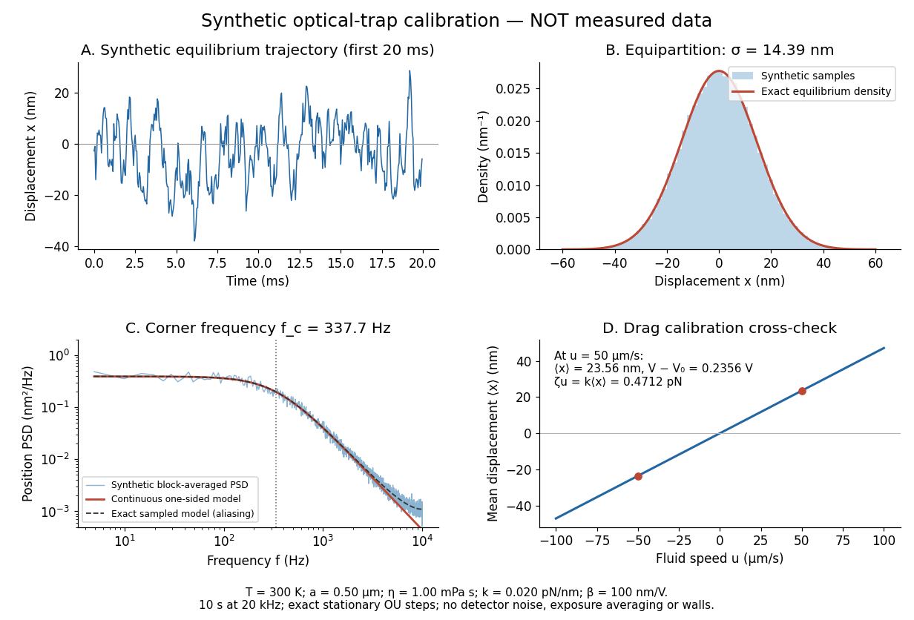
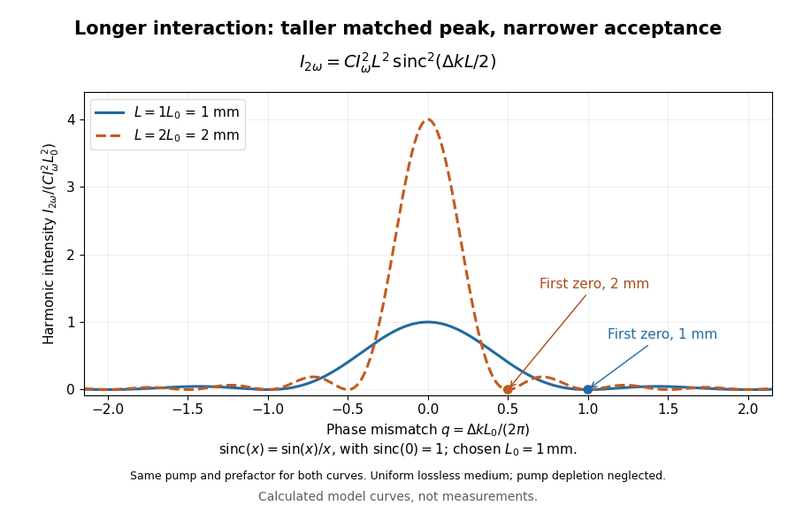

# Optics

↑ **Parent:** [Branches of physics](physics.md#branches-of-physics)  
ⓦ [Wiki](https://en.wikipedia.org/wiki/Optics)

Optics studies [light](#light), its propagation, and instruments for forming images and measuring [optical spectra](#optical-spectrum).

The central question is how [light](#light) carries information from a source to an observer. A useful description must explain both where the [light](#light) goes and how its distribution changes. In [geometrical optics](geometrical-optics.md), [light rays](geometrical-optics.md#light-ray) locate paths and images; in [physical optics](physical-optics.md), an [electromagnetic wave](electromagnetic-wave.md) has a [wave amplitude](wave.md#wave-amplitude) and a [wave phase](wave.md#phase-waves), so overlapping contributions can produce [wave interference](physical-optics.md#interference-wave-propagation) and [diffraction](quantum-scattering.md#diffraction). These descriptions address different levels of detail within the same subject. [OpenStax: The propagation of light](https://openstax.org/books/university-physics-volume-3/pages/1-1-the-propagation-of-light).

An image is especially interesting because a single object point emits [light](#light) in many directions. An [optical lens](geometrical-optics.md#lens-optics) redirects part of that spreading bundle toward a corresponding image point; repeating this construction over the object preserves spatial information. Simply gathering more [light](#light) is insufficient: [light rays](geometrical-optics.md#light-ray) from distinct object points must arrive at distinct locations. This is why an [optical camera](optical-instrument.md#optical-camera) needs both an [optical lens](geometrical-optics.md#lens-optics) and a correctly positioned receiving surface. The [thin lens](geometrical-optics.md#thin-lens) example below makes that correspondence quantitative. [OpenStax: Images formed by refraction](physics-bibliography.md#university-physics-volume-3-by-samuel-j-ling-and-others/2-3-images-formed-by-refraction).

**Table of contents**

- [Motion blur](#motion-blur)
- [Photonic structure](#photonic-structure)
- [Photonic crystal](#photonic-crystal)
  - [Photonic band structure](#photonic-band-structure)
    - [Photonic band gap](#photonic-band-gap)
      - [Photonic-crystal defect localization](#photonic-crystal-defect-localization)
  - [Colloidal photonic crystal](#colloidal-photonic-crystal)
- [Distributed Bragg reflector](#distributed-bragg-reflector)
  - [Quarter-wave Bragg stack](#quarter-wave-bragg-stack)
- [Color vision](#color-vision)
  - [Colour vision model](#colour-vision-model)
    - [Receptor noise](#receptor-noise)
    - [Receptor quantum catch](#receptor-quantum-catch)
  - [Dichromacy](#dichromacy)
  - [Trichromacy](#trichromacy)
  - [Color](#color)
- [Optician (optical instruments)](#optician-optical-instruments)
  - [List of opticians](#list-of-opticians)
    - [David Vernet](#david-vernet)
      - [Work by David Vernet](#work-by-david-vernet)
- [Microscopy](#microscopy)
  - [X-ray microscopy](#x-ray-microscopy)
    - [Scanning transmission X-ray microscopy](#scanning-transmission-x-ray-microscopy)
  - [Scanning gate microscopy](#scanning-gate-microscopy)
  - [Surface topography](#surface-topography)
  - [Super-resolution microscopy](#super-resolution-microscopy)
  - [Optical resolution](#optical-resolution)
    - [Diffraction limit](#diffraction-limit)
    - [Axial resolution](#axial-resolution)
    - [Lateral resolution](#lateral-resolution)
  - [Optical sectioning](#optical-sectioning)
- [Ellipsometry](#ellipsometry)
- [Spatial resolution](#spatial-resolution)
- [Luminescence](#luminescence)
  - [Electroluminescence](#electroluminescence)
  - [Photoluminescence](#photoluminescence)
    - [Photoluminescence excitation spectrum](#photoluminescence-excitation-spectrum)
  - [Phosphor](#phosphor)
- [Additive color](#additive-color)
- [Electron optics](#electron-optics)
  - [Electron beam brightness](#electron-beam-brightness)
  - [Electron objective lens](#electron-objective-lens)
  - [Condenser lens](#condenser-lens)
  - [Electron biprism](#electron-biprism)
  - [Electron microscope](#electron-microscope)
    - [Contrast transfer function](#contrast-transfer-function)
      - [Scherzer defocus](#scherzer-defocus)
    - [Energy filter](#energy-filter)
    - [Cold field emission gun](#cold-field-emission-gun)
    - [Detective quantum efficiency](#detective-quantum-efficiency)
    - [Direct electron detection](#direct-electron-detection)
    - [Electron microscopy](#electron-microscopy)
      - [Photoemission electron microscopy](#photoemission-electron-microscopy)
      - [Electron beam damage](#electron-beam-damage)
      - [Hydrocarbon contamination in electron microscopy](#hydrocarbon-contamination-in-electron-microscopy)
      - [Crystallographic electron channeling](#crystallographic-electron-channeling)
      - [Negative-stain electron microscopy](#negative-stain-electron-microscopy)
      - [Electron tomography](#electron-tomography)
      - [ChromEMT](#chromemt)
      - [Subtomogram averaging](#subtomogram-averaging)
      - [Cryo-electron tomography](#cryo-electron-tomography)
      - [Single-particle analysis](#single-particle-analysis)
      - [Dose weighting](#dose-weighting)
      - [Cryo-electron microscopy](#cryo-electron-microscopy)
      - [Transmission electron microscopy](#transmission-electron-microscopy)
        - [Aberration-corrected transmission electron microscopy](#aberration-corrected-transmission-electron-microscopy)
        - [High-resolution transmission electron microscopy](#high-resolution-transmission-electron-microscopy)
        - [Transmission electron microscopy contrast](#transmission-electron-microscopy-contrast)
          - [Mass–thickness contrast](#mass-thickness-contrast)
          - [Electron phase contrast](#electron-phase-contrast)
            - [Fresnel contrast](#fresnel-contrast)
          - [Objective aperture](#objective-aperture)
            - [Bright-field transmission electron microscopy](#bright-field-transmission-electron-microscopy)
            - [Dark-field transmission electron microscopy](#dark-field-transmission-electron-microscopy)
          - [Diffraction contrast](#diffraction-contrast)
            - [Thickness fringe](#thickness-fringe)
            - [Bend contour](#bend-contour)
            - [Lossless two-channel thickness scattering model](#lossless-two-channel-thickness-scattering-model)
        - [Transmission electron microscopy specimen dose and calibration](#transmission-electron-microscopy-specimen-dose-and-calibration)
    - [Scanning electron microscope](#scanning-electron-microscope)
      - [Backscattered-electron atomic-number contrast](#backscattered-electron-atomic-number-contrast)
      - [Secondary-electron topographic contrast](#secondary-electron-topographic-contrast)
      - [Environmental scanning electron microscope](#environmental-scanning-electron-microscope)
        - [Gaseous secondary electron detector](#gaseous-secondary-electron-detector)
      - [Everhart–Thornley detector](#everhart-thornley-detector)
      - [Electron backscatter yield](#electron-backscatter-yield)
      - [Scanning transmission electron microscopy](#scanning-transmission-electron-microscopy)
        - [Scanning transmission electron microscope](#scanning-transmission-electron-microscope)
        - [Annular dark-field electron imaging](#annular-dark-field-electron-imaging)
          - [High-angle annular dark-field imaging](#high-angle-annular-dark-field-imaging)
    - [Early two-stage electron microscope experiment](#early-two-stage-electron-microscope-experiment)
    - [Two-stage electron imaging](#two-stage-electron-imaging)
    - [Electron microscope resolution](#electron-microscope-resolution)
  - [Electron lens](#electron-lens)
    - [Magnetic electron lens](#magnetic-electron-lens)
- [Radiometry](radiometry.md)
  - [Optical haze](radiometry.md#optical-haze)
  - [Actinic flux](radiometry.md#actinic-flux)
  - [Fluence](radiometry.md#fluence)
  - [Radiometer](radiometry.md#radiometer)
    - [Noise temperature](radiometry.md#noise-temperature)
      - [System noise temperature](radiometry.md#system-noise-temperature)
      - [Receiver noise temperature](radiometry.md#receiver-noise-temperature)
    - [Two-load radiometer calibration](radiometry.md#two-load-radiometer-calibration)
  - [Reflectance](radiometry.md#reflectance)
  - [Absorption (electromagnetic radiation)](radiometry.md#absorption-electromagnetic-radiation)
  - [Radiant flux](radiometry.md#radiant-flux)
    - [Radiant flux through an oriented surface](radiometry.md#radiant-flux-through-an-oriented-surface)
    - [Beam collection at fixed radiant flux](radiometry.md#beam-collection-at-fixed-radiant-flux)
    - [Spectral radiant flux](radiometry.md#spectral-radiant-flux)
    - [Calibrated radiant-flux measurement](radiometry.md#calibrated-radiant-flux-measurement)
  - [Radiant intensity](radiometry.md#radiant-intensity)
    - [Point emitter](radiometry.md#point-emitter)
  - [Radiance](radiometry.md#radiance)
    - [Projected area](radiometry.md#projected-area)
    - [Spectral radiance](radiometry.md#spectral-radiance)
      - [Frequency and wavelength spectral radiance conversion](radiometry.md#frequency-and-wavelength-spectral-radiance-conversion)
      - [Vacuum conservation of specific intensity](radiometry.md#vacuum-conservation-of-specific-intensity)
      - [Limb darkening](radiometry.md#limb-darkening)
        - [Linear limb-darkening law](radiometry.md#linear-limb-darkening-law)
          - [Limb-darkening coefficient](radiometry.md#limb-darkening-coefficient)
        - [Limb-darkened disk flux](radiometry.md#limb-darkened-disk-flux)
        - [Small-planet transit weighting](radiometry.md#small-planet-transit-weighting)
        - [Solar limb-darkening drift-scan experiment](radiometry.md#solar-limb-darkening-drift-scan-experiment)
  - [Radiant exitance](radiometry.md#radiant-exitance)
  - [Irradiance](radiometry.md#irradiance)
    - [Horizontal versus beam-normal solar irradiance](radiometry.md#horizontal-versus-beam-normal-solar-irradiance)
  - [Radiometric absorptance](radiometry.md#radiometric-absorptance)
  - [Electrical substitution radiometer](radiometry.md#electrical-substitution-radiometer)
    - [Electrical substitution heat balance](radiometry.md#electrical-substitution-heat-balance)
      - [Radiometer thermal link](radiometry.md#radiometer-thermal-link)
      - [Fixed-temperature electrical substitution example](radiometry.md#fixed-temperature-electrical-substitution-example)
    - [Optical-electrical heating non-equivalence](radiometry.md#optical-electrical-heating-non-equivalence)
    - [Cryogenic radiometer](radiometry.md#cryogenic-radiometer)
      - [Cryogenic laser-power substitution experiment](radiometry.md#cryogenic-laser-power-substitution-experiment)
  - [Transmittance](radiometry.md#transmittance)
- [Photometry (optics)](#photometry-optics)
  - [Photopic luminous efficiency function](#photopic-luminous-efficiency-function)
  - [Photopic vision](#photopic-vision)
  - [Scotopic vision](#scotopic-vision)
  - [Spectral luminous efficacy](#spectral-luminous-efficacy)
  - [Luminous efficacy](#luminous-efficacy)
  - [Equal radiant power under visual weighting](#equal-radiant-power-under-visual-weighting)
  - [Luminous intensity](#luminous-intensity)
    - [Candela](#candela)
  - [Illuminance](#illuminance)
    - [Lux](#lux)
  - [Photometer](#photometer)
    - [Photometric matching filter](#photometric-matching-filter)
    - [Photometric calibration](#photometric-calibration)
      - [Spectral mismatch correction](#spectral-mismatch-correction)
        - [Calibrated photometer model](#calibrated-photometer-model)
  - [Luminous flux](#luminous-flux)
    - [Lumen (unit)](#lumen-unit)
- [Lambertian reflectance](#lambertian-reflectance)
- [Lambert's cosine law](#lambert-s-cosine-law)
- [Optical lattice](#optical-lattice)
  - [Condensate compressibility in an optical lattice](#condensate-compressibility-in-an-optical-lattice)
  - [Recoil energy](#recoil-energy)
    - [Photon-scattering recoil heating](#photon-scattering-recoil-heating)
- [Refraction](#refraction)
  - [Refraction at a spherical surface](#refraction-at-a-spherical-surface)
  - [Angle of incidence](#angle-of-incidence)
  - [Angle of refraction](#angle-of-refraction)
  - [Normal incidence](#normal-incidence)
  - [Interface phase matching](#interface-phase-matching)
  - [Apparent depth](#apparent-depth)
  - [Measuring refraction with a rectangular block](#measuring-refraction-with-a-rectangular-block)
- [Image formation](#image-formation)
  - [Conjugate optical plane](#conjugate-optical-plane)
  - [Optical bench](#optical-bench)
  - [Real image](#real-image)
  - [Virtual image](#virtual-image)
    - [Parallax localization of a virtual image](#parallax-localization-of-a-virtual-image)
  - [Magnification](#magnification)
    - [Transverse magnification](#transverse-magnification)
    - [Angular magnification](#angular-magnification)
- [Specular reflection](#specular-reflection)
  - [Reflection curve on a surface](#reflection-curve-on-a-surface)
- [Spatial light modulator](#spatial-light-modulator)
- [Spectral pulse shaping](#spectral-pulse-shaping)
  - [4f pulse shaper](#4f-pulse-shaper)
- [Laser](laser.md)
  - [Vertical-cavity surface-emitting laser](laser.md#vertical-cavity-surface-emitting-laser)
  - [Excimer laser](laser.md#excimer-laser)
  - [Laser ablation](laser.md#laser-ablation)
  - [Semiconductor laser](laser.md#semiconductor-laser)
    - [Laser diode](laser.md#laser-diode)
  - [Dye laser](laser.md#dye-laser)
  - [Three-level laser](laser.md#three-level-laser)
    - [Three-level ground-state inversion threshold](laser.md#three-level-ground-state-inversion-threshold)
    - [Ruby laser](laser.md#ruby-laser)
      - [Maiman ruby laser experiment](laser.md#maiman-ruby-laser-experiment)
    - [Three-level laser rate equation](laser.md#three-level-laser-rate-equation)
      - [Laser gain clamping](laser.md#laser-gain-clamping)
      - [Stored excitation in a pulsed laser](laser.md#stored-excitation-in-a-pulsed-laser)
  - [Laser detuning](laser.md#laser-detuning)
  - [Stimulated emission](laser.md#stimulated-emission)
    - [Photon occupation enhancement of emission](laser.md#photon-occupation-enhancement-of-emission)
    - [Population inversion](laser.md#population-inversion)
      - [Lower-level depopulation in a four-level laser](laser.md#lower-level-depopulation-in-a-four-level-laser)
  - [Optical gain](laser.md#optical-gain)
    - [Gain bandwidth](laser.md#gain-bandwidth)
      - [Gain narrowing](laser.md#gain-narrowing)
    - [Laser threshold](laser.md#laser-threshold)
      - [Round-trip laser threshold condition](laser.md#round-trip-laser-threshold-condition)
  - [Helium-neon laser](laser.md#helium-neon-laser)
  - [Optical frequency comb](laser.md#optical-frequency-comb)
    - [Mode locking](laser.md#mode-locking)
      - [Mode-locked laser](laser.md#mode-locked-laser)
    - [Carrier-envelope offset frequency](laser.md#carrier-envelope-offset-frequency)
    - [Comb self-referencing](laser.md#comb-self-referencing)
      - [Octave-spanning comb phase-control experiment](laser.md#octave-spanning-comb-phase-control-experiment)
    - [Optical frequency measurement with a comb](laser.md#optical-frequency-measurement-with-a-comb)
      - [Comb tooth index ambiguity](laser.md#comb-tooth-index-ambiguity)
  - [Chirped pulse amplification](laser.md#chirped-pulse-amplification)
    - [Chirped pulse amplification energy budget](laser.md#chirped-pulse-amplification-energy-budget)
    - [Spectral phase in pulse compression](laser.md#spectral-phase-in-pulse-compression)
    - [Gaussian chirped pulse compression](laser.md#gaussian-chirped-pulse-compression)
    - [Strickland-Mourou chirped pulse amplification experiment](laser.md#strickland-mourou-chirped-pulse-amplification-experiment)
  - [Attosecond physics](laser.md#attosecond-physics)
    - [High harmonic generation](laser.md#high-harmonic-generation)
      - [Three-step model of high harmonic generation](laser.md#three-step-model-of-high-harmonic-generation)
    - [Attosecond pulse train](laser.md#attosecond-pulse-train)
      - [Coherent harmonic pulse-train model](laser.md#coherent-harmonic-pulse-train-model)
    - [Isolated attosecond pulse](laser.md#isolated-attosecond-pulse)
    - [Reconstruction of attosecond beating by interference of two-photon transitions](laser.md#reconstruction-of-attosecond-beating-by-interference-of-two-photon-transitions)
      - [Two-path attosecond phase reconstruction](laser.md#two-path-attosecond-phase-reconstruction)
      - [2001 attosecond pulse-train experiment](laser.md#2001-attosecond-pulse-train-experiment)
    - [Attosecond streaking](laser.md#attosecond-streaking)
      - [2001 isolated attosecond pulse experiment](laser.md#2001-isolated-attosecond-pulse-experiment)
- [Maser](maser.md)
  - [Hydrogen maser](maser.md#hydrogen-maser)
  - [Ammonia maser](maser.md#ammonia-maser)
    - [Ammonia inversion transition](maser.md#ammonia-inversion-transition)
    - [Maser state selection](maser.md#maser-state-selection)
    - [Maser cavity](maser.md#maser-cavity)
      - [Maser oscillation threshold](maser.md#maser-oscillation-threshold)
        - [Maser microwave energy budget](maser.md#maser-microwave-energy-budget)
    - [Maser discovery experiment](maser.md#maser-discovery-experiment)
  - [Maser history](maser.md#maser-history)
- [Optical tweezers](#optical-tweezers)
  - [Equipartition trap calibration](#equipartition-trap-calibration)
  - [Ashkin radiation-pressure trapping experiment](#ashkin-radiation-pressure-trapping-experiment)
  - [Single-beam gradient trapping experiment](#single-beam-gradient-trapping-experiment)
  - [Optical gradient force](#optical-gradient-force)
    - [Rayleigh optical gradient force](#rayleigh-optical-gradient-force)
  - [Optical scattering force](#optical-scattering-force)
  - [Three-dimensional optical trap stability](#three-dimensional-optical-trap-stability)
  - [Harmonic optical trap](#harmonic-optical-trap)
    - [Optical trap relaxation time](#optical-trap-relaxation-time)
    - [Thermal calibration of an optical trap](#thermal-calibration-of-an-optical-trap)
      - [Optical trap Langevin calibration](#optical-trap-langevin-calibration)
        - [Sinusoidal-stage optical trap calibration](#sinusoidal-stage-optical-trap-calibration)
    - [Optical trap drag calibration](#optical-trap-drag-calibration)
    - [Optical trap calibration uncertainty](#optical-trap-calibration-uncertainty)
  - [Optical trap position readout](#optical-trap-position-readout)
  - [Optical momentum efficiency](#optical-momentum-efficiency)
  - [Passage through a translating optical trap](#passage-through-a-translating-optical-trap)
    - [High-speed passage expansion of a localized trap](#high-speed-passage-expansion-of-a-localized-trap)
    - [Sufficient escape condition for a translating trap](#sufficient-escape-condition-for-a-translating-trap)
    - [Repeated kicks from a circular optical trap](#repeated-kicks-from-a-circular-optical-trap)
      - [Large-speed approximation for circular-trap kicks](#large-speed-approximation-for-circular-trap-kicks)
      - [Triangular optical-trap response](#triangular-optical-trap-response)
    - [Forward displacement from a translating localized potential](#forward-displacement-from-a-translating-localized-potential)
- [Redshift](#redshift)
  - [Blueshift](#blueshift)
- [Coronagraph](#coronagraph)
  - [Lyot coronagraph](#lyot-coronagraph)
    - [Coronagraphic focal plane mask](#coronagraphic-focal-plane-mask)
    - [Lyot stop](#lyot-stop)
    - [Fourier model of a Lyot coronagraph](#fourier-model-of-a-lyot-coronagraph)
    - [Coronagraph pupil-stop observing experiment](#coronagraph-pupil-stop-observing-experiment)
  - [Coronagraph throughput](#coronagraph-throughput)
  - [Coronagraph inner working angle](#coronagraph-inner-working-angle)
- [Scattering of light](#scattering-of-light)
  - [Single scattering](#single-scattering)
  - [Scattering vector](#scattering-vector)
  - [Guinier approximation](#guinier-approximation)
  - [Static light scattering](#static-light-scattering)
  - [Turbidity](#turbidity)
  - [Multi-angle light scattering](#multi-angle-light-scattering)
  - [Brillouin scattering](#brillouin-scattering)
  - [Raman scattering](#raman-scattering)
    - [Raman and Krishnan light-scattering experiment](#raman-and-krishnan-light-scattering-experiment)
    - [Raman shift](#raman-shift)
    - [Stokes Raman scattering](#stokes-raman-scattering)
    - [Anti-Stokes Raman scattering](#anti-stokes-raman-scattering)
    - [Raman vibrational activity](#raman-vibrational-activity)
    - [Thermal Raman line ratio](#thermal-raman-line-ratio)
      - [One-mode Raman spectrum example](#one-mode-raman-spectrum-example)
    - [Raman spectroscopy](#raman-spectroscopy)
      - [Surface-enhanced Raman spectroscopy](#surface-enhanced-raman-spectroscopy)
        - [Chemical SERS enhancement](#chemical-sers-enhancement)
        - [Electromagnetic SERS enhancement](#electromagnetic-sers-enhancement)
- [Aperture](#aperture)
  - [Optical pinhole](#optical-pinhole)
  - [Aperture stop](#aperture-stop)
    - [Optical pupil](#optical-pupil)
- [Light](#light)
  - [Optical absorption](#optical-absorption)
    - [Weak-probe interband absorption edge](#weak-probe-interband-absorption-edge)
  - [Optical pulse](#optical-pulse)
    - [Frequency-resolved optical gating](#frequency-resolved-optical-gating)
      - [Polarization-gating frequency-resolved optical gating](#polarization-gating-frequency-resolved-optical-gating)
      - [Second-harmonic frequency-resolved optical gating](#second-harmonic-frequency-resolved-optical-gating)
    - [Gaussian pulse](#gaussian-pulse)
    - [Time-bandwidth product](#time-bandwidth-product)
      - [Gain bandwidth limit on a laser pulse](#gain-bandwidth-limit-on-a-laser-pulse)
    - [Intensity autocorrelation](#intensity-autocorrelation)
      - [Interferometric autocorrelation](#interferometric-autocorrelation)
      - [Second-harmonic intensity autocorrelation](#second-harmonic-intensity-autocorrelation)
    - [Pulse compression](#pulse-compression)
    - [Transform-limited pulse](#transform-limited-pulse)
- [Optical spectrum](#optical-spectrum)
- [Infrared](#infrared)
- [Ultraviolet](#ultraviolet)
  - [Extreme ultraviolet](#extreme-ultraviolet)
- [Geometrical optics](geometrical-optics.md)
  - [Optical rays in a reciprocal-height refractive index](geometrical-optics.md#optical-rays-in-a-reciprocal-height-refractive-index)
  - [Optical momentum of a ray](geometrical-optics.md#optical-momentum-of-a-ray)
  - [Helical rays in a radially graded refractive index](geometrical-optics.md#helical-rays-in-a-radially-graded-refractive-index)
  - [Mirage](geometrical-optics.md#mirage)
    - [Catenary light ray in a linear refractive index](geometrical-optics.md#catenary-light-ray-in-a-linear-refractive-index)
      - [Two stationary catenary rays in an inverse-height speed profile](geometrical-optics.md#two-stationary-catenary-rays-in-an-inverse-height-speed-profile)
  - [Optical lever](geometrical-optics.md#optical-lever)
  - [Wave caustic](geometrical-optics.md#wave-caustic)
  - [Light ray](geometrical-optics.md#light-ray)
    - [Circular light ray in a linear speed profile](geometrical-optics.md#circular-light-ray-in-a-linear-speed-profile)
    - [Meridional ray](geometrical-optics.md#meridional-ray)
  - [Eikonal equation for a variable-speed wave](geometrical-optics.md#eikonal-equation-for-a-variable-speed-wave)
    - [Wave-action transport for a variable-speed wave](geometrical-optics.md#wave-action-transport-for-a-variable-speed-wave)
      - [Stationary wave amplitude in a stratified wavespeed](geometrical-optics.md#stationary-wave-amplitude-in-a-stratified-wavespeed)
    - [Phase compatibility in geometrical optics](geometrical-optics.md#phase-compatibility-in-geometrical-optics)
  - [Lagrange optical invariant](geometrical-optics.md#lagrange-optical-invariant)
  - [Etendue](geometrical-optics.md#etendue)
    - [Conservation of etendue](geometrical-optics.md#conservation-of-etendue)
      - [Basic radiance](geometrical-optics.md#basic-radiance)
    - [Etendue of a circular aperture and cone](geometrical-optics.md#etendue-of-a-circular-aperture-and-cone)
    - [Area-angle tradeoff](geometrical-optics.md#area-angle-tradeoff)
    - [Aperture truncation of etendue](geometrical-optics.md#aperture-truncation-of-etendue)
    - [Optical concentrator](geometrical-optics.md#optical-concentrator)
      - [Etendue concentration limit](geometrical-optics.md#etendue-concentration-limit)
    - [Etendue bench measurement](geometrical-optics.md#etendue-bench-measurement)
  - [Optical axis](geometrical-optics.md#optical-axis)
  - [Law of reflection](geometrical-optics.md#law-of-reflection)
  - [Reversibility of an optical ray](geometrical-optics.md#reversibility-of-an-optical-ray)
  - [Lens (optics)](geometrical-optics.md#lens-optics)
    - [Focus (optics)](geometrical-optics.md#focus-optics)
    - [Focal length](geometrical-optics.md#focal-length)
      - [Optical power](geometrical-optics.md#optical-power)
        - [Dioptre](geometrical-optics.md#dioptre)
    - [Thick lens](geometrical-optics.md#thick-lens)
      - [Principal plane](geometrical-optics.md#principal-plane)
    - [Thin lens](geometrical-optics.md#thin-lens)
      - [Two equal lenses with a virtual intermediate object](geometrical-optics.md#two-equal-lenses-with-a-virtual-intermediate-object)
      - [Virtual object](geometrical-optics.md#virtual-object)
      - [Newton's lens formula](geometrical-optics.md#newton-s-lens-formula)
      - [Bessel lens displacement method](geometrical-optics.md#bessel-lens-displacement-method)
        - [Bessel two focus positions](geometrical-optics.md#bessel-two-focus-positions)
        - [Bessel lens displacement experiment](geometrical-optics.md#bessel-lens-displacement-experiment)
        - [Bessel focal length uncertainty](geometrical-optics.md#bessel-focal-length-uncertainty)
      - [Lensmaker's equation](geometrical-optics.md#lensmaker-s-equation)
  - [Optical aberration](geometrical-optics.md#optical-aberration)
    - [Seidel aberration](geometrical-optics.md#seidel-aberration)
      - [Spherical aberration](geometrical-optics.md#spherical-aberration)
      - [Coma (optics)](geometrical-optics.md#coma-optics)
        - [Seidel coma pupil mapping](geometrical-optics.md#seidel-coma-pupil-mapping)
        - [Off-axis pinhole test for coma](geometrical-optics.md#off-axis-pinhole-test-for-coma)
      - [Astigmatism (optical systems)](geometrical-optics.md#astigmatism-optical-systems)
      - [Petzval field curvature](geometrical-optics.md#petzval-field-curvature)
      - [Distortion (optics)](geometrical-optics.md#distortion-optics)
    - [Chromatic aberration](geometrical-optics.md#chromatic-aberration)
      - [Axial chromatic aberration](geometrical-optics.md#axial-chromatic-aberration)
      - [Lateral chromatic aberration](geometrical-optics.md#lateral-chromatic-aberration)
      - [Achromatic lens](geometrical-optics.md#achromatic-lens)
        - [Achromatic doublet](geometrical-optics.md#achromatic-doublet)
        - [Achromatic doublet power balance](geometrical-optics.md#achromatic-doublet-power-balance)
        - [Secondary spectrum](geometrical-optics.md#secondary-spectrum)
  - [Dispersion (optics)](geometrical-optics.md#dispersion-optics)
    - [Normal dispersion](geometrical-optics.md#normal-dispersion)
    - [Anomalous dispersion](geometrical-optics.md#anomalous-dispersion)
    - [Abbe number](geometrical-optics.md#abbe-number)
      - [Abbe diagram](geometrical-optics.md#abbe-diagram)
  - [Prism (optics)](geometrical-optics.md#prism-optics)
    - [Minimum deviation](geometrical-optics.md#minimum-deviation)
  - [Schlieren photography](geometrical-optics.md#schlieren-photography)
- [Physical optics](physical-optics.md)
  - [Phase-contrast imaging](physical-optics.md#phase-contrast-imaging)
  - [Huygens-Fresnel principle](physical-optics.md#huygens-fresnel-principle)
    - [Refraction from secondary wavelets](physical-optics.md#refraction-from-secondary-wavelets)
  - [Scalar diffraction theory](physical-optics.md#scalar-diffraction-theory)
    - [Babinet's principle](physical-optics.md#babinet-s-principle)
  - [Spectral phase](physical-optics.md#spectral-phase)
  - [Interferometer](physical-optics.md#interferometer)
    - [Rayleigh interferometer](physical-optics.md#rayleigh-interferometer)
    - [Division of wavefront](physical-optics.md#division-of-wavefront)
    - [Division of amplitude](physical-optics.md#division-of-amplitude)
    - [Interferogram](physical-optics.md#interferogram)
    - [Astronomical interferometer](physical-optics.md#astronomical-interferometer)
      - [Closure phase](physical-optics.md#closure-phase)
      - [Michelson stellar interferometer](physical-optics.md#michelson-stellar-interferometer)
        - [Equal-brightness binary-star visibility](physical-optics.md#equal-brightness-binary-star-visibility)
          - [Binary separation from visibility-zero spacing](physical-optics.md#binary-separation-from-visibility-zero-spacing)
          - [Uniform-disc binary-star visibility](physical-optics.md#uniform-disc-binary-star-visibility)
  - [Fresnel diffraction](physical-optics.md#fresnel-diffraction)
    - [Cornu chord power normalization](physical-optics.md#cornu-chord-power-normalization)
      - [Largest contiguous Fresnel aperture](physical-optics.md#largest-contiguous-fresnel-aperture)
        - [Pointwise Fresnel gain versus integrated transmitted power](physical-optics.md#pointwise-fresnel-gain-versus-integrated-transmitted-power)
        - [Existing-opening constraint in Fresnel aperture optimization](physical-optics.md#existing-opening-constraint-in-fresnel-aperture-optimization)
    - [Knife-edge diffraction](physical-optics.md#knife-edge-diffraction)
      - [Geometric spreading in a moving-receiver diffraction measurement](physical-optics.md#geometric-spreading-in-a-moving-receiver-diffraction-measurement)
    - [Fresnel-Kirchhoff diffraction integral](physical-optics.md#fresnel-kirchhoff-diffraction-integral)
    - [Zone plate](physical-optics.md#zone-plate)
      - [Exact half-period zone radii](physical-optics.md#exact-half-period-zone-radii)
      - [Axial intensity gain of an amplitude zone plate](physical-optics.md#axial-intensity-gain-of-an-amplitude-zone-plate)
    - [Half-plane shadow-boundary intensity](physical-optics.md#half-plane-shadow-boundary-intensity)
    - [Arago spot](physical-optics.md#arago-spot)
    - [Fresnel diffraction by an opaque disk](physical-optics.md#fresnel-diffraction-by-an-opaque-disk)
    - [Fresnel diffraction by a circular aperture](physical-optics.md#fresnel-diffraction-by-a-circular-aperture)
    - [Fresnel half-period zone](physical-optics.md#fresnel-half-period-zone)
    - [Square-aperture Fresnel diffraction](physical-optics.md#square-aperture-fresnel-diffraction)
    - [Fresnel diffraction phase curvature](physical-optics.md#fresnel-diffraction-phase-curvature)
    - [Fresnel number](physical-optics.md#fresnel-number)
    - [Fresnel slit propagation](physical-optics.md#fresnel-slit-propagation)
    - [Near-field diffraction laboratory experiment](physical-optics.md#near-field-diffraction-laboratory-experiment)
  - [Gaussian beam](physical-optics.md#gaussian-beam)
    - [Beam waist](physical-optics.md#beam-waist)
    - [Rayleigh length](physical-optics.md#rayleigh-length)
    - [Gaussian beam with one transverse coordinate](physical-optics.md#gaussian-beam-with-one-transverse-coordinate)
  - [Beam divergence](physical-optics.md#beam-divergence)
  - [Phase conjugation](physical-optics.md#phase-conjugation)
    - [Phase-conjugate mirror](physical-optics.md#phase-conjugate-mirror)
      - [Phase-conjugate ray retracing](physical-optics.md#phase-conjugate-ray-retracing)
    - [Thin phase-plate cancellation by phase conjugation](physical-optics.md#thin-phase-plate-cancellation-by-phase-conjugation)
    - [Digital optical phase conjugation](physical-optics.md#digital-optical-phase-conjugation)
  - [Wavefront](physical-optics.md#wavefront)
    - [Optical path length](physical-optics.md#optical-path-length)
      - [Optical path difference](physical-optics.md#optical-path-difference)
        - [Full-cycle phase-plate invisibility](physical-optics.md#full-cycle-phase-plate-invisibility)
      - [Group refractive index](physical-optics.md#group-refractive-index)
        - [Group index from refracted-angle dispersion](physical-optics.md#group-index-from-refracted-angle-dispersion)
        - [Group delay](physical-optics.md#group-delay)
          - [Group delay dispersion](physical-optics.md#group-delay-dispersion)
            - [Third-order dispersion](physical-optics.md#third-order-dispersion)
    - [Wavefront error](physical-optics.md#wavefront-error)
      - [Modal amplitude norm versus wavefront RMS](physical-optics.md#modal-amplitude-norm-versus-wavefront-rms)
  - [Interference (wave propagation)](physical-optics.md#interference-wave-propagation)
    - [Interferometry](physical-optics.md#interferometry)
      - [Optical interferometry](physical-optics.md#optical-interferometry)
        - [Atmospheric piston in interferometry](physical-optics.md#atmospheric-piston-in-interferometry)
        - [Fringe tracking](physical-optics.md#fringe-tracking)
    - [Moiré pattern](physical-optics.md#moire-pattern)
      - [Moiré fringe](physical-optics.md#moire-fringe)
        - [Moiré fringe spacing formula](physical-optics.md#moire-fringe-spacing-formula)
    - [Destructive interference](physical-optics.md#destructive-interference)
    - [Thin-film interference](physical-optics.md#thin-film-interference)
      - [Adjacent reflected minima of an air-film-air layer](physical-optics.md#adjacent-reflected-minima-of-an-air-film-air-layer)
      - [Antireflection coating](physical-optics.md#antireflection-coating)
        - [Spectral colour of an antireflection coating](physical-optics.md#spectral-colour-of-an-antireflection-coating)
      - [Angular fringe spacing of a transparent film](physical-optics.md#angular-fringe-spacing-of-a-transparent-film)
      - [Newton's rings](physical-optics.md#newton-s-rings)
    - [Double-slit experiment](physical-optics.md#double-slit-experiment)
      - [Incidence-independent adjacent-fringe wavelength](physical-optics.md#incidence-independent-adjacent-fringe-wavelength)
        - [Unknown incidence offset in double-slit phase](physical-optics.md#unknown-incidence-offset-in-double-slit-phase)
      - [Single-electron interference pattern buildup](physical-optics.md#single-electron-interference-pattern-buildup)
      - [Double-slit interference](physical-optics.md#double-slit-interference)
        - [Fraunhofer diffraction of unequal slits](physical-optics.md#fraunhofer-diffraction-of-unequal-slits)
          - [Fringe-count convention inside a diffraction envelope](physical-optics.md#fringe-count-convention-inside-a-diffraction-envelope)
        - [Phase-reversed double-slit diffraction](physical-optics.md#phase-reversed-double-slit-diffraction)
          - [Half-slit phase-step diffraction factorization](physical-optics.md#half-slit-phase-step-diffraction-factorization)
    - [Phase matching](physical-optics.md#phase-matching)
      - [Type-II phase matching](physical-optics.md#type-ii-phase-matching)
      - [Type-I phase matching](physical-optics.md#type-i-phase-matching)
      - [Quasi-phase-matching](physical-optics.md#quasi-phase-matching)
        - [Periodically poled lithium niobate](physical-optics.md#periodically-poled-lithium-niobate)
      - [Phase mismatch](physical-optics.md#phase-mismatch)
        - [Nonlinear optical coherence length](physical-optics.md#nonlinear-optical-coherence-length)
    - [Beat](physical-optics.md#beat)
      - [Two-tone output of a linear resonant circuit](physical-optics.md#two-tone-output-of-a-linear-resonant-circuit)
    - [Constructive interference intensity](physical-optics.md#constructive-interference-intensity)
    - [Destructive interference intensity](physical-optics.md#destructive-interference-intensity)
    - [Interference fringe](physical-optics.md#interference-fringe)
      - [Fringe shift](physical-optics.md#fringe-shift)
      - [Interference fringe spacing](physical-optics.md#interference-fringe-spacing)
    - [Which-path information](physical-optics.md#which-path-information)
    - [Interferometric visibility](physical-optics.md#interferometric-visibility)
      - [Signed coherence and fringe visibility](physical-optics.md#signed-coherence-and-fringe-visibility)
  - [Fraunhofer diffraction](physical-optics.md#fraunhofer-diffraction)
    - [Whole-aperture Fraunhofer distance of a coherent array](physical-optics.md#whole-aperture-fraunhofer-distance-of-a-coherent-array)
    - [Reversing one slit at an array minimum](physical-optics.md#reversing-one-slit-at-an-array-minimum)
    - [Side maximum of a finite-width double-slit pattern](physical-optics.md#side-maximum-of-a-finite-width-double-slit-pattern)
    - [Half-slit phase-reversal diffraction](physical-optics.md#half-slit-phase-reversal-diffraction)
    - [Rectangular-aperture dimensions from diffraction zeros](physical-optics.md#rectangular-aperture-dimensions-from-diffraction-zeros)
    - [Four-slit Fraunhofer diffraction](physical-optics.md#four-slit-fraunhofer-diffraction)
    - [Single-slit diffraction](physical-optics.md#single-slit-diffraction)
      - [Polychromatic single-slit diffraction](physical-optics.md#polychromatic-single-slit-diffraction)
      - [Demagnifying a distant diffraction pattern](physical-optics.md#demagnifying-a-distant-diffraction-pattern)
  - [Optical coherence](physical-optics.md#optical-coherence)
    - [Broadband planetary coherence estimate](physical-optics.md#broadband-planetary-coherence-estimate)
    - [Sunlight coherence comparison](physical-optics.md#sunlight-coherence-comparison)
    - [First-order optical coherence](physical-optics.md#first-order-optical-coherence)
      - [Polarization overlap in interferometric visibility](physical-optics.md#polarization-overlap-in-interferometric-visibility)
      - [Temporal optical coherence](physical-optics.md#temporal-optical-coherence)
        - [Unequal-line visibility in a spectral doublet](physical-optics.md#unequal-line-visibility-in-a-spectral-doublet)
        - [Delayed-fibre linewidth measurement](physical-optics.md#delayed-fibre-linewidth-measurement)
        - [Two-line coherence beating](physical-optics.md#two-line-coherence-beating)
          - [Spectral doublet from Michelson visibility revivals](physical-optics.md#spectral-doublet-from-michelson-visibility-revivals)
        - [Temporal coherence from crossed beams](physical-optics.md#temporal-coherence-from-crossed-beams)
          - [Optical path delay in crossed-beam interference](physical-optics.md#optical-path-delay-in-crossed-beam-interference)
        - [Optical coherence time](physical-optics.md#optical-coherence-time)
          - [Optical coherence length](physical-optics.md#optical-coherence-length)
            - [Coherence length from a finite spectral band](physical-optics.md#coherence-length-from-a-finite-spectral-band)
        - [Michelson interferometer](physical-optics.md#michelson-interferometer)
          - [Two-wavelength Michelson rephasing](physical-optics.md#two-wavelength-michelson-rephasing)
          - [Common-arm phase cancellation in a balanced interferometer](physical-optics.md#common-arm-phase-cancellation-in-a-balanced-interferometer)
          - [Round-trip phase in a Michelson interferometer](physical-optics.md#round-trip-phase-in-a-michelson-interferometer)
          - [Precision displacement measurement with a Michelson interferometer](physical-optics.md#precision-displacement-measurement-with-a-michelson-interferometer)
          - [Michelson measurement of length in cadmium wavelengths](physical-optics.md#michelson-measurement-of-length-in-cadmium-wavelengths)
      - [Spatial optical coherence](physical-optics.md#spatial-optical-coherence)
        - [Van Cittert-Zernike theorem](physical-optics.md#van-cittert-zernike-theorem)
        - [Uniform-disk spatial coherence](physical-optics.md#uniform-disk-spatial-coherence)
        - [Transverse optical coherence length](physical-optics.md#transverse-optical-coherence-length)
  - [Diffraction grating](physical-optics.md#diffraction-grating)
    - [Fixed-illumination grating peak change with slit width](physical-optics.md#fixed-illumination-grating-peak-change-with-slit-width)
    - [First subsidiary maximum of a large slit array](physical-optics.md#first-subsidiary-maximum-of-a-large-slit-array)
    - [First minimum of a finite slit array](physical-optics.md#first-minimum-of-a-finite-slit-array)
    - [Pixel sampling of a grating spectrum](physical-optics.md#pixel-sampling-of-a-grating-spectrum)
    - [Resolving power of a diffraction grating](physical-optics.md#resolving-power-of-a-diffraction-grating)
      - [Finite-grating incoherent doublet profile](physical-optics.md#finite-grating-incoherent-doublet-profile)
      - [Normal-incidence grating width bound](physical-optics.md#normal-incidence-grating-width-bound)
    - [Diffraction order](physical-optics.md#diffraction-order)
      - [Missing diffraction order](physical-optics.md#missing-diffraction-order)
    - [Grating equation](physical-optics.md#grating-equation)
      - [Diffraction-order feasibility](physical-optics.md#diffraction-order-feasibility)
      - [Grating dispersion](physical-optics.md#grating-dispersion)
      - [Anamorphic magnification of a grating](physical-optics.md#anamorphic-magnification-of-a-grating)
        - [Slit-limited resolving power of a grating](physical-optics.md#slit-limited-resolving-power-of-a-grating)
    - [Littrow configuration](physical-optics.md#littrow-configuration)
    - [Echelle grating](physical-optics.md#echelle-grating)
  - [Free spectral range](physical-optics.md#free-spectral-range)
    - [Free spectral range of an echelle grating](physical-optics.md#free-spectral-range-of-an-echelle-grating)
      - [Adjacent-order spacing versus nearest-axis echelle interval](physical-optics.md#adjacent-order-spacing-versus-nearest-axis-echelle-interval)
  - [Fluorescence](fluorescence.md)
    - [Fluorescent ion sensor](fluorescence.md#fluorescent-ion-sensor)
    - [Fluorescence spectroscopy](fluorescence.md#fluorescence-spectroscopy)
    - [FITC](fluorescence.md#fitc)
    - [Autofluorescence](fluorescence.md#autofluorescence)
    - [NBD](fluorescence.md#nbd)
    - [Fluorescence recovery after photobleaching](fluorescence.md#fluorescence-recovery-after-photobleaching)
    - [Fluorescence anisotropy](fluorescence.md#fluorescence-anisotropy)
    - [Fluorescence correlation spectroscopy](fluorescence.md#fluorescence-correlation-spectroscopy)
    - [Quenching (fluorescence)](fluorescence.md#quenching-fluorescence)
      - [Static fluorescence quenching](fluorescence.md#static-fluorescence-quenching)
      - [Dynamic fluorescence quenching](fluorescence.md#dynamic-fluorescence-quenching)
      - [Stern-Volmer equation](fluorescence.md#stern-volmer-equation)
      - [Fluorescence dequenching](fluorescence.md#fluorescence-dequenching)
    - [Fluorophore](fluorescence.md#fluorophore)
    - [Jablonski diagram](fluorescence.md#jablonski-diagram)
    - [Stokes shift](fluorescence.md#stokes-shift)
    - [Fluorescence excitation spectrum](fluorescence.md#fluorescence-excitation-spectrum)
    - [Fluorescence emission spectrum](fluorescence.md#fluorescence-emission-spectrum)
    - [Fluorescence quantum yield](fluorescence.md#fluorescence-quantum-yield)
    - [Photobleaching](fluorescence.md#photobleaching)
    - [Fluorescence lifetime](fluorescence.md#fluorescence-lifetime)
      - [Time-correlated single-photon counting](fluorescence.md#time-correlated-single-photon-counting)
        - [Fluorescence instrument response](fluorescence.md#fluorescence-instrument-response)
        - [Fluorescence lifetime measurement with pulsed excitation](fluorescence.md#fluorescence-lifetime-measurement-with-pulsed-excitation)
    - [Fluorescence microscope](fluorescence.md#fluorescence-microscope)
      - [Stimulated emission depletion microscopy](fluorescence.md#stimulated-emission-depletion-microscopy)
      - [Two-photon excitation microscopy](fluorescence.md#two-photon-excitation-microscopy)
      - [Single-molecule fluorescence microscopy](fluorescence.md#single-molecule-fluorescence-microscopy)
        - [Localization precision](fluorescence.md#localization-precision)
        - [Stochastic optical reconstruction microscopy](fluorescence.md#stochastic-optical-reconstruction-microscopy)
      - [Fluorescence microscopy](fluorescence.md#fluorescence-microscopy)
        - [Total internal reflection fluorescence microscopy](fluorescence.md#total-internal-reflection-fluorescence-microscopy)
        - [Live-cell imaging](fluorescence.md#live-cell-imaging)
          - [Intravital imaging](fluorescence.md#intravital-imaging)
      - [Photoconversion](fluorescence.md#photoconversion)
      - [Phototoxicity](fluorescence.md#phototoxicity)
      - [Light-sheet fluorescence microscopy](fluorescence.md#light-sheet-fluorescence-microscopy)
      - [Fluorescence excitation filter](fluorescence.md#fluorescence-excitation-filter)
      - [Fluorescence emission filter](fluorescence.md#fluorescence-emission-filter)
      - [Confocal microscopy](fluorescence.md#confocal-microscopy)
        - [Confocal microscope](fluorescence.md#confocal-microscope)
        - [Conjugate pinholes in confocal microscopy](fluorescence.md#conjugate-pinholes-in-confocal-microscopy)
        - [Confocal optical sectioning](fluorescence.md#confocal-optical-sectioning)
        - [Confocal excitation and detection point spread function](fluorescence.md#confocal-excitation-and-detection-point-spread-function)
        - [Confocal pinhole throughput](fluorescence.md#confocal-pinhole-throughput)
        - [Fluorescent bead experiment for confocal microscopy](fluorescence.md#fluorescent-bead-experiment-for-confocal-microscopy)
      - [Immunofluorescence](fluorescence.md#immunofluorescence)
    - [Fluorescent screen](fluorescence.md#fluorescent-screen)
  - [Point spread function](point-spread-function.md)
    - [Encircled energy](point-spread-function.md#encircled-energy)
    - [Point spread function normalization](point-spread-function.md#point-spread-function-normalization)
    - [Optical point source](point-spread-function.md#optical-point-source)
    - [Incoherent imaging](point-spread-function.md#incoherent-imaging)
    - [Coherent imaging](point-spread-function.md#coherent-imaging)
      - [Coherent imaging cutoff](point-spread-function.md#coherent-imaging-cutoff)
      - [Amplitude spread function](point-spread-function.md#amplitude-spread-function)
    - [Airy disk](point-spread-function.md#airy-disk)
      - [Airy disk derivation](point-spread-function.md#airy-disk-derivation)
      - [Airy disk normalization and encircled energy](point-spread-function.md#airy-disk-normalization-and-encircled-energy)
      - [Circular-aperture diffraction laboratory experiment](point-spread-function.md#circular-aperture-diffraction-laboratory-experiment)
    - [Defocus aberration](point-spread-function.md#defocus-aberration)
    - [Optical transfer function](point-spread-function.md#optical-transfer-function)
      - [Michelson contrast](point-spread-function.md#michelson-contrast)
      - [Modulation transfer function](point-spread-function.md#modulation-transfer-function)
    - [Diffraction-limited system](point-spread-function.md#diffraction-limited-system)
      - [Numerical aperture](point-spread-function.md#numerical-aperture)
      - [Diffraction-limited resolution](point-spread-function.md#diffraction-limited-resolution)
        - [Rayleigh criterion](point-spread-function.md#rayleigh-criterion)
          - [Incoherent two-source Airy profile](point-spread-function.md#incoherent-two-source-airy-profile)
        - [Spatial resolution element](point-spread-function.md#spatial-resolution-element)
    - [Strehl ratio](point-spread-function.md#strehl-ratio)
      - [Maréchal approximation](point-spread-function.md#marechal-approximation)
  - [Speckle pattern](physical-optics.md#speckle-pattern)
    - [Speckle contrast of a sinusoidal wavefront error](physical-optics.md#speckle-contrast-of-a-sinusoidal-wavefront-error)
  - [Amplitude transmittance](physical-optics.md#amplitude-transmittance)
  - [Holography](physical-optics.md#holography)
    - [Electron holography](physical-optics.md#electron-holography)
    - [Hologram](physical-optics.md#hologram)
    - [Holographic reference wave](physical-optics.md#holographic-reference-wave)
    - [Holographic object wave](physical-optics.md#holographic-object-wave)
    - [Holographic wavefront reconstruction](physical-optics.md#holographic-wavefront-reconstruction)
    - [In-line holography](physical-optics.md#in-line-holography)
      - [Twin image in holography](physical-optics.md#twin-image-in-holography)
    - [Off-axis holography](physical-optics.md#off-axis-holography)
- [Optical material](#optical-material)
  - [Silver chloride](#silver-chloride)
  - [Butadiene](#butadiene)
  - [Optical glass](#optical-glass)
    - [Crown glass (optics)](#crown-glass-optics)
    - [Flint glass](#flint-glass)
- [Atmospheric optics](#atmospheric-optics)
  - [Optical halo](#optical-halo)
    - [22-degree halo](#22-degree-halo)
  - [Atmospheric extinction](#atmospheric-extinction)
  - [Atmospheric window](#atmospheric-window)
  - [Atmospheric refraction](#atmospheric-refraction)
    - [Atmospheric dispersion](#atmospheric-dispersion)
  - [Atmospheric turbulence](#atmospheric-turbulence)
    - [Atmospheric coherence time](#atmospheric-coherence-time)
    - [Astronomical seeing](#astronomical-seeing)
      - [Speckle interferometry](#speckle-interferometry)
      - [Lucky imaging](#lucky-imaging)
      - [Fried parameter](#fried-parameter)
      - [Anisoplanatism](#anisoplanatism)
        - [Isoplanatic patch](#isoplanatic-patch)
          - [Isoplanatic angle](#isoplanatic-angle)
    - [Scintillation (astronomy)](#scintillation-astronomy)
- [Optical instrument](optical-instrument.md)
  - [Hamilton echelle spectrograph](optical-instrument.md#hamilton-echelle-spectrograph)
  - [Optical cavity](optical-instrument.md#optical-cavity)
    - [Lorentz invariance of optical cavity resonance](optical-instrument.md#lorentz-invariance-of-optical-cavity-resonance)
  - [Mirror](optical-instrument.md#mirror)
  - [Grism](optical-instrument.md#grism)
  - [Camera lucida](optical-instrument.md#camera-lucida)
  - [Optical filter](optical-instrument.md#optical-filter)
  - [Goniometer](optical-instrument.md#goniometer)
  - [Focal ratio](optical-instrument.md#focal-ratio)
  - [Optical camera](optical-instrument.md#optical-camera)
  - [Optical slit](optical-instrument.md#optical-slit)
  - [Focal plane](optical-instrument.md#focal-plane)
    - [Back focal plane](optical-instrument.md#back-focal-plane)
  - [High-contrast imaging](optical-instrument.md#high-contrast-imaging)
    - [Differential-imaging self-subtraction](optical-instrument.md#differential-imaging-self-subtraction)
    - [Simultaneous spectral differential imaging](optical-instrument.md#simultaneous-spectral-differential-imaging)
    - [Angular differential imaging](optical-instrument.md#angular-differential-imaging)
  - [Fabry–Pérot interferometer](optical-instrument.md#fabry-perot-interferometer)
    - [Order-safe angular scanning of a Fabry–Pérot spectrum](optical-instrument.md#order-safe-angular-scanning-of-a-fabry-perot-spectrum)
    - [Air-gap optical path difference in a Fabry–Pérot interferometer](optical-instrument.md#air-gap-optical-path-difference-in-a-fabry-perot-interferometer)
    - [Fabry–Pérot transmission from multiple reflections](optical-instrument.md#fabry-perot-transmission-from-multiple-reflections)
    - [Fabry–Pérot resonance spacing](optical-instrument.md#fabry-perot-resonance-spacing)
    - [Finesse](optical-instrument.md#finesse)
      - [Etalon resolving power and order overlap](optical-instrument.md#etalon-resolving-power-and-order-overlap)
    - [Fabry–Pérot etalon](optical-instrument.md#fabry-perot-etalon)
    - [Scanning Fabry–Pérot measurement](optical-instrument.md#scanning-fabry-perot-measurement)
  - [Lenslet array](optical-instrument.md#lenslet-array)
  - [Beam splitter](optical-instrument.md#beam-splitter)
    - [Optical port](optical-instrument.md#optical-port)
    - [Beam splitter scattering matrix](optical-instrument.md#beam-splitter-scattering-matrix)
      - [Balanced-splitter twin-Fock output distribution](optical-instrument.md#balanced-splitter-twin-fock-output-distribution)
    - [Coherent beam splitter recombination](optical-instrument.md#coherent-beam-splitter-recombination)
    - [Nonpolarizing beam splitter](optical-instrument.md#nonpolarizing-beam-splitter)
    - [Polarizing beam splitter](optical-instrument.md#polarizing-beam-splitter)
    - [Mach-Zehnder interferometer](optical-instrument.md#mach-zehnder-interferometer)
  - [Field of view](optical-instrument.md#field-of-view)
  - [Optical telescope](optical-instrument.md#optical-telescope)
    - [Altazimuth mount](optical-instrument.md#altazimuth-mount)
      - [Zenith blind spot](optical-instrument.md#zenith-blind-spot)
    - [Giant Magellan Telescope](optical-instrument.md#giant-magellan-telescope)
    - [Thirty Meter Telescope](optical-instrument.md#thirty-meter-telescope)
    - [W. M. Keck Observatory](optical-instrument.md#w-m-keck-observatory)
    - [Large Binocular Telescope](optical-instrument.md#large-binocular-telescope)
    - [Segmented mirror](optical-instrument.md#segmented-mirror)
      - [Mirror segment phasing](optical-instrument.md#mirror-segment-phasing)
    - [Lightweight telescope mirror](optical-instrument.md#lightweight-telescope-mirror)
    - [Active optics](optical-instrument.md#active-optics)
    - [Schmidt camera](optical-instrument.md#schmidt-camera)
    - [Reflecting telescope](optical-instrument.md#reflecting-telescope)
      - [Gregorian telescope](optical-instrument.md#gregorian-telescope)
      - [Cassegrain reflector](optical-instrument.md#cassegrain-reflector)
        - [Ritchey–Chrétien telescope](optical-instrument.md#ritchey-chretien-telescope)
        - [Classical Cassegrain reflector](optical-instrument.md#classical-cassegrain-reflector)
      - [Newtonian telescope](optical-instrument.md#newtonian-telescope)
    - [Diffraction limit of a telescope](optical-instrument.md#diffraction-limit-of-a-telescope)
  - [Entrance pupil](optical-instrument.md#entrance-pupil)
  - [Optical microscope](optical-instrument.md#optical-microscope)
    - [Polarizing microscope](optical-instrument.md#polarizing-microscope)
      - [Azimuthal brightness of a birefringent crystallite](optical-instrument.md#azimuthal-brightness-of-a-birefringent-crystallite)
      - [Conoscopic interference pattern](optical-instrument.md#conoscopic-interference-pattern)
      - [Maltese cross in polarized-light microscopy](optical-instrument.md#maltese-cross-in-polarized-light-microscopy)
    - [Microscope objective](optical-instrument.md#microscope-objective)
    - [Microscope eyepiece](optical-instrument.md#microscope-eyepiece)
    - [Intermediate microscope image](optical-instrument.md#intermediate-microscope-image)
    - [Finite-conjugate microscope](optical-instrument.md#finite-conjugate-microscope)
    - [Infinity-corrected microscope](optical-instrument.md#infinity-corrected-microscope)
      - [Tube lens](optical-instrument.md#tube-lens)
    - [Microscope scale calibration](optical-instrument.md#microscope-scale-calibration)
      - [Ocular micrometer](optical-instrument.md#ocular-micrometer)
      - [Stage micrometer](optical-instrument.md#stage-micrometer)
    - [Empty magnification](optical-instrument.md#empty-magnification)
    - [Differential interference contrast microscopy](optical-instrument.md#differential-interference-contrast-microscopy)
    - [Phase-contrast microscopy](optical-instrument.md#phase-contrast-microscopy)
      - [Phase-contrast microscope](optical-instrument.md#phase-contrast-microscope)
      - [Phase object](optical-instrument.md#phase-object)
        - [Weak phase object](optical-instrument.md#weak-phase-object)
      - [Phase plate](optical-instrument.md#phase-plate)
      - [Coherent zero-mode model of phase contrast](optical-instrument.md#coherent-zero-mode-model-of-phase-contrast)
      - [Phase-contrast image artifacts](optical-instrument.md#phase-contrast-image-artifacts)
      - [Zernike's discovery of phase contrast](optical-instrument.md#zernike-s-discovery-of-phase-contrast)
    - [Bright-field microscopy](optical-instrument.md#bright-field-microscopy)
    - [Köhler illumination](optical-instrument.md#kohler-illumination)
    - [Dark-field microscopy](optical-instrument.md#dark-field-microscopy)
  - [Ronchi ruling](optical-instrument.md#ronchi-ruling)
  - [Collimator](optical-instrument.md#collimator)
    - [Collimation](optical-instrument.md#collimation)
  - [Spectrometer](optical-instrument.md#spectrometer)
    - [Electron spectrometer](optical-instrument.md#electron-spectrometer)
    - [Electron energy analyzer](optical-instrument.md#electron-energy-analyzer)
    - [Magnetic spectrometer](optical-instrument.md#magnetic-spectrometer)
    - [Fourier transform spectroscopy](optical-instrument.md#fourier-transform-spectroscopy)
      - [Interferogram apodization](optical-instrument.md#interferogram-apodization)
      - [Interferogram of an equally spaced spectral multiplet](optical-instrument.md#interferogram-of-an-equally-spaced-spectral-multiplet)
      - [Delay-range resolution in Fourier transform spectroscopy](optical-instrument.md#delay-range-resolution-in-fourier-transform-spectroscopy)
    - [Spectrograph](optical-instrument.md#spectrograph)
      - [Spectrophotometry](optical-instrument.md#spectrophotometry)
        - [Cuvette](optical-instrument.md#cuvette)
        - [Spectrophotometer](optical-instrument.md#spectrophotometer)
      - [Spectral resolution element](optical-instrument.md#spectral-resolution-element)
      - [Linear spectral dispersion](optical-instrument.md#linear-spectral-dispersion)
      - [Integral field spectrograph](optical-instrument.md#integral-field-spectrograph)
        - [Integral-field spectrograph volume scaling](optical-instrument.md#integral-field-spectrograph-volume-scaling)
        - [Spaxel](optical-instrument.md#spaxel)
        - [Image slicer](optical-instrument.md#image-slicer)
        - [Spectral data cube](optical-instrument.md#spectral-data-cube)
      - [Spectral resolving power](optical-instrument.md#spectral-resolving-power)
      - [Cross-dispersed echelle spectrograph](optical-instrument.md#cross-dispersed-echelle-spectrograph)
        - [Cross-disperser](optical-instrument.md#cross-disperser)
        - [Echellogram](optical-instrument.md#echellogram)
      - [Multi-object spectrograph](optical-instrument.md#multi-object-spectrograph)
        - [Multi-slit spectrograph](optical-instrument.md#multi-slit-spectrograph)
        - [Fiber-fed spectrograph](optical-instrument.md#fiber-fed-spectrograph)
  - [Optical fiber](optical-instrument.md#optical-fiber)
    - [Fiber Bragg grating](optical-instrument.md#fiber-bragg-grating)
    - [Optical fiber purity and low-loss transmission](optical-instrument.md#optical-fiber-purity-and-low-loss-transmission)
    - [Step-index optical fiber](optical-instrument.md#step-index-optical-fiber)
      - [Optical fiber acceptance angle](optical-instrument.md#optical-fiber-acceptance-angle)
    - [Multimode optical fiber](optical-instrument.md#multimode-optical-fiber)
    - [Single-mode optical fiber](optical-instrument.md#single-mode-optical-fiber)
    - [Graded-index optical fiber](optical-instrument.md#graded-index-optical-fiber)
    - [Optical fiber coupling and bend experiment](optical-instrument.md#optical-fiber-coupling-and-bend-experiment)
    - [Optical fiber attenuation](optical-instrument.md#optical-fiber-attenuation)
      - [Optical fiber cutback measurement](optical-instrument.md#optical-fiber-cutback-measurement)
    - [Focal-ratio degradation](optical-instrument.md#focal-ratio-degradation)
    - [Optical fiber core](optical-instrument.md#optical-fiber-core)
    - [Optical fiber cladding](optical-instrument.md#optical-fiber-cladding)
  - [Adaptive optics](optical-instrument.md#adaptive-optics)
    - [Deformable mirror](optical-instrument.md#deformable-mirror)
      - [Deformable-mirror Fourier-mode counting](optical-instrument.md#deformable-mirror-fourier-mode-counting)
      - [Deformable-mirror control radius](optical-instrument.md#deformable-mirror-control-radius)
    - [Wavefront sensor](optical-instrument.md#wavefront-sensor)
      - [Shack–Hartmann wavefront sensor](optical-instrument.md#shack-hartmann-wavefront-sensor)
    - [Guide star (adaptive optics)](optical-instrument.md#guide-star-adaptive-optics)
      - [Laser guide star](optical-instrument.md#laser-guide-star)
    - [Adaptive-optics sky coverage](optical-instrument.md#adaptive-optics-sky-coverage)
  - [Optical attenuator](optical-instrument.md#optical-attenuator)
  - [Monochromator](optical-instrument.md#monochromator)
  - [Optical power meter](optical-instrument.md#optical-power-meter)
  - [Photodetector](optical-instrument.md#photodetector)
    - [Detector dynamic range](optical-instrument.md#detector-dynamic-range)
    - [Full well capacity](optical-instrument.md#full-well-capacity)
    - [Photon pile-up](optical-instrument.md#photon-pile-up)
    - [Vacuum photodiode](optical-instrument.md#vacuum-photodiode)
    - [Bolometer](optical-instrument.md#bolometer)
    - [Spectral responsivity](optical-instrument.md#spectral-responsivity)
    - [Detector bias frame](optical-instrument.md#detector-bias-frame)
    - [Flat-field correction](optical-instrument.md#flat-field-correction)
    - [Analogue-to-digital unit](optical-instrument.md#analogue-to-digital-unit)
    - [Detector conversion gain](optical-instrument.md#detector-conversion-gain)
      - [Gain estimation from flat-field ratios](optical-instrument.md#gain-estimation-from-flat-field-ratios)
        - [Bias of pooled flat-field ratio gain](optical-instrument.md#bias-of-pooled-flat-field-ratio-gain)
    - [Optical detector pixel](optical-instrument.md#optical-detector-pixel)
    - [Photodiode](optical-instrument.md#photodiode)
      - [Balanced photodetection](optical-instrument.md#balanced-photodetection)
      - [Quadrant photodiode](optical-instrument.md#quadrant-photodiode)
      - [Photocurrent](optical-instrument.md#photocurrent)
      - [Photodiode operating mode](optical-instrument.md#photodiode-operating-mode)
      - [Photodiode responsivity measurement](optical-instrument.md#photodiode-responsivity-measurement)
    - [Dark current (physics)](optical-instrument.md#dark-current-physics)
    - [Correlated double sampling](optical-instrument.md#correlated-double-sampling)
    - [Hybrid infrared detector](optical-instrument.md#hybrid-infrared-detector)
      - [Detector reference pixel](optical-instrument.md#detector-reference-pixel)
      - [Nondestructive detector readout](optical-instrument.md#nondestructive-detector-readout)
        - [Up-the-ramp sampling](optical-instrument.md#up-the-ramp-sampling)
        - [Fowler sampling](optical-instrument.md#fowler-sampling)
      - [H2RG detector](optical-instrument.md#h2rg-detector)
    - [Background subtraction](optical-instrument.md#background-subtraction)
      - [Radiative temperature uncertainty after background subtraction](optical-instrument.md#radiative-temperature-uncertainty-after-background-subtraction)
      - [Systematic-error signal-to-noise ceiling](optical-instrument.md#systematic-error-signal-to-noise-ceiling)
    - [Read noise](optical-instrument.md#read-noise)
    - [Photon shot noise](optical-instrument.md#photon-shot-noise)
      - [Calibration subtraction preserves shot noise](optical-instrument.md#calibration-subtraction-preserves-shot-noise)
    - [Quantum efficiency](optical-instrument.md#quantum-efficiency)
    - [Active-pixel sensor](optical-instrument.md#active-pixel-sensor)
    - [Charge-coupled device](optical-instrument.md#charge-coupled-device)
      - [Fano-limited X-ray CCD energy resolution](optical-instrument.md#fano-limited-x-ray-ccd-energy-resolution)
      - [CCD noise budget](optical-instrument.md#ccd-noise-budget)
        - [Aperture photometry with an estimated background](optical-instrument.md#aperture-photometry-with-an-estimated-background)
      - [CCD clocked charge transfer](optical-instrument.md#ccd-clocked-charge-transfer)
      - [Charge-transfer efficiency](optical-instrument.md#charge-transfer-efficiency)
      - [Deferred charge in CCD readout](optical-instrument.md#deferred-charge-in-ccd-readout)
      - [Early CCD charge-transfer experiment](optical-instrument.md#early-ccd-charge-transfer-experiment)
      - [Electron-multiplying CCD](optical-instrument.md#electron-multiplying-ccd)
        - [Multiplication excess noise](optical-instrument.md#multiplication-excess-noise)
        - [Impact ionization](optical-instrument.md#impact-ionization)
          - [Impact ionization with a hole at zero momentum](optical-instrument.md#impact-ionization-with-a-hole-at-zero-momentum)
    - [Signal-to-noise ratio in photon counting](optical-instrument.md#signal-to-noise-ratio-in-photon-counting)
      - [Poisson variance after sky subtraction](optical-instrument.md#poisson-variance-after-sky-subtraction)
  - [Refractometer](optical-instrument.md#refractometer)
    - [Abbé refractometer](optical-instrument.md#abbe-refractometer)
  - [Optical chopper](optical-instrument.md#optical-chopper)
  - [Stray light](optical-instrument.md#stray-light)
  - [Optical isolator](optical-instrument.md#optical-isolator)
  - [Photographic plate](optical-instrument.md#photographic-plate)
- [Optical microscopist](#optical-microscopist)
  - [List of optical microscopists](#list-of-optical-microscopists)
    - [Thomas J. Fellers](#thomas-j-fellers)
      - [Work by Thomas J. Fellers](#work-by-thomas-j-fellers)
- [Optical nonreciprocity](#optical-nonreciprocity)
- [Phosphorescence](#phosphorescence)
- [Lippmann plate](#lippmann-plate)
  - [Lippmann colour-recording experiment](#lippmann-colour-recording-experiment)
  - [Lippmann fringe spacing](#lippmann-fringe-spacing)
  - [Finite-layer model of Lippmann reflection](#finite-layer-model-of-lippmann-reflection)
- [Nonlinear optics](#nonlinear-optics)
  - [Optical soliton](#optical-soliton)
    - [Temporal optical soliton](#temporal-optical-soliton)
      - [Soliton order](#soliton-order)
      - [Higher-order temporal soliton](#higher-order-temporal-soliton)
      - [Fundamental temporal bright soliton](#fundamental-temporal-bright-soliton)
  - [Undepleted-pump approximation](#undepleted-pump-approximation)
  - [Four-wave mixing](#four-wave-mixing)
    - [Degenerate four-wave mixing](#degenerate-four-wave-mixing)
      - [Backward four-wave-mixing boundary problem](#backward-four-wave-mixing-boundary-problem)
        - [Four-wave-mixing oscillation threshold](#four-wave-mixing-oscillation-threshold)
      - [Counterpropagating-pump phase matching](#counterpropagating-pump-phase-matching)
  - [Spatial optical soliton](#spatial-optical-soliton)
  - [Cross-phase modulation](#cross-phase-modulation)
  - [Self-defocusing](#self-defocusing)
  - [Spatial walk-off](#spatial-walk-off)
  - [Three-wave mixing](#three-wave-mixing)
    - [Manley-Rowe relations](#manley-rowe-relations)
    - [Optical parametric amplifier](#optical-parametric-amplifier)
      - [Optical parametric oscillator](#optical-parametric-oscillator)
    - [Difference-frequency generation](#difference-frequency-generation)
    - [Sum-frequency generation](#sum-frequency-generation)
  - [Kerr effect](#kerr-effect)
    - [Optical Kerr effect](#optical-kerr-effect)
      - [Cross-Kerr interaction](#cross-kerr-interaction)
        - [Polarization-controlled Kerr rotation](#polarization-controlled-kerr-rotation)
          - [Postselection probability for Kerr-cat preparation](#postselection-probability-for-kerr-cat-preparation)
      - [Kerr lens](#kerr-lens)
    - [Electro-optic Kerr effect](#electro-optic-kerr-effect)
  - [Spontaneous parametric down-conversion](#spontaneous-parametric-down-conversion)
    - [Heralded single-photon source](#heralded-single-photon-source)
    - [SPDC pair state](#spdc-pair-state)
  - [Self-focusing](#self-focusing)
    - [Transverse modulational instability](#transverse-modulational-instability)
  - [Self-phase modulation](#self-phase-modulation)
    - [Nonlinear length](#nonlinear-length)
  - [Nonlinear optical susceptibility](#nonlinear-optical-susceptibility)
    - [Nonlinear-susceptibility tensor symmetry](#nonlinear-susceptibility-tensor-symmetry)
      - [Isotropic fourth-rank susceptibility](#isotropic-fourth-rank-susceptibility)
      - [Kleinman symmetry](#kleinman-symmetry)
      - [Intrinsic permutation symmetry of nonlinear susceptibility](#intrinsic-permutation-symmetry-of-nonlinear-susceptibility)
    - [Bulk electric-dipole selection rule](#bulk-electric-dipole-selection-rule)
  - [Optical rectification](#optical-rectification)
  - [Second-harmonic generation](#second-harmonic-generation)
    - [Two-crystal second-harmonic interference](#two-crystal-second-harmonic-interference)
    - [Franken and colleagues frequency-doubling experiment](#franken-and-colleagues-frequency-doubling-experiment)
    - [Phase matching in second-harmonic generation](#phase-matching-in-second-harmonic-generation)
      - [Second-harmonic phase mismatch](#second-harmonic-phase-mismatch)
      - [Second-harmonic coherence length](#second-harmonic-coherence-length)

## Motion blur

↑ **Parent:** [Optics](optics.md)

[Motion blur](#motion-blur) arises when a detector averages changing image positions during a finite exposure rather than recording an instantaneous position. For a stationary harmonic optical trap with position variance $k_BT/k$ and relaxation time $\tau$, rectangular exposure of duration $W$ reduces that variance by the factor $2[\alpha-1+e^{-\alpha}]/\alpha^2$, where $\alpha=W/\tau$. Integrating the exponential position covariance over both exposure times proves this formula. Ignoring the reduction makes a naive equipartition stiffness estimate too large.[§II, equations (12)–(15): exposure-averaged variance](physics-bibliography.md#the-effect-of-integration-time-on-fluctuation-measurements-calibrating-an-optical-trap-in-the-presence-of-motion-blur-by-wesley-p-wong-and-others)

## Photonic structure

↑ **Parent:** [Optics](optics.md)

A designed spatial arrangement of [dielectric](permittivity.md#dielectric) or other electromagnetic material controls optical propagation, confinement or emission. Examples include [waveguides](wave.md#waveguide), [distributed Bragg reflectors](#distributed-bragg-reflector), [photonic crystals](#photonic-crystal) and defect cavities. Spatial [interference](physical-optics.md#interference-wave-propagation) and [mode](probability-and-statistics.md#mode-statistics) [boundary conditions](differential-equation.md#boundary-condition) act on electromagnetic states; they are distinct from the [electronic band structure](bloch-s-theorem.md#electronic-band-structure) of the material itself.

## Photonic crystal

↑ **Parent:** [Optics](optics.md)

A structure with spatially periodic dielectric response, giving optical bands and, under suitable conditions, forbidden frequency intervals.

### Photonic band structure

↑ **Parent:** [Photonic crystal](#photonic-crystal)

The frequencies $\omega_n(\mathbf k)$ of electromagnetic [Bloch modes](bloch-s-theorem.md) form allowed bands in a periodic [dielectric](permittivity.md#dielectric). Their gaps and curvature determine forbidden propagation, confinement and [group velocity](dispersion-relation.md#group-velocity).

#### Photonic band gap

↑ **Parent:** [Photonic band structure](#photonic-band-structure)

A [frequency](wave.md#frequency) interval without bulk propagating electromagnetic modes in the specified directions and polarizations. A complete gap excludes all directions and polarizations; a one-dimensional stop band need not do so.

##### Photonic-crystal defect localization

↑ **Parent:** [Photonic band gap](#photonic-band-gap)

A local departure from periodicity can support a discrete mode inside a bulk [photonic band gap](#photonic-band-gap). An isolated defect makes a cavity; a line of defects may guide light. Finite surrounding crystals allow leakage.

### Colloidal photonic crystal

↑ **Parent:** [Photonic crystal](#photonic-crystal)

An ordered array of colloidal building blocks whose optical-scale periodicity gives Bragg reflection and photonic stop bands. Particle size and refractive-index contrast control the response; defects and stacking disorder can broaden it.

## Distributed Bragg reflector

↑ **Parent:** [Optics](optics.md)

A multilayer reflector using constructive [interference](physical-optics.md#interference-wave-propagation) of reflections from alternating refractive-index layers.

### Quarter-wave Bragg stack

↑ **Parent:** [Distributed Bragg reflector](#distributed-bragg-reflector)

At normal incidence, alternating layers with indices $n_H,n_L$ and optical thicknesses $n_Hd_H=n_Ld_L=\lambda_0/4$ give reinforcing reflected waves near design [wavelength](wave-equation.md#wavelength) $\lambda_0$. Their periodic transfer matrix has a stop band when its Bloch [phase](wave.md#phase-waves) is complex. A finite stack has nonzero transmission and its exterior impedances matter. Introducing a suitably phased central defect can support a transmission [resonance](dynamical-systems.md#resonance) within the stop band; a one-dimensional stop band is not a complete three-dimensional photonic gap.

## Color vision

↑ **Parent:** [Optics](optics.md)  
ⓦ [Wiki](https://en.wikipedia.org/wiki/Color_vision)

[Color vision](#color-vision) distinguishes distributions of visible [light](#light) across [wavelengths](wave-equation.md#wavelength) through the different spectral sensitivities of visual receptors. A perceived colour need not correspond to one [wavelength](wave-equation.md#wavelength): different [optical spectra](#optical-spectrum) can produce the same receptor responses. Consequently the broad spectral filtering of [thin-film interference](physical-optics.md#thin-film-interference) need not produce pure monochromatic colours.

### Colour vision model

↑ **Parent:** [Color vision](#color-vision)

A model relating a stimulus to the inputs and discrimination capacity of a visual system. Receiver [spectral sensitivity](neuroscience.md#spectral-sensitivity), illumination and background matter; human colour distances are not automatically perceptual distances for another animal.

#### Receptor noise

↑ **Parent:** [Colour vision model](#colour-vision-model)

Variability in a sensory receptor signal that limits discrimination. A difference in average [receptor quantum catch](#receptor-quantum-catch) does not alone establish a perceptually discriminable difference.

#### Receptor quantum catch

↑ **Parent:** [Colour vision model](#colour-vision-model)

Expected photon absorption by a receptor class. A simple relative model is $Q_i=\int L(\lambda)R(\lambda)S_i(\lambda)\,d\lambda$, with illumination $L$, object [reflectance](radiometry.md#reflectance) $R$ and effective [spectral sensitivity](neuroscience.md#spectral-sensitivity) $S_i$. Absolute catch also requires geometric and temporal factors.

### Dichromacy

↑ **Parent:** [Color vision](#color-vision)

Colour vision based on two classes of photoreceptor input.

### Trichromacy

↑ **Parent:** [Color vision](#color-vision)

Colour vision based on three classes of photoreceptor input. Functional discrimination must be tested rather than inferred solely from gene count.

### Color

↑ **Parent:** [Color vision](#color-vision)

The perceived [color](#color) of a transmitting sample depends on the illuminating spectrum and the wavelength-dependent transmission. Removing a blue band can make a sample appear yellow; absorption maximum alone does not determine a unique visual shade.

## Optician (optical instruments)

↑ **Parent:** [Optics](optics.md)

This section concerns specialists in [optical instruments](optical-instrument.md).

### List of opticians

↑ **Parent:** [Optician (optical instruments)](#optician-optical-instruments)

#### David Vernet

↑ **Parent:** [List of opticians](#list-of-opticians)

An [optician](#optician-optical-instruments) at the Observatoire de la Côte d’Azur.[L’équipe du C2PU: David VERNET (Opticien, OCA, département Galilée)](physics-bibliography.md#l’equipe-du-c2pu)

##### Work by David Vernet

↑ **Parent:** [David Vernet](#david-vernet)

## Microscopy

↑ **Parent:** [Optics](optics.md)  
ⓦ [Wiki](https://en.wikipedia.org/wiki/Microscopy)

### X-ray microscopy

↑ **Parent:** [Microscopy](#microscopy)

Imaging with X-rays, combining suitable focusing or image-forming optics with contrast from absorption, phase or emitted signals. Photon-energy selection can make core-edge chemical contrast accessible, while achievable resolution depends on the optics, detector and measurement geometry.

#### Scanning transmission X-ray microscopy

↑ **Parent:** [X-ray microscopy](#x-ray-microscopy)

A focused X-ray probe scans a thin specimen while a detector records transmission. Scanning photon energy across an absorption edge adds local spectroscopic contrast, with spatial resolution set by the probe and scanning performance. Thickness and composition both affect transmission, so an energy stack and suitable references help distinguish them.

### Scanning gate microscopy

↑ **Parent:** [Microscopy](#microscopy)

A conducting scanning-probe tip acts as a movable electrostatic gate. Mapping conductance changes as the tip perturbs a [quantum point contact](quantum-ideal-gas-statistics.md#quantum-point-contact) or surrounding electron gas probes [quantum transport](quantum-mechanics.md#quantum-transport). The image is a response to the tip, not automatically a noninvasive map of the unperturbed local current density.

### Surface topography

↑ **Parent:** [Microscopy](#microscopy)

The spatial height and shape of a surface. In [atomic force microscopy](engineering.md#atomic-force-microscopy), apparent lateral shape also depends on [AFM tip convolution](engineering.md#afm-tip-convolution) and the controller response.

### Super-resolution microscopy

↑ **Parent:** [Microscopy](#microscopy)

### Optical resolution

↑ **Parent:** [Microscopy](#microscopy)

#### Diffraction limit

↑ **Parent:** [Optical resolution](#optical-resolution)

The resolution scale imposed by a finite-aperture wave-imaging system under a stated criterion. For conventional optical microscopy, a common lateral scale is $\lambda/(2\mathrm{NA})$. Changing the illumination, measured signal or reconstruction assumptions can change the applicable criterion.

#### Axial resolution

↑ **Parent:** [Optical resolution](#optical-resolution)

#### Lateral resolution

↑ **Parent:** [Optical resolution](#optical-resolution)

### Optical sectioning

↑ **Parent:** [Microscopy](#microscopy)

## Ellipsometry

↑ **Parent:** [Optics](optics.md)  
ⓦ [Wiki](https://en.wikipedia.org/wiki/Ellipsometry)

Measuring how [specular reflection](#specular-reflection) changes the [polarization of an electromagnetic wave](electromagnetic-wave.md#polarization-of-an-electromagnetic-wave) to infer optical properties.

## Spatial resolution

↑ **Parent:** [Optics](optics.md)

The ability of an imaging or measurement system to distinguish nearby spatial features. A resolution criterion must specify the features and measurement conditions: [diffraction](quantum-scattering.md#diffraction), [noise](electrical-engineering.md#noise-signal-processing) and sampling can all limit the distinction. A small pixel spacing alone does not establish high spatial resolution; [electron microscope resolution](#electron-microscope-resolution) illustrates the role of [wavelength](wave-equation.md#wavelength) and [numerical aperture](point-spread-function.md#numerical-aperture).

## Luminescence

↑ **Parent:** [Optics](optics.md)  
ⓦ [Wiki](https://en.wikipedia.org/wiki/Luminescence)

[Light](#light) emission from excited matter that is not simply its [thermal radiation](electromagnetic-radiation.md#thermal-radiation) at the local [temperature](temperature.md). [Fluorescence](fluorescence.md) is one form of luminescence.

### Electroluminescence

↑ **Parent:** [Luminescence](#luminescence)  
ⓦ [Wiki](https://en.wikipedia.org/wiki/Electroluminescence)

[Light](#light) emission driven by an [electric current](electric-charge.md#electric-current) or [electric field](electric-field.md).

### Photoluminescence

↑ **Parent:** [Luminescence](#luminescence)  
ⓦ [Wiki](https://en.wikipedia.org/wiki/Photoluminescence)

Emission of [light](#light) following the absorption of [photons](quantum-mechanics.md#photon).

#### Photoluminescence excitation spectrum

↑ **Parent:** [Photoluminescence](#photoluminescence)

A measured emission intensity as excitation photon energy is varied, with emitted energy also selected or resolved. Excitation-emission maps can separate transitions belonging to different [semiconducting carbon nanotubes](chemical-substance.md#semiconducting-carbon-nanotube).

### Phosphor

↑ **Parent:** [Luminescence](#luminescence)  
ⓦ [Wiki](https://en.wikipedia.org/wiki/Phosphor)

A luminescent material, for example one that converts some of a blue [light-emitting diode](electrical-circuit.md#light-emitting-diode)'s [light](#light) into longer [wavelengths](wave-equation.md#wavelength). The name does not require long-lived [phosphorescence](#phosphorescence).

## Additive color

↑ **Parent:** [Optics](optics.md)  
ⓦ [Wiki](https://en.wikipedia.org/wiki/Additive_color)

Producing a perceived color by superposing [light](#light) with different [spectra](linear-operator-theory.md#spectrum-functional-analysis).

## Electron optics

↑ **Parent:** [Optics](optics.md)  
ⓦ [Wiki](https://en.wikipedia.org/wiki/Electron_optics)

[Electron optics](#electron-optics) studies how [electric fields](electric-field.md) and [magnetic fields](magnetic-field.md) guide [electrons](physics.md#electron) and form images. The [Lorentz force](relativistic-electromagnetism.md#lorentz-force) supplies a trajectory description, while the [de Broglie wavelength](wave-function.md#de-broglie-wavelength) supplies the [wave](wave.md) scale needed for [diffraction](quantum-scattering.md#diffraction). Both descriptions matter: steering a narrow beam and resolving two nearby specimen features are different achievements.

For a [magnetic electron lens](#magnetic-electron-lens),

$$
\mathbf F=-e\mathbf v\times\mathbf B,\qquad \mathbf F\cdot\mathbf v=0.
$$

Here $e>0$ is the [elementary charge](electric-charge.md#elementary-charge), $\mathbf v$ the [electron](physics.md#electron) [velocity](classical-mechanics.md#velocity), and $\mathbf B$ the [magnetic field](magnetic-field.md). The second equality follows because a [cross product](vector-space.md#cross-product) is perpendicular to each factor: a static [magnetic field](magnetic-field.md) bends the trajectory without increasing the [kinetic energy](energy.md#kinetic-energy). Acceleration instead requires work by an [electric field](electric-field.md). This distinction lets an [electron microscope](#electron-microscope) adjust imaging with [magnetic fields](magnetic-field.md) while an accelerating [voltage](random-walk.md#voltage) sets the [electron](physics.md#electron) [momentum](momentum.md).

### Electron beam brightness

↑ **Parent:** [Electron optics](#electron-optics)

The [electric current](electric-charge.md#electric-current) delivered per transverse probe area per [solid angle](euclidean-geometry.md#solid-angle). For a uniform circular probe of diameter $d$ and a small convergence semiangle $\alpha$, one convention is $\beta=4I/(\pi^2d^2\alpha^2)$. State the accelerating [voltage](random-walk.md#voltage), angular convention and whether brightness is reduced by a [voltage](random-walk.md#voltage) factor before comparing sources. A smaller aperture changes current as well as convergence; finite [electron beam brightness](#electron-beam-brightness) prevents arbitrary current in an arbitrarily small probe.

### Electron objective lens

↑ **Parent:** [Electron optics](#electron-optics)

The principal specimen-adjacent focusing lens of an [electron microscope](#electron-microscope). Its role depends on the mode: forming a small incident probe in scanned imaging differs from forming an enlarged transmitted image in conventional imaging.[Official glossary entry, objective-lens function](physics-bibliography.md#objective-lens-by-jeol)

### Condenser lens

↑ **Parent:** [Electron optics](#electron-optics)

An illumination lens controlling how an [electron](physics.md#electron) beam reaches the probe-forming optics or specimen. Its settings affect current, convergence and illumination geometry.

### Electron biprism

↑ **Parent:** [Electron optics](#electron-optics)

An [electron biprism](#electron-biprism) uses the [electric field](electric-field.md) around a biased fine wire to overlap coherent [electron](physics.md#electron) waves for [interference](physical-optics.md#interference-wave-propagation). It provides object–reference overlap in [electron holography](physical-optics.md#electron-holography).[Electron biprism: electrode arrangement and wave overlap](physics-bibliography.md#electron-biprism-by-jeol-ltd)

### Electron microscope

↑ **Parent:** [Electron optics](#electron-optics)  
ⓦ [Wiki](https://en.wikipedia.org/wiki/Electron_microscope)

An [electron microscope](#electron-microscope) forms a spatially enlarged representation of a specimen using [electrons](physics.md#electron), [electron lenses](#electron-lens), and a detector. Its appeal is access to structure too fine for an ordinary [optical microscope](optical-instrument.md#optical-microscope), but a short [de Broglie wavelength](wave-function.md#de-broglie-wavelength) alone does not guarantee fine [electron microscope resolution](#electron-microscope-resolution). Increasing [magnification](#magnification) can enlarge an existing blur without revealing any additional structure.

In [transmission electron microscopy](#transmission-electron-microscopy), an [electron gun](physics.md#electron-gun) illuminates a thin specimen; [magnetic electron lenses](#magnetic-electron-lens) form and enlarge its transmitted image on a [fluorescent screen](fluorescence.md#fluorescent-screen) or detector. A [vacuum](physics.md#vacuum) reduces collisions with gas. Lens [electric currents](electric-charge.md#electric-current) control focusing and [magnification](#magnification).[JEOL, The difference between Electron Beam and Light: gun, vacuum, magnetic lenses and screen](physics-bibliography.md#transmission-electron-microscope-tem-by-jeol)

#### Contrast transfer function

↑ **Parent:** [Electron microscope](#electron-microscope)

The [contrast transfer function](#contrast-transfer-function) describes how an imaging system transfers object information at different [spatial frequencies](fourier-analysis.md#spatial-frequency). In phase-contrast [electron microscopy](#electron-microscopy), defocus and aberrations can suppress or reverse particular components, requiring calibrated correction and complementary data.

##### Scherzer defocus

↑ **Parent:** [Contrast transfer function](#contrast-transfer-function)

An underfocus setting that balances objective-lens [spherical aberration](geometrical-optics.md#spherical-aberration) against defocus to provide a broad first phase-contrast band for a weak phase object. A common approximate convention is $\Delta f_S\simeq-1.2\sqrt{C_S\lambda}$ for positive $C_S$; numerical optimization conventions differ slightly.

#### Energy filter

↑ **Parent:** [Electron microscope](#electron-microscope)

An [energy filter](#energy-filter) selects electrons according to energy. In [cryo-electron microscopy](#cryo-electron-microscopy), rejecting energy-loss electrons can reduce background, but filtering cannot reverse chemical damage or remove every source of scattering noise.

#### Cold field emission gun

↑ **Parent:** [Electron microscope](#electron-microscope)

A [cold field emission gun](#cold-field-emission-gun) produces an [electron](physics.md#electron) beam by field emission without the high emitter temperature of a thermal source. A narrow energy spread can improve temporal coherence and high-frequency contrast in [cryo-electron microscopy](#cryo-electron-microscopy).

#### Detective quantum efficiency

↑ **Parent:** [Electron microscope](#electron-microscope)

[detective quantum efficiency](#detective-quantum-efficiency) is the ratio of output to input squared [signal-to-noise ratio](electrical-engineering.md#signal-to-noise-ratio) for a specified measurement convention, often evaluated by [spatial frequency](fourier-analysis.md#spatial-frequency). It describes information preservation by a detector rather than just its pixel size.

#### Direct electron detection

↑ **Parent:** [Electron microscope](#electron-microscope)

[direct electron detection](#direct-electron-detection) records incident [electrons](physics.md#electron) in a sensor without first converting them through a scintillator into an optical image. Fast readout permits counting and movies that support motion correction.

#### Electron microscopy

↑ **Parent:** [Electron microscope](#electron-microscope)

[Electron microscopy](#electron-microscopy) is the practice of preparing specimens, producing images with an [electron microscope](#electron-microscope), and interpreting their contrast. A dark region can reflect [electron](physics.md#electron) deflection out of the admitted beam rather than complete absorption. A useful image therefore needs a stated preparation, detection signal and length calibration; brightness by itself does not identify a material. [Transmission electron microscopy](#transmission-electron-microscopy) probes thin specimens, whereas a [scanning electron microscope](#scanning-electron-microscope) can examine the exposed surface of a bulk specimen.[JEOL, Observation of the micro world using electrons and Various Function of SEM: transmitted versus surface-generated signals](physics-bibliography.md#scanning-electron-microscopes-sem-by-jeol)

##### Photoemission electron microscopy

↑ **Parent:** [Electron microscopy](#electron-microscopy)  
ⓦ [Wiki](https://en.wikipedia.org/wiki/Photoemission_electron_microscopy)

[Electron](physics.md#electron) optics forms a magnified spatial image of [photoelectrons](atomic-physics.md#photoelectron) emitted from an illuminated surface. Emission yield and electron-energy selection can supply work-function, electronic or chemical contrast; brightness is not necessarily geometrical height.

##### Electron beam damage

↑ **Parent:** [Electron microscopy](#electron-microscopy)

A specimen change caused by [electron](physics.md#electron) irradiation, including atomic displacement, ionization-driven chemical changes, heating or contamination. Compare low-dose repeated observations and unexposed regions to test whether measured nanostructure is being altered by its measurement.

##### Hydrocarbon contamination in electron microscopy

↑ **Parent:** [Electron microscopy](#electron-microscopy)

Deposition or presence of carbonaceous material that changes imaging and spectroscopy.

##### Crystallographic electron channeling

↑ **Parent:** [Electron microscopy](#electron-microscopy)

Orientation-dependent propagation and scattering of [electrons](physics.md#electron) along crystal planes or columns.

##### Negative-stain electron microscopy

↑ **Parent:** [Electron microscopy](#electron-microscopy)

##### Electron tomography

↑ **Parent:** [Electron microscopy](#electron-microscopy)

Reconstruction of three-dimensional structure from electron-microscopy views at different tilts. Preparation, sampling and angular coverage affect the reconstruction.

##### ChromEMT

↑ **Parent:** [Electron microscopy](#electron-microscopy)

DNA-selective electron-microscopy staining combined with tomography for reconstructing [chromatin](molecular-genetics.md#chromatin) ultrastructure in [biological cells](biological-cell.md).[Method and in situ structure](biology-bibliography.md#chromemt-visualizing-3d-chromatin-structure-and-compaction-in-interphase-and-mitotic-cells-by-horng-d-ou-and-others)

##### Subtomogram averaging

↑ **Parent:** [Electron microscopy](#electron-microscopy)

[subtomogram averaging](#subtomogram-averaging) aligns and combines repeated structures extracted from tomographic volumes. Structural equivalence, orientation coverage and independent validation determine which details are reproducible.

##### Cryo-electron tomography

↑ **Parent:** [Electron microscopy](#electron-microscopy)

[cryo-electron tomography](#cryo-electron-tomography) reconstructs three-dimensional specimen information from tilted projections at cryogenic temperature. Radiation exposure and incomplete angular coverage limit resolution and interpretation.

##### Single-particle analysis

↑ **Parent:** [Electron microscopy](#electron-microscopy)

[single-particle analysis](#single-particle-analysis) reconstructs a three-dimensional structure from many two-dimensional images of individual particles in different orientations. Classification, alignment and assumptions about symmetry or structural sameness determine which information can be combined.

##### Dose weighting

↑ **Parent:** [Electron microscopy](#electron-microscopy)

[dose weighting](#dose-weighting) combines image information with weights that depend on accumulated exposure and [spatial frequency](fourier-analysis.md#spatial-frequency). Frames recorded after fine-detail damage may still supply useful lower-frequency information.

##### Cryo-electron microscopy

↑ **Parent:** [Electron microscopy](#electron-microscopy)

[cryo-electron microscopy](#cryo-electron-microscopy) images specimens at cryogenic [temperature](temperature.md). In biological [single-particle analysis](#single-particle-analysis), many weak projections of vitrified particles are combined to estimate a three-dimensional scattering [electrostatic potential](electric-field.md#electric-potential) map; specimen heterogeneity and [radiation damage](biology.md#radiation-damage) limit the recoverable detail.

##### Transmission electron microscopy

↑ **Parent:** [Electron microscopy](#electron-microscopy)  
ⓦ [Wiki](https://en.wikipedia.org/wiki/Transmission_electron_microscopy)

[Transmission electron microscopy](#transmission-electron-microscopy) images [electrons](physics.md#electron) transmitted through a thin specimen. [Electron diffraction](quantum-scattering.md#electron-diffraction) from a selected region supplies complementary information about its atomic arrangement. A useful transmitted signal requires suitable specimen thickness.[JEOL, Another characteristic electron diffraction: thin specimens, images and diffraction patterns](physics-bibliography.md#transmission-electron-microscope-tem-by-jeol)

The image also depends on which outgoing [electron](physics.md#electron) directions reach the detector. [Transmission electron microscopy contrast](#transmission-electron-microscopy-contrast) makes this selection explicit: changing the [objective aperture](#objective-aperture) can change an image without changing the specimen. Interpreting the result requires [electron diffraction](quantum-scattering.md#electron-diffraction), a specified detector response and [measurement calibration](physics.md#measurement-calibration).

###### Aberration-corrected transmission electron microscopy

↑ **Parent:** [Transmission electron microscopy](#transmission-electron-microscopy)

[Electron](physics.md#electron) microscopy with optical correctors compensating selected lens aberrations. Multipole correctors can reduce spherical-aberration blur and permit finer probes or improved image transfer. Resolution still depends on chromatic effects, source properties, stability, specimen scattering and damage.

###### High-resolution transmission electron microscopy

↑ **Parent:** [Transmission electron microscopy](#transmission-electron-microscopy)

An imaging approach resolving fine specimen structure through transmitted-electron interference. Contrast depends on the specimen and imaging transfer, so visible fringes require interpretation rather than direct identification with a new atomic spacing.

###### Transmission electron microscopy contrast

↑ **Parent:** [Transmission electron microscopy](#transmission-electron-microscopy)

[Transmission electron microscopy contrast](#transmission-electron-microscopy-contrast) is a difference in recorded signal between specimen regions under specified illumination, angular acceptance and detector settings. For a positive reference signal $S_{\mathrm{ref}}$, one possible signed contrast convention is

$$
C=\frac{S-S_{\mathrm{ref}}}{S_{\mathrm{ref}}}.
$$

Negative $C$ means darker than the reference; it does not specify a surface height or [chemical composition](chemical-substance.md#chemical-composition). The definition must accompany a numerical contrast value, since other conventions exist. A conspicuous feature need not establish fine [spatial resolution](#spatial-resolution): detecting a small signal difference and distinguishing two nearby features are different measurement questions.

<h6 id="mass-thickness-contrast">Mass–thickness contrast</h6>

↑ **Parent:** [Transmission electron microscopy contrast](#transmission-electron-microscopy-contrast)

Image contrast from differences in scattering mass along the [electron](physics.md#electron) path.

###### Electron phase contrast

↑ **Parent:** [Transmission electron microscopy contrast](#transmission-electron-microscopy-contrast)

Image-intensity variation produced when scattered and unscattered electron-wave amplitudes interfere after phase shifts from the specimen and imaging optics. It depends on defocus and aberrations.

###### Fresnel contrast

↑ **Parent:** [Electron phase contrast](#electron-phase-contrast)

Defocus-dependent edge fringes caused by propagation and interference of the [electron](physics.md#electron) wave. Their apparent width and sign can change with defocus, so they do not directly measure the thickness of a material shell.

###### Objective aperture

↑ **Parent:** [Transmission electron microscopy contrast](#transmission-electron-microscopy-contrast)

An [objective aperture](#objective-aperture) selects outgoing [electron](physics.md#electron) directions in the objective lens's back [focal plane](optical-instrument.md#focal-plane). Passing the central transmitted beam gives [bright-field transmission electron microscopy](#bright-field-transmission-electron-microscopy); selecting a separated diffracted beam gives [dark-field transmission electron microscopy](#dark-field-transmission-electron-microscopy).[Definition: back focal plane and beam selection](physics-bibliography.md#objective-aperture-by-jeol)

In a [paraxial approximation](partial-differential-equation.md#paraxial-approximation), an outgoing [angle](geometry-and-topology.md#angle) $\theta$ maps approximately to position $r=f\theta$ in this [focal plane](optical-instrument.md#focal-plane), where $f$ is the objective [focal length](geometrical-optics.md#focal-length). A centred opening of [radius](topology.md#radius) $a$ therefore admits $|\theta|\lesssim a/f$. Selecting a direction selects a component of the outgoing [wavefunction](wave-function.md); the subsequent image still assigns intensity to specimen positions. The opening is not a hole cut into a real-space specimen image. Its angular selection must be distinguished from selecting a specimen region for [electron diffraction](quantum-scattering.md#electron-diffraction).

**[Figure 1](#image-objective-aperture-selection-for-bright-field-transmission-electron-microscopy-and-dark-field-transmission-electron-microscopy). Objective aperture selection for bright-field transmission electron microscopy and dark-field transmission electron microscopy**. [Source](tem-objective-aperture-bright-dark-paths.py). Original functional diagram. Lower relay boxes denote image formation, not literal ray paths. Scales and beam angles are illustrative.

###### Bright-field transmission electron microscopy

↑ **Parent:** [Objective aperture](#objective-aperture)

[Bright-field transmission electron microscopy](#bright-field-transmission-electron-microscopy) selects the central transmitted beam; deflection into excluded [electron diffraction](quantum-scattering.md#electron-diffraction) beams can make a region dark.[Definition: transmitted beam and dark diffracting regions](physics-bibliography.md#bright-field-image-by-jeol)

###### Dark-field transmission electron microscopy

↑ **Parent:** [Objective aperture](#objective-aperture)

[Dark-field transmission electron microscopy](#dark-field-transmission-electron-microscopy) selects a diffracted beam while excluding the central beam. Regions contributing to that selected [electron diffraction](quantum-scattering.md#electron-diffraction) beam can appear bright.[Definition: selected diffracted beam and bright contributing regions](physics-bibliography.md#dark-field-image-by-jeol)

###### Diffraction contrast

↑ **Parent:** [Transmission electron microscopy contrast](#transmission-electron-microscopy-contrast)

[Diffraction contrast](#diffraction-contrast) is image-intensity variation caused by spatially varying [electron diffraction](quantum-scattering.md#electron-diffraction) conditions. JEOL documents a [silicon](chemical-substance.md#silicon) semiconductor-interconnect specimen at $200\,\mathrm{kV}$: its differently oriented [crystals](thermodynamics.md#crystal) are imaged in [bright-field transmission electron microscopy](#bright-field-transmission-electron-microscopy) and same-area [dark-field transmission electron microscopy](#dark-field-transmission-electron-microscopy), alongside an [electron diffraction](quantum-scattering.md#electron-diffraction) pattern. Selecting the marked diffracted beam makes the corresponding [crystal](thermodynamics.md#crystal) bright after it was dark. The preparation route, thickness and exposure are not supplied. The changed [objective aperture](#objective-aperture) selection provides a comparison within one specimen; the readout supports orientation-dependent contrast rather than a map of surface height or [chemical composition](chemical-substance.md#chemical-composition).[Definition and silicon example, panels a–c: 200 kV, same-area comparison and selected diffraction spot](physics-bibliography.md#diffraction-contrast-by-jeol)

This comparison is useful precisely because the material has not been replaced between the two images. It does not prove that thickness and [chemical composition](chemical-substance.md#chemical-composition) never influence [transmission electron microscopy contrast](#transmission-electron-microscopy-contrast). Instead, it supplies a concrete counterexample to assigning either quantity uniquely from brightness. A proposed extension is to repeat the first aperture setting after the second: recovery of the original contrast tests whether specimen motion or irradiation changed the comparison.

###### Thickness fringe

↑ **Parent:** [Diffraction contrast](#diffraction-contrast)

An oscillation of transmitted or diffracted intensity with crystal thickness caused by coupled-wave [electron diffraction](quantum-scattering.md#electron-diffraction). A uniform chemical composition can still show [thickness fringes](#thickness-fringe).

###### Bend contour

↑ **Parent:** [Diffraction contrast](#diffraction-contrast)

A band of [diffraction contrast](#diffraction-contrast) where local bending brings a [crystal structure](physical-chemistry.md#crystal-structure) into a particular [Bragg diffraction](quantum-scattering.md#bragg-diffraction) condition. Its position changes with specimen tilt.

###### Lossless two-channel thickness scattering model

↑ **Parent:** [Diffraction contrast](#diffraction-contrast)

Consider an original illustrative model with exactly two outgoing [scattering channels](quantum-scattering.md#scattering-channel): a central beam $0$ and one diffracted beam $g$. Let $t\geq0$ be specimen thickness and $\kappa>0$ a constant coupling with units of inverse length. Normalize the [probability amplitudes](wave-function.md#probability-amplitude) $A_0,A_g$ to incident [probability current](wave-function.md#probability-current), assume equal longitudinal speeds, and specify

$$
\frac{dA_0}{dt}=i\kappa A_g,\qquad
\frac{dA_g}{dt}=i\kappa A_0,\qquad
A_0(0)=1,\quad A_g(0)=0.
$$

These [ordinary differential equations](differential-equation.md#ordinary-differential-equation) define a lossless toy model, not a fit to the [silicon](chemical-substance.md#silicon) example or a complete theory of [crystal scattering](quantum-scattering.md#crystal-scattering). Differentiating once more gives $A_0''=-\kappa^2 A_0$, so

$$
A_0=\cos(\kappa t),\qquad A_g=i\sin(\kappa t),\qquad
p_0=|A_0|^2=\cos^2(\kappa t),\quad p_g=|A_g|^2=\sin^2(\kappa t).
$$

The identity $p_0+p_g=1$ expresses conservation within these two [scattering channels](quantum-scattering.md#scattering-channel). Alternatively, substituting the [ordinary differential equations](differential-equation.md#ordinary-differential-equation) into $d(|A_0|^2+|A_g|^2)/dt$ makes the two cross terms cancel. Here ideal [bright-field transmission electron microscopy](#bright-field-transmission-electron-microscopy) accepts fraction $p_0$ and rejects fraction $p_g$; ideal [dark-field transmission electron microscopy](#dark-field-transmission-electron-microscopy) accepts precisely the rejected channel. This complementarity requires the declared two-channel completeness and absence of loss.

Even with known $\kappa$, thickness is ambiguous: $\kappa t=\pi/4$ and $3\pi/4$ both give $(p_0,p_g)=(1/2,1/2)$. Near $t=0$, $p_g\simeq(\kappa t)^2$; extending that approximation through a full oscillation would erase the ambiguity incorrectly. The model isolates reversible transfer between [probability amplitudes](wave-function.md#probability-amplitude); it does not say that every thicker specimen must look darker.

**[Figure 2](#image-complementary-scattering-channel-fractions-and-ambiguous-thickness-in-a-lossless-model). Complementary scattering channel fractions and ambiguous thickness in a lossless model**. [Source](tem-lossless-two-channel-thickness.py). Original calculations from the stated coupled [probability amplitudes](wave-function.md#probability-amplitude). Left: accepted central and diffracted fractions versus dimensionless thickness $\kappa t$. Right: their [probability amplitudes](wave-function.md#probability-amplitude) trace a unit circle in the $(A_0,-iA_g)$ plane; the marked distinct thicknesses have identical fractions but different amplitude signs. No measured data or physical thickness calibration is implied.

Real [dark-field transmission electron microscopy](#dark-field-transmission-electron-microscopy) usually collects only a subset of the directions rejected in [bright-field transmission electron microscopy](#bright-field-transmission-electron-microscopy). Other [elastic scattering](quantum-scattering.md#elastic-scattering) directions, [inelastic scattering](quantum-scattering.md#inelastic-scattering) and detector losses prevent a general two-image conservation rule. To keep loss and background separate, extend the counting model explicitly. Let $\ell$ be the fraction absent from both recorded beam channels, $p_0+p_g=1$ describe the remaining fraction, $N$ be incident count per exposure, $\eta_j$ the detector efficiency and $b_j$ its mean additive background. Then the [expected value](expected-value.md) of recorded count $n_j$ is

$$
\mathbb E[n_j]=\eta_j N(1-\ell)p_j+b_j,\qquad j\in\{0,g\}.
$$

For separately acquired equal-illumination exposures with known $b_j,\eta_j$, the two corrected mean counts sum to $N(1-\ell)$, not necessarily $N$. Removal from these channels is not synonymous with physical absorption: an [electron](physics.md#electron) can leave the chosen acceptance or change [kinetic energy](energy.md#kinetic-energy) without being stopped in the specimen. Background subtraction removes a mean offset, but its counting [variance](variance.md) remains.

###### Transmission electron microscopy specimen dose and calibration

↑ **Parent:** [Transmission electron microscopy](#transmission-electron-microscopy)

JEOL's minimum-dose method focuses and corrects [astigmatism](geometrical-optics.md#astigmatism-optical-systems) away from the recording position before exposing it, reducing irradiation of the chosen field.[Definition: adjustments away from the photographed position](physics-bibliography.md#minimum-dose-system-mds-by-jeol) A downstream [objective aperture](#objective-aperture) cannot undo irradiation that has already reached the specimen: rejecting more outgoing [electrons](physics.md#electron) does not itself reduce specimen exposure.

For an original dose budget, define $D$ as incident [electron](physics.md#electron) count per specimen area, rather than absorbed [energy](energy.md) per [mass](classical-mechanics.md#mass). A uniform beam of [electric current](electric-charge.md#electric-current) magnitude $I$, illuminating area $A$ for time $T$, gives

$$
N=\frac{IT}{e},\qquad D=\frac{IT}{eA},
$$

where $e$ is the [elementary charge](electric-charge.md#elementary-charge). Choosing $I=1\,\mathrm{pA}$, $T=1\,\mathrm{s}$ and $A=1\,\mathrm{\mu m^2}$ gives approximately $6.24\times10^6$ incident [electrons](physics.md#electron), or $6.24\,\mathrm{electrons\,nm^{-2}}$. This is an invented exposure calculation, not a safe-dose recommendation. Focusing and searching exposures must also enter the accumulated budget.

If detected counts follow a [Poisson distribution](discrete-probability-distribution.md#poisson-distribution), a mean count $\mu$ has [standard deviation](variance.md#standard-deviation) $\sqrt{\mu}$. Ignoring background, $100$ accepted counts therefore have $10\%$ relative counting uncertainty, while $25$ have $20\%$. Reducing accepted counts can reveal useful [diffraction contrast](#diffraction-contrast) while increasing counting uncertainty. It is useful to specify both contrast and count budget when discussing [electron microscope resolution](#electron-microscope-resolution).

A proposed [measurement calibration](physics.md#measurement-calibration) sequence records a beam-blocked detector background, an illuminated empty support region, and a specimen image with fixed [voltage](random-walk.md#voltage), exposure and detector gain. Test detector linearity with exposure time before comparing corrected intensities. Calibrate the image scale against a known spacing, as in [microscope scale calibration](optical-instrument.md#microscope-scale-calibration), and independently calibrate [electron diffraction](quantum-scattering.md#electron-diffraction) spacing at its own lens settings; one calibration does not supply the other. Register compared regions, record [objective aperture](#objective-aperture) selection, specimen tilt and accumulated exposure, then repeat the first setting to test drift and irradiation changes. These are proposed controls, not undocumented steps attributed to JEOL's [silicon](chemical-substance.md#silicon) example.

#### Scanning electron microscope

↑ **Parent:** [Electron microscope](#electron-microscope)  
ⓦ [Wiki](https://en.wikipedia.org/wiki/Scanning_electron_microscope)

A [scanning electron microscope](#scanning-electron-microscope) scans a focused [electron](physics.md#electron) probe across a specimen and assigns a detector signal to each probe position. [Secondary electrons](physics.md#secondary-electron) leaving the irradiated region often reveal surface relief; [backscattered electrons](physics.md#backscattered-electron) can provide composition-dependent contrast. Image brightness records the selected signal, rather than a transmitted projection enlarged by two lenses. Display enlargement is therefore set by the ratio of display width to scanned specimen width. Surface geometry and composition both affect brightness.[JEOL, Why can a specimen be observed with an electron? and Various Function of SEM: secondary and backscattered signals](physics-bibliography.md#scanning-electron-microscopes-sem-by-jeol)

##### Backscattered-electron atomic-number contrast

↑ **Parent:** [Scanning electron microscope](#scanning-electron-microscope)

Composition-sensitive contrast associated with the generally larger electron backscattering yield of higher-atomic-number regions. Detector geometry, crystal orientation, surface topography and beam energy can also affect intensity, so a bright region is not a unique elemental identification.

##### Secondary-electron topographic contrast

↑ **Parent:** [Scanning electron microscope](#scanning-electron-microscope)

Image contrast from changes in secondary-electron escape and collection as surface slope, edges and detector-facing geometry vary. Secondary electrons originate near the surface, but brightness also depends on material, charging and the beam conditions.

##### Environmental scanning electron microscope

↑ **Parent:** [Scanning electron microscope](#scanning-electron-microscope)  
ⓦ [Wiki](https://en.wikipedia.org/wiki/Environmental_scanning_electron_microscope)

A scanning electron microscope permitting a controlled gaseous specimen environment while maintaining the electron column at lower pressure by differential pumping. Ionization of the gas supplies positive ions that can neutralize negative specimen charging, and a suitable gaseous detector collects electron signals. This enables examination of some nonconducting uncoated specimens, with gas scattering and detector response included in interpretation.

###### Gaseous secondary electron detector

↑ **Parent:** [Environmental scanning electron microscope](#environmental-scanning-electron-microscope)

A secondary-electron detector using amplification through collisions in the specimen-chamber gas. Its field drives signal electrons toward collection while positive ions can move toward a negatively charging specimen. Operating pressure and electrode geometry control amplification and background.

<h5 id="everhart-thornley-detector">Everhart–Thornley detector</h5>

↑ **Parent:** [Scanning electron microscope](#scanning-electron-microscope)

A scintillator–lightguide–photomultiplier detector used especially for secondary-electron imaging.

##### Electron backscatter yield

↑ **Parent:** [Scanning electron microscope](#scanning-electron-microscope)

The fraction of incident [electrons](physics.md#electron) emerging from a specimen as [backscattered electrons](physics.md#backscattered-electron).

##### Scanning transmission electron microscopy

↑ **Parent:** [Scanning electron microscope](#scanning-electron-microscope)

Imaging a sufficiently thin specimen using a scanned electron probe and transmitted-electron detectors.

###### Scanning transmission electron microscope

↑ **Parent:** [Scanning transmission electron microscopy](#scanning-transmission-electron-microscopy)

An [electron microscope](#electron-microscope) that scans a focused probe across an electron-transparent specimen and records transmitted-electron signals at each scan position. Its image [magnification](#magnification) is set by the displayed-to-scanned length ratio, separately from angular detector collection.

###### Annular dark-field electron imaging

↑ **Parent:** [Scanning transmission electron microscopy](#scanning-transmission-electron-microscopy)

Detection of transmitted electrons within an angular annulus excluding the direct beam. Contrast can include diffraction, atomic-number and thickness contributions depending on the collection angles.

###### High-angle annular dark-field imaging

↑ **Parent:** [Annular dark-field electron imaging](#annular-dark-field-electron-imaging)

A [scanning transmission electron microscopy](#scanning-transmission-electron-microscopy) mode collecting electrons scattered to sufficiently large angles. It often gives approximately monotonic atomic-number and mass-thickness contrast, with detector angles and multiple scattering still important.

#### Early two-stage electron microscope experiment

↑ **Parent:** [Electron microscope](#electron-microscope)

[Ernst Ruska](physicist.md#ernst-ruska) and [Max Knoll](electrical-engineering.md#max-knoll) developed [electron optics](#electron-optics) while improving the writing spot of a [cathode-ray oscilloscope](wave-equation.md#cathode-ray-oscilloscope).[Ruska, Nobel lecture, §C; RMP reprint pp. 628–629](physics-bibliography.md#the-development-of-the-electron-microscope-and-of-electron-microscopy-by-ernst-ruska) A structured object tests [image formation](#image-formation) more strongly than a single bright spot: each feature must retain its own image position.

On 7 April 1931, a [cold cathode](physics.md#cold-cathode) source and two short magnetic coils imaged aperture grids at $50\,\mathrm{kV}$. A [platinum](chemical-substance.md#platinum) grid preceded the first coil; a bronze grid preceded the second. The [fluorescent screen](fluorescence.md#fluorescent-screen) showed one-stage grid images and the first grid reimaged through both stages. Comparing these patterns tested successive [image formation](#image-formation), not merely beam concentration. Heating could destroy even metal grids. This prototype did not establish resolution beyond an [optical microscope](optical-instrument.md#optical-microscope).[Ruska, §E, Figs. 2–3; RMP reprint p. 630: dated one-stage and two-stage comparison](physics-bibliography.md#the-development-of-the-electron-microscope-and-of-electron-microscopy-by-ernst-ruska)

In 1933, Ruska measured $3\,\mathrm{mm}$ [focal lengths](geometrical-optics.md#focal-length) at $75\,\mathrm{kV}$ with a pole-piece lens, then built an instrument giving $12000$-fold [magnification](#magnification).[Ruska, §E, Figs. 4–5; RMP reprint p. 631](physics-bibliography.md#the-development-of-the-electron-microscope-and-of-electron-microscopy-by-ernst-ruska) TU Berlin dates images surpassing conventional [optical microscope](optical-instrument.md#optical-microscope) resolution to 1933.[TU Berlin, indexed historical biography: 1933 prototype surpassing light-microscope resolution](physics-bibliography.md#ernst-ruska-by-technische-universitat-berlin)

A [fluorescent screen](fluorescence.md#fluorescent-screen) converts the spatial [electron](physics.md#electron) distribution into visible [light](#light).[JEOL, The difference between Electron Beam and Light: fluorescent image readout](physics-bibliography.md#transmission-electron-microscope-tem-by-jeol) A collector reporting only total [electric current](electric-charge.md#electric-current) would discard that spatial pattern. In a two-stage image relay, the first lens makes an intermediate [real image](#real-image); the second treats that image as its object. The diagram below illustrates this geometry with invented distances and an ideal beam.

#### Two-stage electron imaging

↑ **Parent:** [Electron microscope](#electron-microscope)

Consider two ideal thin [electron lenses](#electron-lens) in successive imaging stages. In each stage choose positive object and image distances $u_i,v_i$ for a [real image](#real-image), measured from its effective lens plane, and neglect the image rotation of a [magnetic electron lens](#magnetic-electron-lens). The [paraxial approximation](partial-differential-equation.md#paraxial-approximation) gives

$$
\frac{1}{f_i}=\frac{1}{u_i}+\frac{1}{v_i},\qquad m_i=-\frac{v_i}{u_i},\qquad m=m_1m_2.
$$

The product follows directly by writing $y_1=m_1y_0$ and $y_2=m_2y_1$. Here $m_i$ is [transverse magnification](#transverse-magnification), rather than the enlargement applied later to a photograph. Both inversions cancel in this planar model; actual [magnetic electron lenses](#magnetic-electron-lens) can additionally rotate the image.

For an original worked example, take $u_1=40\,\mathrm{mm}$, $v_1=80\,\mathrm{mm}$, $u_2=50\,\mathrm{mm}$ and $v_2=150\,\mathrm{mm}$. Then

$$
f_1=\frac{80}{3}\,\mathrm{mm},\qquad f_2=37.5\,\mathrm{mm},\qquad m_1=-2,\qquad m_2=-3,\qquad m=6.
$$

A $100\,\mathrm{\mu m}$ object interval becomes $600\,\mathrm{\mu m}$ at the screen. The second lens sits $v_1+u_2=130\,\mathrm{mm}$ after the first. These are calculated distances, not measurements of the 1931 instrument.

**[Figure 3](#image-two-electron-lenses-relay-an-object-into-an-enlarged-screen-image). Two electron lenses relay an object into an enlarged screen image**. [Source](electron-lens-two-stage-imaging.py). Original [paraxial approximation](partial-differential-equation.md#paraxial-approximation) construction for the worked example, in a frame neglecting magnetic image rotation. Three illustrative trajectories from one off-axis point meet at the intermediate image and again at the screen. The shaded bands represent effective magnetic lens regions; real trajectories bend smoothly. The dashed enclosure represents a [vacuum](physics.md#vacuum) column, with an upstream [electron gun](physics.md#electron-gun) and a pump connection indicated schematically. Horizontal and vertical scales differ; neither the geometry nor the rays reproduce historical apparatus measurements.

To measure [magnification](#magnification), divide a screen interval between corresponding grid features by the independently known object interval. Repeat over several periods to reduce endpoint uncertainty. For a proposed check, record accelerating [voltage](random-walk.md#voltage), lens [electric currents](electric-charge.md#electric-current), screen position and specimen orientation; compare one-stage and two-stage images, refocusing as necessary. Changing a lens [electric current](electric-charge.md#electric-current) should change focus and scale, while a blank exposure checks detector background. Keep irradiation and recording enlargement controlled, and repeat the original setting to test drift or specimen damage. These are suggested checks, not a claim that every check was performed in 1931. A grid-scale measurement establishes [magnification](#magnification); resolving much finer features requires a separate target and contrast criterion.

#### Electron microscope resolution

↑ **Parent:** [Electron microscope](#electron-microscope)

[Electron microscope resolution](#electron-microscope-resolution) concerns distinguishable specimen detail under a specified contrast criterion. It depends on [diffraction](quantum-scattering.md#diffraction), lens defects, [electron](physics.md#electron) energy spread, specimen motion and detection. A smaller [de Broglie wavelength](wave-function.md#de-broglie-wavelength) permits finer detail in principle, but neither [wavelength](wave-equation.md#wavelength) nor [magnification](#magnification) is the instrument's measured resolution.

For an [electron](physics.md#electron) accelerated from negligible initial [kinetic energy](energy.md#kinetic-energy) through a positive [electric potential difference](electric-field.md#electric-potential-difference) $U$, combine $K=eU$, the [relativistic energy-momentum relation](special-relativity.md#energy-momentum-relation) and the [de Broglie wavelength](wave-function.md#de-broglie-wavelength):

$$
p^2c^2=K(K+2m_ec^2),\qquad
\lambda(U)=\frac{h}{\sqrt{2m_e eU\left(1+\frac{eU}{2m_ec^2}\right)}}.
$$

Here $h$ is the [Planck constant](quantum-mechanics.md#planck-constant), $m_e$ the [electron](physics.md#electron) [mass](classical-mechanics.md#mass), $e$ the [elementary charge](electric-charge.md#elementary-charge), and $c$ the [speed of light](special-relativity.md#speed-of-light). This includes the relativistic correction omitted by the low-[voltage](random-walk.md#voltage) [electron accelerating-voltage wavelength](wave-function.md#electron-accelerating-voltage-wavelength) approximation. With $m_e\simeq9.1093837\times10^{-31}\,\mathrm{kg}$ and SI defining values of $h,e,c$, calculated [wavelengths](wave-equation.md#wavelength) are approximately $6.979$, $3.701$ and $1.969\,\mathrm{pm}$ at $30$, $100$ and $300\,\mathrm{kV}$ respectively. The rounded [mass](classical-mechanics.md#mass) agrees with the recommended value.[CODATA electron mass, 2022 adjustment](physics-bibliography.md#codata-value-electron-mass-by-national-institute-of-standards-and-technology)

For a circular aperture admitting a small semi-angle $\alpha$, the [Rayleigh criterion](point-spread-function.md#rayleigh-criterion) suggests a [diffraction-limited resolution](point-spread-function.md#diffraction-limited-resolution) scale $d_D=0.61\lambda/\alpha$. At $100\,\mathrm{kV}$ and $\alpha=10\,\mathrm{mrad}$, this gives $0.226\,\mathrm{nm}$, already much larger than the $0.00370\,\mathrm{nm}$ [wavelength](wave-equation.md#wavelength). This is an ideal aperture estimate. [Transmission electron microscopy](#transmission-electron-microscopy) with coherent illumination and a particular specimen requires its own image-contrast analysis; this scale alone is not a universal two-feature resolution test.

An original illustrative blur model adds competing effects:

$$
b(\alpha)^2=\left(\frac{0.61\lambda}{\alpha}\right)^2
 +(C_s\alpha^3)^2
 +\left(C_c\alpha\frac{\Delta K}{K}\right)^2+b_0^2.
$$

Define $C_s\alpha^3$ as a characteristic transverse blur from the electron-lens analogue of [spherical aberration](geometrical-optics.md#spherical-aberration), and $C_c\alpha\Delta K/K$ as one from energy-dependent focusing, the analogue of [chromatic aberration](geometrical-optics.md#chromatic-aberration). The coefficients $C_s,C_c$ have units of length, $\Delta K$ is a chosen characteristic [kinetic energy](energy.md#kinetic-energy) spread, and $b_0$ is a fixed residual blur. Adding their squares is a declared heuristic, not a measured [point spread function](point-spread-function.md) or a rigorous resolution theorem. The model omits contrast transfer, specimen scattering and signal statistics, so its minimum is only an estimate within its assumptions.

Choose $C_s=C_c=1\,\mathrm{mm}$, $\Delta K=0.7\,\mathrm{eV}$ and $b_0=0.10\,\mathrm{nm}$ at $K=100\,\mathrm{keV}$. At $5\,\mathrm{mrad}$, the four contributions are about $0.452$, $0.125$, $0.035$ and $0.100\,\mathrm{nm}$, giving $b\simeq0.480\,\mathrm{nm}$. At $10\,\mathrm{mrad}$, the [diffraction](quantum-scattering.md#diffraction) contribution falls to $0.226\,\mathrm{nm}$ but the assumed [spherical aberration](geometrical-optics.md#spherical-aberration) contribution grows to $1.00\,\mathrm{nm}$. Thus opening the aperture indefinitely worsens this model's image. All these values are calculations with chosen parameters, not observations of any microscope.

**[Figure 4](#image-short-electron-wavelength-and-competing-image-blur-scales). Short electron wavelength and competing image-blur scales**. [Source](electron-wavelength-resolution-budget.py). Original calculations, not measurements. Left: relativistic [de Broglie wavelength](wave-function.md#de-broglie-wavelength) versus accelerating [voltage](random-walk.md#voltage). Right: ideal [diffraction](quantum-scattering.md#diffraction) and assumed electron-lens blur contributions at $100\,\mathrm{kV}$, with their quadrature total. The marked minimum belongs only to the stated heuristic model and does not specify a historical or modern instrument's resolution.

### Electron lens

↑ **Parent:** [Electron optics](#electron-optics)

An [electron lens](#electron-lens) uses an [electric field](electric-field.md) or [magnetic field](magnetic-field.md) to make trajectories from an object point converge towards an image point. It has no glass for the [electrons](physics.md#electron) to pass through. In a [paraxial approximation](partial-differential-equation.md#paraxial-approximation), an effective [focal length](geometrical-optics.md#focal-length) permits the same first-order image geometry used for a [thin lens](geometrical-optics.md#thin-lens); finite beam angles, energy spread and misalignment limit this approximation.

#### Magnetic electron lens

↑ **Parent:** [Electron lens](#electron-lens)

A [magnetic electron lens](#magnetic-electron-lens) uses a [solenoid](magnetic-field.md#solenoid) around the beam axis; iron pole pieces concentrate its [magnetic field](magnetic-field.md).[Ruska, §§C and E, Fig. 4: iron enclosure and pole-piece lens](physics-bibliography.md#the-development-of-the-electron-microscope-and-of-electron-microscopy-by-ernst-ruska) A strictly axial trajectory in a perfectly uniform axial [magnetic field](magnetic-field.md) experiences no [Lorentz force](relativistic-electromagnetism.md#lorentz-force), since $\mathbf v\times\mathbf B=0$. Near the entrance, a radial field component turns an advancing [electron](physics.md#electron) azimuthally; the resulting sideways [velocity](classical-mechanics.md#velocity) in the axial [magnetic field](magnetic-field.md) also produces a radial [Lorentz force](relativistic-electromagnetism.md#lorentz-force). This couples image rotation and focusing. Real trajectories bend smoothly, whereas a [thin lens](geometrical-optics.md#thin-lens) diagram compresses that bending into one effective plane.

## Radiometry

↑ **Parent:** [Optics](optics.md)

[This section is present in another page, follow this link to view it.](radiometry.md)

## Photometry (optics)

↑ **Parent:** [Optics](optics.md)  
ⓦ [Wiki](https://en.wikipedia.org/wiki/Photometry_(optics))

[Photometry](#photometry-optics) weights visible [electromagnetic radiation](electromagnetic-radiation.md) by standardized visual response functions; [radiometry](radiometry.md) measures its [energy](energy.md) and [power](energy.md#power) without visual weighting.[Radiometry and Photometry: Review for Vision Optics](physics-bibliography.md#osa-handbook-of-optics-volume-iii-visual-optics-and-vision/radiometry-and-photometry-review-for-vision-optics)

The question is how much [light](#light) a source supplies under a stated visual weighting. A beam containing $1\,\mathrm{mW}$ at the defining [frequency](wave.md#frequency) $540\,\mathrm{THz}$ has [luminous flux](#luminous-flux) $0.683\,\mathrm{lm}$. Moving the same [radiant flux](radiometry.md#radiant-flux) to a region of smaller [spectral luminous efficacy](#spectral-luminous-efficacy) reduces its [luminous flux](#luminous-flux). Changing the [optical spectrum](#optical-spectrum) changes this conversion even when its total [power](energy.md#power) stays fixed. This makes [photometry](#photometry-optics) useful for comparing lighting, while [radiometry](radiometry.md) remains necessary for an [energy](energy.md) budget. The [lumen](#lumen-unit) counts [luminous flux](#luminous-flux); the [candela](#candela) additionally specifies its distribution over [solid angle](euclidean-geometry.md#solid-angle).

Two measurement routes implement the weighting: measure an [optical spectrum](#optical-spectrum) and evaluate a weighted [integral](integral.md), or use a [photometer](#photometer) whose [spectral responsivity](optical-instrument.md#spectral-responsivity) approximates the prescribed weighting. Both require a specified collection geometry. Neither is a complete prediction of an individual's perception of a scene.[Radiometry and Photometry: Review for Vision Optics](physics-bibliography.md#osa-handbook-of-optics-volume-iii-visual-optics-and-vision/radiometry-and-photometry-review-for-vision-optics)

### Photopic luminous efficiency function

↑ **Parent:** [Photometry (optics)](#photometry-optics)

The [photopic luminous efficiency function](#photopic-luminous-efficiency-function) $V(\lambda)$ is dimensionless and describes standardized relative sensitivity for [photopic vision](#photopic-vision). It is normalized to $V(555\,\mathrm{nm})=1$ and tabulated over $360$–$830\,\mathrm{nm}$. The [wavelength](wave-equation.md#wavelength) coordinate is in standard air, rather than [vacuum](physics.md#vacuum); changing coordinates requires converting the [spectral radiant flux](radiometry.md#spectral-radiant-flux) density as well. The official prescription uses linear [interpolation](interpolation.md) between the specified 1 nm entries.[§3.1, printed pp. 2–3: wavelength convention, normalized functions and interpolation](physics-bibliography.md#the-international-system-of-units-si-ninth-edition-si-brochure/mise-en-pratique-for-the-definition-of-the-candela-and-associated-derived-units-for-photometric-and-radiometric-quantities-in-the-si)

Write $\lambda_a$ for the standard-air [wavelength](wave-equation.md#wavelength) at $540\,\mathrm{THz}$. With [spectral radiant flux](radiometry.md#spectral-radiant-flux) $\Phi_{e,\lambda}$ in $\mathrm{W\,nm^{-1}}$ and $d\lambda$ in nanometres, the [luminous flux](#luminous-flux) is

$$
\Phi_v=K_m\int_{360\,\mathrm{nm}}^{830\,\mathrm{nm}}V(\lambda)\Phi_{e,\lambda}(\lambda)\,d\lambda,
\qquad K_m=\frac{K_{\mathrm{cd}}}{V(\lambda_a)},\qquad K_{\mathrm{cd}}=683\,\mathrm{lm\,W^{-1}}.
$$

The [integral](integral.md) has units of [watts](electric-charge.md#watt), and $K_m$ converts them to [lumens](#lumen-unit). For radiation at a single [wavelength](wave-equation.md#wavelength) $\lambda_0$ with total [radiant flux](radiometry.md#radiant-flux) $P$, this reduces to $\Phi_v=K_mV(\lambda_0)P$. For a sufficiently narrow finite band, this is an approximation requiring nearly constant $V$ across the band.[§3.1, equation (2), printed p. 3: spectral weighting normalized at the defining frequency](physics-bibliography.md#the-international-system-of-units-si-ninth-edition-si-brochure/mise-en-pratique-for-the-definition-of-the-candela-and-associated-derived-units-for-photometric-and-radiometric-quantities-in-the-si)

### Photopic vision

↑ **Parent:** [Photometry (optics)](#photometry-optics)  
ⓦ [Wiki](https://en.wikipedia.org/wiki/Photopic_vision)

[Photopic vision](#photopic-vision) means vision under light-adapted conditions. Standard [photometry](#photometry-optics) here uses the [photopic luminous efficiency function](#photopic-luminous-efficiency-function); [scotopic vision](#scotopic-vision) uses a different weighting for dark-adapted conditions. The response function and adaptation conditions must be stated when comparing [luminous fluxes](#luminous-flux).[§3.1, printed p. 3: photopic and scotopic luminous efficiency functions](physics-bibliography.md#the-international-system-of-units-si-ninth-edition-si-brochure/mise-en-pratique-for-the-definition-of-the-candela-and-associated-derived-units-for-photometric-and-radiometric-quantities-in-the-si)

### Scotopic vision

↑ **Parent:** [Photometry (optics)](#photometry-optics)  
ⓦ [Wiki](https://en.wikipedia.org/wiki/Scotopic_vision)

### Spectral luminous efficacy

↑ **Parent:** [Photometry (optics)](#photometry-optics)

[Spectral luminous efficacy](#spectral-luminous-efficacy) converts [radiant flux](radiometry.md#radiant-flux) at one [wavelength](wave-equation.md#wavelength) to [luminous flux](#luminous-flux). The [candela](#candela) convention fixes $K_{\mathrm{cd}}$ exactly at $540\times10^{12}\,\mathrm{Hz}$, not at an exactly specified [wavelength](wave-equation.md#wavelength) of $555\,\mathrm{nm}$. [SI base unit: candela (cd)](physics-bibliography.md#si-base-unit-candela-cd)

In [vacuum](physics.md#vacuum), that [frequency](wave.md#frequency) corresponds to $c/(540\times10^{12}\,\mathrm{Hz})\simeq555.1712\,\mathrm{nm}$, using the [speed of light](special-relativity.md#speed-of-light). In standard air it is approximately $555.017\,\mathrm{nm}$, close to the $555\,\mathrm{nm}$ maximum of the [photopic luminous efficiency function](#photopic-luminous-efficiency-function). Thus $K_m$ is slightly larger than $683\,\mathrm{lm\,W^{-1}}$; using $K_m\simeq683\,\mathrm{lm\,W^{-1}}$ in ordinary calculations is a rounded convention. The exact anchor is $K(\lambda_a)=683\,\mathrm{lm\,W^{-1}}$. [luminous efficacy of radiation, for a specified photometric condition](physics-bibliography.md#luminous-efficacy-of-radiation-for-a-specified-photometric-condition)

### Luminous efficacy

↑ **Parent:** [Photometry (optics)](#photometry-optics)  
ⓦ [Wiki](https://en.wikipedia.org/wiki/Luminous_efficacy)

The [luminous efficacy](#luminous-efficacy) of radiation is [luminous flux](#luminous-flux) divided by total [radiant flux](radiometry.md#radiant-flux), in $\mathrm{lm\,W^{-1}}$, for the specified visual conditions. For nonzero [radiant flux](radiometry.md#radiant-flux), it is a spectral [weighted mean](arithmetic.md#weighted-arithmetic-mean) of [spectral luminous efficacy](#spectral-luminous-efficacy). Specify the denominator: a lamp's [luminous efficacy](#luminous-efficacy) relative to electrical input [power](energy.md#power) also includes conversion losses and is a different ratio. [luminous efficacy of radiation, for a specified photometric condition](physics-bibliography.md#luminous-efficacy-of-radiation-for-a-specified-photometric-condition)

### Equal radiant power under visual weighting

↑ **Parent:** [Photometry (optics)](#photometry-optics)

An original declared model makes the distinction visible without substituting invented numbers for the [photopic luminous efficiency function](#photopic-luminous-efficiency-function). Define a triangular weight

$$
w(\lambda)=\max\!\left(0,1-\frac{|\lambda-555\,\mathrm{nm}|}{150\,\mathrm{nm}}\right),\qquad
\widetilde\Phi_v=(683\,\mathrm{lm\,W^{-1}})\int w(\lambda)\Phi_{e,\lambda}(\lambda)\,d\lambda.
$$

This $w$ is an illustrative function, not a fit or table of $V$. Three ideal spectral lines, each carrying [radiant flux](radiometry.md#radiant-flux) $1\,\mathrm{mW}$, at $450$, $555$ and $650\,\mathrm{nm}$ have weights $3/10$, $1$ and $11/30$. Their model weighted outputs are respectively $0.2049$, $0.6830$ and approximately $0.25043\,\mathrm{lm}$. These are model calculations, not standard [luminous fluxes](#luminous-flux) or measured data. For mixtures of these lines the model outputs add, just as the [integral](integral.md) adds independent spectral contributions.

**[Figure 5](#photometry-declared-spectral-weighting). Equal radiant fluxes give different outputs under a declared spectral weight**. Original triangular weighting model, not CIE data. Each ideal line carries $1\,\mathrm{mW}$; its drawn height represents line [power](energy.md#power), not a finite spectral density. The lower bars apply the stipulated $683\,\mathrm{lm\,W^{-1}}$ model scale. The model demonstrates the mechanism without supplying calibration data for actual [photometry](#photometry-optics).

### Luminous intensity

↑ **Parent:** [Photometry (optics)](#photometry-optics)  
ⓦ [Wiki](https://en.wikipedia.org/wiki/Luminous_intensity)

[Luminous intensity](#luminous-intensity) is [luminous flux](#luminous-flux) per outgoing [solid angle](euclidean-geometry.md#solid-angle), measured in [candelas](#candela). It is the visually weighted counterpart of [radiant intensity](radiometry.md#radiant-intensity). The same total [luminous flux](#luminous-flux) concentrated into a narrower cone can give a greater [luminous intensity](#luminous-intensity) within that cone.[Radiometry and Photometry: Review for Vision Optics](physics-bibliography.md#osa-handbook-of-optics-volume-iii-visual-optics-and-vision/radiometry-and-photometry-review-for-vision-optics)

#### Candela

↑ **Parent:** [Luminous intensity](#luminous-intensity)  
ⓦ [Wiki](https://en.wikipedia.org/wiki/Candela)

At exactly $540\,\mathrm{THz}$, [radiant intensity](radiometry.md#radiant-intensity) $1/683\,\mathrm{W\,sr^{-1}}$ corresponds to [luminous intensity](#luminous-intensity) $1\,\mathrm{cd}$. This convention specifies a direction, rather than the source's total [luminous flux](#luminous-flux). [SI base unit: candela (cd)](physics-bibliography.md#si-base-unit-candela-cd)

### Illuminance

↑ **Parent:** [Photometry (optics)](#photometry-optics)  
ⓦ [Wiki](https://en.wikipedia.org/wiki/Illuminance)

[Illuminance](#illuminance) is incident [luminous flux](#luminous-flux) per receiving [area](differential-geometry.md#surface-area), measured in [lux](#lux). It is the visually weighted counterpart of [irradiance](radiometry.md#irradiance). Uniform illumination of an aperture of [area](differential-geometry.md#surface-area) $A$ gives collected [luminous flux](#luminous-flux) $AE_v$. An aperture measurement alone does not give a source's total emitted [luminous flux](#luminous-flux).[Radiometry and Photometry: Review for Vision Optics](physics-bibliography.md#osa-handbook-of-optics-volume-iii-visual-optics-and-vision/radiometry-and-photometry-review-for-vision-optics)

#### Lux

↑ **Parent:** [Illuminance](#illuminance)  
ⓦ [Wiki](https://en.wikipedia.org/wiki/Lux)

### Photometer

↑ **Parent:** [Photometry (optics)](#photometry-optics)  
ⓦ [Wiki](https://en.wikipedia.org/wiki/Photometer)

A [photometer](#photometer) measures a visually weighted radiation quantity. A filtered [photodiode](optical-instrument.md#photodiode) approximates the [photopic luminous efficiency function](#photopic-luminous-efficiency-function) with its [spectral responsivity](optical-instrument.md#spectral-responsivity); calibration establishes how its [electric current](electric-charge.md#electric-current) maps to [illuminance](#illuminance) or collected [luminous flux](#luminous-flux). NIST's detector-based realization traces the [spectral responsivity](optical-instrument.md#spectral-responsivity) to a [cryogenic radiometer](radiometry.md#cryogenic-radiometer) and the aperture [area](differential-geometry.md#surface-area) to length measurements. [Realization of the candela](physics-bibliography.md#realization-of-the-candela)

#### Photometric matching filter

↑ **Parent:** [Photometer](#photometer)

A [photometric matching filter](#photometric-matching-filter) shapes a [photodiode](optical-instrument.md#photodiode)'s combined [spectral responsivity](optical-instrument.md#spectral-responsivity) toward the [photopic luminous efficiency function](#photopic-luminous-efficiency-function). Matching is imperfect, so [photometric calibration](#photometric-calibration) must retain spectral information. [Realization of the candela](physics-bibliography.md#realization-of-the-candela)

#### Photometric calibration

↑ **Parent:** [Photometer](#photometer)

[NIST Measurement Services: Photometric Calibrations by Yuqin Zong and others](physics-bibliography.md#nist-measurement-services-photometric-calibrations-by-yuqin-zong-and-others) describes a concrete experiment (§§3.2–3.3.2): a [silicon](chemical-substance.md#silicon) [photodiode](optical-instrument.md#photodiode), multilayer [photometric matching filter](#photometric-matching-filter), precision aperture, [temperature](temperature.md) sensor and current-to-voltage converter. A [monochromator](optical-instrument.md#monochromator) supplies a small beam; scanning [wavelength](wave-equation.md#wavelength) yields [spectral responsivity](optical-instrument.md#spectral-responsivity), and scanning position checks response across the aperture. Finite spectral bandwidth requires correction. The average aperture response converts uniform illumination to [illuminance](#illuminance).

On the photometric bench (§§3.4.1, 3.5.3, 3.5.6), align lamp and aperture reference planes, set the lamp's [electric current](electric-charge.md#electric-current), stabilize, and compare a check lamp with standard [photometers](#photometer). The readout is a [voltmeter](electric-field.md#voltmeter) signal. Subtract the shutter-closed reading (§3.4.4), divide by converter gain to infer [electric current](electric-charge.md#electric-current), and use calibrated [illuminance](#illuminance) responsivity $S_A$ to obtain $E_v=i/S_A$. For a distant source, [luminous intensity](#luminous-intensity) follows from $I_v=E_vd^2$, with $d$ between reference planes.

Controls include repeat lamp operations, distance changes to test the [inverse-square law](physics.md#inverse-square-law), [temperature](temperature.md) corrections and gain [linearity](vector-space.md#linearity) checks. [Spectral mismatch correction](#spectral-mismatch-correction) is source dependent (§3.4.3). Unknown [optical spectra](#optical-spectrum), spatial nonuniformity and incorrect reference planes remain limitations.[§§3.2–3.5.6, printed pp. 16–19, 22–28, 33–37: apparatus, dark subtraction, readout, corrections and check-lamp procedure](physics-bibliography.md#nist-measurement-services-photometric-calibrations-by-yuqin-zong-and-others)

##### Spectral mismatch correction

↑ **Parent:** [Photometric calibration](#photometric-calibration)

For collected [spectral radiant flux](radiometry.md#spectral-radiant-flux) $f(\lambda)$ and a linear [photodiode](optical-instrument.md#photodiode) with [spectral responsivity](optical-instrument.md#spectral-responsivity) $r(\lambda)$, the dark-subtracted [electric current](electric-charge.md#electric-current) is $i=\int r f\,d\lambda$. A reference [optical spectrum](#optical-spectrum) $f_A$ sets the conversion $C_A$ from [electric current](electric-charge.md#electric-current) to collected [luminous flux](#luminous-flux). Applying it to another [optical spectrum](#optical-spectrum) $f_T$ gives

$$
C_A=\frac{K_m\int V f_A\,d\lambda}{\int r f_A\,d\lambda},\qquad
\Phi_{v,\mathrm{indicated}}=C_A\int r f_T\,d\lambda,
\qquad
F=\frac{\int V f_T\,d\lambda}{\int r f_T\,d\lambda}
\frac{\int r f_A\,d\lambda}{\int V f_A\,d\lambda}.
$$

Assume nonzero calibration and test signals. Then $F\Phi_{v,\mathrm{indicated}}$ is the corrected [luminous flux](#luminous-flux). Multiplying either [optical spectrum](#optical-spectrum) by an overall positive scale leaves $F$ unchanged. If $r$ is proportional to $V$, $F=1$ for every [optical spectrum](#optical-spectrum). Uniformly overfilled aperture measurements use [wavelength](wave-equation.md#wavelength)-resolved [irradiance](radiometry.md#irradiance) instead, multiplying the [electric current](electric-charge.md#electric-current) expression by aperture [area](differential-geometry.md#surface-area); the same ratio cancellation gives the [illuminance](#illuminance) correction. This is the algebra behind source-dependent calibration, rather than a new measured correction curve. [Realization of the candela](physics-bibliography.md#realization-of-the-candela)

###### Calibrated photometer model

↑ **Parent:** [Spectral mismatch correction](#spectral-mismatch-correction)

Use the triangular $w$ in [equal radiant power under visual weighting](#equal-radiant-power-under-visual-weighting) and stipulate the detector's [spectral responsivity](optical-instrument.md#spectral-responsivity)

$$
r(\lambda)=(0.5\,\mathrm{A\,W^{-1}})w(\lambda)
\left(1+\frac{\lambda-555\,\mathrm{nm}}{150\,\mathrm{nm}}\right).
$$

This model has nonnegative response: $w$ is zero outside $405$–$705\,\mathrm{nm}$. For a $1\,\mathrm{mW}$ ideal calibration line at $555\,\mathrm{nm}$, $i_A=0.5\,\mathrm{mA}$ and $\widetilde\Phi_{v,A}=0.683\,\mathrm{lm}$, so $C_A=1366\,\mathrm{lm\,A^{-1}}$. An equal-[radiant flux](radiometry.md#radiant-flux) test line at $630\,\mathrm{nm}$ gives $w=1/2$, $r=0.375\,\mathrm{A\,W^{-1}}$ and $i_T=0.375\,\mathrm{mA}$. The unchanged conversion indicates $0.51225\,\mathrm{lm}$, whereas the model's intended weighted result is $0.3415\,\mathrm{lm}$. The required [spectral mismatch correction](#spectral-mismatch-correction) is $F=2/3$: the uncorrected result is 50% too large. All these numbers are declared model outputs, not instrument measurements or standard [photometry](#photometry-optics) data.

**[Figure 6](#photometry-calibrated-detector-spectral-mismatch). Calibration at one wavelength leaves a spectral mismatch at another**. Original schematic and analytic model. The apparatus shows the signal path of a filtered [photodiode](optical-instrument.md#photodiode) [photometer](#photometer), with shutter-closed subtraction; it is not a drawing to scale of a specific instrument. The lower panels use the declared triangular weighting and detector response, not CIE tables. The two ideal lines carry the same collected [radiant flux](radiometry.md#radiant-flux); the source-dependent factor $2/3$ corrects the test indication within this model only.

### Luminous flux

↑ **Parent:** [Photometry (optics)](#photometry-optics)  
ⓦ [Wiki](https://en.wikipedia.org/wiki/Luminous_flux)

[Luminous flux](#luminous-flux) is the visually weighted counterpart of [radiant flux](radiometry.md#radiant-flux), measured in lumens. Its value depends on the [optical spectrum](#optical-spectrum) and the specified visual response; it is distinct from [radiant flux](radiometry.md#radiant-flux) in [watts](electric-charge.md#watt).[Radiometry and Photometry: Review for Vision Optics](physics-bibliography.md#osa-handbook-of-optics-volume-iii-visual-optics-and-vision/radiometry-and-photometry-review-for-vision-optics)

#### Lumen (unit)

↑ **Parent:** [Luminous flux](#luminous-flux)  
ⓦ [Wiki](https://en.wikipedia.org/wiki/Lumen_(unit))

The [lumen](#lumen-unit) is the [International System of Units](physics.md#international-system-of-units) unit of [luminous flux](#luminous-flux): $1\,\mathrm{lm}=1\,\mathrm{cd}\,\mathrm{sr}$. A source with constant [luminous intensity](#luminous-intensity) $1\,\mathrm{cd}$ within a cone of [solid angle](euclidean-geometry.md#solid-angle) $1\,\mathrm{sr}$ supplies $1\,\mathrm{lm}$ into that cone. A source with the same [luminous intensity](#luminous-intensity) in every direction supplies $4\pi\,\mathrm{lm}$ over a full [sphere](euclidean-geometry.md#sphere). [SI base unit: candela (cd)](physics-bibliography.md#si-base-unit-candela-cd)

## Lambertian reflectance

↑ **Parent:** [Optics](optics.md)  
ⓦ [Wiki](https://en.wikipedia.org/wiki/Lambertian_reflectance)

[Lambertian reflectance](#lambertian-reflectance) is the ideal diffuse-reflection model with direction-independent outgoing [radiance](radiometry.md#radiance), the [frequency](wave.md#frequency)-integrated [specific intensity](radiometry.md#spectral-radiance). If a fraction $0\leq\rho\leq1$ of incident [radiant flux](radiometry.md#radiant-flux) is reflected, a surface receiving [irradiance](radiometry.md#irradiance) $E$ has reflected [radiance](radiometry.md#radiance) $L=\rho E/\pi$. The reflected outward [power](energy.md#power) per [area](differential-geometry.md#surface-area) is $\pi L=\rho E$ by the same hemispherical integral used for [radiant exitance](radiometry.md#radiant-exitance). Its [radiant intensity](radiometry.md#radiant-intensity) still acquires the [projected area](radiometry.md#projected-area) factor in [Lambert's cosine law](#lambert-s-cosine-law).

For $E=100\,\mathrm{W\,m^{-2}}$ and $\rho=0.80$, the reflected [radiance](radiometry.md#radiance) is $80/\pi\approx25.4648\,\mathrm{W\,m^{-2}\,sr^{-1}}$. A patch of [area](differential-geometry.md#surface-area) $0.020\,\mathrm{m^2}$ reflects $1.6\,\mathrm W$ in total, and its [radiant intensities](radiometry.md#radiant-intensity) at $0^\circ$ and $60^\circ$ are respectively $1.6/\pi$ and $0.8/\pi\,\mathrm{W\,sr^{-1}}$. The [radiance](radiometry.md#radiance) stays fixed as the view changes, provided the illumination stays fixed. Changing the incident [angle](geometry-and-topology.md#angle) can change [irradiance](radiometry.md#irradiance) and therefore the reflected [radiance](radiometry.md#radiance).

<h2 id="lambert-s-cosine-law">Lambert's cosine law</h2>

↑ **Parent:** [Optics](optics.md)  
ⓦ [Wiki](https://en.wikipedia.org/wiki/Lambert's_cosine_law)

For an ideal diffuse emitting or reflecting planar surface with uniform direction-independent [radiance](radiometry.md#radiance), the [radiant intensity](radiometry.md#radiant-intensity) in a direction at [angle](geometry-and-topology.md#angle) $\theta$ to its [unit normal](differential-geometry.md#unit-normal) is $I(\theta)=I(0)\cos\theta$. This follows immediately from $I=LA\cos\theta$ and the [projected area](radiometry.md#projected-area) formula. The worked [radiance](radiometry.md#radiance) example and diagram show the $0^\circ$ and $60^\circ$ cases. [Lambertian reflectance](#lambertian-reflectance) supplies one physical idealization realizing the law; an ideal [blackbody](astrophysics.md#blackbody) provides an emitting example.

The historical setting is Johann Heinrich Lambert's _Photometria sive de mensura et gradibus luminis, colorum et umbrae_, published in Augsburg in 1760. Its Part I, §139, explicitly compares normal and oblique illumination using the sine of the source's elevation, equivalently the [cosine](geometry-and-topology.md#cosine) of its [angle](geometry-and-topology.md#angle) from the receiving [normal vector](differential-geometry.md#normal-vector). This is an early receiving-surface projection calculation; the modern outgoing-patch statement above keeps [radiance](radiometry.md#radiance), [radiant intensity](radiometry.md#radiant-intensity) and [irradiance](radiometry.md#irradiance) distinct. [Lambert, Photometria, 1760, digitized original held by ETH-Bibliothek Zürich](https://www.e-rara.ch/zut/content/titleinfo/2814923) [Photometria, searchable text, Part I, §139](https://www.e-rara.ch/zut/download/ftpack/plain/2814923).

## Optical lattice

↑ **Parent:** [Optics](optics.md)  
ⓦ [Wiki](https://en.wikipedia.org/wiki/Optical_lattice)

An optical lattice is a periodic [optical trap](#optical-tweezers) produced by interfering light fields. Its [periodic potential](bloch-s-theorem.md#periodic-potential) gives atomic [Bloch states](bloch-s-theorem.md#bloch-state) and [energy bands](bloch-s-theorem.md#energy-band). For the displayed one-dimensional lattice, the [recoil energy](#recoil-energy) is $E_R=\hbar^2\pi^2/(2md^2)$ and $s$ measures the depth in recoil units.

### Condensate compressibility in an optical lattice

↑ **Parent:** [Optical lattice](#optical-lattice)

Here $n$ is average [number density](statistical-physics.md#number-density) and $\mu$ the ground-state [chemical potential](chemical-potential.md). This commonly used condensate response has units of inverse energy; thermodynamic [isothermal compressibility](thermodynamics.md#isothermal-compressibility) is instead $\kappa/n$. In a weakly interacting repulsive condensate, the normalized one-cell ground state $f_s$, with average $|f_s|^2=1$, gives $\mu=E_0(s)+Un I(s)+\cdots$, $I(s)=d^{-1}\int_0^d|f_s|^4dx$. Localization raises $I$ and reduces $\kappa$ at fixed $n,U,d$. In deep harmonic wells $I\propto s^{1/4}$, hence $\kappa\propto s^{-1/4}$. This is a ground-band, repulsive-superfluid statement with the held variables specified, not a theorem for arbitrary signs of the interaction or arbitrary excited branches.

### Recoil energy

↑ **Parent:** [Optical lattice](#optical-lattice)

Recoil energy is the [kinetic energy](energy.md#kinetic-energy) gained by an initially stationary atom absorbing a photon of momentum $p_R$. In a standing-wave [optical lattice](#optical-lattice) of spacing $d$, the photon wavenumber is $\pi/d$, giving $E_R=\hbar^2\pi^2/(2md^2)$.

#### Photon-scattering recoil heating

↑ **Parent:** [Recoil energy](#recoil-energy)

Absorption of [momentum](momentum.md) $\mathbf p$ followed by emission of $\mathbf p'$ changes a free atom's [momentum](momentum.md) by $\mathbf p-\mathbf p'$. For isotropic emission of fixed magnitude, its mean [vector](vector-space.md#vector) is zero. The [energy](energy.md) change then separates into a directional [work](energy.md#work) term and two positive [recoil](momentum.md#recoil) terms. If absorption directions are also isotropic and uncorrelated with the initial [momentum](momentum.md), the [work](energy.md#work) term averages away. Equal incoming and outgoing [photon](quantum-mechanics.md#photon) magnitudes give two [recoil](momentum.md#recoil) energies per cycle.

## Refraction

↑ **Parent:** [Optics](optics.md)  
ⓦ [Wiki](https://en.wikipedia.org/wiki/Refraction)

Refraction changes the direction of a transmitted [wave](wave.md) when it crosses between media with different [phase velocities](dispersion-relation.md#phase-velocity). For [light](#light) at a planar interface, [Snell's law](partial-differential-equation.md#snell-s-law) relates the angles measured from the [normal vector](differential-geometry.md#normal-vector) through the [refractive indices](electromagnetic-wave.md#refractive-index). At normal incidence the direction remains unchanged even though the [wavelength](wave-equation.md#wavelength) and [phase velocity](dispersion-relation.md#phase-velocity) can change. The worked example under [geometrical optics](geometrical-optics.md) distinguishes transmission from [total internal reflection](electromagnetic-wave.md#total-internal-reflection).

For [light](#light), [refraction](#refraction) explains why a submerged object looks nearer the surface and why an [optical lens](geometrical-optics.md#lens-optics) can form an image. A [wavefront](physical-optics.md#wavefront) crossing a boundary must retain a consistent [wave phase](wave.md#phase-waves) along that boundary: its normal spacing changes with [phase velocity](dispersion-relation.md#phase-velocity), and oblique [light rays](geometrical-optics.md#light-ray) change direction. [Normal incidence](#normal-incidence) separates these two effects especially clearly.

Take stationary, transparent, homogeneous media with [isotropy](continuum-mechanics.md#isotropy), [linearity](vector-space.md#linearity) of their optical response, and real positive [refractive indices](electromagnetic-wave.md#refractive-index), at one chosen [frequency](wave.md#frequency) $f$. With $c$ the [vacuum](physics.md#vacuum) [speed of light](special-relativity.md#speed-of-light) and $\lambda_0=c/f$ the [vacuum](physics.md#vacuum) [wavelength](wave-equation.md#wavelength), medium $j$ has

$$
n_j=\frac{c}{v_{\mathrm{phase},j}},\qquad
v_{\mathrm{phase},j}=f\lambda_j,\qquad
\lambda_j=\frac{\lambda_0}{n_j},\qquad
k_j=\frac{2\pi}{\lambda_j}=\frac{n_j\omega}{c},\qquad \omega=2\pi f.
$$

The [frequency](wave.md#frequency) is unchanged at a stationary boundary; the [phase velocity](dispersion-relation.md#phase-velocity), [wavelength](wave-equation.md#wavelength) and [wavenumber](wave-equation.md#wavenumber) can change. Here $n_j$ is a phase [refractive index](electromagnetic-wave.md#refractive-index), not the [group refractive index](physical-optics.md#group-refractive-index). If there is [optical dispersion](geometrical-optics.md#dispersion-optics), evaluate $n_j$ at this same [frequency](wave.md#frequency) on both sides.[§27.1, paragraph preceding equation 27.2 and equation 27.2: unchanged frequency and wavelength in a medium](physics-bibliography.md#college-physics-by-paul-peter-urone-and-others/27-1-the-wave-aspect-of-light-interference)

For an original idealized air–[water](chemical-substance.md#water) example, stipulate $n_{\mathrm a}=1$ and $n_{\mathrm w}=4/3$, with [vacuum](physics.md#vacuum) [wavelength](wave-equation.md#wavelength) $600\,\mathrm{nm}$. Then $f=c/(600\,\mathrm{nm})\approx4.99654\times10^{14}\,\mathrm{Hz}$, the [water](chemical-substance.md#water) [phase velocity](dispersion-relation.md#phase-velocity) is $3c/4$, and its [wavelength](wave-equation.md#wavelength) is $450\,\mathrm{nm}$. At an air [angle of incidence](#angle-of-incidence) $30^\circ$, [Snell's law](partial-differential-equation.md#snell-s-law) gives a [water](chemical-substance.md#water) [angle of refraction](#angle-of-refraction) $\arcsin(3/8)\approx22.0243^\circ$. These stipulated values illustrate the relations; actual [refractive indices](electromagnetic-wave.md#refractive-index) depend on material conditions and [frequency](wave.md#frequency). By [reversibility of an optical ray](geometrical-optics.md#reversibility-of-an-optical-ray), the same path emerging from [water](chemical-substance.md#water) has outgoing air [angle](geometry-and-topology.md#angle) $30^\circ$.

### Refraction at a spherical surface

↑ **Parent:** [Refraction](#refraction)

With incident [light](#light) travelling to the right, use positive object distance $u$ to the left, image distance $d$ to the right, and curvature radius $R$ toward a right-hand centre. For a ray hitting at small height $Y$, its incoming inclination, outgoing downward inclination and inward-normal downward inclination are $\alpha\simeq Y/u$, $\beta\simeq Y/d$ and $\theta\simeq Y/R$. The [paraxial approximation](partial-differential-equation.md#paraxial-approximation) to [Snell's law](partial-differential-equation.md#snell-s-law) gives $n_1(\alpha+\theta)=n_2(\theta-\beta)$. Cancelling $Y$ proves the title equation. Virtual conjugates and other centre orientations require corresponding signed distances. Applying the relation at both faces of a [thin lens](geometrical-optics.md#thin-lens) proves the [lensmaker's equation](geometrical-optics.md#lensmaker-s-equation).

### Angle of incidence

↑ **Parent:** [Refraction](#refraction)  
ⓦ [Wiki](https://en.wikipedia.org/wiki/Angle_of_incidence_(optics))

The [angle of incidence](#angle-of-incidence) is the [angle](geometry-and-topology.md#angle) between the incident [light ray](geometrical-optics.md#light-ray) and the line of the surface [normal vector](differential-geometry.md#normal-vector) at the point of incidence. Use the acute [angle](geometry-and-topology.md#angle) on the incident side, with $0\leq\theta_i<90^\circ$ for a nongrazing incident [light ray](geometrical-optics.md#light-ray). An [angle](geometry-and-topology.md#angle) measured from the surface itself is its complement $90^\circ-\theta_i$. The same convention applies to [wavevectors](elasticity-physics.md#wavevector) in the transparent media with [isotropy](continuum-mechanics.md#isotropy) considered here.

### Angle of refraction

↑ **Parent:** [Refraction](#refraction)

The [angle of refraction](#angle-of-refraction) is the [angle](geometry-and-topology.md#angle) between the transmitted [light ray](geometrical-optics.md#light-ray) and the surface [normal vector](differential-geometry.md#normal-vector), measured on the transmitted side. With positive [refractive indices](electromagnetic-wave.md#refractive-index), a propagating transmitted [light ray](geometrical-optics.md#light-ray) satisfies $n_i\sin\theta_i=n_t\sin\theta_t$ in [Snell's law](partial-differential-equation.md#snell-s-law). The incident and transmitted [angles](geometry-and-topology.md#angle) are measured from the same normal line, not from the surface and not from the emergent [light ray](geometrical-optics.md#light-ray) at a second surface.

### Normal incidence

↑ **Parent:** [Refraction](#refraction)

At [normal incidence](#normal-incidence), the incident [light ray](geometrical-optics.md#light-ray) follows the surface [normal vector](differential-geometry.md#normal-vector). [Snell's law](partial-differential-equation.md#snell-s-law) gives $\theta_t=0$ for positive [refractive indices](electromagnetic-wave.md#refractive-index), so the transmitted [light ray](geometrical-optics.md#light-ray) does not bend. Nevertheless, its [phase velocity](dispersion-relation.md#phase-velocity) and [wavelength](wave-equation.md#wavelength) change if the [refractive index](electromagnetic-wave.md#refractive-index) changes. A single axial [light ray](geometrical-optics.md#light-ray) therefore cannot measure apparent depth: neighboring [light rays](geometrical-optics.md#light-ray) and their directions supply that information. A reflected component can still be present; no bending of the transmitted [light ray](geometrical-optics.md#light-ray) does not imply complete transmission.

### Interface phase matching

↑ **Parent:** [Refraction](#refraction)

At a stationary, uniform planar boundary, incident and transmitted [plane waves](wave-function.md#plane-wave) have the same variation of [wave phase](wave.md#phase-waves) along the interface and in [time](classical-mechanics.md#time-in-physics). The figure marks places where equal-[wave phase](wave.md#phase-waves) [wavefronts](physical-optics.md#wavefront) meet the boundary. Although their perpendicular spacing differs, their intersections must advance along the boundary together. This is the local mechanism behind [Snell's law](partial-differential-equation.md#snell-s-law).[equations 946–950: common angular frequency and matching tangential wavevector components](physics-bibliography.md#electromagnetism-lecture-notes-by-richard-fitzpatrick/laws-of-geometric-optics)

**[Figure 7](#image-wavefront-spacing-changes-while-interface-wave-phase-matches). Wavefront spacing changes while interface wave phase matches**. Original [plane wave](wave-function.md#plane-wave) construction for $n_{\mathrm a}=1$, $n_{\mathrm w}=4/3$ and air incidence $30^\circ$. Both panels have equal horizontal and vertical coordinate scales in units of [vacuum](physics.md#vacuum) [wavelength](wave-equation.md#wavelength) $\lambda_0$. Coloured lines join at identical interface crossings; arrows show propagation perpendicular to each [wavefront](physical-optics.md#wavefront). The reflected branch is omitted. At [normal incidence](#normal-incidence), the [wavefronts](physical-optics.md#wavefront) stay parallel to the boundary and only their spacing changes.

For a short derivation, let $x$ run along the interface and $z$ increase into the transmitted medium. Write each [wave phase](wave.md#phase-waves) as $\Phi_j=k_{j,x}x+k_{j,z}z-\omega_jt+\phi_j$. The electromagnetic [boundary conditions](differential-equation.md#boundary-condition) must hold at every $x,t$ on $z=0$; their matching requires $\omega_i=\omega_t$ and $k_{i,x}=k_{t,x}$. Constant offsets $\phi_j$ and [wave amplitudes](wave.md#wave-amplitude) are determined separately. Since $k_{j,x}=k_j\sin\theta_j$, this gives

$$
\frac{n_i\omega}{c}\sin\theta_i=\frac{n_t\omega}{c}\sin\theta_t.
$$

For nonzero tangential [wavenumber](wave-equation.md#wavenumber), the spacing of equal-[wave phase](wave.md#phase-waves) intersections along the interface is $\lambda_i/\sin\theta_i=\lambda_t/\sin\theta_t$. It is not the perpendicular [wavelength](wave-equation.md#wavelength). At [normal incidence](#normal-incidence), the tangential [wavenumber](wave-equation.md#wavenumber) vanishes and the interface is uniform in [wave phase](wave.md#phase-waves).[equations 951–955: $k=n\omega/c$ and Snell's law](physics-bibliography.md#electromagnetism-lecture-notes-by-richard-fitzpatrick/laws-of-geometric-optics)

### Apparent depth

↑ **Parent:** [Refraction](#refraction)

A submerged object looks shallower because its emerging [light rays](geometrical-optics.md#light-ray) bend away from the surface [normal vector](differential-geometry.md#normal-vector). Their backward extensions give an approximate [virtual image](#virtual-image) nearer the surface. For an object at perpendicular depth $d$ in a medium of [refractive index](electromagnetic-wave.md#refractive-index) $n_{\mathrm{obj}}$, viewed through a flat boundary from a medium of [refractive index](electromagnetic-wave.md#refractive-index) $n_{\mathrm{obs}}$, the near-normal [paraxial approximation](partial-differential-equation.md#paraxial-approximation) gives $d_{\mathrm{par}}=(n_{\mathrm{obs}}/n_{\mathrm{obj}})d$. Thus the model [water](chemical-substance.md#water) depth $12\,\mathrm{cm}$ appears approximately $9\,\mathrm{cm}$ from air. This is a bundle-of-[light rays](geometrical-optics.md#light-ray) statement, not a deflection of the axial [light ray](geometrical-optics.md#light-ray).[§2.3, Refraction at a Plane Interface—Apparent Depth, Figures 2.13–2.14 and equation 2.10: near-normal small-angle assumption](physics-bibliography.md#university-physics-volume-3-by-samuel-j-ling-and-others)

For general transmitted [light rays](geometrical-optics.md#light-ray), specify what “depth” means. Put the object at $(0,-d)$ below a horizontal boundary $z=0$. A [light ray](geometrical-optics.md#light-ray) reaches the boundary at $(x,0)$, with object-side [angle](geometry-and-topology.md#angle) $\theta_{\mathrm{obj}}$ and observer-side [angle](geometry-and-topology.md#angle) $\theta_{\mathrm{obs}}$, both measured from the upward [normal vector](differential-geometry.md#normal-vector). For $x>0$, its backward extension meets the object's normal line $x=0$ at $z=-d_{\mathrm{axis}}$, where

$$
x=d\tan\theta_{\mathrm{obj}},\qquad
n_{\mathrm{obj}}\sin\theta_{\mathrm{obj}}=n_{\mathrm{obs}}\sin\theta_{\mathrm{obs}},\qquad
d_{\mathrm{axis}}=\frac{x}{\tan\theta_{\mathrm{obs}}}
=d\frac{n_{\mathrm{obs}}\cos\theta_{\mathrm{obs}}}{n_{\mathrm{obj}}\cos\theta_{\mathrm{obj}}}.
$$

This axis-intercept depth is exact for that one transmitted [light ray](geometrical-optics.md#light-ray) in the stated model. It tends to $d_{\mathrm{par}}$ as the [angles](geometry-and-topology.md#angle) tend to zero; at exactly zero the quotient is interpreted as a [limit](calculus.md#limit-of-a-function). These elementary [tangent](geometry-and-topology.md#tangent), [sine](geometry-and-topology.md#sine) and [cosine](geometry-and-topology.md#cosine) relations show precisely where the [small-angle approximation](geometry-and-topology.md#small-angle-approximation) enters.

The original calculations below use $d=12\,\mathrm{cm}$, $n_{\mathrm{obj}}=4/3$ and $n_{\mathrm{obs}}=1$:

| Outgoing air [angle](geometry-and-topology.md#angle) $\theta_{\mathrm{obs}}$ | [Water](chemical-substance.md#water) [angle](geometry-and-topology.md#angle) $\theta_{\mathrm{obj}}$ | Boundary position $x$ in cm | Axis-intercept depth $d_{\mathrm{axis}}$ in cm |
| --- | --- | --- | --- |
| $5^\circ$ | $3.7479^\circ$ | $0.7861$ | $8.9850$ |
| $30^\circ$ | $22.0243^\circ$ | $4.8542$ | $8.4078$ |
| $60^\circ$ | $40.5054^\circ$ | $10.2509$ | $5.9184$ |

**[Figure 8](#image-exact-light-ray-extensions-and-the-near-normal-apparent-depth-approximation). Exact light ray extensions and the near-normal apparent-depth approximation**. Original model of an object $12\,\mathrm{cm}$ below a planar [water](chemical-substance.md#water)–air boundary, with [refractive indices](electromagnetic-wave.md#refractive-index) $4/3$ and $1$. The left panel has equal coordinate scales; solid lines are forward [light rays](geometrical-optics.md#light-ray) and dashed lines are backward extensions to the object's normal line. The two outgoing [light rays](geometrical-optics.md#light-ray) are different viewing directions, not a bundle entering one eye. The right panel compares their exact axis-intercept depths with the near-normal value $9\,\mathrm{cm}$. Marked points are calculated predictions, not observations.

At appreciable obliquity these depths differ, so the full outgoing bundle has no single exact [virtual image](#virtual-image) on the object's normal line. An oblique eye samples a narrow bundle; its local apparent position also depends on that bundle and cannot be inferred by declaring $d_{\mathrm{axis}}$ to be a universal image depth. A plane refracting boundary gives approximate [image formation](#image-formation) near [normal incidence](#normal-incidence), with departures at larger [angles](geometry-and-topology.md#angle). The construction assumes a flat surface, uniform transparent media with [isotropy](continuum-mechanics.md#isotropy), and a propagating transmitted [light ray](geometrical-optics.md#light-ray); it does not extend to [total internal reflection](electromagnetic-wave.md#total-internal-reflection).

### Measuring refraction with a rectangular block

↑ **Parent:** [Refraction](#refraction)

Use a slit [light](#light) source, a rectangular transparent block on plain paper, pencil, ruler and protractor. Trace the block outline, keep it fixed, and mark widely separated points on incident and emergent [light rays](geometrical-optics.md#light-ray). Remove the block and join the entry and exit points to reconstruct its internal [light ray](geometrical-optics.md#light-ray). Draw the surface [normal vector](differential-geometry.md#normal-vector) at entry; measure $i$ outside and $r$ inside from that normal line. Choose a path exiting the opposite parallel face rather than a side edge. Repeat for a range of $i$ with the same block and source colour; record $i,r,\sin i,\sin r$ and repeat-reading spread. Plot $\sin i$ vertically against $\sin r$ horizontally: [Snell's law](partial-differential-equation.md#snell-s-law) predicts slope $n_{\mathrm{block}}/n_{\mathrm{air}}$, approximately the block's [refractive index](electromagnetic-wave.md#refractive-index). The emergent [light ray](geometrical-optics.md#light-ray) should be parallel to the incident one. Beam width, pencil marks, protractor resolution, block movement and colour spread limit precision; a narrow-colour source reduces spread from [optical dispersion](geometrical-optics.md#dispersion-optics). These are measured angular readings, not a direct timing of [phase velocity](dispersion-relation.md#phase-velocity).[International GCSE (Modular) Core Practical Guide, Issue 1, Physics core practicals 8–9, printed pp. 171–172 and 178–179: slit source, internal angle convention, pencil crosses, side-edge avoidance and sine-plot axes](physics-bibliography.md#international-gcse-modular-core-practical-guide)

A [normal incidence](#normal-incidence) trial checks the drawn normal and the absence of bending, but the ratio $\sin i/\sin r$ is then $0/0$. Small nonzero [angles](geometry-and-topology.md#angle) also make that ratio sensitive to reading errors. Compare several trials through the slope rather than relying on one nearly axial pair. This rectangular-block measurement complements the existing [total internal reflection](electromagnetic-wave.md#total-internal-reflection) experiment, which probes a different boundary condition.

## Image formation

↑ **Parent:** [Optics](optics.md)

[Image formation](#image-formation) assigns each object point a corresponding image point: outgoing [light rays](geometrical-optics.md#light-ray) from that object point either converge there, giving a [real image](#real-image), or diverge as though they originated there, giving a [virtual image](#virtual-image). The requirement applies separately to each point. Bringing unrelated [light rays](geometrical-optics.md#light-ray) together makes a bright patch, but does not preserve the object's pattern. This point-by-point correspondence explains how an [optical camera](optical-instrument.md#optical-camera) records a scene. [Ling, Sanny and Moebs, University Physics Volume 3, §2.4: Image formation by thin lenses](https://openstax.org/books/university-physics-volume-3/pages/2-4-thin-lenses).

Use the same convention as [thin lens](geometrical-optics.md#thin-lens): place the [optical lens](geometrical-optics.md#lens-optics) at $x=0$, with incident [light](#light) travelling to the right and a real object at $x=-u$, $u>0$. Write the image coordinate as $x=v$, so $v>0$ for a [real image](#real-image) and $v<0$ for a [virtual image](#virtual-image). Heights $h_o,h_i$ are positive above the [optical axis](geometrical-optics.md#optical-axis) and negative below it. In air, within the [paraxial approximation](partial-differential-equation.md#paraxial-approximation), a [thin lens](geometrical-optics.md#thin-lens) obeys

$$
\frac1u+\frac1v=\frac1f,\qquad v=\frac{fu}{u-f},\qquad m=\frac{h_i}{h_o}=-\frac vu.
$$

Here $f$ is the signed [focal length](geometrical-optics.md#focal-length), positive for a converging [optical lens](geometrical-optics.md#lens-optics) and negative for a diverging [optical lens](geometrical-optics.md#lens-optics); the expression for $v$ assumes $u\ne f$. Object distance $u$ is positive even though the object's coordinate is negative. These coordinate rules describe transmission through the [optical lens](geometrical-optics.md#lens-optics); a mirror reverses the outgoing direction, so do not identify its image distance with this same rightward coordinate. [Urone and Hinrichs, College Physics 2e, §25.6: Lens equation and sign conventions](https://openstax.org/books/college-physics-2e/pages/25-6-image-formation-by-lenses).

The beauty of [geometrical optics](geometrical-optics.md) is that two convenient [light rays](geometrical-optics.md#light-ray) can locate a point, while a whole admitted bundle forms its image. For a converging [thin lens](geometrical-optics.md#thin-lens), an incident [light ray](geometrical-optics.md#light-ray) parallel to the [optical axis](geometrical-optics.md#optical-axis) exits through the rear [optical focus](geometrical-optics.md#focus-optics); a [light ray](geometrical-optics.md#light-ray) through the centre continues undeviated. Real [optical lens](geometrical-optics.md#lens-optics) elements do not focus every admitted [light ray](geometrical-optics.md#light-ray) exactly: [optical aberrations](geometrical-optics.md#optical-aberration) and [diffraction](quantum-scattering.md#diffraction) limit the point correspondence. The diagrams below are original ideal-model constructions, not measured data. [Ling, Sanny and Moebs, §2.4: Ray tracing and imaging limits](https://openstax.org/books/university-physics-volume-3/pages/2-4-thin-lenses).

### Conjugate optical plane

↑ **Parent:** [Image formation](#image-formation)

Two [conjugate optical planes](#conjugate-optical-plane) are object and image planes related by an imaging system: points in one are imaged onto corresponding points in the other in the [paraxial approximation](partial-differential-equation.md#paraxial-approximation). For a converging [thin lens](geometrical-optics.md#thin-lens) forming a [real image](#real-image) in air, their distances $u,v>0$ obey $1/u+1/v=1/f$. Exchanging $u$ and $v$ preserves this relation; this symmetry gives the two settings of the [Bessel lens displacement method](geometrical-optics.md#bessel-lens-displacement-method).

### Optical bench

↑ **Parent:** [Image formation](#image-formation)

An [optical bench](#optical-bench) is a rail or aligned platform carrying an object, [optical lens](geometrical-optics.md#lens-optics) elements and a screen or detector at readable positions. It turns [image formation](#image-formation) into measurements of position and [transverse magnification](#transverse-magnification). Read distances between the optical planes rather than arbitrary holder boundaries; keep heights and [optical axis](geometrical-optics.md#optical-axis) alignment controlled. [PASCO, Object and Image Distances Thin Lens: bench apparatus and measurements](https://www.pasco.com/resources/lab-experiments/484).

### Real image

↑ **Parent:** [Image formation](#image-formation)  
ⓦ [Wiki](https://en.wikipedia.org/wiki/Real_image)

A [real image](#real-image) lies where the outgoing [light rays](geometrical-optics.md#light-ray) from each object point actually intersect in [geometrical optics](geometrical-optics.md). A screen or detector placed at that image plane receives the focused pattern. The screen reveals the [real image](#real-image); it does not create the intersection. A viewer can also see a [real image](#real-image) without a screen if their eye receives the diverging [light rays](geometrical-optics.md#light-ray) beyond the intersection. [Urone and Hinrichs, College Physics 2e, §25.7: Real images and their observation](https://openstax.org/books/college-physics-2e/pages/25-7-image-formation-by-mirrors).

For a converging [thin lens](geometrical-optics.md#thin-lens) and real object with $u>f>0$, the [real image](#real-image) has $v>0$ and signed [transverse magnification](#transverse-magnification) $m<0$. Inversion is a property of this particular setup, not the definition of a [real image](#real-image). With $f=10\,\mathrm{cm}$ and $h_o=0.50\,\mathrm{cm}$, the following are predictions:

| Object distance $u$ | Image distance $v$ | [Transverse magnification](#transverse-magnification) $m$ | Signed image height $h_i$ |
| --- | --- | --- | --- |
| $30\,\mathrm{cm}$ | $15\,\mathrm{cm}$ | $-1/2$ | $-0.25\,\mathrm{cm}$ |
| $20\,\mathrm{cm}$ | $20\,\mathrm{cm}$ | $-1$ | $-0.50\,\mathrm{cm}$ |
| $15\,\mathrm{cm}$ | $30\,\mathrm{cm}$ | $-2$ | $-1.00\,\mathrm{cm}$ |

**[Figure 9](#image-a-converging-thin-lens-forms-reduced-and-enlarged-real-images). A converging thin lens forms reduced and enlarged real images**. Original ideal-model [ray tracing](dispersion-relation.md#ray-tracing) for $f=10\,\mathrm{cm}$ and $h_o=0.50\,\mathrm{cm}$. Solid coloured [light rays](geometrical-optics.md#light-ray) travel rightward and meet at the image tip on the screen. Both panels use the same coordinate scales, with the vertical scale enlarged for readability. Values are predictions, not measured data.

To test both image position and [transverse magnification](#transverse-magnification), use an [optical bench](#optical-bench) with an illuminated arrow or millimetre target, a converging [optical lens](geometrical-optics.md#lens-optics) of nominal [focal length](geometrical-optics.md#focal-length) $10\,\mathrm{cm}$, a movable white screen and a ruler. Measure corresponding target and image intervals, rather than guessing the whole image size when it exceeds the screen. PASCO's Experiment 12 compares distance-based and size-based [magnification](#magnification); the following procedure uses several object distances, as in the Northern Virginia laboratory. [PASCO, Basic Optics System manual, Experiment 12, pp. 33–36](https://tecnoedu.com/recursos/UNLCHidrologia/ManualesOriginalesPasco/Basic-Optics-System-Manual-OS-8515C.pdf); [PASCO, Object and Image Distances Thin Lens](https://www.pasco.com/resources/lab-experiments/484).

- Align target centre, [optical lens](geometrical-optics.md#lens-optics) centre and screen along one [optical axis](geometrical-optics.md#optical-axis), with target and screen perpendicular to it. Record bench positions of the actual target plane, [optical lens](geometrical-optics.md#lens-optics) plane and screen surface; distances between holder edges introduce an offset.
- Start at $u=30\,\mathrm{cm}$. Move the screen through the expected $v=15\,\mathrm{cm}$ region until the target's central detail is sharpest. Record $u$, measured $v$, the corresponding target and image intervals, and whether the arrow is inverted. Give the measured size ratio a negative sign if inverted.
- Repeat at $u=20\,\mathrm{cm}$ and $u=15\,\mathrm{cm}$. Compare the measured signed size ratio with $-v/u$, and calculate $f_{\mathrm{est}}=uv/(u+v)$ for each pair. The three ideal rows above are predictions to compare against, not entries to copy into the measurement record. [Northern Virginia Community College, Physics 242 Lab 11, pp. 2–4: screen focusing, orientation and size measurements](https://sites.nvcc.edu/alphy/_files/Manuals/Physics%20242%20Lab%2011%20-%20Thin%20Lenses.pdf).

Keep the [optical lens](geometrical-optics.md#lens-optics), illumination and central target detail fixed between trials. Approach best focus from both sides and record the interval over which sharpness is difficult to distinguish; repeat focusing to estimate its reproducibility. A modest central [aperture stop](#aperture-stop) tests whether peripheral [light rays](geometrical-optics.md#light-ray) change the result, but also reduces brightness. [Spherical aberration](geometrical-optics.md#spherical-aberration), [chromatic aberration](geometrical-optics.md#chromatic-aberration) and [diffraction](quantum-scattering.md#diffraction) can broaden the optimum; a thick [optical lens](geometrical-optics.md#lens-optics) also makes the chosen reference plane imperfect. Treat nominal $f$ as an initial prediction, and report position and interval-reading limits instead of forcing exact agreement. [Feynman, Leighton and Sands, §§27-5–27-7: principal planes and imaging limits](https://www.feynmanlectures.caltech.edu/I_27.html).

Moving the object toward the front [optical focus](geometrical-optics.md#focus-optics) from outside makes the [real image](#real-image) larger and farther away. A failed screen search near $u=f$ can therefore mean that the [real image](#real-image) is beyond the bench, rather than that a [virtual image](#virtual-image) has formed. At exactly $u=f$, the outgoing bundle from each point is parallel and no finite screen position focuses it.

### Virtual image

↑ **Parent:** [Image formation](#image-formation)  
ⓦ [Wiki](https://en.wikipedia.org/wiki/Virtual_image)

A [virtual image](#virtual-image) is the apparent origin of an outgoing diverging bundle: the backward extensions of its [light rays](geometrical-optics.md#light-ray) intersect at the image point. Those extensions are geometric constructions, not backward-travelling [light](#light). A screen placed there cannot intercept the outgoing bundle to display that [virtual image](#virtual-image). An eye or a second [optical lens](geometrical-optics.md#lens-optics) receiving the actual outgoing [light rays](geometrical-optics.md#light-ray) can nevertheless form a subsequent [real image](#real-image). “Virtual” describes this imaging stage, not whether the image can be seen or photographed. [PASCO, Basic Optics System manual, Experiment 14, pp. 41–43: viewing and reimaging virtual images](https://tecnoedu.com/recursos/UNLCHidrologia/ManualesOriginalesPasco/Basic-Optics-System-Manual-OS-8515C.pdf).

For a converging [thin lens](geometrical-optics.md#thin-lens) with $0<u<f$, the same equations give $v<0$ and $m=f/(f-u)>1$: the [virtual image](#virtual-image) is upright and enlarged. For the illustrative choice $f=10\,\mathrm{cm}$, $u=7.5\,\mathrm{cm}$, $h_o=0.30\,\mathrm{cm}$,

$$
v=-30\,\mathrm{cm},\qquad m=4,\qquad h_i=1.20\,\mathrm{cm}.
$$

The image appears farther from the [optical lens](geometrical-optics.md#lens-optics) than the object. A diverging [thin lens](geometrical-optics.md#thin-lens) with a real object instead has $v<0$ and $0<m<1$, so a [virtual image](#virtual-image) need not be enlarged. A plane mirror provides another [virtual image](#virtual-image), located behind the reflecting surface by backward extensions of the reflected [light rays](geometrical-optics.md#light-ray). [Urone and Hinrichs, College Physics 2e, §25.7: Plane-mirror images](https://openstax.org/books/college-physics-2e/pages/25-7-image-formation-by-mirrors).

**[Figure 10](#image-backward-ray-extensions-locate-a-virtual-image-u-f-gives-parallel-outgoing-light-rays). Backward ray extensions locate a virtual image; $u=f$ gives parallel outgoing light rays**. Original ideal-model diagrams for a converging [thin lens](geometrical-optics.md#thin-lens) with $f=10\,\mathrm{cm}$ and $h_o=0.30\,\mathrm{cm}$. Above, solid [light rays](geometrical-optics.md#light-ray) travel rightward while dashed backward extensions meet at $(-30,1.20)\,\mathrm{cm}$. Below, each object point at $u=f$ sends out a parallel bundle, so there is no finite image position. Vertical distances are enlarged; both panels share coordinate scales. These are predictions, not measurements.

For a direct viewing test, bring the target to $u=7.5\,\mathrm{cm}$, search for a sharp screen image on the outgoing side, then remove the screen and look through the [optical lens](geometrical-optics.md#lens-optics) toward the target. Expect an upright enlarged view if the eye receives the bundle and can focus. Record the eye position: $5\,\mathrm{cm}$ beyond the [optical lens](geometrical-optics.md#lens-optics) gives a predicted apparent distance $35\,\mathrm{cm}$. This adapts the Northern Virginia laboratory's comparison. [Northern Virginia Community College, Physics 242 Lab 11, pp. 4–5: Virtual images with a converging lens](https://sites.nvcc.edu/alphy/_files/Manuals/Physics%20242%20Lab%2011%20-%20Thin%20Lenses.pdf).

For a position measurement, use [parallax localization of a virtual image](#parallax-localization-of-a-virtual-image). Place a movable pencil tip or narrow comparison marker beside the apparent image, and view that marker directly beside or above the [optical lens](geometrical-optics.md#lens-optics), while viewing the image through it. Move the head a little sideways and move the marker along the bench until relative lateral motion vanishes. Read its coordinate $x_m$; the estimate is $v=x_m<0$. Deliberately place the marker nearer and farther to check that relative motion reverses on opposite sides of the match. This follows Orhan Aytür's lens laboratory, which uses a pencil to locate a [virtual image](#virtual-image). [Orhan Aytür, Bilkent University, Experiment 2: Imaging with mirrors and lenses, §2](https://www.ee.bilkent.edu.tr/~ee428/manual/html/node6.html).

Keep target and [optical lens](geometrical-optics.md#lens-optics) fixed, use one eye and the central image detail, and ensure the marker itself is not viewed through the [optical lens](geometrical-optics.md#lens-optics). A marker blocked by the target, or a head movement that loses the bundle through the [aperture](#aperture), invalidates that trial. Repeat the match from both directions and record its depth range. This measures apparent depth; comparing apparent sizes at different depths does not directly measure [transverse magnification](#transverse-magnification). Near $u=f$, apparent depth becomes very large and the match is poorly constrained. A failed screen search alone therefore needs the distance check and the viewing test.

#### Parallax localization of a virtual image

↑ **Parent:** [Virtual image](#virtual-image)

[Parallax localization of a virtual image](#parallax-localization-of-a-virtual-image) matches the apparent depth of a [virtual image](#virtual-image) to a directly viewed physical marker. A sideways change of viewpoint changes their relative apparent positions if their depths differ. Adjust the marker until that relative motion vanishes, and use its coordinate to estimate image position. The marker must be viewed directly; viewing it through the same [optical lens](geometrical-optics.md#lens-optics) compares two images rather than an image and a known physical depth. [Orhan Aytür, Bilkent University, Experiment 2, §2: Pencil parallax test](https://www.ee.bilkent.edu.tr/~ee428/manual/html/node6.html).

For two nearly aligned points at distances $L_i,L_m$ from an eye displaced sideways by $\delta$, the [small-angle approximation](geometry-and-topology.md#small-angle-approximation) gives a change of relative viewing [angle](geometry-and-topology.md#angle) proportional to $\delta(1/L_i-1/L_m)$. It vanishes when $L_i=L_m$, and changes sign across that match. When both distances are large, the difference is small, explaining the poor depth precision near the [thin lens](geometrical-optics.md#thin-lens) condition $u=f$.

### Magnification

↑ **Parent:** [Image formation](#image-formation)  
ⓦ [Wiki](https://en.wikipedia.org/wiki/Magnification)

[Magnification](#magnification) compares an image's scale with a specified reference. [Transverse magnification](#transverse-magnification) compares signed lengths in object and image planes; [angular magnification](#angular-magnification) compares viewing [angles](geometry-and-topology.md#angle) at an observer. Both are [dimensionless quantities](physics.md#dimensionless-quantity), but they answer different questions. A projected [real image](#real-image) twice as tall has $|m|=2$; an [optical telescope](optical-instrument.md#optical-telescope)'s advertised viewing enlargement normally concerns [angular magnification](#angular-magnification). [Ling, Sanny and Moebs, University Physics Volume 3, §2.8: Angular magnification and telescopes](physics-bibliography.md#university-physics-volume-3-by-samuel-j-ling-and-others/2-8-microscopes-and-telescopes).

Always specify the sign and the reference arrangement. For signed [transverse magnification](#transverse-magnification), $m<0$ means inverted and $m>0$ means upright; $|m|>1$ means enlarged and $0<|m|<1$ means reduced. A larger [virtual image](#virtual-image) can subtend a modest viewing [angle](geometry-and-topology.md#angle) if it is farther away. At $u=f$, an ideal converging [thin lens](geometrical-optics.md#thin-lens) has no finite image height and hence no finite [transverse magnification](#transverse-magnification), while [angular magnification](#angular-magnification) can remain finite. Enlargement also does not guarantee extra detail: [diffraction-limited resolution](point-spread-function.md#diffraction-limited-resolution) and [optical aberrations](geometrical-optics.md#optical-aberration) limit the information available to enlarge. [Feynman, Leighton and Sands, §§27-6–27-7](https://www.feynmanlectures.caltech.edu/I_27.html).

#### Transverse magnification

↑ **Parent:** [Magnification](#magnification)

[Transverse magnification](#transverse-magnification) is the ratio of corresponding signed lengths perpendicular to the [optical axis](geometrical-optics.md#optical-axis). For an ideal image of a small arrow of nonzero height,

$$
m=\frac{h_i}{h_o}.
$$

Use the same upward-positive height convention in both planes. Thus an upright $0.50\,\mathrm{cm}$ arrow imaged as $-0.25\,\mathrm{cm}$ has $m=-1/2$: inverted and half as tall. The sign describes orientation; [real image](#real-image) versus [virtual image](#virtual-image) describes ray intersections. They are separate properties, even when a particular [thin lens](geometrical-optics.md#thin-lens) setup correlates them.[§H: Magnification](physics-bibliography.md#mit-2-71-and-2-710-optics-spring-2014-by-nicholas-x-fang/lecture-notes-on-geometrical-optics)

For a [thin lens](geometrical-optics.md#thin-lens) with object coordinate $-u$ and image coordinate $v$, the undeviated centre [light ray](geometrical-optics.md#light-ray) is the [straight line](euclidean-geometry.md#straight-line) through $(-u,h_o)$ and $(0,0)$, so its height at $x=v$ is $h_i=-h_ov/u$. This is the signed [similar triangles](euclidean-geometry.md#similar-triangle) argument. Combining it with the [thin lens](geometrical-optics.md#thin-lens) equation gives

$$
m=-\frac vu=-\frac{f}{u-f}\qquad (u\ne f).
$$

For $f>0$, $u>2f$ gives $-1<m<0$; $u=2f$ gives $m=-1$; $f<u<2f$ gives $m<-1$; and $0<u<f$ gives $m>1$. At $u=f$, the image is conventionally “at infinity”: the divergent expressions for $v$ and $m$ describe the limiting behaviour, not a finite image of infinite height. Different object points produce parallel bundles in different directions, which is why [angular magnification](#angular-magnification) remains meaningful.

The [real image](#real-image) experiment tests $m$ in two independent ways: signed ratios of measured corresponding intervals, and $-v/u$ from measured longitudinal distances. As a further prediction, moving from $u=30\,\mathrm{cm}$ to $u=15\,\mathrm{cm}$ for $f=10\,\mathrm{cm}$ swaps $u,v$, changing $m=-1/2$ to $m=-2$. The two image sizes differ by a factor of four, while both images remain inverted. This reversal follows from the symmetric [thin lens](geometrical-optics.md#thin-lens) equation and connects to the [Bessel lens displacement method](geometrical-optics.md#bessel-lens-displacement-method).

#### Angular magnification

↑ **Parent:** [Magnification](#magnification)

[Angular magnification](#angular-magnification) is the ratio of the signed viewing [angle](geometry-and-topology.md#angle) with an [optical instrument](optical-instrument.md) to the signed viewing [angle](geometry-and-topology.md#angle) in a stated reference arrangement. Measure both as apparent directions from the eye, positive toward the same side of the [optical axis](geometrical-optics.md#optical-axis); then an inverted view has negative $M_\theta$. If only positive angular sizes are compared, the result is $|M_\theta|$ and carries no orientation information. [Urone and Hinrichs, College Physics 2e, §26.5: Telescope angular magnification and inversion](https://openstax.org/books/college-physics-2e/pages/26-5-telescopes).

For the upright [virtual image](#virtual-image) of a converging [thin lens](geometrical-optics.md#thin-lens), let the eye be at $x=e\geq0$ and take the unaided reference to be the same small object at a distance $D$ from the eye. Within the [small-angle approximation](geometry-and-topology.md#small-angle-approximation),

$$
\theta_i\simeq\frac{h_i}{e-v},\qquad \theta_o\simeq\frac{h_o}{D},\qquad M_\theta\simeq m\frac{D}{e-v}.
$$

Specify $D$: keeping the object in its original position means $D=e+u$, whereas the customary magnifier rating uses a near-point reference, often $D=25\,\mathrm{cm}$. A reference distance is a convention, not a claim that every eye has that near point. [Ling, Sanny and Moebs, University Physics Volume 3, §2.7: Angle ratio and viewing distances](https://openstax.org/books/university-physics-volume-3/pages/2-7-the-simple-magnifier).

For the [virtual image](#virtual-image) diagram, $m=4$, $v=-30\,\mathrm{cm}$ and $e=5\,\mathrm{cm}$. With $D=25\,\mathrm{cm}$, $M_\theta\simeq20/7$, whereas keeping the object at $D=e+u=12.5\,\mathrm{cm}$ gives $M_\theta\simeq10/7$. Thus neither viewing comparison gives the [transverse magnification](#transverse-magnification) four. A person may also be unable to focus on the unaided object at the shorter reference distance.

At $u=f$, each outgoing bundle is parallel with slope $-h_o/f$; its apparent viewing direction has [angle](geometry-and-topology.md#angle) $\theta_i\simeq h_o/f$. Consequently $M_\theta\simeq D/f$ remains finite even though $m$ is undefined at a finite image plane. Equivalently, in the limit $u\to f^-$, the factors $m$ and $e-v$ both grow without bound but their ratio tends to $1/f$. For $f=10\,\mathrm{cm}$ and $D=25\,\mathrm{cm}$, the relaxed-view prediction is $M_\theta\simeq2.5$. [Ling, Sanny and Moebs, §2.7: Image at infinity](https://openstax.org/books/university-physics-volume-3/pages/2-7-the-simple-magnifier).

## Specular reflection

↑ **Parent:** [Optics](optics.md)  
ⓦ [Wiki](https://en.wikipedia.org/wiki/Specular_reflection)

At a smooth mirror with unit [normal vector](differential-geometry.md#normal-vector) $n$, an incoming unit direction $i$ has outgoing direction $i-2(i\cdot n)n$. Thus the incident and reflected rays make equal angles with the normal.

More precisely, [specular reflection](#specular-reflection) redirects each incident [light ray](geometrical-optics.md#light-ray) into the direction prescribed by the [law of reflection](geometrical-optics.md#law-of-reflection), rather than spreading it over many outgoing directions. The incident [light ray](geometrical-optics.md#light-ray), reflected [light ray](geometrical-optics.md#light-ray), and local [normal vector](differential-geometry.md#normal-vector) lie in one plane. The surface must be sufficiently smooth on the scale of the [wavelength](wave-equation.md#wavelength) for this model to describe its reflected beam; a visibly flat surface can still scatter [light](#light) if its microscopic roughness is appreciable. [OpenStax: The law of reflection](https://openstax.org/books/university-physics-volume-3/pages/1-2-the-law-of-reflection).

The displayed formula uses [unit vectors](vector-space.md#unit-vector) $\mathbf i,\mathbf n,\mathbf r$ and the [dot product](inner-product.md#dot-product). It preserves the component parallel to the mirror and reverses the [normal component](differential-geometry.md#normal-component). For a mirror along $y=0$, take $\mathbf n=(0,1)$ and $\mathbf i=(3/5,-4/5)$. Then $\mathbf i\cdot\mathbf n=-4/5$ and $\mathbf r=(3/5,4/5)$: both directions have [vector norm](normed-vector-space.md#norm) one, and both make an [angle](geometry-and-topology.md#angle) $\arccos(4/5)\approx36.87^\circ$ with the relevant normal direction. Replacing $\mathbf n$ by $-\mathbf n$ leaves the result unchanged.

This same local rule explains a flat mirror's [virtual image](#virtual-image). For a source at $(0,a)$ above $y=0$, backward extensions of reflected [light rays](geometrical-optics.md#light-ray) intersect at $(0,-a)$. The [light](#light) remains above the mirror; its apparent origin lies below it. A curved mirror changes its [normal vector](differential-geometry.md#normal-vector) from point to point and can instead make reflected [light rays](geometrical-optics.md#light-ray) converge. The geometry of image formation therefore starts with one simple direction rule. [OpenStax: Images formed by plane mirrors](https://openstax.org/books/university-physics-volume-3/pages/2-1-images-formed-by-plane-mirrors).

// Target: optics.bigb

### Reflection curve on a surface

↑ **Parent:** [Specular reflection](#specular-reflection)

For a [parametric surface](differential-geometry.md#parametric-surface) $P(u,v)$, source [parametric curve](topology.md#parametric-curve) $Q(t)$ and eye $E$, put $a=(Q-P)/\lVert Q-P\rVert$ and $b=(E-P)/\lVert E-P\rVert$. The visible reflection locus satisfies $(a+b)\cdot P_u=(a+b)\cdot P_v=0$, with the source and eye on the reflecting side. Rank two of the resulting [Jacobian matrix](multivariable-calculus.md#jacobian-matrix) gives a locally one-dimensional locus in $(u,v,t)$ by the [implicit function theorem](multivariable-calculus.md#implicit-function-theorem).

// Target: analysis.bigb

## Spatial light modulator

↑ **Parent:** [Optics](optics.md)  
ⓦ [Wiki](https://en.wikipedia.org/wiki/Spatial_light_modulator)

A [spatial light modulator](#spatial-light-modulator) applies an electronically controlled spatially varying optical phase, amplitude, or polarization change. In a [4f pulse shaper](#4f-pulse-shaper), frequency maps to transverse position, allowing the pixels to implement a calibrated spectral mask. A phase-only modulator generally needs additional polarization optics or another modulation stage for independent amplitude control.

## Spectral pulse shaping

↑ **Parent:** [Optics](optics.md)

[Spectral pulse shaping](#spectral-pulse-shaping) changes an optical pulse by applying a complex amplitude-and-phase mask $M(\omega)$ to its frequency components. The output in time is the inverse [Fourier transform](fourier-transform.md) of the masked spectrum. A passive device cannot amplify unavailable spectral components; finite bandwidth and spectral resolution constrain the realizable waveforms and time window.

### 4f pulse shaper

↑ **Parent:** [Spectral pulse shaping](#spectral-pulse-shaping)

A [4f pulse shaper](#4f-pulse-shaper) uses a [diffraction grating](physical-optics.md#diffraction-grating) to disperse an input pulse, a lens to focus its frequencies at different positions in a shared Fourier plane, a spectral mask or [spatial light modulator](#spatial-light-modulator) there to modify them, and a second lens and grating to recombine them. In the symmetric idealization the distances are $f,f,f,f$, with the lenses separated by $2f$. Shaping the spatially resolved spectrum implements [spectral pulse shaping](#spectral-pulse-shaping) rather than a direct time-domain mask.

## Laser

↑ **Parent:** [Optics](optics.md)

[This section is present in another page, follow this link to view it.](laser.md)

## Maser

↑ **Parent:** [Optics](optics.md)

[This section is present in another page, follow this link to view it.](maser.md)

## Optical tweezers

↑ **Parent:** [Optics](optics.md)  
ⓦ [Wiki](https://en.wikipedia.org/wiki/Optical_tweezers)

[Optical tweezers](#optical-tweezers) hold and move a small particle using the [force](force.md) exerted by a tightly focused beam of [light](#light), usually from a [laser](laser.md). They can position transparent beads in a liquid and manipulate suitable [biological cells](biological-cell.md). Attaching a [molecule](molecule.md) to a trapped bead turns the bead into a handle: a measured bead [displacement](classical-mechanics.md#displacement), together with a calibrated [spring constant](elasticity-physics.md#spring-constant), reveals the [force](force.md) exerted on the attachment. This makes microscopic manipulation and measurement possible without a mechanical tool touching the bead. Living [biological cells](biological-cell.md) were manipulated with [infrared](#infrared) beams by Ashkin, Dziedzic and Yamane in 1987; Svoboda and Block used trapped beads to measure [forces](force.md) from individual [molecules](molecule.md) in 1994. [Ashkin, Dziedzic and Yamane, Optical trapping and manipulation of single cells using infrared laser beams, 1987](https://doi.org/10.1038/330769a0) [Svoboda and Block, Force and Velocity Measured for Single Kinesin Molecules, 1994](https://www.andrew.cmu.edu/course/42-620/handouts/svoboda_cell_94.pdf).

Why can [light](#light) pull a bead towards a focus? [Light](#light) carries [momentum](momentum.md). A transparent bead with a higher [refractive index](electromagnetic-wave.md#refractive-index) than the surrounding liquid bends transmitted [light rays](geometrical-optics.md#light-ray) by [refraction](#refraction), changing their [momentum](momentum.md); [conservation of momentum](momentum.md#momentum-conservation) requires an opposite transfer to the bead. In the [geometrical optics](geometrical-optics.md) picture, unequal illumination of a displaced bead produces a net [restoring force](force.md#restoring-force) towards the brighter region. For a particle much smaller than the [wavelength](wave-equation.md#wavelength), a [physical optics](physical-optics.md) description replaces that ray picture. The detailed [force](force.md) depends on particle size, [refractive index](electromagnetic-wave.md#refractive-index), beam shape and [wavelength](wave-equation.md#wavelength); the qualitative attraction does not supply a universal formula for every particle.

The [optical gradient force](#optical-gradient-force) draws a suitable transparent bead towards high illumination, while the [optical scattering force](#optical-scattering-force) generally pushes along beam propagation. A stable three-dimensional [optical trap](#optical-tweezers) needs a balance with a [restoring force](force.md#restoring-force) in each direction: transverse confinement alone does not ensure axial confinement. Strong focusing can make the backward axial gradient contribution large enough to balance the forward scattering contribution, with the [equilibrium](dynamical-systems.md#equilibrium-point-of-a-dynamical-system) displaced from the focus. Higher [refractive index](electromagnetic-wave.md#refractive-index) alone is insufficient; absorbing particles, different index contrasts and different beam geometries can behave differently. [Ashkin, Dziedzic, Bjorkholm and Chu, Observation of a single-beam gradient force optical trap for dielectric particles, 1986, pp. 288–289](physics-bibliography.md#observation-of-a-single-beam-gradient-force-optical-trap-for-dielectric-particles-by-arthur-ashkin-and-others).

Historically, Ashkin's 1970 experiments accelerated and trapped particles using [radiation pressure](pressure.md#radiation-pressure). The 1986 paper by Ashkin, Dziedzic, Bjorkholm and Chu demonstrated the single-beam gradient [optical trap](#optical-tweezers) for transparent particles. These are distinct steps: the earlier work established optical manipulation, and the later work supplied the tightly focused single-beam arrangement. [Ashkin, Acceleration and Trapping of Particles by Radiation Pressure, 1970](physics-bibliography.md#acceleration-and-trapping-of-particles-by-radiation-pressure-by-arthur-ashkin) [Ashkin, Dziedzic, Bjorkholm and Chu, 1986](physics-bibliography.md#observation-of-a-single-beam-gradient-force-optical-trap-for-dielectric-particles-by-arthur-ashkin-and-others).

Near a stable [equilibrium](dynamical-systems.md#equilibrium-point-of-a-dynamical-system), a [harmonic optical trap](#harmonic-optical-trap) behaves like a [spring](elasticity-physics.md#spring); [thermal calibration of an optical trap](#thermal-calibration-of-an-optical-trap) uses its [Brownian motion](brownian-motion.md) to determine the effective [spring constant](elasticity-physics.md#spring-constant). The later [passage through a translating optical trap](#passage-through-a-translating-optical-trap) sections instead consider a moving localized [potential energy](energy.md#potential-energy), which need not remain harmonic throughout a passage.

### Equipartition trap calibration

↑ **Parent:** [Optical tweezers](#optical-tweezers)

A calibrated coordinate in a harmonic trap has equilibrium [variance](variance.md) $\langle\delta x^2\rangle=k_BT/k$. This determines stiffness only after removing detector noise and accounting for drift, exposure averaging and finite bandwidth. Position [variance](variance.md) does not supply a [force](force.md) calibration if the coordinate scale is unknown.

### Ashkin radiation-pressure trapping experiment

↑ **Parent:** [Optical tweezers](#optical-tweezers)

[Arthur Ashkin](physicist.md#arthur-ashkin)'s 1970 first experiment suspended transparent latex [spheres](euclidean-geometry.md#sphere) in [water](chemical-substance.md#water) inside a $120\,\mathrm{\mu m}$ glass cell. A horizontal $514.5\,\mathrm{nm}$ argon [laser](laser.md) beam, focused to a $6.2\,\mathrm{\mu m}$ radius, illuminated individual beads viewed through a [microscope](physics.md#microscope). An off-centre $2.68\,\mathrm{\mu m}$ bead moved toward the beam axis and downstream until reaching the cell wall; blocking the beam released it into [Brownian motion](brownian-motion.md). Transparent particles and liquid reduced competing thermal effects. This observed sequence separates transverse attraction from downstream [radiation pressure](pressure.md#radiation-pressure): wall-assisted confinement is not free three-dimensional confinement by one beam.[A. Ashkin, Acceleration and Trapping of Particles by Radiation Pressure, 1970, p. 156 and Fig. 1(a)](physics-bibliography.md#acceleration-and-trapping-of-particles-by-radiation-pressure-by-arthur-ashkin)

The beam-blocking comparison is particularly informative: persistence against a wall while illuminated and release when illumination stops test an optical cause. To infer a [force](force.md) from the downstream [velocity](classical-mechanics.md#velocity), one additionally needs a [linear drag](fluid-mechanics.md#linear-drag) model and the bead's distance from the wall; the observed motion alone does not calibrate an unrestricted [harmonic optical trap](#harmonic-optical-trap).

### Single-beam gradient trapping experiment

↑ **Parent:** [Optical tweezers](#optical-tweezers)

In 1986, [Arthur Ashkin](physicist.md#arthur-ashkin), [Joseph Martin Dziedzic](physics-author.md#joseph-martin-dziedzic), [John Ernst Bjorkholm](physicist.md#john-ernst-bjorkholm) and [Steven Chu](physicist.md#steven-chu) used spatially filtered $514.5\,\mathrm{nm}$ argon [laser](laser.md) light, a water-immersion objective of [numerical aperture](point-spread-function.md#numerical-aperture) $1.25$, and a water-filled glass cell. An auxiliary beam loaded large glass beads; dispersed small particles entered by [Brownian motion](brownian-motion.md). A side [microscope](physics.md#microscope) and $90^\circ$ [scattering of light](#scattering-of-light) detector provided readout. Their Fig. 1 shows a $10\,\mathrm{\mu m}$ bead below the focus with about $100\,\mathrm{mW}$. On p. 290, silica size was inferred by scattering against a latex standard; translating the cell imposed fluid drag. These observations support single-beam confinement, while inferred size depends on the scattering model.[A. Ashkin, J. M. Dziedzic, J. E. Bjorkholm and Steven Chu, Observation of a single-beam gradient force optical trap for dielectric particles, 1986, pp. 288–290, Figs. 1–2 and final experimental paragraphs](physics-bibliography.md#observation-of-a-single-beam-gradient-force-optical-trap-for-dielectric-particles-by-arthur-ashkin-and-others)

A loading beam can help bring a bead into the capture region without supplying its subsequent confinement. Distinguish loading, holding and sensing when interpreting an apparatus drawing. The following [optical trap position readout](#optical-trap-position-readout) is a proposed calibration arrangement; its detector layout is not a reconstruction of this historical experiment.

### Optical gradient force

↑ **Parent:** [Optical tweezers](#optical-tweezers)

An optical gradient force arises from spatial variation in illumination. In a usual [optical trap](#optical-tweezers) for a suitable transparent particle with higher [refractive index](electromagnetic-wave.md#refractive-index) than its surroundings, it draws the particle towards high [light intensity](wave.md#light-intensity). It supplies a [restoring force](force.md#restoring-force) near a stable trap, but three-dimensional confinement also depends on the [optical scattering force](#optical-scattering-force). The direction and size depend on the particle and field; attraction to the brightest point is not universal. [Ashkin and colleagues, single-beam gradient optical trap, 1986](physics-bibliography.md#observation-of-a-single-beam-gradient-force-optical-trap-for-dielectric-particles-by-arthur-ashkin-and-others).

#### Rayleigh optical gradient force

↑ **Parent:** [Optical gradient force](#optical-gradient-force)

The [geometrical optics](geometrical-optics.md) account of an [optical trap](#optical-tweezers) adds the [momentum](momentum.md) flux changes of refracted and reflected [light rays](geometrical-optics.md#light-ray). It applies when the bead is large compared with the surrounding medium's [wavelength](wave-equation.md#wavelength). When the bead is much smaller, an induced [electric dipole](electrostatics.md#electric-dipole) gives a different approximation. For a homogeneous [dielectric](permittivity.md#dielectric) [sphere](euclidean-geometry.md#sphere) of [radius](topology.md#radius) $a$, define $\mathbf p(t)=\operatorname{Re}[\alpha\mathbf E_0e^{-i\omega t}]$, with $\mathbf E_0$ the peak complex [electric field](electric-field.md) and $\alpha$ its SI [polarizability](electrostatics.md#electric-polarizability). In a transparent, nonmagnetic, nondispersive host,

$$
\epsilon_m=\epsilon_0 n_m^2,\qquad
\alpha=4\pi\epsilon_m a^3\frac{n_p^2-n_m^2}{n_p^2+2n_m^2},\qquad
I=\frac12n_m\epsilon_0c|\mathbf E_0|^2,
$$

where $n_p,n_m$ are particle and host [refractive indices](electromagnetic-wave.md#refractive-index), $I$ is cycle-averaged [light intensity](wave.md#light-intensity), $\epsilon_0$ is the [vacuum permittivity](permittivity.md#vacuum-permittivity) and $c$ is the [speed of light](special-relativity.md#speed-of-light). The quasistatic [electric dipole](electrostatics.md#electric-dipole) approximation requires $2\pi n_ma/\lambda_0\ll1$, with $\lambda_0$ the [vacuum](physics.md#vacuum) [wavelength](wave-equation.md#wavelength), and a field nearly uniform across the bead.

For real quasistatic $\alpha$, building an induced [electric dipole](electrostatics.md#electric-dipole) gives instantaneous [potential energy](energy.md#potential-energy) $-\alpha E^2/2$. Averaging over one optical cycle gives

$$
U_{\mathrm{grad}}=-\frac14\alpha|\mathbf E_0|^2,
\qquad \mathbf F_{\mathrm{grad}}=-\nabla U_{\mathrm{grad}}
=\frac{\alpha}{2n_m\epsilon_0c}\nabla I.
$$

Thus $n_p>n_m$ gives positive [polarizability](electrostatics.md#electric-polarizability) and attraction toward larger [light intensity](wave.md#light-intensity); $n_p<n_m$ reverses this contribution. The factor $1/4$ uses a peak field: substituting a [root mean square](analysis.md#root-mean-square) field without changing that factor would halve the [force](force.md) incorrectly. Dimensionally $\alpha|E_0|^2$ is [energy](energy.md), so its [gradient](multivariable-calculus.md#gradient) is [force](force.md).

This leading conservative term does not remove the [optical scattering force](#optical-scattering-force). Even a nonabsorbing induced [electric dipole](electrostatics.md#electric-dipole) reradiates [light](#light): at fixed [wavelength](wave-equation.md#wavelength) and index contrast, its [Rayleigh scattering cross-section](electromagnetic-radiation.md#rayleigh-scattering-by-a-small-sphere) scales as $a^6$, while $\alpha$ scales as $a^3$. A smaller bead can therefore improve the ratio of gradient to scattering [forces](force.md) while weakening the well relative to $k_BT$, where $k_B$ is the [Boltzmann constant](thermodynamics.md#boltzmann-constant) and $T$ the [temperature](temperature.md). Optical [force balance](force.md#force-balance) and resistance to thermal escape are separate questions. Intermediate bead sizes require a wave-scattering calculation; neither a ray calculation nor this small-dipole expression is uniformly valid there.

### Optical scattering force

↑ **Parent:** [Optical tweezers](#optical-tweezers)

An optical scattering force transfers [momentum](momentum.md) from [light](#light) to a particle through [scattering of light](#scattering-of-light). In a usual single-beam [optical trap](#optical-tweezers), its axial contribution pushes along beam propagation; the [optical gradient force](#optical-gradient-force) must balance it for axial confinement. This balance can place the stable [equilibrium](dynamical-systems.md#equilibrium-point-of-a-dynamical-system) away from the beam focus.

### Three-dimensional optical trap stability

↑ **Parent:** [Optical tweezers](#optical-tweezers)

At an [equilibrium](dynamical-systems.md#equilibrium-point-of-a-dynamical-system) $\mathbf r_*$, the total [force](force.md) vanishes. A small transverse [displacement](classical-mechanics.md#displacement) must produce a transverse [restoring force](force.md#restoring-force); a small axial [displacement](classical-mechanics.md#displacement) must also restore the bead. Downstream of a tight focus, the backward [optical gradient force](#optical-gradient-force) can oppose the forward [optical scattering force](#optical-scattering-force). Equality at one point is insufficient: the total axial [force](force.md) must decrease as the bead moves downstream through that point. The [equilibrium](dynamical-systems.md#equilibrium-point-of-a-dynamical-system) can therefore lie downstream of the intensity maximum.

For uncoupled overdamped coordinates, $\zeta_i\dot{\delta r_i}=-k_i\delta r_i$ with $\zeta_i>0$ decays only when each $k_i>0$. More generally, linearizing gives $\dot{\delta\mathbf r}=M J\delta\mathbf r$, where $M$ is the [hydrodynamic mobility matrix](stokes-flow.md#hydrodynamic-mobility-matrix) and $J_{ij}=\partial F_i/\partial r_j$ at [equilibrium](dynamical-systems.md#equilibrium-point-of-a-dynamical-system). All [eigenvalues](linear-operator-theory.md#eigenvalue) of $MJ$ must have negative real parts for linear asymptotic stability. For a conservative [force](force.md) with symmetric positive-definite mobility, a positive-definite [Hessian matrix](multivariable-calculus.md#hessian-matrix) of the [potential energy](energy.md#potential-energy) supplies this condition. A general optical [force](force.md) need not possess a global [potential energy](energy.md#potential-energy).

Increasing [numerical aperture](point-spread-function.md#numerical-aperture) admits more strongly converging [light rays](geometrical-optics.md#light-ray) and a steeper axial variation of the field. But a larger nominal [numerical aperture](point-spread-function.md#numerical-aperture) alone does not establish trapping: illumination of the objective pupil, [optical aberration](geometrical-optics.md#optical-aberration), particle properties and the actual in-liquid focus also matter. A [harmonic optical trap](#harmonic-optical-trap) describes local confinement after this stability question has been answered; it does not predict capture from arbitrary positions or an infinite holding [force](force.md).

### Harmonic optical trap

↑ **Parent:** [Optical tweezers](#optical-tweezers)

A harmonic [optical trap](#optical-tweezers) approximates one coordinate near a stable [equilibrium](dynamical-systems.md#equilibrium-point-of-a-dynamical-system) by a quadratic [potential energy](energy.md#potential-energy). Measure [displacement](classical-mechanics.md#displacement) $x$ from that [equilibrium](dynamical-systems.md#equilibrium-point-of-a-dynamical-system), set its [potential energy](energy.md#potential-energy) to zero there, and take a positive effective [spring constant](elasticity-physics.md#spring-constant) $k$, also called the trap stiffness:

$$
U(x)=\frac12kx^2,\qquad F(x)=-\frac{dU}{dx}=-kx,\qquad k>0.
$$

The [restoring force](force.md#restoring-force) points left when $x>0$ and right when $x<0$. This is a local model: a [Taylor series](calculus.md#taylor-series) of a smooth [potential energy](energy.md#potential-energy) about a nondegenerate [local minimum](analysis.md#local-minimum) gives $k=U''(0)>0$ as its leading curvature. A real [optical trap](#optical-tweezers) has a finite capture region; the endlessly rising parabola does not describe its escape boundary. A three-dimensional [optical trap](#optical-tweezers) can have different stiffnesses along different axes, and nonconservative optical [forces](force.md) can limit the [potential energy](energy.md#potential-energy) description.

#### Optical trap relaxation time

↑ **Parent:** [Harmonic optical trap](#harmonic-optical-trap)

For a bead in a stationary viscous liquid, [linear drag](fluid-mechanics.md#linear-drag) often dominates [inertia](classical-mechanics.md#inertia) on the observed timescale. Neglecting both [inertia](classical-mechanics.md#inertia) and the random thermal [force](force.md), the deterministic [force balance](force.md#force-balance) gives

$$
\zeta\dot x=-kx,\qquad x(t)=x(0)e^{-t/\tau},\qquad \tau=\frac{\zeta}{k}.
$$

Here $\zeta>0$ is the drag coefficient and $\tau$ the [optical trap relaxation time](#optical-trap-relaxation-time): the time to reduce the deterministic [displacement](classical-mechanics.md#displacement) by a factor $e$. The bead approaches [equilibrium](dynamical-systems.md#equilibrium-point-of-a-dynamical-system) without oscillation in this overdamped model. The approximation requires times long compared with the inertial time $m/\zeta$ and, for separated timescales, $m/\zeta\ll\zeta/k$, where $m$ is the bead's [mass](classical-mechanics.md#mass). For a no-slip spherical bead of radius $a$ in an unbounded liquid of [dynamic viscosity](dynamic-viscosity.md) $\eta$, [Stokes drag law](stokes-flow.md#stokes-s-law) gives $\zeta=6\pi\eta a$. Nearby walls change that drag coefficient.

For example, $a=0.5\,\mathrm{\mu m}$, $\eta=10^{-3}\,\mathrm{Pa\,s}$ and $k=0.01\,\mathrm{pN/nm}=10^{-5}\,\mathrm{N/m}$ give $\zeta\approx9.42\times10^{-9}\,\mathrm{N\,s/m}$ and $\tau\approx0.942\,\mathrm{ms}$. A [displacement](classical-mechanics.md#displacement) of $100\,\mathrm{nm}$ gives a [restoring force](force.md#restoring-force) of magnitude $1\,\mathrm{pN}$, and its deterministic [displacement](classical-mechanics.md#displacement) drops to $100/e\approx36.8\,\mathrm{nm}$ after one [optical trap relaxation time](#optical-trap-relaxation-time). These are predictions for the stated model, not measured trajectories.

**[Figure 11](#image-local-harmonic-optical-trap-potential-well-restoring-force-and-deterministic-overdamped-relaxation). Local harmonic optical trap: potential well, restoring force and deterministic overdamped relaxation**.

The figure uses $q=x/\ell$, $\kappa=k/k_0$ and $s=t/(\zeta/k_0)$, with arbitrary positive reference length $\ell$ and stiffness $k_0$. Thus $U/(k_0\ell^2)=\kappa q^2/2$, $F/(k_0\ell)=-\kappa q$ and, from $q(0)=1$, $q(s)=e^{-\kappa s}$. At fixed drag, greater stiffness gives both a steeper [potential energy](energy.md#potential-energy) well and faster relaxation. Thermal [Brownian motion](brownian-motion.md) is omitted from these deterministic curves.

#### Thermal calibration of an optical trap

↑ **Parent:** [Harmonic optical trap](#harmonic-optical-trap)

A bead in a liquid keeps undergoing [Brownian motion](brownian-motion.md) even when an [optical trap](#optical-tweezers) holds its average position fixed. For a stationary [harmonic optical trap](#harmonic-optical-trap) in [thermal equilibrium](thermal-equilibrium.md) at absolute [temperature](temperature.md) $T$, the [equipartition theorem](canonical-ensemble.md#equipartition-theorem) assigns mean [potential energy](energy.md#potential-energy) $k_BT/2$ to this one quadratic coordinate. With $k_B$ the [Boltzmann constant](thermodynamics.md#boltzmann-constant) and $x=0$ at [equilibrium](dynamical-systems.md#equilibrium-point-of-a-dynamical-system),

$$
\langle x\rangle=0,\qquad \sigma^2=\operatorname{Var}(x)=\langle x^2\rangle=\frac{k_BT}{k}.
$$

At the same [temperature](temperature.md), quadrupling the [spring constant](elasticity-physics.md#spring-constant) divides the position [variance](variance.md) by four and the [standard deviation](variance.md#standard-deviation) by two. The [Boltzmann factor](canonical-ensemble.md#boltzmann-factor) gives the complete equilibrium [probability density function](continuous-probability-distribution.md#probability-density-function), a [Gaussian distribution](probability-distribution.md#normal-distribution):

$$
p(x)=\sqrt{\frac{k}{2\pi k_BT}}\exp\!\left(-\frac{kx^2}{2k_BT}\right),\qquad -\infty<x<\infty.
$$

The prefactor makes $\int_{-\infty}^{\infty}p(x)\,dx=1$; its second moment is $\int_{-\infty}^{\infty}x^2p(x)\,dx=k_BT/k$. The [probability density function](continuous-probability-distribution.md#probability-density-function) has units of inverse length, and its area gives [probability](probability-theory.md#probability). This density is exact for the ideal quadratic model. In a finite [optical trap](#optical-tweezers) it approximates the occupied well when thermal excursions remain within the harmonic region and escape is negligible during observation. Driven motion, appreciable nonconservative [forces](force.md) or [laser](laser.md) heating need not give this equilibrium density.

**[Figure 12](#image-thermal-force-calibration-model-exact-gaussian-position-densities-for-relative-trap-stiffnesses-1-2-and-4-at-a-common-temperature). Thermal force calibration model: exact Gaussian position densities for relative trap stiffnesses 1, 2 and 4 at a common temperature**.

Here $\ell=\sqrt{k_BT/k_0}$, $q=x/\ell$ and $\kappa=k/k_0$. The plotted density per unit $q$ is $p_q(q)=\ell p(\ell q)=\sqrt{\kappa/(2\pi)}e^{-\kappa q^2/2}$. Each curve has total area one; their dimensionless [standard deviations](variance.md#standard-deviation) are $1$, $1/\sqrt2$ and $1/2$. The curves are exact model densities, not noisy experimental data.

[Brownian motion](brownian-motion.md) becomes a measuring tool: a calibrated position measurement supplies $\sigma^2=\langle(x-\langle x\rangle)^2\rangle$, and the known [temperature](temperature.md) supplies $k=k_BT/\sigma^2$. Once $k$ is known, a slowly applied constant external [force](force.md) $f$ shifts the mean by $\langle x\rangle=f/k$, so $f=k\langle x\rangle$ in the same harmonic range. Fluctuations therefore calibrate the conversion from [displacement](classical-mechanics.md#displacement) to [force](force.md). Svoboda and Block used this [equipartition theorem](canonical-ensemble.md#equipartition-theorem) method when calibrating their bead traps. [Svoboda and Block, 1994, trap stiffness calibration](https://www.andrew.cmu.edu/course/42-620/handouts/svoboda_cell_94.pdf).

For the example stiffness $0.01\,\mathrm{pN/nm}$ and $T=300\,\mathrm K$, $k_BT\approx4.142\,\mathrm{pN\,nm}$ and $\sigma\approx20.35\,\mathrm{nm}$. Using a [variance](variance.md) measured in uncalibrated detector units would not determine that physical stiffness. Measurement noise, finite exposure time, drift and insufficient sampling of the correlated [Brownian motion](brownian-motion.md) can bias the estimate; record positions over many [optical trap relaxation times](#optical-trap-relaxation-time) and account for the detector response. The deterministic relaxation curve above describes relaxation without thermal forcing; an individual thermal trajectory continues to fluctuate.

##### Optical trap Langevin calibration

↑ **Parent:** [Thermal calibration of an optical trap](#thermal-calibration-of-an-optical-trap)

Add the random thermal [force](force.md) to the deterministic [optical trap relaxation time](#optical-trap-relaxation-time) model. In one stationary coordinate of a [harmonic optical trap](#harmonic-optical-trap), the overdamped [Langevin equation](stochastic-process.md#langevin-dynamics) is

$$
\zeta\dot x=-kx+\xi(t),\qquad
\langle\xi(t)\rangle=0,\qquad
\langle\xi(t)\xi(t')\rangle=2k_BT\zeta\,\delta(t-t').
$$

Here $\xi$ is [Gaussian white noise](gaussian-process.md#gaussian-white-noise) understood through its integrals, $\delta$ is the [Dirac delta function](distribution-theory.md#dirac-delta-function), and $\zeta$ is the [linear friction coefficient](fluid-mechanics.md#linear-friction-coefficient). The covariance coefficient has units $\mathrm{N^2\,s}$; multiplying by $\delta(t-t')$, of units $\mathrm{s^{-1}}$, gives squared [force](force.md). This [fluctuation-dissipation relation for a Langevin particle](stochastic-thermodynamics.md#fluctuation-dissipation-relation-for-a-langevin-particle) makes the stationary [variance](variance.md) $\sigma^2=k_BT/k$, consistent with the [equipartition theorem](canonical-ensemble.md#equipartition-theorem). The solution is an [Ornstein-Uhlenbeck process](gaussian-process.md#ornstein-uhlenbeck-process) with [autocovariance function](time-series.md#autocovariance)

$$
C_x(t)=\sigma^2e^{-|t|/\tau},\qquad
\tau=\frac{\zeta}{k}.
$$

Indeed, at positive lag the noise has zero correlation with the initial position, so $\zeta C_x'=-kC_x$; its initial value is $\sigma^2$. This supplies both a decay time and an amplitude, making a stronger calibration test than a position histogram alone.

Specify the [Fourier transform](fourier-transform.md) convention before using a [power spectral density](electrical-engineering.md#power-spectral-density). For [frequency](wave.md#frequency) $f$ in [hertz](wave.md#hertz), define $S_x^{(2)}(f)=\int_{-\infty}^{\infty}C_x(t)e^{-2\pi ift}\,dt$ and the one-sided density $S_x^{(1)}(f)=2S_x^{(2)}(f)$ for $f>0$. Integration of the exponential gives

$$
S_x^{(1)}(f)=\frac{4k_BT\zeta}{k^2+(2\pi f\zeta)^2}
=\frac{k_BT}{\pi^2\zeta(f^2+f_c^2)},\qquad
f_c=\frac{k}{2\pi\zeta},\qquad
\int_0^\infty S_x^{(1)}(f)\,df=\frac{k_BT}{k}.
$$

The position [power spectral density](electrical-engineering.md#power-spectral-density) has units $\mathrm{m^2/Hz}$; its integral is a [variance](variance.md), not a [standard deviation](variance.md#standard-deviation). At $f=f_c$ it is half its zero-frequency plateau. Angular [frequency](wave.md#frequency) conventions require a corresponding $2\pi$ conversion in both axis and integration measure. If $x=\beta(V-V_0)$ with position sensitivity $\beta$ in $\mathrm{m/V}$, then $S_V^{(1)}=S_x^{(1)}/\beta^2$ in $\mathrm{V^2/Hz}$ before independent detector noise is added.

For an original invented calibration example, choose $a=0.500\,\mathrm{\mu m}$, [dynamic viscosity](dynamic-viscosity.md) $\eta=1.00\times10^{-3}\,\mathrm{Pa\,s}$, $T=300\,\mathrm K$, $k=0.0200\,\mathrm{pN/nm}=2.00\times10^{-5}\,\mathrm{N/m}$, and $\beta=100\,\mathrm{nm/V}$. The unbounded no-slip [Stokes drag law](stokes-flow.md#stokes-s-law) gives

$$
\zeta=9.42478\times10^{-9}\,\mathrm{N\,s/m},\quad
\tau=0.471239\,\mathrm{ms},\quad
f_c=337.737\,\mathrm{Hz},\quad
\sigma=14.391\,\mathrm{nm}.
$$

The corresponding voltage [standard deviation](variance.md#standard-deviation) is $0.14391\,\mathrm V$, and the position [power spectral density](electrical-engineering.md#power-spectral-density) plateau is $0.390369\,\mathrm{nm^2/Hz}$, or $3.90369\times10^{-5}\,\mathrm{V^2/Hz}$ in the detector. Recovering both $k=k_BT/\sigma^2$ and $k=2\pi\zeta f_c$ is an internal model check; actual agreement also tests the assumed [temperature](temperature.md), drag and detector response.

**[Figure 13](#image-synthetic-harmonic-optical-trap-fluctuations-power-spectral-density-and-optical-trap-drag-calibration). Synthetic harmonic optical trap fluctuations, power spectral density and optical trap drag calibration**. [Source](optical-tweezers-synthetic-calibration.py). Original model calculations and seeded synthetic [Ornstein-Uhlenbeck process](gaussian-process.md#ornstein-uhlenbeck-process) samples; explicitly not measured data. The $10\,\mathrm s$ record is sampled at $20\,\mathrm{kHz}$ with no detector noise or exposure averaging. The dashed spectrum includes sampling aliases; the red continuous spectrum integrates to the exact [equipartition theorem](canonical-ensemble.md#equipartition-theorem) variance. The drag line is an exact steady-model prediction.

The generator uses the exact stationary update $x_{j+1}=\rho x_j+\sigma\sqrt{1-\rho^2}\,Z_j$, with $\rho=e^{-\Delta t/\tau}$ and independent standard [normal random variables](probability-distribution.md#gaussian-random-variable) $Z_j$. For a demeaned block of $N$ samples and its unnormalized [discrete Fourier transform](discrete-fourier-transform.md) $X_j$, the two-sided [periodogram](time-series.md#periodogram) is $\Delta t|X_j|^2/N$; doubling positive bins except the zero and Nyquist endpoints gives a one-sided density. Summing those bins times $\Delta f=1/(N\Delta t)$ returns the block mean square by [discrete Parseval identity](discrete-fourier-transform.md#discrete-parseval-identity). Independent detector noise, finite exposure and [aliasing](fourier-analysis.md#aliasing) would alter a measured spectrum and must enter a fit before interpreting $f_c$.

###### Sinusoidal-stage optical trap calibration

↑ **Parent:** [Optical trap Langevin calibration](#optical-trap-langevin-calibration)

For an overdamped [harmonic optical trap](#harmonic-optical-trap), impose a known sinusoidal local fluid [velocity](classical-mechanics.md#velocity) of amplitude $u_0$ and [angular frequency](lagrangian-mechanics.md#angular-frequency) $\Omega$. The coherent bead response has amplitude $A_x=u_0/\sqrt{(k/\zeta)^2+\Omega^2}$. Measuring the thermal corner [frequency](wave.md#frequency) $f_c=k/(2\pi\zeta)$ and detector-voltage amplitude $A_s=A_x/\beta$ therefore determines the position sensitivity in the displayed formula without a drag coefficient as input. Use a thermal record with the drive line removed to obtain stiffness from the [equipartition theorem](canonical-ensemble.md#equipartition-theorem). Fluid-following, detector response and hydrodynamic corrections must remain valid. Combined thermal and stage measurements have experimentally calibrated an optical trap without drag as an input.[2006 preprint abstract: calibration without drag as an input](physics-bibliography.md#calibration-of-optical-tweezers-with-positional-detection-in-the-back-focal-plane-by-simon-f-tolic-norrelykke-and-others)

#### Optical trap drag calibration

↑ **Parent:** [Harmonic optical trap](#harmonic-optical-trap)

Translate the liquid past a bead held in a stationary [harmonic optical trap](#harmonic-optical-trap). At steady mean position, take $u$ as the local fluid [velocity](classical-mechanics.md#velocity) relative to the fixed trap and $x$ positive downstream. Averaging the overdamped [force balance](force.md#force-balance) gives

$$
0=-k\langle x\rangle+\zeta u,\qquad
\langle x\rangle=\frac{\zeta}{k}u,\qquad
k=\frac{\zeta}{d\langle x\rangle/du}.
$$

For the invented [optical trap Langevin calibration](#optical-trap-langevin-calibration) example, $u=50.0\,\mathrm{\mu m/s}$ predicts $\langle x\rangle=23.562\,\mathrm{nm}$, $V-V_0=0.23562\,\mathrm V$, and $\zeta u=k\langle x\rangle=0.47124\,\mathrm{pN}$. Reversing $u$ reverses the mean shift but leaves the ideal thermal [variance](variance.md) unchanged. A symmetric speed sweep tests the offset and the linear [force](force.md) range; the slope determines $\zeta/k$ if position is calibrated.

Near a wall, $\zeta=6\pi\eta a$ is not the appropriate drag without a boundary correction; record bead height and direction of motion. Stage [velocity](classical-mechanics.md#velocity) must correspond to the local fluid [velocity](classical-mechanics.md#velocity) after transients have settled. Escape under increasing flow estimates a maximum holding [force](force.md) in that geometry, whereas small-displacement drag calibration estimates the local [spring constant](elasticity-physics.md#spring-constant). They are different quantities. The [atomic force microscopy](engineering.md#atomic-force-microscopy) similarly needs a calibrated [spring constant](elasticity-physics.md#spring-constant) to convert a measured deflection to [force](force.md), but its cantilever is a physical spring rather than this optical field.

#### Optical trap calibration uncertainty

↑ **Parent:** [Harmonic optical trap](#harmonic-optical-trap)

Write $s_V^2$ for the detector's position-related voltage [variance](variance.md), after characterizing independent detector noise and the acquisition response. The [equipartition theorem](canonical-ensemble.md#equipartition-theorem) estimate is $k=k_BT/(\beta^2s_V^2)$. For small independent input [standard uncertainties](physics.md#standard-uncertainty), first-order propagation gives

$$
\left(\frac{u_k}{k}\right)^2\simeq
\left(\frac{u_T}{T}\right)^2+
4\left(\frac{u_\beta}{\beta}\right)^2+
\left(\frac{u_{s_V^2}}{s_V^2}\right)^2.
$$

In this expression $u_{s_V^2}$ is the uncertainty of the [variance](variance.md) itself. If the assumed independent relative uncertainties are $1\%$, $2\%$, and $3\%$, respectively, the resulting relative [standard uncertainty](physics.md#standard-uncertainty) is $\sqrt{26}\%\simeq5.10\%$. This invented budget excludes model bias. Shared calibration inputs introduce [covariance](variance.md#covariance) terms: a [force](force.md) estimate $F=k\beta\overline V$ using this same thermal estimate has $F=k_BT\overline V/(\beta s_V^2)$, so treating $k$ and $\beta$ as independent would count their sensitivity incorrectly.

Correlated [Brownian motion](brownian-motion.md) also makes sample count a poor proxy for independent information. For a long continuous stationary Gaussian record of duration $\mathcal T$, estimating $\sigma^2$ from $\mathcal T^{-1}\int x(t)^2dt$ gives, to leading order,

$$
\operatorname{Var}(\widehat{\sigma^2})\simeq
\frac{2\sigma^4\tau}{\mathcal T},\qquad
\frac{u_{\widehat{\sigma^2}}}{\sigma^2}\simeq
\sqrt{\frac{2\tau}{\mathcal T}}.
$$

The [Gaussian distribution](probability-distribution.md#normal-distribution) fourth-moment identity gives $\operatorname{Cov}(x(t)^2,x(0)^2)=2C_x(t)^2$; integrating this covariance over the observation interval gives the result. Subtracting a fitted mean changes higher-order terms when $\mathcal T\gg\tau$. The ideal $10\,\mathrm s$ example gives about $0.97\%$ relative uncertainty in the [variance](variance.md), even though $200000$ samples were recorded. This ideal statistical estimate does not include drift, detector noise or incorrect drag.

### Optical trap position readout

↑ **Parent:** [Optical tweezers](#optical-tweezers)

A detector measures a [signal](electrical-engineering.md#signal), not a [force](force.md). One proposed arrangement collects transmitted and scattered [light](#light) onto a [quadrant photodiode](optical-instrument.md#quadrant-photodiode), using a normalized difference of opposite segments as a position-sensitive [signal](electrical-engineering.md#signal). A [camera](photography.md#camera) can supply an independent image and bead-height check. Near a chosen operating point, a voltage channel may obey $V-V_0=x/\beta$, but its linear range and sensitivity $\beta$ must be measured at that bead size, focus and collection geometry. An arbitrary scattered-light intensity is not automatically proportional to [displacement](classical-mechanics.md#displacement).

**[Figure 14](#image-momentum-transfer-in-optical-tweezers-and-a-proposed-calibrated-optical-trap-position-readout). Momentum transfer in optical tweezers and a proposed calibrated optical trap position readout**. [Source](optical-tweezers-force-readout.py). Original functional schematic. Left: qualitative large-bead [geometrical optics](geometrical-optics.md) paths; more axial outgoing [momentum](momentum.md) produces a backward recoil contribution, competing with forward [optical scattering force](#optical-scattering-force). Right: a proposed detector and stage arrangement distinguishes illumination, sensing, position sensitivity and [force](force.md) calibration; it is not the historical 1986 apparatus.

A useful proposed control sequence is to record detector offsets with illumination blocked, calibrate image scale against known stage travel, and test the detector response with independently known bead-relative motion. Moving a free trapped bead's chamber is not by itself a known bead [displacement](classical-mechanics.md#displacement): fluid drag and trap stiffness determine the shift. Use a separate immobilized bead or an independently imaged trajectory for the position response, then check whether the response transfers to the actual trapped bead. Repeat the calibration after changing trapping power or optics.

Measure the acquisition [frequency response](electrical-engineering.md#frequency-response) and choose a sample rate that resolves $f_c$, with sufficient [signal bandwidth](electrical-engineering.md#signal-bandwidth) and control of [aliasing](fourier-analysis.md#aliasing). Compare [thermal calibration of an optical trap](#thermal-calibration-of-an-optical-trap) with [optical trap drag calibration](#optical-trap-drag-calibration), sweep small positive and negative flow speeds, inspect for multiple beads, and repeat at several wall distances. Check [temperature](temperature.md) and drift before interpreting a power-dependent stiffness: a changed fluid [viscosity](dynamic-viscosity.md) can change $f_c$ even at unchanged $k$. These are proposed diagnostics of the model, not procedures attributed to the 1970 or 1986 papers.

### Optical momentum efficiency

↑ **Parent:** [Optical tweezers](#optical-tweezers)

An optical momentum efficiency $Q$ expresses the net axial momentum transferred to a bead relative to incident power $P$ divided by vacuum light speed. It absorbs medium-index factors and the incident/outgoing ray geometry. Refractive-index contrast alone does not determine $Q$ for a transparent bead illuminated by a focused beam. The estimate $Q\sim m-1$ is a weak-contrast scale, not a universal force formula. An effective reflector with power reflectance $\mathcal R$ instead gives $Q\simeq2\mathcal R$ in the simple vacuum-momentum convention.

### Passage through a translating optical trap

↑ **Parent:** [Optical tweezers](#optical-tweezers)

For a [force](force.md) profile supported on an interval of width $w$, set $u=F/\zeta$. If a trap of speed $v$ overtakes an overdamped particle with $v-u>0$, then $\Delta t=\int dy/(v-u)$ and $\Delta x=v\Delta t-w$. These expressions follow by changing to the trap-frame coordinate, whose [velocity](classical-mechanics.md#velocity) is $u-v$. Smooth zeroes of $v-u$ can prevent finite passage.

#### High-speed passage expansion of a localized trap

↑ **Parent:** [Passage through a translating optical trap](#passage-through-a-translating-optical-trap)

If the maximum force-induced speed is smaller in magnitude than $v_T$, expand the passage denominator as a uniformly convergent [geometric series](sequence-and-series.md#geometric-series). For a localized conservative well with equal outside potential levels, the first force moment vanishes and displacement starts at order $v_T^{-2}$. An odd force has no cubic moment, giving the next correction at order $v_T^{-4}$. Compact force support alone does not guarantee a vanishing first moment or positive displacement.

#### Sufficient escape condition for a translating trap

↑ **Parent:** [Passage through a translating optical trap](#passage-through-a-translating-optical-trap)

In the trap frame, a particle under [linear drag](fluid-mechanics.md#linear-drag) has relative speed $F(y)/\zeta-v_T$. A uniform strictly negative relative speed guarantees finite passage through a [compact support](function.md#compact-support). For a bounded continuous force, $v_T>\sup F/\zeta$ supplies that condition. For ordinary smooth forces, an encountered zero of the relative speed is an equilibrium or a passage bottleneck, not a finite crossing. Negative forces do not impede forward trap passage.

#### Repeated kicks from a circular optical trap

↑ **Parent:** [Passage through a translating optical trap](#passage-through-a-translating-optical-trap)

For a passing [optical trap](#optical-tweezers) on a circle of circumference $L$ with nonoverlapping support, a particle that is stationary between encounters receives displacement $\Delta x$ in each encounter. The trap revolution [frequency](wave.md#frequency) $f_T$ and particle revolution [frequency](wave.md#frequency) obey $Lf_p=\Delta x(f_T-f_p)$. This corrects the naive independent-kick estimate when the particle motion changes the encounter rate.

##### Large-speed approximation for circular-trap kicks

↑ **Parent:** [Repeated kicks from a circular optical trap](#repeated-kicks-from-a-circular-optical-trap)

The exact separated-kick response is $f_p=f_T\Delta x/(C+\Delta x)$ for circumference $C=2\pi R$. Its relative correction to the independent-kick estimate is controlled by $\Delta x/C$. For a localized well with force-induced speed bounded by $\epsilon v_T$, $\Delta x/C\leq(w/C)\epsilon^2/(1-\epsilon)$. Thus high speed is sufficient when the support width is below one circumference. The local straight-force approximation also requires a narrow trap on the curved track.

##### Triangular optical-trap response

↑ **Parent:** [Repeated kicks from a circular optical trap](#repeated-kicks-from-a-circular-optical-trap)

A triangular localized [potential energy](energy.md#potential-energy) has forces $+F$ behind and $-F$ ahead of the trap centre. With $v_c=F/\zeta=Lf_c$, $\alpha=2X_0/L$ and $\beta=f_T/f_c$, its circular response is $f_p/f_c=\alpha\beta/(\beta^2-1+\alpha)$ for $\beta>1$. A trapped particle has $f_p/f_c=\beta$ for $0\le\beta\le1$, interpreting the discontinuous [force](force.md) at the cusp by a sticking or rounded-well limit.

#### Forward displacement from a translating localized potential

↑ **Parent:** [Passage through a translating optical trap](#passage-through-a-translating-optical-trap)

For a translating [potential energy](energy.md#potential-energy) profile with equal values at the two ends and [linear drag](fluid-mechanics.md#linear-drag) [force](force.md) $-\zeta\dot x$, a finite passing trajectory satisfies $v\Delta x=\int\dot x^2dt\ge0$. Equivalently, since $\int F\,dy=0$, $\Delta x=\int u^2/[v(v-u)]\,dy$. [Compact support](function.md#compact-support) of the [force](force.md) alone is insufficient. At high speed the displacement is $v^{-2}\int(F/\zeta)^2dy+O(v^{-3})$.

## Redshift

↑ **Parent:** [Optics](optics.md)

The [redshift](#redshift) $z$ compares emitted and received local [frequencies](wave.md#frequency) or [wavelengths](wave-equation.md#wavelength): $1+z=\lambda_{\rm rec}/\lambda_{\rm em}=\nu_{\rm em}/\nu_{\rm rec}$. Motion, gravitation, and cosmological expansion can all contribute.

### Blueshift

↑ **Parent:** [Redshift](#redshift)

A shift of spectral features to shorter [wavelengths](wave-equation.md#wavelength) and higher [frequencies](wave.md#frequency). Relative approach produces a kinematic blueshift through the [Doppler effect](wave.md#doppler-effect); gravitational and cosmological contributions can also affect an observed shift.

## Coronagraph

↑ **Parent:** [Optics](optics.md)  
ⓦ [Wiki](https://en.wikipedia.org/wiki/Coronagraph)

A [coronagraph](#coronagraph) is an [optical instrument](optical-instrument.md) that suppresses a bright source's [light](#light) before detection while transmitting some [light](#light) from nearby directions. Its purpose is to reveal faint structure buried in the bright source's [point spread function](point-spread-function.md), as in [exoplanet direct imaging](exoplanet.md#exoplanet-direct-imaging). A [Lyot coronagraph](#lyot-coronagraph) combines a [coronagraphic focal plane mask](#coronagraphic-focal-plane-mask) with a [Lyot stop](#lyot-stop) in a reimaged [optical pupil](#optical-pupil); blocking the central image alone does not remove its [diffraction](quantum-scattering.md#diffraction) rings. [Olivier Guyon, Coronagraph concepts & systems, 2014, PDF pages 3 and 6](https://subarutelescope.org/staff/guyon/15teaching.web/03AstrOptics2014.web/wdir.web/AstrOpt2014_20highcontrast.pdf).

**[Figure 15](#image-the-four-principal-planes-of-a-lyot-coronagraph-a-focal-plane-mask-and-a-reimaged-optical-pupil-stop-select-different-parts-of-the-wave-amplitude-distribution-qualitative-schematic-with-illustrative-sizes-and-brightness). The four principal planes of a Lyot coronagraph: a focal plane mask and a reimaged optical pupil stop select different parts of the wave amplitude distribution. Qualitative schematic, with illustrative sizes and brightness.**

The original motivation was the [solar corona](stellar-astrophysics.md#solar-corona): hiding the bright [photosphere](stellar-structure.md#photosphere) would allow longer, repeated observations of faint surrounding [light](#light). In his 1930 paper, Lyot explained that short total eclipses restricted observing time and prevented some long exposures for [spectral lines](stellar-astrophysics.md#spectral-line). The attraction is an instrument that makes the faint neighborhood accessible on demand. [Bernard Lyot, La couronne solaire étudiée en dehors des éclipses, 1930, p. 305](https://www.persee.fr/doc/bastr_0245-9760_1930_num_6_1_14031). The [Sun](stellar-astrophysics.md#sun) is an extended source; the point-source calculation below illustrates imaging of an unresolved [star](stellar-astrophysics.md#star) and is not a quantitative model of the [solar corona](stellar-astrophysics.md#solar-corona).

### Lyot coronagraph

↑ **Parent:** [Coronagraph](#coronagraph)

A classical [Lyot coronagraph](#lyot-coronagraph) first forms an image of a bright source on the [optical axis](geometrical-optics.md#optical-axis). A [coronagraphic focal plane mask](#coronagraphic-focal-plane-mask) hides its core. Relay optics then form an image of the [entrance pupil](optical-instrument.md#entrance-pupil), where a [Lyot stop](#lyot-stop) blocks the outer rim and, when needed, borders around internal obstructions. Finally an [optical camera](optical-instrument.md#optical-camera) forms the science image. The [focal plane](optical-instrument.md#focal-plane) sorts incoming directions into image positions; the [optical pupil](#optical-pupil) sorts contributions across the [aperture](#aperture). This change of plane makes it possible to reject additional stellar [light](#light) that survives the first mask. [Olivier Guyon, Coronagraph concepts & systems, 2014, PDF pages 6–8](https://subarutelescope.org/staff/guyon/15teaching.web/03AstrOptics2014.web/wdir.web/AstrOpt2014_20highcontrast.pdf).

#### Coronagraphic focal plane mask

↑ **Parent:** [Lyot coronagraph](#lyot-coronagraph)

A [coronagraphic focal plane mask](#coronagraphic-focal-plane-mask) modifies the [wave amplitude](wave.md#wave-amplitude) or [wave phase](wave.md#phase-waves) in an intermediate [focal plane](optical-instrument.md#focal-plane). Here it is a perfectly opaque circular disk centered on the bright source. A finite [aperture](#aperture) produces an extended [point spread function](point-spread-function.md), so a finite disk blocks only part of the stellar [light](#light). Its sharp edge also changes the transmitted field and hence the later [diffraction](quantum-scattering.md#diffraction) pattern. The exact model below makes both effects visible.

#### Lyot stop

↑ **Parent:** [Lyot coronagraph](#lyot-coronagraph)  
ⓦ [Wiki](https://en.wikipedia.org/wiki/Lyot_stop)

A [Lyot stop](#lyot-stop) is a mask in the reimaged [optical pupil](#optical-pupil) after a [coronagraphic focal plane mask](#coronagraphic-focal-plane-mask). For an unobstructed circular [entrance pupil](optical-instrument.md#entrance-pupil), it usually transmits a smaller concentric disk. In a classical [Lyot coronagraph](#lyot-coronagraph), much of the residual stellar field lies near the [optical pupil](#optical-pupil) boundary; the [Lyot stop](#lyot-stop) rejects that field before the final image is formed. It also rejects useful off-axis [light](#light), so choosing its opening involves a [coronagraph throughput](#coronagraph-throughput) tradeoff. [Sivaramakrishnan et al., 2001, §2.1](https://ao.jpl.nasa.gov/Publications/Technical/2001ApJ.sivaramakrishnan.AO.pdf).

#### Fourier model of a Lyot coronagraph

↑ **Parent:** [Lyot coronagraph](#lyot-coronagraph)

Consider an ideal coherent [monochromatic wave](wave.md#monochromatic-wave) from an unresolved source on the [optical axis](geometrical-optics.md#optical-axis), a uniform circular [entrance pupil](optical-instrument.md#entrance-pupil) of [diameter](topological-analysis.md#diameter) $D$, and ideal relay optics without [wavefront errors](physical-optics.md#wavefront-error). In the scalar [Fraunhofer diffraction](physical-optics.md#fraunhofer-diffraction) approximation, a [Fourier transform](fourier-transform.md) carries the pupil's [complex amplitude](wave.md#complex-amplitude) into the image plane. Choose dimensionless pupil coordinates $\mathbf x$ in units of $D$ and angular coordinates $\mathbf u=D\boldsymbol\theta/\lambda$, where $\lambda$ is the [wavelength](wave-equation.md#wavelength). Define

$$
P(\mathbf x)=\begin{cases}1,&|\mathbf x|\leq1/2,\\0,&|\mathbf x|>1/2,\end{cases}
\qquad A=\mathcal F P,\qquad
(\mathcal F P)(\mathbf u)=\int_{\mathbb R^2}P(\mathbf x)e^{-2\pi i\mathbf x\cdot\mathbf u}\,d^2\mathbf x.
$$

The [coronagraphic focal plane mask](#coronagraphic-focal-plane-mask) has transmission $M=1-W$, with $W=1$ inside the occulting disk and $W=0$ outside. Thus the field immediately after the mask is $MA$. Outside the disk $M=1$, so the local [wave intensity](wave.md#intensity-physics) is still $|A|^2$: hiding the core has left those rings intact. Reimaging an unlimited pupil gives

$$
E_{\rm L}=\mathcal F^{-1}(MA)=P-P*\mathcal F^{-1}W,
\qquad
A_{\rm final}=\mathcal F(LE_{\rm L}),
\qquad I_{\rm final}=|A_{\rm final}|^2,
$$

where $*$ is [convolution](fourier-analysis.md#convolution), $L$ is the [Lyot stop](#lyot-stop) transmission, and the proportionality constant in the [irradiance](radiometry.md#irradiance) is omitted. Coordinate reversals from physical relay optics are absorbed into the coordinate choice. These equations use [wave amplitudes](wave.md#wave-amplitude) throughout propagation; applying a [Fourier transform](fourier-transform.md) to [wave intensity](wave.md#intensity-physics) would give a different and incorrect model. This is the pupil/image calculation described by Sivaramakrishnan et al.; the circular disk and numerical choices below are our illustrative specialization. [Sivaramakrishnan et al., 2001, §2.1, equations 2–6](https://ao.jpl.nasa.gov/Publications/Technical/2001ApJ.sivaramakrishnan.AO.pdf).

The subtraction explains the beauty of the arrangement: in much of the interior, the original pupil field and the [convolution](fourier-analysis.md#convolution) term nearly cancel. Near a boundary, that cancellation is incomplete. The [Lyot stop](#lyot-stop) can therefore block a region containing disproportionately much unwanted [light](#light). A hard-edged [coronagraphic focal plane mask](#coronagraphic-focal-plane-mask) has a transform with extended tails, so the interior need not be perfectly dark. With an unlimited relay, $L=1$ gives $A_{\rm final}=MA$ exactly: no further ring suppression occurs. A stop covering the full original [optical pupil](#optical-pupil) instead uses $L=P$ and already clips field outside the [optical pupil](#optical-pupil); an undersized [Lyot stop](#lyot-stop) clips more of the remaining rim.

**[Figure 16](#image-fourier-transform-model-of-a-circular-pupil-lyot-coronagraph). Fourier transform model of a circular-pupil Lyot coronagraph**. Original [Fourier transform](fourier-transform.md) calculation for a circular [entrance pupil](optical-instrument.md#entrance-pupil): the residual [wave intensity](wave.md#intensity-physics) before the [Lyot stop](#lyot-stop), and final radial profiles with different pupil openings. All curves use the same unmasked stellar peak normalization. Ideal toy, not measured data.

The toy uses a [coronagraphic focal plane mask](#coronagraphic-focal-plane-mask) of angular [radius](topology.md#radius) $3\lambda/D$ and a [Lyot stop](#lyot-stop) of [diameter](topological-analysis.md#diameter) $0.8D$. The [discrete Fourier transform](discrete-fourier-transform.md) grid has $1024\times1024$ samples, with 128 across $D$ and angular sampling $0.125\lambda/D$; it approximates the continuous equations on a finite periodic domain. The plot averages [wave intensity](wave.md#intensity-physics) in annuli of width $0.25\lambda/D$. Over the annulus $4\leq|\mathbf u|\leq10$, the mean [wave intensity](wave.md#intensity-physics) divided by the direct stellar peak is approximately $1.40\times10^{-4}$ without a [coronagraph](#coronagraph), the same with only the focal mask and an unlimited relay, $4.44\times10^{-5}$ with the mask and full pupil, and $1.66\times10^{-6}$ with the mask and $0.8D$ [Lyot stop](#lyot-stop). Thus the undersized opening reduces this particular annular mean about 27-fold relative to the full-pupil comparison. It does not suppress every direction by that factor, and these values do not predict a real instrument's detection limit.

The ideal toy excludes a central obstruction, support vanes, [scattering of light](#scattering-of-light), [wavefront errors](physical-optics.md#wavefront-error), atmospheric effects, a spread of [wavelengths](wave-equation.md#wavelength), pointing drift and detector noise. It also contains only the star: no simulated planet or [solar corona](stellar-astrophysics.md#solar-corona). For a far off-axis source whose image misses the [coronagraphic focal plane mask](#coronagraphic-focal-plane-mask), the continuous geometric [coronagraph throughput](#coronagraph-throughput) of the $0.8D$ opening tends to $0.8^2=0.64$ relative to the full disk. Rejecting stellar [light](#light) therefore costs some desired [light](#light) as well. Enlarging the [coronagraphic focal plane mask](#coronagraphic-focal-plane-mask) narrows the characteristic scale of its pupil-plane transform by the [scaling property of the Fourier transform](fourier-transform.md#scaling-property-of-the-fourier-transform), but also hides a larger neighborhood of the source.

#### Coronagraph pupil-stop observing experiment

↑ **Parent:** [Lyot coronagraph](#lyot-coronagraph)

Schmid et al. tested the [Lyot stop](#lyot-stop) on sky using the close binary $\alpha$ Hydri with SPHERE/ZIMPOL at the Very Large Telescope. They kept the CLC-S-WF [coronagraphic focal plane mask](#coronagraphic-focal-plane-mask), the NB730 filter and pupil-stabilized imaging mode, and compared observations without a pupil stop and with stopB1\_2. Each configuration used ten 8-second exposures. One camera imaged the [optical pupil](#optical-pupil) while the other simultaneously imaged the [focal plane](optical-instrument.md#focal-plane), connecting the blocked pupil features to the image improvement. [Schmid et al., 2018, §4.2, figures 19–20 and table 10, test A](https://doi.org/10.1051/0004-6361/201833620).

Bright rings occurred at the inner and outer pupil boundaries; the stop covered them and other unwanted features. To compare [point spread functions](point-spread-function.md), the authors multiplied the no-stop image by $0.68$, accounting for lost off-axis transmission. The companion's reported detection significance rose from $5.2$ to $9.7$. This demonstrates a useful gain despite lost companion [light](#light). It measures the complete stop, including obstruction, support-vane and faulty-actuator blockers; it does not isolate outer-rim clipping alone or establish a universal suppression factor. The figures here are independent toys, not reproductions of those observations. [Schmid et al., 2018, §4.2 and table 10](https://doi.org/10.1051/0004-6361/201833620).

### Coronagraph throughput

↑ **Parent:** [Coronagraph](#coronagraph)

For a specified [photodetector](optical-instrument.md#photodetector) measurement, [coronagraph throughput](#coronagraph-throughput) $T(\theta)$ is the fraction of a source's [light](#light) transmitted into that measurement at angular separation $\theta$ from the blocked source, relative to a stated reference configuration. Total transmitted [power](energy.md#power) and [power](energy.md#power) inside a small image opening can give different fractions; one must specify which is used. Throughput usually depends on [wavelength](wave-equation.md#wavelength) and separation. A lower stellar residual is useful only in relation to the retained companion signal and noise. Guyon's worked designs plot transmitted off-axis [light](#light) against separation to expose that tradeoff. [Olivier Guyon, High Performance Lyot and PIAA Coronagraphy for Arbitrarily shaped Apertures, §3.4](https://subarutelescope.org/staff/guyon/04research.web/10coronagraphy.web/60complexApertures.web/content_nomenu.html).

### Coronagraph inner working angle

↑ **Parent:** [Coronagraph](#coronagraph)

The [coronagraph inner working angle](#coronagraph-inner-working-angle) describes how close to the blocked source a specified [coronagraph](#coronagraph) can usefully transmit or detect a faint neighbor. It requires a criterion, such as a chosen fraction of the far off-axis [coronagraph throughput](#coronagraph-throughput), and is often expressed in units of $\lambda/D$. It is not automatically the [coronagraphic focal plane mask](#coronagraphic-focal-plane-mask) [radius](topology.md#radius) or a guarantee of detection. Small separations make useful source transmission and accurate control of [wavefront errors](physical-optics.md#wavefront-error) particularly demanding. [Olivier Guyon, Low order aberrations and high performance coronagraphy](https://subarutelescope.org/staff/guyon/04research.web/01adaptiveoptics.web/lowfs.web/content_nomenu.html).

## Scattering of light

↑ **Parent:** [Optics](optics.md)

Scattering of light redirects radiation through interaction with particles or spatial variations in a medium. It can remove light from a beam without true absorption, or add light from other directions. Wavelength and particle-size dependence make [Rayleigh scattering](electromagnetic-radiation.md#rayleigh-scattering) and aerosol scattering useful probes of planetary atmospheres.

### Single scattering

↑ **Parent:** [Scattering of light](#scattering-of-light)

A detected wave scatters only once in the sample. Multiple scattering mixes paths and [scattering vectors](#scattering-vector), invalidating a simple one-vector [dynamic light scattering](biology.md#dynamic-light-scattering) decay.

### Scattering vector

↑ **Parent:** [Scattering of light](#scattering-of-light)

The scattered minus incident wavevector. In elastic optical scattering, $q=(4\pi n/\lambda_0)\sin(\theta/2)$ for scattering angle $\theta$, refractive index $n$ and vacuum wavelength $\lambda_0$. A dilute diffusing-particle field correlation decays at rate $Dq^2$ in the single-scattering limit.

### Guinier approximation

↑ **Parent:** [Scattering of light](#scattering-of-light)

The low-wave-number approximation relating the scattering form factor of an isotropic dilute population to its [radius of gyration](polymer.md#radius-of-gyration). Fitting its range requires $qR_g$ sufficiently small and negligible or corrected interparticle scattering.

### Static light scattering

↑ **Parent:** [Scattering of light](#scattering-of-light)

Measurement of time-averaged scattering intensity as a function of angle and concentration. For suitable dilute [polymer](polymer.md) solutions its small-wave-number behavior gives a [radius of gyration](polymer.md#radius-of-gyration); intensity weighting and interparticle correlations require attention.

### Turbidity

↑ **Parent:** [Scattering of light](#scattering-of-light)

Cloudiness measured through attenuation or scattering of light. [actin filaments](protein.md#actin-filament), bundles and aggregates can contribute differently, so the signal is not automatically proportional to [polymer](polymer.md) mass.

### Multi-angle light scattering

↑ **Parent:** [Scattering of light](#scattering-of-light)

[multi-angle light scattering](#multi-angle-light-scattering) measures scattered light at multiple angles to infer molecular size and, with appropriate [concentration](mathematical-physics.md#concentration) and optical-contrast information, molar mass. Coupling it to [size-exclusion chromatography](chromatography.md#size-exclusion-chromatography) helps distinguish eluting assemblies, although unresolved mixtures complicate inference.

### Brillouin scattering

↑ **Parent:** [Scattering of light](#scattering-of-light)

### Raman scattering

↑ **Parent:** [Scattering of light](#scattering-of-light)  
ⓦ [Wiki](https://en.wikipedia.org/wiki/Raman_scattering)

[Raman scattering](#raman-scattering) is [inelastic scattering](quantum-scattering.md#inelastic-scattering) of [light](#light) in which the outgoing [photon](quantum-mechanics.md#photon) has a different [frequency](wave.md#frequency) because matter gains or loses internal [energy](energy.md). [Molecular vibration](molecule.md#molecular-vibration) is a particularly useful recipient: a visible [photon](quantum-mechanics.md#photon) can reveal an internal [energy](energy.md) spacing normally associated with [infrared](#infrared) [frequencies](wave.md#frequency). [Rayleigh scattering](electromagnetic-radiation.md#rayleigh-scattering) supplies the much stronger, approximately unchanged-[frequency](wave.md#frequency) reference. The distinction concerns the transferred [energy](energy.md), rather than merely a change of direction or the colour of the illuminating beam.

The elementary bookkeeping is [conservation of energy](mathematical-physics.md#conservation-of-energy):

$$
h\nu_0+E_i=h\nu_s+E_f,\qquad h(\nu_0-\nu_s)=E_f-E_i.
$$

Here $h$ is the [Planck constant](quantum-mechanics.md#planck-constant), $\nu_0$ and $\nu_s$ are the incident and scattered [photon](quantum-mechanics.md#photon) [frequencies](wave.md#frequency), and $E_i,E_f$ are initial and final internal molecular [energies](energy.md). This expression neglects translational recoil and [Doppler broadening](quantum-ideal-gas-statistics.md#doppler-broadening); those can matter in sufficiently precise gas measurements. A positive internal [energy](energy.md) change gives [Stokes Raman scattering](#stokes-raman-scattering), and a negative one gives [Anti-Stokes Raman scattering](#anti-stokes-raman-scattering). The [energy](energy.md) difference determines a possible line position, but it does not by itself establish that a transition is optically allowed or predict its strength.

The spontaneous molecular process developed here has a connection to the [Raman transition](atomic-physics.md#raman-transition) used in [atomic measurement methods](atomic-physics.md#atomic-measurement-methods): two [photon](quantum-mechanics.md#photon) interactions transfer an internal [energy](energy.md) difference. Coherently driving that process with two applied [light](#light) fields is a different experimental regime from collecting weak spontaneous [Raman scattering](#raman-scattering) beside an illuminating beam.

#### Raman and Krishnan light-scattering experiment

↑ **Parent:** [Raman scattering](#raman-scattering)

[Chandrasekhara Venkata Raman](physicist.md#chandrasekhara-venkata-raman) and [Kariamanikkam Srinivasa Krishnan](physicist.md#kariamanikkam-srinivasa-krishnan) jointly reported the effect in 1928. Their letter describes [light](#light) from the [Sun](stellar-astrophysics.md#sun) concentrated by an $18\,\mathrm{cm}$-[aperture](#aperture), $230\,\mathrm{cm}$-[focal length](geometrical-optics.md#focal-length) telescope objective and a second [optical lens](geometrical-optics.md#lens-optics) onto a liquid purified by repeated [vacuum distillation](chemistry.md#vacuum-distillation). With blue-violet and yellow-green [optical filters](optical-instrument.md#optical-filter) together in the incident beam, the visible track disappeared; moving the yellow-green [optical filter](optical-instrument.md#optical-filter) between liquid and observer restored it. The complementary arrangement rejected unchanged-colour [scattering of light](#scattering-of-light) while admitting newly generated [light](#light). Persistence after purification and strong [wave polarization](wave.md#polarization-waves) in many liquids argued against ordinary fluorescent contamination.[Raman and Krishnan, A New Type of Secondary Radiation, Nature 121, pp. 501–502; letter reproduced on PDF page 5 at dkasc.ac.in](physics-bibliography.md#a-new-type-of-secondary-radiation-by-chandrasekhara-venkata-raman-and-kariamanikkam-srinivasa-krishnan)

In his 1930 lecture, [Chandrasekhara Venkata Raman](physicist.md#chandrasekhara-venkata-raman) describes a cobalt-glass [optical filter](optical-instrument.md#optical-filter) selecting indigo-violet [light](#light) from the [Sun](stellar-astrophysics.md#sun), with a separated blue-green band in the scattered [optical spectrum](#optical-spectrum). Substituting a quartz mercury arc and condenser gave sharp new [spectral lines](stellar-astrophysics.md#spectral-line). Small Hilger quartz [spectrographs](optical-instrument.md#spectrograph) recorded them photographically; [Kariamanikkam Srinivasa Krishnan](physicist.md#kariamanikkam-srinivasa-krishnan) obtained more precise records with a larger instrument and established violet-displaced lines. The [optical prism](geometrical-optics.md#prism-optics) disperses [wavelengths](wave-equation.md#wavelength) for spatial readout; it does not create the [Raman shift](#raman-shift). The diagram gives functional optical paths rather than a reconstruction of a specific Hilger instrument.[Nobel Lectures, Physics 1922–1941; Raman, The molecular scattering of light, Nobel lecture, 11 December 1930, printed pp. 271–273, spectroscopic examination and photographic recording; inspected in a reproduction of the complete lecture](physics-bibliography.md#nobel-lectures-physics-1922-1941/the-molecular-scattering-of-light-by-chandrasekhara-venkata-raman)

**[Figure 17](#image-complementary-optical-filters-and-a-dispersive-readout-test-different-parts-of-the-raman-scattering-evidence). Complementary optical filters and a dispersive readout test different parts of the Raman scattering evidence**. [Source](raman-filter-and-prism-apparatus.py). Original functional schematic of the filter test and later spectral test. Side collection is unfolded for readability. The [optical prism](geometrical-optics.md#prism-optics), [spectrograph slit](optical-instrument.md#optical-slit) and [photographic plate](optical-instrument.md#photographic-plate) indicate dispersion and recording; the sketch supplies no historical distances, exact optical prescription or measured colour intensities.

Their May 1928 report strengthens the comparison: filtered mercury illumination of [toluene](chemical-substance.md#toluene) produced extra [spectral lines](stellar-astrophysics.md#spectral-line). Removing the $4358\,\text{Å}$ incident line removed its associated longer-[wavelength](wave-equation.md#wavelength) group; a quinine filter removing the $4047$, $4078$ and $4109\,\text{Å}$ group removed a different shifted group while preserving the one associated with $4358\,\text{Å}$. These are actual selective-excitation controls, rather than inferred colours.[Raman and Krishnan, The Optical Analogue of the Compton Effect, Nature 121, p. 711, Fig. 1 description and removal of individual incident-line groups](physics-bibliography.md#the-optical-analogue-of-the-compton-effect-by-chandrasekhara-venkata-raman-and-kariamanikkam-srinivasa-krishnan)

The inference has limits. A complementary-filter test alone establishes newly admitted [wavelengths](wave-equation.md#wavelength), not their precise spacing or a unique microscopic mechanism. [Fluorescence](fluorescence.md) can also survive purification when intrinsic to the liquid, and [fluorescence](fluorescence.md) can be polarized. Useful distinctions therefore combine resolved [spectral lines](stellar-astrophysics.md#spectral-line), excitation dependence, [wave polarization](wave.md#polarization-waves) and sample preparation. A proposed modern extension is to change a single incident [frequency](wave.md#frequency): a molecular [Raman shift](#raman-shift) should follow the same internal [energy](energy.md) gap, whereas ordinary relaxed molecular [fluorescence](fluorescence.md) usually retains approximately its emission-band positions. This is a diagnostic under stated conditions, not a universal theorem about every fluorescent material or resonant scattering process. [Raman scattering](#raman-scattering) need not involve a populated, relaxed electronic [excited state](energy-eigenvalue.md#excited-state) as ordinary molecular [fluorescence](fluorescence.md) does; neither a redder photon nor the word Stokes identifies the mechanism by itself.

The 1930 [Nobel Prize in Physics](nobel-prize-in-physics.md) went to [Chandrasekhara Venkata Raman](physicist.md#chandrasekhara-venkata-raman) alone for his work on [scattering of light](#scattering-of-light) and the discovery of the effect. That award allocation should be distinguished from the joint experimental report with [Kariamanikkam Srinivasa Krishnan](physicist.md#kariamanikkam-srinivasa-krishnan).[Nobel Foundation prize record: sole laureate and award motivation, Physics 1930](physics-bibliography.md#the-nobel-prize-in-physics-1930-by-nobel-foundation)

#### Raman shift

↑ **Parent:** [Raman scattering](#raman-scattering)

The signed [Raman shift](#raman-shift) subtracts scattered from incident [spectroscopic wavenumber](wave-equation.md#spectroscopic-wavenumber):

$$
\Delta\widetilde\nu=\frac{\nu_0-\nu_s}{c}
=\frac{1}{\lambda_0}-\frac{1}{\lambda_s}
=\frac{E_f-E_i}{hc}.
$$

Here $c$ is the [speed of light](special-relativity.md#speed-of-light), and both [wavelengths](wave-equation.md#wavelength) are in [vacuum](physics.md#vacuum). Positive shifts denote [Stokes Raman scattering](#stokes-raman-scattering); negative shifts denote [Anti-Stokes Raman scattering](#anti-stokes-raman-scattering). Some plots reverse the horizontal direction or report separate unsigned magnitudes, so check the convention. [Spectroscopic wavenumber](wave-equation.md#spectroscopic-wavenumber) has no $2\pi$ factor, unlike the common angular [wavenumber](wave-equation.md#wavenumber) $k=2\pi/\lambda$. A shift of $1000\,\mathrm{cm^{-1}}$ means $100000\,\mathrm{m^{-1}}$, not a [frequency](wave.md#frequency) of $1000\,\mathrm{Hz}$.

For a one-quantum change of [molecular vibration](molecule.md#molecular-vibration) with ordinary [frequency](wave.md#frequency) $\nu_v$, the magnitude is $\widetilde\nu_v=\nu_v/c$. This makes [Raman spectroscopy](#raman-spectroscopy) attractive: the same molecular [energy](energy.md) spacing can be read using different visible excitation [wavelengths](wave-equation.md#wavelength). Equal and opposite [Raman shifts](#raman-shift) are not equal and opposite changes measured in nanometres, because [wavelength](wave-equation.md#wavelength) is the reciprocal of [spectroscopic wavenumber](wave-equation.md#spectroscopic-wavenumber).

#### Stokes Raman scattering

↑ **Parent:** [Raman scattering](#raman-scattering)

In [Stokes Raman scattering](#stokes-raman-scattering), matter gains internal [energy](energy.md) and the [photon](quantum-mechanics.md#photon) loses the same amount. For a [quantum harmonic oscillator](quantum-harmonic-oscillator.md) representing one [molecular vibration](molecule.md#molecular-vibration), $E_v=h\nu_v(v+1/2)$ with $v=0,1,\ldots$. The transition $v\to v+1$ gives $\nu_s=\nu_0-\nu_v$, requiring $\nu_0>\nu_v$ for an outgoing [photon](quantum-mechanics.md#photon). Even a molecule initially in its vibrational [ground state](quantum-mechanics.md#ground-state) can undergo this process. The shared name does not turn it into the absorption/emission-band [Stokes shift](fluorescence.md#stokes-shift) used for [fluorescence](fluorescence.md).

#### Anti-Stokes Raman scattering

↑ **Parent:** [Raman scattering](#raman-scattering)

In [Anti-Stokes Raman scattering](#anti-stokes-raman-scattering), matter loses internal [energy](energy.md) and the outgoing [photon](quantum-mechanics.md#photon) gains it. The harmonic transition $v\to v-1$ requires $v\geq1$, so an initially excited vibrational population must be available. At low [temperature](temperature.md), high-[frequency](wave.md#frequency) vibrational excitations are scarce and the corresponding anti-Stokes line is weak. The extra [photon](quantum-mechanics.md#photon) [energy](energy.md) comes from the molecule; there is no conflict with [conservation of energy](mathematical-physics.md#conservation-of-energy).

#### Raman vibrational activity

↑ **Parent:** [Raman scattering](#raman-scattering)

The simplest off-resonant explanation is a vibrating [polarizability](electrostatics.md#electric-polarizability). Let $Q(t)=Q_0\cos(2\pi\nu_vt)$ be a small [normal mode](wave-equation.md#normal-mode) coordinate of [molecular vibration](molecule.md#molecular-vibration), and use one scalar component of [polarizability](electrostatics.md#electric-polarizability), $\alpha(Q)\simeq\alpha_0+\alpha'_0Q$. For incident [electric field](electric-field.md) $E(t)=E_0\cos(2\pi\nu_0t)$, the induced [electric dipole moment](electrostatics.md#electric-dipole-moment) is

$$
\begin{aligned}
p(t)&=\alpha(Q(t))E(t)\\
&=\alpha_0E_0\cos(2\pi\nu_0t)\\
&\quad+\frac{\alpha'_0Q_0E_0}{2}
\left[\cos\bigl(2\pi(\nu_0-\nu_v)t\bigr)
+\cos\bigl(2\pi(\nu_0+\nu_v)t\bigr)\right].
\end{aligned}
$$

The [product-to-sum formula](geometry-and-topology.md#product-to-sum-formula) produces the two displaced [frequencies](wave.md#frequency). A nonzero derivative $\alpha'_0$ gives vibrational [Raman scattering](#raman-scattering) in this linear model. Real [polarizability](electrostatics.md#electric-polarizability) is generally a [tensor](multilinear-algebra.md#tensor), and the selected components depend on incident and observed [wave polarization](wave.md#polarization-waves). This condition differs from [vibrational infrared activity](molecule.md#vibrational-infrared-activity), which requires a changing molecular [electric dipole moment](electrostatics.md#electric-dipole-moment) without an applied optical [electric field](electric-field.md). A vibration can therefore appear in one measurement and be absent in the other.

This classical modulation argument explains line locations but supplies equal sideband [wave amplitudes](wave.md#wave-amplitude); it does not explain their thermal asymmetry or the nonzero [Stokes Raman scattering](#stokes-raman-scattering) from a vibrational [ground state](quantum-mechanics.md#ground-state). Those require the [quantum harmonic oscillator](quantum-harmonic-oscillator.md) population and transition strengths. The far-off-resonance drawing uses dashed virtual intermediate levels: they represent terms in a scattering [probability amplitude](wave-function.md#probability-amplitude), not a long-lived occupied electronic [energy eigenstate](energy-eigenvalue.md#energy-eigenstate). Near an electronic resonance, a more detailed treatment of the intermediate response is needed.

#### Thermal Raman line ratio

↑ **Parent:** [Raman scattering](#raman-scattering)

Assume one harmonic [normal mode](wave-equation.md#normal-mode) at [thermal equilibrium](thermal-equilibrium.md), weak spontaneous excitation far from electronic resonances, the same collection [solid angle](euclidean-geometry.md#solid-angle) and [wave polarization](wave.md#polarization-waves), and matched response after instrumental correction. The [Boltzmann distribution](thermodynamics.md#boltzmann-distribution) gives

$$
r=\exp\left(-\frac{h\nu_v}{k_BT}\right),\qquad
P_v=(1-r)r^v,\qquad
\overline v=\frac{r}{1-r}.
$$

Here $k_B$ is the [Boltzmann constant](thermodynamics.md#boltzmann-constant), $T>0$ is [temperature](temperature.md), and $P_v$ is the probability of vibrational [quantum number](quantum-system.md#quantum-number) $v$. Thus $P_1/P_0=r$. Linear coupling to $Q$ has squared oscillator matrix elements proportional to $v+1$ for [Stokes Raman scattering](#stokes-raman-scattering) and $v$ for [Anti-Stokes Raman scattering](#anti-stokes-raman-scattering). Summing over initial levels gives strengths proportional to $\overline v+1$ and $\overline v$ respectively; their ratio is $r$, even when levels above $v=1$ are occupied.

Let $I_{\rm S}$ and $I_{\rm AS}$ denote line-integrated [radiant intensities](radiometry.md#radiant-intensity), meaning [power](energy.md#power) per collection [solid angle](euclidean-geometry.md#solid-angle). The off-resonant [electric dipole radiation](electromagnetic-wave.md#electric-dipole-radiation) law adds the fourth power of emitted [frequency](wave.md#frequency):

$$
\frac{I_{\rm AS}}{I_{\rm S}}
=\left(\frac{\nu_0+\nu_v}{\nu_0-\nu_v}\right)^4
\exp\left(-\frac{h\nu_v}{k_BT}\right).
$$

The [photon](quantum-mechanics.md#photon) rate divides each line's [power](energy.md#power) by its own $h\nu_s$. Consequently, the ideal response-corrected anti-Stokes/Stokes count-rate ratio has the third power of the same [frequency](wave.md#frequency) ratio. Peak heights alone do not give line-integrated [radiant intensities](radiometry.md#radiant-intensity) if linewidths differ. Uncorrected detector counts can also include unequal detector response and unequal [optical filter](optical-instrument.md#optical-filter) transmission. Resonant enhancement, overlapping [spectral lines](stellar-astrophysics.md#spectral-line), nonthermal populations and local optical heating can invalidate a [temperature](temperature.md) inferred from this simple formula.

##### One-mode Raman spectrum example

↑ **Parent:** [Thermal Raman line ratio](#thermal-raman-line-ratio)

Choose a vibrational [Raman shift](#raman-shift) magnitude $\widetilde\nu_v=1000\,\mathrm{cm^{-1}}$, excitation [vacuum](physics.md#vacuum) [wavelength](wave-equation.md#wavelength) $\lambda_0=532\,\mathrm{nm}$ and [temperature](temperature.md) $T=300\,\mathrm K$. These are original illustrative inputs, not a measured 1928 [optical spectrum](#optical-spectrum) or a claim about a particular liquid. They give

$$
\begin{aligned}
\nu_v&=c\widetilde\nu_v=29.9792458\,\mathrm{THz},&
h\nu_v&\simeq0.123984\,\mathrm{eV},\\
\widetilde\nu_0&\simeq18796.9925\,\mathrm{cm^{-1}},&
\lambda_{\rm S}&=\frac{1}{\widetilde\nu_0-\widetilde\nu_v}
\simeq561.893\,\mathrm{nm},\\
\lambda_{\rm AS}&=\frac{1}{\widetilde\nu_0+\widetilde\nu_v}
\simeq505.127\,\mathrm{nm}.&&
\end{aligned}
$$

Take reciprocal lengths in consistent units before converting to nanometres. At $300\,\mathrm K$, $r\simeq0.00826337$ and $\overline v\simeq0.00833222$. The predicted line-integrated [radiant intensity](radiometry.md#radiant-intensity) ratio is $0.0126522$, whereas the ideal [photon](quantum-mechanics.md#photon) count-rate ratio is $0.0113740$. Thus the radiometric ratio is about $1.27$ percent, rather than the $0.826$ percent obtained by using the [Boltzmann factor](canonical-ensemble.md#boltzmann-factor) alone.

**[Figure 18](#image-molecular-energy-transfer-and-an-original-one-mode-raman-scattering-line-model). Molecular energy transfer and an original one-mode Raman scattering line model**. [Source](raman-vibrational-levels-and-spectrum.py). Upper panels show initial and final vibrational levels with schematic virtual intermediates. Lower panel uses the stated $1000\,\mathrm{cm^{-1}}$, $532\,\mathrm{nm}$, $300\,\mathrm K$ example. Chosen equal [Gaussian function](calculus.md#gaussian-function) linewidths have standard deviation $25\,\mathrm{cm^{-1}}$; the [Rayleigh scattering](electromagnetic-radiation.md#rayleigh-scattering) line has an arbitrarily chosen integrated area of $20$ relative to a unit Stokes area. The anti-Stokes area follows the line-integrated [radiant intensity](radiometry.md#radiant-intensity) formula. The vertical axis is logarithmic. No line shape, width, relative elastic strength or line position is a historical measurement.

#### Raman spectroscopy

↑ **Parent:** [Raman scattering](#raman-scattering)  
🏷️ **Tags:** [Spectroscopy](physics.md#spectroscopy)  
ⓦ [Wiki](https://en.wikipedia.org/wiki/Raman_spectroscopy)

[Raman spectroscopy](#raman-spectroscopy) measures shifted [scattering of light](#scattering-of-light) to infer internal [energy](energy.md) spacings and the molecular response that makes them visible. In a modern illustrative arrangement, narrowband [laser](laser.md) illumination replaces the historical arc, an [optical filter](optical-instrument.md#optical-filter) rejects the strong excitation line, and a [spectrograph](optical-instrument.md#spectrograph) resolves the weak shifted [spectral lines](stellar-astrophysics.md#spectral-line). The illumination, rejection and spectral dispersion are separate jobs. Increasing rejection can conceal small [Raman shifts](#raman-shift) close to the excitation line.

A proposed measurement should record the excitation [wavelength](wave-equation.md#wavelength), a dark signal, a blank container and the liquid, then compare calibrated line positions and integrated signals under the same collection conditions. Measure [optical filter](optical-instrument.md#optical-filter) transmission and detector response before using the [Thermal Raman line ratio](#thermal-raman-line-ratio) for [temperature](temperature.md). Repeat at lower incident [power](energy.md#power) to look for heating or altered sample response. These are suggested checks, not an assertion that the 1928 apparatus implemented modern calibration procedures.

Its appeal is the conversion of internal molecular [energy](energy.md) differences into visible [spectral lines](stellar-astrophysics.md#spectral-line): changing the excitation can move the whole pattern while preserving characteristic [Raman shifts](#raman-shift). Combined with [vibrational infrared activity](molecule.md#vibrational-infrared-activity), [Raman vibrational activity](#raman-vibrational-activity) supplies complementary information about [molecular vibration](molecule.md#molecular-vibration). A line pattern can constrain a material's identity or environment, but overlapping bands, [fluorescence](fluorescence.md) backgrounds and the finite [spectral resolution element](optical-instrument.md#spectral-resolution-element) prevent an unqualified identification from one peak alone.

##### Surface-enhanced Raman spectroscopy

↑ **Parent:** [Raman spectroscopy](#raman-spectroscopy)

[Raman spectroscopy](#raman-spectroscopy) enhanced by a nearby structured surface, commonly through local plasmonic fields and adsorbate-specific electronic interactions. Enhancement of a signal per molecule does not alone determine a detection limit.

###### Chemical SERS enhancement

↑ **Parent:** [Surface-enhanced Raman spectroscopy](#surface-enhanced-raman-spectroscopy)

A change in Raman response from adsorption-induced electronic coupling or charge-transfer resonance, distinct from enhancement of the external optical field alone.

###### Electromagnetic SERS enhancement

↑ **Parent:** [Surface-enhanced Raman spectroscopy](#surface-enhanced-raman-spectroscopy)

Enhancement of molecular excitation and Raman emission by the local optical response of a nanostructure. Pump and emitted frequencies both enter the enhancement factor.

## Aperture

↑ **Parent:** [Optics](optics.md)  
ⓦ [Wiki](https://en.wikipedia.org/wiki/Aperture)

An [aperture](#aperture) is an opening that admits [light](#light) into or through an [optical instrument](optical-instrument.md). Its shape and size select the transmitted [light rays](geometrical-optics.md#light-ray); an [aperture](#aperture) alone does not bend them as an [optical lens](geometrical-optics.md#lens-optics) does. The [aperture stop](#aperture-stop) is the opening that most restricts the bundle from an on-axis object point. The [entrance pupil](optical-instrument.md#entrance-pupil) is the image of that [aperture stop](#aperture-stop) formed by the preceding [optical lens](geometrical-optics.md#lens-optics) elements, viewed from the object side. Consequently the effective collecting [diameter](topological-analysis.md#diameter) $D$ is the [entrance pupil](optical-instrument.md#entrance-pupil) [diameter](topological-analysis.md#diameter), which can differ from the physical hole's [diameter](topological-analysis.md#diameter). For example, preceding [optical lens](geometrical-optics.md#lens-optics) elements that enlarge a $10\,\mathrm{mm}$ [aperture stop](#aperture-stop) by a factor of two give $D=20\,\mathrm{mm}$; measuring the physical hole alone would misidentify the [focal ratio](optical-instrument.md#focal-ratio). [Rüdiger Paschotta, RP Photonics Encyclopedia, Entrance and Exit Pupil](https://www.rp-photonics.com/entrance_and_exit_pupil.html).

For an unobscured circular [entrance pupil](optical-instrument.md#entrance-pupil) under a uniform beam normal to its plane, the collecting [area](differential-geometry.md#surface-area) and admitted [radiant flux](radiometry.md#radiant-flux) are

$$
A=\frac{\pi D^2}{4},\qquad \Phi_{\rm admitted}=E_{\rm pupil}A,
$$

where $E_{\rm pupil}$ is incident [irradiance](radiometry.md#irradiance). Doubling $D$ quadruples admitted [radiant flux](radiometry.md#radiant-flux). Obstructions, nonuniform illumination and losses after the [entrance pupil](optical-instrument.md#entrance-pupil) require the actual illuminated [area](differential-geometry.md#surface-area) and transmission to be included. The same $D$ also sets an angular [diffraction-limited resolution](point-spread-function.md#diffraction-limited-resolution) scale $\lambda/D$ at [wavelength](wave-equation.md#wavelength) $\lambda$. Collection and [diffraction](quantum-scattering.md#diffraction) therefore answer different questions from [field of view](optical-instrument.md#field-of-view): an [aperture](#aperture) selects the bundle from each object point, while the receiving plane's extent helps select which object directions appear in the image.

NASA/JPL's published pinhole demonstration uses two white cards, foil taped over a window in one card, and a small hole pierced in the foil. Sunlight passes through the hole onto the second card; the projected image is viewed on that card. The activity describes a larger image when the card separation increases, improved visibility when the receiving card is shaded, and a separate image from each of several holes. These are qualitative observations of [image formation](#image-formation), rather than calibrated measurements of [radiant flux](radiometry.md#radiant-flux) or [diffraction](quantum-scattering.md#diffraction). [NASA/JPL Education, How to Make a Pinhole Camera, apparatus and projection observations](https://www.jpl.nasa.gov/edu/resources/project/how-to-make-a-pinhole-camera/).

A proposed quantitative extension replaces sunlight by a steadily illuminated asymmetric target and puts the foil and a translucent receiving screen in a dark box. Record target distance $u$, hole-to-screen distance $b$, hole [diameter](topological-analysis.md#diameter) $d$, image height, orientation and edge blur. Measure screen brightness with a fixed [photodetector](optical-instrument.md#photodetector), or record the screen with an [optical camera](optical-instrument.md#optical-camera) whose integration time and gain stay fixed. Exchange centred foils of measured $d$ at fixed $u,b$; then vary $b$ with the same foil. [Geometrical optics](geometrical-optics.md) predicts an inverted image with [transverse magnification](#transverse-magnification) $m=-b/u$ and a point's geometric blur [diameter](topological-analysis.md#diameter) $d(1+b/u)$. Thus a larger hole admits more [radiant flux](radiometry.md#radiant-flux) without changing the central image scale, whereas increasing $b$ enlarges the image. These are predictions to test, not reported data. Keep target illumination and detector position fixed, subtract a hole-covered dark reading, repeat the original foil to check drift, and avoid clipping the detector response. Foil thickness and ragged edges can block oblique [light rays](geometrical-optics.md#light-ray); at sufficiently small $d$, [diffraction](quantum-scattering.md#diffraction) invalidates the claim that ever smaller holes always sharpen the image. A lensless [optical camera](optical-instrument.md#optical-camera) has no [optical lens](geometrical-optics.md#lens-optics) [focal length](geometrical-optics.md#focal-length): $b$ is a propagation distance, not that [focal length](geometrical-optics.md#focal-length).

### Optical pinhole

↑ **Parent:** [Aperture](#aperture)

An [optical pinhole](#optical-pinhole) is a small [aperture](#aperture) used to select a narrow part of a beam or approximate an [optical point source](point-spread-function.md#optical-point-source). Its finite [diameter](topological-analysis.md#diameter) and [diffraction](quantum-scattering.md#diffraction) limit that approximation; an illuminated [optical pinhole](#optical-pinhole) at a [collimator](optical-instrument.md#collimator)'s [optical focus](geometrical-optics.md#focus-optics) supplies a narrow bundle of nearly parallel [light rays](geometrical-optics.md#light-ray).

### Aperture stop

↑ **Parent:** [Aperture](#aperture)

An [aperture stop](#aperture-stop) is the physical opening that limits the angular cone of rays from an on-axis object point. Its images through preceding and following optics are the entrance and exit [optical pupils](#optical-pupil); it differs from a field stop, which limits the extent of the imaged field.

#### Optical pupil

↑ **Parent:** [Aperture stop](#aperture-stop)

An [optical pupil](#optical-pupil) is an image of the [aperture stop](#aperture-stop). The [entrance pupil](optical-instrument.md#entrance-pupil) is its image viewed through optics before the stop; the exit [optical pupil](#optical-pupil) is its image through the optics after it. [optical pupil](#optical-pupil) reimaging maps the telescope aperture onto devices such as a [deformable mirror](optical-instrument.md#deformable-mirror).

## Light

↑ **Parent:** [Optics](optics.md)  
ⓦ [Wiki](https://en.wikipedia.org/wiki/Light)

Light is [electromagnetic radiation](electromagnetic-radiation.md) in the visible range; [optics](optics.md) also studies neighboring [infrared](#infrared) and [ultraviolet](#ultraviolet) radiation.

### Optical absorption

↑ **Parent:** [Light](#light)

Transfer of [energy](energy.md) from an optical electromagnetic wave into matter. Electronic absorption depends on transition [matrix elements](vector-space.md#matrix-element), occupied and empty states, and the [joint density of states](quantum-ideal-gas-statistics.md#joint-density-of-states). Bound [excitons](quantum-mechanics.md#exciton) can create resonances below an independent-particle continuum edge.

#### Weak-probe interband absorption edge

↑ **Parent:** [Optical absorption](#optical-absorption)

For allowed direct transitions between three-dimensional parabolic bands with a slowly varying dipole matrix element, the joint state density grows as $\sqrt{\hbar\omega-E_g}$. Linear absorption is proportional to that factor divided by $\omega$, before Coulomb enhancement and broadening are included.

### Optical pulse

↑ **Parent:** [Light](#light)

An optical pulse is a finite-duration envelope of [light](#light). A nearly monochromatic pulse has many carrier oscillations within its duration $\tau$: in units with light speed one, its [wavelength](wave-equation.md#wavelength) obeys $\lambda\ll\tau$. A slowly varying propagation-time map stretches the pulse duration by its derivative and divides the observed [frequency](wave.md#frequency) by the same factor.

// Target: general-relativity.bigb

#### Frequency-resolved optical gating

↑ **Parent:** [Optical pulse](#optical-pulse)

Measure the spectrum of a nonlinear optical gate signal as its relative delay is varied. A retrieval algorithm seeks a complex pulse consistent with the resulting two-dimensional [intensity](wave.md#intensity-physics) record and the particular gate law. Different gate laws have different ambiguities and response limitations; a small fitting residual alone does not guarantee stable pulses or correct calibration.

##### Polarization-gating frequency-resolved optical gating

↑ **Parent:** [Frequency-resolved optical gating](#frequency-resolved-optical-gating)

An optical Kerr gate rotates a probe's polarization in proportion to a delayed replica's [intensity](wave.md#intensity-physics) in the weak-gate regime. Resolving the gated spectrum gives a pulse-characterization record with a third-order gate law, distinct from a second-harmonic gate.

##### Second-harmonic frequency-resolved optical gating

↑ **Parent:** [Frequency-resolved optical gating](#frequency-resolved-optical-gating)

The self-gated second-harmonic [spectrogram](fourier-analysis.md#spectrogram) has the displayed ideal form. Its delay marginal is proportional to the [intensity autocorrelation](#intensity-autocorrelation) by the [Parseval identity](fourier-analysis.md#parseval-identity). Absolute time and [wave phase](wave.md#phase-waves) are undetermined; $A(t)$ and $A^*(-t)$ also give the same record. Finite crystal acceptance and [spatial walk-off](#spatial-walk-off) modify the ideal gate.

#### Gaussian pulse

↑ **Parent:** [Optical pulse](#optical-pulse)

A Gaussian pulse has a field or intensity envelope specified by a Gaussian function; the distinction must be stated. For the displayed intensity, the temporal [full width at half maximum](analysis.md#full-width-at-half-maximum) is $2\sqrt{2\ln2}\,\sigma_t$. A [transform-limited pulse](#transform-limited-pulse) with this shape has intensity spectral and temporal widths satisfying $\Delta\nu\Delta t=2\ln2/\pi$. A quadratic spectral phase can lengthen the pulse without changing its spectral intensity.

#### Time-bandwidth product

↑ **Parent:** [Optical pulse](#optical-pulse)

The product of a specified temporal width and spectral [frequency](wave.md#frequency) width. State whether each width refers to power or field amplitude and whether it is a [full width at half maximum](analysis.md#full-width-at-half-maximum) or a [standard deviation](variance.md#standard-deviation).

##### Gain bandwidth limit on a laser pulse

↑ **Parent:** [Time-bandwidth product](#time-bandwidth-product)

A [transform-limited pulse](#transform-limited-pulse) needs coherent phases across its contributing [frequency](wave.md#frequency) range. A laser's usable [gain bandwidth](laser.md#gain-bandwidth) therefore sets a duration scale through the [time-bandwidth product](#time-bandwidth-product), as displayed. The wavelength interval must first be converted to frequency; the simple conversion $c\Delta\lambda/\lambda^2$ is only a narrow-band approximation. Numerical constants depend on pulse shape and width convention: a Gaussian intensity envelope has $\Delta t_{\rm FWHM}\Delta\nu_{\rm FWHM}=2\ln2/\pi\simeq0.441$. A hard gain interval is not automatically a spectral FWHM. [Mode locking](laser.md#mode-locking) can arrange the longitudinal modes' phases, while [group velocity dispersion](dispersion-relation.md#group-velocity-dispersion) must be controlled to approach the transform limit. The cavity round-trip time sets pulse spacing, rather than this bandwidth-limited width.

#### Intensity autocorrelation

↑ **Parent:** [Optical pulse](#optical-pulse)

A diagnostic proportional to $\int I(t)I(t-\tau)\,dt$ for delay $\tau$. It does not uniquely reconstruct a complex optical [electric field](electric-field.md); extracting pulse duration requires a shape model.

##### Interferometric autocorrelation

↑ **Parent:** [Intensity autocorrelation](#intensity-autocorrelation)

A two-replica second-harmonic measurement retaining carrier interference fringes. The formula assumes an instantaneous broad-band second-harmonic response and includes the carrier in $E$. The extra interference information does not in general determine an arbitrary complex pulse uniquely.

##### Second-harmonic intensity autocorrelation

↑ **Parent:** [Intensity autocorrelation](#intensity-autocorrelation)

Overlap delayed replicas in a sufficiently thin phase-matched second-order crystal and collect their cross-generated sum-frequency signal. Its integrated [energy](energy.md) gives the displayed autocorrelation under undepleted, broadband-response assumptions. Temporal resolution depends on gate overlap, [group-velocity mismatch](dispersion-relation.md#group-velocity-mismatch) and spectral acceptance. Duration inference requires a pulse-shape assumption, and arbitrary temporal phase is not recovered.

#### Pulse compression

↑ **Parent:** [Optical pulse](#optical-pulse)

Reduction of an [optical pulse](#optical-pulse)'s duration, for example by compensating its [spectral phase](physical-optics.md#spectral-phase).

#### Transform-limited pulse

↑ **Parent:** [Optical pulse](#optical-pulse)

An [optical pulse](#optical-pulse) with constant [group delay](physical-optics.md#group-delay) over its spectrum. At fixed spectral amplitude, its power-weighted temporal [variance](variance.md) is minimal.

## Optical spectrum

↑ **Parent:** [Optics](optics.md)

An optical spectrum describes the distribution of optical radiation over [wavelength](wave-equation.md#wavelength) or [frequency](wave.md#frequency). A [spectrograph](optical-instrument.md#spectrograph) records it by separating wavelengths, while a [photometric passband](astrophysics.md#photometric-passband) integrates a chosen part.

## Infrared

↑ **Parent:** [Optics](optics.md)  
ⓦ [Wiki](https://en.wikipedia.org/wiki/Infrared)

[Infrared](#infrared) is [electromagnetic radiation](electromagnetic-radiation.md) with [wavelengths](wave-equation.md#wavelength) longer than the red end of ordinarily visible [light](#light). A useful named convention is the CIE range $780\,\mathrm{nm}$ to $1\,\mathrm{mm}$; the approximate visible range $400$–$700\,\mathrm{nm}$ used in some teaching texts puts the boundary nearer $700\,\mathrm{nm}$. [Andrew Fraknoi, David Morrison and Sidney C. Wolff, Astronomy 2e, §5.2: approximate visible range](https://openstax.org/books/astronomy-2e/pages/5-2-the-electromagnetic-spectrum). Neither number is a sharp physical cutoff of human vision. The CIE divisions IR-A, IR-B and IR-C are respectively $0.78$–$1.4\,\mathrm{\mu m}$, $1.4$–$3\,\mathrm{\mu m}$ and $3$–$1000\,\mathrm{\mu m}$; the boundaries of near-, middle- and far-[infrared](#infrared) vary between applications. [CIE, International Lighting Vocabulary (2020), infrared radiation: ranges and boundary caveats](https://cie.co.at/eilvterm/17-21-004).

Use [vacuum](physics.md#vacuum) [wavelength](wave-equation.md#wavelength) $\lambda$ when comparing these ranges. With [frequency](wave.md#frequency) $\nu$, [speed of light](special-relativity.md#speed-of-light) $c$, [Planck constant](quantum-mechanics.md#planck-constant) $h$ and [photon](quantum-mechanics.md#photon) [energy](energy.md) $E$,

$$
\nu=\frac{c}{\lambda},\qquad E=h\nu=\frac{hc}{\lambda}.
$$

Thus the CIE [infrared](#infrared) interval corresponds approximately to $3.00\times10^{11}$–$3.84\times10^{14}\,\mathrm{Hz}$ and $1.99\times10^{-22}$–$2.55\times10^{-19}\,\mathrm J$ per [photon](quantum-mechanics.md#photon), with the smaller [energy](energy.md) at the longer [wavelength](wave-equation.md#wavelength). A $940\,\mathrm{nm}$ [infrared](#infrared) [photon](quantum-mechanics.md#photon) has $E\simeq2.11\times10^{-19}\,\mathrm J$, whereas a $254\,\mathrm{nm}$ [ultraviolet](#ultraviolet) [photon](quantum-mechanics.md#photon) has $E\simeq7.82\times10^{-19}\,\mathrm J$. These are calculations from $hc/\lambda$, not measurements of a particular source. A television remote is a familiar approximately $940\,\mathrm{nm}$ source; its information is carried by variations in the emitted [radiant flux](radiometry.md#radiant-flux). [NASA Science Mission Directorate, Infrared Waves: remote controls and thermal imaging](https://science.nasa.gov/ems/07_infraredwaves/).

Detection and visual perception answer different questions. A [photodetector](optical-instrument.md#photodetector) can respond to [infrared](#infrared) even when an observer perceives no [light](#light); a [thermometer](temperature.md#thermometer) detects an increase in [temperature](temperature.md) after [photon absorption](quantum-mechanics.md#photon-absorption). Conversely, a small readout can reflect a small [spectral responsivity](optical-instrument.md#spectral-responsivity), rather than absence of incident [electromagnetic radiation](electromagnetic-radiation.md). Images made from [infrared](#infrared) readouts use display colors chosen by the imaging system; those colors are not the colors of the incoming [infrared](#infrared).

The important microscopic mechanisms also differ. In [infrared spectroscopy](chemistry.md#infrared-spectroscopy), [photon absorption](quantum-mechanics.md#photon-absorption) often increases the [energy](energy.md) of a [normal mode](wave-equation.md#normal-mode) in which [chemical bonds](chemical-bond.md) stretch or bend. The corresponding [optical spectrum](#optical-spectrum) helps distinguish [molecules](molecule.md) by their motions. For the usual [electric dipole](electrostatics.md#electric-dipole) mechanism, the motion must change the [electric dipole moment](electrostatics.md#electric-dipole-moment); matching the [frequency](wave.md#frequency) alone is not sufficient. [MIT 5.35, Fundamentals of Spectroscopy, p. 6: electric-dipole condition for infrared absorption](https://ocw.mit.edu/courses/5-35-introduction-to-experimental-chemistry-fall-2012/3f54ecef6f159a0a11dd60251491e075_MIT5_35F12_Mod1_Background.pdf). Electronic processes can also emit or absorb [infrared](#infrared), so it is not exclusively radiation from molecular motion. [John McMurry, Organic Chemistry, §12.6: molecular motions and infrared absorption](https://openstax.org/books/organic-chemistry/pages/12-6-infrared-spectroscopy); [Paul Peter Urone and Roger Hinrichs, College Physics 2e, §24.3: sources of infrared radiation](https://openstax.org/books/college-physics-2e/pages/24-3-the-electromagnetic-spectrum).

[Infrared](#infrared) is especially useful for observing [thermal radiation](electromagnetic-radiation.md#thermal-radiation) from objects near everyday [temperatures](temperature.md). For an ideal $300\,\mathrm K$ [blackbody](astrophysics.md#blackbody), [Wien's displacement law](astrophysics.md#wien-s-displacement-law) gives a [wavelength](wave-equation.md#wavelength) peak near $9.66\,\mathrm{\mu m}$. A thermal camera's readout nevertheless depends on [emissivity](heat.md#emissivity), reflected surroundings and transmission along the path, as well as [temperature](temperature.md). [Teledyne FLIR, How Does Emissivity Affect Thermal Imaging?: emitted and reflected contributions](https://www.flir.com/discover/professional-tools/how-does-emissivity-affect-thermal-imaging/). A source emitting [infrared](#infrared) need not be hot: an [infrared](#infrared) remote is useful precisely because a [photodetector](optical-instrument.md#photodetector) can distinguish its signal from a background. Visible [light](#light) and [ultraviolet](#ultraviolet) can also cause heating when absorbed; “infrared” names a [wavelength](wave-equation.md#wavelength) range, not a unique form of [heat](heat.md).

Herschel's 1800 discovery made the distinction between sight and detection experimentally concrete. His report describes a [optical prism](geometrical-optics.md#prism-optics) spreading sunlight across a white, ruled receiving surface, with three [thermometers](temperature.md#thermometer) at different positions near the end of the visible [optical spectrum](#optical-spectrum). He observed heating beyond the red edge where no visible color appeared. The result established that sunlight contained invisible radiation less strongly refracted by that [optical prism](geometrical-optics.md#prism-optics) than the visible red; it did not measure a [photon](quantum-mechanics.md#photon) [energy](energy.md) or establish today's [infrared](#infrared) boundaries. [William Herschel, Experiments on the refrangibility of the invisible rays of the sun (1800), Royal Society manuscript record](https://makingscience.royalsociety.org/items/l-and-p_11_125/paper-experiments-on-the-refrangibility-of-the-invisible-rays-of-the-sun-by-william-herschel); [Royal Society proceedings, contemporary abstract of Herschel's experiment: apparatus and observations](https://en.wikisource.org/wiki/Page:Proceedings_of_the_Royal_Society_of_London_Vol_1.djvu/42).

A documented modern version by Caltech/IPAC uses a glass [optical prism](geometrical-optics.md#prism-optics), white paper in a shaded box and three blackened liquid-filled [thermometers](temperature.md#thermometer). Initial readings in shade provide each [thermometer](temperature.md#thermometer)'s baseline; subsequent readings compare blue, yellow and just beyond red after the bulbs have had time to warm. The measured quantity is the rise in [temperature](temperature.md), not a “temperature of a color”. The lesson reports the expected largest rise beyond visible red and specifically discusses matching the bulb coatings and [thermometer calibration](temperature.md#thermometer-calibration). Clouds and changes in the projected [optical spectrum](#optical-spectrum) affect the comparison. [Caltech/IPAC Cool Cosmos, The Herschel Experiment (2022): apparatus, readout and calibration controls](https://coolcosmos.ipac.caltech.edu/page/lesson_herschel_experiment).

For a stronger modern interpretation, an additional shaded [thermometer](temperature.md#thermometer) would monitor ambient drift, exchanging bulbs between positions would test differences between [thermometers](temperature.md#thermometer), and blocking the incident beam would distinguish beam-dependent heating from warmed supports or air. These are suggested controls, not claims about Herschel's historical procedure. [Thermal conduction](heat.md#thermal-conduction) through the mounting and [convection](convection.md) can change the readout. A broad bulb also samples a range of [wavelengths](wave-equation.md#wavelength); the [optical prism](geometrical-optics.md#prism-optics)'s transmission and [optical dispersion](geometrical-optics.md#dispersion-optics), the bulb's absorption and heat loss all affect the position of the largest rise. In particular, the result does not show that an [infrared](#infrared) [photon](quantum-mechanics.md#photon) carries more [energy](energy.md) than a visible [photon](quantum-mechanics.md#photon).

A simple analytical illustration makes those limitations explicit. Let $\theta=T-T_{\mathrm{amb}}$ be the bulb's excess [temperature](temperature.md), $C$ its [heat capacity](heat.md#heat-capacity), $G$ its effective heat-loss coefficient in $\mathrm{W\,K^{-1}}$, and $P_{\mathrm{abs}}$ the absorbed [power](energy.md#power). Assume one uniform bulb [temperature](temperature.md), constant ambient [temperature](temperature.md), constant $C,G$, and losses linear in $\theta$. Then

$$
C\frac{d\theta}{dt}=P_{\mathrm{abs}}-G\theta,\qquad
\theta(t)=\frac{P_{\mathrm{abs}}}{G}\left(1-e^{-t/\tau}\right),\qquad \tau=\frac{C}{G},
$$

for a beam switched on at $t=0$ with $\theta(0)=0$. After switching the beam off at $t=t_s$, $\theta(t)=\theta(t_s)e^{-(t-t_s)/\tau}$. The [exponential function](calculus.md#exponential-function) follows by solving this [linear differential equation](differential-equation.md#linear-differential-equation). The steady excess [temperature](temperature.md) measures $P_{\mathrm{abs}}/G$; it is not a direct measurement of the [optical spectrum](#optical-spectrum). With illustrative $C=0.020\,\mathrm{J\,K^{-1}}$ and $G=0.0010\,\mathrm{W\,K^{-1}}$, $\tau=20\,\mathrm s$. Absorbed [powers](energy.md#power) of $1.0$ and $0.5\,\mathrm{mW}$ give steady rises of $1.0$ and $0.5\,\mathrm K$, regardless of which [wavelengths](wave-equation.md#wavelength) supplied that absorbed [power](energy.md#power).

**[Figure 19](#image-detecting-infrared-by-a-temperature-rise-a-herschel-style-schematic-and-an-analytical-thermal-response-model). Detecting infrared by a temperature rise: a Herschel-style schematic and an analytical thermal-response model**.

The upper schematic represents the logic of the [optical prism](geometrical-optics.md#prism-optics) experiment; its [light ray](geometrical-optics.md#light-ray) positions are not a calibrated [wavelength](wave-equation.md#wavelength) scale. The lower curves use the illustrative heat-balance model, with the beam blocked at $60\,\mathrm s$; they are not historical or modern measured data. The beauty of the experiment is that a simple change of detector extends observation beyond what the eye can perceive.

## Ultraviolet

↑ **Parent:** [Optics](optics.md)  
ⓦ [Wiki](https://en.wikipedia.org/wiki/Ultraviolet)

[Ultraviolet](#ultraviolet) is [electromagnetic radiation](electromagnetic-radiation.md) with [wavelengths](wave-equation.md#wavelength) shorter than the violet end of ordinarily visible [light](#light). The CIE convention uses $100$–$400\,\mathrm{nm}$, subdivided into UV-A at $315$–$400\,\mathrm{nm}$, UV-B at $280$–$315\,\mathrm{nm}$ and UV-C at $100$–$280\,\mathrm{nm}$. These divisions name intervals; they do not mark universal changes in every material's response. The boundary with visible [light](#light) is not sharp, and other fields use near-, far-, vacuum- and extreme-[ultraviolet](#ultraviolet) divisions. [CIE, International Lighting Vocabulary (2020), ultraviolet radiation: ranges and boundary caveats](https://cie.co.at/eilvterm/17-21-008). For example, NASA's Solar Dynamics Observatory observes extreme-[ultraviolet](#ultraviolet) bands below $100\,\mathrm{nm}$; the CIE interval is therefore not the full extent of astronomical [ultraviolet](#ultraviolet) usage. [NASA, Solar Dynamics Observatory HMI and AIA channels: the Atmospheric Imaging Assembly's ultraviolet and extreme-ultraviolet bands](https://sdo.gsfc.nasa.gov/data/channels.php).

The CIE [ultraviolet](#ultraviolet) interval corresponds to [frequencies](wave.md#frequency) about $7.49\times10^{14}$–$3.00\times10^{15}\,\mathrm{Hz}$ and [photon](quantum-mechanics.md#photon) [energies](energy.md) $4.97\times10^{-19}$–$1.99\times10^{-18}\,\mathrm J$, using [vacuum](physics.md#vacuum) [wavelength](wave-equation.md#wavelength) and $E=hc/\lambda$ with [Planck constant](quantum-mechanics.md#planck-constant) $h$ and [speed of light](special-relativity.md#speed-of-light) $c$. Shorter [wavelength](wave-equation.md#wavelength) means larger [energy](energy.md) per [photon](quantum-mechanics.md#photon); larger [irradiance](radiometry.md#irradiance) means more incident [power](energy.md#power) per [area](differential-geometry.md#surface-area). These are different comparisons. At the same incident [power](energy.md#power), a $254\,\mathrm{nm}$ [ultraviolet](#ultraviolet) beam has fewer [photons](quantum-mechanics.md#photon) per second than a $940\,\mathrm{nm}$ [infrared](#infrared) beam, even though each [ultraviolet](#ultraviolet) [photon](quantum-mechanics.md#photon) has more [energy](energy.md).

A common [ultraviolet](#ultraviolet) mechanism is [photon absorption](quantum-mechanics.md#photon-absorption) promoting an [electron](physics.md#electron) from a [ground state](quantum-mechanics.md#ground-state) to an [excited state](energy-eigenvalue.md#excited-state) of a [chemical atom](physics.md#atom-physics) or [molecule](molecule.md). By contrast, many [infrared](#infrared) absorption bands involve stretching or bending [chemical bonds](chemical-bond.md). For either mechanism, both the [energy](energy.md) difference and the coupling to the incident [electromagnetic field](electromagnetism.md#electromagnetic-field) matter. One concrete example is the $217\,\mathrm{nm}$ absorption discussed for [butadiene](#butadiene): an [electron](physics.md#electron) moves between [molecular orbitals](chemistry.md#molecular-orbital), and the position of the absorption reveals their [energy](energy.md) separation. [Ultraviolet](#ultraviolet) absorption can therefore probe [molecular orbitals](chemistry.md#molecular-orbital), while [infrared spectroscopy](chemistry.md#infrared-spectroscopy) probes many molecular motions. [John McMurry, Organic Chemistry, §14.7: ultraviolet excitation and the 217 nm butadiene example](https://openstax.org/books/organic-chemistry/pages/14-7-ultraviolet-spectroscopy).

Subsequent [chemical reactions](chemical-reaction.md) depend on the absorbing [chemical substance](chemical-substance.md) and its environment; the label [ultraviolet](#ultraviolet) alone does not predict a [reaction rate](chemical-kinetics.md#reaction-rate). At sufficiently short [wavelength](wave-equation.md#wavelength), a [photon](quantum-mechanics.md#photon) can cause [photoionization](atomic-physics.md#photoionization) if its [energy](energy.md) exceeds the relevant [ionization energy](mathematical-physics.md#ionization-energy). There is no single [wavelength](wave-equation.md#wavelength) that separates all ionizing from all nonionizing behavior for every [chemical substance](chemical-substance.md). Likewise, eventual heating after [photon absorption](quantum-mechanics.md#photon-absorption) is possible in both [ultraviolet](#ultraviolet) and [infrared](#infrared). The distinction is useful because different [optical spectra](#optical-spectrum) expose different processes, not because the two ranges obey different laws of [electromagnetism](electromagnetism.md).

Ritter's 1801 observation used a chemical readout rather than a [thermometer](temperature.md#thermometer). In Caltech/IPAC's account, sunlight passed through a glass [optical prism](geometrical-optics.md#prism-optics) and [silver chloride](#silver-chloride) was placed in different parts of the [optical spectrum](#optical-spectrum). Darkening was weak toward red, stronger toward violet, and pronounced beyond the visible violet edge. The measured evidence was a change in the [chemical substance](chemical-substance.md)'s appearance at a spatial location with no visible color, establishing radiation beyond the eye's ordinary range. It was not a calibrated measurement of a universal [ultraviolet](#ultraviolet) [optical spectrum](#optical-spectrum). [Caltech/IPAC Cool Cosmos, The Ritter Experiment (2022): the historical silver-chloride observation](https://coolcosmos.ipac.caltech.edu/page/lesson_ritter_experiment).

A controlled modern interpretation of such a chemical test would compare equal exposure durations and matched fresh samples, keep an unexposed sample in darkness, monitor [temperature](temperature.md), and distinguish scattered visible [light](#light) from the intended short-[wavelength](wave-equation.md#wavelength) beam with characterized filtering. These are proposed controls, not an assertion that Ritter performed them. Unequal sample preparation or heating can change a [reaction rate](chemical-kinetics.md#reaction-rate). The [optical prism](geometrical-optics.md#prism-optics), [terrestrial atmosphere](planetary-science.md#terrestrial-atmosphere) and sample response restrict which [wavelengths](wave-equation.md#wavelength) the test detects. Darkening is a detector-weighted response, so its spatial maximum is not automatically the maximum of incoming [radiant flux](radiometry.md#radiant-flux) or of [photon](quantum-mechanics.md#photon) [energy](energy.md).

Thomas Larason and Jeanne Houston's NIST report documents a quantitative [ultraviolet](#ultraviolet) detector comparison. An argon source feeds a double-[diffraction grating](physical-optics.md#diffraction-grating) [spectrometer](optical-instrument.md#spectrometer); a shutter and mirrors deliver the selected band to a working-standard or test [photodiode](optical-instrument.md#photodiode), successively at the same position. A [beam splitter](optical-instrument.md#beam-splitter) supplies a monitor [photodiode](optical-instrument.md#photodiode). Amplifiers and voltmeters record detector and monitor simultaneously; shutter-closed readings provide dark baselines. The $200$–$500\,\mathrm{nm}$ scan, typically with $4\,\mathrm{nm}$ bandpass, measures [spectral responsivity](optical-instrument.md#spectral-responsivity). Monitor normalization suppresses source drift; known [spectral lines](stellar-astrophysics.md#spectral-line) calibrate [wavelength](wave-equation.md#wavelength). The report assesses [temperature](temperature.md) effects and unwanted [light](#light) outside the band, weighted by detector response. The latter need not cancel between different [spectral responsivities](optical-instrument.md#spectral-responsivity). [Thomas C. Larason and Jeanne M. Houston, NIST SP 250-41 (2008), §§3.2, 4.2 and 7.2: apparatus, readouts and controls](physics-bibliography.md#spectroradiometric-detector-measurements-ultraviolet-visible-and-near-infrared-detectors-for-spectral-power-by-thomas-c-larason-and-others).

This determines electrical response without visual perception. Bandpass and spatial nonuniformity limit the calibration; aging and changed [temperature](temperature.md) can affect later use. The scan includes visible [light](#light) and [ultraviolet](#ultraviolet); no response below $200\,\mathrm{nm}$ follows from it.

For a narrow beam, the idealized substitution calculation is

$$
R_{\mathrm{test}}(\lambda)=R_{\mathrm{std}}(\lambda)
\frac{I_{\mathrm{test}}/M_{\mathrm{test}}}{I_{\mathrm{std}}/M_{\mathrm{std}}}.
$$

Here $R$ is [spectral responsivity](optical-instrument.md#spectral-responsivity); $I$ and $M$ are dark-subtracted detector and monitor [electric currents](electric-charge.md#electric-current). This follows by writing $I=RP$ for each detector and using the monitor to track changes in [radiant flux](radiometry.md#radiant-flux). It assumes linear response, unchanged beam splitting and collection geometry, and a sufficiently narrow band. For an illustrative standard with $R_{\mathrm{std}}=0.15\,\mathrm{A\,W^{-1}}$, ratios $I_{\mathrm{std}}/M_{\mathrm{std}}=2.0$ and $I_{\mathrm{test}}/M_{\mathrm{test}}=1.6$ give $R_{\mathrm{test}}=0.12\,\mathrm{A\,W^{-1}}$. These invented arithmetic inputs illustrate the method; they are not NIST measurements.

An independent [photon](quantum-mechanics.md#photon)-counting model connects [spectral responsivity](optical-instrument.md#spectral-responsivity) to [quantum efficiency](optical-instrument.md#quantum-efficiency). If $\eta(\lambda)$ is the number of collected [electrons](physics.md#electron) per incident [photon](quantum-mechanics.md#photon), there is no internal multiplication, and $q$ is the [elementary charge](electric-charge.md#elementary-charge), then

$$
\dot N=\frac{P\lambda}{hc},\qquad I=q\eta\dot N,\qquad
R(\lambda)=\frac{I}{P}=\eta(\lambda)\frac{q\lambda}{hc}.
$$

At illustrative constant $\eta=0.60$ and $P=1\,\mathrm{\mu W}$, this gives about $0.123\,\mathrm{\mu A}$ at $254\,\mathrm{nm}$ and $0.455\,\mathrm{\mu A}$ at $940\,\mathrm{nm}$. The [ultraviolet](#ultraviolet) readout is smaller in this model because there are fewer incident [photons](quantum-mechanics.md#photon), not because their individual [energies](energy.md) are smaller. Real [quantum efficiency](optical-instrument.md#quantum-efficiency) depends on [wavelength](wave-equation.md#wavelength), windows, absorption and carrier collection; a detector's [band gap](bloch-s-theorem.md#band-gap) and construction determine its usable range. Constant $\eta$ across these two [wavelengths](wave-equation.md#wavelength) is an analytical comparison, not a claimed specification of a real [photodiode](optical-instrument.md#photodiode).

**[Figure 20](#image-photon-energy-across-conventional-ultraviolet-and-infrared-ranges-with-a-schematic-detector-substitution-experiment). Photon energy across conventional ultraviolet and infrared ranges, with a schematic detector-substitution experiment**.

The curve is the calculated relation $E=hc/\lambda$, and the shaded ranges use the stated CIE conventions. The lower diagram abstracts the detector comparison rather than reproducing an instrument drawing. Together with the [infrared](#infrared) heat-balance illustration, it shows why a calibrated detector response, rather than what looks bright to an observer, is the bridge between invisible radiation and a quantitative measurement.

## Geometrical optics

↑ **Parent:** [Optics](optics.md)

[This section is present in another page, follow this link to view it.](geometrical-optics.md)

## Physical optics

↑ **Parent:** [Optics](optics.md)

[This section is present in another page, follow this link to view it.](physical-optics.md)

### Extreme ultraviolet

↑ **Parent:** [Ultraviolet](#ultraviolet)

## Optical material

↑ **Parent:** [Optics](optics.md)

### Silver chloride

↑ **Parent:** [Optical material](#optical-material)  
ⓦ [Wiki](https://en.wikipedia.org/wiki/Silver_chloride)

[Silver chloride](#silver-chloride) is a [chemical compound](chemical-substance.md#chemical-compound) with formula $\mathrm{AgCl}$. Its darkening under illumination supplied the chemical readout in the historical [ultraviolet](#ultraviolet) discovery described above. That response depends on the incident [optical spectrum](#optical-spectrum) and the sample's condition; it does not provide an uncalibrated direct measurement of incident [power](energy.md#power). [Caltech/IPAC, Ritter's silver-chloride detector](https://coolcosmos.ipac.caltech.edu/page/lesson_ritter_experiment).

### Butadiene

↑ **Parent:** [Optical material](#optical-material)  
ⓦ [Wiki](https://en.wikipedia.org/wiki/Butadiene)

Here [butadiene](#butadiene) denotes the 1,3-butadiene [molecule](molecule.md), with formula $\mathrm{C}_4\mathrm{H}_6$. It supplies a concrete [ultraviolet](#ultraviolet) absorption example: a [photon](quantum-mechanics.md#photon) can promote an [electron](physics.md#electron) between [molecular orbitals](chemistry.md#molecular-orbital) with the appropriate [energy](energy.md) separation. [John McMurry, ultraviolet absorption by butadiene](https://openstax.org/books/organic-chemistry/pages/14-7-ultraviolet-spectroscopy).

### Optical glass

↑ **Parent:** [Optical material](#optical-material)  
ⓦ [Wiki](https://en.wikipedia.org/wiki/Optical_glass)

#### Crown glass (optics)

↑ **Parent:** [Optical glass](#optical-glass)  
ⓦ [Wiki](https://en.wikipedia.org/wiki/Crown_glass_(optics))

#### Flint glass

↑ **Parent:** [Optical glass](#optical-glass)  
ⓦ [Wiki](https://en.wikipedia.org/wiki/Flint_glass)

## Atmospheric optics

↑ **Parent:** [Optics](optics.md)  
ⓦ [Wiki](https://en.wikipedia.org/wiki/Atmospheric_optics)

### Optical halo

↑ **Parent:** [Atmospheric optics](#atmospheric-optics)

An [optical halo](#optical-halo) is a ring, arc or other light pattern formed by [refraction](#refraction) or [reflection](linear-algebra.md#reflection-mathematics) in atmospheric ice crystals. It is distinct from a dark-matter halo.

#### 22-degree halo

↑ **Parent:** [Optical halo](#optical-halo)

The common [optical halo](#optical-halo) has a radius of approximately $22^\circ$ around the Sun or Moon. Refraction through a $60^\circ$ ice-crystal [prism](euclidean-geometry.md#prism-geometry) supplies a minimum-deviation edge. Nearby incident directions are concentrated near that edge, forming a [caustic](geometrical-optics.md#wave-caustic).[Section 3.2.3.1.1, 22° halo](physics-bibliography.md#international-cloud-atlas-by-world-meteorological-organization)

### Atmospheric extinction

↑ **Parent:** [Atmospheric optics](#atmospheric-optics)

Atmospheric extinction attenuates starlight through absorption and scattering. It depends on [wavelength](wave-equation.md#wavelength) and path length, and is described by an [optical depth](astrophysics.md#optical-depth) or an extinction coefficient in astronomical magnitudes per airmass.

### Atmospheric window

↑ **Parent:** [Atmospheric optics](#atmospheric-optics)  
ⓦ [Wiki](https://en.wikipedia.org/wiki/Atmospheric_window)

An atmospheric window is a wavelength interval of relatively high atmospheric transmission. [Infrared photometric bands](astrophysics.md#infrared-photometric-band) are largely chosen to lie in such windows.

### Atmospheric refraction

↑ **Parent:** [Atmospheric optics](#atmospheric-optics)  
ⓦ [Wiki](https://en.wikipedia.org/wiki/Atmospheric_refraction)

Atmospheric refraction bends a ray through the vertical [refractive index](electromagnetic-wave.md#refractive-index) gradient, shifting its apparent direction. Because of [optical dispersion](geometrical-optics.md#dispersion-optics), the shift varies with [wavelength](wave-equation.md#wavelength).

#### Atmospheric dispersion

↑ **Parent:** [Atmospheric refraction](#atmospheric-refraction)

Atmospheric dispersion is the wavelength dependence of [atmospheric refraction](#atmospheric-refraction). It spreads a broadband stellar image along the vertical direction toward the zenith.

### Atmospheric turbulence

↑ **Parent:** [Atmospheric optics](#atmospheric-optics)

Atmospheric turbulence produces changing [refractive index](electromagnetic-wave.md#refractive-index) fluctuations. These alter [optical path lengths](physical-optics.md#optical-path-length), distorting [wavefronts](physical-optics.md#wavefront) and causing [astronomical seeing](#astronomical-seeing) and [atmospheric scintillation](#scintillation-astronomy).

#### Atmospheric coherence time

↑ **Parent:** [Atmospheric turbulence](#atmospheric-turbulence)

The timescale on which turbulent optical-path fluctuations decorrelate constrains short-exposure imaging and adaptive-optics control latency. In a frozen-flow approximation it scales as $r_0/v_{\rm eff}$, with an effective turbulence-weighted wind speed. It is not the temporal coherence time set by the optical [bandwidth](electrical-engineering.md#bandwidth-signal-processing).[§3.1, printed p.13, atmospheric coherence length and time](physics-bibliography.md#naco-user-manual-by-european-southern-observatory)

#### Astronomical seeing

↑ **Parent:** [Atmospheric turbulence](#atmospheric-turbulence)  
ⓦ [Wiki](https://en.wikipedia.org/wiki/Astronomical_seeing)

Astronomical seeing is the atmospheric blurring of a stellar image, conventionally expressed as the angular full width at half maximum of its long-exposure [point spread function](point-spread-function.md), usually in arcseconds. For a large aperture in the ideal Kolmogorov model, it is approximately $0.98\lambda/r_0$ radians, with [Fried parameter](#fried-parameter) $r_0$.

##### Speckle interferometry

↑ **Parent:** [Astronomical seeing](#astronomical-seeing)

Calibrated Fourier statistics of short-exposure [speckle patterns](physical-optics.md#speckle-pattern) recover information suppressed by a long seeing-blurred exposure. A power spectrum constrains the modulus, while additional phase-sensitive statistics such as the [bispectrum](time-series.md#bispectrum) are needed for image reconstruction. The exposure must adequately freeze turbulence and the source must supply enough [photons](quantum-mechanics.md#photon); noise and calibrator mismatch limit the reconstruction.

##### Lucky imaging

↑ **Parent:** [Astronomical seeing](#astronomical-seeing)

Many short frames freeze atmospheric image fluctuations. Selecting the sharpest frames, registering them and combining them can improve [angular resolution](astrophysics.md#angular-resolution). Selection discards [photons](quantum-mechanics.md#photon) and can create a read-noise penalty, so adequate reference-source [photon](quantum-mechanics.md#photon) counts are essential. It does not guarantee that every high-order [wavefront error](physical-optics.md#wavefront-error) disappears.

##### Fried parameter

↑ **Parent:** [Astronomical seeing](#astronomical-seeing)  
ⓦ [Wiki](https://en.wikipedia.org/wiki/Fried_parameter)

The Fried parameter is the atmospheric coherence length for optical phase. In the standard inertial-range model, the phase structure function is $6.88(\rho/r_0)^{5/3}$. For unchanged atmospheric turbulence, $r_0\propto\lambda^{6/5}$. The [NACO manual, section 3.1](https://www.eso.org/sci/facilities/paranal/decommissioned/naco/doc/VLT-MAN-ESO-14200-2761_v103.pdf) describes this scaling and its role in adaptive correction.

##### Anisoplanatism

↑ **Parent:** [Astronomical seeing](#astronomical-seeing)

Anisoplanatism is the loss of correlation between [wavefront errors](physical-optics.md#wavefront-error) along different viewing directions. Correcting a [guide star](optical-instrument.md#guide-star-adaptive-optics) therefore leaves a larger residual for a sufficiently separated target.

###### Isoplanatic patch

↑ **Parent:** [Anisoplanatism](#anisoplanatism)  
ⓦ [Wiki](https://en.wikipedia.org/wiki/Isoplanatic_patch)

###### Isoplanatic angle

↑ **Parent:** [Isoplanatic patch](#isoplanatic-patch)

The isoplanatic angle is the characteristic angular separation over which a single-direction atmospheric correction remains useful. It depends on the altitude distribution of [atmospheric turbulence](#atmospheric-turbulence) as well as on [wavelength](wave-equation.md#wavelength).

#### Scintillation (astronomy)

↑ **Parent:** [Atmospheric turbulence](#atmospheric-turbulence)  
ⓦ [Wiki](https://en.wikipedia.org/wiki/Scintillation_(astronomy))

Atmospheric scintillation is the fluctuation of received stellar intensity produced by propagation through [atmospheric turbulence](#atmospheric-turbulence). A phase-only [deformable mirror](optical-instrument.md#deformable-mirror) does not generally remove these amplitude fluctuations.

## Optical instrument

↑ **Parent:** [Optics](optics.md)

[This section is present in another page, follow this link to view it.](optical-instrument.md)

## Optical microscopist

↑ **Parent:** [Optics](optics.md)

### List of optical microscopists

↑ **Parent:** [Optical microscopist](#optical-microscopist)

#### Thomas J. Fellers

↑ **Parent:** [List of optical microscopists](#list-of-optical-microscopists)

An [optical microscopist](#optical-microscopist) and author of material on [optical microscopes](optical-instrument.md#optical-microscope).[Contributing Authors: Thomas J. Fellers and Michael W. Davidson, National High Magnetic Field Laboratory, Florida State University](physics-bibliography.md#linear-measurements-micrometry-by-thomas-j-fellers-and-michael-w-davidson)

##### Work by Thomas J. Fellers

↑ **Parent:** [Thomas J. Fellers](#thomas-j-fellers)

## Optical nonreciprocity

↑ **Parent:** [Optics](optics.md)

[Optical nonreciprocity](#optical-nonreciprocity) means that exchanging source and detector paths need not restore the corresponding transmission when external conditions, including the [magnetic field](magnetic-field.md), are held fixed. The [Faraday effect](electromagnetic-wave.md#faraday-effect) gives a [linear polarization](electromagnetic-wave.md#linear-polarization) rotation with the same laboratory sense on both traversals; see [Faraday rotation on a round trip](electromagnetic-wave.md#faraday-rotation-on-a-round-trip).

## Phosphorescence

↑ **Parent:** [Optics](optics.md)

Delayed emission of [light](#light) by a material following excitation.

## Lippmann plate

↑ **Parent:** [Optics](optics.md)  
ⓦ [Wiki](https://en.wikipedia.org/wiki/Lippmann_plate)

A [Lippmann plate](#lippmann-plate) records colour as a depth-dependent optical structure in a [photographic emulsion](photography.md#photographic-emulsion). A [standing wave](mathematical-physics.md#standing-wave) writes a spacing; [wave interference](physical-optics.md#interference-wave-propagation) during later illumination selects the reflected [wavelengths](wave-equation.md#wavelength). This makes a [photographic plate](optical-instrument.md#photographic-plate) a spatial record of an [optical spectrum](#optical-spectrum). The striking idea is that information about colour can live in geometry.

[Gabriel Lippmann](physicist.md#gabriel-lippmann) presented his colour process in 1891 and received the 1908 [Nobel Prize in Physics](nobel-prize-in-physics.md). His career belongs principally to [physics](physics.md): he held chairs in mathematical and experimental [physics](physics.md).[Institutional biography, paragraphs on the 1883 and 1886 physics appointments and 1891 presentation](physics-bibliography.md#a-propos-de-gabriel-lippmann-by-centre-de-recherche-public-gabriel-lippmann) [Nobel nomination archive: Gabriel Lippmann, awarded the Nobel Prize in Physics 1908](physics-bibliography.md#gabriel-lippmann-nomination-physics-1907-9-0-by-nobel-prize-outreach)

### Lippmann colour-recording experiment

↑ **Parent:** [Lippmann plate](#lippmann-plate)

In his 14 December 1908 Nobel lecture, [Gabriel Lippmann](physicist.md#gabriel-lippmann) described a [photographic plate](optical-instrument.md#photographic-plate) bearing a transparent, even, extremely fine sensitive layer. A holder put [Mercury](planetary-science.md#mercury-planet) against that layer as a mirror during exposure. Incident and reflected [light](#light) formed a [standing wave](mathematical-physics.md#standing-wave) within the [photographic emulsion](photography.md#photographic-emulsion); after [photographic processing](photography.md#photographic-processing) and drying, white [light](#light) revealed colour by selective [reflection](linear-algebra.md#reflection-mathematics). The reflector served during recording; the developed structure supplied the later colour selection.[Colour photography, PDF p. 1, paragraphs beginning The method is very simple and This result is due: apparatus, exposure, development and reflected readout](physics-bibliography.md#colour-photography-by-gabriel-lippmann)

The lecture's control was to project a spectrum photograph, wet it, and project it again. Its colours disappeared as the gelatin swelled, then returned during drying, red before the shorter [wavelengths](wave-equation.md#wavelength). This tested a spacing-dependent explanation. Lippmann also reported roughly one-minute sunlight exposures and identified portrait exposure time as a limitation.[PDF p. 1, wetting demonstration; p. 2, final paragraphs on exposure time](physics-bibliography.md#colour-photography-by-gabriel-lippmann)

A reversible colour change supports a structural explanation, but does not independently measure every fringe spacing or the [refractive index](electromagnetic-wave.md#refractive-index). For a conceptual comparison, record a narrow band and compare reflected [optical spectra](#optical-spectrum) at fixed illumination and viewing [angles](geometry-and-topology.md#angle); an unexposed processed plate tests background. A second comparison changes only viewing geometry. A third compares the dry state before and after a reversible spacing change. These are proposed discriminating controls, not additional experiments attributed to Lippmann. Background surface [reflection](linear-algebra.md#reflection-mathematics) must be separated from the selective signal. A photograph's appearance also depends on the illuminating [optical spectrum](#optical-spectrum); viewing under an arbitrary lamp is not a calibrated spectral measurement.

### Lippmann fringe spacing

↑ **Parent:** [Lippmann plate](#lippmann-plate)

At [normal incidence](#normal-incidence), let $z$ measure distance from the reflector into a uniform transparent layer with [refractive index](electromagnetic-wave.md#refractive-index) $n$. For a [monochromatic wave](wave.md#monochromatic-wave) of [vacuum](physics.md#vacuum) [wavelength](wave-equation.md#wavelength) $\lambda_0$, the layer [wavenumber](wave-equation.md#wavenumber) is $k=2\pi n/\lambda_0$. Represent the incident and returning [electric fields](electric-field.md) by complex [wave amplitudes](wave.md#wave-amplitude) with time factor $e^{-i\omega t}$ suppressed:

$$
E_i(z)=E_0e^{-ikz},\qquad E_r(z)=rE_0e^{ikz},\qquad r=|r|e^{i\phi}.
$$

The time-averaged squared [electric field](electric-field.md), normalized to the incident contribution, is

$$
\frac{\langle E^2\rangle}{\langle E_i^2\rangle}
=1+|r|^2+2|r|\cos(2kz+\phi).
$$

This electric exposure pattern has maxima separated by

$$
2kd=2\pi,\qquad d=\frac{\pi}{k}=\frac{\lambda_0}{2n}.
$$

The [wave phase](wave.md#phase-waves) of the reflector shifts the maxima's positions but leaves their spacing unchanged in this uniform-layer model. The electric pattern, rather than the zero net [energy flux](mathematical-physics.md#energy-flux) of an ideal [standing wave](mathematical-physics.md#standing-wave), is the relevant exposure proxy. An imperfect mirror reduces its contrast: $(I_{\max}-I_{\min})/(I_{\max}+I_{\min})=2|r|/(1+|r|^2)$, where $I$ denotes this exposure proxy.

Choose $\lambda_0=600\,\mathrm{nm}$ and $n=1.5$. Then the medium [wavelength](wave-equation.md#wavelength) is $400\,\mathrm{nm}$ and $d=200\,\mathrm{nm}$. For an ideal phase-reversing reflector, $r=-1$ and the normalized pattern is $4\sin^2(kz)$: its first two maxima are at $z=100$ and $300\,\mathrm{nm}$. These are chosen calculations, not measured properties of a historical [photographic emulsion](photography.md#photographic-emulsion) or the optical response of [Mercury](planetary-science.md#mercury-planet).

**[Figure 21](#image-a-standing-wave-records-depth-fringes-200-mathrm-nm-apart). A standing wave records depth fringes $200\,\mathrm{nm}$ apart**. [Source](lippmann-standing-wave-depth-fringes.py). Original schematic and calculation for chosen $\lambda_0=600\,\mathrm{nm}$, $n=1.5$ and an ideal phase-reversing mirror. The upper diagram distinguishes recording with a reflector from later reflected-colour readout. The lower plot shows the normalized electric exposure pattern, not a measured developed density profile. The first fringe position depends on reflector [wave phase](wave.md#phase-waves); the period does not. Material widths in the apparatus schematic are illustrative.

For multiple mutually incoherent [wavelengths](wave-equation.md#wavelength), time averaging adds exposure contributions rather than their instantaneous [electric fields](electric-field.md). In a linearized recording model,

$$
D(z)\propto\int S(\lambda_0)q(\lambda_0)
\left[1+|r(\lambda_0)|^2+2|r(\lambda_0)|\cos\left(\frac{4\pi n(\lambda_0)z}{\lambda_0}+\phi(\lambda_0)\right)\right]d\lambda_0.
$$

Here $S$ is incident spectral exposure density, $q$ a wavelength-dependent recording sensitivity and $D$ a model exposure response. An [optical spectrum](#optical-spectrum) therefore writes overlapping depth oscillations, not necessarily visibly separated sheets. This is a useful connection to the [Fourier transform](fourier-transform.md): approximately, depth is paired with optical spatial [frequency](wave.md#frequency) $2n/\lambda_0$. Finite recording depth, varying sensitivity and nonlinear [photographic processing](photography.md#photographic-processing) prevent treating this expression as an exact inversion rule for an actual plate.

### Finite-layer model of Lippmann reflection

↑ **Parent:** [Lippmann plate](#lippmann-plate)

To isolate the readout mechanism, replace the processed [photographic emulsion](photography.md#photographic-emulsion) by $N$ equally spaced, identical weak scattering planes, with separation $d$. Take the readout [refractive index](electromagnetic-wave.md#refractive-index) $n$ to be real and independent of [wavelength](wave-equation.md#wavelength), and let $\theta$ be the internal [angle](geometry-and-topology.md#angle) from the plane normal. Adjacent specularly backscattered contributions differ in [wave phase](wave.md#phase-waves) by $2k_zd=4\pi nd\cos\theta/\lambda_0$. Their [geometric series](sequence-and-series.md#geometric-series) gives

$$
r_N=a\sum_{j=0}^{N-1}e^{ij\delta},\qquad
\delta=\frac{4\pi nd\cos\theta}{\lambda_0}-2\pi,\qquad
F_N=\frac{|r_N|^2}{N^2|a|^2}
=\left[\frac{\sin(N\delta/2)}{N\sin(\delta/2)}\right]^2.
$$

Here $a$ is a small plane reflection [wave amplitude](wave.md#wave-amplitude), assumed constant in this illustrative band; $F_N=1$ at $\delta=0$ by continuity. Since incident and reflected waves occupy the same external medium, $|r_N|^2$ is the model [reflectance](radiometry.md#reflectance) when transmission factors are absorbed into $a$. Require $N|a|\ll1$ for the weak-scattering sum to remain self-consistent. Normalizing to $F_N$ discards absolute brightness; it does not predict a highly reflecting historical plate.

The first-order peak obeys

$$
\lambda_B=2nd\cos\theta.
$$

This is [Bragg's law](quantum-scattering.md#bragg-s-law) with an [angle](geometry-and-topology.md#angle) measured from the normal, rather than the glancing [Bragg angle](quantum-scattering.md#bragg-angle). For external viewing [angle](geometry-and-topology.md#angle) $\alpha$ in air approximated by [refractive index](electromagnetic-wave.md#refractive-index) one, [Snell's law](partial-differential-equation.md#snell-s-law) gives $n\sin\theta=\sin\alpha$, hence

$$
\lambda_B(\alpha)=2nd\sqrt{1-\frac{\sin^2\alpha}{n^2}}.
$$

The expression describes specular readout: illumination must supply the matching incident direction. Tilting a plate under fixed narrow illumination can make the signal disappear as well as change its selected colour.

For the chosen $n=1.5$ and $d=200\,\mathrm{nm}$, calculated peaks are $600\,\mathrm{nm}$ at $\alpha=0$, $565.69\,\mathrm{nm}$ at $30^\circ$, and $529.15\,\mathrm{nm}$ at $45^\circ$. Greater obliquity selects a shorter [wavelength](wave-equation.md#wavelength). Uniform shrinkage to $d'=sd$, with unchanged $n$, multiplies every peak [wavelength](wave-equation.md#wavelength) by $s$: a chosen $s=0.95$ moves the normal peak to $570\,\mathrm{nm}$. More generally, $\lambda'_B/\lambda_B=(n'/n)s$ at [normal incidence](#normal-incidence). A change of thickness alone is insufficient if processing also changes the [refractive index](electromagnetic-wave.md#refractive-index).

Finite $N$ gives a finite spectral response. The nearest zeros satisfy $\delta=\pm2\pi/N$, giving $\lambda_\pm=\lambda_B/(1\pm1/N)$. At the normal $600\,\mathrm{nm}$ peak, $N=30$ gives neighbouring zeros at approximately $580.65$ and $620.69\,\mathrm{nm}$; $N=10$ gives $545.45$ and $666.67\,\mathrm{nm}$. Thus greater sampled depth narrows the central band in this model. The small-detuning distance from peak to a nearest zero is approximately $\lambda_B/N$; it is not the full width at half maximum.

**[Figure 22](#image-calculated-angular-colour-shift-and-finite-stack-reflectance-shape). Calculated angular colour shift and finite-stack reflectance shape**. [Source](lippmann-angular-colour-finite-stack.py). Original weak-scattering finite-grating model with chosen $n=1.5$ and $d=200\,\mathrm{nm}$. Left: predicted first-order peak versus external [angle](geometry-and-topology.md#angle), with a separate illustrative 5 percent shrinkage calculation at unchanged [refractive index](electromagnetic-wave.md#refractive-index). Right: normalized $F_N$, comparing $N=10$ and $N=30$ at normal readout and $N=30$ at $45^\circ$ external readout. Every curve is calculated; none is a measured spectrum.

Real processed [photographic emulsions](photography.md#photographic-emulsion) have a continuous, irregular depth response rather than identical planes. Absorption, wavelength-dependent [refractive index](electromagnetic-wave.md#refractive-index), unequal scattering strengths, a nonideal exposure reflector, changes during [photographic processing](photography.md#photographic-processing) and multiple [scattering of light](#scattering-of-light) can alter both peak positions and shapes. A transfer calculation with measured material parameters would be needed for quantitative [reflectance](radiometry.md#reflectance). The present model explains the phase-selection mechanism and the tradeoff between depth and spectral width; it cannot establish faithful reproduction of an arbitrary incident [optical spectrum](#optical-spectrum). Its useful lesson is that a photograph can record colour through sub-[wavelength](wave-equation.md#wavelength) structure, while its eventual appearance still depends on illumination, viewing geometry and processing.

## Nonlinear optics

↑ **Parent:** [Optics](optics.md)  
ⓦ [Wiki](https://en.wikipedia.org/wiki/Nonlinear_optics)

[Nonlinear optics](#nonlinear-optics) studies the response of matter to [light](#light) when the induced [electric polarization](electromagnetism.md#polarization-density) is not proportional to the driving [electric field](electric-field.md). An intense [laser](laser.md) can make these additional terms observable. The striking consequence is that a material can emit [light](#light) at a [frequency](wave.md#frequency) absent from the incident beam: [second-harmonic generation](#second-harmonic-generation) doubles it. This extends a [laser's](laser.md) usable [optical spectrum](#optical-spectrum) without requiring a second lasing transition.

[Franken and colleagues frequency-doubling experiment](#franken-and-colleagues-frequency-doubling-experiment) established an optical harmonic in 1961. [Nicolaas Bloembergen's](physicist.md#nicolaas-bloembergen) theoretical work developed the description of interacting [light](#light) waves in nonlinear matter. His 1981 lecture connects a nonlinear constitutive relation with [Maxwell's equations](maxwell-equations.md) and explains compensation of [optical dispersion](geometrical-optics.md#dispersion-optics) by [birefringence](maxwell-equations.md#birefringence).[Nonlinear Optics and Spectroscopy, introduction and p. 19](physics-bibliography.md#nonlinear-optics-and-spectroscopy-by-nicolaas-bloembergen)

### Optical soliton

↑ **Parent:** [Nonlinear optics](#nonlinear-optics)

An optical [wave envelope](dispersion-relation.md#envelope-waves) whose spreading is balanced by nonlinear refraction. A [temporal optical soliton](#temporal-optical-soliton) balances dispersion, while a [spatial optical soliton](#spatial-optical-soliton) balances [diffraction](quantum-scattering.md#diffraction). Persistence of a profile in an ideal propagation model does not by itself establish robustness in a lossy, higher-dimensional or delayed-response medium.

#### Temporal optical soliton

↑ **Parent:** [Optical soliton](#optical-soliton)

A localized temporal [wave envelope](dispersion-relation.md#envelope-waves) supported by a balance of [group velocity dispersion](dispersion-relation.md#group-velocity-dispersion) and [self-phase modulation](#self-phase-modulation). Bright [solitons](integrable-systems.md#soliton) decay to zero background; [dark solitons](integrable-systems.md#dark-soliton) are dips on a nonzero background. This temporal balance differs from the [diffraction](quantum-scattering.md#diffraction) balance of a [spatial optical soliton](#spatial-optical-soliton).

##### Soliton order

↑ **Parent:** [Temporal optical soliton](#temporal-optical-soliton)

A dimensionless comparison of dispersion and [self-phase modulation](#self-phase-modulation) scales. For the focusing cubic fibre equation with a sech input, $N_s=1$ gives a [fundamental temporal bright soliton](#fundamental-temporal-bright-soliton), and integer $N_s>1$ gives an ideal [higher-order temporal soliton](#higher-order-temporal-soliton). It is a scale parameter for an arbitrary initial pulse, not a theorem that the pulse contains exactly that many separated [solitons](integrable-systems.md#soliton).

##### Higher-order temporal soliton

↑ **Parent:** [Temporal optical soliton](#temporal-optical-soliton)

An integer-order sech initial pulse in the ideal focusing cubic fibre equation has periodic shape evolution involving compression and recombination. It does not preserve a single fixed profile like a [fundamental temporal bright soliton](#fundamental-temporal-bright-soliton). Arbitrary noninteger-order initial pulses can contain radiation as well as [solitons](integrable-systems.md#soliton).

##### Fundamental temporal bright soliton

↑ **Parent:** [Temporal optical soliton](#temporal-optical-soliton)

For positive Kerr nonlinearity and anomalous [group velocity dispersion](dispersion-relation.md#group-velocity-dispersion), the displayed sech envelope solves the ideal cubic fibre equation. Substitution uses $(\operatorname{sech}u)''=\operatorname{sech}u-2\operatorname{sech}^3u$. Dispersion and [nonlinear lengths](#nonlinear-length) coincide. Higher-order corrections, attenuation and a delayed response can change actual propagation.

### Undepleted-pump approximation

↑ **Parent:** [Nonlinear optics](#nonlinear-optics)

Treat the strong input pump amplitudes as prescribed while solving for weaker fields. It is self-consistent only when conversion removes a small fraction of pump [energy](energy.md) and the assumed pump phases remain valid. An apparent divergent gain is evidence of breakdown of this approximation, not unlimited [energy](energy.md) generation.

### Four-wave mixing

↑ **Parent:** [Nonlinear optics](#nonlinear-optics)

A third-order [nonlinear optical susceptibility](#nonlinear-optical-susceptibility) produces a polarization term proportional to $E_1E_2E_3^*$. Its temporal and spatial phases give the displayed output [frequency](wave.md#frequency) and the source [wave vector](elasticity-physics.md#wavevector) $\mathbf k_1+\mathbf k_2-\mathbf k_3$. Efficient emission also requires that this source match a propagating optical mode. The pump waves supply the generated [energy](energy.md).

#### Degenerate four-wave mixing

↑ **Parent:** [Four-wave mixing](#four-wave-mixing)

All four interacting waves have the same [frequency](wave.md#frequency). Counterpropagating equal-frequency pumps can give a source proportional to the conjugate signal field, providing [phase conjugation](physical-optics.md#phase-conjugation). The pump product must have the appropriate uniform spatial phase, and finite [apertures](#aperture) and [phase mismatch](physical-optics.md#phase-mismatch) limit reconstruction.

##### Backward four-wave-mixing boundary problem

↑ **Parent:** [Degenerate four-wave mixing](#degenerate-four-wave-mixing)

Because one wave travels backward, its incident [boundary condition](differential-equation.md#boundary-condition) belongs at the opposite end of the medium. With $u(0)=a$ and $v(L)=0$, differentiating once gives $u''=-\kappa^2u$ and the solution

$$
u(z)=a\frac{\cos[\kappa(L-z)]}{\cos\kappa L},\qquad v(z)=ia^*\frac{\sin[\kappa(L-z)]}{\cos\kappa L}.
$$

The invariant $|u|^2+|v|^2$ is constant along $z$, while the input/output powers obey transmission minus reflection equal to the incident power in this normalization. A proposed solution must satisfy both first-order equations, not just their second derivatives.

###### Four-wave-mixing oscillation threshold

↑ **Parent:** [Backward four-wave-mixing boundary problem](#backward-four-wave-mixing-boundary-problem)

The first zero of $\cos\kappa L$ makes the homogeneous opposite-end boundary problem singular. Its undepleted-pump treatment admits a nontrivial field without an imposed signal, indicating a parametric oscillation threshold. Depletion, saturation and the actual noise-seeded dynamics determine finite fields near threshold.

##### Counterpropagating-pump phase matching

↑ **Parent:** [Degenerate four-wave mixing](#degenerate-four-wave-mixing)

For opposite equal pump [wave vectors](elasticity-physics.md#wavevector), a conjugate mixing source has [wave vector](elasticity-physics.md#wavevector) $-\mathbf k_3$. In an isotropic nondispersive medium this exactly matches a free backward wave at the generated [frequency](wave.md#frequency) only in the degenerate case. Away from degeneracy the longitudinal mismatch has magnitude $2n|\omega_P-\omega_3|/c$; a finite interaction length supplies a tolerance, not exact vector matching.

### Spatial optical soliton

↑ **Parent:** [Nonlinear optics](#nonlinear-optics)

A beam with a transverse profile sustained by a balance between [diffraction](quantum-scattering.md#diffraction) and a nonlinear change of [refractive index](electromagnetic-wave.md#refractive-index). A one-transverse-dimensional focusing cubic model supports a stationary bright profile after its propagation [wave phase](wave.md#phase-waves) is removed. Existence in that model does not establish stability in two transverse dimensions or in a saturating, absorbing material.

### Cross-phase modulation

↑ **Parent:** [Nonlinear optics](#nonlinear-optics)

### Self-defocusing

↑ **Parent:** [Nonlinear optics](#nonlinear-optics)

### Spatial walk-off

↑ **Parent:** [Nonlinear optics](#nonlinear-optics)

Loss of spatial overlap between interacting finite beams because their [energy flux](mathematical-physics.md#energy-flux) directions differ. In an anisotropic crystal, the direction of the [Poynting vector](electromagnetic-wave.md#poynting-vector) need not coincide with the [wave vector](elasticity-physics.md#wavevector). For beam radius $w$ and relative walk-off angle $\rho$, an overlap length is of order $w/|\tan\rho|$. A full conversion calculation also includes beam profiles, [diffraction](quantum-scattering.md#diffraction) and [phase mismatch](physical-optics.md#phase-mismatch).

### Three-wave mixing

↑ **Parent:** [Nonlinear optics](#nonlinear-optics)

An interaction among three [waves](wave.md) mediated by a second-order [nonlinear optical susceptibility](#nonlinear-optical-susceptibility). In [sum-frequency generation](#sum-frequency-generation), two input [angular frequencies](lagrangian-mechanics.md#angular-frequency) satisfy $\omega_3=\omega_1+\omega_2$. The same coupling permits reverse conversion. [Phase matching](physical-optics.md#phase-matching) determines whether successive generated contributions reinforce; the [Manley-Rowe relations](#manley-rowe-relations) express the associated lossless exchange constraints.

#### Manley-Rowe relations

↑ **Parent:** [Three-wave mixing](#three-wave-mixing)  
ⓦ [Wiki](https://en.wikipedia.org/wiki/Manley–Rowe_relations)

Conservation relations for resonant, lossless wave mixing. For [sum-frequency generation](#sum-frequency-generation) with $\omega_3=\omega_1+\omega_2$, the intensities obey $I_1'/\omega_1=I_2'/\omega_2=-I_3'/\omega_3$. Thus $I_1/\omega_1+I_3/\omega_3$ and $I_2/\omega_2+I_3/\omega_3$ are constant. Their difference gives a third, dependent invariant. Adding the intensity derivatives yields [conservation of energy](mathematical-physics.md#conservation-of-energy).

The exchange interpretation divides each intensity by its [photon](quantum-mechanics.md#photon) energy $\hbar\omega_j$. One conversion removes a photon from each lower-frequency mode and adds one to the upper mode. For classical coupled-wave equations, differentiating the squared [complex amplitudes](wave.md#complex-amplitude) gives the same common exchange rate multiplied by $(\omega_1,\omega_2,-\omega_3)$. Loss or externally replenished pumps require corresponding source terms.

#### Optical parametric amplifier

↑ **Parent:** [Three-wave mixing](#three-wave-mixing)

##### Optical parametric oscillator

↑ **Parent:** [Optical parametric amplifier](#optical-parametric-amplifier)

#### Difference-frequency generation

↑ **Parent:** [Three-wave mixing](#three-wave-mixing)

#### Sum-frequency generation

↑ **Parent:** [Three-wave mixing](#three-wave-mixing)  
ⓦ [Wiki](https://en.wikipedia.org/wiki/Sum-frequency_generation)

A [nonlinear optics](#nonlinear-optics) process producing a field at the sum of two input [angular frequencies](lagrangian-mechanics.md#angular-frequency). The driven [electric polarization](electromagnetism.md#polarization-density) contains a term proportional to the product of the input [complex amplitudes](wave.md#complex-amplitude). With undepleted plane-wave inputs, integration along a crystal gives an output amplitude proportional to $L e^{i\Delta kL/2}\operatorname{sinc}(\Delta kL/2)$; the [sinc function](fourier-transform.md#sinc-function) therefore determines the ideal length and [phase mismatch](physical-optics.md#phase-mismatch) dependence. A nonzero initial output field also interferes with this generated field.

### Kerr effect

↑ **Parent:** [Nonlinear optics](#nonlinear-optics)

The [Kerr effect](#kerr-effect) is a change in a material's [refractive index](electromagnetic-wave.md#refractive-index) quadratic in an applied [electric field](electric-field.md). A static applied [electric field](electric-field.md) can produce [linear birefringence](maxwell-equations.md#linear-birefringence); the optical field itself can also produce an intensity-dependent [refractive index](electromagnetic-wave.md#refractive-index) in [nonlinear optics](#nonlinear-optics).

#### Optical Kerr effect

↑ **Parent:** [Kerr effect](#kerr-effect)

An intensity-dependent [refractive index](electromagnetic-wave.md#refractive-index) produced by the optical field itself. In a simple instantaneous isotropic model, $n=n_0+n_2I$. A transversely nonuniform [intensity](wave.md#intensity-physics) produces [self-focusing](#self-focusing) for positive $n_2$ and [self-defocusing](#self-defocusing) for negative $n_2$. Temporal intensity variation produces [self-phase modulation](#self-phase-modulation). These are consequences of a third-order [nonlinear optical susceptibility](#nonlinear-optical-susceptibility), distinct from a static applied-field [electro-optic Kerr effect](#electro-optic-kerr-effect).

##### Cross-Kerr interaction

↑ **Parent:** [Optical Kerr effect](#optical-kerr-effect)

An ideal two-mode intensity-intensity coupling makes the phase of each mode depend on the other's [photon number](quantum-harmonic-oscillator.md#photon-number). With this sign convention, evolution for time $t$ sends a mode-1 coherent amplitude to $\alpha e^{-i\chi t n_2}$ when mode 2 has definite occupation. This single-mode unitary model does not by itself establish a strong, noiseless interaction between real travelling single [photons](quantum-mechanics.md#photon).

###### Polarization-controlled Kerr rotation

↑ **Parent:** [Cross-Kerr interaction](#cross-kerr-interaction)

A one-photon polarization qubit can conditionally rotate another mode's coherent amplitude: the horizontal branch leaves $\alpha$ unchanged and the vertical branch gives $\alpha e^{i\Theta}$. The output is generally entangled. Measuring the polarization in a [superposition](vector-space.md#superposition-principle) basis can erase the branch label and prepare a coherent [superposition](vector-space.md#superposition-principle) of the two amplitudes.

###### Postselection probability for Kerr-cat preparation

↑ **Parent:** [Polarization-controlled Kerr rotation](#polarization-controlled-kerr-rotation)

Normalize the initial polarization qubit and its analysing wave-plate transformation. For a conditional phase rotation of $\pi$, a vertical detection has the displayed probability and prepares $N(|\alpha\rangle+e^{i\phi}|-\alpha\rangle)$. At $\alpha=0,\phi=\pi$, that outcome has zero probability, explaining the singular normalization of the absent branch.

##### Kerr lens

↑ **Parent:** [Optical Kerr effect](#optical-kerr-effect)

A beam's transverse [intensity](wave.md#intensity-physics) changes its own [refractive index](electromagnetic-wave.md#refractive-index). For positive nonlinear index and a bright centre, the accumulated phase has the curvature of a converging lens. For $I(r)=I_0e^{-2r^2/w^2}$ over a short length $L$, the in-medium thin-lens approximation gives $1/f=4n_2I_0L/(n_0w^2)$. Negative $n_2$ instead produces [self-defocusing](#self-defocusing).

#### Electro-optic Kerr effect

↑ **Parent:** [Kerr effect](#kerr-effect)

The [electro-optic Kerr effect](#electro-optic-kerr-effect) produces [linear birefringence](maxwell-equations.md#linear-birefringence) proportional to the square of a static applied [electric field](electric-field.md). Defining the [Kerr effect](#kerr-effect) coefficient $K$ by $\Delta n=\lambda_0 K E^2$, a length $L$ produces [phase retardation](maxwell-equations.md#phase-retardation) $\delta=2\pi KLE^2$. A switchable [quarter-wave plate](maxwell-equations.md#quarter-wave-plate) requires $|\delta|=\pi/2$ modulo $2\pi$, with fixed principal axes. This differs from the [Faraday effect](electromagnetic-wave.md#faraday-effect), whose eigenpolarizations are [circular polarizations](electromagnetic-wave.md#circular-polarization).

### Spontaneous parametric down-conversion

↑ **Parent:** [Nonlinear optics](#nonlinear-optics)

In [spontaneous parametric down-conversion](#spontaneous-parametric-down-conversion), a pump field drives a [nonlinear optics](#nonlinear-optics) process producing correlated pairs of [photons](quantum-mechanics.md#photon).

#### Heralded single-photon source

↑ **Parent:** [Spontaneous parametric down-conversion](#spontaneous-parametric-down-conversion)

Detection of one member of a pair conditions the other mode towards a one-photon state. Imperfect collection reduces heralding efficiency; unresolved spectral correlations can leave a mixed state, and multiple pairs can contaminate the heralded output. Filtering can improve purity while reducing brightness. Heralding is conditional preparation, not deterministic conversion of every pump pulse.

#### SPDC pair state

↑ **Parent:** [Spontaneous parametric down-conversion](#spontaneous-parametric-down-conversion)

The weak-gain state generated by an undepleted pump contains a vacuum term and a photon-pair amplitude. A continuum pair amplitude combines the pump spectrum with a phase-matching factor $L\operatorname{sinc}(\Delta kL/2)e^{i\Delta kL/2}$. Its joint spectrum determines spectral correlations and the purity attainable by heralding one partner.

### Self-focusing

↑ **Parent:** [Nonlinear optics](#nonlinear-optics)

Concentration of a beam caused by its own intensity-dependent change in the medium's [refractive index](electromagnetic-wave.md#refractive-index).

#### Transverse modulational instability

↑ **Parent:** [Self-focusing](#self-focusing)

A broad focusing beam can amplify transverse [intensity](wave.md#intensity-physics) perturbations. Linearizing $iA_z+\nabla_\perp^2A/(2k)+\gamma|A|^2A=0$ about its uniform solution gives the displayed growth rate for transverse wave number $q$. For $\gamma>0$, a finite band grows; noise can develop into filaments. A finite beam and saturating response change the ideal plane-background prediction.

### Self-phase modulation

↑ **Parent:** [Nonlinear optics](#nonlinear-optics)

An intensity-dependent [refractive index](electromagnetic-wave.md#refractive-index) gives an [optical pulse](#optical-pulse) a time-dependent [wave phase](wave.md#phase-waves), changing its instantaneous [frequency](wave.md#frequency) and spectrum.

#### Nonlinear length

↑ **Parent:** [Self-phase modulation](#self-phase-modulation)

The distance for an order-one [self-phase modulation](#self-phase-modulation) at peak [power](energy.md#power) $P$ in a lossless Kerr envelope model. With attenuation, the phase accumulates over an effective interaction length instead.

### Nonlinear optical susceptibility

↑ **Parent:** [Nonlinear optics](#nonlinear-optics)

Choose one driving [electric field](electric-field.md) component and one responding [electric polarization](electromagnetism.md#polarization-density) component. A schematic local, instantaneous expansion is

$$
P=\epsilon_0\left(\chi^{(1)}E+\chi^{(2)}E^2+\chi^{(3)}E^3+\cdots\right).
$$

Here $\epsilon_0$ is the [vacuum permittivity](permittivity.md#vacuum-permittivity), $\chi^{(1)}$ is the linear [electric susceptibility](permittivity.md#electric-susceptibility), and the higher coefficients describe nonlinear response. In SI, $P$ has units $\mathrm{C\,m^{-2}}$, $E$ has units $\mathrm{V\,m^{-1}}$, and $\chi^{(2)}$ has units $\mathrm{m\,V^{-1}}$. The selected scalar coefficient depends on [polarization of waves](wave.md#polarization-waves) and [crystal](thermodynamics.md#crystal) orientation; it is not a universal material number independent of geometry.

For a chosen [monochromatic wave](wave.md#monochromatic-wave) $E(t)=E_0\cos\omega t$, the quadratic contribution is exactly

$$
P^{(2)}(t)=\frac{\epsilon_0\chi^{(2)}E_0^2}{2}\left(1+\cos2\omega t\right).
$$

The [cosine](geometry-and-topology.md#cosine) identity separates a constant contribution, associated with [optical rectification](#optical-rectification), from an oscillation at twice the [angular frequency](lagrangian-mechanics.md#angular-frequency), the source for [second-harmonic generation](#second-harmonic-generation). A term oscillating at $2\omega$ is a local driving source; efficient outgoing [light](#light) additionally requires propagation and [phase matching](physical-optics.md#phase-matching).

For a material with [optical dispersion](geometrical-optics.md#dispersion-optics), the scalar instantaneous expansion is only a teaching model. The actual quadratic response is a [tensor](multilinear-algebra.md#tensor) with output and input [frequency](wave.md#frequency) arguments: $\chi^{(2)}_{ijk}(2\omega;\omega,\omega)$ describes the harmonic, whereas $\chi^{(2)}_{ijk}(0;\omega,-\omega)$ describes the constant response. Their coefficients need not coincide. The [cosine](geometry-and-topology.md#cosine) calculation establishes which [frequencies](wave.md#frequency) are available, without assigning measured coefficients to any [crystal](thermodynamics.md#crystal).

#### Nonlinear-susceptibility tensor symmetry

↑ **Parent:** [Nonlinear optical susceptibility](#nonlinear-optical-susceptibility)

The order-$n$ response has one output vector index and $n$ input vector indices. Material point-group invariance, permutation of input index-frequency pairs, and reality of the [electric polarization](electromagnetism.md#polarization-density) impose different constraints. They must not be conflated with the stronger dispersion-neglecting [Kleinman symmetry](#kleinman-symmetry).

##### Isotropic fourth-rank susceptibility

↑ **Parent:** [Nonlinear-susceptibility tensor symmetry](#nonlinear-susceptibility-tensor-symmetry)

An isotropic fourth-rank polar [tensor](multilinear-algebra.md#tensor) has the displayed form. If its three input slots are fully interchangeable at the same relevant [frequency](wave.md#frequency) arguments, then $a=b=c$, giving $\chi_{xxxx}=3\chi_{xxyy}$. For mixed-sign or unequal [frequencies](wave.md#frequency), intrinsic permutation exchanges the arguments too; it need not make all coefficients at one fixed ordering equal.

##### Kleinman symmetry

↑ **Parent:** [Nonlinear-susceptibility tensor symmetry](#nonlinear-susceptibility-tensor-symmetry)

Far from relevant resonances, when [frequency](wave.md#frequency) dispersion of the nonlinear response can be neglected, a susceptibility can acquire full permutation symmetry among spatial indices. For second order this reduces a general symmetric-input [tensor](multilinear-algebra.md#tensor)'s 18 components to 10 before material point-group reductions. Mere transparency does not establish this approximation. The name refers to [D. A. Kleinman](physicist.md#d-a-kleinman).[abstract, electronic high-frequency response and additional symmetry constraints](physics-bibliography.md#nonlinear-dielectric-polarization-in-optical-media-by-d-a-kleinman)

##### Intrinsic permutation symmetry of nonlinear susceptibility

↑ **Parent:** [Nonlinear-susceptibility tensor symmetry](#nonlinear-susceptibility-tensor-symmetry)

Commuting input field factors permit the response kernel to be symmetrized under interchange of input index-frequency pairs. For example $\chi^{(2)}_{ijk}(\omega_s;\omega_1,\omega_2)=\chi^{(2)}_{ikj}(\omega_s;\omega_2,\omega_1)$. This does not authorize exchanging indices while keeping unequal [frequency](wave.md#frequency) arguments in their old slots, nor exchanging the output index without further assumptions.

#### Bulk electric-dipole selection rule

↑ **Parent:** [Nonlinear optical susceptibility](#nonlinear-optical-susceptibility)

Suppose a homogeneous bulk material is unchanged when all spatial coordinates are reversed. Both [electric polarization](electromagnetism.md#polarization-density) and [electric field](electric-field.md) reverse under this inversion, so a local [electric dipole](electrostatics.md#electric-dipole) response must obey $P(-E)=-P(E)$. Substituting the [nonlinear optical susceptibility](#nonlinear-optical-susceptibility) expansion gives

$$
P(-E)+P(E)=2\epsilon_0\left(\chi^{(2)}E^2+\chi^{(4)}E^4+\cdots\right)=0.
$$

For every sufficiently small $E$, all even coefficients vanish. In the full [tensor](multilinear-algebra.md#tensor) relation, two reversed input [electric fields](electric-field.md) leave their product unchanged while the output [electric polarization](electromagnetism.md#polarization-density) changes sign, forcing every bulk electric-dipole component of $\chi^{(2)}$ to vanish.

The qualification matters: the argument assumes inversion [symmetry](physics.md#symmetry-physics), a local bulk [electric dipole](electrostatics.md#electric-dipole) response, and no applied bias that breaks that [symmetry](physics.md#symmetry-physics). A surface breaks bulk inversion [symmetry](physics.md#symmetry-physics); spatially varying or magnetic responses also lie outside this local electric-dipole model. Thus detecting [second-harmonic generation](#second-harmonic-generation) at a surface or through a weaker magnetic contribution does not contradict the bulk selection rule. Conversely, absence of inversion [symmetry](physics.md#symmetry-physics) permits some quadratic components but does not guarantee a nonzero component in every beam geometry.

### Optical rectification

↑ **Parent:** [Nonlinear optics](#nonlinear-optics)  
ⓦ [Wiki](https://en.wikipedia.org/wiki/Optical_rectification)

A static or slowly varying [electric polarization](electromagnetism.md#polarization-density) produced by nonlinear response to an oscillating optical [electric field](electric-field.md). The constant term in [nonlinear optical susceptibility](#nonlinear-optical-susceptibility) is its simplest model. An [optical pulse](#optical-pulse) has a varying envelope, so its cycle-averaged quadratic response can vary during the pulse rather than remaining constant forever. This term alone does not imply a radiated zero-[frequency](wave.md#frequency) wave.

### Second-harmonic generation

↑ **Parent:** [Nonlinear optics](#nonlinear-optics)  
ⓦ [Wiki](https://en.wikipedia.org/wiki/Second-harmonic_generation)

[Second-harmonic generation](#second-harmonic-generation) converts an incident optical [frequency](wave.md#frequency) $\nu$ into $2\nu$ through a material's nonlinear response. In the [photon](quantum-mechanics.md#photon) description of an ideal lossless conversion, two input [photons](quantum-mechanics.md#photon) supply one output [photon](quantum-mechanics.md#photon):

$$
2h\nu=h(2\nu),\qquad \omega=2\pi\nu.
$$

Here $h$ is the [Planck constant](quantum-mechanics.md#planck-constant). The relation states [conservation of energy](mathematical-physics.md#conservation-of-energy); the material mediates the interaction. It does not say that each input [photon](quantum-mechanics.md#photon) independently splits its [wavelength](wave-equation.md#wavelength) in half.

For [vacuum](physics.md#vacuum) [wavelengths](wave-equation.md#wavelength), $\lambda_{0,\omega}=c/\nu$ and $\lambda_{0,2\omega}=c/(2\nu)$, where $c$ is the [speed of light](special-relativity.md#speed-of-light). Hence

$$
\lambda_{0,2\omega}=\frac{\lambda_{0,\omega}}{2},\qquad
\frac{\lambda_{\mathrm{med},2\omega}}{\lambda_{\mathrm{med},\omega}}=\frac{n_\omega}{2n_{2\omega}}.
$$

The second relation uses the [refractive index](electromagnetic-wave.md#refractive-index) for each propagating mode and [frequency](wave.md#frequency). Within a medium with [optical dispersion](geometrical-optics.md#dispersion-optics), the [wavelength](wave-equation.md#wavelength) need not halve. For an invented example, $\lambda_{0,\omega}=800\,\mathrm{nm}$, $n_\omega=1.5$, and $n_{2\omega}=1.6$ give $400\,\mathrm{nm}$ in [vacuum](physics.md#vacuum), but in the material the two [wavelengths](wave-equation.md#wavelength) are $533.33\,\mathrm{nm}$ and $250\,\mathrm{nm}$; their ratio is $0.46875$.

#### Two-crystal second-harmonic interference

↑ **Parent:** [Second-harmonic generation](#second-harmonic-generation)

Two identical phase-matched crystals generate coherent harmonic amplitudes. In a dispersive gap, the harmonic from the first crystal accumulates a different phase from twice the transmitted pump phase. Their interference gives the displayed undepleted-pump intensity in the stated equal-coupling amplitude normalization. Depletion changes the fringe shape; in the ideal lossless identical-crystal model, an opposite relative phase can coherently undo the first conversion.

#### Franken and colleagues frequency-doubling experiment

↑ **Parent:** [Second-harmonic generation](#second-harmonic-generation)

In 1961, [Peter Alden Franken](physicist.md#peter-alden-franken), [Alan Hill](physics-author.md#alan-hill), [C. Wilbur Peters](physicist.md#c-wilbur-peters) and [Gabriel Weinreich](physicist.md#gabriel-weinreich) focused a pulsed [ruby laser](laser.md#ruby-laser) through a red [optical filter](optical-instrument.md#optical-filter) into [quartz](chemical-substance.md#quartz). The filter suppressed xenon-flash background. A quartz-prism [spectrograph](optical-instrument.md#spectrograph) used red-insensitive Eastman Type 103 plates. A single shot recorded a feature near $347.2\,\mathrm{nm}$ from $694.3\,\mathrm{nm}$ input. Removing the [quartz](chemical-substance.md#quartz) or substituting glass removed the feature; changing [polarization of waves](wave.md#polarization-waves) and orientation followed their predicted pattern. These controls supported [second-harmonic generation](#second-harmonic-generation); photographic density gave an estimated yield.[pp. 118–119, Table I, Fig. 1 and controls](physics-bibliography.md#generation-of-optical-harmonics-by-peter-alden-franken-and-others)

**[Figure 23](#image-functional-second-harmonic-generation-experiment-and-photon-energy-relation). Functional second-harmonic generation experiment and photon energy relation**. [Source](second-harmonic-generation-functional-experiment.py). Original functional diagram; the output strip is illustrative, with no measured line heights. The red [optical filter](optical-instrument.md#optical-filter) precedes the generating [quartz](chemical-substance.md#quartz); it cleans the input rather than isolating the ultraviolet output. The [spectrograph](optical-instrument.md#spectrograph) separates output [frequencies](wave.md#frequency). This is a functional arrangement, not a scaled reconstruction or historical plate. The ideal [photon](quantum-mechanics.md#photon) panel illustrates [conservation of energy](mathematical-physics.md#conservation-of-energy).

A [spectrograph](optical-instrument.md#spectrograph) turns output [frequency](wave.md#frequency) into a recording position. Its spectral separation makes a faint new component distinguishable from bright input [light](#light). The reported rounded [wavelengths](wave-equation.md#wavelength) do not constitute an independent precision measurement of the ratio two. Nor do these observations demonstrate perfect [phase matching](physical-optics.md#phase-matching) or complete conversion. The experiment and [Nicolaas Bloembergen's](physicist.md#nicolaas-bloembergen) later theoretical account are distinct contributions to [nonlinear optics](#nonlinear-optics).

#### Phase matching in second-harmonic generation

↑ **Parent:** [Second-harmonic generation](#second-harmonic-generation)

[Phase matching](physical-optics.md#phase-matching) makes [wave amplitudes](wave.md#wave-amplitude) emitted at different depths add coherently. Consider collinear [plane waves](wave-function.md#plane-wave) in a uniform transparent material of length $L$, with fixed [polarization of waves](wave.md#polarization-waves) and nonzero selected [nonlinear optical susceptibility](#nonlinear-optical-susceptibility). Assume negligible pump depletion, negligible [absorption](radiometry.md#absorption-electromagnetic-radiation), an initially absent harmonic, and a wide beam for which [diffraction](quantum-scattering.md#diffraction) is negligible. The pump's [wave amplitude](wave.md#wave-amplitude) is then constant throughout the interaction.

The pump [electric field](electric-field.md) has spatial [wave phase](wave.md#phase-waves) $k_\omega z$; its quadratic source has spatial [wave phase](wave.md#phase-waves) $2k_\omega z$. The freely propagating harmonic has [wave number](wave-equation.md#wavenumber) $k_{2\omega}$. Define the [second-harmonic phase mismatch](#second-harmonic-phase-mismatch) by

$$
\Delta k=k_{2\omega}-2k_\omega,
\qquad k_\omega=\frac{n_\omega\omega}{c},\qquad
k_{2\omega}=\frac{2n_{2\omega}\omega}{c}.
$$

For the chosen complex-field convention, the outgoing harmonic [wave amplitude](wave.md#wave-amplitude), up to an overall constant and propagation phase, is proportional to

$$
\mathcal A(L)=\int_0^L e^{i\Delta k z}\,dz
=L e^{i\Delta kL/2}\operatorname{sinc}\!\left(\frac{\Delta kL}{2}\right),
\qquad \operatorname{sinc}x=\begin{cases}\sin x/x,&x\ne0,\\1,&x=0.\end{cases}
$$

Choosing the conjugate complex-field convention reverses the exponent's sign without changing the [wave intensity](wave.md#intensity-physics). Taking the squared [complex modulus](complex-analysis.md#complex-modulus) gives

$$
I_{2\omega}(L)=C I_\omega^2 L^2\operatorname{sinc}^2\!\left(\frac{\Delta kL}{2}\right),\qquad C>0.
$$

Here $C$ is fixed for the chosen modes and material; its dimensions accommodate the stated [wave intensity](wave.md#intensity-physics) convention. The quadratic pump dependence follows because the source [wave amplitude](wave.md#wave-amplitude) is proportional to $E_0^2$, whereas $I_\omega$ is proportional to $E_0^2$. The [sinc function](fourier-transform.md#sinc-function) comes from summing contributions along the whole material, just as a finite aperture produces [diffraction](quantum-scattering.md#diffraction) through addition of [complex amplitudes](wave.md#complex-amplitude).

At $\Delta k=0$, the [integral](integral.md) is $L$ and the harmonic [wave intensity](wave.md#intensity-physics) grows as $L^2$. At $\Delta kL=2\pi$, all those contributions cancel. This cancellation needs no [absorption](radiometry.md#absorption-electromagnetic-radiation): their [wave phases](wave.md#phase-waves) wind through a full turn. At high conversion, the constant-pump assumption fails, so the $L^2$ law cannot continue indefinitely. Tight focusing, finite [optical pulses](#optical-pulse), [absorption](radiometry.md#absorption-electromagnetic-radiation), and transverse separation of modes also require a more complete model.

[Optical dispersion](geometrical-optics.md#dispersion-optics) generally makes $n_{2\omega}\ne n_\omega$. In a suitable [crystal](thermodynamics.md#crystal), [birefringence](maxwell-equations.md#birefringence) allows modes with different [polarization of waves](wave.md#polarization-waves) to experience different [refractive indices](electromagnetic-wave.md#refractive-index), making their selected values equal. The appropriate crystal direction and allowed [nonlinear optical susceptibility](#nonlinear-optical-susceptibility) component must both work.[p. 19: momentum mismatch and birefringence compensation](physics-bibliography.md#nonlinear-optics-and-spectroscopy-by-nicolaas-bloembergen)

**[Figure 24](#image-calculated-second-harmonic-generation-versus-second-harmonic-phase-mismatch-and-interaction-length). Calculated second-harmonic generation versus second-harmonic phase mismatch and interaction length**. [Source](second-harmonic-phase-matching-sinc-squared.py). Original uniform-medium, undepleted [plane wave](wave-function.md#plane-wave) model with chosen $L_0=1\,\mathrm{mm}$. Both curves use the same pump and prefactor: $I_{2\omega}/(CI_\omega^2L_0^2)=(L/L_0)^2\operatorname{sinc}^2(\Delta kL/2)$. Doubling $L$ raises the matched peak fourfold and halves the mismatch to the first zero. The dimensionless horizontal coordinate is $\Delta kL_0/(2\pi)$; no curve is a fit to historical data.

For a worked calculation, choose $L_0=1\,\mathrm{mm}$ and $\Delta k=\pi\,\mathrm{mm^{-1}}$. At $L=L_0$, the harmonic [wave intensity](wave.md#intensity-physics) is $4/\pi^2\simeq0.4053$ of its perfectly matched value. At $L=2L_0$ it vanishes in this model. More material can therefore reduce the output. If instead $\Delta k=0$, doubling $L$ multiplies output by four. The two curves retain that common normalization, so their different peak heights are meaningful.

##### Second-harmonic phase mismatch

↑ **Parent:** [Phase matching in second-harmonic generation](#phase-matching-in-second-harmonic-generation)

The difference between the harmonic's [wave number](wave-equation.md#wavenumber) and that of the quadratic driving [electric polarization](electromagnetism.md#polarization-density). It has units of inverse [length](physics.md#length). For collinear modes, $\Delta k=2\omega(n_{2\omega}-n_\omega)/c$, so matching [frequencies](wave.md#frequency) alone does not ensure matching spatial [wave phases](wave.md#phase-waves).

##### Second-harmonic coherence length

↑ **Parent:** [Phase matching in second-harmonic generation](#phase-matching-in-second-harmonic-generation)

The length over which the harmonic and its quadratic source accumulate a relative [wave phase](wave.md#phase-waves) of $\pi$. For nonzero [second-harmonic phase mismatch](#second-harmonic-phase-mismatch), $L_c=\pi/|\Delta k|$; the first output zero of the uniform undepleted model occurs at $2L_c$. This is a propagation mismatch length, distinct from the pump's [optical coherence length](physical-optics.md#optical-coherence-length). It diverges as perfect [phase matching](physical-optics.md#phase-matching) is approached.

## ↑ Ancestors (3)

1. [Branches of physics](physics.md#branches-of-physics)
2. [Physics](physics.md)
3. [Codex Wiki](README.md)

## ← Incoming links (5)

- [Cherenkov luminescence controls in irradiated liquids](electromagnetic-wave.md#cherenkov-luminescence-controls-in-irradiated-liquids)
- [Erwin Louis Hahn](physicist.md#erwin-louis-hahn)
- [Georges Sagnac](physicist.md#georges-sagnac)
- [John William Strutt, 3rd Baron Rayleigh](physicist.md#john-william-strutt-3rd-baron-rayleigh)
- [Light](#light)
