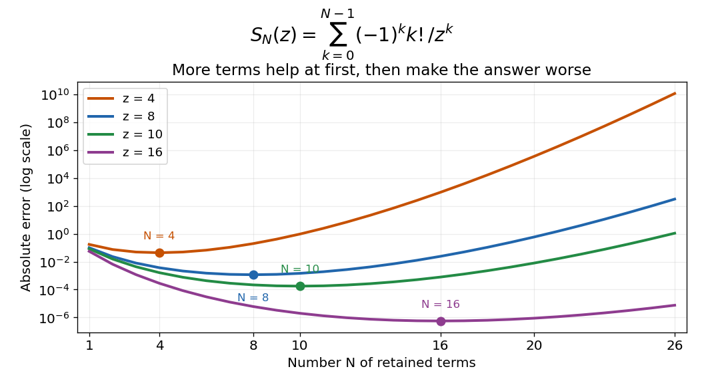

# Optimal truncation

↑ **Parent:** [Asymptotic expansion](asymptotic-expansion-split.md)

[Optimal truncation](optimal-truncation.md) chooses how many terms to retain for a useful finite approximation. In a divergent [asymptotic expansion](asymptotic-expansion-split.md), increasing the truncation order eventually makes the terms larger rather than smaller. Stopping near a smallest term often gives the best direct approximation, but the actual remainder must be checked. A small last term alone is not a universal [error bound](error-bound.md).[NIST Digital Library of Mathematical Functions, §2.11(i), discussion of finite-parameter accuracy and independently checking remainders; §2.11(iii), exponentially improved expansions](nist-digital-library-of-mathematical-functions/2-11-remainder-terms-stokes-phenomenon.md)

For [a divergent factorial series can approximate a convergent integral](a-divergent-factorial-series-can-approximate-a-convergent-integral.md), $T_k=k!/z^k$ decreases while $k+1<z$ and increases while $k+1>z$. Thus the useful cutoff is near $k=z$, rather than at arbitrarily large order. At $z=10$, $T_9=T_{10}=0.00036288$ are the two smallest terms. Retaining $N=10$ terms gives

$$
S_{10}(10)=0.91545632,\qquad
|F(10)-S_{10}(10)|\leq0.00036288.
$$

The actual error is about $0.0001770$. Retaining twenty terms instead gives $S_{20}(10)\approx0.9076137084$, with error about $0.008020$: more work produces a worse answer.

**[Figure 2](#image-a-divergent-asymptotic-series-has-a-useful-stopping-region). A divergent asymptotic series has a useful stopping region**. Original numerical errors $|F(z)-S_N(z)|$ for $z=4,8,10,16$ and $1\leq N\leq26$. Each [partial sum](partial-sum.md) is compared with an independent evaluation of the positive [integral](integral-split.md). The dots mark the smallest errors among the displayed orders; they are not a claim of a universal stopping theorem.

For this example the bound $N!/z^N$ is explicit, so a requested tolerance can be tested before using a truncation. For a different [integral](integral-split.md), a nearby [saddle point](saddle-point.md) or [simple pole](simple-pole.md) can change the relevant remainder scale. This is why the smallest-term rule is a useful guide, rather than a replacement for remainder analysis.

The cutoff for factorial terms $n!z^{-n}$ has $n=|z|+O(1)$. Better analysis can expose contributions smaller than every retained inverse power, linking [optimal truncation](optimal-truncation.md) to the [Stokes phenomenon](stokes-phenomenon.md). Such contributions can be important even when many asymptotic [coefficients](coefficient.md) agree. Directly summing ever more terms does not automatically recover them.

## ↑ Ancestors (5)

1. [Asymptotic expansion](asymptotic-expansion-split.md)
2. [Analysis](analysis-split.md)
3. [Area of mathematics](area-of-mathematics.md)
4. [Mathematics](mathematics-split.md)
5. [Codex Wiki](split.md)

## ← Incoming links (7)

- [Asymptotic expansion](asymptotic-expansion-split.md)
- [Borel integral with a simple pole](borel-integral-with-a-simple-pole.md)
- [Gaussian pole transition for a large gamma parameter](gaussian-pole-transition-for-a-large-gamma-parameter.md)
- [Optimal truncation](optimal-truncation.md)
- [Solution](past-exam-of-the-mathematics-course-of-the-university-of-cambridge/2004/iii/paper-76/2/iii/solution.md)
- [Solution](past-exam-of-the-mathematics-course-of-the-university-of-cambridge/2005/iii/paper-79/2/solution.md)
- [Solution](past-exam-of-the-mathematics-course-of-the-university-of-cambridge/2015/iii/paper-72/3/solution.md)
