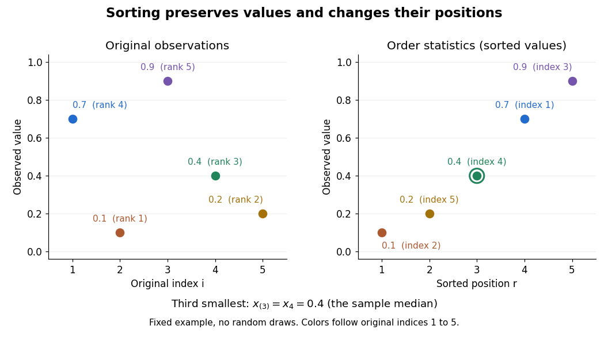

# Order statistic

↑ **Parent:** [Probability theory](probability-theory-split.md)  
ⓦ [Wiki](https://en.wikipedia.org/wiki/Order_statistic)

An [order statistic](order-statistic.md) is a value selected by its position in a sorted [statistical sample](statistical-sample.md). For real observations $X_1,\ldots,X_n$, write

$$
X_{(1)}\leq X_{(2)}\leq\cdots\leq X_{(n)}.
$$

The $r$th [order statistic](order-statistic.md) $X_{(r)}$ is the $r$th smallest value, counting repeated values separately. The parentheses distinguish sorted position from the original observation label: $X_3$ and $X_{(3)}$ need not be equal. This definition permits ties and requires neither [independence](independent-random-variables.md) nor a [continuous probability distribution](continuous-probability-distribution-split.md). For a random [statistical sample](statistical-sample.md), each [order statistic](order-statistic.md) is itself a [random variable](random-variable-split.md) and a [statistic](statistic.md).

For example, the five fixed observations

$$
(x_1,x_2,x_3,x_4,x_5)=(0.7,0.1,0.9,0.4,0.2)
$$

sort to

$$
(x_{(1)},x_{(2)},x_{(3)},x_{(4)},x_{(5)})=(0.1,0.2,0.4,0.7,0.9).
$$

Their original indices in sorted order are $(2,5,4,1,3)$, so $x_{(3)}=x_4=0.4$. Their [ranks of observations](rank-of-an-observation.md), listed in original observation order, are $(4,1,5,3,2)$. Here $x_{(1)}=0.1$ is the [minimum](minimum-of-a-subset-of-a-total-order.md), $x_{(5)}=0.9$ is the [sample maximum](sample-maximum.md), and $x_{(3)}=0.4$ is the [sample median](sample-median.md). These are deliberately chosen observations, rather than simulated draws.

**[Figure 21](#image-five-observations-original-indices-sorted-positions-and-the-third-order-statistic). Five observations: original indices, sorted positions, and the third order statistic**.

[Order statistics](order-statistic.md) put extremes and typical values in one language: the first and last locate the [minimum](minimum-of-a-subset-of-a-total-order.md) and [sample maximum](sample-maximum.md), while intermediate positions give [sample quantiles](sample-quantile.md) and the [sample median](sample-median.md). Under the existing generalized-inverse convention, the [sample quantile](sample-quantile.md) at level $p$ is $X_{(\lceil np\rceil)}$. For the five observations, the [sample quantiles](sample-quantile.md) at $p=0.2,0.5,0.8$ are $0.1,0.4,0.7$. The distinction between a fixed observed value and its [sampling distribution](sampling-distribution.md) lets us quantify how much an extreme or [sample median](sample-median.md) would vary across repeated [statistical samples](statistical-sample.md).

The useful counting identity is

$$
\{X_{(r)}\leq t\}=\{\text{at least }r\text{ of the observations are at most }t\}.
$$

For [independent and identically distributed random variables](independent-and-identically-distributed-random-variables.md) with a continuous [cumulative distribution function](cumulative-distribution-function.md) $F$, the count on the right has [binomial distribution](binomial-distribution.md) with parameters $n,F(t)$, giving

$$
\mathbb P(X_{(r)}\leq t)=\sum_{k=r}^{n}\binom{n}{k}F(t)^k[1-F(t)]^{n-k},\qquad 1\leq r\leq n.
$$

This [cumulative distribution function](cumulative-distribution-function.md) is a [binomial distribution](binomial-distribution.md) tail: a question about sorting becomes a question about counting successes in [Bernoulli trials](bernoulli-trial.md). The counting proof also works for [probability distributions](probability-distribution.md) with atoms and ties, although a [probability density function](probability-density-function.md) need not then exist. For a [uniform order statistic](uniform-order-statistic.md), $F(t)=t$ on $0\leq t\leq1$, which makes the formula particularly explicit.

**Table of contents**

- [Uniformized sample range](uniformized-sample-range.md)
- [Rank of an observation](rank-of-an-observation.md)
- [Exceedance count limit for extreme order statistics](exceedance-count-limit-for-extreme-order-statistics.md)
- [Covariance of two uniform order statistics](covariance-of-two-uniform-order-statistics.md)
- [Independent exponential order-statistic spacings](independent-exponential-order-statistic-spacings.md)
- [Waiting time for a new record after a fixed sample](waiting-time-for-a-new-record-after-a-fixed-sample.md)
- [Independent minimum and gap of two exponential variables](independent-minimum-and-gap-of-two-exponential-variables.md)
- [Distribution functions of independent minima and maxima](distribution-functions-of-independent-minima-and-maxima.md)
- [Descending order statistics](descending-order-statistics.md)
- [Sample maximum](sample-maximum.md)
- [Nearest neighbour distance](nearest-neighbour-distance.md)
  - [Probability content of a nearest neighbour ball](probability-content-of-a-nearest-neighbour-ball.md)
    - [Inverse probability content bound for a Lipschitz density](inverse-probability-content-bound-for-a-lipschitz-density.md)
- [Uniform order statistic](uniform-order-statistic.md)
- [Order symmetry of independent random variables](order-symmetry-of-independent-random-variables.md)
  - [First ascent in independent continuous observations](first-ascent-in-independent-continuous-observations.md)

## ↑ Ancestors (5)

1. [Probability theory](probability-theory-split.md)
2. [Probability and statistics](probability-and-statistics-split.md)
3. [Area of mathematics](area-of-mathematics.md)
4. [Mathematics](mathematics-split.md)
5. [Codex Wiki](split.md)

## ← Incoming links (42)

- [Beta sampling by uniform order statistics](beta-sampling-by-uniform-order-statistics.md)
- [Box plot](box-plot.md)
- [Expected effort in a rank-order contest](expected-effort-in-a-rank-order-contest.md)
- [Hill estimator](hill-estimator.md)
- [Independent exponential order-statistic spacings](independent-exponential-order-statistic-spacings.md)
- [Interquartile range](interquartile-range.md)
- [Kolmogorov-Smirnov statistic](kolmogorov-smirnov-statistic.md)
- [Kolmogorov-Smirnov test](kolmogorov-smirnov-test.md)
- [Maximum of independent exponential random variables](maximum-of-independent-exponential-random-variables.md)
- [Nearest neighbour distance](nearest-neighbour-distance.md)
- [Normal Q-Q plot](normal-q-q-plot.md)
- [Order statistic](order-statistic.md)
- [Solution](past-exam-of-the-mathematics-course-of-the-university-of-cambridge/2003/iii/paper-41/5/i/solution.md)
- [Solution](past-exam-of-the-mathematics-course-of-the-university-of-cambridge/2004/iii/paper-42/2/solution.md)
- [Solution](past-exam-of-the-mathematics-course-of-the-university-of-cambridge/2005/iii/paper-12/6/b/solution.md)
- [Solution](past-exam-of-the-mathematics-course-of-the-university-of-cambridge/2005/iii/paper-36/2/c/solution.md)
- [Solution](past-exam-of-the-mathematics-course-of-the-university-of-cambridge/2006/iii/paper-38/4/solution.md)
- [Solution](past-exam-of-the-mathematics-course-of-the-university-of-cambridge/2006/iii/paper-42/1/solution.md)
- [Solution](past-exam-of-the-mathematics-course-of-the-university-of-cambridge/2007/ia/paper-2/3f/solution.md)
- [Solution](past-exam-of-the-mathematics-course-of-the-university-of-cambridge/2007/iii/paper-49/3/solution.md)
- [Solution](past-exam-of-the-mathematics-course-of-the-university-of-cambridge/2008/iii/paper-47/3/b/iii/solution.md)
- [Solution](past-exam-of-the-mathematics-course-of-the-university-of-cambridge/2009/iii/paper-101/1/c/solution.md)
- [Solution](past-exam-of-the-mathematics-course-of-the-university-of-cambridge/2010/iii/paper-32/2/1/solution.md)
- [Solution](past-exam-of-the-mathematics-course-of-the-university-of-cambridge/2012/iii/paper-42/6/b/solution.md)
- [Solution](past-exam-of-the-mathematics-course-of-the-university-of-cambridge/2014/iii/paper-39/2/solution.md)
- [Solution](past-exam-of-the-mathematics-course-of-the-university-of-cambridge/2017/ib/paper-2/8h/c/solution.md)
- [Solution](past-exam-of-the-mathematics-course-of-the-university-of-cambridge/2017/iii/paper-216/1/c/solution.md)
- [Solution](past-exam-of-the-mathematics-course-of-the-university-of-cambridge/2018/iii/paper-210/1/solution.md)
- [Solution](past-exam-of-the-mathematics-course-of-the-university-of-cambridge/2022/ib/paper-2/6h/a/solution.md)
- [Solution](past-exam-of-the-mathematics-course-of-the-university-of-cambridge/2023/ii/paper-1/28j/b/solution.md)
- [Solution](past-exam-of-the-mathematics-course-of-the-university-of-cambridge/2023/ii/paper-1/28j/d/solution.md)
- [Solution](past-exam-of-the-mathematics-course-of-the-university-of-cambridge/2023/iii/paper-210/1/solution.md)
- [Plotting position](plotting-position.md)
- [Poisson process](poisson-process.md)
- [Q-Q plot](q-q-plot.md)
- [Quartile](quartile.md)
- [Rank of an observation](rank-of-an-observation.md)
- [Sample median](sample-median.md)
- [Sum of exponential variables with linearly increasing rates](sum-of-exponential-variables-with-linearly-increasing-rates.md)
- [Support-restricted confidence interval for a uniform location parameter](support-restricted-confidence-interval-for-a-uniform-location-parameter.md)
- [Uniform order statistic](uniform-order-statistic.md)
- [Uniformized sample range](uniformized-sample-range.md)
