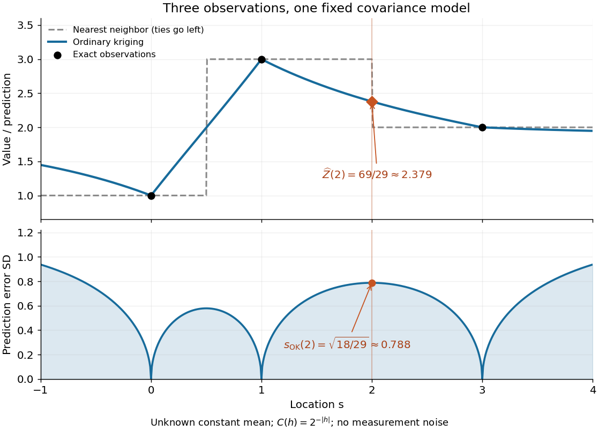
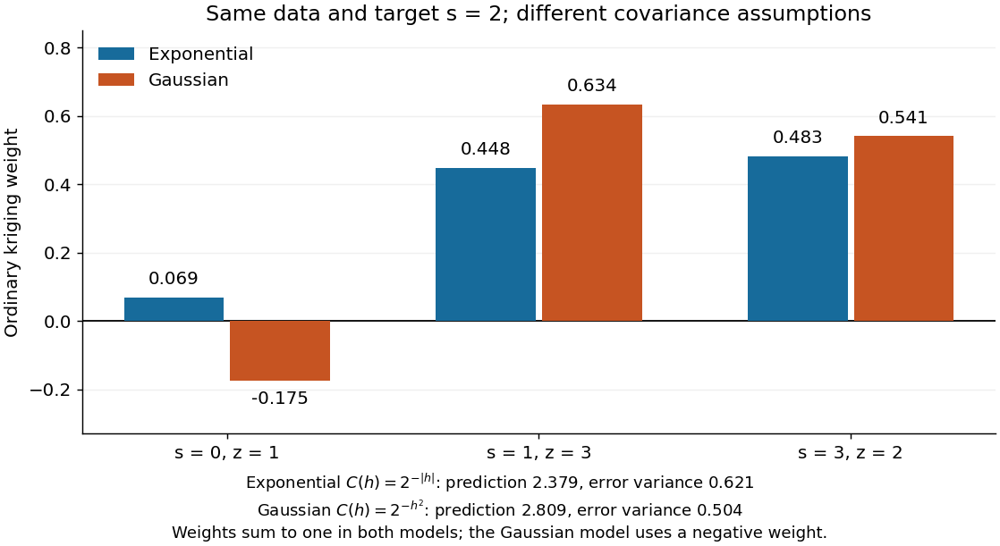

# Ordinary kriging

↑ **Parent:** [Kriging](kriging.md)

[Ordinary kriging](ordinary-kriging.md) assumes $\mathbb E[Z(s)]=\mu$ for an unknown constant $\mu$. A predictor $w^TZ$ has zero [bias](bias-of-an-estimator.md) for every $\mu$ precisely when $\mathbf1^Tw=1$, where $\mathbf1$ is the all-ones vector. [Ordinary kriging](ordinary-kriging.md) minimizes the error [variance](variance-split.md) $Q(w)$ subject to this constraint, giving the [best linear unbiased predictor](best-linear-unbiased-prediction.md). Its explicit system is

$$
\begin{pmatrix}
\Sigma&\mathbf1\\
\mathbf1^T&0
\end{pmatrix}
\begin{pmatrix}w\\\eta\end{pmatrix}
=\begin{pmatrix}c\\1\end{pmatrix},
\qquad
\widehat Z_0=w^Tz,
\qquad
s_{\mathrm{OK}}^2=v_0-w^Tc-\eta.
$$

The sign of the last term follows from the displayed convention $\Sigma w+\eta\mathbf1=c$. To derive the system, differentiate $Q(w)+2\eta(\mathbf1^Tw-1)$. To prove the minimum, let $w_*$ solve it and let $w=w_*+d$ be another feasible choice. Then $\mathbf1^Td=0$, so

$$
Q(w)-Q(w_*)=d^T\Sigma d\geq0.
$$

A [positive-definite matrix](positive-definite-matrix.md) $\Sigma$ makes equality possible only for $d=0$. This argument uses [second moments](second-moment.md), not a [normal distribution](normal-distribution.md) assumption. [Ordinary kriging](ordinary-kriging.md) is the special case of [universal kriging](universal-kriging.md) with $X=\mathbf1$ and $x_0=1$.

For an original one-dimensional teaching example, observe $z=(1,3,2)^T$ at $s=(0,1,3)$, and predict at $s_0=2$. Choose unit marginal [variance](variance-split.md), exact observations without measurement noise, an unknown constant [mean](expected-value-split.md), and the [exponential covariance function](exponential-covariance-function.md)

$$
C(h)=2^{-|h|}=e^{-(\log2)|h|}.
$$

The [exponential covariance function](exponential-covariance-function.md) corresponds to a stationary [Ornstein-Uhlenbeck process](ornstein-uhlenbeck-process.md), so it gives a valid [covariance](covariance.md) model. Its [semivariogram](semivariogram.md) is $1-2^{-|h|}$. The resulting [matrix](matrix.md) and vector are

$$
\Sigma=\begin{pmatrix}1&1/2&1/8\\1/2&1&1/4\\1/8&1/4&1\end{pmatrix},
\qquad c=\begin{pmatrix}1/4\\1/2\\1/2\end{pmatrix},\qquad v_0=1.
$$

Solving the displayed system gives

$$
w=\frac1{29}\begin{pmatrix}2\\13\\14\end{pmatrix},\quad
\eta=-\frac3{29},\quad
\widehat Z_0=\frac{69}{29}\approx2.3793,\quad
s_{\mathrm{OK}}^2=\frac{18}{29}\approx0.6207.
$$

These values can be checked directly: the weights sum to one and $\Sigma w=(41/116,35/58,35/58)^T=c+(3/29)\mathbf1$. Substitution into $Q(w)$ gives $18/29$. [Nearest-neighbor interpolation](nearest-neighbor-interpolation.md) must choose between the two equally close samples at one and three, returning either three or two; their error [variances](variance-split.md) under this model are both $1+1-2(1/2)=1$. Thus the benefit is quantified under the chosen model, without knowing the unobserved target value.

**[Figure 3](#image-ordinary-kriging-combines-three-samples-and-reports-uncertainty-under-a-fixed-exponential-covariance-model). Ordinary kriging combines three samples and reports uncertainty under a fixed exponential covariance model**.

The upper panel applies the same [ordinary kriging](ordinary-kriging.md) calculation at each target location. The lower panel shows the square root of its error [variance](variance-split.md), in the units of the observations. It is zero at the exact observation locations and rises between and beyond them. No [confidence interval](confidence-interval.md) is inferred from a [variance](variance-split.md) alone; a [probability distribution](probability-distribution-split.md) assumption is needed to attach a coverage level.

The weights are not required to be positive. Keep the same observations and target, but replace the [covariogram](covariogram.md) by the smoother [Gaussian kernel](gaussian-kernel.md) $C(h)=2^{-h^2}$. Then

$$
w=\frac1{4199}\begin{pmatrix}-736\\2663\\2272\end{pmatrix},\qquad
\widehat Z_0=\frac{11797}{4199}\approx2.8095,\qquad
s_{\mathrm{OK}}^2=\frac{2115}{4199}\approx0.5037.
$$

The negative coefficient compensates for dependence between samples; the constraint eliminating [bias](bias-of-an-estimator.md) still holds. [Kriging](kriging.md) is not generally a [convex combination](convex-combination.md), and its prediction need not stay between the observed values. A smaller model-based error [variance](variance-split.md) does not establish that one [covariance function](covariance-function.md) is better supported by these three observations.

**[Figure 4](#image-changing-the-covariance-model-changes-the-ordinary-kriging-weights-and-can-make-a-weight-negative). Changing the covariance model changes the ordinary kriging weights and can make a weight negative**.

## ↑ Ancestors (8)

1. [Kriging](kriging.md)
2. [Geostatistics](geostatistics.md)
3. [Statistical modelling](statistical-modelling-split.md)
4. [Statistical model](statistical-model-split.md)
5. [Probability and statistics](probability-and-statistics-split.md)
6. [Area of mathematics](area-of-mathematics.md)
7. [Mathematics](mathematics-split.md)
8. [Codex Wiki](split.md)

## ← Incoming links (4)

- [Kriging](kriging.md)
- [Ordinary kriging](ordinary-kriging.md)
- [Solution](past-exam-of-the-mathematics-course-of-the-university-of-cambridge/2017/iii/paper-206/6/b/solution.md)
- [Simple kriging](simple-kriging.md)
