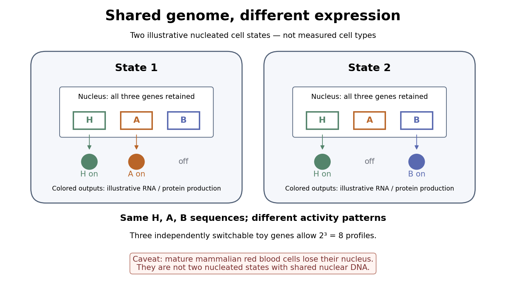

# Organism

↑ **Parent:** [Biology](biology.md)  
ⓦ [Wiki](https://en.wikipedia.org/wiki/Organism)

An [organism](organism.md) is an individual living system, made of one [biological cell](biological-cell.md) or an integrated assembly of [biological cells](biological-cell.md). An [Escherichia coli](#escherichia-coli) cell is an entire [organism](organism.md); a [neuron](neuroscience.md#neuron) is normally a specialized part of an [animal](#animal). [Metabolism](biology.md#metabolism), regulated exchange through [cell membranes](cell-membrane.md), and inherited information connect these very different scales. See [OpenStax Biology 2e, 1.2: living systems and levels of organization](https://openstax.org/books/biology-2e/pages/1-2-themes-and-concepts-of-biology).

Keep two questions separate: how many [biological cells](biological-cell.md) make the [organism](organism.md), and how those [biological cells](biological-cell.md) are organized. A [yeast](#yeast) and an [Escherichia coli](#escherichia-coli) are both [unicellular organisms](#unicellular-organism), but the [yeast](#yeast) is a [eukaryote](#eukaryote) and the [Escherichia coli](#escherichia-coli) a [prokaryote](#prokaryote). A [plant](#plant) and an [animal](#animal) are [multicellular organisms](#multicellular-organism) with [eukaryotic](#eukaryote) cellular organization. Neither distinction ranks [organisms](organism.md) as better or worse: [natural selection](biology.md#natural-selection) acts on reproduction in particular environments.

**Table of contents**

- [Mycoplasma genitalium](#mycoplasma-genitalium)
- [Multicellularity](#multicellularity)
  - [Single-cell bottleneck](#single-cell-bottleneck)
  - [Germ-soma separation](#germ-soma-separation)
- [Toxoplasma gondii](#toxoplasma-gondii)
- [Unicellular organism](#unicellular-organism)
- [Multicellular organism](#multicellular-organism)
  - [Germline-soma differentiation](#germline-soma-differentiation)
  - [Clonal development](#clonal-development)
    - [Snowflake yeast](#snowflake-yeast)
  - [Developmental integration](#developmental-integration)
    - [Cellular differentiation](#cellular-differentiation)
      - [Mesenchymal-to-epithelial transition](#mesenchymal-to-epithelial-transition)
      - [Epithelial-mesenchymal plasticity](#epithelial-mesenchymal-plasticity)
      - [Epithelial-to-mesenchymal transition](#epithelial-to-mesenchymal-transition)
      - [Competence window](#competence-window)
      - [Conditional specification](#conditional-specification)
      - [Autonomous specification](#autonomous-specification)
      - [Cell fate](#cell-fate)
        - [Developmental commitment](#developmental-commitment)
        - [Cell fate plasticity](#cell-fate-plasticity)
          - [Intestinal stem-cell plasticity](#intestinal-stem-cell-plasticity)
          - [Transdifferentiation](#transdifferentiation)
          - [Dedifferentiation](#dedifferentiation)
        - [Cell determination](#cell-determination)
        - [Cell specification](#cell-specification)
        - [Fate map](#fate-map)
      - [Terminal differentiation](#terminal-differentiation)
      - [Cellular reprogramming](#cellular-reprogramming)
        - [Epigenetic reprogramming](#epigenetic-reprogramming)
        - [Somatic cell nuclear transfer](#somatic-cell-nuclear-transfer)
          - [Intestinal nucleus transfer experiment](#intestinal-nucleus-transfer-experiment)
- [Colony (biology)](#colony-biology)
- [Prokaryote](#prokaryote)
  - [Bacteria](#bacteria)
    - [Rhizobia](#rhizobia)
    - [Shewanella oneidensis](#shewanella-oneidensis)
    - [Wolbachia](#wolbachia)
    - [Biofilm](#biofilm)
    - [Paenibacillus larvae](#paenibacillus-larvae)
    - [Streptococcus pyogenes](#streptococcus-pyogenes)
    - [Alteromonas](#alteromonas)
    - [Coxiella burnetii](#coxiella-burnetii)
    - [Buchnera aphidicola](#buchnera-aphidicola)
    - [Rickettsia parkeri](#rickettsia-parkeri)
    - [Chlamydia](#chlamydia)
    - [Rickettsia prowazekii](#rickettsia-prowazekii)
    - [Chlamydia trachomatis](#chlamydia-trachomatis)
    - [Pseudomonas aeruginosa](#pseudomonas-aeruginosa)
    - [Alphaproteobacteria](#alphaproteobacteria)
    - [Escherichia coli](#escherichia-coli)
    - [Cyanobacteria](#cyanobacteria)
      - [Synechocystis](#synechocystis)
      - [Prochlorococcus](#prochlorococcus)
    - [Gram-positive bacteria](#gram-positive-bacteria)
    - [Gram-negative bacteria](#gram-negative-bacteria)
    - [Bacillus megaterium](#bacillus-megaterium)
  - [Archaea](#archaea)
    - [Asgard archaea](#asgard-archaea)
- [Eukaryote](#eukaryote)
  - [Ciliate](#ciliate)
    - [Nuclear dimorphism](#nuclear-dimorphism)
      - [Macronucleus](#macronucleus)
      - [Micronucleus](#micronucleus)
    - [Paramecium](#paramecium)
      - [Paramecium tetraurelia](#paramecium-tetraurelia)
    - [Tetrahymena thermophila](#tetrahymena-thermophila)
  - [Camelina sativa](#camelina-sativa)
  - [Entamoeba histolytica](#entamoeba-histolytica)
  - [Giardia](#giardia)
  - [Dinoflagellate](#dinoflagellate)
  - [Fungus](#fungus)
    - [Yeast](#yeast)
      - [Budding yeast](#budding-yeast)
        - [Yeast budding](#yeast-budding)
      - [Schizosaccharomyces pombe](#schizosaccharomyces-pombe)
      - [Saccharomyces cerevisiae](#saccharomyces-cerevisiae)
  - [Plant](#plant)
    - [Arabis alpina](#arabis-alpina)
    - [Bread wheat](#bread-wheat)
    - [Rice](#rice)
    - [Tomato](#tomato)
    - [African oil palm](#african-oil-palm)
    - [Perennial plant](#perennial-plant)
    - [Annual plant](#annual-plant)
    - [Mimulus](#mimulus)
      - [Mimulus guttatus](#mimulus-guttatus)
    - [Milkweed](#milkweed)
    - [Ophrys sphegodes](#ophrys-sphegodes)
    - [Desiccation tolerance](#desiccation-tolerance)
    - [Rhizoid](#rhizoid)
    - [Vascular plant](#vascular-plant)
      - [Seed plant](#seed-plant)
        - [Gymnosperm](#gymnosperm)
          - [Gnetum](#gnetum)
      - [Fern](#fern)
        - [Sorus](#sorus)
    - [Bryophyte](#bryophyte)
      - [Hornwort](#hornwort)
      - [Liverwort](#liverwort)
      - [Moss](#moss)
    - [Pea](#pea)
    - [Flower](#flower)
      - [Dichogamy](#dichogamy)
      - [Herkogamy](#herkogamy)
      - [Perianth](#perianth)
      - [Bisexual flower](#bisexual-flower)
      - [Floral symmetry](#floral-symmetry)
        - [Bilateral floral symmetry](#bilateral-floral-symmetry)
        - [Radial floral symmetry](#radial-floral-symmetry)
      - [Stamen](#stamen)
        - [Anther](#anther)
        - [Stamen filament](#stamen-filament)
      - [Stigma (botany)](#stigma-botany)
      - [Carpel](#carpel)
        - [Style (botany)](#style-botany)
        - [Ovary (botany)](#ovary-botany)
          - [Ovule](#ovule)
            - [Angiosperm female gametophyte](#angiosperm-female-gametophyte)
      - [Petal](#petal)
      - [Sepal](#sepal)
    - [Seed](#seed)
      - [Seed vigor](#seed-vigor)
      - [Plant embryo](#plant-embryo)
        - [Cotyledon](#cotyledon)
        - [Radicle](#radicle)
      - [Seed coat](#seed-coat)
      - [Seed food reserve](#seed-food-reserve)
      - [Endosperm](#endosperm)
      - [Seedling](#seedling)
      - [Germination](#germination)
        - [Seed imbibition](#seed-imbibition)
        - [Seed dormancy](#seed-dormancy)
        - [Seed viability](#seed-viability)
        - [Lettuce red and far-red germination experiment](#lettuce-red-and-far-red-germination-experiment)
        - [Germination assay](#germination-assay)
    - [Lettuce](#lettuce)
    - [Root (botany)](#root-botany)
    - [Leaf](#leaf)
    - [Plant tissue](#plant-tissue)
      - [Meristem](#meristem)
      - [Plant cuticle](#plant-cuticle)
      - [Stoma](#stoma)
        - [Stomatal closure](#stomatal-closure)
      - [Phloem](#phloem)
      - [Xylem](#xylem)
        - [Tracheid](#tracheid)
    - [Angiosperm](#angiosperm)
      - [Cadia](#cadia)
      - [Antirrhinum](#antirrhinum)
      - [Lilium](#lilium)
  - [Algae](#algae)
    - [Chromera velia](#chromera-velia)
    - [Microalga](#microalga)
  - [Reclinomonas americana](#reclinomonas-americana)
  - [Animal](#animal)
    - [Crustacean](#crustacean)
      - [Ostracod](#ostracod)
    - [Bilaterian](#bilaterian)
      - [Kimberella](#kimberella)
    - [Echolocation](#echolocation)
    - [Chordate](#chordate)
      - [Amphioxus](#amphioxus)
      - [Cephalochordate](#cephalochordate)
      - [Tunicate](#tunicate)
        - [Oikopleura dioica](#oikopleura-dioica)
    - [Ciona](#ciona)
    - [Caenorhabditis elegans](#caenorhabditis-elegans)
    - [Marmoset](#marmoset)
    - [Vertebrate](#vertebrate)
      - [Metaspriggina](#metaspriggina)
      - [Myllokunmingia](#myllokunmingia)
      - [Haikouichthys](#haikouichthys)
      - [Ostracoderm](#ostracoderm)
      - [Gnathostome](#gnathostome)
        - [Osteostracan](#osteostracan)
        - [Galeaspid](#galeaspid)
          - [Tujiaaspis vividus](#tujiaaspis-vividus)
        - [Janusiscus schultzei](#janusiscus-schultzei)
        - [Placoderm](#placoderm)
          - [Kolymaspis sibirica](#kolymaspis-sibirica)
          - [Minjinia turgenensis](#minjinia-turgenensis)
          - [Entelognathus primordialis](#entelognathus-primordialis)
        - [Acanthodian](#acanthodian)
          - [Acanthodes](#acanthodes)
        - [Chondrichthyes](#chondrichthyes)
          - [Leucoraja erinacea](#leucoraja-erinacea)
          - [Chimaera](#chimaera)
          - [Ray fish](#ray-fish)
          - [Shark](#shark)
        - [Qianodus](#qianodus)
        - [Osteichthyes](#osteichthyes)
          - [Gar](#gar)
          - [Psarolepis](#psarolepis)
          - [Sarcopterygii](#sarcopterygii)
            - [Tiktaalik](#tiktaalik)
            - [Lungfish](#lungfish)
            - [Coelacanth](#coelacanth)
      - [Cyclostome](#cyclostome)
        - [Lamprey](#lamprey)
          - [Priscomyzon](#priscomyzon)
        - [Hagfish](#hagfish)
          - [Tethymyxine](#tethymyxine)
      - [Tetrapod](#tetrapod)
        - [Acanthostega](#acanthostega)
        - [Hind limb](#hind-limb)
        - [Forelimb](#forelimb)
          - [Shoulder](#shoulder)
          - [Elbow](#elbow)
        - [Amniote](#amniote)
          - [Sauropsida](#sauropsida)
            - [Eunotosaurus](#eunotosaurus)
            - [Diapsida](#diapsida)
              - [Lizard](#lizard)
              - [Turtle](#turtle)
                - [Pappochelys](#pappochelys)
              - [Archosauria](#archosauria)
                - [Pterosaur](#pterosaur)
                - [Panaves](#panaves)
                - [Dinosaur](#dinosaur)
                  - [Theropod dinosaur](#theropod-dinosaur)
                    - [Avialae](#avialae)
                    - [Yutyrannus](#yutyrannus)
                    - [Bird](#bird)
                      - [Janavis finalidens](#janavis-finalidens)
                      - [Ichthyornis](#ichthyornis)
                      - [Archaeopteryx](#archaeopteryx)
                      - [Aves](#aves)
                        - [Neognathae](#neognathae)
                          - [Sparrow](#sparrow)
                          - [Galloanserae](#galloanserae)
                            - [Waterfowl](#waterfowl)
                            - [Landfowl](#landfowl)
                        - [Palaeognathae](#palaeognathae)
                          - [Tinamou](#tinamou)
                          - [Ostrich](#ostrich)
                      - [Great tit](#great-tit)
                      - [Scrub jay](#scrub-jay)
                      - [Raven](#raven)
                      - [Darwin's finches](#darwin-s-finches)
                        - [Geospiza conirostris](#geospiza-conirostris)
                        - [Geospiza fortis](#geospiza-fortis)
                      - [Barn owl](#barn-owl)
                      - [Fork-tailed drongo](#fork-tailed-drongo)
                - [Crocodilian](#crocodilian)
              - [Lepidosaur](#lepidosaur)
                - [Tuatara](#tuatara)
            - [Reptilia](#reptilia)
          - [Synapsid](#synapsid)
            - [Therapsid](#therapsid)
              - [Cynodont](#cynodont)
                - [Mammaliamorph](#mammaliamorph)
                - [Mammaliaform](#mammaliaform)
                  - [Castorocauda](#castorocauda)
                  - [Sinodelphys](#sinodelphys)
                  - [Gondwanatheria](#gondwanatheria)
                    - [Adalatherium](#adalatherium)
                    - [Vintana](#vintana)
                  - [Boreosphenida](#boreosphenida)
                  - [Australosphenida](#australosphenida)
                  - [Ambondro mahabo](#ambondro-mahabo)
                  - [Hadrocodium](#hadrocodium)
                  - [Morganucodon](#morganucodon)
                  - [Mammal](#mammal)
                    - [Pygmy shrew](#pygmy-shrew)
                    - [Greater white-toothed shrew](#greater-white-toothed-shrew)
                    - [Hedgehog](#hedgehog)
                    - [Bat](#bat)
                      - [Vampire bat](#vampire-bat)
                    - [Topi](#topi)
                    - [Human](#human)
                    - [Lactation](#lactation)
                    - [Theria](#theria)
                      - [Eutheria](#eutheria)
                        - [Ambolestes zhoui](#ambolestes-zhoui)
                        - [Eomaia scansoria](#eomaia-scansoria)
                        - [Placental mammal](#placental-mammal)
                          - [Macrauchenia](#macrauchenia)
                          - [Toxodon](#toxodon)
                          - [Mesonychian](#mesonychian)
                          - [Euarchontoglires](#euarchontoglires)
                            - [Primates](#primates)
                              - [Saimiri sciureus](#saimiri-sciureus)
                              - [Ape](#ape)
                              - [Great ape](#great-ape)
                                - [Australopithecus](#australopithecus)
                                  - [Australopithecus afarensis](#australopithecus-afarensis)
                                - [Paranthropus](#paranthropus)
                                  - [Paranthropus boisei](#paranthropus-boisei)
                                - [Hominin](#hominin)
                                - [Pierolapithecus](#pierolapithecus)
                                - [Ardipithecus](#ardipithecus)
                                  - [Ardipithecus ramidus](#ardipithecus-ramidus)
                                - [Pongo](#pongo)
                                - [Gorilla](#gorilla)
                                - [Homo](#homo)
                                  - [Denisovan](#denisovan)
                                  - [Neanderthal](#neanderthal)
                                  - [Homo sapiens](#homo-sapiens)
                                - [Pan](#pan)
                                  - [Bonobo](#bonobo)
                                  - [Chimpanzee](#chimpanzee)
                              - [Colobinae](#colobinae)
                              - [Colobine monkey](#colobine-monkey)
                            - [Glires](#glires)
                              - [Lagomorpha](#lagomorpha)
                                - [Rabbit](#rabbit)
                              - [Rodentia](#rodentia)
                                - [Water vole](#water-vole)
                                - [Muskrat](#muskrat)
                                - [Coypu](#coypu)
                                - [Red squirrel](#red-squirrel)
                                - [Grey squirrel](#grey-squirrel)
                                - [Beaver](#beaver)
                          - [Xenarthra](#xenarthra)
                            - [Anteater](#anteater)
                          - [Afrotheria](#afrotheria)
                            - [Sirenia](#sirenia)
                              - [Pezosiren portelli](#pezosiren-portelli)
                            - [Proboscidea](#proboscidea)
                              - [Asian elephant](#asian-elephant)
                              - [Mammoth](#mammoth)
                          - [Laurasiatheria](#laurasiatheria)
                            - [Pholidota](#pholidota)
                            - [Perissodactyla](#perissodactyla)
                              - [Horse](#horse)
                            - [Carnivora](#carnivora)
                              - [Bear](#bear)
                              - [Pine marten](#pine-marten)
                              - [American mink](#american-mink)
                              - [Wolf](#wolf)
                                - [Dog](#dog)
                              - [Brown bear](#brown-bear)
                              - [Lynx](#lynx)
                            - [Artiodactyla](#artiodactyla)
                              - [Pig](#pig)
                              - [Goat](#goat)
                              - [Sheep](#sheep)
                              - [Cattle](#cattle)
                              - [Muntjac](#muntjac)
                              - [Sika deer](#sika-deer)
                              - [Fallow deer](#fallow-deer)
                              - [Red deer](#red-deer)
                              - [Wild boar](#wild-boar)
                              - [Aurochs](#aurochs)
                              - [Giant deer](#giant-deer)
                              - [Ruminantia](#ruminantia)
                              - [Ruminant](#ruminant)
                              - [Hippopotamus](#hippopotamus)
                              - [Cetacea](#cetacea)
                                - [Dolphin](#dolphin)
                                  - [Bottlenose dolphin](#bottlenose-dolphin)
                                - [Tail fluke](#tail-fluke)
                                - [Basilosaurid](#basilosaurid)
                                  - [Basilosaurus](#basilosaurus)
                                - [Protocetid](#protocetid)
                                  - [Rodhocetus](#rodhocetus)
                                - [Ambulocetus](#ambulocetus)
                                - [Pakicetidae](#pakicetidae)
                                - [Pakicetid](#pakicetid)
                                - [Mysticeti](#mysticeti)
                                  - [Baleen](#baleen)
                                - [Odontoceti](#odontoceti)
                      - [Metatheria](#metatheria)
                        - [Marsupial](#marsupial)
                          - [Australidelphia](#australidelphia)
                            - [Microbiotheria](#microbiotheria)
                            - [Dasyuromorphia](#dasyuromorphia)
                              - [Thylacine](#thylacine)
                            - [Diprotodontia](#diprotodontia)
                              - [Macropod](#macropod)
                            - [Djarthia](#djarthia)
                    - [Monotreme](#monotreme)
                      - [Platypus](#platypus)
                      - [Monotrematum](#monotrematum)
    - [Insect](#insect)
      - [Water strider](#water-strider)
      - [Nasonia](#nasonia)
        - [Nasonia giraulti](#nasonia-giraulti)
        - [Nasonia vitripennis](#nasonia-vitripennis)
      - [Butterfly](#butterfly)
        - [Monarch butterfly](#monarch-butterfly)
          - [Danaus plexippus](#danaus-plexippus)
      - [Dung beetle](#dung-beetle)
        - [Onthophagus gazella](#onthophagus-gazella)
        - [Onthophagus taurus](#onthophagus-taurus)
      - [Bumblebee](#bumblebee)
      - [Acyrthosiphon pisum](#acyrthosiphon-pisum)
      - [Heliconius](#heliconius)
        - [Heliconius erato](#heliconius-erato)
        - [Heliconius cydno](#heliconius-cydno)
        - [Heliconius melpomene](#heliconius-melpomene)
      - [Rhagoletis pomonella](#rhagoletis-pomonella)
      - [Drosophila](#drosophila)
        - [Drosophila persimilis](#drosophila-persimilis)
        - [Drosophila simulans](#drosophila-simulans)
      - [Temnothorax albipennis](#temnothorax-albipennis)
      - [Honeybee](#honeybee)
      - [Andrena nigroaenea](#andrena-nigroaenea)
      - [Tribolium castaneum](#tribolium-castaneum)
      - [Drosophila melanogaster](#drosophila-melanogaster)
      - [Drosophila pseudoobscura](#drosophila-pseudoobscura)
    - [Amphibian](#amphibian)
      - [Salamander](#salamander)
      - [Salientia](#salientia)
        - [Prosalirus bitis](#prosalirus-bitis)
        - [Triadobatrachus massinoti](#triadobatrachus-massinoti)
      - [Axolotl](#axolotl)
      - [Frog](#frog)
        - [Anura](#anura)
        - [Spadefoot toad](#spadefoot-toad)
        - [Xenopus laevis](#xenopus-laevis)
    - [Fish](#fish)
      - [Guppy](#guppy)
        - [Poecilia reticulata](#poecilia-reticulata)
      - [Cleaner wrasse](#cleaner-wrasse)
        - [Labroides dimidiatus](#labroides-dimidiatus)
      - [Astyanax mexicanus](#astyanax-mexicanus)
      - [Cichlid](#cichlid)
        - [Astatotilapia burtoni](#astatotilapia-burtoni)
      - [Giant moray eel](#giant-moray-eel)
      - [Grouper](#grouper)
      - [Three-spined stickleback](#three-spined-stickleback)
      - [Zebrafish](#zebrafish)
    - [House mouse](#house-mouse)
    - [Echinoderm](#echinoderm)
      - [Sand dollar](#sand-dollar)
- [Microorganism](#microorganism)

## Mycoplasma genitalium

↑ **Parent:** [Organism](organism.md)

## Multicellularity

↑ **Parent:** [Organism](organism.md)

Organization of an organism as multiple associated cells, often with differentiated roles. Its [evolution](biology.md#evolution) raises questions of reproductive alignment and control of within-body competition.

### Single-cell bottleneck

↑ **Parent:** [Multicellularity](#multicellularity)

Passage through a single founding cell during a life cycle. It increases initial genetic similarity among descendants and restricts transmission of competing cell lineages, without preventing later [mutation](genetics.md#mutation).

### Germ-soma separation

↑ **Parent:** [Multicellularity](#multicellularity)

Differentiation between reproductive and nonreproductive cell lineages. Restricting which cells found descendants can reduce transmission of some within-body competitors.

## Toxoplasma gondii

↑ **Parent:** [Organism](organism.md)

A parasite with felids as definitive hosts; rodent odour-response experiments provide evidence relevant to, but not alone proof of, transmission-enhancing [behavioural manipulation](biology.md#behavioural-manipulation).

## Unicellular organism

↑ **Parent:** [Organism](organism.md)  
ⓦ [Wiki](https://en.wikipedia.org/wiki/Unicellular_organism)

A [unicellular organism](#unicellular-organism) is an [organism](organism.md) whose living body consists of one [biological cell](biological-cell.md). That [biological cell](biological-cell.md) maintains itself, grows and participates in [reproduction](biology.md#reproduction); it is not merely one specialized component of a larger body. [Escherichia coli](#escherichia-coli) and ordinary free-living [Saccharomyces cerevisiae](#saccharomyces-cerevisiae) illustrate [prokaryotic](#prokaryote) and [eukaryotic](#eukaryote) examples respectively. Cellular organization and the number of [biological cells](biological-cell.md) are separate questions. See [Clark, Douglas and Choi, Biology 2e, 4.1: cells as units of organisms](https://openstax.org/books/biology-2e/pages/4-1-studying-cells).

How can one [biological cell](biological-cell.md) do enough to sustain an [organism](organism.md)? Its [cell membrane](cell-membrane.md) retains useful material while [membrane transport](cell-membrane.md#membrane-transport) allows exchange; [metabolism](biology.md#metabolism) transforms nutrients and supplies usable [energy](energy.md); [gene expression](molecular-genetics.md#gene-expression) makes [proteins](protein.md) needed to maintain and rebuild the machinery. These functions operate together inside the same boundary. In [Saccharomyces cerevisiae](#saccharomyces-cerevisiae), for example, [glucose](chemical-substance.md#glucose) can support [alcoholic fermentation](biology.md#ethanol-fermentation) and production of [ATP](molecule.md#adenosine-triphosphate), while the [cell cycle](cell-cycle.md) and [budding](biology.md#budding) produce descendants. A single [biological cell](biological-cell.md) therefore combines chemical processing, regulated exchange and inherited organization. See [Alberts et al., Molecular Biology of the Cell (2002): universal cellular machinery](https://www.ncbi.nlm.nih.gov/books/NBK26864/) and the experimental accounts under [Saccharomyces cerevisiae](#saccharomyces-cerevisiae) and [yeast](#yeast).

**[Figure 1](#image-one-biological-cell-a-biological-colony-clonal-development-and-developmental-integration). One biological cell, a biological colony, clonal development and developmental integration**. Original conceptual schematic, not micrographs or an evolutionary ladder. Colors mark illustrative lineages in the middle panels and illustrative functions in the right panel; they are not measured traits. A [biological colony](#colony-biology) can also be clonal, and [clonal development](#clonal-development) need not produce specialized [biological cells](biological-cell.md). The integrated panel illustrates a division of functions, not a particular [species](biology.md#species).

Being a [unicellular organism](#unicellular-organism) does not mean isolated or independent of all other life. [Unicellular organisms](#unicellular-organism) can interact and cooperate in groups. A [biological colony](#colony-biology) describes association; [clonal development](#clonal-development) describes descent; [developmental integration](#developmental-integration) describes coordination of the developing whole. Neither shared ancestry nor a visible clump alone establishes the latter. This distinction makes single-cell experiments easier to interpret: measuring the growth of one [biological cell](biological-cell.md), the expansion of a group and the [reproductive success](biology.md#reproductive-success) of a reproducing cluster can answer different questions. See [Queller and Strassmann, Beyond society: the evolution of organismality (2009): cooperation and the limits of simple organism criteria](https://pmc.ncbi.nlm.nih.gov/articles/PMC2781869/).

## Multicellular organism

↑ **Parent:** [Organism](organism.md)  
ⓦ [Wiki](https://en.wikipedia.org/wiki/Multicellular_organism)

A [multicellular organism](#multicellular-organism) has a body of multiple [biological cells](biological-cell.md) whose growth and activities are integrated into the life of the whole [organism](organism.md). Extensive [cell differentiation](#cellular-differentiation) is common in complex examples, but specialized [biological cells](biological-cell.md) are not a prerequisite for every simple form. Ask how the body develops, how its parts cooperate and how it produces descendants, rather than counting attached [biological cells](biological-cell.md) alone. The boundary with a [biological colony](#colony-biology) depends on the degree of integration and the criteria being investigated; there is no universal cell-count threshold. See the Queller and Strassmann account cited under [unicellular organism](#unicellular-organism).

Specialization makes the whole capable of combinations that one general-purpose [biological cell](biological-cell.md) cannot achieve in the same way. In an [animal](#animal), a [neuron](neuroscience.md#neuron) transmits signals while a [red blood cell](biological-cell.md#red-blood-cell) carries [oxygen](chemical-substance.md#oxygen); each still requires a working [cell membrane](cell-membrane.md) and [metabolism](biology.md#metabolism). A mature mammalian [red blood cell](biological-cell.md#red-blood-cell) lacks a [cell nucleus](biological-cell.md#cell-nucleus) and [mitochondria](biological-cell.md#mitochondria), illustrating how a useful part need not retain the equipment of a self-reproducing [organism](organism.md). See [Clark, Douglas and Choi, Biology 2e, 40.2: red blood cell specialization](https://openstax.org/books/biology-2e/pages/40-2-components-of-the-blood). [Cell differentiation](#cellular-differentiation) generally involves different [gene expression](molecular-genetics.md#gene-expression), rather than a different inherited [genome](molecular-genetics.md#genome) for each function. [Biological development](biology.md#biological-development) must coordinate growth, position, interactions and specialization: increasing the number of [biological cells](biological-cell.md) is only one component. See [Alberts et al., Molecular Biology of the Cell, chapter 21 (2002): construction of multicellular bodies](https://www.ncbi.nlm.nih.gov/books/NBK21046/).

**A motivating experiment: select for a property of groups.** Ratcliff, Denison, Borrello and Travisano's 2012 study began with [Saccharomyces cerevisiae](#saccharomyces-cerevisiae) growing as [unicellular organisms](#unicellular-organism). Daily transfer favored rapidly settling material. Their initial protocol allowed a $10\,\mathrm{mL}$ culture to settle for $45\,\mathrm{min}$, discarded the upper $9.9\,\mathrm{mL}$, and transferred the bottom $100\,\mathrm{\mu L}$ into fresh medium. After seven days, they instead sampled $1.5\,\mathrm{mL}$ and centrifuged it at $100$ times gravitational acceleration for $10\,\mathrm{s}$, again transferring the bottom $100\,\mathrm{\mu L}$. Faster settling made it more likely that a lineage would seed tomorrow's culture; the procedure selected a physical outcome without specifying how it must arise. These protocol details are explicitly recounted in [Gulli, Herron and Ratcliff, Evolution of altruistic cooperation among nascent multicellular organisms (2019): original settling protocol](https://academic.oup.com/evolut/article/73/5/1012/6727309).

**[Figure 2](#image-settling-selection-and-an-explicitly-stipulated-enrichment-example). Settling selection and an explicitly stipulated enrichment example**. Original qualitative transfer schematic with toy numerical bars. The workflow represents the initial settling protocol described above. The lower panel assumes equally weighted tracked units and transfer probabilities $0.8$ and $0.1$; these values and the resulting frequencies are invented for explanation, not fitted to [snowflake yeast](#snowflake-yeast) measurements. The equal-transfer comparison is a model control, distinct from the experimental comparisons described below.

The primary 2012 paper reports [snowflake yeast](#snowflake-yeast) dominating all ten initial replicate populations by 60 transfers. To distinguish the joining of previously separate [biological cells](biological-cell.md) from [clonal development](#clonal-development), the researchers enzymatically separated clusters and followed individual [biological cells](biological-cell.md) for $16\,\mathrm{h}$: attached descendants rebuilt clusters, with no such joining observed. Staining localized attachments at bud scars. Time-lapse observations also showed clusters releasing smaller multicellular offspring, called propagules; small clusters grew before they reproduced. See [Ratcliff et al., Experimental evolution of multicellularity (2012), figures 1–3: emergence, development and reproduction](https://pmc.ncbi.nlm.nih.gov/articles/PMC3277146/).

The experimental comparisons ask different questions. Competition with the [unicellular organism](#unicellular-organism) ancestor showed a reported $34\%$ advantage under settling selection. Without settling selection, the estimated $10\%$ disadvantage had a one-sided $P=0.06$, so it was suggestive rather than decisive evidence of a cost. Separately, three populations derived from one evolved isolate retained the cluster form through 35 transfers without settling selection. That persistence tests stability, not whether clusters always outperform single [biological cells](biological-cell.md). See Ratcliff et al. (2012), figure 2 and the cluster-formation results cited above.

A 2015 follow-up added a causal test: deleting the [gene](genetics.md#gene) ACE2 in the [unicellular organism](#unicellular-organism) ancestor produced [snowflake yeast](#snowflake-yeast), while supplying functional ACE2 to one evolved isolate restored separation into single [biological cells](biological-cell.md). Sequence changes altering the encoded [protein](protein.md) were found in ACE2 in five of ten examined lineages; the study did not identify that same sequence-change mechanism in every lineage. The deletion and restoration comparisons support a mechanism beyond the observation that clusters settle quickly. See [Ratcliff, Fankhauser, Rogers, Greig and Travisano, Origins of multicellular evolvability in snowflake yeast (2015), figure 1](https://www.nature.com/articles/ncomms7102).

**What follows, and what does not.** The evidence supports inherited cluster formation, [clonal development](#clonal-development) and a reproducing collective whose properties can respond to [natural selection](biology.md#natural-selection). Calling these simple [multicellular organisms](#multicellular-organism) recognizes those demonstrated properties; it does not turn every clump into an [animal](#animal) or establish animal-like [cell differentiation](#cellular-differentiation). This laboratory route also does not reconstruct the actual ancestry of [animals](#animal) or show that complex [developmental integration](#developmental-integration) must follow. The interesting achievement is narrower and testable: a change in how descendants remain connected creates a new scale at which growth and [reproductive success](biology.md#reproductive-success) can be measured.

For the toy figure, let $p$ be the fraction of tracked units of type C before transfer and let $s_C,s_U$ be the respective [probabilities](probability-theory.md#probability) of transfer for C and U. Assume equally weighted units and equal multiplication between transfers. When overall transfer [probability](probability-theory.md#probability) is nonzero, conditioning on transfer gives

$$
p_{\mathrm{after}}=\frac{p s_C}{p s_C+(1-p)s_U}.
$$

With $p=1/5$, $s_C=4/5$ and $s_U=1/10$, the numerator is $4/25$ and the denominator $6/25$, giving $p_{\mathrm{after}}=2/3$. If both types have the same nonzero transfer [probability](probability-theory.md#probability), the fraction stays $1/5$. This is [conditional probability](probability-theory.md#conditional-probability), not a model of the full experimental life cycle: real cluster sizes, growth and fragmentation affect which quantity a frequency measures. In particular, a fraction of clusters is not automatically a fraction of [biological cells](biological-cell.md).

### Germline-soma differentiation

↑ **Parent:** [Multicellular organism](#multicellular-organism)

Differentiation between cell lineages contributing to future organisms and those mainly maintaining the current body. Restricting transmission routes can help align cellular reproduction with organismal reproduction.

### Clonal development

↑ **Parent:** [Multicellular organism](#multicellular-organism)

[Clonal development](#clonal-development) builds a group through successive divisions of founding [biological cells](biological-cell.md), rather than by gathering previously separate lineages. In [snowflake yeast](#snowflake-yeast), daughter [biological cells](biological-cell.md) remain attached after [budding](biology.md#budding). Common ancestry does not imply that every descendant remains genetically identical forever: new [mutations](genetics.md#mutation) can arise. See the 2015 study cited under [multicellular organism](#multicellular-organism).

#### Snowflake yeast

↑ **Parent:** [Clonal development](#clonal-development)

[Snowflake yeast](#snowflake-yeast) are cluster-forming [Saccharomyces cerevisiae](#saccharomyces-cerevisiae) with branching connections between mothers and attached daughter [biological cells](biological-cell.md). They provide an experimental system for studying early transitions to simple [multicellular organisms](#multicellular-organism); see the protocol, observations and limits under [multicellular organism](#multicellular-organism).

### Developmental integration

↑ **Parent:** [Multicellular organism](#multicellular-organism)

[Developmental integration](#developmental-integration) here means coordination of cellular growth, organization and function into a developing whole. It describes what the parts do together, whereas [clonal development](#clonal-development) describes how they descend from founders. Interactions through [signal transduction](signal-transduction.md) can help coordinate [cell differentiation](#cellular-differentiation); see the Alberts et al. development chapter cited under [multicellular organism](#multicellular-organism).

#### Cellular differentiation

↑ **Parent:** [Developmental integration](#developmental-integration)  
ⓦ [Wiki](https://en.wikipedia.org/wiki/Cellular_differentiation)

[Cell differentiation](#cellular-differentiation) is the acquisition of a specialized [cell state](biological-cell.md#cell-state), involving changes in structure, function and [gene expression](molecular-genetics.md#gene-expression). A [neuron](neuroscience.md#neuron) and a [red blood cell](biological-cell.md#red-blood-cell) illustrate different outcomes: signaling and [oxygen](chemical-substance.md#oxygen) transport. Different functions usually do not require a different inherited [DNA](polymer.md#deoxyribonucleic-acid) sequence for each function. The shared-[genome](molecular-genetics.md#genome) principle concerns nucleated precursors and most nucleated descendants: a mature mammalian [red blood cell](biological-cell.md#red-blood-cell) has lost its [cell nucleus](biological-cell.md#cell-nucleus) and [mitochondria](biological-cell.md#mitochondria), so it is not an example of two mature [biological cells](biological-cell.md) both retaining the same nuclear [DNA](polymer.md#deoxyribonucleic-acid). [Biology 2e, §40.2, Red Blood Cells: specialization and absence of a nucleus and mitochondria at mammalian maturity](biology-bibliography.md#biology-2e-by-mary-ann-clark-and-others)

The puzzle is how a shared set of [genes](genetics.md#gene) supports different jobs. [Gene expression](molecular-genetics.md#gene-expression) changes which [RNA](polymer.md#ribonucleic-acid) and [proteins](protein.md) a [biological cell](biological-cell.md) produces, and in what amounts. A [transcription factor](molecular-genetics.md#transcription-factor) can regulate several [genes](genetics.md#gene); different combinations of regulators can interpret the same signal differently. Stable regulatory patterns can persist through the [cell cycle](cell-cycle.md), providing memory of developmental history. Specialization therefore usually changes use of inherited information, rather than replacing the [genome](molecular-genetics.md#genome) wholesale. [Alberts et al., The Molecular Genetic Mechanisms That Create Specialized Cell Types, subsections The Expression of a Set of Genes Can Be Coordinated by a Single Protein and Stable Patterns of Gene Expression Can Be Transmitted to Daughter Cells, and Summary](biology-bibliography.md#molecular-biology-of-the-cell-4th-edition-by-bruce-alberts-and-others)

**[Figure 3](#image-shared-genes-different-gene-expression-and-specialized-cell-states). Shared genes, different gene expression and specialized cell states**. Original schematic with three invented [genes](genetics.md#gene) H, A and B. Both nucleated [biological cells](biological-cell.md) retain all three [genes](genetics.md#gene); colored outputs indicate different illustrative expression patterns. These are not measured [RNA](polymer.md#ribonucleic-acid) or [protein](protein.md) amounts, named real [genes](genetics.md#gene), or a claim that real [gene expression](molecular-genetics.md#gene-expression) is simply on or off. The separate mammalian [red blood cell](biological-cell.md#red-blood-cell) note marks an important limit to the shared nuclear [DNA](polymer.md#deoxyribonucleic-acid) comparison.

A small counting example separates sequence from activity. Suppose the same three toy [genes](genetics.md#gene) are present in every nucleated [biological cell](biological-cell.md), and independently assign each [gene](genetics.md#gene) an on/off state. There are $2^3=8$ possible expression profiles with no [DNA](polymer.md#deoxyribonucleic-acid) replacement. The figure shows only two: H and A on versus H and B on. Real [gene expression](molecular-genetics.md#gene-expression) is graded and coordinated, so this count illustrates possible descriptions, not a prediction of eight actual cell types. The interesting consequence is that a stable [cell state](biological-cell.md#cell-state) can depend on how a shared record is used.

[Stem cells](biological-cell.md#stem-cell) combine self-renewal with production of differentiated descendants; [progenitor cells](biological-cell.md#progenitor-cell) generally have more restricted developmental options and renewal capacity. Neither term means that a [biological cell](biological-cell.md) must give rise to every cell type. [Terminal differentiation](#terminal-differentiation) denotes advanced specialization within a lineage, often accompanied by exit from the [cell cycle](cell-cycle.md). [Cell fate](#cell-fate) concerns the developmental outcome of a [biological cell](biological-cell.md) or its descendants, whereas [cell state](biological-cell.md#cell-state) describes its current properties. A temporary change in [gene expression](molecular-genetics.md#gene-expression) after [signal transduction](signal-transduction.md) is not, by itself, proof of a new [cell fate](#cell-fate). [Anatomy and Physiology 2e, §3.6, Stem Cells and Differentiation: renewal, restricted differentiation potential and regulation of gene expression](biology-bibliography.md#anatomy-and-physiology-2e-by-j-gordon-betts-and-others)

##### Mesenchymal-to-epithelial transition

↑ **Parent:** [Cellular differentiation](#cellular-differentiation)

A transition toward epithelial organisation and behaviour, potentially contributing to metastatic colonisation in particular cancer models.

##### Epithelial-mesenchymal plasticity

↑ **Parent:** [Cellular differentiation](#cellular-differentiation)

The ability of cells to move among epithelial, mesenchymal and intermediate regulatory states. The benefit of a state can vary between dissemination, persistence and metastatic outgrowth.

##### Epithelial-to-mesenchymal transition

↑ **Parent:** [Cellular differentiation](#cellular-differentiation)

A transition from an epithelial organisation toward more individually migratory cellular behaviour, involving changes in adhesion and polarity.

##### Competence window

↑ **Parent:** [Cellular differentiation](#cellular-differentiation)

The developmental interval during which a cell can make a specified response to a signal. Absence of response outside the interval need not mean that the signal is absent.

##### Conditional specification

↑ **Parent:** [Cellular differentiation](#cellular-differentiation)

Specification that depends on a cell's interactions with its surroundings. Neighbour exchange and controlled signal perturbation can test it causally.

##### Autonomous specification

↑ **Parent:** [Cellular differentiation](#cellular-differentiation)

Specification driven by information inherited within a cell, such as asymmetrically partitioned maternal material. It can coexist with external inputs later in development.

##### Cell fate

↑ **Parent:** [Cellular differentiation](#cellular-differentiation)

[Cell fate](#cell-fate) is the developmental outcome of a [biological cell](biological-cell.md) or its descendants in a specified setting. What it normally becomes and what it can become after an experimental intervention are different questions. The [intestinal nucleus transfer experiment](#intestinal-nucleus-transfer-experiment) tests potential after [cellular reprogramming](#cellular-reprogramming), rather than directly tracing the normal [cell fate](#cell-fate) of the donor.

###### Developmental commitment

↑ **Parent:** [Cell fate](#cell-fate)

Persistence of a developmental choice. [cell specification](#cell-specification) tests behaviour in a neutral environment; [cell determination](#cell-determination) tests persistence in a viable conflicting environment.

###### Cell fate plasticity

↑ **Parent:** [Cell fate](#cell-fate)

Context-dependent capacity to change differentiated identity or developmental potential. Demonstrating a transition requires distinguishing conversion of a defined starting cell from selection of a rare pre-existing population.

###### Intestinal stem-cell plasticity

↑ **Parent:** [Cell fate plasticity](#cell-fate-plasticity)

Changes in intestinal epithelial potential that allow previously committed cells to restore a renewing stem-cell compartment under particular conditions.

###### Transdifferentiation

↑ **Parent:** [Cell fate plasticity](#cell-fate-plasticity)

Conversion between differentiated cellular identities. Whether a progenitor-like intermediate is traversed is an experimental question rather than part of a universal mechanism.

###### Dedifferentiation

↑ **Parent:** [Cell fate plasticity](#cell-fate-plasticity)

A return from a more committed state toward a less committed or progenitor-like state. Re-expression of one marker is weaker evidence than sustained renewal and functional lineage output.

###### Cell determination

↑ **Parent:** [Cell fate](#cell-fate)

A commitment demonstrated by retaining a fate in a conflicting environment that is viable and supplies the alternative developmental cues.

###### Cell specification

↑ **Parent:** [Cell fate](#cell-fate)

A provisional developmental commitment demonstrated operationally by adopting a fate in an appropriate neutral environment. It is weaker than [cell determination](#cell-determination).

###### Fate map

↑ **Parent:** [Cell fate](#cell-fate)

A description of the normal developmental descendants of identified embryonic regions or cells. It reports realised fate, not the entire potential revealed by experimental transplantation.

##### Terminal differentiation

↑ **Parent:** [Cellular differentiation](#cellular-differentiation)

[Terminal differentiation](#terminal-differentiation) is advanced specialization at the end of a developmental lineage. It often includes withdrawal from the [cell cycle](cell-cycle.md); the term does not mean that every nuclear [gene](genetics.md#gene) needed for another [cell fate](#cell-fate) has been deleted. A mature mammalian [red blood cell](biological-cell.md#red-blood-cell) is an especially restrictive example because it lacks a [cell nucleus](biological-cell.md#cell-nucleus); the [intestinal nucleus transfer experiment](#intestinal-nucleus-transfer-experiment) used nucleated donors.

##### Cellular reprogramming

↑ **Parent:** [Cellular differentiation](#cellular-differentiation)

[Cellular reprogramming](#cellular-reprogramming) changes an established [cell state](biological-cell.md#cell-state) so that a different developmental program becomes accessible. Experimentally induced [cellular reprogramming](#cellular-reprogramming) must be distinguished from the ordinary progression of [cell differentiation](#cellular-differentiation). An [ovum](biology.md#ovum)'s [cytoplasm](biological-cell.md#cytoplasm) can reset aspects of a transferred [cell nucleus](biological-cell.md#cell-nucleus); this does not mean that a specialized donor normally returns to an early developmental state in its original surroundings. [Nobel Assembly, Mature cells can be reprogrammed to become pluripotent, Scientific background: Gurdon nuclear transfer and distinction between differentiation and reprogramming](biology-bibliography.md#mature-cells-can-be-reprogrammed-to-become-pluripotent-by-nobel-assembly-at-karolinska-institutet)

###### Epigenetic reprogramming

↑ **Parent:** [Cellular reprogramming](#cellular-reprogramming)

Large-scale changes in chromatin-associated regulatory states and [DNA methylation](molecular-genetics.md#dna-methylation) during a developmental transition. Loss of methylation is not by itself a measurement of reduced transcription.

###### Somatic cell nuclear transfer

↑ **Parent:** [Cellular reprogramming](#cellular-reprogramming)  
ⓦ [Wiki](https://en.wikipedia.org/wiki/Somatic_cell_nuclear_transfer)

[Somatic cell nuclear transfer](#somatic-cell-nuclear-transfer) introduces a body-cell [cell nucleus](biological-cell.md#cell-nucleus) into an [ovum](biology.md#ovum) whose own nuclear contribution has been removed or inactivated. The donor nuclear [genome](molecular-genetics.md#genome) and recipient [cytoplasm](biological-cell.md#cytoplasm) have different origins; successful development does not show that the donor [cell nucleus](biological-cell.md#cell-nucleus) acts independently of the recipient's machinery.

###### Intestinal nucleus transfer experiment

↑ **Parent:** [Somatic cell nuclear transfer](#somatic-cell-nuclear-transfer)

**Can a specialized donor still supply information for other cell types?** The 1962 [The Developmental Capacity of Nuclei taken from Intestinal Epithelium Cells of Feeding Tadpoles by J. B. Gurdon](https://doi.org/10.1242/dev.10.4.622) used mid-intestinal cells of feeding [Xenopus laevis](#xenopus-laevis) tadpoles. Donors were recognized by columnar shape, basal [cell nuclei](biological-cell.md#cell-nucleus) and a striated absorptive border. Dissociation used Versene solution; this made individual donors accessible. The readout was subsequent development, including normal feeding tadpoles, rather than just division or survival. [Gurdon (1962), Material and Methods and Normal tadpoles; inspected primary text reproduced in the indexed Paperity preview](biology-bibliography.md#the-developmental-capacity-of-nuclei-taken-from-intestinal-epithelium-cells-of-feeding-tadpoles-by-j-b-gurdon)

**Apparatus and intervention.** A microscope with [ultraviolet](optics.md#ultraviolet) illumination directed light at the surface region containing the unfertilized [ovum](biology.md#ovum)'s [chromosomes](genetics.md#chromosome), inactivating the recipient nuclear contribution. Irradiation also softened the surrounding jelly so a glass micropipette could enter. The pipette delivered donor nuclear material into recipient [cytoplasm](biological-cell.md#cytoplasm). In the technique's validation, fertilizing irradiated eggs produced [haploid](genetics.md#haploid) embryos, supporting destruction of the maternal nuclear contribution. This is inactivation, not a diagram of surgically removing an intact [cell nucleus](biological-cell.md#cell-nucleus). [Gurdon, The Egg and the Nucleus: A Battle for Supremacy, The Technique of Nuclear Transfer in Xenopus; indexed authored Nobel lecture text inspected](biology-bibliography.md#the-egg-and-the-nucleus-a-battle-for-supremacy-by-j-b-gurdon)

**[Figure 4](#image-somatic-cell-nuclear-transfer-intervention-developmental-readout-and-distinct-controls). Somatic cell nuclear transfer: intervention, developmental readout and distinct controls**. Original apparatus-and-inference schematic, not a tracing of an experimental photograph. The [ultraviolet](optics.md#ultraviolet) beam indicates inactivation of recipient nuclear material; the injection pipette supplies a donor [cell nucleus](biological-cell.md#cell-nucleus). Donor nuclear markers test origin; interspersed embryonic-donor transfers test recipient quality. Successful development is a possible outcome, not an asserted success rate. The figure omits exact dimensions, light dose and many technical steps.

**Controls ask different questions.** Donor [cell nuclei](biological-cell.md#cell-nucleus) carried a marker absent from recipients; post-[blastula](biology.md#blastula) embryos carried that marker. The marker distinguished diploid donors with one [nucleolus](game-theory.md#nucleolus) per [cell nucleus](biological-cell.md#cell-nucleus) from the usual two-[nucleolus](game-theory.md#nucleolus) recipient background, rather than mistaking one [nucleolus](game-theory.md#nucleolus) for proof of a [haploid](genetics.md#haploid) state. [Gurdon, Nobel lecture, The Technique of Nuclear Transfer in Xenopus, p. 233: one-nucleolus diploid marker and its use to establish donor nuclear origin](biology-bibliography.md#the-egg-and-the-nucleus-a-battle-for-supremacy-by-j-b-gurdon) Interspersed transfers of [blastula](biology.md#blastula) or later embryonic [cell nuclei](biological-cell.md#cell-nucleus) checked variable recipient quality. A positive embryonic-donor control thus tests the preparation, while the marker tests donor origin. Abnormal development remained common. Neither control establishes universal transfer competence. [Gurdon (1962), Material and Methods (nuclear marker), Results (interspersed embryonic controls), and Normal tadpoles (abnormal outcomes); primary text inspected through the indexed preview](biology-bibliography.md#the-developmental-capacity-of-nuclei-taken-from-intestinal-epithelium-cells-of-feeding-tadpoles-by-j-b-gurdon)

**Inference and limits.** A successful marked donor demonstrates that specialization had not irreversibly removed all information required to build other cell types. Failure is less decisive: transfer damage, recipient condition and incomplete [cellular reprogramming](#cellular-reprogramming) can also prevent development. The marker identifies nuclear origin; it is not a complete [DNA](polymer.md#deoxyribonucleic-acid) sequence comparison. The experiment tests donor nuclear potential in an altered [cytoplasm](biological-cell.md#cytoplasm), rather than normal donor [cell fate](#cell-fate), a universal capacity of every donor, or development from a mature mammalian [red blood cell](biological-cell.md#red-blood-cell). The Nobel account also describes serial transfers through embryonic intermediates; these must not be silently combined with direct transfers into one success rate. [Nobel Assembly, Scientific background, Gurdon's nuclear-transfer experiments and serial transplantation](biology-bibliography.md#mature-cells-can-be-reprogrammed-to-become-pluripotent-by-nobel-assembly-at-karolinska-institutet)

## Colony (biology)

↑ **Parent:** [Organism](organism.md)  
ⓦ [Wiki](https://en.wikipedia.org/wiki/Colony_(biology))

A [biological colony](#colony-biology) is an associated group of [organisms](organism.md) or [biological cells](biological-cell.md). The name alone specifies neither [cell differentiation](#cellular-differentiation) nor a particular mode of [biological development](biology.md#biological-development). A colony can arise from related descendants or from previously separate members; see [clonal development](#clonal-development) and the Queller and Strassmann discussion cited under [unicellular organism](#unicellular-organism).

## Prokaryote

↑ **Parent:** [Organism](organism.md)  
ⓦ [Wiki](https://en.wikipedia.org/wiki/Prokaryote)

A [prokaryote](#prokaryote) is an [organism](organism.md) whose [biological cells](biological-cell.md) lack a membrane-bounded [cell nucleus](biological-cell.md#cell-nucleus). The [DNA](polymer.md#deoxyribonucleic-acid) of its [chromosomes](genetics.md#chromosome) occupies a [nucleoid](biological-cell.md#nucleoid) within the [cytoplasm](biological-cell.md#cytoplasm). [Bacteria](#bacteria) and [archaea](#archaea) have this cellular organization. Both contain [ribosomes](biological-cell.md#ribosome) that perform [biological translation](molecular-genetics.md#translation-biology) and a selective [cell membrane](cell-membrane.md); neither is a bag of unorganized chemicals. See [OpenStax Biology 2e, 4.2: prokaryotic organization](https://openstax.org/books/biology-2e/pages/4-2-prokaryotic-cells).

The word [prokaryotic](#prokaryote) describes organization, not a single exclusive [clade](biology.md#clade). Grouping [bacteria](#bacteria) and [archaea](#archaea) by the absence of a [cell nucleus](biological-cell.md#cell-nucleus) is useful for comparing [biological cells](biological-cell.md), but does not establish that they share a more recent ancestor with one another than either does with [eukaryotes](#eukaryote). See [three-domain system](biology.md#three-domain-system) and [two-domain system](biology.md#two-domain-system) for the different ancestry models.

[Prokaryotic](#prokaryote) does not mean membrane-free. [Cyanobacteria](#cyanobacteria) contain internal [thylakoid](biological-cell.md#thylakoid) membranes for [oxygenic photosynthesis](biology.md#oxygenic-photosynthesis), despite lacking [chloroplasts](biological-cell.md#chloroplast) and a [cell nucleus](biological-cell.md#cell-nucleus). Many [prokaryotes](#prokaryote) have circular [chromosomes](genetics.md#chromosome), but circular shape and a single [chromosome](genetics.md#chromosome) are not defining requirements. See [OpenStax Biology 2e, 22.2: bacterial and archaeal structures](https://openstax.org/books/biology-2e/pages/22-2-structure-of-prokaryotes-bacteria-and-archaea).

**[Figure 5](#image-cell-organization-an-escherichia-coli-example-beside-a-nucleated-animal-cell). Cell organization: an Escherichia coli example beside a nucleated animal cell**. Original schematic cross-sections, not micrographs and not at exact relative scale. Both show a [cell membrane](cell-membrane.md), [cytoplasm](biological-cell.md#cytoplasm), [DNA](polymer.md#deoxyribonucleic-acid) and [ribosomes](biological-cell.md#ribosome). The [Escherichia coli](#escherichia-coli) envelope is simplified: its outer membrane is omitted. The [animal](#animal) cell additionally shows a [nuclear envelope](biological-cell.md#nuclear-envelope) and [mitochondria](biological-cell.md#mitochondria); many other structures are omitted. The outlined [nucleoid](biological-cell.md#nucleoid) is a region, not a membrane.

### Bacteria

↑ **Parent:** [Prokaryote](#prokaryote)  
ⓦ [Wiki](https://en.wikipedia.org/wiki/Bacteria)

[Bacteria](#bacteria) are a major evolutionary lineage of [organisms](organism.md) with [prokaryotic](#prokaryote) cellular organization. [Escherichia coli](#escherichia-coli) and [cyanobacteria](#cyanobacteria) illustrate its variety: the same broad cellular plan supports different kinds of [metabolism](biology.md#metabolism). Most [bacteria](#bacteria) have a [cell wall](biological-cell.md#cell-wall) containing [peptidoglycan](biological-cell.md#peptidoglycan); [archaea](#archaea) do not have [peptidoglycan](biological-cell.md#peptidoglycan) walls. A [cell wall](biological-cell.md#cell-wall) and a [cell membrane](cell-membrane.md) are distinct structures, and some [bacteria](#bacteria) lack a [cell wall](biological-cell.md#cell-wall). See [OpenStax Biology 2e, 22.2: bacterial envelopes](https://openstax.org/books/biology-2e/pages/22-2-structure-of-prokaryotes-bacteria-and-archaea).

The usefulness of recognizing [bacteria](#bacteria) extends beyond naming: it identifies a shared evolutionary background for comparing [genes](genetics.md#gene), [proteins](protein.md) and cellular mechanisms. A familiar shape or the absence of a [cell nucleus](biological-cell.md#cell-nucleus) alone cannot distinguish [bacteria](#bacteria) from [archaea](#archaea); molecular comparisons, including [ribosomal RNA](polymer.md#ribosomal-rna), supply additional evidence.

#### Rhizobia

↑ **Parent:** [Bacteria](#bacteria)

A functional grouping of bacteria able to establish nitrogen-fixing root-nodule symbioses with compatible legumes. Compatibility and fixation effectiveness vary between partners.

#### Shewanella oneidensis

↑ **Parent:** [Bacteria](#bacteria)

A bacterial species used as a model of respiratory [extracellular electron transfer](biochemistry.md#extracellular-electron-transfer), including the [MtrCAB](biochemistry.md#mtrcab) pathway.

#### Wolbachia

↑ **Parent:** [Bacteria](#bacteria)

#### Biofilm

↑ **Parent:** [Bacteria](#bacteria)

A microbial community associated with a self-produced extracellular matrix. Local exposure, growth state and population heterogeneity can change responses to antimicrobial treatment.

#### Paenibacillus larvae

↑ **Parent:** [Bacteria](#bacteria)

The bacterium responsible for [American foulbrood](biology.md#american-foulbrood).

#### Streptococcus pyogenes

↑ **Parent:** [Bacteria](#bacteria)

The bacterial species supplying the widely used SpCas9 nuclease for [CRISPR genome editing](molecular-genetics.md#crispr-genome-editing).

#### Alteromonas

↑ **Parent:** [Bacteria](#bacteria)

A bacterial genus used as a peroxide-scavenging helper in the cited [Prochlorococcus](#prochlorococcus) co-cultures.

#### Coxiella burnetii

↑ **Parent:** [Bacteria](#bacteria)

[Coxiella burnetii](#coxiella-burnetii) is a specialized intracellular bacterium whose replication was achieved in host-cell-free medium. Its natural intracellular niche must therefore be distinguished from an absolute biochemical requirement for a living host in all culture conditions.

#### Buchnera aphidicola

↑ **Parent:** [Bacteria](#bacteria)

[Buchnera aphidicola](#buchnera-aphidicola) is an intracellular aphid symbiont associated with nutritional complementation. Its reduced [genome](molecular-genetics.md#genome) retains functions relevant to amino-acid provision, illustrating a host-dependent mutualism rather than simply a pathogenic strategy.

#### Rickettsia parkeri

↑ **Parent:** [Bacteria](#bacteria)

[Rickettsia parkeri](#rickettsia-parkeri) is a spotted-fever-group intracellular bacterium used to study Sca2-dependent [actin](protein.md#actin) assembly. Its motility machinery should not be generalized to every rickettsial species.

#### Chlamydia

↑ **Parent:** [Bacteria](#bacteria)

[Chlamydia](#chlamydia) is a bacterial genus containing intracellular species with developmental transitions between infectious and replicative forms.

#### Rickettsia prowazekii

↑ **Parent:** [Bacteria](#bacteria)

[Rickettsia prowazekii](#rickettsia-prowazekii) is an intracellular bacterium with extensive biosynthetic losses but retained respiratory and citric-acid-cycle functions. Its cytosolic niche and metabolic inventory differ from those of inclusion-resident [Chlamydia](#chlamydia).

#### Chlamydia trachomatis

↑ **Parent:** [Bacteria](#bacteria)

[Chlamydia trachomatis](#chlamydia-trachomatis) is an intracellular bacterium that replicates within a modified host-cell inclusion and alternates between infectious and replicative forms.

#### Pseudomonas aeruginosa

↑ **Parent:** [Bacteria](#bacteria)

[Pseudomonas aeruginosa](#pseudomonas-aeruginosa) is a bacterium with flexible central carbon metabolism. Its [isocitrate](chemical-substance.md#isocitrate) branchpoint includes two regulated dehydrogenase routes and a [glyoxylate shunt](biochemistry.md#glyoxylate-shunt).

#### Alphaproteobacteria

↑ **Parent:** [Bacteria](#bacteria)  
ⓦ [Wiki](https://en.wikipedia.org/wiki/Alphaproteobacteria)

[Alphaproteobacteria](#alphaproteobacteria) are a bacterial group implicated in the ancestry of [mitochondria](biological-cell.md#mitochondria). This relationship concerns [common descent](biology.md#common-descent), not descent from a named modern member of [Alphaproteobacteria](#alphaproteobacteria).

#### Escherichia coli

↑ **Parent:** [Bacteria](#bacteria)  
ⓦ [Wiki](https://en.wikipedia.org/wiki/Escherichia_coli)

[Escherichia coli](#escherichia-coli), often abbreviated [E. coli](#escherichia-coli), is a bacterial [species](biology.md#species) widely used to study [DNA replication](molecular-genetics.md#dna-replication) and [gene expression](molecular-genetics.md#gene-expression). Its [chromosome](genetics.md#chromosome) is in a [nucleoid](biological-cell.md#nucleoid), and its [ribosomes](biological-cell.md#ribosome) work in the [cytoplasm](biological-cell.md#cytoplasm), outside any [cell nucleus](biological-cell.md#cell-nucleus). A result from one laboratory strain should not automatically be generalized to every member of the [species](biology.md#species).

The original 1997 report by Blattner and colleagues presented the K-12 MG1655 [genome](molecular-genetics.md#genome) sequence as a circular [chromosome](genetics.md#chromosome) of $4{,}639{,}221$ [base pairs](polymer.md#base-pair). See [Blattner laboratory: original K-12 sequence and 1997 paper](https://www.genome.wisc.edu/sequencing/U00096.1.htm). As a bookkeeping example, one complete round of [DNA replication](molecular-genetics.md#dna-replication) from one such [chromosome](genetics.md#chromosome) produces two daughter sequence copies totaling $2\times4{,}639{,}221=9{,}278{,}442$ [base pairs](polymer.md#base-pair). This is twice the copied material, not twice the length of the reference [genome](molecular-genetics.md#genome); it does not specify the instantaneous [DNA](polymer.md#deoxyribonucleic-acid) content of a rapidly growing [E. coli](#escherichia-coli) cell.

#### Cyanobacteria

↑ **Parent:** [Bacteria](#bacteria)  
ⓦ [Wiki](https://en.wikipedia.org/wiki/Cyanobacteria)

[Cyanobacteria](#cyanobacteria) are [bacteria](#bacteria) that perform [oxygenic photosynthesis](biology.md#oxygenic-photosynthesis): [light-dependent reactions](biology.md#light-dependent-reactions) release [oxygen](chemical-substance.md#oxygen) from [water](chemical-substance.md#water). Their photosynthetic machinery operates on [thylakoid](biological-cell.md#thylakoid) membranes without a [chloroplast](biological-cell.md#chloroplast) or a [cell nucleus](biological-cell.md#cell-nucleus). This is a particularly useful counterexample to equating [photosynthesis](biology.md#photosynthesis) with being a [plant](#plant). [Chloroplasts](biological-cell.md#chloroplast) descend from an ancestral cyanobacterial partner through [endosymbiosis](ecology.md#endosymbiosis); present-day [cyanobacteria](#cyanobacteria) are independent descendants, rather than [chloroplasts](biological-cell.md#chloroplast) waiting to become [plants](#plant). See [Alberts et al., Molecular Biology of the Cell: chloroplasts and cyanobacteria](https://www.ncbi.nlm.nih.gov/books/NBK26819/).

##### Synechocystis

↑ **Parent:** [Cyanobacteria](#cyanobacteria)

A genus of oxygenic photosynthetic bacteria. The strain PCC 6803 is a common experimental system for photosynthesis and electron-export studies.

##### Prochlorococcus

↑ **Parent:** [Cyanobacteria](#cyanobacteria)

A marine cyanobacterial genus used in experiments on protection supplied by peroxide-removing microbes.

#### Gram-positive bacteria

↑ **Parent:** [Bacteria](#bacteria)  
ⓦ [Wiki](https://en.wikipedia.org/wiki/Gram-positive_bacteria)

Typical [Gram-positive bacteria](#gram-positive-bacteria) have a relatively thick [peptidoglycan](biological-cell.md#peptidoglycan) layer outside the [cell membrane](cell-membrane.md), without the [bacterial outer membrane](biological-cell.md#bacterial-outer-membrane) of typical [Gram-negative bacteria](#gram-negative-bacteria). This is a representative [cell envelope](biological-cell.md#cell-envelope) pattern, not a complete description of every member of [bacteria](#bacteria).

#### Gram-negative bacteria

↑ **Parent:** [Bacteria](#bacteria)  
ⓦ [Wiki](https://en.wikipedia.org/wiki/Gram-negative_bacteria)

Typical [Gram-negative bacteria](#gram-negative-bacteria) have a relatively thin [peptidoglycan](biological-cell.md#peptidoglycan) layer between the [cell membrane](cell-membrane.md) and a [bacterial outer membrane](biological-cell.md#bacterial-outer-membrane).

#### Bacillus megaterium

↑ **Parent:** [Bacteria](#bacteria)

[Bacillus megaterium](#bacillus-megaterium) is the historical species name used for strain KM in the [lysozyme wall-removal experiment](biological-cell.md#lysozyme-wall-removal-experiment).

### Archaea

↑ **Parent:** [Prokaryote](#prokaryote)  
ⓦ [Wiki](https://en.wikipedia.org/wiki/Archaea)

[Archaea](#archaea) are a major evolutionary lineage distinct from [bacteria](#bacteria). The cellular comparison here concerns the [prokaryotic](#prokaryote) members of [archaea](#archaea); see [two-domain system](biology.md#two-domain-system) for broader [clade](biology.md#clade) usage. Their [biological cells](biological-cell.md) have a [nucleoid](biological-cell.md#nucleoid) rather than a membrane-bounded [cell nucleus](biological-cell.md#cell-nucleus), yet aspects of [DNA replication](molecular-genetics.md#dna-replication), [transcription](molecular-genetics.md#transcription-biology) and [biological translation](molecular-genetics.md#translation-biology) resemble those of [eukaryotes](#eukaryote). Their characteristic [lipids](chemical-substance.md#lipid) differ chemically from the usual bacterial membrane [lipids](chemical-substance.md#lipid), and their [cell walls](biological-cell.md#cell-wall), when present, lack [peptidoglycan](biological-cell.md#peptidoglycan). See [OpenStax Biology 2e, 22.2: archaeal distinctions](https://openstax.org/books/biology-2e/pages/22-2-structure-of-prokaryotes-bacteria-and-archaea).

Some [archaea](#archaea) perform [methanogenesis](chemical-substance.md#methanogenesis), producing [methane](chemical-substance.md#methane) as part of their [metabolism](biology.md#metabolism). [Archaea](#archaea) also inhabit ordinary soils and oceans: extreme habitats do not define the lineage. See [OpenStax Biology 2e, 22.1: moderate and extreme environments](https://openstax.org/books/biology-2e/pages/22-1-prokaryotic-diversity). Woese and Fox's 1977 analysis of [ribosomal RNA](polymer.md#ribosomal-rna) distinguished the methanogenic group they called archaebacteria from typical [bacteria](#bacteria). Their proposed three primary lines of descent were a historical interpretation, rather than the final resolution of deep [phylogenetics](biology.md#phylogenetics). See [Woese and Fox, 1977: Phylogenetic structure of the prokaryotic domain](https://www.pnas.org/doi/10.1073/pnas.74.11.5088).

#### Asgard archaea

↑ **Parent:** [Archaea](#archaea)  
ⓦ [Wiki](https://en.wikipedia.org/wiki/Asgard_archaea)

[Asgard archaea](#asgard-archaea) are an archaeal group important in studies of [eukaryotic](#eukaryote) origins. Molecular comparisons connect their [genes](genetics.md#gene) to the nuclear lineage of [eukaryotes](#eukaryote), rather than making modern [Asgard archaea](#asgard-archaea) the direct ancestors of modern [animals](#animal) or [plants](#plant). See the original analysis cited under [two-domain system](biology.md#two-domain-system).

## Eukaryote

↑ **Parent:** [Organism](organism.md)  
ⓦ [Wiki](https://en.wikipedia.org/wiki/Eukaryote)

A [eukaryote](#eukaryote) is an [organism](organism.md) belonging to the lineage characterized by a membrane-bounded [cell nucleus](biological-cell.md#cell-nucleus) and extensive cellular compartmentalization. A [nuclear envelope](biological-cell.md#nuclear-envelope) surrounds the nuclear [genome](molecular-genetics.md#genome); nuclear [chromosomes](genetics.md#chromosome) are typically linear. [Ribosomes](biological-cell.md#ribosome) perform [biological translation](molecular-genetics.md#translation-biology) outside the [cell nucleus](biological-cell.md#cell-nucleus). See [OpenStax Microbiology, 3.4: nuclear organization and protein synthesis](https://openstax.org/books/microbiology/pages/3-4-unique-characteristics-of-eukaryotic-cells). Specialized [biological cells](biological-cell.md) can lose their [cell nucleus](biological-cell.md#cell-nucleus), as mature mammalian [red blood cells](biological-cell.md#red-blood-cell) do, while remaining parts of [eukaryotic](#eukaryote) [organisms](organism.md); see [OpenStax Biology 2e, 40.2: mature red blood cells](https://openstax.org/books/biology-2e/pages/40-2-components-of-the-blood).

[Yeasts](#yeast), [plants](#plant) and [animals](#animal) are all [eukaryotes](#eukaryote). Typical cells in these groups have [mitochondria](biological-cell.md#mitochondria), but [chloroplasts](biological-cell.md#chloroplast) belong to photosynthetic [plant](#plant) and [algae](#algae) lineages, not to every [eukaryote](#eukaryote). A [cell wall](biological-cell.md#cell-wall) occurs in typical [plant](#plant) and [fungus](#fungus) cells but is absent from [animal](#animal) cells. These are comparisons of representative cells, not a checklist every specialized cell must satisfy. See [OpenStax Biology 2e, 4.3: nucleus, organelles and representative cells](https://openstax.org/books/biology-2e/pages/4-3-eukaryotic-cells).

The interesting feature is controlled separation: [cell membranes](cell-membrane.md) and [organelle](biological-cell.md#organelle) membranes let different cellular processes occupy distinct compartments while [membrane transport](cell-membrane.md#membrane-transport) connects them. The [evolution](biology.md#evolution) of [eukaryotes](#eukaryote) also involved partnership: [mitochondria](biological-cell.md#mitochondria) descend from a bacterial [endosymbiosis](ecology.md#endosymbiosis). Modern [phylogenetics](biology.md#phylogenetics) supports an archaeal ancestry for the nuclear lineage, alongside this bacterial contribution; see [two-domain system](biology.md#two-domain-system). Thus the history of a whole [eukaryote](#eukaryote) cannot be read as the history of just one of its [genes](genetics.md#gene).

**[Figure 6](#image-shared-cellular-machinery-and-distinguishing-organization-across-bacteria-archaea-and-eukaryotes). Shared cellular machinery and distinguishing organization across bacteria, archaea and eukaryotes**. Original comparison table, not a [phylogenetic tree](biology.md#phylogenetic-tree). The shared functions do not require identical [molecules](molecule.md). Entries describe representative cellular organization and explicitly qualify exceptions; column positions imply neither ancestry nor evolutionary rank.

### Ciliate

↑ **Parent:** [Eukaryote](#eukaryote)

A member of the ciliate lineage, characterized in typical examples by cilia and distinct germline and somatic nuclear systems. Sexual and nuclear-development details differ across species.

#### Nuclear dimorphism

↑ **Parent:** [Ciliate](#ciliate)

The separation of germline and somatic nuclear functions in distinct nuclei. In ciliates, a micronucleus preserves germline inheritance while a macronucleus supports vegetative expression.

##### Macronucleus

↑ **Parent:** [Nuclear dimorphism](#nuclear-dimorphism)

The somatic nuclear compartment of a ciliate, often highly polyploid. Development can involve DNA elimination and amplification, and vegetative inheritance can involve amitotic division.

##### Micronucleus

↑ **Parent:** [Nuclear dimorphism](#nuclear-dimorphism)

The germline nuclear compartment of a ciliate. It contributes meiotic and zygotic inheritance, rather than supplying most vegetative transcription.

#### Paramecium

↑ **Parent:** [Ciliate](#ciliate)

A ciliate genus used to study nuclear dimorphism, conjugation, autogamy and epigenetic inheritance. Nuclear-cycle details and mating-type mechanisms differ between species.

##### Paramecium tetraurelia

↑ **Parent:** [Paramecium](#paramecium)

A model ciliate in which small-RNA-guided developmental DNA elimination contributes to mating-type inheritance, including regulation of the mtA promoter.

#### Tetrahymena thermophila

↑ **Parent:** [Ciliate](#ciliate)

A model ciliate with seven mating types and developmentally programmed somatic genome rearrangement. Compatible cells exchange pronuclei during conjugation; population increase occurs separately through fission.

### Camelina sativa

↑ **Parent:** [Eukaryote](#eukaryote)

[Camelina sativa](#camelina-sativa) is an oilseed plant used to investigate engineered accumulation of long-chain omega-3 fatty acids. Agronomic productivity and the percentage of a target in seed oil are distinct measurements.

### Entamoeba histolytica

↑ **Parent:** [Eukaryote](#eukaryote)

A microbial [eukaryote](#eukaryote) whose [mitosomes](biological-cell.md#mitosome) contain a [sulfate activation](biology.md#sulfate-activation) pathway.[Abstract](biology-bibliography.md#mitosomes-in-entamoeba-histolytica-contain-a-sulfate-activation-pathway-by-fumika-mi-ichi-and-others)

### Giardia

↑ **Parent:** [Eukaryote](#eukaryote)

A genus of microbial [eukaryotes](#eukaryote) with reduced mitochondrion-related [organelles](biological-cell.md#organelle) called [mitosomes](biological-cell.md#mitosome).

### Dinoflagellate

↑ **Parent:** [Eukaryote](#eukaryote)

A [dinoflagellate](#dinoflagellate) belongs to a eukaryotic lineage notable for unusual nuclear chromosome organization. Many species have persistently condensed DNA with low bulk histone abundance, while retained histones and alternative nucleoproteins caution against a universal histone-free description.

### Fungus

↑ **Parent:** [Eukaryote](#eukaryote)  
ⓦ [Wiki](https://en.wikipedia.org/wiki/Fungus)

A [fungus](#fungus) is a [eukaryote](#eukaryote) that obtains nutrients by absorption rather than [photosynthesis](biology.md#photosynthesis). [Fungi](#fungus) include unicellular [yeasts](#yeast) and multicellular forms. Their [cell walls](biological-cell.md#cell-wall) differ from bacterial [peptidoglycan](biological-cell.md#peptidoglycan) walls; having a [cell wall](biological-cell.md#cell-wall) does not make a [fungus](#fungus) a [plant](#plant). See [OpenStax Biology 2e, 24.1: fungal nutrition and organization](https://openstax.org/books/biology-2e/pages/24-1-characteristics-of-fungi).

#### Yeast

↑ **Parent:** [Fungus](#fungus)  
ⓦ [Wiki](https://en.wikipedia.org/wiki/Yeast)

[Yeasts](#yeast) are [fungi](#fungus) whose growth is predominantly unicellular, commonly through [budding](biology.md#budding) or division into two cells. The word describes a growth form across different fungal lineages, rather than one [species](biology.md#species) or an exclusive [clade](biology.md#clade); some [fungi](#fungus) can switch between unicellular and filamentous growth. Thus [Saccharomyces cerevisiae](#saccharomyces-cerevisiae) is a [yeast](#yeast), but [yeast](#yeast) is not another name for that one [species](biology.md#species). See [Kurtzman, Fell and Boekhout, The Yeasts, chapter 1 (2011): definition and classification](https://booksite.elsevier.com/samplechapters/9780444521491/9780444521491.pdf).

A [yeast](#yeast) cell has [eukaryotic](#eukaryote) organization, including a [cell nucleus](biological-cell.md#cell-nucleus), [mitochondria](biological-cell.md#mitochondria) and a [cell wall](biological-cell.md#cell-wall). Small size and a unicellular lifestyle do not make it a member of [bacteria](#bacteria). These compartments let an experimentally accessible [biological cell](biological-cell.md) retain much of the organization shared with other [eukaryotes](#eukaryote). See [Clark, Douglas and Choi, Biology 2e, 24.1: fungal cells and yeast growth](https://openstax.org/books/biology-2e/pages/24-1-characteristics-of-fungi).

**A motivating experiment: can [fermentation](biology.md#fermentation) continue without intact [yeast](#yeast) cells?** In 1897, Eduard Buchner ground brewers' [yeast](#yeast) with quartz sand and diatomite, added [water](chemical-substance.md#water), and pressed out a liquid extract. Adding concentrated cane [sugar](chemical-substance.md#sugar) produced [carbon dioxide](chemical-substance.md#carbon-dioxide) after 15–60 minutes. A cell-retaining filter still yielded an active filtrate: with sterilized cane [sugar](chemical-substance.md#sugar) in an icebox, [fermentation](biology.md#fermentation) began after about a day. Saturated lactose gave no observed [fermentation](biology.md#fermentation). These are reported observations, not invented control results. See [Buchner, Alcoholic fermentation without yeast cells (1897), translated excerpt hosted by Carmen Giunta](https://web.lemoyne.edu/~giunta/buchner.html).

**[Figure 7](#image-removing-intact-yeast-cells-while-retaining-fermentation-activity). Removing intact yeast cells while retaining fermentation activity**. Original qualitative evidence schematic based on Buchner's report and Harden's later summary cited here. No measured rates are plotted; the preparations had different conditions and are not a matched quantitative comparison.

The filtration comparison addresses the objection that surviving intact [yeast](#yeast) cells caused the activity. The lactose comparison tests [substrate](enzyme.md#substrate-biochemistry) dependence; it is not a no-[sugar](chemical-substance.md#sugar) blank, nor a comparison at matched [sugar](chemical-substance.md#sugar) [concentrations](mathematical-physics.md#concentration). A proposed modern follow-up would also compare the same extract with and without added [sugar](chemical-substance.md#sugar), accounting for material already in the extract. That is an experimental suggestion, not a result attributed to Buchner. His report specifies brewers' [yeast](#yeast); it does not identify the preparation here as a pure [Saccharomyces cerevisiae](#saccharomyces-cerevisiae) strain.

Heat treatment asks a different question: does destroying activity in the extract stop [fermentation](biology.md#fermentation)? Buchner's preliminary report described weak or absent activity after heating and filtration, rather than one clean universal threshold. Harden's 1914 account of the subsequent work summarized loss of activity on heating the juice to $50\,{}^\circ\mathrm{C}$. Harden also described requirements for both [enzymes](enzyme.md) and [coenzymes](enzyme.md#coenzyme). Cell-free therefore means neither chemical-free nor a preparation containing one purified [enzyme](enzyme.md). See [Arthur Harden, Alcoholic Fermentation (1914), chapters II and VI: cell-free activity and the fermenting complex](https://www.gutenberg.org/files/44985/44985-h/44985-h.htm).

The inference is that extracted cellular machinery can sustain these [chemical reactions](chemical-reaction.md) without an intact living [biological cell](biological-cell.md). This does not show that the extract reproduces, grows or maintains itself like a [yeast](#yeast). Moreover, gas evolution alone does not identify [ethanol](biology.md#ethanol): [cellular respiration](biology.md#cellular-respiration) can also release [carbon dioxide](chemical-substance.md#carbon-dioxide). Product identification is a separate measurement; Harden's account describes both [ethanol](biology.md#ethanol) and [carbon dioxide](chemical-substance.md#carbon-dioxide) as products of cell-free [alcoholic fermentation](biology.md#ethanol-fermentation). The beautiful separation is between the [organism](organism.md) that produces and maintains the machinery and the machinery that catalyzes a particular transformation.

##### Budding yeast

↑ **Parent:** [Yeast](#yeast)

Yeasts that grow a daughter [biological cell](biological-cell.md) as a bud from a mother. Bud emergence, daughter-cell growth and successful completion of division are distinct endpoints.

###### Yeast budding

↑ **Parent:** [Budding yeast](#budding-yeast)

Formation and growth of a daughter-cell bud. A visible bud is evidence of initial [polarized cell growth](biological-cell.md#polarized-cell-growth) but does not establish normal [cytokinesis](cell-cycle.md#cytokinesis) or long-term proliferative capacity.

##### Schizosaccharomyces pombe

↑ **Parent:** [Yeast](#yeast)  
ⓦ [Wiki](https://en.wikipedia.org/wiki/Schizosaccharomyces_pombe)

[Schizosaccharomyces pombe](#schizosaccharomyces-pombe) is a [yeast](#yeast) [species](biology.md#species) used as a [model organism](biology.md#model-organism). It supplies the candidate [genes](genetics.md#gene) in the [yeast cross-species complementation experiment](biology.md#yeast-cross-species-complementation-experiment); the recipient remains [Saccharomyces cerevisiae](#saccharomyces-cerevisiae).

##### Saccharomyces cerevisiae

↑ **Parent:** [Yeast](#yeast)  
ⓦ [Wiki](https://en.wikipedia.org/wiki/Saccharomyces_cerevisiae)

[Saccharomyces cerevisiae](#saccharomyces-cerevisiae) is a particular [species](biology.md#species) of [yeast](#yeast), used in baking, brewing and laboratory research. During ordinary vegetative growth it reproduces by [budding](biology.md#budding): a smaller daughter grows from the mother before separation. Laboratory strains can be maintained as either [haploid](genetics.md#haploid) or [diploid](genetics.md#diploid) [biological cells](biological-cell.md). This makes it possible to investigate [genes](genetics.md#gene) in a single [eukaryote](#eukaryote), then use controlled crosses and [meiosis](genetics.md#meiosis) to connect a [genotype](genetics.md#genotype) to a [phenotype](genetics.md#phenotype). See [Burgess, Powers and Mell, Budding Yeast Saccharomyces cerevisiae as a Model Genetic Organism (2017), pp. 1–2](https://smburgess.faculty.ucdavis.edu/wp-content/uploads/sites/33/2019/08/Burgess-Powers-Mell-eLS.pdf).

The practical value of [Saccharomyces cerevisiae](#saccharomyces-cerevisiae) as a [model organism](biology.md#model-organism) is the combination of easy laboratory cultivation, accessible [genetics](genetics.md), and cellular functions shared with other [eukaryotes](#eukaryote). A [haploid](genetics.md#haploid) strain has one set of [chromosomes](genetics.md#chromosome), so a changed [allele](genetics.md#allele) is not accompanied by a second copy at that [genetic locus](genetics.md#genetic-locus). But a [mutation](genetics.md#mutation) need not produce an observable [phenotype](genetics.md#phenotype) under every condition. The [yeast](#yeast) is also a whole [organism](organism.md), not a miniature human: transferring a result requires evidence that the relevant function is shared in the target system. See [Duina, Miller and Keeney, Budding Yeast for Budding Geneticists (2014): cultivation, genetic tools and conserved functions](https://pmc.ncbi.nlm.nih.gov/articles/PMC4012490/).

For a concrete example, Hartwell, Culotti and Reid's 1970 work followed temperature-sensitive [Saccharomyces cerevisiae](#saccharomyces-cerevisiae) strains with successive microscope photographs. Failure to complete a particular part of the [cell cycle](cell-cycle.md) helped identify required [gene](genetics.md#gene) functions. Their distinction between when a function is required and where a cell finally stops is especially instructive: the visible endpoint need not be the time of the underlying defect. See [Hartwell, Culotti and Reid, Genetic control of the cell-division cycle in yeast. I. Detection of mutants (1970): primary abstract](https://pubmed.ncbi.nlm.nih.gov/5271168/). This is a useful way to turn an observable change in a [biological cell](biological-cell.md) into a question about [genes](genetics.md#gene) and causal order.

In [alcoholic fermentation](biology.md#ethanol-fermentation), [Saccharomyces cerevisiae](#saccharomyces-cerevisiae) converts [sugars](chemical-substance.md#sugar) into [ethanol](biology.md#ethanol) and [carbon dioxide](chemical-substance.md#carbon-dioxide). The [carbon dioxide](chemical-substance.md#carbon-dioxide) helps dough rise; the [ethanol](biology.md#ethanol) is useful in alcoholic drinks. The [metabolism](biology.md#metabolism) also supports production of [ATP](molecule.md#adenosine-triphosphate), a usable cellular [energy](energy.md) carrier. This is one metabolic ability of one [species](biology.md#species), not the definition of every [yeast](#yeast). See [Clark, Douglas and Choi, Biology 2e, 7.5: alcohol fermentation](https://openstax.org/books/biology-2e/pages/7-5-metabolism-without-oxygen) and the Burgess, Powers and Mell account above.

For [glucose](chemical-substance.md#glucose), the ideal net [stoichiometry](chemical-reaction.md#stoichiometry) is

$$
\mathrm{C}_6\mathrm{H}_{12}\mathrm{O}_6\longrightarrow 2\mathrm{C}_2\mathrm{H}_5\mathrm{OH}+2\mathrm{CO}_2.
$$

One [molecule](molecule.md) of [glucose](chemical-substance.md#glucose) supplies six [carbon](chemical-substance.md#carbon) [chemical atoms](physics.md#atom-physics): four end up in the two [ethanol](biology.md#ethanol) [molecules](molecule.md) and two in the two [carbon dioxide](chemical-substance.md#carbon-dioxide) [molecules](molecule.md). The twelve [hydrogen](chemical-substance.md#hydrogen) and six [oxygen](chemical-substance.md#oxygen) [chemical atoms](physics.md#atom-physics) also balance. This is a net material balance across several [enzyme](enzyme.md)-catalyzed steps, not a single [chemical reaction](chemical-reaction.md) step or the complete bookkeeping for cellular [energy](energy.md) carriers. The standard pathway accounting yields a net two [ATP](molecule.md#adenosine-triphosphate) per [glucose](chemical-substance.md#glucose): the initial breakdown produces the [ATP](molecule.md#adenosine-triphosphate), while the later conversion to [ethanol](biology.md#ethanol) regenerates a [coenzyme](enzyme.md#coenzyme) needed to keep the breakdown going. See [Clark, Douglas and Choi, Biology 2e, 7.2: net ATP accounting](https://openstax.org/books/biology-2e/pages/7-2-glycolysis) and the section 7.5 cited above.

**[Figure 8](#image-ideal-alcoholic-fermentation-glucose-carbon-divides-between-ethanol-and-carbon-dioxide). Ideal alcoholic fermentation: glucose carbon divides between ethanol and carbon dioxide**. Original schematic and theoretical toy calculation, not measured culture data. The dots count [carbon](chemical-substance.md#carbon) [chemical atoms](physics.md#atom-physics); they do not depict molecular bonds or traced individual atoms. Starting with $10\,\mathrm{mmol}$ of [glucose](chemical-substance.md#glucose), conversion of $x\,\mathrm{mmol}$ leaves $10-x$ and forms $2x$ each of [ethanol](biology.md#ethanol) and [carbon dioxide](chemical-substance.md#carbon-dioxide). The coincident product lines count [molecules](molecule.md), not equal masses.

At complete conversion, this toy gives $20\,\mathrm{mmol}$ of [ethanol](biology.md#ethanol) and $20\,\mathrm{mmol}$ of [carbon dioxide](chemical-substance.md#carbon-dioxide). The [carbon](chemical-substance.md#carbon) balance is $6\times10=2\times20+1\times20=60\,\mathrm{mmol}$ of [carbon](chemical-substance.md#carbon) [chemical atoms](physics.md#atom-physics). A real culture also builds cellular material, can use other metabolic routes, and may retain dissolved [carbon dioxide](chemical-substance.md#carbon-dioxide); the toy is a reference balance rather than a prediction of collected gas or beverage yield.

Although [alcoholic fermentation](biology.md#ethanol-fermentation) does not require [molecular oxygen](chemical-substance.md#molecular-oxygen) as a reactant, the presence of [molecular oxygen](chemical-substance.md#molecular-oxygen) does not force [Saccharomyces cerevisiae](#saccharomyces-cerevisiae) to stop fermenting. De Deken's 1966 experiments reported predominantly fermentative [glucose](chemical-substance.md#glucose) use during exponential growth in air. Consequently, bubbles do not establish either absence of [molecular oxygen](chemical-substance.md#molecular-oxygen) or an exclusively fermentative [metabolism](biology.md#metabolism). See [De Deken, The Crabtree Effect: A Regulatory System in Yeast (1966): primary abstract](https://www.microbiologyresearch.org/content/journal/micro/10.1099/00221287-44-2-149).

### Plant

↑ **Parent:** [Eukaryote](#eukaryote)  
ⓦ [Wiki](https://en.wikipedia.org/wiki/Plant)

[Plants](#plant) are [eukaryotes](#eukaryote). A typical photosynthetic leaf cell has a [cell nucleus](biological-cell.md#cell-nucleus), [mitochondria](biological-cell.md#mitochondria), [chloroplasts](biological-cell.md#chloroplast), and a [cell wall](biological-cell.md#cell-wall) outside its [cell membrane](cell-membrane.md). A root cell need not have [chloroplasts](biological-cell.md#chloroplast); the [plant](#plant)'s parts specialize for different functions. [Plants](#plant) perform [cellular respiration](biology.md#cellular-respiration) as well as [photosynthesis](biology.md#photosynthesis). See [OpenStax Biology 2e, 4.3: plant cell organization](https://openstax.org/books/biology-2e/pages/4-3-eukaryotic-cells).

#### Arabis alpina

↑ **Parent:** [Plant](#plant)

#### Bread wheat

↑ **Parent:** [Plant](#plant)

#### Rice

↑ **Parent:** [Plant](#plant)

#### Tomato

↑ **Parent:** [Plant](#plant)

#### African oil palm

↑ **Parent:** [Plant](#plant)

#### Perennial plant

↑ **Parent:** [Plant](#plant)

A [plant](#plant) persisting for multiple years; repeated reproductive episodes and vegetative renewal create different allocation requirements from those of annual [crops](biology.md#crop).

#### Annual plant

↑ **Parent:** [Plant](#plant)

A [plant](#plant) completing its life cycle within one growing year; this does not imply that all varieties have identical flowering requirements.

#### Mimulus

↑ **Parent:** [Plant](#plant)

##### Mimulus guttatus

↑ **Parent:** [Mimulus](#mimulus)

#### Milkweed

↑ **Parent:** [Plant](#plant)

#### Ophrys sphegodes

↑ **Parent:** [Plant](#plant)

An orchid studied for chemical mimicry of its pollinator’s female sex pheromone.

#### Desiccation tolerance

↑ **Parent:** [Plant](#plant)

Capacity to survive substantial drying and recover function after rehydration. It differs from avoiding water loss. Recovery of one physiological signal does not establish successful growth and reproduction.

#### Rhizoid

↑ **Parent:** [Plant](#plant)

An anchoring structure on relevant plant bodies. It may contribute to water or nutrient uptake, but is not anatomically identical to a [root](#root-botany).

#### Vascular plant

↑ **Parent:** [Plant](#plant)

A land plant with the specialized conducting tissues [xylem](#xylem) and [phloem](#phloem). An independent, usually conspicuous [sporophyte](biology.md#sporophyte) supports transport and growth; the ecological requirements of the [gametophyte](biology.md#gametophyte) still matter for completing reproduction.

##### Seed plant

↑ **Parent:** [Vascular plant](#vascular-plant)

A plant lineage reproducing through [seeds](#seed), including [gymnosperms](#gymnosperm) and [angiosperms](#angiosperm). Reduction and retention of gametophytes and male delivery through [pollen](biology.md#pollen) distinguish their reproductive ecology from a typical free-living fern [gametophyte](biology.md#gametophyte).

###### Gymnosperm

↑ **Parent:** [Seed plant](#seed-plant)

A member of a seed-plant lineage whose [ovules](#ovule) are not enclosed in angiosperm [carpels](#carpel). Conifers contribute extensively to forest carbon pools, but the lineage includes different growth forms and reproductive arrangements.

###### Gnetum

↑ **Parent:** [Gymnosperm](#gymnosperm)

A gymnosperm genus used in comparisons of reproductive regulatory genes.[Heterologous expression of a B-class-related regulator](biology-bibliography.md#on-the-origin-of-class-b-floral-homeotic-genes-functional-substitution-and-dominant-inhibition-in-arabidopsis-by-expression-of-an-orthologue-from-the-gymnosperm-gnetum-by-kai-uwe-winter-and-others)

##### Fern

↑ **Parent:** [Vascular plant](#vascular-plant)

A member of a vascular-plant lineage generally reproducing through [spores](biology.md#spore) rather than [seeds](#seed). Most familiar fern bodies are [sporophytes](biology.md#sporophyte); their [gametophytes](biology.md#gametophyte) can have different environmental requirements. [heterospory](biology.md#heterospory) and other life-cycle differences prevent treating every fern as one identical model.

###### Sorus

↑ **Parent:** [Fern](#fern)

A cluster of [sporangia](biology.md#sporangium) on a fern [sporophyte](biology.md#sporophyte).

#### Bryophyte

↑ **Parent:** [Plant](#plant)

A member of the land-plant lineages comprising [mosses](#moss), [liverworts](#liverwort) and [hornworts](#hornwort). Their persistent [gametophytes](biology.md#gametophyte) support attached [sporophytes](biology.md#sporophyte); physiological independence should not be inferred merely from a green sporophyte.

##### Hornwort

↑ **Parent:** [Bryophyte](#bryophyte)

##### Liverwort

↑ **Parent:** [Bryophyte](#bryophyte)

##### Moss

↑ **Parent:** [Bryophyte](#bryophyte)

#### Pea

↑ **Parent:** [Plant](#plant)

#### Flower

↑ **Parent:** [Plant](#plant)

A [flower](#flower) is an [angiosperm](#angiosperm)'s reproductive structure. [Stamens](#stamen) produce [pollen](biology.md#pollen); [carpels](#carpel) enclose [ovules](#ovule). [Petals](#petal) and [sepals](#sepal) surround these organs in a complete [flower](#flower), but some [flowers](#flower) lack one or more groups, including either reproductive group.[Biology 2e, §32.1 Flower Structure, Figures 32.3–32.4: organs and incomplete flowers](biology-bibliography.md#biology-2e-by-mary-ann-clark-and-others)

**[Figure 9](#image-flower-organs-and-the-enclosure-of-ovules). Flower organs and the enclosure of ovules**. Original schematic cutaway of a [flower](#flower) with both reproductive groups. Colors separate functions; shapes, organ counts and relative sizes are illustrative. The enlarged [ovule](#ovule) belongs inside the [ovary](#ovary-botany), not on the [stigma](#stigma-botany). The sketch is not a universal arrangement.

Read the drawing from outside inward, then trace two routes: where [pollen](biology.md#pollen) is released, and where an [ovule](#ovule) is enclosed. This reveals why catching [pollen](biology.md#pollen) and forming a [seed](#seed) require different structures. A detached [petal](#petal) cannot substitute for a [stigma](#stigma-botany) simply because both belong to the same [flower](#flower).

##### Dichogamy

↑ **Parent:** [Flower](#flower)

Temporal separation of male and female reproductive function. It can reduce self-fertilization without requiring separate male and female [flowers](#flower).

##### Herkogamy

↑ **Parent:** [Flower](#flower)

Spatial separation of male and female reproductive organs that can reduce self-pollen transfer while retaining them within one [flower](#flower).

##### Perianth

↑ **Parent:** [Flower](#flower)

The floral structures surrounding the reproductive organs, often differentiated into [sepals](#sepal) and [petals](#petal). Protection and pollinator attraction can be combined in a shared display.

##### Bisexual flower

↑ **Parent:** [Flower](#flower)

A [flower](#flower) containing both male and female reproductive organs, [stamens](#stamen) and [carpels](#carpel). It differs from [monoecy](biology.md#monoecy), in which male and female structures occur separately on the same individual.

##### Floral symmetry

↑ **Parent:** [Flower](#flower)

The organization of symmetry in a [flower](#flower). Whole-flower symmetry, individual organ shape and developmental identity are distinct characters; similar outlines can arise through different molecular mechanisms.

###### Bilateral floral symmetry

↑ **Parent:** [Floral symmetry](#floral-symmetry)

A floral arrangement with one principal symmetry plane. Differential deployment of dorsal regulators can contribute, but a shared appearance does not establish one universal developmental mechanism.

###### Radial floral symmetry

↑ **Parent:** [Floral symmetry](#floral-symmetry)

A floral arrangement with multiple planes of symmetry around the reproductive axis. Its developmental basis can differ among lineages, so a derived radial flower need not restore the ancestral organ identities.

##### Stamen

↑ **Parent:** [Flower](#flower)

A [stamen](#stamen) is a [flower](#flower)'s male reproductive organ, typically an [anther](#anther) supported by a [stamen filament](#stamen-filament). The [anther](#anther) produces and releases [pollen](biology.md#pollen).[Biology 2e, §32.1 Flower Structure and Male Gametophyte (The Pollen Grain), Figures 32.3 and 32.6](biology-bibliography.md#biology-2e-by-mary-ann-clark-and-others)

###### Anther

↑ **Parent:** [Stamen](#stamen)

The [pollen](biology.md#pollen)-producing part of a [stamen](#stamen).

###### Stamen filament

↑ **Parent:** [Stamen](#stamen)

The stalk supporting an [anther](#anther).

##### Stigma (botany)

↑ **Parent:** [Flower](#flower)

The [stigma](#stigma-botany) is the [carpel](#carpel)'s [pollen](biology.md#pollen)-receiving region. Compatible [pollen](biology.md#pollen) may form a [pollen tube](biology.md#pollen-tube) that grows toward an [ovule](#ovule); arrival alone does not establish [fertilization](biology.md#fertilization).[Biology 2e, §32.2 Incompatibility Genes in Flowers and Double Fertilization](biology-bibliography.md#biology-2e-by-mary-ann-clark-and-others/32-2-pollination-and-fertilization)

A useful diagnostic question is what was actually observed: [pollen](biology.md#pollen) on a [stigma](#stigma-botany), a growing [pollen tube](biology.md#pollen-tube), or a new [plant embryo](#plant-embryo)? Each observation tests a different stage. A [pollen tube germination assay](biology.md#pollen-tube-germination-assay) isolates the middle process for direct viewing.

##### Carpel

↑ **Parent:** [Flower](#flower)

A female reproductive unit of a [flower](#flower), comprising a [stigma](#stigma-botany), a [style](#style-botany) and an [ovary](#ovary-botany). A [flower](#flower) may have several [carpels](#carpel), including fused ones.[Biology 2e, §32.1 Flower Structure: individual carpel and one or multiple carpels](biology-bibliography.md#biology-2e-by-mary-ann-clark-and-others)

###### Style (botany)

↑ **Parent:** [Carpel](#carpel)

The connection between the [stigma](#stigma-botany) and [ovary](#ovary-botany) through which a [pollen tube](biology.md#pollen-tube) can grow.

###### Ovary (botany)

↑ **Parent:** [Carpel](#carpel)  
ⓦ [Wiki](https://en.wikipedia.org/wiki/Ovary_(botany))

The [carpel](#carpel) region enclosing one or more [ovules](#ovule).

###### Ovule

↑ **Parent:** [Ovary (botany)](#ovary-botany)  
ⓦ [Wiki](https://en.wikipedia.org/wiki/Ovule)

The structure containing the [angiosperm female gametophyte](#angiosperm-female-gametophyte); a fertilized [ovule](#ovule) can develop into a [seed](#seed).

###### Angiosperm female gametophyte

↑ **Parent:** [Ovule](#ovule)

The [gametophyte](biology.md#gametophyte) inside an [angiosperm](#angiosperm)'s [ovule](#ovule), containing an [ovum](biology.md#ovum) and, in the common arrangement, a central [biological cell](biological-cell.md) with two polar [cell nuclei](biological-cell.md#cell-nucleus).[Biology 2e, §32.1 Female Gametophyte (The Embryo Sac), Figure 32.8; species variation is explicitly noted](biology-bibliography.md#biology-2e-by-mary-ann-clark-and-others)

##### Petal

↑ **Parent:** [Flower](#flower)  
ⓦ [Wiki](https://en.wikipedia.org/wiki/Petal)

A [flower](#flower) organ surrounding the reproductive structures, often conspicuous.

##### Sepal

↑ **Parent:** [Flower](#flower)  
ⓦ [Wiki](https://en.wikipedia.org/wiki/Sepal)

An outer [flower](#flower) organ often protecting the unopened bud.

#### Seed

↑ **Parent:** [Plant](#plant)

A [seed](#seed) packages a [plant embryo](#plant-embryo), a [seed food reserve](#seed-food-reserve) and a protective [seed coat](#seed-coat). It is a living starting point for a new [plant](#plant), not merely stored food. In a mature [pea](#pea) [seed](#seed), the large [cotyledons](#cotyledon) hold reserves; other [seeds](#seed) retain substantial [endosperm](#endosperm). These are alternative arrangements, not successive [germination](#germination) stages.[Biology 2e, §32.2 Development of the Seed, Figure 32.20 and the paragraph on pea cotyledons](biology-bibliography.md#biology-2e-by-mary-ann-clark-and-others)

**[Figure 10](#image-two-arrangements-of-plant-embryo-and-seed-food-reserve). Two arrangements of plant embryo and seed food reserve**. Original schematic sections, not microscope images or scale drawings. [Cotyledons](#cotyledon) belong to the [plant embryo](#plant-embryo); [endosperm](#endosperm) is a distinct [plant tissue](#plant-tissue).

A useful reading exercise is to identify both the future [plant](#plant) and its initial food supply in each drawing. The large yellow area has the same role in both pictures, but it belongs to different [plant tissues](#plant-tissue). Thus location and function alone do not establish tissue identity.

##### Seed vigor

↑ **Parent:** [Seed](#seed)

The capacity of a seed lot to germinate and establish under specified conditions, distinguished from viability alone.

##### Plant embryo

↑ **Parent:** [Seed](#seed)

The young [plant](#plant) inside a [seed](#seed); its [cotyledons](#cotyledon) and [radicle](#radicle) are parts of the [plant embryo](#plant-embryo).

###### Cotyledon

↑ **Parent:** [Plant embryo](#plant-embryo)  
ⓦ [Wiki](https://en.wikipedia.org/wiki/Cotyledon)

An embryonic [leaf](#leaf); a [cotyledon](#cotyledon) can store a [seed food reserve](#seed-food-reserve) or help transfer it.

###### Radicle

↑ **Parent:** [Plant embryo](#plant-embryo)  
ⓦ [Wiki](https://en.wikipedia.org/wiki/Radicle)

The embryonic [root](#root-botany); [radicle](#radicle) protrusion commonly marks completion of [germination](#germination).

##### Seed coat

↑ **Parent:** [Seed](#seed)

The protective covering of a [seed](#seed), formed from maternal [plant tissues](#plant-tissue) surrounding the developing [plant embryo](#plant-embryo).

##### Seed food reserve

↑ **Parent:** [Seed](#seed)

Stored material supporting early [seedling](#seedling) growth, located in [cotyledons](#cotyledon), [endosperm](#endosperm) or other [plant tissues](#plant-tissue) depending on the [plant](#plant).

##### Endosperm

↑ **Parent:** [Seed](#seed)  
ⓦ [Wiki](https://en.wikipedia.org/wiki/Endosperm)

A nutritive [plant tissue](#plant-tissue) distinct from the [plant embryo](#plant-embryo); it may remain in the mature [seed](#seed) or be depleted during development.[Biology 2e, §32.2 Development of the Seed: endospermic and non-endospermic seeds](biology-bibliography.md#biology-2e-by-mary-ann-clark-and-others)

##### Seedling

↑ **Parent:** [Seed](#seed)  
ⓦ [Wiki](https://en.wikipedia.org/wiki/Seedling)

A young [plant](#plant) developing after [germination](#germination). Early growth can use a [seed food reserve](#seed-food-reserve) before [leaves](#leaf) support [photosynthesis](biology.md#photosynthesis).[Biology 2e, §32.2 Development of the Seed: reliance on cotyledon reserves before leaf photosynthesis](biology-bibliography.md#biology-2e-by-mary-ann-clark-and-others)

##### Germination

↑ **Parent:** [Seed](#seed)  
ⓦ [Wiki](https://en.wikipedia.org/wiki/Germination)

[Seed](#seed) [germination](#germination) is renewed [plant embryo](#plant-embryo) activity and growth. Many [germination assays](#germination-assay) score completion as [radicle](#radicle) emergence, before [seedling](#seedling) establishment. [Seed imbibition](#seed-imbibition) precedes that endpoint; swelling alone is insufficient.[Seed dormancy and the control of germination, §II.1, p. 502: [water](chemical-substance.md#water) uptake, embryo expansion and radicle protrusion](biology-bibliography.md#seed-dormancy-and-the-control-of-germination-by-william-e-finch-savage-and-gerhard-leubner-metzger)

**[Figure 11](#image-germination-stages-and-a-controlled-red-far-red-light-assay). Germination stages and a controlled red/far-red light assay**. Original qualitative diagram. The upper sequence separates [seed imbibition](#seed-imbibition), activation, [radicle](#radicle) emergence and later [seedling](#seedling) growth. The lower panel is a proposed [germination assay](#germination-assay), not observed counts or a measured time curve.

[Water](chemical-substance.md#water), [molecular oxygen](chemical-substance.md#molecular-oxygen) and suitable [temperature](temperature.md) support [germination](#germination); [light](optics.md#light) sensitivity depends on the [species](biology.md#species) and [seed](#seed) state. Neither illumination nor one particular [temperature](temperature.md) is universally required. [Seed dormancy](#seed-dormancy) connects [germination](#germination) timing to [ecology](ecology.md) by delaying [seedling](#seedling) establishment.[Seed dormancy and the control of germination, Summary and §II.1–2, pp. 501–502: environmental requirements and timing](biology-bibliography.md#seed-dormancy-and-the-control-of-germination-by-william-e-finch-savage-and-gerhard-leubner-metzger)

The distinction matters when comparing propagation experiments: a treatment that increases [radicle](#radicle) emergence need not improve later [seedling](#seedling) survival. Define the endpoint before comparing treatments, then measure the later outcome separately.

###### Seed imbibition

↑ **Parent:** [Germination](#germination)

Initial [seed](#seed) [water](chemical-substance.md#water) uptake, permitting renewed [metabolism](biology.md#metabolism). Hydration does not prove [seed viability](#seed-viability) or imply the idealized hydraulic law for [capillary imbibition](porous-media-flow.md#capillary-imbibition).[Seed dormancy and the control of germination, §II.1, p. 502: initial uptake and subsequent embryo expansion](biology-bibliography.md#seed-dormancy-and-the-control-of-germination-by-william-e-finch-savage-and-gerhard-leubner-metzger)

###### Seed dormancy

↑ **Parent:** [Germination](#germination)  
ⓦ [Wiki](https://en.wikipedia.org/wiki/Seed_dormancy)

A living [seed](#seed)'s restriction on [germination](#germination) under otherwise favorable conditions, distinct from insufficient [water](chemical-substance.md#water), unsuitable [temperature](temperature.md) or lost [seed viability](#seed-viability). One failed test cannot diagnose [seed dormancy](#seed-dormancy).[Seed dormancy and the control of germination, §II.2, p. 502: operational definition and why absence of germination is insufficient](biology-bibliography.md#seed-dormancy-and-the-control-of-germination-by-william-e-finch-savage-and-gerhard-leubner-metzger)

###### Seed viability

↑ **Parent:** [Germination](#germination)

The capacity of a living [seed](#seed) to produce a developing [plant](#plant) under suitable conditions. A [seed](#seed) with [seed dormancy](#seed-dormancy) can retain [seed viability](#seed-viability). In an ideal counting exercise, if $g$ of $N$ [seeds](#seed) complete [germination](#germination), at least $g$ were living at the start. The other $N-g$ are unresolved: a failed [germination assay](#germination-assay) alone cannot separate dead [seeds](#seed), [seed dormancy](#seed-dormancy) and unsuitable conditions.

###### Lettuce red and far-red germination experiment

↑ **Parent:** [Germination](#germination)

The 1952 experiment used Grand Rapids [lettuce](#lettuce) [seeds](#seed) on wetted blotters in covered dishes. After 16 hours in darkness, seven lots of 200 received successive alternating exposures: one minute of red [light](optics.md#light) at $580$–$680\,\mathrm{nm}$, then four minutes above $700\,\mathrm{nm}$, with one lot removed after each exposure. Treated lots and a dark [scientific control](statistical-modelling.md#scientific-control) remained at $20\,{}^\circ\mathrm{C}$ for two days; germinated [seeds](#seed) were counted. Separate wavelength tests used a two-glass-prism [spectrograph](optical-instrument.md#spectrograph).[A Reversible Photoreaction Controlling Seed Germination, pp. 662–664: preparation, spectrograph and alternating-exposure protocol](biology-bibliography.md#a-reversible-photoreaction-controlling-seed-germination-by-harry-alfred-borthwick-and-others)

Table 1 shows alternating promotion and suppression according to the final exposure. Red [light](optics.md#light) could restore promotion after far-red [light](optics.md#light); suppression was incomplete. This reversibility supports a reversible sensing state rather than simple cumulative illumination. The paper did not isolate or identify the pigment; the response concerns this [lettuce](#lettuce) preparation and timing. Its readout was a two-day [germination](#germination) count, not subsequent [seedling](#seedling) performance.[A Reversible Photoreaction Controlling Seed Germination, p. 663 pigment-identification limitation and p. 665 Table 1](biology-bibliography.md#a-reversible-photoreaction-controlling-seed-germination-by-harry-alfred-borthwick-and-others)

The modern [phytochrome](signal-transduction.md#phytochrome) description distinguishes forms $P_r$ and $P_{fr}$ that interconvert under red and far-red [light](optics.md#light). This provides a concrete example of [signal transduction](signal-transduction.md): [light](optics.md#light) changes a sensing state that affects development. The response should be distinguished from [photosynthesis](biology.md#photosynthesis), which supplies chemical resources.[Biology 2e, §30.6 The Phytochrome System and the Red/Far-Red Response, Figure 30.38: interconversion and cellular response](biology-bibliography.md#biology-2e-by-mary-ann-clark-and-others)

###### Germination assay

↑ **Parent:** [Germination](#germination)

A specified test for [germination](#germination), recording the endpoint, conditions and observation window. For a proposed red/far-red [light](optics.md#light) test, use [randomization](causal-inference.md#randomization) to allocate one [seed](#seed) lot to darkness, red, red then far-red, and red then far-red then red. Match hydration, [temperature](temperature.md), handling and elapsed time before counting; use sham waiting periods to equalize schedules. Use dish [replication](design-of-experiments.md#replication-in-experimental-design), retain the dark [scientific control](statistical-modelling.md#scientific-control), and record [radicle](#radicle) emergence using an observation procedure that does not itself provide an uncontrolled [light](optics.md#light) treatment. This is a proposed design, not a claim about the 1952 paper's [randomization](causal-inference.md#randomization) or [replication](design-of-experiments.md#replication-in-experimental-design).

As an original hypothetical counting example, begin with $N=40$ [seeds](#seed) in one dish. Suppose 12 first meet the [radicle](#radicle) endpoint by 24 hours, eight additional [seeds](#seed) by 48 hours, and four additional [seeds](#seed) by 72 hours. These invented event counts give

$$
g(24)=12,\qquad g(48)=12+8=20,\qquad g(72)=12+8+4=24,
$$

and cumulative [sample proportions](discrete-probability-distribution.md#sample-proportion) $\widehat G(24)=0.30$, $\widehat G(48)=0.50$ and $\widehat G(72)=0.60$. The 48-hour increment is $8/40=0.20$, not $0.50$; the latter includes earlier events. Counting the same emerged [radicle](#radicle) again at each inspection would inflate the total. These numbers illustrate bookkeeping, not biological rates or treatment effects.

With a fixed denominator and irreversible classification of the first endpoint event, the [set](set.md) counted at an earlier inspection is a [subset](set.md#subset) of the [set](set.md) counted later. Hence $0\leq\widehat G(t)\leq1$ and $\widehat G(t)$ cannot decrease. This short proof applies to cumulative [germination](#germination) counts even if a later [seedling](#seedling) dies. A count of currently surviving [seedlings](#seedling) has a different definition and can decrease.

For treatment comparisons, the dish may be the [experimental unit](design-of-experiments.md#experimental-unit): [seeds](#seed) in the same dish share conditions. Forty [seeds](#seed) in one dish do not supply forty independent dish replicates. Report the [sample size](probability-and-statistics.md#sample-size), [replication](design-of-experiments.md#replication-in-experimental-design), endpoint time and denominator; a [sample proportion](discrete-probability-distribution.md#sample-proportion) by a deadline measures this assay's outcome, not an unconditional fraction with [seed viability](#seed-viability).

#### Lettuce

↑ **Parent:** [Plant](#plant)  
ⓦ [Wiki](https://en.wikipedia.org/wiki/Lettuce)

A [plant](#plant) used in the [lettuce red and far-red germination experiment](#lettuce-red-and-far-red-germination-experiment).

#### Root (botany)

↑ **Parent:** [Plant](#plant)  
ⓦ [Wiki](https://en.wikipedia.org/wiki/Root)

A [plant](#plant) organ; the embryonic [root](#root-botany) is the [radicle](#radicle).

#### Leaf

↑ **Parent:** [Plant](#plant)  
ⓦ [Wiki](https://en.wikipedia.org/wiki/Leaf)

A [plant](#plant) organ; a [cotyledon](#cotyledon) is an embryonic [leaf](#leaf).

#### Plant tissue

↑ **Parent:** [Plant](#plant)

A grouping of [biological cells](biological-cell.md) in a [plant](#plant) with related functions. In a [seed](#seed), [plant embryo](#plant-embryo) tissues and [endosperm](#endosperm) have distinct developmental identities.

##### Meristem

↑ **Parent:** [Plant tissue](#plant-tissue)

A region maintaining cells that support continued plant growth and organ production. Floral reproductive development coordinates organ identity with changes in the activity and termination of its meristem.

##### Plant cuticle

↑ **Parent:** [Plant tissue](#plant-tissue)

A surface barrier that limits water exchange with the environment. Its development helps regulate drying, but varies between [gametophytes](biology.md#gametophyte), [sporophytes](biology.md#sporophyte) and plant organs.

##### Stoma

↑ **Parent:** [Plant tissue](#plant-tissue)

A pore with associated guard cells in the plant surface. Distribution and function differ among life-cycle stages and lineages; a liverwort air pore is not an equivalent regulated structure.

###### Stomatal closure

↑ **Parent:** [Stoma](#stoma)

Reduction of stomatal aperture through changes in [guard cell](biology.md#guard-cell) mechanics and [turgor pressure](biological-cell.md#turgor-pressure). In ABA responses, regulated solute efflux promotes water loss from guard cells.

##### Phloem

↑ **Parent:** [Plant tissue](#plant-tissue)

Conducting tissue transporting organic compounds and other materials between source and sink regions of a vascular [plant](#plant).

##### Xylem

↑ **Parent:** [Plant tissue](#plant-tissue)

Conducting tissue carrying water and dissolved materials through a vascular [plant](#plant). Its anatomy and vulnerability to water stress affect plant stature, growth and survival.

###### Tracheid

↑ **Parent:** [Xylem](#xylem)

An elongated water-conducting cell in [xylem](#xylem). Its transport and support roles help explain the hydraulic organization of many [gymnosperms](#gymnosperm).

#### Angiosperm

↑ **Parent:** [Plant](#plant)

A [plant](#plant) that produces [flowers](#flower) and encloses its [ovules](#ovule) within an [ovary](#ovary-botany).

##### Cadia

↑ **Parent:** [Angiosperm](#angiosperm)

A legume genus whose radial flowers provide an example in which an apparent reversal of floral symmetry can reflect expanded dorsal organ identity.[Phylogenetic interpretation and expression-domain evidence](biology-bibliography.md#an-apparent-reversal-in-floral-symmetry-in-the-legume-cadia-is-a-homeotic-transformation-by-helene-l-citerne-and-others)

##### Antirrhinum

↑ **Parent:** [Angiosperm](#angiosperm)

A plant genus used to investigate floral development.[Mutant and expression analyses](biology-bibliography.md#origin-of-floral-asymmetry-in-antirrhinum-by-da-luo-and-others)

##### Lilium

↑ **Parent:** [Angiosperm](#angiosperm)  
ⓦ [Wiki](https://en.wikipedia.org/wiki/Lilium)

### Algae

↑ **Parent:** [Eukaryote](#eukaryote)  
ⓦ [Wiki](https://en.wikipedia.org/wiki/Algae)

[Algae](#algae) is a broad name for several photosynthetic [eukaryotic](#eukaryote) groups, rather than one exclusive [clade](biology.md#clade). The older name blue-green algae for [cyanobacteria](#cyanobacteria) is misleading in a comparison of cellular organization: [cyanobacteria](#cyanobacteria) are [bacteria](#bacteria), with neither [chloroplasts](biological-cell.md#chloroplast) nor a [cell nucleus](biological-cell.md#cell-nucleus).

#### Chromera velia

↑ **Parent:** [Algae](#algae)

[Chromera velia](#chromera-velia) is a photosynthetic alveolate closely related to apicomplexan lineages. Comparative evidence from it helps reconstruct photosynthetic ancestry without assuming that a modern parasite itself photosynthesizes.

#### Microalga

↑ **Parent:** [Algae](#algae)

A [microalga](#microalga) is a microscopic algal organism. Eukaryotic microalgae and cyanobacteria have different compartment architectures, so their electron-export mechanisms cannot be assumed identical.

### Reclinomonas americana

↑ **Parent:** [Eukaryote](#eukaryote)

[Reclinomonas americana](#reclinomonas-americana) is a microbial [eukaryote](#eukaryote) whose mitochondrial [genome](molecular-genetics.md#genome) retains an unusually rich set of bacterial features. The 1997 sequence report provides a concrete observation under [evidence for bacterial ancestry of organelles](ecology.md#evidence-for-bacterial-ancestry-of-organelles).

### Animal

↑ **Parent:** [Eukaryote](#eukaryote)  
ⓦ [Wiki](https://en.wikipedia.org/wiki/Animal)

[Animals](#animal) are [multicellular organisms](#multicellular-organism) with [eukaryotic](#eukaryote) cellular organization. A representative [animal](#animal) cell has a [cell membrane](cell-membrane.md), [cell nucleus](biological-cell.md#cell-nucleus) and [mitochondria](biological-cell.md#mitochondria), but no [cell wall](biological-cell.md#cell-wall) or [chloroplasts](biological-cell.md#chloroplast). A [neuron](neuroscience.md#neuron) illustrates how this common plan can acquire a specialized shape and signaling function. See [OpenStax Biology 2e, 4.3: animal cell organization](https://openstax.org/books/biology-2e/pages/4-3-eukaryotic-cells).

#### Crustacean

↑ **Parent:** [Animal](#animal)

##### Ostracod

↑ **Parent:** [Crustacean](#crustacean)

A small bivalved crustacean. Sexually dimorphic fossil carapaces can provide indirect evidence about reproductive investment.

#### Bilaterian

↑ **Parent:** [Animal](#animal)

A member of the animal lineage characterized ancestrally by bilateral organization, including [chordates](#chordate) and many other groups. [bilaterian](#bilaterian) affinity does not imply [vertebrate](#vertebrate) affinity.

##### Kimberella

↑ **Parent:** [Bilaterian](#bilaterian)

An [Ediacaran](biology.md#ediacaran) animal interpreted as a mollusc-like [bilaterian](#bilaterian). It informs the timing of animal differentiation without being a proposed [vertebrate](#vertebrate) ancestor.

#### Echolocation

↑ **Parent:** [Animal](#animal)

Active sensing in which an animal uses emitted sounds and their returning echoes to obtain information about its surroundings.

#### Chordate

↑ **Parent:** [Animal](#animal)

A member of the animal group including vertebrates, tunicates and cephalochordates, with a notochord as part of the characteristic developmental body plan.

##### Amphioxus

↑ **Parent:** [Chordate](#chordate)

A [cephalochordate](#cephalochordate) lineage used in comparative analysis of [chordate](#chordate) [genomes](molecular-genetics.md#genome). Modern [amphioxus](#amphioxus) is a living relative, not the actual ancestor of [vertebrates](#vertebrate).

##### Cephalochordate

↑ **Parent:** [Chordate](#chordate)

A member of the lancelet lineage. Its [anatomy](biology.md#anatomy) is informative for comparisons, but a living lancelet is not an unchanged ancestor of [vertebrates](#vertebrate).

##### Tunicate

↑ **Parent:** [Chordate](#chordate)

A member of the [chordate](#chordate) lineage that molecular evidence places closer to [vertebrates](#vertebrate) than are living [cephalochordates](#cephalochordate).[Phylogenomic result](biology-bibliography.md#tunicates-and-not-cephalochordates-are-the-closest-living-relatives-of-vertebrates-by-frederic-delsuc-and-others)

###### Oikopleura dioica

↑ **Parent:** [Tunicate](#tunicate)

A larvacean [tunicate](#tunicate) with dispersed [Hox genes](genetics.md#hox-gene) whose expression still shows aspects of anteroposterior ordering. The derived dispersed state is a counterexample to obligatory linkage for all spatial Hox regulation.

#### Ciona

↑ **Parent:** [Animal](#animal)

A tunicate genus used in comparative chordate developmental biology. Experiments on one lineage do not establish all vertebrate neural-crest properties throughout the genus.

#### Caenorhabditis elegans

↑ **Parent:** [Animal](#animal)

A nematode species used to investigate early cell lineages and germline regulation, including inherited [PIE-1](protein.md#pie-1) activity.

#### Marmoset

↑ **Parent:** [Animal](#animal)

A group of New World primates used in comparative studies of embryonic development; conclusions from a particular species or experiment should not be assigned to all primates.

#### Vertebrate

↑ **Parent:** [Animal](#animal)

A member of the chordate lineage that includes jawless and jawed vertebrates. Features of the head, neural crest and internal skeleton vary across its descendant groups.

##### Metaspriggina

↑ **Parent:** [Vertebrate](#vertebrate)

A [Cambrian](biology.md#cambrian) [fossil](biology.md#fossil) animal with evidence of segmented musculature, sensory [anatomy](biology.md#anatomy) and serial branchial structures.

##### Myllokunmingia

↑ **Parent:** [Vertebrate](#vertebrate)

A [Chengjiang](biology.md#chengjiang) [fossil](biology.md#fossil) animal described with [Haikouichthys](#haikouichthys) in studies of early [vertebrate](#vertebrate) organization.

##### Haikouichthys

↑ **Parent:** [Vertebrate](#vertebrate)

A [Chengjiang](biology.md#chengjiang) [fossil](biology.md#fossil) animal important to interpretations of early [vertebrate](#vertebrate) [anatomy](biology.md#anatomy).

##### Ostracoderm

↑ **Parent:** [Vertebrate](#vertebrate)

A traditional assemblage of armoured jawless [fossil](biology.md#fossil) [vertebrates](#vertebrate). It is not a complete [clade](biology.md#clade), and many members are stem relatives of [gnathostomes](#gnathostome), rather than early [cyclostomes](#cyclostome).

##### Gnathostome

↑ **Parent:** [Vertebrate](#vertebrate)

A member of the jawed-vertebrate lineage. Crown usage includes the ancestor of living cartilaginous and bony [vertebrates](#vertebrate) and all its descendants; a total-group usage additionally includes jawless stem relatives. The usage must be stated when discussing early [fossils](biology.md#fossil).

###### Osteostracan

↑ **Parent:** [Gnathostome](#gnathostome)

A member of an extinct armoured jawless lineage with differentiated [pectoral fins](biology.md#pectoral-fin) and usually recovered close to jawed [vertebrates](#vertebrate).

###### Galeaspid

↑ **Parent:** [Gnathostome](#gnathostome)

A member of an extinct armoured jawless lineage commonly placed on the [gnathostome](#gnathostome) stem outside [osteostracans](#osteostracan) and jawed [vertebrates](#vertebrate).

###### Tujiaaspis vividus

↑ **Parent:** [Galeaspid](#galeaspid)

A [Silurian](biology.md#silurian) jawless [vertebrate](#vertebrate) preserving continuous paired ventrolateral [fins](biology.md#fin), interpreted as a precursor to more localized paired appendages.

###### Janusiscus schultzei

↑ **Parent:** [Gnathostome](#gnathostome)

An Early [Devonian](biology.md#devonian) stem jawed [vertebrate](#vertebrate) combining an extensively ossified dermal roof with informative braincase [anatomy](biology.md#anatomy).

###### Placoderm

↑ **Parent:** [Gnathostome](#gnathostome)

An armoured jawed fish in a traditional Palaeozoic assemblage. Whether the assemblage is monophyletic or a succession of branches affects [ancestral state reconstruction](biology.md#ancestral-state-reconstruction).

###### Kolymaspis sibirica

↑ **Parent:** [Placoderm](#placoderm)

An Early [Devonian](biology.md#devonian) Siberian jawed [vertebrate](#vertebrate) whose braincase–shoulder relationship supplies evidence for a posterior pharyngeal component of the [pectoral girdle](biology.md#pectoral-girdle).

###### Minjinia turgenensis

↑ **Parent:** [Placoderm](#placoderm)

An Early [Devonian](biology.md#devonian) Mongolian jawed [vertebrate](#vertebrate) whose braincase contains a trabecular internal tissue interpreted as [endochondral bone](biology.md#endochondral-bone). Implications for ancestral [bone](biology.md#bone) depend on both tissue identity and phylogenetic placement.

###### Entelognathus primordialis

↑ **Parent:** [Placoderm](#placoderm)

A [Silurian](biology.md#silurian) armoured jawed [vertebrate](#vertebrate) with large marginal [jaw](biology.md#jaw) [bones](biology.md#bone) previously associated with bony [vertebrates](#vertebrate).

###### Acanthodian

↑ **Parent:** [Gnathostome](#gnathostome)

A member of a traditionally recognized assemblage of Palaeozoic spiny jawed fishes. Many analyses resolve these taxa as a succession on the [Chondrichthyes](#chondrichthyes) stem rather than a separate complete [clade](biology.md#clade).

###### Acanthodes

↑ **Parent:** [Acanthodian](#acanthodian)

A [fossil](biology.md#fossil) [acanthodian](#acanthodian) whose preserved braincase informs early jawed-vertebrate comparisons.

###### Chondrichthyes

↑ **Parent:** [Gnathostome](#gnathostome)

The cartilaginous-fish [clade](biology.md#clade), including [sharks](#shark), [ray fish](#ray-fish) and [chimaeras](#chimaera). Extant lack of extensive [bone](biology.md#bone) does not demonstrate that their ancestors never possessed it.

###### Leucoraja erinacea

↑ **Parent:** [Chondrichthyes](#chondrichthyes)

The little skate, used experimentally to compare branchial and appendage patterning.

###### Chimaera

↑ **Parent:** [Chondrichthyes](#chondrichthyes)

A living holocephalan [cartilaginous fish](#chondrichthyes), distinct from a genetic chimera.

###### Ray fish

↑ **Parent:** [Chondrichthyes](#chondrichthyes)

A member of the batoid cartilaginous-fish lineage.

###### Shark

↑ **Parent:** [Chondrichthyes](#chondrichthyes)

###### Qianodus

↑ **Parent:** [Gnathostome](#gnathostome)

An Early [Silurian](biology.md#silurian) jawed [vertebrate](#vertebrate) known from mineralized [tooth](biology.md#tooth) whorls, illustrating the information carried by isolated hard parts.

###### Osteichthyes

↑ **Parent:** [Gnathostome](#gnathostome)

The bony-vertebrate lineage including ray-finned [vertebrates](#vertebrate) and [Sarcopterygii](#sarcopterygii); descendants remain members even after extensive modification of their ancestral skeleton.

###### Gar

↑ **Parent:** [Osteichthyes](#osteichthyes)

A ray-finned [vertebrate](#vertebrate) whose skin expression of enamel-matrix [genes](genetics.md#gene) contributes to comparisons of [enamel](biology.md#enamel) and ganoine [evolution](biology.md#evolution).

###### Psarolepis

↑ **Parent:** [Osteichthyes](#osteichthyes)

A [fossil](biology.md#fossil) bony [vertebrate](#vertebrate) whose dermal [odontodes](biology.md#odontode) preserve [enamel](biology.md#enamel) despite [teeth](biology.md#tooth) without an [enamel](biology.md#enamel) coating, important for separating tissue origin from oral deployment.

###### Sarcopterygii

↑ **Parent:** [Osteichthyes](#osteichthyes)

In crown-based usage, the [clade](biology.md#clade) comprising the most recent common ancestor of living [coelacanths](#coelacanth), [lungfish](#lungfish) and [tetrapods](#tetrapod), and all its descendants. Lobed, internally supported paired appendages provide a traditional diagnostic character; inherited organization can persist despite conversion of [fins](biology.md#fin) into [limbs](biology.md#vertebrate-limb).

###### Tiktaalik

↑ **Parent:** [Sarcopterygii](#sarcopterygii)

A finned [Devonian](biology.md#devonian) relative of digit-bearing [vertebrates](#vertebrate). Its pectoral skeleton combines retained [fin](biology.md#fin) rays with jointed internal structures relevant to [limb](biology.md#vertebrate-limb) [evolution](biology.md#evolution).

###### Lungfish

↑ **Parent:** [Sarcopterygii](#sarcopterygii)

A member of the [lungfish](#lungfish) lineage, one of the living branches included in [Sarcopterygii](#sarcopterygii).

###### Coelacanth

↑ **Parent:** [Sarcopterygii](#sarcopterygii)

A member of the [coelacanth](#coelacanth) lineage of [sarcopterygians](#sarcopterygii). Living representatives are specialized descendants, not unchanged ancestral fish.

##### Cyclostome

↑ **Parent:** [Vertebrate](#vertebrate)

A member of the lineage uniting living [hagfish](#hagfish) and [lampreys](#lamprey). Jawlessness alone cannot assign an extinct [vertebrate](#vertebrate) to this lineage.

###### Lamprey

↑ **Parent:** [Cyclostome](#cyclostome)

A jawless [vertebrate](#vertebrate) lineage with a specialized oral apparatus. Living [lamprey](#lamprey) [anatomy](biology.md#anatomy) is informative without being a direct reconstruction of the ancestral [vertebrate](#vertebrate).

###### Priscomyzon

↑ **Parent:** [Lamprey](#lamprey)

A Late [Devonian](biology.md#devonian) [fossil](biology.md#fossil) [lamprey](#lamprey) from South Africa preserving diagnostic [anatomy](biology.md#anatomy) in an exceptional soft-tissue window.

###### Hagfish

↑ **Parent:** [Cyclostome](#cyclostome)

A jawless [vertebrate](#vertebrate) with a strongly specialized feeding apparatus and slime-producing system. Soft-tissue [anatomy](biology.md#anatomy) and secondary modifications make the ordinary [fossil record](biology.md#fossil-record) difficult to interpret.

###### Tethymyxine

↑ **Parent:** [Hagfish](#hagfish)

A [Cretaceous](planetary-science.md#cretaceous) [fossil](biology.md#fossil) [hagfish](#hagfish) preserving evidence of specialized soft-tissue [anatomy](biology.md#anatomy), including slime-producing structures.

##### Tetrapod

↑ **Parent:** [Vertebrate](#vertebrate)

A [vertebrate](#vertebrate) belonging to the lineage of four-limbed vertebrates, including descendants whose limbs were reduced or lost.

###### Acanthostega

↑ **Parent:** [Tetrapod](#tetrapod)

A [Devonian](biology.md#devonian) digit-bearing [vertebrate](#vertebrate) with eight [anatomical digits](biology.md#anatomical-digit) in the [forelimb](#forelimb), demonstrating that a five-digit condition was not universal in early [limbs](biology.md#vertebrate-limb).

###### Hind limb

↑ **Parent:** [Tetrapod](#tetrapod)

The posterior paired limb of the tetrapod body plan. A reduced limb can lose its locomotor role while retaining other functions.

###### Forelimb

↑ **Parent:** [Tetrapod](#tetrapod)

The anterior paired limb of the tetrapod body plan, modified into structures including arms, wings and flippers.

###### Shoulder

↑ **Parent:** [Forelimb](#forelimb)

###### Elbow

↑ **Parent:** [Forelimb](#forelimb)

###### Amniote

↑ **Parent:** [Tetrapod](#tetrapod)

A [tetrapod](#tetrapod) in the lineage including [synapsids](#synapsid) and sauropsids, characterized ancestrally by embryonic membranes including an [amnion](biology.md#amnion).

###### Sauropsida

↑ **Parent:** [Amniote](#amniote)

The reptile-side [amniote](#amniote) lineage, including [birds](#bird). A traditional assemblage excluding [birds](#bird) does not contain all of this ancestry’s descendants.

###### Eunotosaurus

↑ **Parent:** [Sauropsida](#sauropsida)

A [fossil](biology.md#fossil) reptile proposed as an early [turtle](#turtle) relative. Its [skull](biology.md#skull) [anatomy](biology.md#anatomy), ontogeny and phylogenetic placement have been used to test the history of temporal roof closure.

###### Diapsida

↑ **Parent:** [Sauropsida](#sauropsida)

A reptile lineage with a two-opening temporal [skull](biology.md#skull) organization inferred in its ancestry. Modified descendants can lose or close these openings; [turtles](#turtle) illustrate why present-day hole counts do not determine ancestry.

###### Lizard

↑ **Parent:** [Diapsida](#diapsida)

###### Turtle

↑ **Parent:** [Diapsida](#diapsida)

A member of the [turtle](#turtle) lineage, whose shell and [skull](biology.md#skull) underwent substantial modification. Molecular and [fossil](biology.md#fossil) evidence support a [diapsid](#diapsida) origin, with living [turtles](#turtle) commonly recovered as sister to [archosaurs](#archosauria).

###### Pappochelys

↑ **Parent:** [Turtle](#turtle)

A Middle [Triassic](planetary-science.md#triassic) stem relative of [turtles](#turtle) combining modified ribs and ventral skeletal elements with temporal [anatomy](biology.md#anatomy) supporting a [diapsid](#diapsida) origin.

###### Archosauria

↑ **Parent:** [Diapsida](#diapsida)

The [clade](biology.md#clade) comprising the most recent common ancestor of living [crocodilians](#crocodilian) and [birds](#bird) and all its descendants, including extinct [dinosaurs](#dinosaur). Being sister to this [clade](biology.md#clade) does not make [turtles](#turtle) [archosaurs](#archosauria).

###### Pterosaur

↑ **Parent:** [Archosauria](#archosauria)

###### Panaves

↑ **Parent:** [Archosauria](#archosauria)

The avian [total group](biology.md#total-group): [Aves](#aves) and all extinct [archosaurs](#archosauria) more closely related to them than to living [crocodilians](#crocodilian). Under standard relationships this includes [pterosaurs](#pterosaur) and nonavian [dinosaurs](#dinosaur).

###### Dinosaur

↑ **Parent:** [Archosauria](#archosauria)

A member of the [dinosaur](#dinosaur) lineage, including [birds](#bird). Restricting the word to extinct nonavian forms excludes descendants.

###### Theropod dinosaur

↑ **Parent:** [Dinosaur](#dinosaur)

A member of the theropod lineage of [dinosaurs](#dinosaur), within which [birds](#bird) are nested. The hands and integument of nonavian relatives inform comparisons of avian origins.

###### Avialae

↑ **Parent:** [Theropod dinosaur](#theropod-dinosaur)

A name used for a more restricted avian-lineage [clade](biology.md#clade) than [Panaves](#panaves). Definitions have included a branch-based bird-versus-deinonychosaur rule and an apomorphy-based flight rule; the definition must be specified in comparative work.

###### Yutyrannus

↑ **Parent:** [Theropod dinosaur](#theropod-dinosaur)

A nonavian tyrannosauroid [dinosaur](#dinosaur) represented by skeletons with preserved filamentous [feathers](biology.md#feather).

###### Bird

↑ **Parent:** [Theropod dinosaur](#theropod-dinosaur)

A member of the avian lineage of [theropod dinosaurs](#theropod-dinosaur). The extent of the named group can differ between crown-based and broader [fossil](biology.md#fossil) usages.

###### Janavis finalidens

↑ **Parent:** [Bird](#bird)

A toothed latest [Cretaceous](planetary-science.md#cretaceous) [bird](#bird) outside the living-bird [crown group](biology.md#crown-group). Its preserved [pterygoid bone](biology.md#pterygoid-bone) supplies evidence for a mobile palatal arrangement before the crown divergence.

###### Ichthyornis

↑ **Parent:** [Bird](#bird)

A toothed Late [Cretaceous](planetary-science.md#cretaceous) [bird](#bird) outside [Aves](#aves) in crown usage, important for comparisons of the avian [skull](biology.md#skull).

###### Archaeopteryx

↑ **Parent:** [Bird](#bird)

A Late [Jurassic](planetary-science.md#jurassic) avian-lineage [theropod dinosaur](#theropod-dinosaur) outside the living-bird [crown group](biology.md#crown-group) under standard relationships.

###### Aves

↑ **Parent:** [Bird](#bird)

Used here for the [crown group](biology.md#crown-group) of [birds](#bird): the [last common ancestor](biology.md#last-common-ancestor) of living [palaeognaths](#palaeognathae) and [neognaths](#neognathae) and all descendants. Broader historical definitions also occur and should be stated explicitly.

###### Neognathae

↑ **Parent:** [Aves](#aves)

The crown-bird lineage containing [Galloanserae](#galloanserae) and other living [birds](#bird) outside [Palaeognathae](#palaeognathae). Taxonomic membership and possession of a particular mobile [palate](biology.md#palate) are different claims.

###### Sparrow

↑ **Parent:** [Neognathae](#neognathae)

###### Galloanserae

↑ **Parent:** [Neognathae](#neognathae)

The [clade](biology.md#clade) containing [landfowl](#landfowl) and [waterfowl](#waterfowl).

###### Waterfowl

↑ **Parent:** [Galloanserae](#galloanserae)

###### Landfowl

↑ **Parent:** [Galloanserae](#galloanserae)

###### Palaeognathae

↑ **Parent:** [Aves](#aves)

The crown-bird lineage containing [ostriches](#ostrich), emus, kiwis, [tinamous](#tinamou) and relatives. Its [palaeognathous palate](biology.md#palaeognathous-palate) is an anatomical specialization, not evidence that its members are ancestors of [neognaths](#neognathae).

###### Tinamou

↑ **Parent:** [Palaeognathae](#palaeognathae)

###### Ostrich

↑ **Parent:** [Palaeognathae](#palaeognathae)

###### Great tit

↑ **Parent:** [Bird](#bird)

###### Scrub jay

↑ **Parent:** [Bird](#bird)

A corvid used in studies of food caching and experience-dependent cache protection.

###### Raven

↑ **Parent:** [Bird](#bird)

A corvid, including Corvus corax, used in studies of social information and caching.

<h6 id="darwin-s-finches">Darwin's finches</h6>

↑ **Parent:** [Bird](#bird)

A radiation of Galápagos and nearby finches important in studies of ecological divergence, song and hybridization.

###### Geospiza conirostris

↑ **Parent:** [Darwin's finches](#darwin-s-finches)

###### Geospiza fortis

↑ **Parent:** [Darwin's finches](#darwin-s-finches)

###### Barn owl

↑ **Parent:** [Bird](#bird)

The owl called Tyto alba in the cited sibling-negotiation experiments.

###### Fork-tailed drongo

↑ **Parent:** [Bird](#bird)

The bird studied in experiments on flexible deceptive alarm mimicry.

###### Crocodilian

↑ **Parent:** [Archosauria](#archosauria)

A member of the living [crocodilian](#crocodilian) lineage, including crocodiles and their closest living relatives. [birds](#bird) are its living sister lineage within [Archosauria](#archosauria).

###### Lepidosaur

↑ **Parent:** [Diapsida](#diapsida)

A member of the lineage containing the [tuatara](#tuatara) and squamates such as lizards and snakes.

###### Tuatara

↑ **Parent:** [Lepidosaur](#lepidosaur)

A living representative of the rhynchocephalian lineage. Including this branch helps test alternatives for [turtle](#turtle) placement rather than equating all [lepidosaur](#lepidosaur) diversity with lizards.

###### Reptilia

↑ **Parent:** [Sauropsida](#sauropsida)

A reptile taxon whose precise ancestry-based definition should be stated. [clade](biology.md#clade) usages include [birds](#bird); the traditional everyday assemblage excluding [birds](#bird) is [paraphyletic](biology.md#paraphyly).

###### Synapsid

↑ **Parent:** [Amniote](#amniote)

An [amniote](#amniote) in the lineage containing [mammals](#mammal) and their extinct relatives on the mammalian side of the split from sauropsids. The name does not mean a mammalian ancestor was a living reptile.

###### Therapsid

↑ **Parent:** [Synapsid](#synapsid)

A [synapsid](#synapsid) in the lineage that includes [cynodonts](#cynodont) and [mammals](#mammal). Many [therapsids](#therapsid) lie outside the mammalian [crown group](biology.md#crown-group).

###### Cynodont

↑ **Parent:** [Therapsid](#therapsid)

A [therapsid](#therapsid) belonging to the group containing [mammaliaforms](#mammaliaform) and close extinct relatives. Enlargement of the [dentary](biology.md#dentary), differentiation of [teeth](biology.md#tooth) and changes in the palate record a mosaic of feeding transformations.

###### Mammaliamorph

↑ **Parent:** [Cynodont](#cynodont)

A cynodont clade containing [mammaliaforms](#mammaliaform) and some close extinct relatives. It is broader than the living mammalian [crown group](biology.md#crown-group).

###### Mammaliaform

↑ **Parent:** [Cynodont](#cynodont)

A member of the lineage including [mammals](#mammal) and close extinct relatives such as [Morganucodon](#morganucodon). Usage must distinguish this broader grouping from a living mammalian [crown group](biology.md#crown-group).

###### Castorocauda

↑ **Parent:** [Mammaliaform](#mammaliaform)

A Middle [Jurassic](planetary-science.md#jurassic) mammaliaform with aquatic adaptations and preserved integument. The [fossil](biology.md#fossil) supplies a minimum occurrence for a fur-bearing covering, not the exact origin date of [endothermy](biology.md#endothermy). [Science 311, pp. 1123–1127; Castorocauda skeleton and preserved integument](biology-bibliography.md#a-swimming-mammaliaform-from-the-middle-jurassic-and-ecomorphological-diversification-of-early-mammals-by-qiang-ji-and-others)

###### Sinodelphys

↑ **Parent:** [Mammaliaform](#mammaliaform)

An Early [Cretaceous](planetary-science.md#cretaceous) mammal initially interpreted as a metatherian; later comparative analysis supported a [eutherian](#eutheria) placement, illustrating uncertainty in [fossil](biology.md#fossil) assignment. [Nature 558, pp. 390–395; Ambolestes anatomy and revised placement of Sinodelphys](biology-bibliography.md#an-early-cretaceous-eutherian-and-the-placental-marsupial-dichotomy-by-shundong-bi-and-others)

###### Gondwanatheria

↑ **Parent:** [Mammaliaform](#mammaliaform)

An extinct mammalian radiation historically known chiefly from teeth. New cranial and skeletal material permits wider tests of its uncertain relationships. [Nature 515, pp. 512–517; Vintana cranium and phylogenetic character sampling](biology-bibliography.md#first-cranial-remains-of-a-gondwanatherian-mammal-reveal-remarkable-mosaicism-by-david-w-krause-and-others)

###### Adalatherium

↑ **Parent:** [Gondwanatheria](#gondwanatheria)

A latest [Cretaceous](planetary-science.md#cretaceous) Malagasy [gondwanatherian](#gondwanatheria) with an unusually informative skeleton and a mosaic of anatomical features. [Nature 581, pp. 421–427; Adalatherium skeleton and insularity hypothesis](biology-bibliography.md#skeleton-of-a-cretaceous-mammal-from-madagascar-reflects-long-term-insularity-by-david-w-krause-and-others)

###### Vintana

↑ **Parent:** [Gondwanatheria](#gondwanatheria)

A latest [Cretaceous](planetary-science.md#cretaceous) Malagasy [gondwanatherian](#gondwanatheria) known from a well-preserved cranium. [Nature 515, pp. 512–517; Vintana cranium and phylogenetic character sampling](biology-bibliography.md#first-cranial-remains-of-a-gondwanatherian-mammal-reveal-remarkable-mosaicism-by-david-w-krause-and-others)

###### Boreosphenida

↑ **Parent:** [Mammaliaform](#mammaliaform)

A grouping used in hypotheses contrasting northern and southern origins of [tribosphenic molars](biology.md#tribospheny), including the lineage of [therians](#theria).

###### Australosphenida

↑ **Parent:** [Mammaliaform](#mammaliaform)

A proposed southern [mammaliaform](#mammaliaform) grouping important to hypotheses of an independent southern origin of [tribospheny](biology.md#tribospheny). Membership and relationships have differed among analyses. [Nature 409, pp. 53–57; alternative placements of southern tribosphenic mammals](biology-bibliography.md#dual-origin-of-tribosphenic-mammals-by-zhe-xi-luo-and-others)

###### Ambondro mahabo

↑ **Parent:** [Mammaliaform](#mammaliaform)

A Middle [Jurassic](planetary-science.md#jurassic) Malagasy [mammaliaform](#mammaliaform) known from lower teeth in a jaw fragment. Its tribosphenic-like construction bears on competing hypotheses for the origin of [tribospheny](biology.md#tribospheny). [Nature 401, pp. 57–60; Ambondro lower jaw, approximately 167 ± 2 million years old](biology-bibliography.md#a-middle-jurassic-mammal-from-madagascar-by-john-j-flynn-and-others)

###### Hadrocodium

↑ **Parent:** [Mammaliaform](#mammaliaform)

An Early [Jurassic](planetary-science.md#jurassic) [mammaliaform](#mammaliaform) with a small skull documenting changes in the jaw, ear attachment and braincase. [Science 292, pp. 1535–1540; Hadrocodium skull and jaw comparisons](biology-bibliography.md#a-new-mammaliaform-from-the-early-jurassic-and-evolution-of-mammalian-characteristics-by-zhe-xi-luo-and-others)

###### Morganucodon

↑ **Parent:** [Mammaliaform](#mammaliaform)

An early [mammaliaform](#mammaliaform) whose jaw preserves both [articular](biology.md#articular)–[quadrate](biology.md#quadrate) and [dentary](biology.md#dentary)–[squamosal](biology.md#squamosal) articulations.

###### Mammal

↑ **Parent:** [Mammaliaform](#mammaliaform)

For a crown-based usage, a member of the [clade](biology.md#clade) comprising the [last common ancestor](biology.md#last-common-ancestor) of living [monotremes](#monotreme) and [therians](#theria) and all its descendants. [hair](biology.md#hair) and [lactation](#lactation) characterize living members, but recognition of many early [fossils](biology.md#fossil) depends on jaw and dental characters.

###### Pygmy shrew

↑ **Parent:** [Mammal](#mammal)

Sorex minutus, a native Irish shrew.

###### Greater white-toothed shrew

↑ **Parent:** [Mammal](#mammal)

Crocidura russula, an introduced shrew in Ireland first recorded there in 2007.

###### Hedgehog

↑ **Parent:** [Mammal](#mammal)

Native status is geographical: a species native in mainland Britain can be introduced to an offshore island.

###### Bat

↑ **Parent:** [Mammal](#mammal)

A member of Chiroptera. Echolocation occurs in many, but not all, living bat lineages.

###### Vampire bat

↑ **Parent:** [Bat](#bat)

###### Topi

↑ **Parent:** [Mammal](#mammal)

An antelope studied for false alarm snorts associated with retaining receptive females.

###### Human

↑ **Parent:** [Mammal](#mammal)

A member of the living [human](#human) [species](biology.md#species). Our [anatomy](biology.md#anatomy) retains deeply inherited [vertebrate](#vertebrate) organization alongside derived specializations.

###### Lactation

↑ **Parent:** [Mammal](#mammal)

Production and delivery of milk to offspring. It is characteristic of living [mammals](#mammal), including egg-laying [monotremes](#monotreme).

###### Theria

↑ **Parent:** [Mammal](#mammal)

The [clade](biology.md#clade) containing living [marsupials](#marsupial) and [placental mammals](#placental-mammal) and their common ancestor. These living branches are distinct from the broader total lineages [Metatheria](#metatheria) and [Eutheria](#eutheria).

###### Eutheria

↑ **Parent:** [Theria](#theria)

The lineage comprising [placental mammals](#placental-mammal) and extinct relatives closer to them than to [marsupials](#marsupial). A fossil assignment to [Eutheria](#eutheria) does not automatically assign it to the placental [crown group](biology.md#crown-group).

###### Ambolestes zhoui

↑ **Parent:** [Eutheria](#eutheria)

An Early [Cretaceous](planetary-science.md#cretaceous) [eutherian](#eutheria) from the Jehol biota. Its well-preserved anatomy informed reassessment of characters used to distinguish early [eutherians](#eutheria) from metatherians. [Nature 558, pp. 390–395; Ambolestes anatomy and revised placement of Sinodelphys](biology-bibliography.md#an-early-cretaceous-eutherian-and-the-placental-marsupial-dichotomy-by-shundong-bi-and-others)

###### Eomaia scansoria

↑ **Parent:** [Eutheria](#eutheria)

An approximately 125-million-year-old Early [Cretaceous](planetary-science.md#cretaceous) mammal commonly analysed as a stem [eutherian](#eutheria). Its informative skeleton combines [eutherian](#eutheria) affinities, [epipubic bones](biology.md#epipubic-bone) and evidence of climbing adaptations. [Nature 416, pp. 816–822; Eomaia skeleton and stem-eutherian character combination](biology-bibliography.md#the-earliest-known-eutherian-mammal-by-qiang-ji-and-others)

###### Placental mammal

↑ **Parent:** [Eutheria](#eutheria)

A member of the [crown group](biology.md#crown-group) containing all living placental lineages. The presence of a placenta alone is not a sufficient phylogenetic definition: forms of placentation also occur in other [mammals](#mammal).

###### Macrauchenia

↑ **Parent:** [Placental mammal](#placental-mammal)

An extinct South American mammal whose unusual anatomy made its relationships difficult to resolve. Ancient protein sequences support affinities with the perissodactyl lineage. [Nature 522, pp. 81–84; collagen sequences from Toxodon and Macrauchenia](biology-bibliography.md#ancient-proteins-resolve-the-evolutionary-history-of-darwin-s-south-american-ungulates-by-frido-welker-and-others)

###### Toxodon

↑ **Parent:** [Placental mammal](#placental-mammal)

An extinct South American ungulate-like mammal whose [collagen](protein.md#collagen) sequence evidence supports affinities with the perissodactyl lineage. [Nature 522, pp. 81–84; collagen sequences from Toxodon and Macrauchenia](biology-bibliography.md#ancient-proteins-resolve-the-evolutionary-history-of-darwin-s-south-american-ungulates-by-frido-welker-and-others)

###### Mesonychian

↑ **Parent:** [Placental mammal](#placental-mammal)

An extinct group of hoofed [mammals](#mammal) once linked closely to whale ancestry through dental similarities; whole-skeleton and molecular evidence changed that interpretation.

###### Euarchontoglires

↑ **Parent:** [Placental mammal](#placental-mammal)

A placental [clade](biology.md#clade) containing [Primates](#primates) and [Glires](#glires), among other lineages.

###### Primates

↑ **Parent:** [Euarchontoglires](#euarchontoglires)

###### Saimiri sciureus

↑ **Parent:** [Primates](#primates)

A squirrel-monkey species used in tests of acquired colour discrimination after opsin addition.

###### Ape

↑ **Parent:** [Primates](#primates)

A member of [Hominoidea](#ape), comprising lesser apes and [great apes](#great-ape). Living members do not exhaust the anatomical diversity of extinct apes.

###### Great ape

↑ **Parent:** [Primates](#primates)

A member of [Hominidae](#great-ape), including [Pongo](#pongo), [Gorilla](#gorilla), [Pan](#pan) and [Homo](#homo). Living apes are evolved comparative relatives, not unchanged ancestral populations.

###### Australopithecus

↑ **Parent:** [Great ape](#great-ape)

An extinct African [hominin](#hominin) genus whose species combine different locomotor and feeding character mosaics.

###### Australopithecus afarensis

↑ **Parent:** [Australopithecus](#australopithecus)

A [Pliocene](planetary-science.md#pliocene) [hominin](#hominin) important to studies of the relationship between habitual [bipedalism](biology.md#bipedalism) and retained climbing capabilities. Comparative analysis must account for age and growth. [Science 338, pp. 514–517; juvenile scapula and comparative growth patterns](biology-bibliography.md#australopithecus-afarensis-scapular-ontogeny-function-and-the-role-of-climbing-in-human-evolution-by-david-j-green-and-others)

###### Paranthropus

↑ **Parent:** [Great ape](#great-ape)

An extinct African [hominin](#hominin) genus, including [Paranthropus boisei](#paranthropus-boisei), with specialized masticatory anatomy.

###### Paranthropus boisei

↑ **Parent:** [Paranthropus](#paranthropus)

An East African [hominin](#hominin) with very large postcanine [teeth](biology.md#tooth) and a robust feeding apparatus. [dental microwear](biology.md#dental-microwear) and enamel carbon-isotope evidence complicate a simple inference of habitual hard-object feeding from gross anatomy. [PLoS ONE 3, e2044; seven specimens with preserved microwear and comparison with gross anatomy](biology-bibliography.md#dental-microwear-and-diet-of-the-plio-pleistocene-hominin-paranthropus-boisei-by-peter-s-ungar-and-others)

###### Hominin

↑ **Parent:** [Great ape](#great-ape)

In the human-evolution usage adopted here, a member of the human lineage after its separation from [Pan](#pan). Usage and formal tribal boundaries should be stated because classifications differ.

###### Pierolapithecus

↑ **Parent:** [Great ape](#great-ape)

A [Miocene](planetary-science.md#miocene) fossil ape with a mosaic of trunk and hand characters. Its informative anatomy does not uniquely identify it as the [Pan](#pan)–[Homo](#homo) [last common ancestor](biology.md#last-common-ancestor). [Science 306, pp. 1339–1344; orthograde trunk and contrasting hand morphology](biology-bibliography.md#pierolapithecus-catalaunicus-a-new-middle-miocene-great-ape-from-spain-by-salvador-moya-sola-and-others)

###### Ardipithecus

↑ **Parent:** [Great ape](#great-ape)

An African fossil ape genus including [Ardipithecus ramidus](#ardipithecus-ramidus), important to hypotheses about early hominin locomotion.

###### Ardipithecus ramidus

↑ **Parent:** [Ardipithecus](#ardipithecus)

An approximately 4.4-million-year-old fossil hominin with an informative, incomplete skeleton. Its inferred locomotor mosaic differs from treating a living chimpanzee as an unchanged human ancestor. [Science 326, pp. 75–86; 4.4 Ma skeleton and locomotor mosaic](biology-bibliography.md#ardipithecus-ramidus-and-the-paleobiology-of-early-hominids-by-tim-d-white-and-others)

###### Pongo

↑ **Parent:** [Great ape](#great-ape)

###### Gorilla

↑ **Parent:** [Great ape](#great-ape)

###### Homo

↑ **Parent:** [Great ape](#great-ape)

The genus containing [Homo sapiens](#homo-sapiens) and extinct related species.

###### Denisovan

↑ **Parent:** [Homo](#homo)

An archaic human lineage first characterized genetically. Its contribution to some living populations illustrates a history more complex than complete replacement without interbreeding.

###### Neanderthal

↑ **Parent:** [Homo](#homo)

An extinct Eurasian human lineage known from fossils and [Ancient DNA](polymer.md#ancient-dna), with evidence of [genetic admixture](population-genetics.md#genetic-admixture) with ancestors of living people.

###### Homo sapiens

↑ **Parent:** [Homo](#homo)

The living human species. Its population history includes African ancestral structure, dispersal, demographic change and [genetic admixture](population-genetics.md#genetic-admixture).

###### Pan

↑ **Parent:** [Great ape](#great-ape)

The genus containing chimpanzees and bonobos, the closest living sister lineage of [Homo](#homo).

###### Bonobo

↑ **Parent:** [Pan](#pan)

The species [Pan paniscus](#bonobo), sister to the chimpanzee within [Pan](#pan). It is a living evolved lineage rather than an unchanged ancestral social model.

###### Chimpanzee

↑ **Parent:** [Pan](#pan)

The species [Pan troglodytes](#chimpanzee), distinguished from the bonobo. Within-species ecological and behavioural variation matters in comparative inference.

###### Colobinae

↑ **Parent:** [Primates](#primates)

###### Colobine monkey

↑ **Parent:** [Primates](#primates)

A member of [Colobinae](#colobinae), a primate lineage with specialized [foregut fermentation](biology.md#foregut-fermentation).

###### Glires

↑ **Parent:** [Euarchontoglires](#euarchontoglires)

###### Lagomorpha

↑ **Parent:** [Glires](#glires)

###### Rabbit

↑ **Parent:** [Lagomorpha](#lagomorpha)

A lagomorph with specialized hindgut digestion and [cecotrophy](biology.md#cecotrophy). It is not a member of [Rodentia](#rodentia).

###### Rodentia

↑ **Parent:** [Glires](#glires)

###### Water vole

↑ **Parent:** [Rodentia](#rodentia)

A native vole affected by habitat change and introduced American mink.

###### Muskrat

↑ **Parent:** [Rodentia](#rodentia)

Ondatra zibethicus, a rodent introduced to Britain through fur farming and subsequently eradicated.

###### Coypu

↑ **Parent:** [Rodentia](#rodentia)

Myocastor coypus, a South American rodent whose escaped populations were the subject of an eradication campaign in Britain.

###### Red squirrel

↑ **Parent:** [Rodentia](#rodentia)

[Sciurus vulgaris](#red-squirrel), whose regional decline or recovery can reflect habitat, competitors, pathogens and predators.

###### Grey squirrel

↑ **Parent:** [Rodentia](#rodentia)

[Sciurus carolinensis](#grey-squirrel), native to North America and introduced to Britain and Ireland. Its effects can include competition and pathogen-mediated impacts.

###### Beaver

↑ **Parent:** [Rodentia](#rodentia)

A rodent of the genus [Castor](#beaver), capable of substantial habitat modification. Native regional presence and modern reintroduction require separate evidence.

###### Xenarthra

↑ **Parent:** [Placental mammal](#placental-mammal)

The placental lineage containing armadillos, sloths and [anteaters](#anteater).

###### Anteater

↑ **Parent:** [Xenarthra](#xenarthra)

A member of the toothless vermilinguan lineage, with a protrusible tongue specialized for collecting social insects.

###### Afrotheria

↑ **Parent:** [Placental mammal](#placental-mammal)

A placental [clade](biology.md#clade) including [proboscideans](#proboscidea) and several other living groups with deep African evolutionary associations.

###### Sirenia

↑ **Parent:** [Afrotheria](#afrotheria)

The placental lineage containing living manatees and dugongs. [fossils](biology.md#fossil) with substantial weight-bearing limbs document earlier stages of its aquatic transition.

###### Pezosiren portelli

↑ **Parent:** [Sirenia](#sirenia)

An [Eocene](planetary-science.md#eocene) Jamaican sirenian retaining four substantial limbs and a strong sacroiliac connection alongside aquatic specializations. It informs the terrestrial-to-aquatic transition without being demonstrated to be a direct ancestor. [Nature 413, pp. 625–627; Pezosiren locomotor and aquatic character mosaic](biology-bibliography.md#the-earliest-known-fully-quadrupedal-sirenian-by-daryl-p-domning)

###### Proboscidea

↑ **Parent:** [Afrotheria](#afrotheria)

###### Asian elephant

↑ **Parent:** [Proboscidea](#proboscidea)

###### Mammoth

↑ **Parent:** [Proboscidea](#proboscidea)

An extinct proboscidean lineage with extensive [fossil](biology.md#fossil) and genomic evidence. Ancient genomes show that morphological groupings can conceal distinct and admixed ancestry histories. [Nature 591, pp. 265–269; Early Pleistocene genomes and hybrid ancestry of Columbian mammoths](biology-bibliography.md#million-year-old-dna-sheds-light-on-the-genomic-history-of-mammoths-by-tom-van-der-valk-and-others)

###### Laurasiatheria

↑ **Parent:** [Placental mammal](#placental-mammal)

A placental [clade](biology.md#clade) including [Carnivora](#carnivora), [Pholidota](#pholidota), [Perissodactyla](#perissodactyla) and [Artiodactyla](#artiodactyla), among other orders.

###### Pholidota

↑ **Parent:** [Laurasiatheria](#laurasiatheria)

###### Perissodactyla

↑ **Parent:** [Laurasiatheria](#laurasiatheria)

###### Horse

↑ **Parent:** [Perissodactyla](#perissodactyla)

A member of the horse lineage. Its fossil history supplies unusually rich evidence for changes in diet, tooth wear and crown height.

###### Carnivora

↑ **Parent:** [Laurasiatheria](#laurasiatheria)

A placental order containing cats, dogs, bears and their relatives. The taxon name does not imply that every member has a predominantly meat-based diet.

###### Bear

↑ **Parent:** [Carnivora](#carnivora)

A member of [Ursidae](#bear). Archaeological occurrence of a transported captive bear is not proof of a local wild population.

###### Pine marten

↑ **Parent:** [Carnivora](#carnivora)

[Martes martes](#pine-marten), a mustelid predator whose recovery can change interactions within mammalian assemblages.

###### American mink

↑ **Parent:** [Carnivora](#carnivora)

A North American mustelid whose introduced populations in Europe derive from human transport and escapes or releases.

###### Wolf

↑ **Parent:** [Carnivora](#carnivora)

A canid of the [Canis lupus](#wolf) lineage. Exact regional last-occurrence claims require distinguishing verified records from later stories.

###### Dog

↑ **Parent:** [Wolf](#wolf)

A domesticated canid. Self-related odour discrimination and visual mirror-guided body localization are different experimental capacities.

###### Brown bear

↑ **Parent:** [Carnivora](#carnivora)

[Ursus arctos](#brown-bear). Later archaeological specimens can represent transported captive animals rather than a surviving local wild population.

###### Lynx

↑ **Parent:** [Carnivora](#carnivora)

A felid genus including [Lynx lynx](#lynx), the Eurasian lynx documented in the British fossil and archaeological record.

###### Artiodactyla

↑ **Parent:** [Laurasiatheria](#laurasiatheria)

In the broad phylogenetic usage, a [clade](biology.md#clade) including [Cetacea](#cetacea) together with the traditional even-toed ungulates. Whale ancestry is therefore artiodactyl ancestry, despite the loss of the adult terrestrial hoofed body plan.

###### Pig

↑ **Parent:** [Artiodactyla](#artiodactyla)

###### Goat

↑ **Parent:** [Artiodactyla](#artiodactyla)

###### Sheep

↑ **Parent:** [Artiodactyla](#artiodactyla)

###### Cattle

↑ **Parent:** [Artiodactyla](#artiodactyla)

Domestic bovines whose archaeological history must be distinguished from that of wild [aurochs](#aurochs).

###### Muntjac

↑ **Parent:** [Artiodactyla](#artiodactyla)

A deer of the genus [Muntiacus](#muntjac), some populations of which occur outside their native range through human introductions.

###### Sika deer

↑ **Parent:** [Artiodactyla](#artiodactyla)

[Cervus nippon](#sika-deer), introduced into parts of Britain and Ireland through human management.

###### Fallow deer

↑ **Parent:** [Artiodactyla](#artiodactyla)

The deer lineage including [Dama dama](#fallow-deer), with a long history of human translocation.

###### Red deer

↑ **Parent:** [Artiodactyla](#artiodactyla)

[Cervus elaphus](#red-deer), whose modern populations can include both older regional lineages and recent translocations.

###### Wild boar

↑ **Parent:** [Artiodactyla](#artiodactyla)

The wild form of [Sus scrofa](#wild-boar); interpretation of archaeological material must distinguish wild, domestic and managed animals.

###### Aurochs

↑ **Parent:** [Artiodactyla](#artiodactyla)

The extinct wild cattle species [Bos primigenius](#aurochs). Its regional disappearance must be distinguished from the history of domestic cattle.

###### Giant deer

↑ **Parent:** [Artiodactyla](#artiodactyla)

The extinct deer [Megaloceros giganteus](#giant-deer), also called the Irish elk despite its wider geographical distribution. [Nature 405, pp. 753–754; directly dated giant deer from the northern Irish Sea basin](biology-bibliography.md#survival-of-the-irish-elk-into-the-holocene-by-silvia-gonzalez-and-others)

###### Ruminantia

↑ **Parent:** [Artiodactyla](#artiodactyla)

###### Ruminant

↑ **Parent:** [Artiodactyla](#artiodactyla)

A member of [Ruminantia](#ruminantia), characterized by a specialized [foregut fermentation](biology.md#foregut-fermentation) system and [rumination](biology.md#rumination). It is not a general name for every foregut-fermenting herbivore.

###### Hippopotamus

↑ **Parent:** [Artiodactyla](#artiodactyla)

Living hippopotamuses belong to the closest living sister lineage of [Cetacea](#cetacea); a living hippopotamus is not a whale ancestor.

###### Cetacea

↑ **Parent:** [Artiodactyla](#artiodactyla)

The lineage of whales, dolphins and porpoises. Its [Eocene](planetary-science.md#eocene) [fossils](biology.md#fossil) document a sequence from terrestrial or amphibious relatives to fully aquatic forms; living members comprise [Odontoceti](#odontoceti) and [Mysticeti](#mysticeti).

###### Dolphin

↑ **Parent:** [Cetacea](#cetacea)

###### Bottlenose dolphin

↑ **Parent:** [Dolphin](#dolphin)

###### Tail fluke

↑ **Parent:** [Cetacea](#cetacea)

A soft-tissue propulsive structure of the tail. It should not be drawn as a directly preserved fossil feature when only skeletal evidence is available.

###### Basilosaurid

↑ **Parent:** [Cetacea](#cetacea)

A member of a late [Eocene](planetary-science.md#eocene) whale radiation with a fully aquatic body plan and strongly reduced hind limbs.

###### Basilosaurus

↑ **Parent:** [Basilosaurid](#basilosaurid)

A late [Eocene](planetary-science.md#eocene) whale retaining small hind limbs incapable of supporting terrestrial walking. [Science 249, pp. 154–157; reduced pelvis and hind limbs](biology-bibliography.md#hind-limbs-of-eocene-basilosaurus-evidence-of-feet-in-whales-by-philip-d-gingerich-and-others)

###### Protocetid

↑ **Parent:** [Cetacea](#cetacea)

A member of an [Eocene](planetary-science.md#eocene) grade of whales documenting increasing aquatic specialization. Named fossil grades need not be monophyletic under every analysis.

###### Rodhocetus

↑ **Parent:** [Protocetid](#protocetid)

An [Eocene](planetary-science.md#eocene) whale whose ankle anatomy supplies evidence of artiodactyl relationships. A reconstructed tail fluke is not a directly preserved observation in its known skeletons. [Science 293, pp. 2239–2242; protocetid ankle anatomy](biology-bibliography.md#origin-of-whales-from-early-artiodactyls-hands-and-feet-of-eocene-protocetidae-from-pakistan-by-philip-d-gingerich-and-others)

###### Ambulocetus

↑ **Parent:** [Cetacea](#cetacea)

An [Eocene](planetary-science.md#eocene) whale with a combination of robust limbs and aquatic locomotor specializations.

###### Pakicetidae

↑ **Parent:** [Cetacea](#cetacea)

###### Pakicetid

↑ **Parent:** [Cetacea](#cetacea)

An early whale of the family [Pakicetidae](#pakicetidae), with diagnostic ear anatomy but a largely terrestrial skeleton. [Nature 413, pp. 277–281; pakicetid postcranial skeletons](biology-bibliography.md#skeletons-of-terrestrial-cetaceans-and-the-relationship-of-whales-to-artiodactyls-by-j-g-m-thewissen-and-others)

###### Mysticeti

↑ **Parent:** [Cetacea](#cetacea)

The whale lineage containing living [baleen](#baleen)-bearing species and their extinct relatives, including toothed forms. Adult toothlessness is a derived feature of the living radiation.

###### Baleen

↑ **Parent:** [Mysticeti](#mysticeti)

Keratinous plates used in filtering food in living [mysticetes](#mysticeti). Its presence in a fossil may be inferred from associated anatomy but must not be confused with direct preservation of the plates. [Systematic Biology 57, pp. 15–37; palatal foramina, tooth characters and enamel-gene pseudogenes](biology-bibliography.md#morphological-and-molecular-evidence-for-a-stepwise-evolutionary-transition-from-teeth-to-baleen-in-mysticete-whales-by-thomas-a-demere-and-others)

###### Odontoceti

↑ **Parent:** [Cetacea](#cetacea)

The living toothed-whale lineage, including dolphins and porpoises. Specialized sound production and [echolocation](#echolocation) are important components of its sensory biology.

###### Metatheria

↑ **Parent:** [Theria](#theria)

The lineage comprising [marsupials](#marsupial) and extinct relatives closer to them than to [placental mammals](#placental-mammal). A metatherian fossil need not fall within the living marsupial [crown group](biology.md#crown-group).

###### Marsupial

↑ **Parent:** [Metatheria](#metatheria)

A member of the living marsupial [crown group](biology.md#crown-group), including all descendants of its [last common ancestor](biology.md#last-common-ancestor). [marsupials](#marsupial) include several independently specialized feeding and locomotor lineages.

###### Australidelphia

↑ **Parent:** [Marsupial](#marsupial)

###### Microbiotheria

↑ **Parent:** [Australidelphia](#australidelphia)

###### Dasyuromorphia

↑ **Parent:** [Australidelphia](#australidelphia)

###### Thylacine

↑ **Parent:** [Dasyuromorphia](#dasyuromorphia)

An extinct predatory [marsupial](#marsupial). Its superficial resemblance to canids illustrates [convergent evolution](biology.md#convergent-evolution), not membership in [Carnivora](#carnivora).

###### Diprotodontia

↑ **Parent:** [Australidelphia](#australidelphia)

###### Macropod

↑ **Parent:** [Diprotodontia](#diprotodontia)

A member of the kangaroo and wallaby lineage, many of which combine specialized grinding [teeth](biology.md#tooth) with [foregut fermentation](biology.md#foregut-fermentation).

###### Djarthia

↑ **Parent:** [Australidelphia](#australidelphia)

An early [Eocene](planetary-science.md#eocene) Australian marsupial whose ankle material informs the early history of [Australidelphia](#australidelphia). [PLoS ONE 3, e1858; Djarthia tarsals and australidelphian relationships](biology-bibliography.md#australia-s-oldest-marsupial-fossils-and-their-biogeographical-implications-by-robin-m-d-beck-and-others)

###### Monotreme

↑ **Parent:** [Mammal](#mammal)

An egg-laying [mammal](#mammal) of the lineage containing living platypuses and echidnas. Living distribution in Australasia does not describe the full fossil distribution.

###### Platypus

↑ **Parent:** [Monotreme](#monotreme)

A living monotreme lineage with fossil relatives that extend its geographical history beyond the present distribution.

###### Monotrematum

↑ **Parent:** [Monotreme](#monotreme)

A fossil monotreme from the South American [Paleocene](planetary-science.md#paleocene), showing that the geographical history of [monotremes](#monotreme) extends beyond their living Australasian range. [Nature 356, pp. 704–706; Paleocene Monotrematum teeth](biology-bibliography.md#first-discovery-of-monotremes-in-south-america-by-rosendo-pascual-and-others)

#### Insect

↑ **Parent:** [Animal](#animal)

##### Water strider

↑ **Parent:** [Insect](#insect)

##### Nasonia

↑ **Parent:** [Insect](#insect)

###### Nasonia giraulti

↑ **Parent:** [Nasonia](#nasonia)

###### Nasonia vitripennis

↑ **Parent:** [Nasonia](#nasonia)

##### Butterfly

↑ **Parent:** [Insect](#insect)

###### Monarch butterfly

↑ **Parent:** [Butterfly](#butterfly)

###### Danaus plexippus

↑ **Parent:** [Monarch butterfly](#monarch-butterfly)

##### Dung beetle

↑ **Parent:** [Insect](#insect)

A beetle associated with dung as a resource. Brood provisioning and associated microorganisms can create maternal effects.

###### Onthophagus gazella

↑ **Parent:** [Dung beetle](#dung-beetle)

A dung-beetle species in which pedestal-associated microbiota have been experimentally linked to developmental benefits under some conditions.

###### Onthophagus taurus

↑ **Parent:** [Dung beetle](#dung-beetle)

A dung-beetle species in which quantitative-genetic and microbial-transmission studies motivate experimentally separating maternal provisioning pathways.

##### Bumblebee

↑ **Parent:** [Insect](#insect)

##### Acyrthosiphon pisum

↑ **Parent:** [Insect](#insect)

The pea aphid, including host-associated lineages used to study ecological specialization.

##### Heliconius

↑ **Parent:** [Insect](#insect)

A butterfly genus used in studies of warning patterns, mate recognition and gene flow.

###### Heliconius erato

↑ **Parent:** [Heliconius](#heliconius)

###### Heliconius cydno

↑ **Parent:** [Heliconius](#heliconius)

###### Heliconius melpomene

↑ **Parent:** [Heliconius](#heliconius)

##### Rhagoletis pomonella

↑ **Parent:** [Insect](#insect)

The apple maggot fly, with host-associated populations used to study partial reproductive isolation.

##### Drosophila

↑ **Parent:** [Insect](#insect)

A fly genus including experimental models for cell competition and genetic conflict.

###### Drosophila persimilis

↑ **Parent:** [Drosophila](#drosophila)

###### Drosophila simulans

↑ **Parent:** [Drosophila](#drosophila)

A fly species with experimentally characterized sex-ratio drive and suppressor systems.

##### Temnothorax albipennis

↑ **Parent:** [Insect](#insect)

The ant used in the cited test separating task specialization from individual task efficiency.

##### Honeybee

↑ **Parent:** [Insect](#insect)

Apis mellifera in the cited studies of worker task development and [worker policing](biology.md#worker-policing).

##### Andrena nigroaenea

↑ **Parent:** [Insect](#insect)

A solitary bee studied as the pollinator targeted by sexual deception in [Ophrys sphegodes](#ophrys-sphegodes).

##### Tribolium castaneum

↑ **Parent:** [Insect](#insect)

A beetle species used to study sequential insect segmentation and its relationship to the more simultaneous mode in [Drosophila melanogaster](#drosophila-melanogaster).

##### Drosophila melanogaster

↑ **Parent:** [Insect](#insect)

A fruit-fly species used extensively to investigate inheritance, embryonic patterning and [germline](biological-cell.md#germline) development.

##### Drosophila pseudoobscura

↑ **Parent:** [Insect](#insect)  
ⓦ [Wiki](https://en.wikipedia.org/wiki/Drosophila_pseudoobscura)

[Drosophila pseudoobscura](#drosophila-pseudoobscura) is the [species](biology.md#species) of [insect](#insect) used in the [dietary divergence and mating isolation in Drosophila pseudoobscura](biology.md#dietary-divergence-and-mating-isolation-in-drosophila-pseudoobscura) experiment. The independently maintained experimental [biological populations](ecology.md#population-biology) were not already different [species](biology.md#species).

#### Amphibian

↑ **Parent:** [Animal](#animal)  
ⓦ [Wiki](https://en.wikipedia.org/wiki/Amphibian)

##### Salamander

↑ **Parent:** [Amphibian](#amphibian)

##### Salientia

↑ **Parent:** [Amphibian](#amphibian)

The [frog](#frog) [total group](biology.md#total-group), including [Anura](#anura) and extinct stem relatives such as [Triadobatrachus massinoti](#triadobatrachus-massinoti).

###### Prosalirus bitis

↑ **Parent:** [Salientia](#salientia)

An Early [Jurassic](planetary-science.md#jurassic) [frog](#frog) relative with a derived caudopelvic apparatus interpreted as consistent with jumping.

###### Triadobatrachus massinoti

↑ **Parent:** [Salientia](#salientia)

An Early [Triassic](planetary-science.md#triassic) stem [frog](#frog) from Madagascar with an anteriorly elongated [ilium](biology.md#ilium), a retained short tail and incompletely transformed [limbs](biology.md#vertebrate-limb). CT redescription identified 15 [presacral vertebrae](biology.md#presacral-vertebra) rather than the traditional count of 14.

##### Axolotl

↑ **Parent:** [Amphibian](#amphibian)

A salamander used experimentally to investigate limb regeneration and lineage contributions to the regenerative outgrowth.

##### Frog

↑ **Parent:** [Amphibian](#amphibian)  
ⓦ [Wiki](https://en.wikipedia.org/wiki/Frog)

###### Anura

↑ **Parent:** [Frog](#frog)

Used here for the living-frog [crown group](biology.md#crown-group), including the common ancestor of living [frogs](#frog) and every descendant.

###### Spadefoot toad

↑ **Parent:** [Frog](#frog)

A common name for several burrowing frogs. Their tadpoles include systems used to investigate environmentally induced resource-use phenotypes.

###### Xenopus laevis

↑ **Parent:** [Frog](#frog)  
ⓦ [Wiki](https://en.wikipedia.org/wiki/Xenopus_laevis)

[Xenopus laevis](#xenopus-laevis) is a [frog](#frog) used in [developmental biology](biology.md#developmental-biology), including the [intestinal nucleus transfer experiment](#intestinal-nucleus-transfer-experiment) and [Xenopus laevis egg extract](signal-transduction.md#xenopus-laevis-egg-extract) preparations.

#### Fish

↑ **Parent:** [Animal](#animal)  
ⓦ [Wiki](https://en.wikipedia.org/wiki/Fish)

[Fish](#fish) are aquatic [animals](#animal); their feeding roles depend on their diet and life stage. Small and large [fish](#fish) in the illustrative [food web](mathematical-biology.md#food-web) are generic groups chosen to distinguish two feeding positions, rather than a measured relationship between named [species](biology.md#species).

##### Guppy

↑ **Parent:** [Fish](#fish)

###### Poecilia reticulata

↑ **Parent:** [Guppy](#guppy)

##### Cleaner wrasse

↑ **Parent:** [Fish](#fish)

###### Labroides dimidiatus

↑ **Parent:** [Cleaner wrasse](#cleaner-wrasse)

##### Astyanax mexicanus

↑ **Parent:** [Fish](#fish)

A fish species with surface and cave populations used in studies of eye development and degeneration.

##### Cichlid

↑ **Parent:** [Fish](#fish)

A member of the fish family Cichlidae, with radiations informing studies of sensory evolution and speciation.

###### Astatotilapia burtoni

↑ **Parent:** [Cichlid](#cichlid)

##### Giant moray eel

↑ **Parent:** [Fish](#fish)

Gymnothorax javanicus, the moray in the cited interspecific hunting study.

##### Grouper

↑ **Parent:** [Fish](#fish)

A group of predatory fishes including the Red Sea fish studied in coordinated hunting with moray eels.

##### Three-spined stickleback

↑ **Parent:** [Fish](#fish)

Gasterosteus aculeatus, used in experiments on personality, social feedback and collective decisions.

##### Zebrafish

↑ **Parent:** [Fish](#fish)

A freshwater fish used in live embryological studies; rapid external development makes cell tracking and experimental manipulation particularly useful.

#### House mouse

↑ **Parent:** [Animal](#animal)  
ⓦ [Wiki](https://en.wikipedia.org/wiki/House_mouse)

#### Echinoderm

↑ **Parent:** [Animal](#animal)  
ⓦ [Wiki](https://en.wikipedia.org/wiki/Echinoderm)

##### Sand dollar

↑ **Parent:** [Echinoderm](#echinoderm)  
ⓦ [Wiki](https://en.wikipedia.org/wiki/Sand_dollar)

## Microorganism

↑ **Parent:** [Organism](organism.md)  
ⓦ [Wiki](https://en.wikipedia.org/wiki/Microorganism)

## ↑ Ancestors (2)

1. [Biology](biology.md)
2. [Codex Wiki](README.md)

## ← Incoming links (54)

- [Anaerobic respiration](biology.md#anaerobic-respiration)
- [Anoxygenic photosynthesis](biology.md#anoxygenic-photosynthesis)
- [Asexual reproduction](biology.md#asexual-reproduction)
- [Bacteria](#bacteria)
- [Biological species concept](biology.md#biological-species-concept)
- [Biology](biology.md)
- [Cell culture](biological-cell.md#cell-culture)
- [Cell-cycle DNA content](cell-cycle.md#cell-cycle-dna-content)
- [Cell-free extract](biochemistry.md#cell-free-extract)
- [Cell-free fermentation as a biochemical experiment](biochemistry.md#cell-free-fermentation-as-a-biochemical-experiment)
- [Colony (biology)](#colony-biology)
- [Consumer (food chain)](ecology.md#consumer-food-chain)
- [Deoxyribonucleic acid](polymer.md#deoxyribonucleic-acid)
- [Detritus](ecology.md#detritus)
- [Domain (biology)](biology.md#domain-biology)
- [Ecology](ecology.md)
- [Ecosystem](ecology.md#ecosystem)
- [Endosymbiont](ecology.md#endosymbiont)
- [Endosymbiosis](ecology.md#endosymbiosis)
- [Energy flow (ecology)](ecology.md#energy-flow-ecology)
- [Eukaryote](#eukaryote)
- [Evidence for bacterial ancestry of organelles](ecology.md#evidence-for-bacterial-ancestry-of-organelles)
- [Gene](genetics.md#gene)
- [Genetics](genetics.md)
- [Genome](molecular-genetics.md#genome)
- [Germline mutation](genetics.md#germline-mutation)
- [HeLa](biological-cell.md#hela)
- [Model organism](biology.md#model-organism)
- [Multicellular organism](#multicellular-organism)
- [Mutant](genetics.md#mutant)
- [Mutation](genetics.md#mutation)
- [Omnivore](ecology.md#omnivore)
- [Organism](organism.md)
- [Solution](past-exam-of-the-genetics-course-of-the-university-of-cambridge/2024/paper-2.md#7/solution)
- [Solution](past-exam-of-the-genetics-course-of-the-university-of-cambridge/2025/paper-4.md#7/solution)
- [Phenotype](genetics.md#phenotype)
- [Phenotypic trait](genetics.md#phenotypic-trait)
- [Phytoplankton](ecology.md#phytoplankton)
- [Population (biology)](ecology.md#population-biology)
- [Predator](ecology.md#predator)
- [Prey](ecology.md#prey)
- [Primary producer](ecology.md#primary-producer)
- [Prokaryote](#prokaryote)
- [Saccharomyces cerevisiae](#saccharomyces-cerevisiae)
- [Sequence alignment](molecular-genetics.md#sequence-alignment)
- [Somatic mutation](genetics.md#somatic-mutation)
- [Species concept](biology.md#species-concept)
- [Species delimitation](biology.md#species-delimitation)
- [Species, populations and strains](biology.md#species-populations-and-strains)
- [Taxonomy (biology)](biology.md#taxonomy-biology)
- [Trophic level](ecology.md#trophic-level)
- [Two-domain system](biology.md#two-domain-system)
- [Unicellular organism](#unicellular-organism)
- [Yeast](#yeast)
