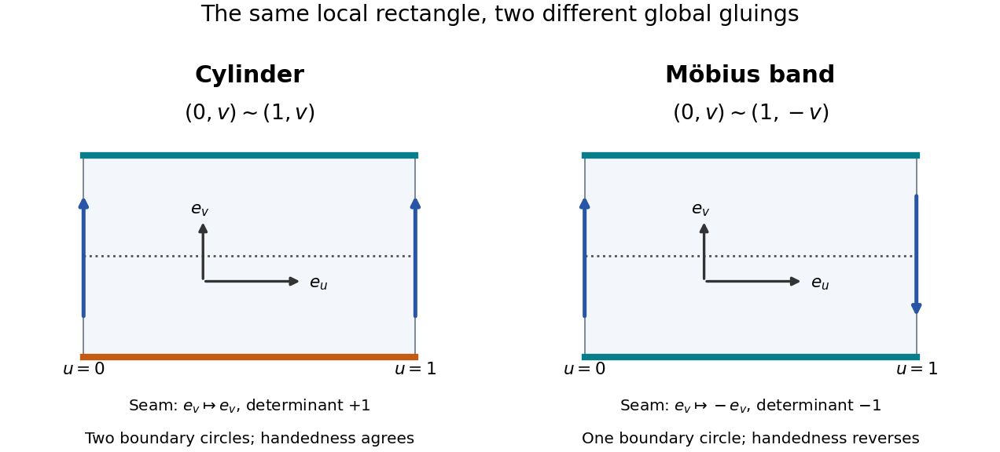

# Orientability

↑ **Parent:** [Topology](topology-split.md)  
ⓦ [Wiki](https://en.wikipedia.org/wiki/Orientability)

Orientability asks whether local choices of handedness can agree everywhere on a [manifold](topological-manifold.md). On a [smooth manifold](smooth-manifold.md), an [orientation of a smooth manifold](orientation-of-a-smooth-manifold.md) chooses an [orientation of a vector space](orientation-of-a-vector-space.md) for each [tangent space](tangent-space.md), continuously with position. An [ordered basis](ordered-basis.md) describes the same handedness as another one when the change-of-basis [determinant](determinant.md) is positive. An [oriented atlas](oriented-atlas.md) implements this condition through positive [Jacobian determinants](jacobian-determinant.md) of the [smooth transition maps](smooth-transition-map.md).

A paper strip makes the obstruction visible. Join its short ends without twisting: the resulting [untwisted band](untwisted-band.md) admits a consistent choice of [unit normal](unit-normal.md). Add a half-turn before joining: on the [Möbius band](mobius-band.md), following the [core circle of a Möbius band](core-circle-of-a-mobius-band.md) reverses that choice when you first return to the same point. A local decision about handedness has encountered a global contradiction. The [normal reversal around the Möbius core](normal-reversal-around-the-mobius-core.md) makes this precise for an explicit model.

**[Figure 2](#image-matching-and-reversed-edge-identifications-on-a-cylinder-and-a-mobius-band). Matching and reversed edge identifications on a cylinder and a Möbius band**.

Both rectangles have coordinates $(u,v)\in[0,1]\times[-1,1]$. The [untwisted band](untwisted-band.md) identifies $(0,v)$ with $(1,v)$; the [Möbius band](mobius-band.md) identifies $(0,v)$ with $(1,-v)$. Across a seam the corresponding local coordinate changes preserve or reverse $v$, giving [determinants](determinant.md) $+1$ and $-1$. This sign explains the handedness change; the drawing also tracks the two [boundary](boundary-of-a-set.md) circles of the [untwisted band](untwisted-band.md) and the single [boundary](boundary-of-a-set.md) circle of the [Möbius band](mobius-band.md).

For a [smooth](smooth-function.md) [topological surface](topological-surface.md) embedded in $\mathbb R^3$, choosing an [orientation of a surface](orientation-of-a-surface.md) is equivalent to choosing a continuous [unit normal](unit-normal.md). This picture is specific to surfaces in three-dimensional space: the general definition uses compatible local orientations, without requiring an [embedding](embedding.md). [Orientability](orientability.md) is a [topological invariant](topological-invariant.md), so a [homeomorphism](homeomorphism.md) cannot turn a [Möbius band](mobius-band.md) into a [untwisted band](untwisted-band.md). The [sphere](sphere.md) and [torus](torus.md) are [orientable surfaces](orientable-surface.md); the [Klein bottle](klein-bottle.md) is not. [Open University, Surfaces, §3.2: orientability](https://www.open.edu/openlearn/science-maths-technology/mathematics-statistics/surfaces/content-section-3.2)

The distinction matters when a sign has geometric meaning. A signed [flux](flux.md) [surface integral](surface-integral.md) needs an [orientation of a surface](orientation-of-a-surface.md), and [Stokes theorem](stokes-theorem.md) relates that choice to the [outward-normal-first boundary orientation](outward-normal-first-boundary-orientation.md). Ordinary unsigned [surface area](surface-area.md) does not require [orientability](orientability.md). Thus a [Möbius band](mobius-band.md) still has a perfectly meaningful area even though it has no continuous global [unit normal](unit-normal.md).

A [connected](connected-space.md) orientable [manifold](topological-manifold.md) of positive dimension has two possible orientations: reversing every local choice gives the other one. If a [manifold](topological-manifold.md) has several [connected components](connected-component.md), each component can be oriented independently when it is orientable. For [topological surfaces](topological-surface.md), a useful obstruction criterion is the presence of a [Möbius band](mobius-band.md): a surface is nonorientable exactly when it contains such a band. [Cornell Mathematical Explorers' Club, Orientable and Nonorientable Surfaces](https://pi.math.cornell.edu/~mec/Winter2009/Victor/part3.htm)

## ↑ Ancestors (5)

1. [Topology](topology-split.md)
2. [Geometry and topology](geometry-and-topology-split.md)
3. [Area of mathematics](area-of-mathematics.md)
4. [Mathematics](mathematics-split.md)
5. [Codex Wiki](split.md)

## ← Incoming links (9)

- [Classification of compact surfaces](classification-of-compact-surfaces.md)
- [Möbius band](mobius-band.md)
- [Normal reversal around the Möbius core](normal-reversal-around-the-mobius-core.md)
- [Orientability](orientability.md)
- [Orientable smooth manifold](orientable-smooth-manifold.md)
- [Solution](past-exam-of-the-mathematics-course-of-the-university-of-cambridge/2001/iii/paper-16/2/solution.md)
- [Solution](past-exam-of-the-mathematics-course-of-the-university-of-cambridge/2001/iii/paper-16/3/solution.md)
- [Solution](past-exam-of-the-mathematics-course-of-the-university-of-cambridge/2001/iii/paper-16/5/solution.md)
- [Untwisted band](untwisted-band.md)
