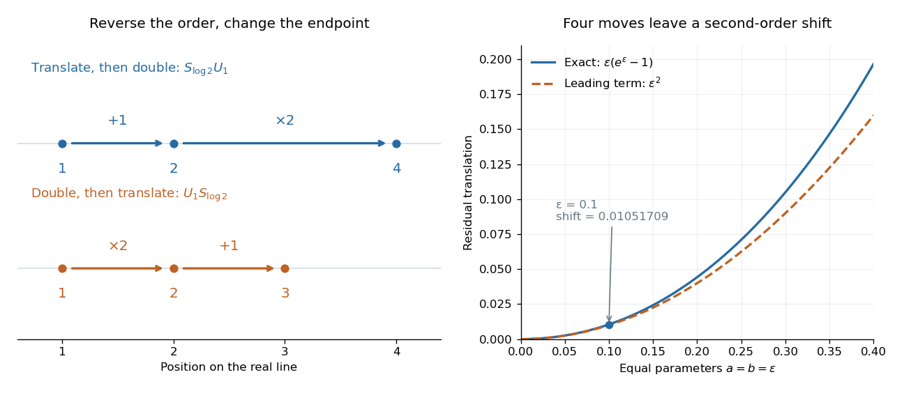

# Orientation-preserving affine group of the real line

↑ **Parent:** [Lie group](lie-group.md)

The [real affine group](orientation-preserving-affine-group-of-the-real-line.md) used here is the orientation-preserving subgroup of the [affine group](affine-group.md) on the real line. It acts by $x\mapsto e^ax+b$ and has multiplication $(a,b)(a',b')=(a+a',b+e^ab')$. The positive dilation distinguishes this connected component from the full group, which also contains negative dilations.

Here is a small [Lie group](lie-group.md) where order matters. Write a point as $(x,1)^T$, and let

$$
D=\begin{pmatrix}1&0\\0&0\end{pmatrix},\quad T=\begin{pmatrix}0&1\\0&0\end{pmatrix},\quad S_a=\exp(aD)=\begin{pmatrix}e^a&0\\0&1\end{pmatrix},\quad U_b=\exp(bT)=\begin{pmatrix}1&b\\0&1\end{pmatrix}.
$$

The [one-parameter subgroups](one-parameter-subgroup.md) $S_a$ and $U_b$ give [dilations](uniform-dilation.md) and [translations](translation-geometry.md). With [matrix multiplication](matrix-multiplication.md) acting rightmost first, $S_aU_b$ sends $x$ to $e^ax+e^ab$, whereas $U_bS_a$ sends $x$ to $e^ax+b$. At $a=\log2$ and $b=1$, translate then double gives $2x+2$, while double then translate gives $2x+1$. Starting at $x=1$ gives endpoints $4$ and $3$.

The same order dependence survives infinitesimally: the [matrix commutator](commutator.md) is $[D,T]=DT-TD=T$. Indeed, the [group commutator](group-commutator.md) satisfies

$$
S_aU_bS_{-a}U_{-b}=U_{(e^a-1)b}.
$$

At $a=b=0.1$, the residual [translation](translation-geometry.md) is $0.01051709$, close to the leading product $ab=0.01$. It measures a second-order failure of the four moves to cancel. This connects finite composition directly to the [Lie bracket](lie-bracket.md) on the [Lie algebra](lie-algebra-split.md); see [Meinrenken, Section 4, Proposition 4.7](https://www.math.toronto.edu/mein/teaching/LectureNotes/lie.pdf).

**[Figure 2](#image-scaling-and-translation-have-different-endpoints-when-their-order-is-reversed). Scaling and translation have different endpoints when their order is reversed**.

**Table of contents**

- [Invariant frames of the real affine group](invariant-frames-of-the-real-affine-group.md)
- [Maurer-Cartan coframe of the real affine group](maurer-cartan-coframe-of-the-real-affine-group.md)

## ↑ Ancestors (7)

1. [Lie group](lie-group.md)
2. [Lie theory](lie-theory-split.md)
3. [Diagonal dominance](diagonal-dominance.md)
4. [Algebra](algebra-split.md)
5. [Area of mathematics](area-of-mathematics.md)
6. [Mathematics](mathematics-split.md)
7. [Codex Wiki](split.md)

## ← Incoming links (5)

- [Adjoint dilation obstruction to a bi-invariant Riemannian metric](adjoint-dilation-obstruction-to-a-bi-invariant-riemannian-metric.md)
- [Affine conjugation obstruction to a bi-invariant group metric](affine-conjugation-obstruction-to-a-bi-invariant-group-metric.md)
- [Solution](past-exam-of-the-mathematics-course-of-the-university-of-cambridge/2003/iii/paper-11/1/solution.md)
- [Solution](past-exam-of-the-mathematics-course-of-the-university-of-cambridge/2003/iii/paper-16/5/c/solution.md)
- [Solution](past-exam-of-the-mathematics-course-of-the-university-of-cambridge/2004/iii/paper-19/5/c/solution.md)
