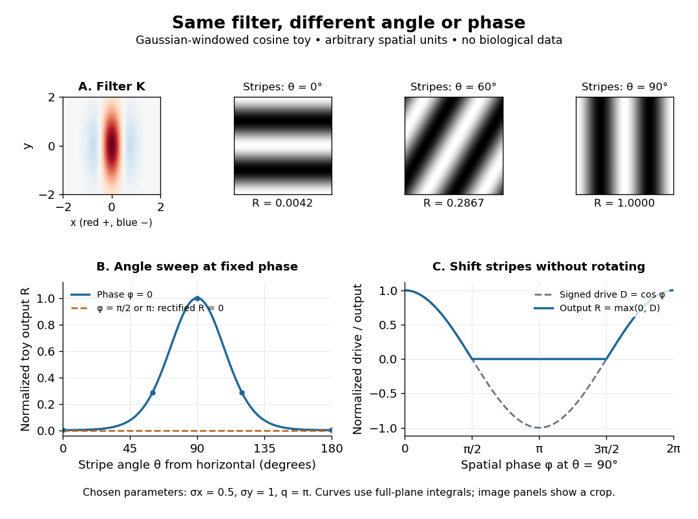

# Orientation selectivity

↑ **Parent:** [Primary visual cortex](primary-visual-cortex.md)  
ⓦ [Wiki](https://en.wikipedia.org/wiki/Orientation_selectivity)

[Orientation selectivity](orientation-selectivity.md) is a systematic dependence of a visual [neuron](neuron.md)'s response on the axis of a bar, edge or stripe pattern presented in its [receptive field](receptive-field.md), under specified stimulus conditions. Here the [angle](angle.md) $\theta$ measures the stripe axis from horizontal: $0^\circ$ is horizontal and $90^\circ$ vertical. An axis has no arrow, so $\theta$ and $\theta+180^\circ$ describe the same orientation. A preference for one direction of movement across that axis is an additional property; the 1962 recordings included both equal and unequal responses to opposite movements. [Hubel and Wiesel (1962), p. 112: orientation versus opposite movements](https://www.gatsby.ucl.ac.uk/teaching/courses/tn1-2020/additional/systems/JPhysiol-1962-Hubel-106-54.pdf)

A particularly clear experiment using [extracellular single-unit recording](extracellular-single-unit-recording.md) appears in the 1959 paper, Figures 2–3. A bright $1^\circ\times8^\circ$ slit was centered on the same [receptive field](receptive-field.md) and rotated through successive [angles](angle.md); each presentation lasted one second. The vertical slit strongly increased the extracellularly recorded [spike train](spike-train.md), whereas the horizontal slit was ineffective. Small-spot tests had identified [ON and OFF receptive-field subregions](on-and-off-receptive-field-subregions.md), with a central ON region and opposing flanks: rotation illuminated less of the center and more of the flanks. Geometry and location therefore mattered together. These dimensions belong to that recorded unit, not to every [neuron](neuron.md). [Hubel and Wiesel, Receptive fields of single neurones in the cat's striate cortex (1959), pp. 578–579, Figures 2–3: primary recordings](https://xbio-live.s3.amazonaws.com/narratives/57358/Hubel%20and%20Wiesel%201959_Guided%20paper.pdf)

An [orientation tuning curve](orientation-tuning-curve.md) summarizes a controlled [angle](angle.md) sweep. Keep location, size and [visual contrast](visual-contrast.md) fixed; for a stripe pattern also specify [spatial frequency](spatial-frequency.md) and [phase](phase-waves.md). The same [signed spatial filter model of a simple cell](signed-spatial-filter-model-of-a-simple-cell.md) can produce strong [orientation selectivity](orientation-selectivity.md) and strong dependence on [phase](phase-waves.md), as the following original toy illustrates. Its smooth curves are calculated predictions, not digitized or invented biological measurements.

**[Figure 3](#image-orientation-selectivity-and-phase-sensitivity-in-a-toy-gabor-filter). Orientation selectivity and phase sensitivity in a toy Gabor filter**. A chosen [Gaussian function](gaussian-function.md) times a [cosine](cosine.md) supplies the signed filter. At fixed [phase](phase-waves.md) its normalized output peaks for vertical stripes; shifting the same stripes changes the signed drive and the rectified output. The [angle](angle.md) labels refer to the stripe axis, perpendicular to the direction in which brightness varies. Spatial units and all parameters are arbitrary; curves use an infinite-domain [integral](integral-split.md), while the small image panels show only a crop. See [signed spatial filter model of a simple cell](signed-spatial-filter-model-of-a-simple-cell.md) for the calculation.

**Table of contents**

- [Orientation tuning curve](orientation-tuning-curve.md)
- [Orientation-map self-organization](orientation-map-self-organization.md)

## ↑ Ancestors (4)

1. [Primary visual cortex](primary-visual-cortex.md)
2. [Neuroscience](neuroscience-split.md)
3. [Biology](biology-split.md)
4. [Codex Wiki](split.md)

## ← Incoming links (6)

- [Orientation selectivity](orientation-selectivity.md)
- [Orientation tuning curve](orientation-tuning-curve.md)
- [Solution](past-exam-of-the-mathematics-course-of-the-university-of-cambridge/2006/iii/paper-84/5/solution.md)
- [Solution](past-exam-of-the-mathematics-course-of-the-university-of-cambridge/2007/iii/paper-73/4/e/solution.md)
- [Primary visual cortex](primary-visual-cortex.md)
- [Signed spatial filter model of a simple cell](signed-spatial-filter-model-of-a-simple-cell.md)
