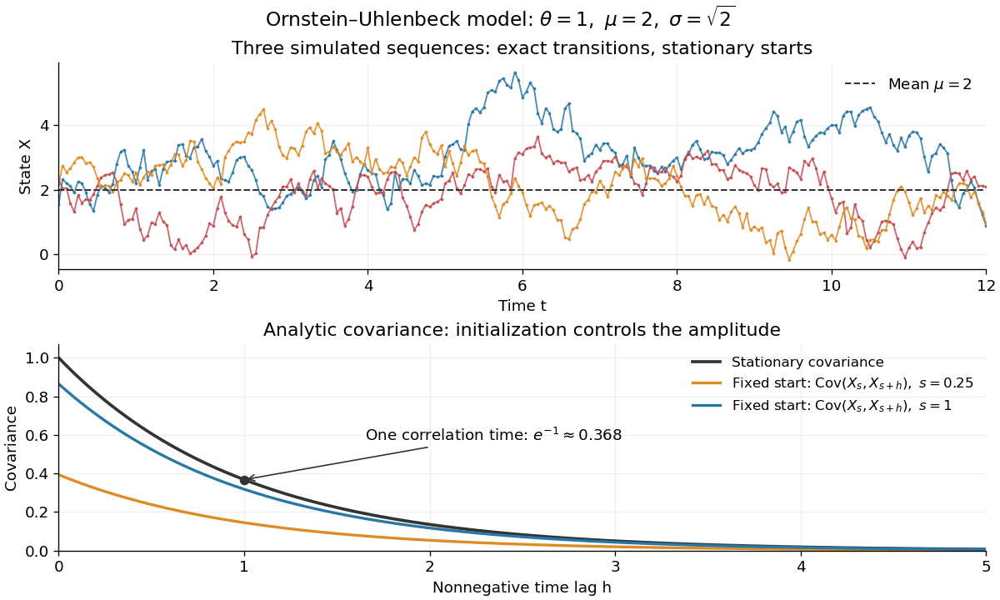

# Ornstein-Uhlenbeck stationary initialization

↑ **Parent:** [Ornstein-Uhlenbeck process](ornstein-uhlenbeck-process.md)

Set $v_\infty=\sigma^2/(2\theta)$ and draw $X_0\sim\mathcal N(\mu,v_\infty)$ independently of future [Brownian increments](brownian-increment.md). The [Ornstein-Uhlenbeck process](ornstein-uhlenbeck-process.md) is then a [strictly stationary process](strictly-stationary-process.md), with

$$
\mathbb E X_t=\mu,\qquad \operatorname{Var}(X_t)=v_\infty,\qquad \operatorname{Cov}(X_s,X_t)=v_\infty e^{-\theta|t-s|}.
$$

Every time has the same [normal distribution](normal-distribution.md), and the [covariance function](covariance-function.md) depends only on the time lag. For a [Gaussian process](gaussian-process.md) these properties also make all its [finite-dimensional distributions](finite-dimensional-distribution.md) invariant under a common time shift. The [stationary distribution](stationary-distribution.md) balances the continual random forcing against the contracting [drift](drift-coefficient.md).[Applied Stochastic Differential Equations, Example 6.8, printed pp. 91–92, equations (6.73)–(6.76): steady-state variance and covariance](applied-stochastic-differential-equations-by-simo-sarkka-and-arno-solin.md)

With a fixed $X_0=x_0$, the [covariance function](covariance-function.md) instead is

$$
\operatorname{Cov}(X_s,X_t)=v_\infty\left(e^{-\theta|t-s|}-e^{-\theta(s+t)}\right),\qquad s,t\ge0.
$$

In particular, it is zero when $s=0$, since the initial value has no uncertainty. The second term records the fixed start; it is the general scaling of the [zero-start Ornstein-Uhlenbeck covariance](zero-start-ornstein-uhlenbeck-covariance.md). The pure [exponential covariance function](exponential-covariance-function.md) displayed above assumes stationary initialization. For a fixed start, that function emerges as the late-time limit at fixed lag, while the one-time [probability distributions](probability-distribution.md) approach $\mathcal N(\mu,v_\infty)$ by [convergence in distribution](convergence-in-distribution.md).

For the stipulated $\theta=1$, $\mu=2$, $\sigma=\sqrt2$, stationary initialization has [variance](variance-split.md) one from the outset. Its [autocorrelation](autocorrelation.md) is $e^{-|h|}$, so the [correlation time](correlation-time.md) is one: a lag of one reduces the [autocorrelation](autocorrelation.md) to $e^{-1}\approx0.3679$. Its raw second moment $\mathbb E[X_sX_t]=4+e^{-|t-s|}$ includes the squared [expected value](expected-value.md); it must not be confused with the [covariance](covariance.md).

**[Figure 4](#image-simulated-stationary-ornstein-uhlenbeck-samples-and-analytic-covariance-compared-with-a-fixed-start). Simulated stationary Ornstein-Uhlenbeck samples and analytic covariance compared with a fixed start**.

The upper panel shows three simulated sequences with independent stationary initial values and exact transitions at spacing $0.05$. Joining their points only guides the eye; it does not simulate a continuous [sample path](sample-path.md) between those points. The lower panel shows analytic [covariance functions](covariance-function.md): the stationary curve and, for comparison, $\operatorname{Cov}(X_s,X_{s+h})$ for fixed initialization at two different ages $s$. These are simulated samples and model curves, not measured trajectories or empirical [covariance](covariance.md) estimates.

## ↑ Ancestors (8)

1. [Ornstein-Uhlenbeck process](ornstein-uhlenbeck-process.md)
2. [Gaussian process](gaussian-process.md)
3. [Stochastic process](stochastic-process-split.md)
4. [Probability theory](probability-theory-split.md)
5. [Probability and statistics](probability-and-statistics-split.md)
6. [Area of mathematics](area-of-mathematics.md)
7. [Mathematics](mathematics-split.md)
8. [Codex Wiki](split.md)

## ← Incoming links (2)

- [Exact sampling of an Ornstein-Uhlenbeck process](exact-sampling-of-an-ornstein-uhlenbeck-process.md)
- [Ornstein-Uhlenbeck process](ornstein-uhlenbeck-process.md)
