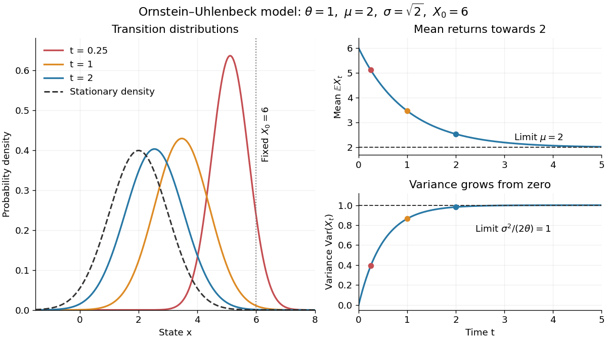

# Ornstein-Uhlenbeck transition distribution

↑ **Parent:** [Ornstein-Uhlenbeck process](ornstein-uhlenbeck-process.md)

For a fixed initial value $X_0=x_0$, the [Ornstein-Uhlenbeck process](ornstein-uhlenbeck-process.md) has the [normal distribution](normal-distribution.md)

$$
X_t\sim\mathcal N\!\left(\mu+(x_0-\mu)e^{-\theta t},\ \frac{\sigma^2}{2\theta}(1-e^{-2\theta t})\right),\qquad t>0.
$$

The two parameters of $\mathcal N(m,v)$ are the [expected value](expected-value.md) and [variance](variance-split.md), not the [standard deviation](standard-deviation.md). At $t=0$ the [variance](variance-split.md) is zero and the value is fixed. More generally, its [transition kernel](markov-kernel.md) over any interval of length $h>0$ has [conditional expected value](conditional-expectation.md) $\mu+(x-\mu)e^{-\theta h}$ and conditional [variance](variance-split.md) $\sigma^2(1-e^{-2\theta h})/(2\theta)$ when the current value is $x$. The coefficients depend on elapsed time; the initial [probability distribution](probability-distribution.md) determines whether the resulting [stochastic process](stochastic-process-split.md) is stationary.[Applied Stochastic Differential Equations, Example 6.2, printed p. 81, equations (6.27)–(6.30); centered model with diffusion constant q](applied-stochastic-differential-equations-by-simo-sarkka-and-arno-solin.md)

In the stipulated example $\theta=1$, $\mu=2$, $\sigma=\sqrt2$, $x_0=6$, the [expected value](expected-value.md) at time two is $2+4e^{-2}\approx2.5413$ and the [variance](variance-split.md) is $1-e^{-4}\approx0.9817$. The initial distance from two has fallen by a factor $e^{-2}$, but the [standard deviation](standard-deviation.md) has grown to about $0.9908$. Approaching the reference level in [expected value](expected-value.md) is compatible with growing uncertainty from a perfectly known initial value.

**[Figure 3](#image-ornstein-uhlenbeck-transition-densities-mean-relaxation-and-variance-growth-from-a-fixed-initial-value). Ornstein-Uhlenbeck transition densities, mean relaxation and variance growth from a fixed initial value**.

The solid [probability density functions](probability-density-function.md) use times $0.25$, $1$ and $2$; the dashed curve is the limiting [normal distribution](normal-distribution.md) with [expected value](expected-value.md) two and [variance](variance-split.md) one. The curves are exact model predictions. There is no ordinary density for the fixed value at time zero.

A short derivation uses the [integrating factor](integrating-factor.md) $e^{\theta t}$. The [Itô product rule](ito-product-rule.md) gives $d[e^{\theta t}(X_t-\mu)]=\sigma e^{\theta t}\,dW_t$, hence

$$
X_t=\mu+(x_0-\mu)e^{-\theta t}+\sigma\int_0^t e^{-\theta(t-u)}\,dW_u.
$$

The [stochastic integral](stochastic-integral.md) has zero [expected value](expected-value.md). The [Itô isometry](ito-isometry.md) gives its [variance](variance-split.md) as $\sigma^2\int_0^t e^{-2\theta(t-u)}du$. Its deterministic integrand makes it a [Gaussian random variable](gaussian-random-variable.md), yielding the displayed [normal distribution](normal-distribution.md). Shifting the integration interval gives the same [transition kernel](markov-kernel.md) from any later time.

## ↑ Ancestors (8)

1. [Ornstein-Uhlenbeck process](ornstein-uhlenbeck-process.md)
2. [Gaussian process](gaussian-process.md)
3. [Stochastic process](stochastic-process-split.md)
4. [Probability theory](probability-theory-split.md)
5. [Probability and statistics](probability-and-statistics-split.md)
6. [Area of mathematics](area-of-mathematics.md)
7. [Mathematics](mathematics-split.md)
8. [Codex Wiki](split.md)

## ← Incoming links (2)

- [Exact sampling of an Ornstein-Uhlenbeck process](exact-sampling-of-an-ornstein-uhlenbeck-process.md)
- [Ornstein-Uhlenbeck process](ornstein-uhlenbeck-process.md)
