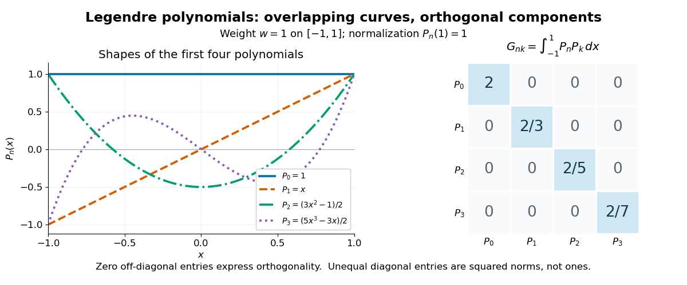
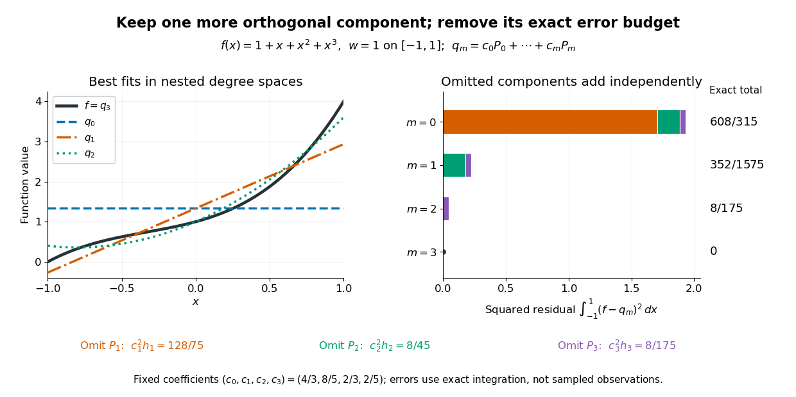

# Orthogonal polynomial

↑ **Parent:** [Numerical analysis](numerical-analysis.md)  
ⓦ [Wiki](https://en.wikipedia.org/wiki/Orthogonal_polynomial)

An [orthogonal polynomial](orthogonal-polynomial.md) family chooses [polynomials](polynomial.md) that do not overlap under a specified [inner product](inner-product.md). For real [polynomials](polynomial.md) on an interval $(a,b)$, use the [weighted inner product](inner-product.md#weighted-inner-product)

$$
\langle p,q\rangle_w=\int_a^b p(x)q(x)w(x)\,dx,\qquad \|p\|_w^2=\langle p,p\rangle_w.
$$

Assume $a<b$, the weight $w$ is measurable and positive [almost everywhere](measure-theory.md#almost-everywhere), and its absolute moments $\int_a^b |x|^k w(x)\,dx$ are finite for every [integer](integer.md) $k\geq0$. These conditions make the [integrals](integral.md) finite and give every nonzero [polynomial](polynomial.md) positive squared [norm](normed-vector-space.md#norm). A sequence $p_0,p_1,\ldots$ is an [orthogonal polynomial](orthogonal-polynomial.md) family when $p_n$ has real [coefficients](vector-space.md#coefficient) and [polynomial degree](polynomial.md#degree-of-a-polynomial) exactly $n$, and $\langle p_n,p_k\rangle_w=0$ for $n\ne k$.[NIST Digital Library of Mathematical Functions; Koornwinder, Wong, Koekoek, Swarttouw and Reinhardt, NIST DLMF Chapter 18, §18.2(i), equations 18.2.1 and 18.2.1\_5: interval orthogonality and finite absolute moments](mathematics-bibliography.md#nist-digital-library-of-mathematical-functions/18-orthogonal-polynomials)

Here $h_n=\|p_n\|_w^2>0$ and $\delta_{nk}$ is the [Kronecker delta](multilinear-algebra.md#kronecker-delta). [Orthogonality](inner-product.md#orthogonal-vectors) does not require $h_n=1$: an [orthonormal set](inner-product.md#orthonormal-set) is obtained only after replacing $p_n$ by $p_n/\sqrt{h_n}$. Multiplying each member by any nonzero real constant preserves [orthogonality](inner-product.md#orthogonal-vectors), but changes its [norm](normed-vector-space.md#norm) and the corresponding expansion [coefficient](vector-space.md#coefficient). The [monic orthogonal polynomial](#monic-orthogonal-polynomial) convention instead fixes each leading [coefficient](vector-space.md#coefficient) to one.

The first four [Legendre polynomials](linear-ordinary-differential-equation.md#legendre-polynomial), named for [Adrien-Marie Legendre](mathematics.md#adrien-marie-legendre), use $w=1$ on $[-1,1]$ and the normalization $P_n(1)=1$:

$$
P_0(x)=1,\qquad P_1(x)=x,\qquad P_2(x)=\frac{3x^2-1}{2},\qquad P_3(x)=\frac{5x^3-3x}{2}.
$$

Their [orthogonality](inner-product.md#orthogonal-vectors) and squared [norms](normed-vector-space.md#norm) are

$$
\int_{-1}^1 P_n(x)P_k(x)\,dx=\frac{2}{2n+1}\delta_{nk}.
$$

Thus their [Gram matrix](inner-product.md#gram-matrix) has a positive diagonal and zero entries elsewhere, although their [function graphs](function.md#graph-of-a-function) cross and overlap on the page. [Orthogonality](inner-product.md#orthogonal-vectors) measures an [integral](integral.md) of products, rather than separation of [function graphs](function.md#graph-of-a-function).[NIST Digital Library of Mathematical Functions; Koornwinder and collaborators, NIST DLMF Chapter 18, Table 18.3.1, Legendre row: interval, unit weight, squared norm and normalization](mathematics-bibliography.md#nist-digital-library-of-mathematical-functions/18-orthogonal-polynomials)

**[Figure 1](#image-the-first-four-legendre-polynomials-and-their-exact-integral-gram-matrix-orthogonal-with-unequal-squared-norms). The first four Legendre polynomials and their exact integral Gram matrix: orthogonal, with unequal squared norms**.

For these four [polynomials](polynomial.md), a short verification expands each product and uses $\int_{-1}^1x^{2j+1}\,dx=0$ and $\int_{-1}^1x^{2j}\,dx=2/(2j+1)$. For example, $\langle P_0,P_2\rangle=(3(2/3)-2)/2=0$ and $\langle P_1,P_3\rangle=(5(2/5)-3(2/3))/2=0$. The same calculation gives the diagonal entries $2,2/3,2/5,2/7$. More generally, apply the [Gram-Schmidt process](inner-product.md#gram-schmidt-process) to the [monomial basis](vector-space.md#monomial-basis) $1,x,x^2,\ldots$: at step $n$, subtract projections onto the earlier [polynomials](polynomial.md). The result retains its leading term, has degree $n$, and has positive [norm](normed-vector-space.md#norm), proving existence without a differential equation. Different degrees also give [linear independence](vector-space.md#linear-independence), so $p_0,\ldots,p_m$ form a [basis](vector-space.md#basis) of the [polynomials](polynomial.md) of degree at most $m$.

This [basis](vector-space.md#basis) turns [least-squares solutions](inverse-problem.md#least-squares-solution-of-a-linear-inverse-problem) for [functions](function.md) into independent scalar calculations, as the [decoupled coefficients of orthogonal polynomial projections](#decoupled-coefficients-of-orthogonal-polynomial-projections) show. In a [spectral method](numerical-analysis.md#spectral-method), increasing the degree enlarges the approximation space while keeping earlier projection [coefficients](vector-space.md#coefficient) fixed. Weighted [integrals](integral.md) also connect the same [orthogonal polynomials](orthogonal-polynomial.md) to [Gaussian quadrature](numerical-analysis.md#gaussian-quadrature): its nodes are [polynomial roots](polynomial.md#root-of-a-polynomial) of a member of the family. The projection problem minimizes an integrated squared error; [Gaussian quadrature](numerical-analysis.md#gaussian-quadrature) uses the family to choose evaluation points for an [integral](integral.md).

**Table of contents**

- [Rodrigues' formula](#rodrigues-formula)
- [Decoupled coefficients of orthogonal polynomial projections](#decoupled-coefficients-of-orthogonal-polynomial-projections)
  - [Legendre least-squares projections of a cubic](#legendre-least-squares-projections-of-a-cubic)
- [Kravchuk polynomials](#kravchuk-polynomials)
- [Orthogonality forces many interior zeros](#orthogonality-forces-many-interior-zeros)
- [Zernike polynomials](#zernike-polynomials)
  - [Zernike spherical mode](#zernike-spherical-mode)
- [Monic orthogonal polynomial](#monic-orthogonal-polynomial)
  - [Three-term recurrence for monic orthogonal polynomials](#three-term-recurrence-for-monic-orthogonal-polynomials)
- [Hermite polynomial](#hermite-polynomial)
  - [Hermite polynomial derivative recurrence](#hermite-polynomial-derivative-recurrence)
  - [Hermite function](#hermite-function)
    - [Hermite functions are Fourier eigenfunctions](#hermite-functions-are-fourier-eigenfunctions)
    - [Mehler formula for Hermite functions](#mehler-formula-for-hermite-functions)
  - [Probabilists' Hermite polynomial](#probabilists-hermite-polynomial)
    - [Space-time Hermite polynomial](#space-time-hermite-polynomial)
- [Zeros of orthogonal polynomials](#zeros-of-orthogonal-polynomials)
- [Jacobi matrix](#jacobi-matrix)

## Rodrigues' formula

↑ **Parent:** [Orthogonal polynomial](orthogonal-polynomial.md)  
ⓦ [Wiki](https://en.wikipedia.org/wiki/Rodrigues'_formula)

A Rodrigues formula constructs an [orthogonal polynomial](orthogonal-polynomial.md) by differentiating a weight multiplied by a power. The [Rodrigues formula for Legendre polynomials](linear-ordinary-differential-equation.md#rodrigues-formula-for-legendre-polynomials) uses a derivative of $(x^2-1)^l$. For [Generalized Laguerre polynomials](linear-operator-theory.md#generalized-laguerre-polynomial),

$$
L_n^{(\alpha)}(x)
=\frac{x^{-\alpha}e^x}{n!}\frac{d^n}{dx^n}
\left(e^{-x}x^{n+\alpha}\right).
$$

## Decoupled coefficients of orthogonal polynomial projections

↑ **Parent:** [Orthogonal polynomial](orthogonal-polynomial.md)

Let $f$ be a real [function](function.md) with $\|f\|_w^2=\int_a^b f(x)^2w(x)\,dx<\infty$, and let $V_m$ be the [vector space](vector-space.md) of real [polynomials](polynomial.md) of degree at most $m$. Its [orthogonal projection](hilbert-space.md#orthogonal-projection) is the [least-squares polynomial in an orthogonal-polynomial basis](inner-product.md#least-squares-polynomial-in-an-orthogonal-polynomial-basis)

$$
q_m=\sum_{n=0}^m c_np_n,\qquad c_n=\frac{\langle f,p_n\rangle_w}{h_n},\qquad h_n=\langle p_n,p_n\rangle_w.
$$

Each [coefficient](vector-space.md#coefficient) depends on just one [weighted inner product](inner-product.md#weighted-inner-product) with $f$ and one squared [norm](normed-vector-space.md#norm). In particular, the [coefficients](vector-space.md#coefficient) $c_0,\ldots,c_m$ stay the same when the allowed [polynomial degree](polynomial.md#degree-of-a-polynomial) increases. This statement assumes a fixed weight, interval and normalization of the [orthogonal polynomials](orthogonal-polynomial.md).

To see why the [least-squares normal equations](linear-regression.md#normal-equations-for-linear-least-squares) decouple, first write a trial [polynomial](polynomial.md) as $q=\sum_{j=0}^m a_j\phi_j$ in any [basis](vector-space.md#basis) of $V_m$. The residual must be [orthogonal](inner-product.md#orthogonal-vectors) to each permitted direction, giving

$$
\sum_{j=0}^m G_{ij}a_j=b_i,\qquad G_{ij}=\langle\phi_j,\phi_i\rangle_w,\qquad b_i=\langle f,\phi_i\rangle_w.
$$

The [Gram matrix](inner-product.md#gram-matrix) usually couples the unknown [coefficients](vector-space.md#coefficient). With $\phi_j=p_j$, it becomes $G_{ij}=h_i\delta_{ij}$, leaving the separate equations $h_i a_i=b_i$. For the [monomial basis](vector-space.md#monomial-basis) on $[-1,1]$ with $w=1$, by contrast, $G_{ij}$ is zero when $i+j$ is odd and $2/(i+j+1)$ when $i+j$ is even. Distinct even powers, or distinct odd powers, remain coupled.

There is also a proof of the minimum that uses no [differentiation](calculus.md#differentiation). The defining [coefficients](vector-space.md#coefficient) give $\langle f-q_m,p_n\rangle_w=0$ for $0\leq n\leq m$. Thus $f-q_m$ is [orthogonal](inner-product.md#orthogonal-vectors) to all of $V_m$. For every $v\in V_m$, the [Pythagorean theorem in an inner-product space](inner-product.md#pythagorean-theorem-in-an-inner-product-space) gives

$$
\|f-v\|_w^2=\|f-q_m\|_w^2+\|q_m-v\|_w^2.
$$

The second term is nonnegative and vanishes exactly when $v=q_m$, proving that the [least-squares solution](inverse-problem.md#least-squares-solution-of-a-linear-inverse-problem) is unique. This is an integrated squared-error optimum; it does not assert a smallest error at every point or a smallest [uniform norm](normed-vector-space.md#supremum-norm).

For $N>m$, the nested [orthogonal projections](hilbert-space.md#orthogonal-projection) satisfy the exact residual budget

$$
\|f-q_m\|_w^2=\|f-q_N\|_w^2+\sum_{n=m+1}^{N}c_n^2h_n.
$$

Indeed, $q_N-q_m$ is a [linear combination](vector-space.md#linear-combination) of mutually [orthogonal polynomials](orthogonal-polynomial.md), and $f-q_N$ is [orthogonal](inner-product.md#orthogonal-vectors) to it. Every newly retained component removes exactly $c_n^2h_n$ from the squared error. No infinite expansion or completeness assumption is needed for this finite identity. The [Legendre least-squares projections of a cubic](#legendre-least-squares-projections-of-a-cubic) make every term explicit.

### Legendre least-squares projections of a cubic

↑ **Parent:** [Decoupled coefficients of orthogonal polynomial projections](#decoupled-coefficients-of-orthogonal-polynomial-projections)

Take the [polynomial](polynomial.md) $f(x)=1+x+x^2+x^3$ on $[-1,1]$ with unit weight. Using the four [Legendre polynomials](linear-ordinary-differential-equation.md#legendre-polynomial) above, direct [integration](integral.md) gives

$$
\begin{array}{c|c|c|c|c}
n&h_n&\langle f,P_n\rangle&c_n&c_n^2h_n\\\hline
0&2&8/3&4/3&32/9\\
1&2/3&16/15&8/5&128/75\\
2&2/5&4/15&2/3&8/45\\
3&2/7&4/35&2/5&8/175
\end{array}
$$

For example, $\langle f,P_2\rangle=\tfrac12\int_{-1}^1(3x^4+2x^2-1)\,dx=4/15$: the omitted odd terms have zero [integral](integral.md). Dividing by $h_2=2/5$ gives $c_2=2/3$. Substituting all four [coefficients](vector-space.md#coefficient) proves the exact identity

$$
f=\frac43P_0+\frac85P_1+\frac23P_2+\frac25P_3.
$$

The successive [orthogonal projections](hilbert-space.md#orthogonal-projection) onto degrees at most $m$ are therefore

$$
\begin{array}{c|l|c}
m&q_m(x)&E_m=\|f-q_m\|_2^2\\\hline
0&4/3&608/315\\
1&4/3+8x/5&352/1575\\
2&1+8x/5+x^2&8/175\\
3&1+x+x^2+x^3&0
\end{array}
$$

Here $\|g\|_2^2=\int_{-1}^1g(x)^2\,dx$ is the squared [L2 norm](real-analysis.md#l2-norm), without division by the interval length. Each row retains the previous [Legendre polynomial](linear-ordinary-differential-equation.md#legendre-polynomial) [coefficients](vector-space.md#coefficient) and appends one new term. The ordinary power [coefficients](vector-space.md#coefficient) can change: adding $\tfrac23P_2$ changes the constant from $4/3$ to $1$, and adding $\tfrac25P_3$ changes the linear [coefficient](vector-space.md#coefficient) from $8/5$ to $1$. Independence belongs to the chosen [orthogonal polynomial](orthogonal-polynomial.md) coordinates.

**[Figure 2](#image-nested-legendre-least-squares-projections-of-a-cubic-and-the-exact-squared-residual-contributed-by-each-omitted-mode). Nested Legendre least-squares projections of a cubic and the exact squared residual contributed by each omitted mode**.

The full squared [L2 norm](real-analysis.md#l2-norm) is $\|f\|_2^2=192/35$, equal to $32/9+128/75+8/45+8/175$. The residual budgets are the omitted terms:

$$
E_0=\frac{128}{75}+\frac8{45}+\frac8{175}=\frac{608}{315},\qquad E_1=\frac8{45}+\frac8{175}=\frac{352}{1575},\qquad E_2=\frac8{175},\qquad E_3=0.
$$

For a direct check independent of summing the budgets, $f-q_2=x^3-3x/5$, and integrating its square gives $2/7-12/25+6/25=8/175$. This residual is [orthogonal](inner-product.md#orthogonal-vectors) to $1,x,x^2$, exactly the conditions for the best quadratic [least-squares solution](inverse-problem.md#least-squares-solution-of-a-linear-inverse-problem). An [orthogonal projection](hilbert-space.md#orthogonal-projection) need not be a [polynomial interpolant](interpolation.md#lagrange-polynomial): for example, $q_2(1)=18/5$ while $f(1)=4$. The approximation allocates error across the interval according to the chosen [weighted inner product](inner-product.md#weighted-inner-product).

## Kravchuk polynomials

↑ **Parent:** [Orthogonal polynomial](orthogonal-polynomial.md)  
ⓦ [Wiki](https://en.wikipedia.org/wiki/Kravchuk_polynomials)

These [polynomials](polynomial.md) are orthogonal for a [binomial distribution](discrete-probability-distribution.md#binomial-distribution) weight and encode the coefficient transformation in the [MacWilliams identity](coding-theory.md#macwilliams-identity). Their [generating function](sequence-and-series.md#generating-function) follows by expanding the two factors:

$$
\sum_{s=0}^nK_s(t;n,q)z^s=(1-z)^t(1+(q-1)z)^{n-t}.
$$

For binary [linear codes](coding-theory.md#linear-code), $q=2$. Expanding the factors gives $K_s(t;n,2)=\sum_j(-1)^j\binom tj\binom{n-t}{s-j}$, where [binomial coefficients](binomial-coefficient.md) outside their usual integer range are zero. Orthogonality follows by multiplying [generating functions](sequence-and-series.md#generating-function) and summing over $t$ with weight $\binom nt(q-1)^t$: the result is $q^n(1+(q-1)zw)^n$, whose coefficient of $z^rw^s$ is zero for $r\ne s$ and $q^n(q-1)^r\binom nr$ for $r=s$.

## Orthogonality forces many interior zeros

↑ **Parent:** [Orthogonal polynomial](orthogonal-polynomial.md)

If a nonzero continuous real function on an interval is orthogonal to every [polynomial](polynomial.md) of degree below $n$, it has at least $n$ distinct interior zeros. If it had only finitely many zeros and fewer than $n$ sign changes, multiply it by the product of linear factors at its sign-changing zeros. The product has constant sign and is nonzero on an [open interval](topology.md#open-interval), so its integral cannot vanish. Orthogonality to this degree-below-$n$ [polynomial](polynomial.md) contradicts that conclusion. Infinitely many interior zeros already satisfy the assertion. Orthogonal [polynomials](polynomial.md) of respective degrees $0,\ldots,n-1$ form a [basis](vector-space.md#basis) of the needed [polynomial](polynomial.md) space.

## Zernike polynomials

↑ **Parent:** [Orthogonal polynomial](orthogonal-polynomial.md)  
ⓦ [Wiki](https://en.wikipedia.org/wiki/Zernike_polynomials)

The real Zernike polynomials form an [orthogonal polynomial](orthogonal-polynomial.md) basis on the unit [Euclidean disk](topology.md#disk-mathematics), with radial factor $R_n^m(\rho)$ and angular factor $\cos m\phi$ or $\sin m\phi$. Here $0\leq m\leq n$ and $n-m$ is [even](calculus.md#even-function). They decompose [wavefront errors](physical-optics.md#wavefront-error) into modes useful for optical correction. Normalizations differ, so coefficients should specify the chosen convention.

### Zernike spherical mode

↑ **Parent:** [Zernike polynomials](#zernike-polynomials)

The unnormalized rotationally symmetric mode is $Z_4^0(\rho)=6\rho^4-6\rho^2+1$. It describes balanced primary [spherical aberration](geometrical-optics.md#spherical-aberration). The lower-degree terms make it orthogonal to constant piston and quadratic defocus under the disk area measure: direct integration gives $\int_0^1 Z_4^0\rho\,d\rho=0$ and $\int_0^1 Z_4^0(2\rho^2-1)\rho\,d\rho=0$.

## Monic orthogonal polynomial

↑ **Parent:** [Orthogonal polynomial](orthogonal-polynomial.md)

A monic orthogonal polynomial has leading coefficient one. For a fixed positive weight, there is a unique monic orthogonal polynomial of each degree.

### Three-term recurrence for monic orthogonal polynomials

↑ **Parent:** [Monic orthogonal polynomial](#monic-orthogonal-polynomial)

For monic orthogonal polynomials,

$$
p_{n+1}(x)=(x-\alpha_n)p_n(x)-\beta_np_{n-1}(x),
$$

where

$$
\alpha_n=\frac{\langle xp_n,p_n\rangle}{\langle p_n,p_n\rangle},
\qquad
\beta_n=\frac{\langle p_n,p_n\rangle}{\langle p_{n-1},p_{n-1}\rangle}.
$$

## Hermite polynomial

↑ **Parent:** [Orthogonal polynomial](orthogonal-polynomial.md)  
ⓦ [Wiki](https://en.wikipedia.org/wiki/Hermite_polynomial)

Named after [Charles Hermite](mathematics.md#charles-hermite).

### Hermite polynomial derivative recurrence

↑ **Parent:** [Hermite polynomial](#hermite-polynomial)

For the physicists' [Hermite polynomials](#hermite-polynomial) $H_n=(-1)^ne^{x^2}D^ne^{-x^2}$, the displayed recurrence holds for $n\geq1$, while $H_0'=0$ separately. Put $u=e^{-x^2}$. Differentiating $u'+2xu=0$ exactly $n$ times using the [Leibniz rule](calculus.md#leibniz-rule) yields

$$
(D+2x)D^nu=-2nD^{n-1}u.
$$

Differentiating the defining product for $H_n$ then gives

$$
H_n'=(-1)^ne^{x^2}(D+2x)D^nu
=2n(-1)^{n-1}e^{x^2}D^{n-1}u=2nH_{n-1}.
$$

The nonnegative integer convention is essential for the derivative-based definition; no negative-order derivative or $H_{-1}$ is needed.

### Hermite function

↑ **Parent:** [Hermite polynomial](#hermite-polynomial)

The normalized Hermite functions multiply the physicists' [Hermite polynomials](#hermite-polynomial) by a Gaussian. They form an [orthonormal basis](inner-product.md#orthonormal-basis) of $L^2(\mathbb R)$ and satisfy $(-d^2/dx^2+x^2)H_n=(2n+1)H_n$. With $a=(x+d/dx)/\sqrt2$ and $a^*=(x-d/dx)/\sqrt2$, they are $(a^*)^nH_0/\sqrt{n!}$ and the [quantum harmonic oscillator](quantum-harmonic-oscillator.md) is $2a^*a+1$. For completeness, if $u$ is orthogonal to all of them, all moments of $u(x)e^{-x^2/2}$ vanish. Its transform $\int u(x)e^{-x^2/2}e^{zx}\,dx$ is entire by [Cauchy-Schwarz inequality](probability-and-statistics.md#cauchy-schwarz-inequality), has every derivative zero at zero, and hence vanishes identically. Uniqueness of the [Fourier transform](fourier-transform.md) gives $u=0$.

#### Hermite functions are Fourier eigenfunctions

↑ **Parent:** [Hermite function](#hermite-function)

Use the unitary [Fourier transform](fourier-transform.md) with phase $e^{-i\lambda x}$. It commutes with $-d^2/dx^2+x^2$, because differentiation transforms to multiplication by $i\lambda$ and multiplication by $x$ transforms to $i\,d/d\lambda$. The [Hermite differential equation](analysis.md#hermite-differential-equation) has a unique polynomial solution of each degree up to scale, and multiplying by the Gaussian gives a [Hermite function](#hermite-function). Transforming a polynomial times this Gaussian again gives a polynomial times the Gaussian of the same degree; comparison of leading coefficients gives the eigenvalue $(-i)^n$.

#### Mehler formula for Hermite functions

↑ **Parent:** [Hermite function](#hermite-function)

For $|t|<1$, this identity sums the [Hermite function](#hermite-function) expansion into a Gaussian. One proof takes the [Bargmann-Fock space](hilbert-space.md#bargmann-fock-space) inner product of the generating functions $\pi^{-1/4}\exp(-x^2/2+\sqrt2 xz-z^2/2)$ at $\sqrt t\,z$. Writing $z=u+iv$, the two resulting real [Gaussian integrals](integral.md#gaussian-integral) have quadratic coefficients $1+t$ and $1-t$ and linear coefficients $\sqrt{2t}(x+y)$ and $i\sqrt{2t}(x-y)$. Evaluation gives the formula. Setting $t=e^{-2s}$ and multiplying by $e^{-s}$ gives the [harmonic oscillator transition kernel](quantum-harmonic-oscillator.md#harmonic-oscillator-transition-kernel) of $e^{-s(-d^2/dx^2+x^2)}$.

### Probabilists' Hermite polynomial

↑ **Parent:** [Hermite polynomial](#hermite-polynomial)

The probabilists' Hermite polynomials are

$$
\mathrm{He}_n(x)=(-1)^ne^{x^2/2}\frac{d^n}{dx^n}e^{-x^2/2}.
$$

They are orthogonal for the standard Gaussian weight and satisfy $\mathrm{He}_{n+1}=x\mathrm{He}_n-n\mathrm{He}_{n-1}$.

This is the Gaussian-probability normalization of the [Hermite polynomial](#hermite-polynomial) family.

#### Space-time Hermite polynomial

↑ **Parent:** [Probabilists' Hermite polynomial](#probabilists-hermite-polynomial)

The space-time [Probabilists' Hermite polynomial](#probabilists-hermite-polynomial) $H_n(x,t)=t^{n/2}\mathrm{He}_n(x/\sqrt t)$ extends polynomially to $t=0$ and solves $\partial_tH_n+\frac12\partial_x^2H_n=0$. Therefore $H_n(B_t,t)$ is a [martingale](martingale.md) for a standard [Brownian motion](brownian-motion.md), by the [Itô formula](stochastic-calculus.md#ito-s-lemma) and Gaussian [moments](expected-value.md#moment).

## Zeros of orthogonal polynomials

↑ **Parent:** [Orthogonal polynomial](orthogonal-polynomial.md)  
ⓦ [Wiki](https://en.wikipedia.org/wiki/Zeros_of_orthogonal_polynomials)

A degree-n orthogonal polynomial for a positive interval weight has n simple zeros in the interval interior.

## Jacobi matrix

↑ **Parent:** [Orthogonal polynomial](orthogonal-polynomial.md)  
ⓦ [Wiki](https://en.wikipedia.org/wiki/Jacobi_matrix)

A Jacobi matrix is a symmetric tridiagonal matrix whose characteristic polynomials obey the orthogonal-polynomial three-term recurrence.

## ↑ Ancestors (5)

1. [Numerical analysis](numerical-analysis.md)
2. [Analysis](analysis.md)
3. [Area of mathematics](mathematics.md#area-of-mathematics)
4. [Mathematics](mathematics.md)
5. [Codex Wiki](README.md)

## ← Incoming links (32)

- [Basis](vector-space.md#basis)
- [Chebyshev polynomial](numerical-analysis.md#chebyshev-polynomial)
- [Decoupled coefficients of orthogonal polynomial projections](#decoupled-coefficients-of-orthogonal-polynomial-projections)
- [Legendre least-squares projections of a cubic](#legendre-least-squares-projections-of-a-cubic)
- [Normalization of the ordinary Laguerre polynomials](linear-operator-theory.md#normalization-of-the-ordinary-laguerre-polynomials)
- [Orthogonal polynomial](orthogonal-polynomial.md)
- [Orthogonal polynomial contrast](normal-linear-model.md#orthogonal-polynomial-contrast)
- [Orthogonal projection onto a finite-dimensional subspace](inner-product.md#orthogonal-projection-onto-a-finite-dimensional-subspace)
- [Solution](past-exam-of-the-mathematics-course-of-the-university-of-cambridge/2002/ib/paper-3.md#6b/solution)
- [Solution](past-exam-of-the-mathematics-course-of-the-university-of-cambridge/2004/ib/paper-2.md#9a/solution)
- [Solution](past-exam-of-the-mathematics-course-of-the-university-of-cambridge/2005/ib/paper-4.md#8f/solution)
- [Solution](past-exam-of-the-mathematics-course-of-the-university-of-cambridge/2005/ii/paper-3.md#2f/iii/solution)
- [Solution](past-exam-of-the-mathematics-course-of-the-university-of-cambridge/2007/ib/paper-3.md#19f/solution)
- [Solution](past-exam-of-the-mathematics-course-of-the-university-of-cambridge/2008/ib/paper-4.md#8d/solution)
- [Solution](past-exam-of-the-mathematics-course-of-the-university-of-cambridge/2009/ib/paper-4.md#8c/solution)
- [Solution](past-exam-of-the-mathematics-course-of-the-university-of-cambridge/2014/ib/paper-4.md#1g/solution)
- [Solution](past-exam-of-the-mathematics-course-of-the-university-of-cambridge/2014/ib/paper-4.md#8c/solution)
- [Solution](past-exam-of-the-mathematics-course-of-the-university-of-cambridge/2016/ib/paper-1.md#6d/a/solution)
- [Solution](past-exam-of-the-mathematics-course-of-the-university-of-cambridge/2019/ib/paper-2.md#16d/solution)
- [Solution](past-exam-of-the-mathematics-course-of-the-university-of-cambridge/2019/ib/paper-3.md#19c/b/solution)
- [Solution](past-exam-of-the-mathematics-course-of-the-university-of-cambridge/2020/ib/paper-1.md#18c/b/solution)
- [Solution](past-exam-of-the-mathematics-course-of-the-university-of-cambridge/2020/ii/paper-2.md#2h/solution)
- [Solution](past-exam-of-the-mathematics-course-of-the-university-of-cambridge/2023/ib/paper-4.md#6b/a/solution)
- [Solution](past-exam-of-the-mathematics-course-of-the-university-of-cambridge/2025/ib/paper-3.md#17b/a/solution)
- [Recurrence relation](sequence-and-series.md#recurrence-relation)
- [René F. Swarttouw](mathematics.md#rene-f-swarttouw)
- [Rodrigues' formula](#rodrigues-formula)
- [Roelof Koekoek](mathematics.md#roelof-koekoek)
- [Tom H. Koornwinder](mathematics.md#tom-h-koornwinder)
- [Two-node Gaussian quadrature with sine weight](numerical-analysis.md#two-node-gaussian-quadrature-with-sine-weight)
- [Vandermonde determinant invariance under monic basis change](galois-theory.md#vandermonde-determinant-invariance-under-monic-basis-change)
- [Zernike polynomials](#zernike-polynomials)
