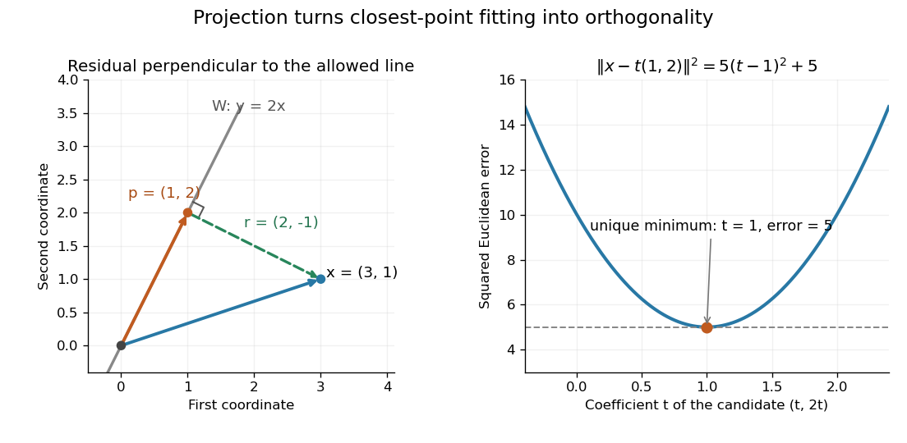

# Orthogonal projection onto a finite-dimensional subspace

↑ **Parent:** [Inner product](inner-product-split.md)

A finite-dimensional [linear subspace](vector-subspace.md) $W$ of an [inner product space](inner-product-space.md) has a unique closest [vector](vector.md) to any given [vector](vector.md) $x$. This is its [orthogonal projection](orthogonal-projection.md) $P_Wx$. If $e_1,\ldots,e_d$ is an [orthogonal basis](orthogonal-basis.md) of $W$, compute it one direction at a time:

$$
P_Wx=\sum_{j=1}^d\frac{\langle x,e_j\rangle}{\langle e_j,e_j\rangle}e_j.
$$

The [inner product](inner-product-split.md) convention here is linear in its first argument, including over the [complex numbers](complex-number.md). For an [orthonormal basis](orthonormal-basis.md), each denominator is one. When $W$ consists only of the [zero vector](zero-vector.md), the empty sum gives $P_Wx=0$. The finite-dimensional formula is described in [Francis Narcowich, Inner Products and Norms: minimization problems](https://people.tamu.edu/~f-narcowich/m641/m641_notes/inner_products.html).

Take $W=\operatorname{span}\{(1,2)^T\}$ and $x=(3,1)^T$, using the [dot product](dot-product.md). With $e=(1,2)^T$,

$$
\frac{x\cdot e}{e\cdot e}=\frac{3+2}{1+4}=1,\qquad
P_Wx=(1,2)^T,\qquad r=x-P_Wx=(2,-1)^T.
$$

The [orthogonal projection residual](orthogonal-projection-residual.md) has $r\cdot e=2-2=0$. To verify the best approximation directly, every candidate in the line is $te$, and

$$
\|x-te\|_2^2=(3-t)^2+(1-2t)^2=5(t-1)^2+5.
$$

The smallest squared [Euclidean norm](euclidean-norm.md) error is therefore $5$, attained only at $t=1$. The diagram connects the perpendicular residual to this one-variable [quadratic polynomial](quadratic-polynomial.md).

**[Figure 3](#image-the-perpendicular-residual-identifies-the-closest-point-on-a-line-and-the-unique-minimum-of-the-squared-error). The perpendicular residual identifies the closest point on a line and the unique minimum of the squared error**.

The general mechanism is the [Pythagorean theorem in an inner-product space](pythagorean-theorem-in-an-inner-product-space.md). For any $w\in W$, the [vectors](vector.md) $r=x-P_Wx$ and $P_Wx-w$ are [orthogonal](orthogonal-vectors.md), so

$$
\|x-w\|^2=\|x-P_Wx\|^2+\|P_Wx-w\|^2.
$$

Moving away from $P_Wx$ inside $W$ adds a nonnegative squared [norm](norm.md), which is zero only when $w=P_Wx$. This proves both optimality and uniqueness.

The useful feature is separation of preparation from evaluation. Construct an [orthonormal basis](orthonormal-basis.md) once with the [Gram-Schmidt process](gram-schmidt-process.md), then obtain each new best approximation using [inner products](inner-product-split.md) instead of a fresh [optimization](mathematical-optimization-split.md) problem. When $W$ is the [column space](column-space.md) of a [matrix](matrix.md), this gives [linear least squares](linear-least-squares.md); when $W$ is spanned by [orthogonal polynomials](orthogonal-polynomial-split.md), it gives a [least-squares polynomial in an orthogonal-polynomial basis](least-squares-polynomial-in-an-orthogonal-polynomial-basis.md). The ambient [inner product space](inner-product-space.md) need not be a [Hilbert space](hilbert-space-split.md) for this finite-dimensional construction. In an infinite-dimensional target [linear subspace](vector-subspace.md), existence requires additional hypotheses, supplied by [orthogonal decomposition by a closed subspace](orthogonal-decomposition-by-a-closed-subspace.md).

**Table of contents**

- [Orthogonal projection residual](orthogonal-projection-residual.md)
- [Orthogonal projection matrix](orthogonal-projection-matrix.md)
  - [Orthogonal projection of a circle between planes](orthogonal-projection-of-a-circle-between-planes.md)
  - [Transverse projection operator](transverse-projection-operator.md)
- [Least-squares polynomial in an orthogonal-polynomial basis](least-squares-polynomial-in-an-orthogonal-polynomial-basis.md)

## ↑ Ancestors (6)

1. [Inner product](inner-product-split.md)
2. [Linear algebra](linear-algebra-split.md)
3. [Algebra](algebra-split.md)
4. [Area of mathematics](area-of-mathematics.md)
5. [Mathematics](mathematics-split.md)
6. [Codex Wiki](split.md)

## ← Incoming links (8)

- [Compression of a linear operator](compression-of-a-linear-operator.md)
- [Gram-Schmidt process](gram-schmidt-process.md)
- [Solution](past-exam-of-the-mathematics-course-of-the-university-of-cambridge/2005/iii/paper-35/1/solution.md)
- [Solution](past-exam-of-the-mathematics-course-of-the-university-of-cambridge/2008/iii/paper-75/6/1/a/solution.md)
- [Solution](past-exam-of-the-mathematics-course-of-the-university-of-cambridge/2019/ii/paper-1/29j/d/solution.md)
- [Solution](past-exam-of-the-mathematics-course-of-the-university-of-cambridge/2023/ib/paper-4/6b/b/solution.md)
- [Solution](past-exam-of-the-mathematics-course-of-the-year-1-of-the-natural-sciences-course-of-the-university-of-cambridge/2021/paper-2/18/a/solution.md)
- [Weighted inner product](weighted-inner-product.md)
