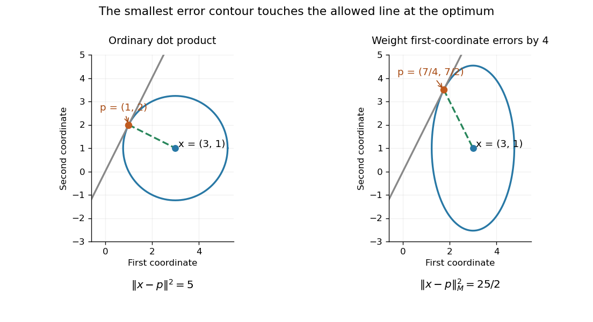

# Orthogonal projection residual

↑ **Parent:** [Orthogonal projection onto a finite-dimensional subspace](orthogonal-projection-onto-a-finite-dimensional-subspace.md)

An [orthogonal projection residual](orthogonal-projection-residual.md) is the difference $r=x-P_Wx$ between a [vector](vector.md) and its [orthogonal projection](orthogonal-projection.md) onto a [linear subspace](vector-subspace.md) $W$. It is [orthogonal](orthogonal-vectors.md) to every [vector](vector.md) in $W$, so $\langle r,w\rangle=0$ for all $w\in W$. The [Gram-Schmidt process](gram-schmidt-process.md) uses such residuals to remove directions already represented by earlier basis [vectors](vector.md).

This is an optimality condition as well as a geometric description. No permitted change within $W$ can remove a further [orthogonal](orthogonal-vectors.md) component of $r$. In the preceding [dot product](dot-product.md) example, $r=(2,-1)^T$ is perpendicular to the line spanned by $(1,2)^T$.

The selected [inner product](inner-product.md) matters. Keep $x=(3,1)^T$ and the same line, but use the [weighted Euclidean inner product](weighted-euclidean-inner-product.md) with $M=\operatorname{diag}(4,1)$. The projection coefficient and residual become

$$
t_M=\frac{\langle x,e\rangle_M}{\langle e,e\rangle_M}
=\frac{14}{8}=\frac74,\qquad
P_W^{(M)}x=\left(\frac74,\frac72\right)^T,\qquad
r_M=\left(\frac54,-\frac52\right)^T.
$$

Now $4(r_M)_1e_1+(r_M)_2e_2=5-5=0$, although $r_M\cdot e=-15/4\ne0$. The [orthogonality](orthogonal-vectors.md) is with respect to $M$, so it need not look perpendicular in the ordinary drawing. The squared weighted error is

$$
\|x-te\|_M^2=4(3-t)^2+(1-2t)^2
=8\left(t-\frac74\right)^2+\frac{25}{2}.
$$

The weighted optimum reduces the first-coordinate error from $2$ to $5/4$, at the cost of increasing the magnitude of the second-coordinate error from $1$ to $5/2$. The weights express which errors are more costly.

**[Figure 46](#image-changing-the-inner-product-changes-the-closest-point-a-circle-and-a-weighted-error-ellipse-touch-the-same-permitted-line-at-different-points). Changing the inner product changes the closest point: a circle and a weighted error ellipse touch the same permitted line at different points**.

In [linear least squares](linear-least-squares.md), residual [orthogonality](orthogonal-vectors.md) to the [column space](column-space.md) is expressed by the [normal equations for linear least squares](normal-equations-for-linear-least-squares.md). With a [weighted Euclidean inner product](weighted-euclidean-inner-product.md), the corresponding real-matrix equation is $A^TM(x-Ac)=0$. This makes the choice of error measurement part of the mathematical model, rather than merely a plotting convention.

## ↑ Ancestors (7)

1. [Orthogonal projection onto a finite-dimensional subspace](orthogonal-projection-onto-a-finite-dimensional-subspace.md)
2. [Inner product](inner-product.md)
3. [Linear algebra](linear-algebra-split.md)
4. [Algebra](algebra-split.md)
5. [Area of mathematics](area-of-mathematics.md)
6. [Mathematics](mathematics-split.md)
7. [Codex Wiki](split.md)

## ← Incoming links (7)

- [Dot product](dot-product.md)
- [Gram-Schmidt process](gram-schmidt-process.md)
- [Orthogonal projection onto a finite-dimensional subspace](orthogonal-projection-onto-a-finite-dimensional-subspace.md)
- [Orthogonal projection residual](orthogonal-projection-residual.md)
- [QR decomposition](qr-decomposition.md)
- [Vector projection](vector-projection.md)
- [Weighted Euclidean inner product](weighted-euclidean-inner-product.md)
