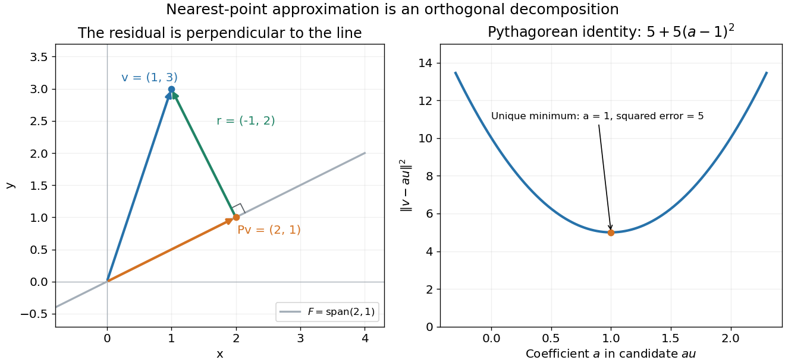
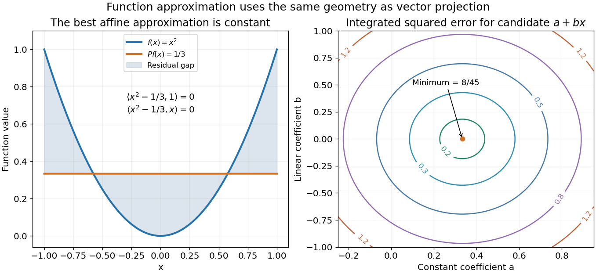

# Orthogonal projection

↑ **Parent:** [Orthogonal decomposition by a closed subspace](orthogonal-decomposition-by-a-closed-subspace.md)

The orthogonal projection $P_F$ onto a [closed subspace of a Hilbert space](closed-subspace-of-a-hilbert-space.md) $F$ sends $x$ to its component in the [orthogonal decomposition](orthogonal-decomposition-by-a-closed-subspace.md)

$$
x=P_Fx+r,\qquad P_Fx\in F,\quad r\in F^\perp.
$$

The residual $r$ is [orthogonal](orthogonal-vectors.md) to every permitted direction. For any $z\in F$, the [Pythagorean theorem](pythagorean-theorem.md) gives

$$
\|x-z\|^2=\|r\|^2+\|P_Fx-z\|^2.
$$

Thus $P_Fx$ uniquely minimizes the distance to $F$. It is a [linear map](linear-map.md), is idempotent, and is [nonexpansive](nonexpansive-mapping.md): $\|P_Fx-P_Fy\|\leq\|x-y\|$; taking $y=0$ gives $\|P_Fx\|\leq\|x\|$.

In $\mathbb R^2$, project $v=(1,3)$ onto the line spanned by $u=(2,1)$. The [inner product](inner-product.md) gives

$$
P_Fv=\frac{\langle v,u\rangle}{\langle u,u\rangle}u
=\frac55u=(2,1),\qquad r=(-1,2).
$$

The check $\langle r,u\rangle=-2+2=0$ confirms orthogonality, and $\|v\|^2=10=5+5=\|P_Fv\|^2+\|r\|^2$. Projecting again changes nothing, since the result already lies on the line.

**[Figure 1](#image-orthogonal-projection-gives-the-unique-nearest-point-on-a-line-and-a-perpendicular-residual). Orthogonal projection gives the unique nearest point on a line and a perpendicular residual**.

For a finite [orthonormal basis](orthonormal-basis.md) $e_1,\ldots,e_m$ of $F$, the same operation is $P_Fx=\sum_j\langle x,e_j\rangle e_j$, using the convention linear in the first argument. Replacing coordinate [vectors](vector.md) by [functions](function-split.md) gives exactly the same approximation principle. For $f(x)=x^2$ in the real [L2 space](l2-space-is-a-hilbert-space.md) on $[-1,1]$ and $F=\operatorname{span}\{1,x\}$, the directions are [orthogonal](orthogonal-vectors.md), with squared [norms](norm.md) $2$ and $2/3$. Their [inner products](inner-product.md) with $f$ are $2/3$ and zero, so

$$
P_Ff=\frac{2/3}{2}\cdot1+\frac0{2/3}\cdot x=\frac13.
$$

Direct integration gives the squared error $\|x^2-1/3\|^2=8/45$. For any competing affine [polynomial](polynomial-split.md), the [orthogonal](orthogonal-vectors.md) residual yields

$$
\int_{-1}^{1}\bigl(x^2-a-bx\bigr)^2\,dx
=\frac8{45}+2\left(a-\frac13\right)^2+\frac23b^2.
$$

Every deviation from $a=1/3$, $b=0$ adds a nonnegative error. The best [function](function-split.md) need not pass through any selected data point: it minimizes an integrated error across the whole [interval](interval-mathematics.md).

**[Figure 2](#image-projecting-x-squared-onto-affine-functions-gives-the-constant-one-third-and-minimum-integrated-squared-error-8-45). Projecting x squared onto affine functions gives the constant one third and minimum integrated squared error 8/45**.

**Table of contents**

- [Directed subspace angle](directed-subspace-angle.md)
  - [Complementarity from two directed subspace angles](complementarity-from-two-directed-subspace-angles.md)
- [Smallest angle between two subspaces](smallest-angle-between-two-subspaces.md)
  - [Kitaev geometrical lemma](kitaev-geometrical-lemma.md)
- [Powers of a product of two orthogonal projections](powers-of-a-product-of-two-orthogonal-projections.md)

## ↑ Ancestors (8)

1. [Orthogonal decomposition by a closed subspace](orthogonal-decomposition-by-a-closed-subspace.md)
2. [Hilbert projection theorem](hilbert-projection-theorem.md)
3. [Hilbert space](hilbert-space-split.md)
4. [Functional analysis](functional-analysis-split.md)
5. [Analysis](analysis-split.md)
6. [Area of mathematics](area-of-mathematics.md)
7. [Mathematics](mathematics-split.md)
8. [Codex Wiki](split.md)

## ← Incoming links (259)

- [2-summing norm of a finite-dimensional identity](2-summing-norm-of-a-finite-dimensional-identity.md)
- [Active spectrum of the power method](active-spectrum-of-the-power-method.md)
- [Average pure-source fidelity after typical projection](average-pure-source-fidelity-after-typical-projection.md)
- [Best affine state estimate](best-affine-state-estimate.md)
- [Best linear prediction from a finite past](best-linear-prediction-from-a-finite-past.md)
- [Best linear prediction from an infinite past](best-linear-prediction-from-an-infinite-past.md)
- [Binary rank-one qubit POVM](binary-rank-one-qubit-povm.md)
- [Bipartite Szemerédi regularity lemma](bipartite-szemeredi-regularity-lemma.md)
- [Born rule](born-rule.md)
- [Borsuk-Ulam theorem](borsuk-ulam-theorem.md)
- [Canonical gradient](canonical-gradient.md)
- [Cell-average projection](cell-average-projection.md)
- [Character orthogonality for compact groups](character-orthogonality-for-compact-groups.md)
- [Classical Gram-Schmidt](classical-gram-schmidt.md)
- [Closed subspace of a Hilbert space](closed-subspace-of-a-hilbert-space.md)
- [Closest points on two line segments](closest-points-on-two-line-segments.md)
- [Coarse-grid correction](coarse-grid-correction.md)
- [Completeness forces orthogonality of measurement projections](completeness-forces-orthogonality-of-measurement-projections.md)
- [Conditional variance](conditional-variance.md)
- [Cyclic eigenvector obstruction to invariant vectors](cyclic-eigenvector-obstruction-to-invariant-vectors.md)
- [Density matrix](density-matrix.md)
- [Detectability lemma](detectability-lemma.md)
- [Double commutant theorem for star-algebras](double-commutant-theorem-for-star-algebras.md)
- [Efficient score](efficient-score.md)
- [Efficient score in independent-error regression](efficient-score-in-independent-error-regression.md)
- [Elliptical polarization](elliptical-polarization.md)
- [Expectation value](expectation-value.md)
- [Finite-dimensional Hilbert sampling reconstruction](finite-dimensional-hilbert-sampling-reconstruction.md)
- [Finite element method](finite-element-method.md)
- [Finite-rank projection kernel](finite-rank-projection-kernel.md)
- [Fitted values](fitted-values.md)
- [Fredholm index](fredholm-index.md)
- [Galerkin orthogonality](galerkin-orthogonality.md)
- [Gaussian Johnson–Lindenstrauss transform](gaussian-johnson-lindenstrauss-transform.md)
- [Gaussian posterior in the zero-noise limit](gaussian-posterior-in-the-zero-noise-limit.md)
- [Gram-Schmidt process](gram-schmidt-process.md)
- [Haar projection](haar-projection.md)
- [Hardy space of the circle](hardy-space-of-the-circle.md)
- [Hermitian effect variational principle](hermitian-effect-variational-principle.md)
- [Hermitian inner product](hermitian-inner-product.md)
- [Hilbert projection theorem](hilbert-projection-theorem.md)
- [Hilbert space](hilbert-space-split.md)
- [Householder transformation](householder-transformation.md)
- [Incidence pseudoinverse decomposition](incidence-pseudoinverse-decomposition.md)
- [Inner product](inner-product.md)
- [Inner product adapted to an idempotent linear map](inner-product-adapted-to-an-idempotent-linear-map.md)
- [Innovation process](innovation-process.md)
- [Johnson–Lindenstrauss lemma](johnson-lindenstrauss-lemma.md)
- [Kac collision operator](kac-collision-operator.md)
- [Law of total variance](law-of-total-variance.md)
- [Least-squares existence criterion](least-squares-existence-criterion.md)
- [Linear regression](linear-regression-split.md)
- [Local projector cone in a frustration-free chain](local-projector-cone-in-a-frustration-free-chain.md)
- [Malus's law](malus-s-law.md)
- [Mixed state](mixed-state.md)
- [Modified Gram-Schmidt](modified-gram-schmidt.md)
- [MRA projection Fourier identity](mra-projection-fourier-identity.md)
- [Nearest least-squares solution](nearest-least-squares-solution.md)
- [Normal and tangential components](normal-and-tangential-components.md)
- [Normal component](normal-component.md)
- [Normal equations for linear least squares](normal-equations-for-linear-least-squares.md)
- [Normalized velocity-reset projection](normalized-velocity-reset-projection.md)
- [Oblique projection](oblique-projection.md)
- [Orthogonal basis](orthogonal-basis.md)
- [Orthogonal direct sum](orthogonal-direct-sum.md)
- [Orthogonal projection matrix](orthogonal-projection-matrix.md)
- [Orthogonal projection onto a finite-dimensional subspace](orthogonal-projection-onto-a-finite-dimensional-subspace.md)
- [Orthogonal projection residual](orthogonal-projection-residual.md)
- [Orthogonal splitting of a vector subbundle](orthogonal-splitting-of-a-vector-subbundle.md)
- [Solution](past-exam-of-the-mathematics-course-of-the-university-of-cambridge/2001/ia/paper-1/1c/solution.md)
- [Solution](past-exam-of-the-mathematics-course-of-the-university-of-cambridge/2001/iii/paper-1/4/solution.md)
- [Solution](past-exam-of-the-mathematics-course-of-the-university-of-cambridge/2001/iii/paper-22/1/solution.md)
- [Solution](past-exam-of-the-mathematics-course-of-the-university-of-cambridge/2001/iii/paper-6/5/solution.md)
- [Solution](past-exam-of-the-mathematics-course-of-the-university-of-cambridge/2001/iii/paper-7/5/solution.md)
- [Solution](past-exam-of-the-mathematics-course-of-the-university-of-cambridge/2002/ib/paper-2/5b/solution.md)
- [Solution](past-exam-of-the-mathematics-course-of-the-university-of-cambridge/2002/iii/paper-36/1/i/solution.md)
- [Solution](past-exam-of-the-mathematics-course-of-the-university-of-cambridge/2002/iii/paper-39/2/solution.md)
- [Solution](past-exam-of-the-mathematics-course-of-the-university-of-cambridge/2002/iii/paper-50/3/solution.md)
- [Solution](past-exam-of-the-mathematics-course-of-the-university-of-cambridge/2002/iii/paper-58/1/ii/solution.md)
- [Solution](past-exam-of-the-mathematics-course-of-the-university-of-cambridge/2002/iii/paper-61/7/2/solution.md)
- [Solution](past-exam-of-the-mathematics-course-of-the-university-of-cambridge/2002/iii/paper-61/7/a/solution.md)
- [Solution](past-exam-of-the-mathematics-course-of-the-university-of-cambridge/2003/ib/paper-2/12h/solution.md)
- [Solution](past-exam-of-the-mathematics-course-of-the-university-of-cambridge/2003/ib/paper-3/19g/c/solution.md)
- [Solution](past-exam-of-the-mathematics-course-of-the-university-of-cambridge/2003/iii/paper-27/5/solution.md)
- [Solution](past-exam-of-the-mathematics-course-of-the-university-of-cambridge/2003/iii/paper-32/1/a/ii/solution.md)
- [Solution](past-exam-of-the-mathematics-course-of-the-university-of-cambridge/2003/iii/paper-42/1/ii/solution.md)
- [Solution](past-exam-of-the-mathematics-course-of-the-university-of-cambridge/2003/iii/paper-68/1/solution.md)
- [Solution](past-exam-of-the-mathematics-course-of-the-university-of-cambridge/2003/iii/paper-69/7/a/solution.md)
- [Solution](past-exam-of-the-mathematics-course-of-the-university-of-cambridge/2004/ia/paper-1/1b/solution.md)
- [Solution](past-exam-of-the-mathematics-course-of-the-university-of-cambridge/2004/ib/paper-4/1e/solution.md)
- [Solution](past-exam-of-the-mathematics-course-of-the-university-of-cambridge/2004/iii/paper-43/4/solution.md)
- [Solution](past-exam-of-the-mathematics-course-of-the-university-of-cambridge/2004/iii/paper-60/1/c/solution.md)
- [Solution](past-exam-of-the-mathematics-course-of-the-university-of-cambridge/2005/ia/paper-1/7a/solution.md)
- [Solution](past-exam-of-the-mathematics-course-of-the-university-of-cambridge/2005/ib/paper-2/18f/a/solution.md)
- [Solution](past-exam-of-the-mathematics-course-of-the-university-of-cambridge/2005/ii/paper-2/27i/ii/solution.md)
- [Solution](past-exam-of-the-mathematics-course-of-the-university-of-cambridge/2005/ii/paper-3/5i/b/solution.md)
- [Solution](past-exam-of-the-mathematics-course-of-the-university-of-cambridge/2005/iii/paper-41/3/i/solution.md)
- [Solution](past-exam-of-the-mathematics-course-of-the-university-of-cambridge/2005/iii/paper-47/2/solution.md)
- [Solution](past-exam-of-the-mathematics-course-of-the-university-of-cambridge/2006/ia/paper-1/5c/solution.md)
- [Solution](past-exam-of-the-mathematics-course-of-the-university-of-cambridge/2006/ia/paper-1/6c/solution.md)
- [Solution](past-exam-of-the-mathematics-course-of-the-university-of-cambridge/2006/iii/paper-39/1/solution.md)
- [Solution](past-exam-of-the-mathematics-course-of-the-university-of-cambridge/2006/iii/paper-56/3/solution.md)
- [Solution](past-exam-of-the-mathematics-course-of-the-university-of-cambridge/2006/iii/paper-58/4/c/solution.md)
- [Solution](past-exam-of-the-mathematics-course-of-the-university-of-cambridge/2006/iii/paper-59/3/solution.md)
- [Solution](past-exam-of-the-mathematics-course-of-the-university-of-cambridge/2006/iii/paper-66/1/solution.md)
- [Solution](past-exam-of-the-mathematics-course-of-the-university-of-cambridge/2006/iii/paper-66/3/b/solution.md)
- [Solution](past-exam-of-the-mathematics-course-of-the-university-of-cambridge/2007/ia/paper-1/5b/i/a/solution.md)
- [Solution](past-exam-of-the-mathematics-course-of-the-university-of-cambridge/2007/ia/paper-1/5b/i/solution.md)
- [Solution](past-exam-of-the-mathematics-course-of-the-university-of-cambridge/2007/ia/paper-1/5b/ii/solution.md)
- [Solution](past-exam-of-the-mathematics-course-of-the-university-of-cambridge/2007/ia/paper-1/6c/iii/solution.md)
- [Solution](past-exam-of-the-mathematics-course-of-the-university-of-cambridge/2007/iii/paper-10/5/solution.md)
- [Solution](past-exam-of-the-mathematics-course-of-the-university-of-cambridge/2007/iii/paper-34/2/c/solution.md)
- [Solution](past-exam-of-the-mathematics-course-of-the-university-of-cambridge/2007/iii/paper-34/5/c/solution.md)
- [Solution](past-exam-of-the-mathematics-course-of-the-university-of-cambridge/2007/iii/paper-58/1/a/solution.md)
- [Solution](past-exam-of-the-mathematics-course-of-the-university-of-cambridge/2007/iii/paper-58/2/c/solution.md)
- [Solution](past-exam-of-the-mathematics-course-of-the-university-of-cambridge/2007/iii/paper-60/1/c/solution.md)
- [Solution](past-exam-of-the-mathematics-course-of-the-university-of-cambridge/2007/iii/paper-60/2/e/solution.md)
- [Solution](past-exam-of-the-mathematics-course-of-the-university-of-cambridge/2007/iii/paper-9/3/solution.md)
- [Solution](past-exam-of-the-mathematics-course-of-the-university-of-cambridge/2008/ib/paper-4/19h/i/solution.md)
- [Solution](past-exam-of-the-mathematics-course-of-the-university-of-cambridge/2008/ii/paper-3/5j/solution.md)
- [Solution](past-exam-of-the-mathematics-course-of-the-university-of-cambridge/2008/ii/paper-4/22f/solution.md)
- [Solution](past-exam-of-the-mathematics-course-of-the-university-of-cambridge/2008/ii/paper-4/22f/v/solution.md)
- [Solution](past-exam-of-the-mathematics-course-of-the-university-of-cambridge/2008/iii/paper-1/3/a/solution.md)
- [Solution](past-exam-of-the-mathematics-course-of-the-university-of-cambridge/2008/iii/paper-1/6/solution.md)
- [Solution](past-exam-of-the-mathematics-course-of-the-university-of-cambridge/2008/iii/paper-1/8/b/solution.md)
- [Solution](past-exam-of-the-mathematics-course-of-the-university-of-cambridge/2008/iii/paper-1/8/c/solution.md)
- [Solution](past-exam-of-the-mathematics-course-of-the-university-of-cambridge/2008/iii/paper-30/3/solution.md)
- [Solution](past-exam-of-the-mathematics-course-of-the-university-of-cambridge/2008/iii/paper-63/1/solution.md)
- [Solution](past-exam-of-the-mathematics-course-of-the-university-of-cambridge/2008/iii/paper-75/6/2/solution.md)
- [Solution](past-exam-of-the-mathematics-course-of-the-university-of-cambridge/2009/ii/paper-4/25j/solution.md)
- [Solution](past-exam-of-the-mathematics-course-of-the-university-of-cambridge/2009/iii/paper-17/1/c/solution.md)
- [Solution](past-exam-of-the-mathematics-course-of-the-university-of-cambridge/2009/iii/paper-17/4/c/solution.md)
- [Solution](past-exam-of-the-mathematics-course-of-the-university-of-cambridge/2009/iii/paper-33/3/solution.md)
- [Solution](past-exam-of-the-mathematics-course-of-the-university-of-cambridge/2009/iii/paper-34/1/b/solution.md)
- [Solution](past-exam-of-the-mathematics-course-of-the-university-of-cambridge/2009/iii/paper-50/1/a/solution.md)
- [Solution](past-exam-of-the-mathematics-course-of-the-university-of-cambridge/2009/iii/paper-50/2/a/solution.md)
- [Solution](past-exam-of-the-mathematics-course-of-the-university-of-cambridge/2009/iii/paper-50/3/d/solution.md)
- [Solution](past-exam-of-the-mathematics-course-of-the-university-of-cambridge/2009/iii/paper-8/2/c/solution.md)
- [Solution](past-exam-of-the-mathematics-course-of-the-university-of-cambridge/2009/iii/paper-8/7/b/solution.md)
- [Solution](past-exam-of-the-mathematics-course-of-the-university-of-cambridge/2010/ii/paper-3/5j/solution.md)
- [Solution](past-exam-of-the-mathematics-course-of-the-university-of-cambridge/2010/iii/paper-28/3/a/solution.md)
- [Solution](past-exam-of-the-mathematics-course-of-the-university-of-cambridge/2010/iii/paper-31/3/solution.md)
- [Solution](past-exam-of-the-mathematics-course-of-the-university-of-cambridge/2010/iii/paper-32/1/solution.md)
- [Solution](past-exam-of-the-mathematics-course-of-the-university-of-cambridge/2010/iii/paper-51/2/c/solution.md)
- [Solution](past-exam-of-the-mathematics-course-of-the-university-of-cambridge/2010/iii/paper-7/2/b/solution.md)
- [Solution](past-exam-of-the-mathematics-course-of-the-university-of-cambridge/2010/iii/paper-7/4/d/solution.md)
- [Solution](past-exam-of-the-mathematics-course-of-the-university-of-cambridge/2011/ia/paper-1/5c/solution.md)
- [Solution](past-exam-of-the-mathematics-course-of-the-university-of-cambridge/2011/ia/paper-1/6a/b/solution.md)
- [Solution](past-exam-of-the-mathematics-course-of-the-university-of-cambridge/2012/iii/paper-36/1/c/solution.md)
- [Solution](past-exam-of-the-mathematics-course-of-the-university-of-cambridge/2012/iii/paper-36/2/d/solution.md)
- [Solution](past-exam-of-the-mathematics-course-of-the-university-of-cambridge/2012/iii/paper-36/4/b/solution.md)
- [Solution](past-exam-of-the-mathematics-course-of-the-university-of-cambridge/2012/iii/paper-36/4/d/solution.md)
- [Solution](past-exam-of-the-mathematics-course-of-the-university-of-cambridge/2012/iii/paper-38/2/solution.md)
- [Solution](past-exam-of-the-mathematics-course-of-the-university-of-cambridge/2012/iii/paper-7/3/e/solution.md)
- [Solution](past-exam-of-the-mathematics-course-of-the-university-of-cambridge/2012/iii/paper-7/3/f/solution.md)
- [Solution](past-exam-of-the-mathematics-course-of-the-university-of-cambridge/2012/iii/paper-70/5/a/solution.md)
- [Solution](past-exam-of-the-mathematics-course-of-the-university-of-cambridge/2012/iii/paper-70/6/a/solution.md)
- [Solution](past-exam-of-the-mathematics-course-of-the-university-of-cambridge/2013/iii/paper-29/1/solution.md)
- [Solution](past-exam-of-the-mathematics-course-of-the-university-of-cambridge/2013/iii/paper-33/3/solution.md)
- [Solution](past-exam-of-the-mathematics-course-of-the-university-of-cambridge/2013/iii/paper-36/4/a/solution.md)
- [Solution](past-exam-of-the-mathematics-course-of-the-university-of-cambridge/2013/iii/paper-36/4/c/solution.md)
- [Solution](past-exam-of-the-mathematics-course-of-the-university-of-cambridge/2013/iii/paper-6/3/d/solution.md)
- [Solution](past-exam-of-the-mathematics-course-of-the-university-of-cambridge/2013/iii/paper-6/3/e/solution.md)
- [Solution](past-exam-of-the-mathematics-course-of-the-university-of-cambridge/2013/iii/paper-6/3/f/solution.md)
- [Solution](past-exam-of-the-mathematics-course-of-the-university-of-cambridge/2013/iii/paper-8/1/i/solution.md)
- [Solution](past-exam-of-the-mathematics-course-of-the-university-of-cambridge/2013/iii/paper-8/1/ii/solution.md)
- [Solution](past-exam-of-the-mathematics-course-of-the-university-of-cambridge/2014/iii/paper-33/1/solution.md)
- [Solution](past-exam-of-the-mathematics-course-of-the-university-of-cambridge/2014/iii/paper-5/1/e/solution.md)
- [Solution](past-exam-of-the-mathematics-course-of-the-university-of-cambridge/2014/iii/paper-5/1/f/solution.md)
- [Solution](past-exam-of-the-mathematics-course-of-the-university-of-cambridge/2014/iii/paper-61/2/i/solution.md)
- [Solution](past-exam-of-the-mathematics-course-of-the-university-of-cambridge/2014/iii/paper-61/2/ii/solution.md)
- [Solution](past-exam-of-the-mathematics-course-of-the-university-of-cambridge/2014/iii/paper-63/1/c/solution.md)
- [Solution](past-exam-of-the-mathematics-course-of-the-university-of-cambridge/2015/ii/paper-4/10j/solution.md)
- [Solution](past-exam-of-the-mathematics-course-of-the-university-of-cambridge/2015/iii/paper-14/1/solution.md)
- [Solution](past-exam-of-the-mathematics-course-of-the-university-of-cambridge/2015/iii/paper-33/1/solution.md)
- [Solution](past-exam-of-the-mathematics-course-of-the-university-of-cambridge/2015/iii/paper-36/2/solution.md)
- [Solution](past-exam-of-the-mathematics-course-of-the-university-of-cambridge/2015/iii/paper-37/3/a/solution.md)
- [Solution](past-exam-of-the-mathematics-course-of-the-university-of-cambridge/2015/iii/paper-67/1/b/i/solution.md)
- [Solution](past-exam-of-the-mathematics-course-of-the-university-of-cambridge/2015/iii/paper-67/1/b/ii/solution.md)
- [Solution](past-exam-of-the-mathematics-course-of-the-university-of-cambridge/2015/iii/paper-67/2/b/i/solution.md)
- [Solution](past-exam-of-the-mathematics-course-of-the-university-of-cambridge/2015/iii/paper-67/4/a/solution.md)
- [Solution](past-exam-of-the-mathematics-course-of-the-university-of-cambridge/2015/iii/paper-69/1/ii/solution.md)
- [Solution](past-exam-of-the-mathematics-course-of-the-university-of-cambridge/2015/iii/paper-76/3/a/solution.md)
- [Solution](past-exam-of-the-mathematics-course-of-the-university-of-cambridge/2016/iii/paper-115/4/solution.md)
- [Solution](past-exam-of-the-mathematics-course-of-the-university-of-cambridge/2016/iii/paper-118/3/c/solution.md)
- [Solution](past-exam-of-the-mathematics-course-of-the-university-of-cambridge/2016/iii/paper-206/2/b/solution.md)
- [Solution](past-exam-of-the-mathematics-course-of-the-university-of-cambridge/2016/iii/paper-323/2/i/solution.md)
- [Solution](past-exam-of-the-mathematics-course-of-the-university-of-cambridge/2016/iii/paper-323/2/ii/solution.md)
- [Solution](past-exam-of-the-mathematics-course-of-the-university-of-cambridge/2016/iii/paper-324/2/a/solution.md)
- [Solution](past-exam-of-the-mathematics-course-of-the-university-of-cambridge/2016/iii/paper-326/1/i/solution.md)
- [Solution](past-exam-of-the-mathematics-course-of-the-university-of-cambridge/2016/iii/paper-326/1/ii/solution.md)
- [Solution](past-exam-of-the-mathematics-course-of-the-university-of-cambridge/2017/ii/paper-2/5j/b/solution.md)
- [Solution](past-exam-of-the-mathematics-course-of-the-university-of-cambridge/2017/ii/paper-4/27k/c/ii/solution.md)
- [Solution](past-exam-of-the-mathematics-course-of-the-university-of-cambridge/2017/iii/paper-103/4/c/i/solution.md)
- [Solution](past-exam-of-the-mathematics-course-of-the-university-of-cambridge/2017/iii/paper-106/5/solution.md)
- [Solution](past-exam-of-the-mathematics-course-of-the-university-of-cambridge/2017/iii/paper-205/5/solution.md)
- [Solution](past-exam-of-the-mathematics-course-of-the-university-of-cambridge/2017/iii/paper-326/1/1/b/solution.md)
- [Solution](past-exam-of-the-mathematics-course-of-the-university-of-cambridge/2017/iii/paper-331/4/b/solution.md)
- [Solution](past-exam-of-the-mathematics-course-of-the-university-of-cambridge/2017/iii/paper-340/2/a/solution.md)
- [Solution](past-exam-of-the-mathematics-course-of-the-university-of-cambridge/2018/ia/paper-1/2a/ii/solution.md)
- [Solution](past-exam-of-the-mathematics-course-of-the-university-of-cambridge/2018/iii/paper-106/2/a/solution.md)
- [Solution](past-exam-of-the-mathematics-course-of-the-university-of-cambridge/2018/iii/paper-106/2/b/3/solution.md)
- [Solution](past-exam-of-the-mathematics-course-of-the-university-of-cambridge/2018/iii/paper-326/1/1/d/solution.md)
- [Solution](past-exam-of-the-mathematics-course-of-the-university-of-cambridge/2018/iii/paper-338/1/a/ii/solution.md)
- [Solution](past-exam-of-the-mathematics-course-of-the-university-of-cambridge/2018/iii/paper-340/1/b/solution.md)
- [Solution](past-exam-of-the-mathematics-course-of-the-university-of-cambridge/2018/iii/paper-340/2/b/solution.md)
- [Solution](past-exam-of-the-mathematics-course-of-the-university-of-cambridge/2018/iii/paper-340/3/a/solution.md)
- [Solution](past-exam-of-the-mathematics-course-of-the-university-of-cambridge/2018/iii/paper-341/6/solution.md)
- [Solution](past-exam-of-the-mathematics-course-of-the-university-of-cambridge/2019/ii/paper-1/17g/c/solution.md)
- [Solution](past-exam-of-the-mathematics-course-of-the-university-of-cambridge/2019/ii/paper-1/29j/e/solution.md)
- [Solution](past-exam-of-the-mathematics-course-of-the-university-of-cambridge/2019/iii/paper-147/3/ii/solution.md)
- [Solution](past-exam-of-the-mathematics-course-of-the-university-of-cambridge/2019/iii/paper-323/4/i/solution.md)
- [Solution](past-exam-of-the-mathematics-course-of-the-university-of-cambridge/2019/iii/paper-324/2/a/solution.md)
- [Solution](past-exam-of-the-mathematics-course-of-the-university-of-cambridge/2020/ii/paper-3/21i/b/solution.md)
- [Solution](past-exam-of-the-mathematics-course-of-the-university-of-cambridge/2020/ii/paper-3/5j/c/solution.md)
- [Solution](past-exam-of-the-mathematics-course-of-the-university-of-cambridge/2022/iii/paper-218/3/e/solution.md)
- [Solution](past-exam-of-the-mathematics-course-of-the-university-of-cambridge/2022/iii/paper-326/1/b/iii/solution.md)
- [Solution](past-exam-of-the-mathematics-course-of-the-university-of-cambridge/2023/iii/paper-324/3/i/solution.md)
- [Solution](past-exam-of-the-mathematics-course-of-the-university-of-cambridge/2024/iii/paper-318/5/1/b/solution.md)
- [Solution](past-exam-of-the-mathematics-course-of-the-university-of-cambridge/2024/iii/paper-324/2/a/solution.md)
- [Solution](past-exam-of-the-mathematics-course-of-the-university-of-cambridge/2024/iii/paper-325/1/solution.md)
- [Solution](past-exam-of-the-mathematics-course-of-the-university-of-cambridge/2024/iii/paper-343/1/c/solution.md)
- [Solution](past-exam-of-the-mathematics-course-of-the-university-of-cambridge/2024/iii/paper-358/1/c/solution.md)
- [Solution](past-exam-of-the-mathematics-course-of-the-university-of-cambridge/2024/iii/paper-358/2/a/solution.md)
- [Solution](past-exam-of-the-mathematics-course-of-the-university-of-cambridge/2025/iii/paper-106/3/a/solution.md)
- [Solution](past-exam-of-the-mathematics-course-of-the-university-of-cambridge/2025/iii/paper-201/3/b/solution.md)
- [Solution](past-exam-of-the-mathematics-course-of-the-university-of-cambridge/2025/iii/paper-323/3/ii/b/solution.md)
- [Solution](past-exam-of-the-mathematics-course-of-the-university-of-cambridge/2026/iii/paper-359/1/b/i/solution.md)
- [Solution](past-exam-of-the-mathematics-course-of-the-university-of-cambridge/2026/iii/paper-359/2/a/i/solution.md)
- [Petrov-Galerkin method](petrov-galerkin-method.md)
- [Phase retardation](phase-retardation.md)
- [Positive operator](positive-operator.md)
- [Positive operator-valued measure](positive-operator-valued-measure.md)
- [Power iteration direction error](power-iteration-direction-error.md)
- [Powers of a product of two orthogonal projections](powers-of-a-product-of-two-orthogonal-projections.md)
- [4.1 Conditional Expectation](probability-theory-and-examples-fifth-edition-by-rick-durrett/4-1-conditional-expectation.md)
- [Projected ambient connection](projected-ambient-connection.md)
- [Projected Chern connection](projected-chern-connection.md)
- [Projection (linear algebra)](projection-linear-algebra.md)
- [Projection-valued measure](projection-valued-measure.md)
- [Projective measurement](projective-measurement.md)
- [Projector phase rotation](projector-phase-rotation.md)
- [Pythagorean theorem](pythagorean-theorem.md)
- [QR decomposition](qr-decomposition.md)
- [Measurement in quantum mechanics](quantum-measurement-split.md)
- [Quantum typical subspace](quantum-typical-subspace.md)
- [Quotient Hermitian metric](quotient-hermitian-metric.md)
- [Rank-sum form of Cochran's theorem](rank-sum-form-of-cochran-s-theorem.md)
- [Regression coefficient test power ignores nuisance coefficients](regression-coefficient-test-power-ignores-nuisance-coefficients.md)
- [Scalar-measure construction of a projection-valued measure](scalar-measure-construction-of-a-projection-valued-measure.md)
- [Spectral projection of a self-adjoint matrix](spectral-projection-of-a-self-adjoint-matrix.md)
- [Statistical tangent space](statistical-tangent-space.md)
- [Tangential component](tangential-component.md)
- [Uniform norm bound for B-spline orthogonal projection](uniform-norm-bound-for-b-spline-orthogonal-projection.md)
- [Unitary dilation of a measurement instrument](unitary-dilation-of-a-measurement-instrument.md)
- [Vector projection](vector-projection.md)
- [Von Neumann mean ergodic theorem](von-neumann-mean-ergodic-theorem.md)
- [Wavelet projection](wavelet-projection.md)
- [Weighted Hilbert structure of velocity-reset relaxation](weighted-hilbert-structure-of-velocity-reset-relaxation.md)
